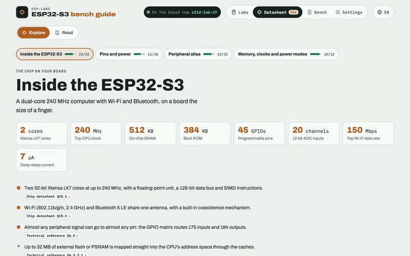
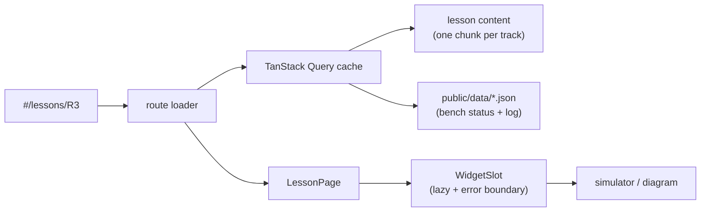

<div align="center">

# ESP32 Labs: the bench guide

**Wire it, flash it, watch it, then read the code.**<br>
An interactive guide to the ESP32-S3: 32 hands-on labs with live simulators, a 3D board, a pinout, a reader that explains the firmware line by line, and the chip's datasheet made readable.

[](https://esp-labs-web.vercel.app)

[](https://react.dev)
[](tsconfig.app.json)
[](https://vite.dev)
[](docs/I18N.md)
[](https://github.com/agharsallah/esp-labs-web/actions/workflows/ci.yml)
[](CONTRIBUTING.md)

[Live guide](https://esp-labs-web.vercel.app) ·
[Firmware (esp-labs)](https://github.com/agharsallah/esp-labs) ·
[Architecture](docs/ARCHITECTURE.md) ·
[Contributing](CONTRIBUTING.md) ·
[Report a bug](https://github.com/agharsallah/esp-labs-web/issues/new?template=bug-report.yml) ·
[Propose a lab](https://github.com/agharsallah/esp-labs-web/issues/new?template=new-lab.yml)


</div>

## Contents

- [What's inside](#whats-inside)
- [The labs](#the-labs)
- [Quick start](#quick-start)
- [How it is built](#how-it-is-built)
- [Contributing](#contributing)
- [Commands](#commands)
- [Configuration](#configuration)
- [Deploy to Vercel](#deploy-to-vercel)
- [Where things live](#where-things-live)

## What's inside

### Every lab runs in the browser first

Each lesson is one sheet: the goal, the pins it uses on a live pinout, the wiring, the command to flash it, the steps to tick off and a simulator of what you should see. Type a command into the simulated serial monitor and the board answers like the real firmware does.

<p align="center"></p>

### A code reader that never overwhelms

**Read the code** opens the real firmware the lab flashes, taken from [esp-labs](https://github.com/agharsallah/esp-labs) at build time. **Tour** walks it a few lines at a time and asks you to guess first. **Story** follows the program as it runs, from `setup()` into every call. **Explore** explains any line you tap. New C++ words come up three at a time, and the phrasebook remembers the ones you've already met.

<p align="center"></p>

### The datasheet, made for makers

The new **Datasheet** section ([`#/datasheet`](https://esp-labs-web.vercel.app/#/datasheet)) is about the ESP32-S3 itself. **Explore** keeps the 10% of Espressif's documents a maker needs: the chip at a glance with a 3D dive from the board down to the die, every pin and its jobs, an atlas of all 32 peripheral blocks with a page each, and memory, clocks and power modes. Each fact cites its section of the reference, the "things that bite" are called out, and the blocks your labs have used light up as you tick steps.

A citation opens that section of the reference in a side reader, and **Read** turns the board guide, module datasheet, chip datasheet and technical reference into one book you can read cover to cover, with section ticks and "Continue at". Titles follow your language; the text stays Espressif's English.

<p align="center"></p>

> [!NOTE]
> Espressif's reference (`docs-llm/esp32-s3/ESP32-S3_REFERENCE.md` and its `images/`) is in the repo, so a clone and the deploy get the reader and the book. Its text stays Espressif's and is never bundled into the JS: the build emits it as static files under `reference/`. Without the file (see `REFERENCE_FILE` under [Configuration](#configuration)) the curated pages work as usual and citations link to Espressif's official PDFs.

### In your language, on your phone

The guide is in English, French, Spanish, Italian, German, Polish, Turkish, Chinese (Simplified and Traditional), Japanese and Arabic (right to left). Add `?lang=fr` to any link to share it in a language. It works on a phone at 390 px, in light and dark themes, and respects reduced motion.

<table>
  <tr>
    <td width="70%"></td>
    <td width="30%"></td>
  </tr>
</table>

### Also inside

- **Meet the board**: the DevKitC-1 in 3D (three.js) with six callouts. Each one lights up its part and lists the labs that use it.
- **The bench log**: what is flashed on the board right now and every command recorded. It is plain JSON in `public/data/`, so you can update it without a rebuild.
- **Progress**: your ticks, the last lesson you opened and the variants you picked stay in your browser, with no account.
- **The parts library** at [`#/parts`](https://esp-labs-web.vercel.app/#/parts): 42 isometric drawings of every component on the bench, coloured from design tokens only.

## The labs

| Theme             | Labs                                                                                       | What you build                                          |
| ----------------- | ------------------------------------------------------------------------------------------ | ------------------------------------------------------- |
| **Intro**         | 00 Setup · 01 Hello · 02 First circuit                                                     | The toolchain, your first program, an LED you command   |
| **Display & input** | 03 Display · 03b Showcase                                                                | The 1.9″ TFT and the buttons                            |
| **Wi-Fi**         | W1 Scan & join · W2 Phone control · W3 Internet & AI · *W4, W5 planned*                    | Scanning, a web page on the board, APIs over HTTPS      |
| **RFID & NFC**    | R1 Wire & talk → R8 Card friends                                                           | The 13.56 MHz field, card memory, a door with card admin |
| **Bluetooth LE**  | B1 Listen → B8 Host                                                                        | Advertising, pairing, a phone app, a keyboard, music    |
| **Sound**         | S1 Hear → S8 Voice FX                                                                      | Loudness, clap control, a recorder, a spectrum, a speaker |
| **Sensors**       | *planned*                                                                                  | Temperature, air and motion over I2C                    |

The firmware for every lab is a standalone PlatformIO project in [esp-labs](https://github.com/agharsallah/esp-labs). Each lesson links to its folder on GitHub.

## Quick start

You need **Node 24.14+** and **pnpm 11** (`corepack enable` gives you the pinned version). The code reader shows the firmware from a sibling checkout of `esp-labs`, so clone both repos side by side:

```sh
git clone https://github.com/agharsallah/esp-labs.git
git clone https://github.com/agharsallah/esp-labs-web.git
cd esp-labs-web
pnpm install
pnpm dev              # http://localhost:5180
```

Without `../esp-labs`, everything else still works: the lessons, the simulators and the bench log. Only the code reader has nothing to show. Point `FIRMWARE_DIR` elsewhere if your checkout lives somewhere else ([Configuration](#configuration)).

## How it is built

React 19 with React Compiler, React Router 8 (data mode, hash URLs), TanStack Query 5, zod 4, i18next, three.js, CSS Modules and design tokens, built by Vite 8. Lessons are data, simulators are lazily loaded widgets, and the bench log is JSON fetched at run time.



The full picture: layers, the widget contract, the three simulator rules, the lab-screen engine and the code reader. It's all in **[docs/ARCHITECTURE.md](docs/ARCHITECTURE.md)**. How text and translations work is in **[docs/I18N.md](docs/I18N.md)**.

## Contributing

Contributions of every size are welcome. These need no React at all:

| You want to…                          | Start here                                                                                                         |
| ------------------------------------- | ------------------------------------------------------------------------------------------------------------------ |
| Report something broken               | [Bug report](https://github.com/agharsallah/esp-labs-web/issues/new?template=bug-report.yml)                       |
| Suggest a lab or a theme              | [Lab proposal](https://github.com/agharsallah/esp-labs-web/issues/new?template=new-lab.yml)                        |
| Fix or improve a translation          | [Translation issue](https://github.com/agharsallah/esp-labs-web/issues/new?template=translation.yml) or edit `src/locales/<lang>/` |
| Fix a typo or a confusing step        | Edit the lesson in `src/content/lessons/<track>.ts` and open a PR                                                  |
| Add a lab, a simulator or a language  | [CONTRIBUTING.md](CONTRIBUTING.md): step by step, with the checks to run                                          |

Issues labelled [`good first issue`](https://github.com/agharsallah/esp-labs-web/labels/good%20first%20issue) are a good place to start. Please read the [code of conduct](CODE_OF_CONDUCT.md); report security problems privately ([SECURITY.md](SECURITY.md)). How CI and the review rules work: [docs/MAINTAINING.md](docs/MAINTAINING.md).

## Commands

Run them from this folder.

```sh
pnpm install          # once
pnpm dev              # http://localhost:5180
pnpm check            # typecheck + lint + tests
pnpm i18n:extract     # regenerate the English content catalogues after editing lessons
pnpm build            # static bundle in dist/ (relative paths: serve it from any folder)
pnpm preview          # serve dist/ locally (browsers will not run module scripts from file://)
```

## Configuration

Copy `.env.example` to `.env` to override:

| Variable               | Default                                               | Meaning                                                       |
| ---------------------- | ----------------------------------------------------- | ------------------------------------------------------------- |
| `VITE_BENCH_DATA_URL`  | `./data/`                                             | Where `bench-status.json` and `bench-log.json` are read       |
| `VITE_FIRMWARE_URL`    | `./firmware/`                                         | Where the bundled lab code is read                            |
| `VITE_LABS_SOURCE_URL` | `https://github.com/agharsallah/esp-labs/tree/main/labs/` | Where each lesson's "code on GitHub" link points          |
| `VITE_LOG_LEVEL`       | `info`                                                | `debug`, `info`, `warn`, `error` or `silent`                  |
| `FIRMWARE_DIR`         | `../esp-labs`                                         | Build time only: the firmware checkout the code reader shows  |
| `REFERENCE_FILE`       | `docs-llm/esp32-s3/ESP32-S3_REFERENCE.md`             | Build time only: Espressif's reference (with its `images/`) for the datasheet reader and book; absent, they are off |
| `VITE_REFERENCE_URL`   | `./reference/`                                        | Where the reference sections are read (set to `""` when there is no reference) |

## Deploy to Vercel

<details>
<summary>Production deploys from GitHub, local prebuilt deploys, Web Analytics and Speed Insights</summary>

<br>

Configuration is in `vercel.json` (Vite preset, pnpm, cache and security headers). The app uses a hash router, so no rewrite rules are needed.

The code reader bundles the firmware from the sibling `esp-labs` checkout at build time, and that checkout is not on Vercel's build servers. So Vercel never builds: the build runs elsewhere (`vercel build`, using `../esp-labs`) and the result is uploaded with `--prebuilt`. Git-triggered builds are turned off in `vercel.json` for the same reason.

**Deploy production from GitHub.** Merging to `main` does not deploy. When you want `main` live, run the [Deploy](.github/workflows/deploy.yml) workflow (Actions → **Deploy → Run workflow**, or `gh workflow run Deploy`). It checks that CI passed on `main`'s latest commit, checks it out with the firmware, runs `vercel build --prod` and uploads it. It needs, once (see [docs/MAINTAINING.md](docs/MAINTAINING.md#production-deploys)): a `VERCEL_TOKEN` secret and the `VERCEL_ORG_ID` and `VERCEL_PROJECT_ID` variables.

Preview deploys, and production from your machine if you need it:

```sh
vercel login          # once
vercel link           # once: creates/links the project, writes .vercel/ (git-ignored)
pnpm deploy:preview   # preview deployment, prints its URL
pnpm deploy:prod      # production deployment
```

Web Analytics (`@vercel/analytics`) and Speed Insights (`@vercel/speed-insights`) are mounted by `src/app/VercelInsights.tsx` only in builds made for Vercel (`vercel build` sets `VERCEL`). Dev and a plain `pnpm build` load neither. Switch both on once per project in the dashboard (**Analytics** and **Speed Insights**, then **Enable**) and redeploy. Because the router is hash-based, `#/lessons/R3` is reported as the page `/lessons/R3`.

</details>

## Where things live

<details>
<summary>A map of the source tree</summary>

<br>

| Path                        | What                                                                                                                 |
| --------------------------- | -------------------------------------------------------------------------------------------------------------------- |
| `src/content/`              | Tracks (table of contents) and lessons, one file per track; `code/` holds the phrasebook and hand-written code tours |
| `src/domain/`               | Pure, tested logic: the lesson model, progress, the board, the C++ analyser and tour builder (`code/`)               |
| `src/labs/<track>/`         | That track's simulators and explainers, registered in `widgets.ts`                                                   |
| `src/labs/shared/`          | `Simulation` and the lab-screen engine (screen + buttons + serial)                                                   |
| `src/features/`             | App screens: labs map, lesson sheet and dock, navigation, board pinout, code reader, bench log, settings, progress   |
| `src/features/chip/`, `src/content/chip/` | The Datasheet section's pages and their curated, cited chip data                                        |
| `src/features/reference/`   | The reference reader (side sheet) and the book (`#/datasheet/read`)                                                 |
| `src/ui/`                   | Design-system pieces: Panel, Button, Terminal, SequenceDiagram, RichText…                                            |
| `src/ui/parts/`             | The parts library: isometric illustrations of every component (`<PartIcon name="led" />`), gallery at `#/parts`      |
| `src/ui/stage3d/`           | The shared 3D stage (three.js): orbit camera, toolbar, leaders, ink outlines, toon materials                         |
| `src/i18n/`, `src/locales/` | Language setup and translations, one folder per language: see [docs/I18N.md](docs/I18N.md)                           |
| `src/lib/`                  | Logger, storage, theme, palette, animation loop, http, clipboard                                                     |
| `src/styles/tokens.css`     | Every colour, font and radius; light and dark themes                                                                 |
| `tools/firmware/`           | Reads `esp-labs` (or an old `test-esp`) and ships each env's code as JSON (Vite plugin)                              |
| `tools/reference/`          | Splits the reference into typed sections and emits them as JSON (Vite plugin, only when `REFERENCE_FILE` exists)     |
| `public/data/`              | Bench status and log (validated with zod when fetched)                                                               |
| `docs-llm/`                 | Offline React, React Router and TanStack Query docs used to build this (fetched, git-ignored)                        |

</details>

### Versions

All dependencies are pinned exactly (`savePrefix: ""`): React 19.3, React Router 8.4, TanStack Query 5.104, Vite 8.3, React Compiler 1.0, zod 4.6, three 0.186, i18next 26.4. TypeScript stays on 6.0 because typescript-eslint does not support TypeScript 7 yet.

---

<sub>A learning project, not affiliated with Espressif. Pin layout follows the Espressif ESP32-S3-DevKitC-1 v1.0; the labels printed on your board always win.</sub>
