# ESP32-S3 Complete Reference

This file merges four Espressif documents into a single reference, with each fact kept once:

| Source | Covered in |
| --- | --- |
| ESP32-S3-DevKitC-1 v1.1 User Guide (`esp32-s3-devkitc-1_user_guide.md`) | Part A |
| ESP32-S3-WROOM-1 / WROOM-1U Datasheet (`esp32-s3-wroom-1_wroom-1u_datasheet_en.pdf`) | Part M |
| ESP32-S3 Series Datasheet (`esp32-s3_datasheet_en.pdf`) | Part C, and its chapter 4 "Functional Description" merged into the Part T chapters |
| ESP32-S3 Technical Reference Manual (`esp32-s3_technical_reference_manual_en.pdf`) | Part T, Appendices |

The parts go from the board to the module to the chip, then to the register-level reference. Where two sources state the same fact, it appears once and the other places link to it. Where the sources disagree, both values are kept with their sources named. Figures are in `images/`. TRM chapter numbers match the original manual, and datasheet chapters keep their numbers with a `C` (chip) or `M` (module) prefix.

## Contents

- [Part A: ESP32-S3-DevKitC-1 Board](#part-a-esp32-s3-devkitc-1-board)
  - [A1 Getting Started](#a1-getting-started)
    - [A1.1 Description of Components](#a11-description-of-components)
    - [A1.2 Start Application Development](#a12-start-application-development)
    - [A1.3 Contents and Packaging](#a13-contents-and-packaging)
  - [A2 Hardware Reference](#a2-hardware-reference)
    - [A2.1 Block Diagram](#a21-block-diagram)
    - [A2.2 Header Block](#a22-header-block)
    - [A2.3 Pin Layout](#a23-pin-layout)
  - [A3 Hardware Revision Details](#a3-hardware-revision-details)
  - [A4 Board Design Documents](#a4-board-design-documents)
- [Part M: ESP32-S3-WROOM-1 / WROOM-1U Module](#part-m-esp32-s3-wroom-1--wroom-1u-module)
  - [M1 Module Overview](#m1-module-overview)
    - [M1.1 Features](#m11-features)
    - [M1.2 Series Comparison](#m12-series-comparison)
    - [M1.3 Applications](#m13-applications)
  - [M2 Block Diagram](#m2-block-diagram)
  - [M3 Pin Definitions](#m3-pin-definitions)
    - [M3.1 Pin Layout](#m31-pin-layout)
    - [M3.2 Pin Description](#m32-pin-description)
    - [M3.3 Module-specific Pin Notes](#m33-module-specific-pin-notes)
  - [M4 Boot Configurations](#m4-boot-configurations)
    - [M4.5 Chip Power-up and Reset](#m45-chip-power-up-and-reset)
  - [M5 Peripherals](#m5-peripherals)
  - [M6 Electrical Characteristics](#m6-electrical-characteristics)
    - [M6.1 Absolute Maximum Ratings](#m61-absolute-maximum-ratings)
    - [M6.2 Recommended Operating Conditions](#m62-recommended-operating-conditions)
    - [M6.3 DC Characteristics (3.3 V, 25 °C)](#m63-dc-characteristics-33-v-25-c)
    - [M6.4 Current Consumption Characteristics](#m64-current-consumption-characteristics)
    - [M6.5 Memory Specifications](#m65-memory-specifications)
  - [M7 RF Characteristics](#m7-rf-characteristics)
    - [M7.1 Wi-Fi Radio](#m71-wi-fi-radio)
    - [M7.2 Bluetooth LE Radio](#m72-bluetooth-le-radio)
  - [M8 Module Schematics](#m8-module-schematics)
  - [M9 Peripheral Schematics](#m9-peripheral-schematics)
  - [M10 Physical Dimensions](#m10-physical-dimensions)
    - [M10.1 Module Dimensions](#m101-module-dimensions)
    - [M10.2 Dimensions of External Antenna Connector](#m102-dimensions-of-external-antenna-connector)
  - [M11 PCB Layout Recommendations](#m11-pcb-layout-recommendations)
    - [M11.1 PCB Land Pattern](#m111-pcb-land-pattern)
    - [M11.2 Module Placement for PCB Design](#m112-module-placement-for-pcb-design)
  - [M12 Product Handling](#m12-product-handling)
    - [M12.1 Storage Conditions](#m121-storage-conditions)
    - [M12.2 Electrostatic Discharge (ESD)](#m122-electrostatic-discharge-esd)
    - [M12.3 Reflow Profile](#m123-reflow-profile)
    - [M12.4 Ultrasonic Vibration](#m124-ultrasonic-vibration)
- [Part C: ESP32-S3 Chip Datasheet](#part-c-esp32-s3-chip-datasheet)
  - [C0 Product Overview](#c0-product-overview)
    - [C0.1 Features](#c01-features)
    - [C0.2 Applications](#c02-applications)
  - [C1 ESP32-S3 Series Comparison](#c1-esp32-s3-series-comparison)
    - [C1.1 Nomenclature](#c11-nomenclature)
    - [C1.2 Comparison](#c12-comparison)
    - [C1.3 Chip Revision](#c13-chip-revision)
  - [C2 Pins](#c2-pins)
    - [C2.1 Pin Layout](#c21-pin-layout)
    - [C2.2 Pin Overview](#c22-pin-overview)
    - [C2.3 IO Pins](#c23-io-pins)
    - [C2.4 Analog Pins](#c24-analog-pins)
    - [C2.5 Power Supply](#c25-power-supply)
    - [C2.6 Pin Mapping Between Chip and Flash/PSRAM](#c26-pin-mapping-between-chip-and-flashpsram)
  - [C3 Boot Configurations](#c3-boot-configurations)
    - [C3.1 Chip Boot Mode Control](#c31-chip-boot-mode-control)
    - [C3.2 VDD_SPI Voltage Control](#c32-vdd_spi-voltage-control)
    - [C3.3 ROM Messages Printing Control](#c33-rom-messages-printing-control)
    - [C3.4 JTAG Signal Source Control](#c34-jtag-signal-source-control)
  - [C4 Functional Description](#c4-functional-description)
    - [C4.1 System and C4.2 Peripherals: where each block is described](#c41-system-and-c42-peripherals-where-each-block-is-described)
    - [C4.3 Wireless Communication](#c43-wireless-communication)
  - [C5 Electrical Characteristics](#c5-electrical-characteristics)
    - [C5.1 Absolute Maximum Ratings](#c51-absolute-maximum-ratings)
    - [C5.2 Recommended Operating Conditions](#c52-recommended-operating-conditions)
    - [C5.3 VDD_SPI Output Characteristics](#c53-vdd_spi-output-characteristics)
    - [C5.4 DC Characteristics (3.3 V, 25 °C)](#c54-dc-characteristics-33-v-25-c)
    - [C5.5 ADC Characteristics](#c55-adc-characteristics)
    - [C5.6 Current Consumption](#c56-current-consumption)
    - [C5.7 Memory Specifications](#c57-memory-specifications)
    - [C5.8 Reliability](#c58-reliability)
  - [C6 RF Characteristics](#c6-rf-characteristics)
    - [C6.1 Wi-Fi Radio](#c61-wi-fi-radio)
    - [C6.2 Bluetooth LE Radio](#c62-bluetooth-le-radio)
  - [C7 Packaging](#c7-packaging)
  - [C8 Consolidated Pin Overview](#c8-consolidated-pin-overview)
- [Part T: Technical Reference Manual](#part-t-technical-reference-manual)
- [Part T-I: Microprocessor and Master](#part-t-i-microprocessor-and-master)
  - [1 Processor Instruction Extensions (PIE)](#1-processor-instruction-extensions-pie)
    - [1.0 Overview (from the chip datasheet)](#10-overview-from-the-chip-datasheet)
    - [1.1 Overview](#11-overview)
    - [1.2 Features](#12-features)
    - [1.3 Structure Overview](#13-structure-overview)
    - [1.4 Syntax Description](#14-syntax-description)
    - [1.5 Components of Extended Instruction Set](#15-components-of-extended-instruction-set)
    - [1.6 Extended Instruction List](#16-extended-instruction-list)
    - [1.7 Instruction Performance](#17-instruction-performance)
    - [1.8 Extended Instruction Functional Description](#18-extended-instruction-functional-description)
  - [2 ULP Coprocessor (ULP-FSM, ULP-RISC-V)](#2-ulp-coprocessor-ulp-fsm-ulp-risc-v)
    - [2.0 Overview (from the chip datasheet)](#20-overview-from-the-chip-datasheet)
    - [2.1 Overview](#21-overview)
    - [2.2 Features](#22-features)
    - [2.3 Programming Workflow](#23-programming-workflow)
    - [2.4 ULP Coprocessor Sleep and Wake-Up Workflow](#24-ulp-coprocessor-sleep-and-wake-up-workflow)
    - [2.5 ULP-FSM](#25-ulp-fsm)
    - [2.6 ULP-RISC-V](#26-ulp-risc-v)
    - [2.7 RTC I2C Controller](#27-rtc-i2c-controller)
    - [2.8 Address Mapping](#28-address-mapping)
    - [2.9 Register Summary](#29-register-summary)
    - [2.10 Registers](#210-registers)
  - [3 GDMA Controller (GDMA)](#3-gdma-controller-gdma)
    - [3.0 Overview (from the chip datasheet)](#30-overview-from-the-chip-datasheet)
    - [3.1 Overview](#31-overview)
    - [3.2 Features](#32-features)
    - [3.3 Architecture](#33-architecture)
    - [3.4 Functional Description](#34-functional-description)
    - [3.5 GDMA Interrupts](#35-gdma-interrupts)
    - [3.6 Programming Procedures](#36-programming-procedures)
    - [3.7 Register Summary](#37-register-summary)
    - [3.8 Registers](#38-registers)
- [Part T-II: Memory Organization](#part-t-ii-memory-organization)
  - [4 System and Memory](#4-system-and-memory)
    - [4.0 Overview (from the chip datasheet)](#40-overview-from-the-chip-datasheet)
    - [4.1 Overview](#41-overview)
    - [4.2 Features](#42-features)
    - [4.3 Functional Description](#43-functional-description)
  - [5 eFuse Controller (EFUSE)](#5-efuse-controller-efuse)
    - [5.1 Overview](#51-overview)
    - [5.2 Features](#52-features)
    - [5.3 Functional Description](#53-functional-description)
    - [5.4 Register Summary](#54-register-summary)
    - [5.5 Registers](#55-registers)
- [Part T-III: System Component](#part-t-iii-system-component)
  - [6 IO MUX and GPIO Matrix (GPIO, IO MUX)](#6-io-mux-and-gpio-matrix-gpio-io-mux)
    - [6.1 Overview](#61-overview)
    - [6.2 Features](#62-features)
    - [6.3 Architectural Overview](#63-architectural-overview)
    - [6.4 Peripheral Input via GPIO Matrix](#64-peripheral-input-via-gpio-matrix)
    - [6.5 Peripheral Output via GPIO Matrix](#65-peripheral-output-via-gpio-matrix)
    - [6.6 Direct Input and Output via IO MUX](#66-direct-input-and-output-via-io-mux)
    - [6.7 RTC IO MUX for Low Power and Analog Input/Output](#67-rtc-io-mux-for-low-power-and-analog-inputoutput)
    - [6.8 Pin Functions in Light-sleep](#68-pin-functions-in-light-sleep)
    - [6.9 Pin Hold Feature](#69-pin-hold-feature)
    - [6.10 Power Supply and Management of GPIO Pins](#610-power-supply-and-management-of-gpio-pins)
    - [6.11 Peripheral Signals via GPIO Matrix](#611-peripheral-signals-via-gpio-matrix)
    - [6.12 IO MUX Function List](#612-io-mux-function-list)
    - [6.13 RTC IO MUX Pin List](#613-rtc-io-mux-pin-list)
    - [6.14 Register Summary](#614-register-summary)
    - [6.15 Registers](#615-registers)
  - [7 Reset and Clock](#7-reset-and-clock)
    - [7.0 Overview (from the chip datasheet)](#70-overview-from-the-chip-datasheet)
    - [7.1 Reset](#71-reset)
    - [7.2 Clock](#72-clock)
  - [8 Chip Boot Control](#8-chip-boot-control)
    - [8.1 Overview](#81-overview)
    - [8.2 Boot Mode Control](#82-boot-mode-control)
    - [8.3 ROM Messages Printing Control](#83-rom-messages-printing-control)
    - [8.4 VDD_SPI Voltage Control](#84-vdd_spi-voltage-control)
    - [8.5 JTAG Signal Source Control](#85-jtag-signal-source-control)
  - [9 Interrupt Matrix (INTERRUPT)](#9-interrupt-matrix-interrupt)
    - [9.1 Overview](#91-overview)
    - [9.2 Features](#92-features)
    - [9.3 Functional Description](#93-functional-description)
    - [9.4 Register Summary](#94-register-summary)
    - [9.5 Registers](#95-registers)
  - [10 Low-power Management (RTC_CNTL)](#10-low-power-management-rtc_cntl)
    - [10.0 Overview (from the chip datasheet)](#100-overview-from-the-chip-datasheet)
    - [10.1 Introduction](#101-introduction)
    - [10.2 Features](#102-features)
    - [10.3 Functional Description](#103-functional-description)
    - [10.4 Power Modes Management](#104-power-modes-management)
    - [10.5 Retention DMA](#105-retention-dma)
    - [10.6 RTC Boot](#106-rtc-boot)
    - [10.7 Register Summary](#107-register-summary)
    - [10.8 Registers](#108-registers)
  - [11 System Timer (SYSTIMER)](#11-system-timer-systimer)
    - [11.0 Overview (from the chip datasheet)](#110-overview-from-the-chip-datasheet)
    - [11.1 Overview](#111-overview)
    - [11.2 Features](#112-features)
    - [11.3 Clock Source Selection](#113-clock-source-selection)
    - [11.4 Functional Description](#114-functional-description)
    - [11.5 Programming Procedure](#115-programming-procedure)
    - [11.6 Register Summary](#116-register-summary)
    - [11.7 Registers](#117-registers)
  - [12 Timer Group (TIMG)](#12-timer-group-timg)
    - [12.0 Overview (from the chip datasheet)](#120-overview-from-the-chip-datasheet)
    - [12.1 Overview](#121-overview)
    - [12.2 Functional Description](#122-functional-description)
    - [12.3 Configuration and Usage](#123-configuration-and-usage)
    - [12.4 Register Summary](#124-register-summary)
    - [12.5 Registers](#125-registers)
  - [13 Watchdog Timers (WDT)](#13-watchdog-timers-wdt)
    - [13.0 Overview (from the chip datasheet)](#130-overview-from-the-chip-datasheet)
    - [13.1 Overview](#131-overview)
    - [13.2 Digital Watchdog Timers](#132-digital-watchdog-timers)
    - [13.3 Super Watchdog](#133-super-watchdog)
    - [13.4 Interrupts](#134-interrupts)
    - [13.5 Registers](#135-registers)
  - [14 XTAL32K Watchdog Timers (XTWDT)](#14-xtal32k-watchdog-timers-xtwdt)
    - [14.0 Overview (from the chip datasheet)](#140-overview-from-the-chip-datasheet)
    - [14.1 Overview](#141-overview)
    - [14.2 Features](#142-features)
    - [14.3 Functional Description](#143-functional-description)
  - [15 Permission Control (PMS)](#15-permission-control-pms)
    - [15.0 Overview (from the chip datasheet)](#150-overview-from-the-chip-datasheet)
    - [15.1 Overview](#151-overview)
    - [15.2 Features](#152-features)
    - [15.3 Internal Memory](#153-internal-memory)
    - [15.4 Peripherals](#154-peripherals)
    - [15.5 External Memory](#155-external-memory)
    - [15.6 Unauthorized Access and Interrupts](#156-unauthorized-access-and-interrupts)
    - [15.7 Protection of CPU VECBASE Registers](#157-protection-of-cpu-vecbase-registers)
    - [15.8 Register Locks](#158-register-locks)
    - [15.9 Register Summary](#159-register-summary)
    - [15.10 Registers](#1510-registers)
  - [16 World Controller (WCL)](#16-world-controller-wcl)
    - [16.0 Overview (from the chip datasheet)](#160-overview-from-the-chip-datasheet)
    - [16.1 Introduction](#161-introduction)
    - [16.2 Features](#162-features)
    - [16.3 Functional Description](#163-functional-description)
    - [16.4 CPU's World Switch](#164-cpus-world-switch)
    - [16.5 World Switch Log](#165-world-switch-log)
    - [16.6 NMI Interrupt Masking](#166-nmi-interrupt-masking)
    - [16.7 Register Summary](#167-register-summary)
    - [16.8 Registers](#168-registers)
  - [17 System Registers (SYSTEM)](#17-system-registers-system)
    - [17.0 Overview (from the chip datasheet)](#170-overview-from-the-chip-datasheet)
    - [17.1 Overview](#171-overview)
    - [17.2 Features](#172-features)
    - [17.3 Function Description](#173-function-description)
    - [17.4 Register Summary](#174-register-summary)
    - [17.5 Registers](#175-registers)
- [Part T-IV: Cryptography/Security Component](#part-t-iv-cryptographysecurity-component)
  - [18 SHA Accelerator (SHA)](#18-sha-accelerator-sha)
    - [18.1 Introduction](#181-introduction)
    - [18.2 Features](#182-features)
    - [18.3 Working Modes](#183-working-modes)
    - [18.4 Function Description](#184-function-description)
    - [18.5 Register Summary](#185-register-summary)
    - [18.6 Registers](#186-registers)
  - [19 AES Accelerator (AES)](#19-aes-accelerator-aes)
    - [19.1 Introduction](#191-introduction)
    - [19.2 Features](#192-features)
    - [19.3 AES Working Modes](#193-aes-working-modes)
    - [19.4 Typical AES Working Mode](#194-typical-aes-working-mode)
    - [19.5 DMA-AES Working Mode](#195-dma-aes-working-mode)
    - [19.6 Memory Summary](#196-memory-summary)
    - [19.7 Register Summary](#197-register-summary)
    - [19.8 Registers](#198-registers)
  - [20 RSA Accelerator (RSA)](#20-rsa-accelerator-rsa)
    - [20.0 Overview (from the chip datasheet)](#200-overview-from-the-chip-datasheet)
    - [20.1 Introduction](#201-introduction)
    - [20.2 Features](#202-features)
    - [20.3 Functional Description](#203-functional-description)
    - [20.4 Memory Summary](#204-memory-summary)
    - [20.5 Register Summary](#205-register-summary)
    - [20.6 Registers](#206-registers)
  - [21 HMAC Accelerator (HMAC)](#21-hmac-accelerator-hmac)
    - [21.1 Main Features](#211-main-features)
    - [21.2 Functional Description](#212-functional-description)
    - [21.3 HMAC Algorithm Details](#213-hmac-algorithm-details)
    - [21.4 Register Summary](#214-register-summary)
    - [21.5 Registers](#215-registers)
  - [22 Digital Signature (DS)](#22-digital-signature-ds)
    - [22.1 Overview](#221-overview)
    - [22.2 Features](#222-features)
    - [22.3 Functional Description](#223-functional-description)
    - [22.4 Memory Summary](#224-memory-summary)
    - [22.5 Register Summary](#225-register-summary)
    - [22.6 Registers](#226-registers)
  - [23 External Memory Encryption and Decryption (XTS_AES)](#23-external-memory-encryption-and-decryption-xts_aes)
    - [23.1 Overview](#231-overview)
    - [23.2 Features](#232-features)
    - [23.3 Module Structure](#233-module-structure)
    - [23.4 Functional Description](#234-functional-description)
    - [23.5 Software Process](#235-software-process)
    - [23.6 Register Summary](#236-register-summary)
    - [23.7 Registers](#237-registers)
  - [24 Clock Glitch Detection](#24-clock-glitch-detection)
    - [24.1 Overview](#241-overview)
    - [24.2 Functional Description](#242-functional-description)
  - [25 Random Number Generator (RNG)](#25-random-number-generator-rng)
    - [25.1 Introduction](#251-introduction)
    - [25.2 Features](#252-features)
    - [25.3 Functional Description](#253-functional-description)
    - [25.4 Programming Procedure](#254-programming-procedure)
    - [25.5 Register Summary](#255-register-summary)
    - [25.6 Register](#256-register)
  - [25A Secure Boot (from the chip datasheet)](#25a-secure-boot-from-the-chip-datasheet)
- [Part T-V: Connectivity Interface](#part-t-v-connectivity-interface)
  - [26 UART Controller (UART)](#26-uart-controller-uart)
    - [26.0 Overview (from the chip datasheet)](#260-overview-from-the-chip-datasheet)
    - [26.1 Overview](#261-overview)
    - [26.2 Features](#262-features)
    - [26.3 UART Structure](#263-uart-structure)
    - [26.4 Functional Description](#264-functional-description)
    - [26.5 Programming Procedures](#265-programming-procedures)
    - [26.6 Register Summary](#266-register-summary)
    - [26.7 Registers](#267-registers)
  - [27 I2C Controller (I2C)](#27-i2c-controller-i2c)
    - [27.0 Overview (from the chip datasheet)](#270-overview-from-the-chip-datasheet)
    - [27.1 Overview](#271-overview)
    - [27.2 Features](#272-features)
    - [27.3 I2C Architecture](#273-i2c-architecture)
    - [27.4 Functional Description](#274-functional-description)
    - [27.5 Programming Example](#275-programming-example)
    - [27.6 Interrupts](#276-interrupts)
    - [27.7 Register Summary](#277-register-summary)
    - [27.8 Registers](#278-registers)
  - [28 I2S Controller (I2S)](#28-i2s-controller-i2s)
    - [28.0 Overview (from the chip datasheet)](#280-overview-from-the-chip-datasheet)
    - [28.1 Overview](#281-overview)
    - [28.2 Terminology](#282-terminology)
    - [28.3 Features](#283-features)
    - [28.4 System Architecture](#284-system-architecture)
    - [28.5 Supported Audio Standards](#285-supported-audio-standards)
    - [28.6 TX/RX Clock](#286-txrx-clock)
    - [28.7 I2S*n* Reset](#287-i2sn-reset)
    - [28.8 I2S*n* Master/Slave Mode](#288-i2sn-masterslave-mode)
    - [28.9 Transmitting Data](#289-transmitting-data)
    - [28.10 Receiving Data](#2810-receiving-data)
    - [28.11 Software Configuration Process](#2811-software-configuration-process)
    - [28.12 I2S*n* Interrupts](#2812-i2sn-interrupts)
    - [28.13 Register Summary](#2813-register-summary)
    - [28.14 Registers](#2814-registers)
  - [29 LCD and Camera Controller (LCD_CAM)](#29-lcd-and-camera-controller-lcd_cam)
    - [29.0 Overview (from the chip datasheet)](#290-overview-from-the-chip-datasheet)
    - [29.1 Overview](#291-overview)
    - [29.2 Features](#292-features)
    - [29.3 Functional Description](#293-functional-description)
    - [29.4 Software Configuration Process](#294-software-configuration-process)
    - [29.5 LCD_CAM Interrupts](#295-lcd_cam-interrupts)
    - [29.6 Register Summary](#296-register-summary)
    - [29.7 Registers](#297-registers)
  - [30 SPI Controller (SPI)](#30-spi-controller-spi)
    - [30.0 Overview (from the chip datasheet)](#300-overview-from-the-chip-datasheet)
    - [30.1 Overview](#301-overview)
    - [30.2 Glossary](#302-glossary)
    - [30.3 Features](#303-features)
    - [30.4 Architectural Overview](#304-architectural-overview)
    - [30.5 Functional Description](#305-functional-description)
    - [30.6 CS Setup Time and Hold Time Control](#306-cs-setup-time-and-hold-time-control)
    - [30.7 GP-SPI Clock Control](#307-gp-spi-clock-control)
    - [30.8 GP-SPI Timing Compensation](#308-gp-spi-timing-compensation)
    - [30.9 Differences Between GP-SPI2 and GP-SPI3](#309-differences-between-gp-spi2-and-gp-spi3)
    - [30.10 Interrupts](#3010-interrupts)
    - [30.11 Register Summary](#3011-register-summary)
    - [30.12 Registers](#3012-registers)
  - [31 Two-wire Automotive Interface (TWAI)](#31-two-wire-automotive-interface-twai)
    - [31.1 Overview](#311-overview)
    - [31.2 Features](#312-features)
    - [31.3 Functional Protocol](#313-functional-protocol)
    - [31.4 Architectural Overview](#314-architectural-overview)
    - [31.5 Functional Description](#315-functional-description)
    - [31.6 Register Summary](#316-register-summary)
    - [31.7 Registers](#317-registers)
  - [32 USB On-The-Go (USB)](#32-usb-on-the-go-usb)
    - [32.1 Overview](#321-overview)
    - [32.2 Features](#322-features)
    - [32.3 Functional Description](#323-functional-description)
    - [32.4 OTG](#324-otg)
    - [32.5 Registers](#325-registers)
  - [33 USB Serial/JTAG Controller (USB_SERIAL_JTAG)](#33-usb-serialjtag-controller-usb_serial_jtag)
    - [33.1 Overview](#331-overview)
    - [33.2 Features](#332-features)
    - [33.3 Functional Description](#333-functional-description)
    - [33.4 Recommended Operation](#334-recommended-operation)
    - [33.5 Register Summary](#335-register-summary)
    - [33.6 Registers](#336-registers)
  - [34 SD/MMC Host Controller (SDHOST)](#34-sdmmc-host-controller-sdhost)
    - [34.0 Overview (from the chip datasheet)](#340-overview-from-the-chip-datasheet)
    - [34.1 Overview](#341-overview)
    - [34.2 Features](#342-features)
    - [34.3 SD/MMC External Interface Signals](#343-sdmmc-external-interface-signals)
    - [34.4 Functional Description](#344-functional-description)
    - [34.5 Software Restrictions for Proper CIU Operation](#345-software-restrictions-for-proper-ciu-operation)
    - [34.6 RAM for Receiving and Sending Data](#346-ram-for-receiving-and-sending-data)
    - [34.7 DMA Descriptor Chain](#347-dma-descriptor-chain)
    - [34.8 The Structure of DMA Descriptor Chain](#348-the-structure-of-dma-descriptor-chain)
    - [34.9 Initialization](#349-initialization)
    - [34.10 Clock Phase Selection](#3410-clock-phase-selection)
    - [34.11 Interrupt](#3411-interrupt)
    - [34.12 Register Summary](#3412-register-summary)
    - [34.13 Registers](#3413-registers)
  - [35 LED PWM Controller (LEDC)](#35-led-pwm-controller-ledc)
    - [35.0 Overview (from the chip datasheet)](#350-overview-from-the-chip-datasheet)
    - [35.1 Overview](#351-overview)
    - [35.2 Features](#352-features)
    - [35.3 Functional Description](#353-functional-description)
    - [35.4 Register Summary](#354-register-summary)
    - [35.5 Registers](#355-registers)
  - [36 Motor Control PWM (MCPWM)](#36-motor-control-pwm-mcpwm)
    - [36.1 Overview](#361-overview)
    - [36.2 Features](#362-features)
    - [36.3 Submodules](#363-submodules)
    - [36.4 Register Summary](#364-register-summary)
    - [36.5 Registers](#365-registers)
  - [37 Remote Control Peripheral (RMT)](#37-remote-control-peripheral-rmt)
    - [37.1 Overview](#371-overview)
    - [37.2 Features](#372-features)
    - [37.3 Functional Description](#373-functional-description)
    - [37.4 Interrupts](#374-interrupts)
    - [37.5 Register Summary](#375-register-summary)
    - [37.6 Registers](#376-registers)
  - [38 Pulse Count Controller (PCNT)](#38-pulse-count-controller-pcnt)
    - [38.0 Overview](#380-overview)
    - [38.1 Features](#381-features)
    - [38.2 Functional Description](#382-functional-description)
    - [38.3 Applications](#383-applications)
    - [38.4 Register Summary](#384-register-summary)
    - [38.5 Registers](#385-registers)
- [Part T-VI: Analog Signal Processing](#part-t-vi-analog-signal-processing)
  - [39 On-Chip Sensors and Analog Signal Processing](#39-on-chip-sensors-and-analog-signal-processing)
    - [39.0 Overview (from the chip datasheet)](#390-overview-from-the-chip-datasheet)
    - [39.1 Overview](#391-overview)
    - [39.2 Capacitive Touch Sensors](#392-capacitive-touch-sensors)
    - [39.3 SAR ADCs](#393-sar-adcs)
    - [39.4 Temperature Sensor](#394-temperature-sensor)
    - [39.5 Interrupts](#395-interrupts)
    - [39.6 Register Summary](#396-register-summary)
    - [39.7 Registers](#397-registers)
- [Appendices](#appendices)
  - [X1 Glossary](#x1-glossary)
  - [X2 Programming Reserved Register Field](#x2-programming-reserved-register-field)
    - [Introduction](#introduction)
    - [Programming Reserved Register Field](#programming-reserved-register-field)
  - [X3 Interrupt Configuration Registers](#x3-interrupt-configuration-registers)
  - [X4 Source Documents](#x4-source-documents)
    - [X4.1 ESP32-S3 Series Datasheet](#x41-esp32-s3-series-datasheet)
    - [X4.2 ESP32-S3-WROOM-1 & ESP32-S3-WROOM-1U Datasheet](#x42-esp32-s3-wroom-1--esp32-s3-wroom-1u-datasheet)
    - [X4.3 ESP32-S3 Technical Reference Manual](#x43-esp32-s3-technical-reference-manual)
    - [X4.4 ESP32-S3-DevKitC-1 User Guide](#x44-esp32-s3-devkitc-1-user-guide)
    - [X4.5 Related Documentation and Resources](#x45-related-documentation-and-resources)
  - [X5 Disclaimer and Copyright Notice](#x5-disclaimer-and-copyright-notice)

# Part A: ESP32-S3-DevKitC-1 Board

## A1 Getting Started

The ESP32-S3-DevKitC-1 is an entry-level development board equipped with ESP32-S3-WROOM-1, ESP32-S3-WROOM-1U, or ESP32-S3-WROOM-2, a general-purpose Wi-Fi + Bluetooth® Low Energy MCU module that integrates complete Wi-Fi and Bluetooth Low Energy functions.

Most of the I/O pins on the module are broken out to the pin headers on both sides of this board for easy interfacing. Developers can either connect peripherals with jumper wires or mount ESP32-S3-DevKitC-1 on a breadboard.

This section (version v1.1 of the board) provides a brief introduction of ESP32-S3-DevKitC-1, instructions on how to do the initial hardware setup and how to flash firmware onto it. Source: [ESP32-S3-DevKitC-1 v1.1 user guide](https://docs.espressif.com/projects/esp-dev-kits/en/latest/esp32s3/esp32-s3-devkitc-1/user_guide_v1.1.html). The older version: [ESP32-S3-DevKitC-1 v1.0](https://docs.espressif.com/projects/esp-dev-kits/en/latest/esp32s3/esp32-s3-devkitc-1/user_guide_v1.0.html).

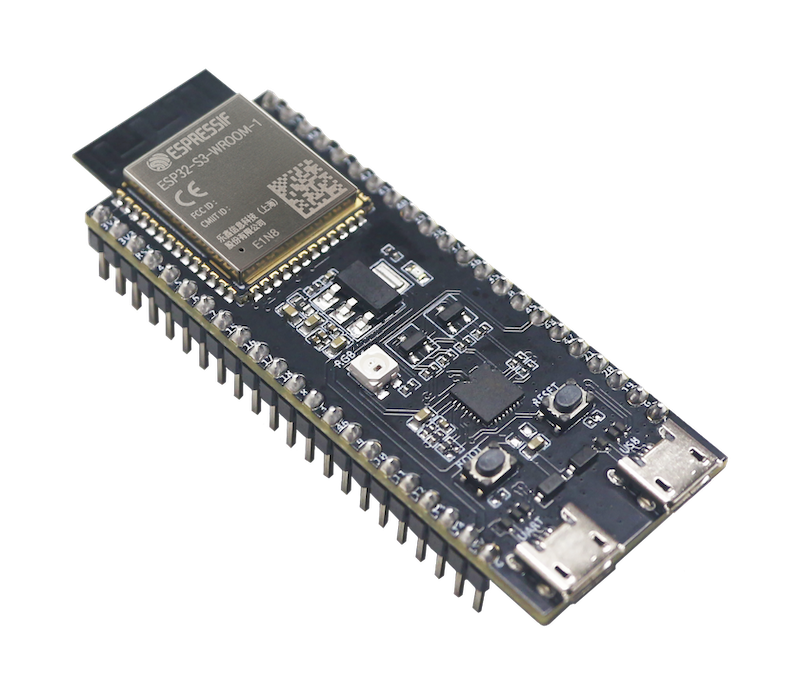

### A1.1 Description of Components

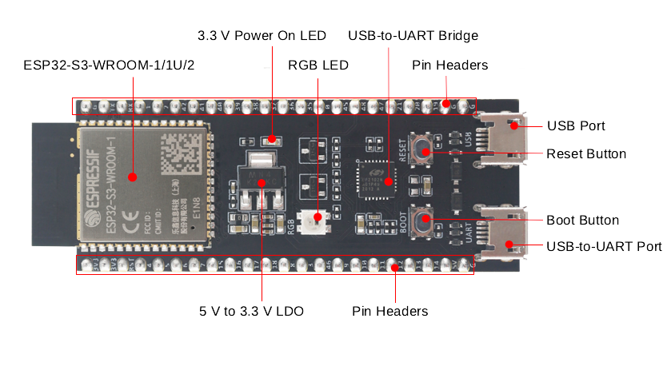

The key components of the board are described in a counter-clockwise direction.

| Key Component | Description |
| --- | --- |
| ESP32-S3-WROOM-1/1U/2 | ESP32-S3-WROOM-1, ESP32-S3-WROOM-1U, and ESP32-S3-WROOM-2 are powerful, generic Wi-Fi + Bluetooth Low Energy MCU modules that have a rich set of peripherals. They provide acceleration for neural network computing and signal processing workloads. ESP32-S3-WROOM-1 and ESP32-S3-WROOM-2 comes with a PCB antenna. ESP32-S3-WROOM-1U comes with an external antenna connector. |
| 5 V to 3.3 V LDO | Power regulator that converts a 5 V supply into a 3.3 V output. |
| Pin Headers | All available GPIO pins (except for the SPI bus for flash) are broken out to the pin headers on the board for easy interfacing and programming. For details, please see [A2.2 Header Block](#a22-header-block). |
| USB-to-UART Port | A Micro-USB port used for power supply to the board, for flashing applications to the chip, as well as for communication with the chip via the on-board USB-to-UART bridge. |
| Boot Button | Download button. Holding down **Boot** and then pressing **Reset** initiates Firmware Download mode for downloading firmware through the serial port. |
| Reset Button | Press this button to restart the system. |
| USB Port | ESP32-S3 full-speed USB OTG interface, compliant with the USB 1.1 specification. The interface is used for power supply to the board, for flashing applications to the chip, for communication with the chip using USB 1.1 protocols, as well as for JTAG debugging. |
| USB-to-UART Bridge | Single USB-to-UART bridge chip provides transfer rates up to 3 Mbps. |
| RGB LED | Addressable RGB LED, driven by GPIO38. |
| 3.3 V Power On LED | Turns on when the USB power is connected to the board. |

> **Note:** For boards with Octal SPI flash/PSRAM memory embedded ESP32-S3-WROOM-1/1U modules, and boards with ESP32-S3-WROOM-2 modules, the pins GPIO35, GPIO36 and GPIO37 are used for the internal communication between ESP32-S3 and SPI flash/PSRAM memory, thus not available for external use.

### A1.2 Start Application Development

Before powering up your board, please make sure that it is in good condition with no obvious signs of damage.

#### A1.2.1 Required Hardware

* ESP32-S3-DevKitC-1
* USB 2.0 cable (Standard-A to Micro-B)
* Computer running Windows, Linux, or macOS

> **Note:** Be sure to use an appropriate USB cable. Some cables are for charging only and do not provide the needed data lines nor work for programming the boards.

#### A1.2.2 Hardware Setup

Connect the board with the computer using **USB-to-UART Port** or **ESP32-S3 USB Port**. In subsequent steps, **USB-to-UART Port** will be used by default.

#### A1.2.3 Software Setup

Please proceed to [Get Started](https://docs.espressif.com/projects/esp-idf/en/latest/esp32s3/get-started/index.html), where Section [Installation](https://docs.espressif.com/projects/esp-idf/en/latest/esp32s3/get-started/index.html#get-started-step-by-step) will quickly help you set up the development environment and then flash an application example onto your board.

### A1.3 Contents and Packaging

#### A1.3.1 Ordering Information

The development board has a variety of variants to choose from, as shown in the table below.

| Part Number | On-board Module | Flash | PSRAM | Antenna |
| --- | --- | --- | --- | --- |
| ESP32-S3-DevKitC-1-N32R16V | ESP32-S3-WROOM-2-N32R16V | 32 MB | 16 MB | PCB on-board antenna |
| ESP32-S3-DevKitC-1-N8R8 | ESP32-S3-WROOM-1-N8R8 | 8 MB | 8 MB | PCB on-board antenna |
| ESP32-S3-DevKitC-1U-N8R8 | ESP32-S3-WROOM-1U-N8R8 | 8 MB | 8 MB | External antenna connector |
| ESP32-S3-DevKitC-1-N8 (EOL) | ESP32-S3-WROOM-1-N8 | 8 MB | — | PCB on-board antenna |
| ESP32-S3-DevKitC-1-N8R2 (EOL) | ESP32-S3-WROOM-1-N8R2 | 8 MB | 2 MB | PCB on-board antenna |
| ESP32-S3-DevKitC-1U-N8 (EOL) | ESP32-S3-WROOM-1U-N8 | 8 MB | — | External antenna connector |
| ESP32-S3-DevKitC-1U-N8R2 (EOL) | ESP32-S3-WROOM-1U-N8R2 | 8 MB | 2 MB | External antenna connector |

For more information about available variants, visit the [ESP Product Selector](https://products.espressif.com/#/product-selector?names=) and select the **Development Board** tab. If you cannot find the variant you need in the table or Product Selector, or if you have special customization requirements, contact [Espressif Sales](https://www.espressif.com/en/contact-us/sales-questions).

#### A1.3.2 Retail Orders

If you order a few samples, each board comes in an individual package in either antistatic bag or any packaging depending on your retailer.

For retail orders, please go to [https://www.espressif.com/en/contact-us/get-samples](https://www.espressif.com/en/contact-us/get-samples).

#### A1.3.3 Wholesale Orders

If you order in bulk, the boards come in large cardboard boxes.

For wholesale orders, please go to [https://www.espressif.com/en/contact-us/sales-questions](https://www.espressif.com/en/contact-us/sales-questions).

## A2 Hardware Reference

### A2.1 Block Diagram

The block diagram below shows the components of ESP32-S3-DevKitC-1 and their interconnections.

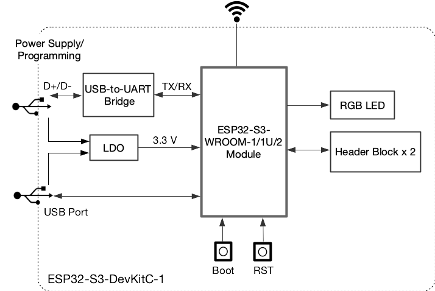

#### A2.1.1 Power Supply Options

There are three mutually exclusive ways to provide power to the board:

* USB-to-UART Port and ESP32-S3 USB Port (either one or both), default power supply (recommended)
* 5V and G (GND) pins
* 3V3 and G (GND) pins

### A2.2 Header Block

The two tables below provide the **Name** and **Function** of the pins on both sides of the board (J1 and J3). The pin names are shown in [Figure A-2](#a11-description-of-components). The numbering is the same as in the [Board Schematic](https://dl.espressif.com/dl/schematics/SCH_ESP32-S3-DevKitC-1_V1.1_20220413.pdf) (PDF).

#### A2.2.1 J1

| No. | Name | Type [1] | Function |
| --- | --- | --- | --- |
| 1 | 3V3 | P | 3.3 V power supply |
| 2 | 3V3 | P | 3.3 V power supply |
| 3 | RST | I | EN |
| 4 | 4 | I/O/T | RTC_GPIO4, GPIO4, TOUCH4, ADC1_CH3 |
| 5 | 5 | I/O/T | RTC_GPIO5, GPIO5, TOUCH5, ADC1_CH4 |
| 6 | 6 | I/O/T | RTC_GPIO6, GPIO6, TOUCH6, ADC1_CH5 |
| 7 | 7 | I/O/T | RTC_GPIO7, GPIO7, TOUCH7, ADC1_CH6 |
| 8 | 15 | I/O/T | RTC_GPIO15, GPIO15, U0RTS, ADC2_CH4, XTAL_32K_P |
| 9 | 16 | I/O/T | RTC_GPIO16, GPIO16, U0CTS, ADC2_CH5, XTAL_32K_N |
| 10 | 17 | I/O/T | RTC_GPIO17, GPIO17, U1TXD, ADC2_CH6 |
| 11 | 18 | I/O/T | RTC_GPIO18, GPIO18, U1RXD, ADC2_CH7, CLK_OUT3 |
| 12 | 8 | I/O/T | RTC_GPIO8, GPIO8, TOUCH8, ADC1_CH7, SUBSPICS1 |
| 13 | 3 | I/O/T | RTC_GPIO3, GPIO3, TOUCH3, ADC1_CH2 |
| 14 | 46 | I/O/T | GPIO46 |
| 15 | 9 | I/O/T | RTC_GPIO9, GPIO9, TOUCH9, ADC1_CH8, FSPIHD, SUBSPIHD |
| 16 | 10 | I/O/T | RTC_GPIO10, GPIO10, TOUCH10, ADC1_CH9, FSPICS0, FSPIIO4, SUBSPICS0 |
| 17 | 11 | I/O/T | RTC_GPIO11, GPIO11, TOUCH11, ADC2_CH0, FSPID, FSPIIO5, SUBSPID |
| 18 | 12 | I/O/T | RTC_GPIO12, GPIO12, TOUCH12, ADC2_CH1, FSPICLK, FSPIIO6, SUBSPICLK |
| 19 | 13 | I/O/T | RTC_GPIO13, GPIO13, TOUCH13, ADC2_CH2, FSPIQ, FSPIIO7, SUBSPIQ |
| 20 | 14 | I/O/T | RTC_GPIO14, GPIO14, TOUCH14, ADC2_CH3, FSPIWP, FSPIDQS, SUBSPIWP |
| 21 | 5V | P | 5 V power supply |
| 22 | G | G | Ground |

#### A2.2.2 J3

| No. | Name | Type [1] | Function |
| --- | --- | --- | --- |
| 1 | G | G | Ground |
| 2 | TX | I/O/T | U0TXD, GPIO43, CLK_OUT1 |
| 3 | RX | I/O/T | U0RXD, GPIO44, CLK_OUT2 |
| 4 | 1 | I/O/T | RTC_GPIO1, GPIO1, TOUCH1, ADC1_CH0 |
| 5 | 2 | I/O/T | RTC_GPIO2, GPIO2, TOUCH2, ADC1_CH1 |
| 6 | 42 | I/O/T | MTMS, GPIO42 |
| 7 | 41 | I/O/T | MTDI, GPIO41, CLK_OUT1 |
| 8 | 40 | I/O/T | MTDO, GPIO40, CLK_OUT2 |
| 9 | 39 | I/O/T | MTCK, GPIO39, CLK_OUT3, SUBSPICS1 |
| 10 | 38 | I/O/T | GPIO38, FSPIWP, SUBSPIWP, RGB LED |
| 11 | 37 | I/O/T | SPIDQS, GPIO37, FSPIQ, SUBSPIQ |
| 12 | 36 | I/O/T | SPIIO7, GPIO36, FSPICLK, SUBSPICLK |
| 13 | 35 | I/O/T | SPIIO6, GPIO35, FSPID, SUBSPID |
| 14 | 0 | I/O/T | RTC_GPIO0, GPIO0 |
| 15 | 45 | I/O/T | GPIO45 |
| 16 | 48 | I/O/T | GPIO48, SPICLK_N, SUBSPICLK_N_DIFF |
| 17 | 47 | I/O/T | GPIO47, SPICLK_P, SUBSPICLK_P_DIFF |
| 18 | 21 | I/O/T | RTC_GPIO21, GPIO21 |
| 19 | 20 | I/O/T | RTC_GPIO20, GPIO20, U1CTS, ADC2_CH9, CLK_OUT1, USB_D+ |
| 20 | 19 | I/O/T | RTC_GPIO19, GPIO19, U1RTS, ADC2_CH8, CLK_OUT2, USB_D- |
| 21 | G | G | Ground |
| 22 | G | G | Ground |

[1] P: Power supply; I: Input; O: Output; T: High impedance.

For description of function names, please refer to the [ESP32-S3 Series Datasheet](https://www.espressif.com/sites/default/files/documentation/esp32-s3_datasheet_en.pdf) (PDF), see [C2 Pins](#c2-pins).

### A2.3 Pin Layout

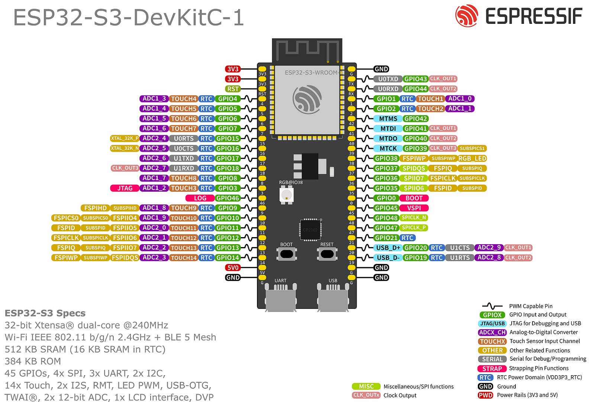

## A3 Hardware Revision Details

[Initial release](https://docs.espressif.com/projects/esp-dev-kits/en/latest/esp32s3/esp32-s3-devkitc-1/user_guide_v1.0.html)

> **Note:** Both the initial and v1.1 versions of ESP32-S3-DevKitC-1 are available on the market. The main difference lies in the GPIO assignment for the RGB LED: the initial version uses GPIO48, whereas v1.1 uses GPIO38.

## A4 Board Design Documents

* [ESP32-S3-DevKitC-1 Schematic](https://dl.espressif.com/dl/schematics/SCH_ESP32-S3-DevKitC-1_V1.1_20221130.pdf) (PDF)
* [ESP32-S3-DevKitC-1 PCB layout](https://dl.espressif.com/dl/schematics/PCB_ESP32-S3-DevKitC-1_V1.1_20220429.pdf) (PDF)
* [ESP32-S3-DevKitC-1 Dimensions](https://dl.espressif.com/dl/schematics/esp_idf/DXF_ESP32-S3-DevKitC-1_V1.1_20220429.pdf) (PDF)
* [ESP32-S3-DevKitC-1 Dimensions source file](https://dl.espressif.com/dl/schematics/esp_idf/DXF_ESP32-S3-DevKitC-1_V1.1_20220429.dxf) (DXF), viewable with [Autodesk Viewer](https://viewer.autodesk.com/)
* [ESP32-S3-DevKitC-1 Reference Design](https://documentation.espressif.com/ESP32-S3-DevKitC-1_Reference_Design.zip) (ZIP)
* Module datasheets: [ESP32-S3-WROOM-1 & ESP32-S3-WROOM-1U](https://www.espressif.com/sites/default/files/documentation/esp32-s3-wroom-1_wroom-1u_datasheet_en.pdf) (see [Part M](#m1-module-overview)), [ESP32-S3-WROOM-2](https://www.espressif.com/sites/default/files/documentation/esp32-s3-wroom-2_datasheet_en.pdf)

For further design documentation for the board, please contact us at sales@espressif.com.

# Part M: ESP32-S3-WROOM-1 / WROOM-1U Module

## M1 Module Overview

ESP32-S3-WROOM-1 and ESP32-S3-WROOM-1U. Datasheet version 1.8 ([latest version](https://www.espressif.com/documentation/esp32-s3-wroom-1_wroom-1u_datasheet_en.pdf)).

2.4 GHz Wi-Fi (802.11b/g/n) and Bluetooth® 5 module. Built around ESP32-S3 series of SoCs, Xtensa® dual-core 32-bit LX7 microprocessor. Flash up to 16 MB, PSRAM up to 16 MB. Up to 36 GPIOs, rich set of peripherals. On-board PCB antenna or external antenna connector.

### M1.1 Features

**CPU and On-Chip Memory**

* ESP32-S3 series of SoCs embedded, Xtensa® dual-core 32-bit LX7 microprocessor (with single precision FPU), up to 240 MHz
* 384 KB ROM
* 512 KB SRAM
* 16 KB SRAM in RTC
* Up to 16 MB PSRAM

**Wi-Fi**

* 802.11b/g/n
* Bit rate: 802.11n up to 150 Mbps
* A-MPDU and A-MSDU aggregation
* 0.4 µs guard interval support
* Center frequency range of operating channel: 2412 ~ 2484 MHz

**Bluetooth**

* Bluetooth LE: Bluetooth 5, Bluetooth mesh
* Speed: 125 Kbps, 500 Kbps, 1 Mbps, 2 Mbps
* Advertising extensions
* Multiple advertisement sets
* Channel selection algorithm #2
* Internal co-existence mechanism between Wi-Fi and Bluetooth to share the same antenna

**Peripherals**

* 36 GPIOs
  * 4 strapping GPIOs
* SPI, LCD interface, Camera interface, UART, I2C, I2S, remote control, pulse counter, LED PWM, full-speed USB 2.0 OTG, USB Serial/JTAG controller, MCPWM, SD/MMC host controller, GDMA, TWAI® controller (compatible with ISO 11898-1), ADC, touch sensor, temperature sensor, timers and watchdogs

**Integrated Components on Module**

* 40 MHz crystal oscillator
* Up to 16 MB Quad SPI flash

**Antenna Options**

* ESP32-S3-WROOM-1: On-board PCB antenna
* ESP32-S3-WROOM-1U: External antenna via a connector

**Operating Conditions**

* Operating voltage/Power supply: 3.0 ~ 3.6 V
* Operating ambient temperature:
  * 65 °C version: –40 ~ 65 °C
  * 85 °C version: –40 ~ 85 °C
  * 105 °C version: –40 ~ 105 °C

**Certification**

* RF certification: [See certificates](https://espressif.com/en/support/documents/certificates?keys=&field_product_value%5B%5D=ESP32-S3-WROOM-1&field_product_value%5B%5D=ESP32-S3-WROOM-1U)
* Green certification: RoHS/REACH

**Test**

* HTOL/HTSL/uHAST/TCT/ESD

### M1.2 Series Comparison

ESP32-S3-WROOM-1 and ESP32-S3-WROOM-1U are two powerful, generic Wi-Fi + Bluetooth LE MCU modules that are built around the ESP32-S3 series of SoCs. On top of a rich set of peripherals, the acceleration for neural network computing and signal processing workloads provided by the SoC make the modules an ideal choice for a wide variety of application scenarios related to AI and Artificial Intelligence of Things (AIoT), such as wake word detection, speech commands recognition, face detection and recognition, smart home, smart appliances, smart control panel, smart speaker, etc.

ESP32-S3-WROOM-1 comes with a PCB antenna. ESP32-S3-WROOM-1U comes with an external antenna connector. A wide selection of module variants are available for customers as shown in Table M1-1 and M1-2. H4 series modules operate at –40 ~ 105 °C ambient temperature, R8 and R16V series modules operate at –40 ~ 65 °C ambient temperature, and other module variants operate at –40 ~ 85 °C ambient temperature. For R8 and R16V series modules with Octal SPI PSRAM, if the PSRAM ECC function is enabled, the maximum ambient temperature can be improved to 85 °C, while the usable size of PSRAM will be reduced by 1/16.

**Table M1-1. ESP32-S3-WROOM-1 Series Comparison [1]**

| Part Number | Flash [2][3] | PSRAM [4] | Ambient Temp. (°C) [5] | Size (mm) [6] |
| --- | --- | --- | --- | --- |
| ESP32-S3-WROOM-1-N4 | 4 MB (Quad SPI) | - | –40 ~ 85 | 18.0 × 25.5 × 3.1 |
| ESP32-S3-WROOM-1-N8 | 8 MB (Quad SPI) | - | –40 ~ 85 | 18.0 × 25.5 × 3.1 |
| ESP32-S3-WROOM-1-N16 | 16 MB (Quad SPI) | - | –40 ~ 85 | 18.0 × 25.5 × 3.1 |
| ESP32-S3-WROOM-1-H4 | 4 MB (Quad SPI) | - | –40 ~ 105 | 18.0 × 25.5 × 3.1 |
| ESP32-S3-WROOM-1-N4R2 | 4 MB (Quad SPI) | 2 MB (Quad SPI) | –40 ~ 85 | 18.0 × 25.5 × 3.1 |
| ESP32-S3-WROOM-1-N8R2 | 8 MB (Quad SPI) | 2 MB (Quad SPI) | –40 ~ 85 | 18.0 × 25.5 × 3.1 |
| ESP32-S3-WROOM-1-N16R2 | 16 MB (Quad SPI) | 2 MB (Quad SPI) | –40 ~ 85 | 18.0 × 25.5 × 3.1 |
| ESP32-S3-WROOM-1-N4R8 | 4 MB (Quad SPI) | 8 MB (Octal SPI) | –40 ~ 65 | 18.0 × 25.5 × 3.1 |
| ESP32-S3-WROOM-1-N8R8 | 8 MB (Quad SPI) | 8 MB (Octal SPI) | –40 ~ 65 | 18.0 × 25.5 × 3.1 |
| ESP32-S3-WROOM-1-N16R8 | 16 MB (Quad SPI) | 8 MB (Octal SPI) | –40 ~ 65 | 18.0 × 25.5 × 3.1 |
| ESP32-S3-WROOM-1-N16R16VA7 | 16 MB (Quad SPI) | 16 MB (Octal SPI) | –40 ~ 65 | 18.0 × 25.5 × 3.1 |

[1] This table shares the same notes presented below Table M1-2.

**Table M1-2. ESP32-S3-WROOM-1U Series Comparison**

| Part Number | Flash [2][3] | PSRAM [4] | Ambient Temp. (°C) [5] | Size (mm) [6] |
| --- | --- | --- | --- | --- |
| ESP32-S3-WROOM-1U-N4 | 4 MB (Quad SPI) | - | –40 ~ 85 | 18.0 × 19.2 × 3.2 |
| ESP32-S3-WROOM-1U-N8 | 8 MB (Quad SPI) | - | –40 ~ 85 | 18.0 × 19.2 × 3.2 |
| ESP32-S3-WROOM-1U-N16 | 16 MB (Quad SPI) | - | –40 ~ 85 | 18.0 × 19.2 × 3.2 |
| ESP32-S3-WROOM-1U-H4 | 4 MB (Quad SPI) | - | –40 ~ 105 | 18.0 × 19.2 × 3.2 |
| ESP32-S3-WROOM-1U-N4R2 | 4 MB (Quad SPI) | 2 MB (Quad SPI) | –40 ~ 85 | 18.0 × 19.2 × 3.2 |
| ESP32-S3-WROOM-1U-N8R2 | 8 MB (Quad SPI) | 2 MB (Quad SPI) | –40 ~ 85 | 18.0 × 19.2 × 3.2 |
| ESP32-S3-WROOM-1U-N16R2 | 16 MB (Quad SPI) | 2 MB (Quad SPI) | –40 ~ 85 | 18.0 × 19.2 × 3.2 |
| ESP32-S3-WROOM-1U-N4R8 | 4 MB (Quad SPI) | 8 MB (Octal SPI) | –40 ~ 65 | 18.0 × 19.2 × 3.2 |
| ESP32-S3-WROOM-1U-N8R8 | 8 MB (Quad SPI) | 8 MB (Octal SPI) | –40 ~ 65 | 18.0 × 19.2 × 3.2 |
| ESP32-S3-WROOM-1U-N16R8 | 16 MB (Quad SPI) | 8 MB (Octal SPI) | –40 ~ 65 | 18.0 × 19.2 × 3.2 |
| ESP32-S3-WROOM-1U-N16R16VA7 | 16 MB (Quad SPI) | 16 MB (Octal SPI) | –40 ~ 65 | 18.0 × 19.2 × 3.2 |

Notes:

2. For customization of ESP32-S3-WROOM-1-H4, ESP32-S3-WROOM-1U-H4, and ESP32-S3-WROOM-1U-N16R16VA, [please contact us](https://espressif.com/en/contact-us/sales-questions).
3. By default, the SPI flash on the module operates at a maximum clock frequency of 80 MHz and does not support the auto suspend feature. If you have a requirement for a higher flash clock frequency of 120 MHz or if you need the flash auto suspend feature, [please contact us](https://espressif.com/en/contact-us/sales-questions).
4. The modules use PSRAM integrated in the chip's package. For specifications, refer to [M6.5 Memory Specifications](#m65-memory-specifications).
5. Ambient temperature specifies the recommended temperature range of the environment immediately outside the Espressif module.
6. For details, refer to [M10.1 Module Dimensions](#m101-module-dimensions).
7. Please note that the VDD_SPI voltage is 1.8 V for ESP32-S3-WROOM-1-N16R16VA and ESP32-S3-WROOM-1U-N16R16VA only.

At the core of the modules is an ESP32-S3 series of SoC, an Xtensa® 32-bit LX7 CPU that operates at up to 240 MHz. You can power off the CPU and make use of the low-power co-processor to constantly monitor the peripherals for changes or crossing of thresholds.

> **Note:** For more information on ESP32-S3, please refer to the [ESP32-S3 Series Datasheet](https://espressif.com/documentation/esp32-s3_datasheet_en.pdf). For chip revision identification, ESP-IDF release that supports a specific chip revision, and other information on chip revisions, please refer to the [ESP32-S3 Series SoC Errata](https://espressif.com/sites/default/files/documentation/esp32-s3_errata_en.pdf), Section *Chip Revision Identification*.

### M1.3 Applications

* Smart Home
* Industrial Automation
* Health Care
* Consumer Electronics
* Smart Agriculture
* POS Machines
* Service Robot
* Audio Devices
* Generic Low-power IoT Sensor Hubs
* Generic Low-power IoT Data Loggers
* Cameras for Video Streaming
* USB Devices
* Speech Recognition
* Image Recognition
* Wi-Fi + Bluetooth Networking Card
* Touch and Proximity Sensing

## M2 Block Diagram

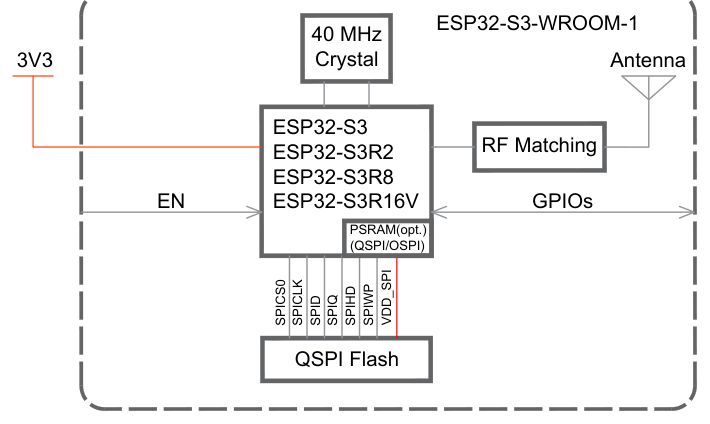

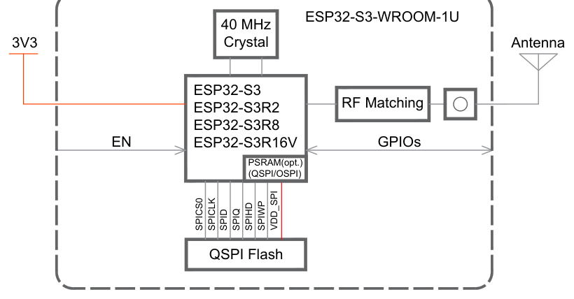

## M3 Pin Definitions

### M3.1 Pin Layout

The pin diagram below shows the approximate location of pins on the module. For the actual diagram drawn to scale, please refer to [Figure M10-1](#m101-module-dimensions).

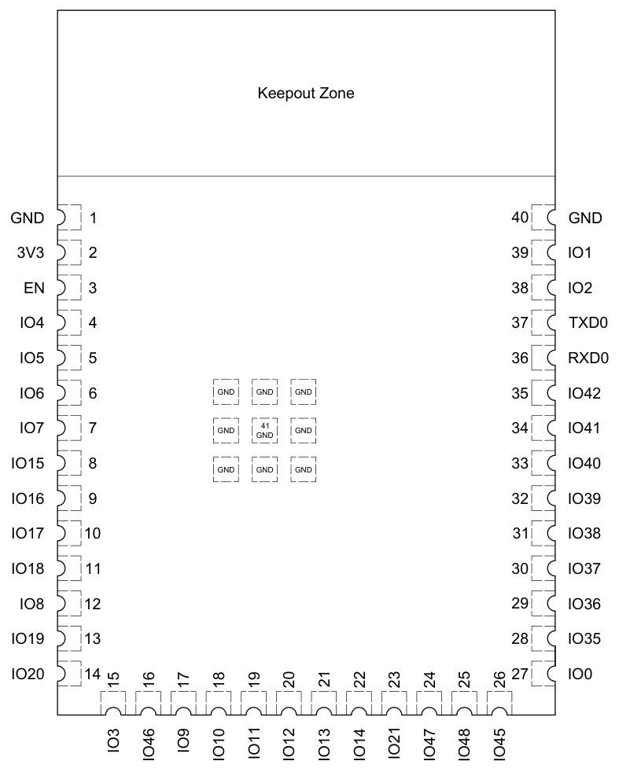

> **Note:** The pin diagram is applicable to ESP32-S3-WROOM-1 and ESP32-S3-WROOM-1U, but the latter has no antenna keepout zone. To learn more about the keepout zone for module's antenna on the base board, please refer to [ESP32-S3 Hardware Design Guidelines](https://espressif.com/documentation/esp32-s3_hardware_design_guidelines_en.pdf), Section *General Principles of PCB Layout for Modules*.

### M3.2 Pin Description

The module has 41 pins. See pin definitions in Table M3-1.

For explanations of pin names and function names, as well as configurations of peripheral pins, please refer to the [ESP32-S3 Series Datasheet](https://espressif.com/documentation/esp32-s3_datasheet_en.pdf), see [C2 Pins](#c2-pins).

**Table M3-1. Pin Definitions**

| Name | No. | Type [a] | Function |
| --- | --- | --- | --- |
| GND | 1 | P | GND |
| 3V3 | 2 | P | Power supply |
| EN | 3 | I | High: on, enables the chip. Low: off, the chip powers off. Note: Do not leave the EN pin floating. |
| IO4 | 4 | I/O/T | RTC_GPIO4, **GPIO4**, TOUCH4, ADC1_CH3 |
| IO5 | 5 | I/O/T | RTC_GPIO5, **GPIO5**, TOUCH5, ADC1_CH4 |
| IO6 | 6 | I/O/T | RTC_GPIO6, **GPIO6**, TOUCH6, ADC1_CH5 |
| IO7 | 7 | I/O/T | RTC_GPIO7, **GPIO7**, TOUCH7, ADC1_CH6 |
| IO15 | 8 | I/O/T | RTC_GPIO15, **GPIO15**, U0RTS, ADC2_CH4, XTAL_32K_P |
| IO16 | 9 | I/O/T | RTC_GPIO16, **GPIO16**, U0CTS, ADC2_CH5, XTAL_32K_N |
| IO17 | 10 | I/O/T | RTC_GPIO17, **GPIO17**, U1TXD, ADC2_CH6 |
| IO18 | 11 | I/O/T | RTC_GPIO18, **GPIO18**, U1RXD, ADC2_CH7, CLK_OUT3 |
| IO8 | 12 | I/O/T | RTC_GPIO8, **GPIO8**, TOUCH8, ADC1_CH7, SUBSPICS1 |
| IO19 | 13 | I/O/T | RTC_GPIO19, GPIO19, U1RTS, ADC2_CH8, CLK_OUT2, **USB_D-** |
| IO20 | 14 | I/O/T | RTC_GPIO20, GPIO20, U1CTS, ADC2_CH9, CLK_OUT1, **USB_D+** |
| IO3 | 15 | I/O/T | RTC_GPIO3, **GPIO3**, TOUCH3, ADC1_CH2 |
| IO46 | 16 | I/O/T | **GPIO46** |
| IO9 | 17 | I/O/T | RTC_GPIO9, **GPIO9**, TOUCH9, ADC1_CH8, FSPIHD, SUBSPIHD |
| IO10 | 18 | I/O/T | RTC_GPIO10, **GPIO10**, TOUCH10, ADC1_CH9, FSPICS0, FSPIIO4, SUBSPICS0 |
| IO11 | 19 | I/O/T | RTC_GPIO11, **GPIO11**, TOUCH11, ADC2_CH0, FSPID, FSPIIO5, SUBSPID |
| IO12 | 20 | I/O/T | RTC_GPIO12, **GPIO12**, TOUCH12, ADC2_CH1, FSPICLK, FSPIIO6, SUBSPICLK |
| IO13 | 21 | I/O/T | RTC_GPIO13, **GPIO13**, TOUCH13, ADC2_CH2, FSPIQ, FSPIIO7, SUBSPIQ |
| IO14 | 22 | I/O/T | RTC_GPIO14, **GPIO14**, TOUCH14, ADC2_CH3, FSPIWP, FSPIDQS, SUBSPIWP |
| IO21 | 23 | I/O/T | RTC_GPIO21, **GPIO21** |
| IO47 [c] | 24 | I/O/T | SPICLK_P_DIFF, **GPIO47**, SUBSPICLK_P_DIFF |
| IO48 [c] | 25 | I/O/T | SPICLK_N_DIFF, **GPIO48**, SUBSPICLK_N_DIFF |
| IO45 | 26 | I/O/T | **GPIO45** |
| IO0 | 27 | I/O/T | RTC_GPIO0, **GPIO0** |
| IO35 [b] | 28 | I/O/T | SPIIO6, **GPIO35**, FSPID, SUBSPID |
| IO36 [b] | 29 | I/O/T | SPIIO7, **GPIO36**, FSPICLK, SUBSPICLK |
| IO37 [b] | 30 | I/O/T | SPIDQS, **GPIO37**, FSPIQ, SUBSPIQ |
| IO38 | 31 | I/O/T | **GPIO38**, FSPIWP, SUBSPIWP |
| IO39 | 32 | I/O/T | **MTCK**, GPIO39, CLK_OUT3, SUBSPICS1 |
| IO40 | 33 | I/O/T | **MTDO**, GPIO40, CLK_OUT2 |
| IO41 | 34 | I/O/T | **MTDI**, GPIO41, CLK_OUT1 |
| IO42 | 35 | I/O/T | **MTMS**, GPIO42 |
| RXD0 | 36 | I/O/T | **U0RXD**, GPIO44, CLK_OUT2 |
| TXD0 | 37 | I/O/T | **U0TXD**, GPIO43, CLK_OUT1 |
| IO2 | 38 | I/O/T | RTC_GPIO2, **GPIO2**, TOUCH2, ADC1_CH1 |
| IO1 | 39 | I/O/T | RTC_GPIO1, **GPIO1**, TOUCH1, ADC1_CH0 |
| GND | 40 | P | GND |
| EPAD | 41 | P | GND |
[a] P: power supply; I: input; O: output; T: high impedance. Pin functions in bold font are the default pin functions. For pin 28 ~ 30, the default function is decided by eFuse bit.

[b] For modules with Octal SPI PSRAM, i.e., modules embedded with ESP32-S3R8 or ESP32-S3R16V, pins IO35, IO36, and IO37 are connected to the Octal SPI PSRAM and are not available for other uses.

[c] For modules embedded with ESP32-S3R16V, as the VDD_SPI voltage of the ESP32-S3R16V chip is set to 1.8 V, the working voltage for GPIO47 and GPIO48 is also 1.8 V, which is different from other GPIOs.

### M3.3 Module-specific Pin Notes

* Pins IO35, IO36 and IO37 (pins 28 ~ 30) are not available on modules with Octal SPI PSRAM (see note [b] above).
* GPIO47 and GPIO48 (pins 24, 25) work at 1.8 V on modules embedded with ESP32-S3R16V (see note [c] above).
* Not all the chip's IO signals are exposed on the module (up to 36 GPIOs, 4 of them strapping GPIOs), so some peripheral information in the [chip datasheet](#c2-pins) and the technical reference manual may not be applicable to ESP32-S3-WROOM-1 and ESP32-S3-WROOM-1U. To learn more about peripheral signals, refer to the ESP32-S3 Technical Reference Manual, Section *Peripheral Signals via GPIO Matrix* (see Part T, chapter IO MUX and GPIO Matrix).

## M4 Boot Configurations

The boot configuration content of the module datasheet is excerpted from the ESP32-S3 Series Datasheet and is not repeated here. For the strapping pin mapping between the chip and the module, see [M8 Module Schematics](#m8-module-schematics).

* Overview of strapping pins and eFuse parameters, default strapping configuration (GPIO0 weak pull-up, bit value 1; GPIO3 floating; GPIO45 weak pull-down, bit value 0; GPIO46 weak pull-down, bit value 0) and the setup/hold timing of the strapping pins (t_SU min 0 ms, t_H min 3 ms, with EN as the reset pin): see [C3 Boot Configurations](#c3-boot-configurations).
* Chip boot mode control (GPIO0 and GPIO46): see [C3.1 Chip Boot Mode Control](#c31-chip-boot-mode-control).
* VDD_SPI voltage control (GPIO45, EFUSE_VDD_SPI_FORCE, EFUSE_VDD_SPI_TIEH): see [C3.2 VDD_SPI Voltage Control](#c32-vdd_spi-voltage-control).
* ROM messages printing control: see [C3.3 ROM Messages Printing Control](#c33-rom-messages-printing-control).
* JTAG signal source control (GPIO3): see [C3.4 JTAG Signal Source Control](#c34-jtag-signal-source-control).

Module-specific differences:

* On modules with PSRAM, the VDD_SPI voltage is fixed to 3.3 V or 1.8 V via eFuse, so it is not affected by the GPIO45 level. For other modules, make sure GPIO45 is not pulled high when the module is powered up by the external circuit (see [M8 Module Schematics](#m8-module-schematics)).
* The VDD_SPI voltage is 1.8 V for ESP32-S3-WROOM-1-N16R16VA and ESP32-S3-WROOM-1U-N16R16VA only (see note 7 under [Table M1-2](#m12-series-comparison)).
* In the module reference design (Figure M8-1, Figure M8-2), the strapping-related pins are routed to the module pins as follows: GPIO0 = IO0 (pin 27), GPIO3 = IO3 (pin 15), GPIO45 = IO45 (pin 26), GPIO46 = IO46 (pin 16).

### M4.5 Chip Power-up and Reset

The power-up and reset sequence and timing (t_STBL ≥ 50 µs, t_RST ≥ 50 µs) are the same as the chip's: see [C2.5.3 Chip Power-up and Reset](#c253-chip-power-up-and-reset). On the module, the chip's CHIP_PU pin is brought out as **EN**. V_IL_nRST for the module is in [Table M6-3](#m63-dc-characteristics-33-v-25-c).

## M5 Peripherals

The peripheral descriptions of the module datasheet (UART, I2C, I2S, LCD and camera, SPI, TWAI, USB OTG, USB Serial/JTAG, SD/MMC, MCPWM, RMT, PCNT, SAR ADC, temperature sensor, touch sensor) repeat the chip functional description and are covered by the chip datasheet and the technical reference manual chapters in Part T. Module-specific pin availability is given in [M3.3 Module-specific Pin Notes](#m33-module-specific-pin-notes).

## M6 Electrical Characteristics

### M6.1 Absolute Maximum Ratings

Stresses above those listed in Table M6-1 may cause permanent damage to the device. These are stress ratings only and functional operation of the device at these or any other conditions beyond those indicated under Table M6-2 is not implied. Exposure to absolute-maximum-rated conditions for extended periods may affect device reliability.

**Table M6-1. Absolute Maximum Ratings**

| Symbol | Parameter | Min | Max | Unit |
| --- | --- | --- | --- | --- |
| VDD33 | Power supply voltage | –0.3 | 3.6 | V |
| T_STORE | Storage temperature | –40 | 105 | °C |

### M6.2 Recommended Operating Conditions

**Table M6-2. Recommended Operating Conditions**

| Symbol | Parameter | Condition | Min | Typ | Max | Unit |
| --- | --- | --- | --- | --- | --- | --- |
| VDD33 | Power supply voltage | — | 3.0 | 3.3 | 3.6 | V |
| I_VDD | Current delivered by external power supply | — | 0.5 | — | — | A |
| T_A | Operating ambient temperature | 65 °C version | –40 | — | 65 | °C |
| T_A | Operating ambient temperature | 85 °C version | –40 | — | 85 | °C |
| T_A | Operating ambient temperature | 105 °C version | –40 | — | 105 | °C |

### M6.3 DC Characteristics (3.3 V, 25 °C)

**Table M6-3. DC Characteristics (3.3 V, 25 °C)**

| Parameter | Description | Min | Typ | Max | Unit |
| --- | --- | --- | --- | --- | --- |
| C_IN | Pin capacitance | — | 2 | — | pF |
| V_IH | High-level input voltage | 0.75 × VDD [1] | — | VDD [1] + 0.3 | V |
| V_IL | Low-level input voltage | –0.3 | — | 0.25 × VDD [1] | V |
| I_IH | High-level input current | — | — | 50 | nA |
| I_IL | Low-level input current | — | — | 50 | nA |
| V_OH [2] | High-level output voltage | 0.8 × VDD [1] | — | — | V |
| V_OL [2] | Low-level output voltage | — | — | 0.1 × VDD [1] | V |
| I_OH | High-level source current (VDD [1] = 3.3 V, V_OH >= 2.64 V, PAD_DRIVER = 3) | — | 40 | — | mA |
| I_OL | Low-level sink current (VDD [1] = 3.3 V, V_OL = 0.495 V, PAD_DRIVER = 3) | — | 28 | — | mA |
| R_PU | Internal weak pull-up resistor | — | 45 | — | kΩ |
| R_PD | Internal weak pull-down resistor | — | 45 | — | kΩ |
| V_IH_nRST | Chip reset release voltage (EN voltage is within the specified range) | 0.75 × VDD [1] | — | VDD [1] + 0.3 | V |
| V_IL_nRST | Chip reset voltage (EN voltage is within the specified range) | –0.3 | — | 0.25 × VDD [1] | V |

[1] VDD – voltage from a power pin of a respective power domain.

[2] V_OH and V_OL are measured using high-impedance load.

### M6.4 Current Consumption Characteristics

#### M6.4.1 Current Consumption in Active Mode

With the use of advanced power-management technologies, the module can switch between different power modes. For details on different power modes, please refer to the [ESP32-S3 Series Datasheet](https://espressif.com/documentation/esp32-s3_datasheet_en.pdf), Section *Power Management Unit*.

The current consumption measurements are taken with a 3.3 V supply at 25 °C ambient temperature. TX current consumption is rated at a 100% duty cycle. RX current consumption is rated when the peripherals are disabled and the CPU idle.

**Table M6-4. Current Consumption for Wi-Fi (2.4 GHz) in Active Mode**

| Work Mode | RF Condition | Description | Peak (mA) |
| --- | --- | --- | --- |
| Active (RF working) | TX | 802.11b, 1 Mbps, @20.5 dBm | 355 |
| Active (RF working) | TX | 802.11g, 54 Mbps, @18 dBm | 297 |
| Active (RF working) | TX | 802.11n, HT20, MCS 7, @17.5 dBm | 286 |
| Active (RF working) | TX | 802.11n, HT40, MCS 7, @17 dBm | 285 |
| Active (RF working) | RX | 802.11b/g/n, HT20 | 95 |
| Active (RF working) | RX | 802.11n, HT40 | 97 |

**Table M6-5. Current Consumption for Bluetooth LE in Active Mode**

| Work Mode | RF Condition | Description | Peak (mA) |
| --- | --- | --- | --- |
| Active (RF working) | TX | Bluetooth LE @ 20.0 dBm | 344 |
| Active (RF working) | TX | Bluetooth LE @ 9.0 dBm | 202 |
| Active (RF working) | TX | Bluetooth LE @ 0 dBm | 187 |
| Active (RF working) | TX | Bluetooth LE @ –15.0 dBm | 119 |
| Active (RF working) | RX | Bluetooth LE | 93 |

#### M6.4.2 Current Consumption in Other Modes

Tables M6-6 and M6-7 are excerpted from Section *Current Consumption in Other Modes* in the ESP32-S3 Series Datasheet and are identical to the chip datasheet (see [C5 Electrical Characteristics](#c5-electrical-characteristics)). They are kept here once for the module. Please note that if the chip embedded has in-package PSRAM, the current consumption of the module might be higher compared to the measurements below.

**Table M6-6. Current Consumption in Modem-sleep Mode**

| Work mode | Frequency (MHz) | Description | Typ (mA) [1] | Typ (mA) [2] |
| --- | --- | --- | --- | --- |
| Modem-sleep [3] | 40 | WAITI (Dual core in idle state) | 13.2 | 18.8 |
| Modem-sleep [3] | 40 | Single core running 32-bit data access instructions, the other core in idle state | 16.2 | 21.8 |
| Modem-sleep [3] | 40 | Dual core running 32-bit data access instructions | 18.7 | 24.4 |
| Modem-sleep [3] | 40 | Single core running 128-bit data access instructions, the other core in idle state | 19.9 | 25.4 |
| Modem-sleep [3] | 40 | Dual core running 128-bit data access instructions | 23.0 | 28.8 |
| Modem-sleep [3] | 80 | WAITI | 22.0 | 36.1 |
| Modem-sleep [3] | 80 | Single core running 32-bit data access instructions, the other core in idle state | 28.4 | 42.6 |
| Modem-sleep [3] | 80 | Dual core running 32-bit data access instructions | 33.1 | 47.3 |
| Modem-sleep [3] | 80 | Single core running 128-bit data access instructions, the other core in idle state | 35.1 | 49.6 |
| Modem-sleep [3] | 80 | Dual core running 128-bit data access instructions | 41.8 | 56.3 |
| Modem-sleep [3] | 160 | WAITI | 27.6 | 42.3 |
| Modem-sleep [3] | 160 | Single core running 32-bit data access instructions, the other core in idle state | 39.9 | 54.6 |
| Modem-sleep [3] | 160 | Dual core running 32-bit data access instructions | 49.6 | 64.1 |
| Modem-sleep [3] | 160 | Single core running 128-bit data access instructions, the other core in idle state | 54.4 | 69.2 |
| Modem-sleep [3] | 160 | Dual core running 128-bit data access instructions | 66.7 | 81.1 |
| Modem-sleep [3] | 240 | WAITI | 32.9 | 47.6 |
| Modem-sleep [3] | 240 | Single core running 32-bit data access instructions, the other core in idle state | 51.2 | 65.9 |
| Modem-sleep [3] | 240 | Dual core running 32-bit data access instructions | 66.2 | 81.3 |
| Modem-sleep [3] | 240 | Single core running 128-bit data access instructions, the other core in idle state | 72.4 | 87.9 |
| Modem-sleep [3] | 240 | Dual core running 128-bit data access instructions | 91.7 | 107.9 |

[1] Current consumption when all peripheral clocks are disabled.

[2] Current consumption when all peripheral clocks are enabled. In practice, the current consumption might be different depending on which peripherals are enabled.

[3] In Modem-sleep mode, Wi-Fi is clock gated, and the current consumption might be higher when accessing flash. For a flash rated at 80 Mbit/s, in SPI 2-line mode the consumption is 10 mA.

**Table M6-7. Current Consumption in Low-Power Modes**

| Work mode | Description | Sub-condition | Typ (µA) |
| --- | --- | --- | --- |
| Light-sleep [1] | VDD_SPI and Wi-Fi are powered down, and all GPIOs are high-impedance. | — | 240 |
| Deep-sleep | The ULP co-processor is powered on [2] | ULP-FSM | 170 |
| Deep-sleep | The ULP co-processor is powered on [2] | ULP-RISC-V | 190 |
| Deep-sleep | ULP sensor-monitored pattern [3] | — | 18 |
| Deep-sleep | RTC memory and RTC peripherals are powered up. | — | 8 |
| Deep-sleep | RTC memory is powered up. RTC peripherals are powered down. | — | 7 |
| Power off | EN is set to low level. The chip is shut down. | — | 1 |

[1] In Light-sleep mode, all related SPI pins are pulled up. For chips embedded with PSRAM, please add corresponding PSRAM consumption values, e.g., 140 µA for 8 MB 8-line PSRAM (3.3 V), 200 µA for 8 MB 8-line PSRAM (1.8 V) and 40 µA for 2 MB 4-line PSRAM (3.3 V).

[2] During Deep-sleep, when the ULP co-processor is powered on, peripherals such as GPIO and I2C are able to operate.

[3] The "ULP sensor-monitored pattern" refers to the mode where the ULP coprocessor or the sensor works periodically. When touch sensors work with a duty cycle of 1%, the typical current consumption is 18 µA.

### M6.5 Memory Specifications

The data below is sourced from the memory vendor datasheet. These values are guaranteed through design and/or characterization but are not fully tested in production. Devices are shipped with the memory erased.

**Table M6-8. Flash Specifications**

| Parameter | Description | Min | Typ | Max | Unit |
| --- | --- | --- | --- | --- | --- |
| VCC | Power supply voltage (1.8 V) | 1.65 | 1.80 | 2.00 | V |
| VCC | Power supply voltage (3.3 V) | 2.7 | 3.3 | 3.6 | V |
| F_C | Maximum clock frequency | 80 | — | — | MHz |
| — | Program/erase cycles | 100,000 | — | — | cycles |
| T_RET | Data retention time | 20 | — | — | years |
| T_PP | Page program time | — | 0.8 | 5 | ms |
| T_SE | Sector erase time (4 KB) | — | 70 | 500 | ms |
| T_BE1 | Block erase time (32 KB) | — | 0.2 | 2 | s |
| T_BE2 | Block erase time (64 KB) | — | 0.3 | 3 | s |
| T_CE | Chip erase time (16 Mb) | — | 7 | 20 | s |
| T_CE | Chip erase time (32 Mb) | — | 20 | 60 | s |
| T_CE | Chip erase time (64 Mb) | — | 25 | 100 | s |
| T_CE | Chip erase time (128 Mb) | — | 60 | 200 | s |
| T_CE | Chip erase time (256 Mb) | — | 70 | 300 | s |

**Table M6-9. PSRAM Specifications**

| Parameter | Description | Min | Typ | Max | Unit |
| --- | --- | --- | --- | --- | --- |
| VCC | Power supply voltage (1.8 V) | 1.62 | 1.80 | 1.98 | V |
| VCC | Power supply voltage (3.3 V) | 2.7 | 3.3 | 3.6 | V |
| F_C | Maximum clock frequency | 80 | — | — | MHz |

## M7 RF Characteristics

This section contains tables with RF characteristics of the Espressif product.

The RF data is measured at the antenna port, where RF cable is connected, including the front-end loss. The external antennas used for the tests on the modules with external antenna connectors have an impedance of 50 Ω.

Devices should operate in the center frequency range allocated by regional regulatory authorities. The target center frequency range and the target transmit power are configurable by software. See [ESP RF Test Tool and Test Guide](https://www.espressif.com/en/support/download/other-tools?keys=RF+Test+Tool) for instructions.

Unless otherwise stated, the RF tests are conducted with a 3.3 V (±5%) supply at 25 ºC ambient temperature.

Values in the module tables are measured on the module and differ from the chip datasheet's RF tables (see [C6 RF Characteristics](#c6-rf-characteristics)), except Tables M7-1 and M7-5, which are identical to the chip datasheet.

### M7.1 Wi-Fi Radio

**Table M7-1. Wi-Fi RF Characteristics**

| Name | Description |
| --- | --- |
| Center frequency range of operating channel | 2412 ~ 2484 MHz |
| Wi-Fi wireless standard | IEEE 802.11b/g/n |

#### M7.1.1 Wi-Fi RF Transmitter (TX) Characteristics

**Table M7-2. TX Power with Spectral ask and EV eeting 802.11 Standards**

| Rate | Min (dBm) | Typ (dBm) | Max (dBm) |
| --- | --- | --- | --- |
| 802.11b, 1 Mbps | — | 20.5 | — |
| 802.11b, 11 Mbps | — | 20.5 | — |
| 802.11g, 6 Mbps | — | 20.0 | — |
| 802.11g, 54 Mbps | — | 18.0 | — |
| 802.11n, HT20, MCS 0 | — | 19.0 | — |
| 802.11n, HT20, MCS 7 | — | 17.5 | — |
| 802.11n, HT40, MCS 0 | — | 18.5 | — |
| 802.11n, HT40, MCS 7 | — | 17.0 | — |

**Table M7-3. TX EVM Test [1]**

| Rate | Min (dB) | Typ (dB) | Limit (dB) |
| --- | --- | --- | --- |
| 802.11b, 1 Mbps, @20.5 dBm | — | –24.5 | –10 |
| 802.11b, 11 Mbps, @20.5 dBm | — | –24.5 | –10 |
| 802.11g, 6 Mbps, @20 dBm | — | –23.0 | –5 |
| 802.11g, 54 Mbps, @18 dBm | — | –29.5 | –25 |
| 802.11n, HT20, MCS 0, @19 dBm | — | –24.0 | –5 |
| 802.11n, HT20, MCS 7, @17.5 dBm | — | –30.5 | –27 |
| 802.11n, HT40, MCS 0, @18.5 dBm | — | –25.0 | –5 |
| 802.11n, HT40, MCS 7, @17 dBm | — | –30.0 | –27 |

[1] EVM is measured at the corresponding typical TX power provided in Table M7-2 above.

#### M7.1.2 Wi-Fi RF Receiver (RX) Characteristics

For RX tests, the PER (packet error rate) limit is 8% for 802.11b, and 10% for 802.11g/n.

**Table M7-4. RX Sensitivity**

| Rate | Min (dBm) | Typ (dBm) | Max (dBm) |
| --- | --- | --- | --- |
| 802.11b, 1 Mbps | — | –98.2 | — |
| 802.11b, 2 Mbps | — | –95.6 | — |
| 802.11b, 5.5 Mbps | — | –92.8 | — |
| 802.11b, 11 Mbps | — | –88.5 | — |
| 802.11g, 6 Mbps | — | –93.0 | — |
| 802.11g, 9 Mbps | — | –92.0 | — |
| 802.11g, 12 Mbps | — | –90.8 | — |
| 802.11g, 18 Mbps | — | –88.5 | — |
| 802.11g, 24 Mbps | — | –85.5 | — |
| 802.11g, 36 Mbps | — | –82.2 | — |
| 802.11g, 48 Mbps | — | –78.0 | — |
| 802.11g, 54 Mbps | — | –76.2 | — |
| 802.11n, HT20, MCS 0 | — | –93.0 | — |
| 802.11n, HT20, MCS 1 | — | –90.6 | — |
| 802.11n, HT20, MCS 2 | — | –88.4 | — |
| 802.11n, HT20, MCS 3 | — | –84.8 | — |
| 802.11n, HT20, MCS 4 | — | –81.6 | — |
| 802.11n, HT20, MCS 5 | — | –77.4 | — |
| 802.11n, HT20, MCS 6 | — | –75.6 | — |
| 802.11n, HT20, MCS 7 | — | –74.2 | — |
| 802.11n, HT40, MCS 0 | — | –90.0 | — |
| 802.11n, HT40, MCS 1 | — | –87.5 | — |
| 802.11n, HT40, MCS 2 | — | –85.0 | — |
| 802.11n, HT40, MCS 3 | — | –82.0 | — |
| 802.11n, HT40, MCS 4 | — | –78.5 | — |
| 802.11n, HT40, MCS 5 | — | –74.4 | — |
| 802.11n, HT40, MCS 6 | — | –72.5 | — |
| 802.11n, HT40, MCS 7 | — | –71.2 | — |

**Table M7-5. Maximum RX Level**

| Rate | Min (dBm) | Typ (dBm) | Max (dBm) |
| --- | --- | --- | --- |
| 802.11b, 1 Mbps | — | 5 | — |
| 802.11b, 11 Mbps | — | 5 | — |
| 802.11g, 6 Mbps | — | 5 | — |
| 802.11g, 54 Mbps | — | 0 | — |
| 802.11n, HT20, MCS 0 | — | 5 | — |
| 802.11n, HT20, MCS 7 | — | 0 | — |
| 802.11n, HT40, MCS 0 | — | 5 | — |
| 802.11n, HT40, MCS 7 | — | 0 | — |

**Table M7-6. RX Adjacent Channel Rejection**

| Rate | Min (dB) | Typ (dB) | Max (dB) |
| --- | --- | --- | --- |
| 802.11b, 1 Mbps | — | 35 | — |
| 802.11b, 11 Mbps | — | 35 | — |
| 802.11g, 6 Mbps | — | 31 | — |
| 802.11g, 54 Mbps | — | 14 | — |
| 802.11n, HT20, MCS 0 | — | 31 | — |
| 802.11n, HT20, MCS 7 | — | 13 | — |
| 802.11n, HT40, MCS 0 | — | 19 | — |
| 802.11n, HT40, MCS 7 | — | 8 | — |

### M7.2 Bluetooth LE Radio

**Table M7-7. Bluetooth LE RF Characteristics**

| Name | Description |
| --- | --- |
| Center frequency range of operating channel | 2402 ~ 2480 MHz |
| RF transmit power range | –24.0 ~ 20.0 dBm |

#### M7.2.1 Bluetooth LE RF Transmitter (TX) Characteristics

**Table M7-8. Bluetooth LE - Transmitter Characteristics - 1 Mbps**

| Parameter | Description | Min | Typ | Max | Unit |
| --- | --- | --- | --- | --- | --- |
| Carrier frequency offset and drift | Max \|f_n\|, n=0, 1, 2, ..k | — | 2.50 | — | kHz |
| Carrier frequency offset and drift | Max \|f_0 − f_n\| | — | 2.00 | — | kHz |
| Carrier frequency offset and drift | Max \|f_n − f_(n−5)\| | — | 1.40 | — | kHz |
| Carrier frequency offset and drift | \|f_1 − f_0\| | — | 1.00 | — | kHz |
| Modulation characteristics | Δf1_avg | — | 249.00 | — | kHz |
| Modulation characteristics | Min Δf2_max (for at least 99.9% of all Δf2_max) | — | 198.00 | — | kHz |
| Modulation characteristics | Δf2_avg/Δf1_avg | — | 0.86 | — | — |
| In-band spurious emissions | ±2 MHz offset | — | –37.00 | — | dBm |
| In-band spurious emissions | ±3 MHz offset | — | –42.00 | — | dBm |
| In-band spurious emissions | >±3 MHz offset | — | –44.00 | — | dBm |

**Table M7-9. Bluetooth LE - Transmitter Characteristics - 2 Mbps**

| Parameter | Description | Min | Typ | Max | Unit |
| --- | --- | --- | --- | --- | --- |
| Carrier frequency offset and drift | Max \|f_n\|, n=0, 1, 2, ..k | — | 2.50 | — | kHz |
| Carrier frequency offset and drift | Max \|f_0 − f_n\| | — | 2.00 | — | kHz |
| Carrier frequency offset and drift | Max \|f_n − f_(n−5)\| | — | 1.40 | — | kHz |
| Carrier frequency offset and drift | \|f_1 − f_0\| | — | 1.00 | — | kHz |
| Modulation characteristics | Δf1_avg | — | 499.00 | — | kHz |
| Modulation characteristics | Min Δf2_max (for at least 99.9% of all Δf2_max) | — | 416.00 | — | kHz |
| Modulation characteristics | Δf2_avg/Δf1_avg | — | 0.89 | — | — |
| In-band spurious emissions | ±4 MHz offset | — | –42.00 | — | dBm |
| In-band spurious emissions | ±5 MHz offset | — | –44.00 | — | dBm |
| In-band spurious emissions | >±5 MHz offset | — | –47.00 | — | dBm |

**Table M7-10. Bluetooth LE - Transmitter Characteristics - 125 Kbps**

| Parameter | Description | Min | Typ | Max | Unit |
| --- | --- | --- | --- | --- | --- |
| Carrier frequency offset and drift | Max \|f_n\|, n=0, 1, 2, ..k | — | 0.80 | — | kHz |
| Carrier frequency offset and drift | Max \|f_0 − f_n\| | — | 1.00 | — | kHz |
| Carrier frequency offset and drift | \|f_n − f_(n−3)\| | — | 0.30 | — | kHz |
| Carrier frequency offset and drift | \|f_0 − f_3\| | — | 1.00 | — | kHz |
| Modulation characteristics | Δf1_avg | — | 248.00 | — | kHz |
| Modulation characteristics | Min Δf1_max (for at least 99.9% of all Δf1_max) | — | 222.00 | — | kHz |
| In-band spurious emissions | ±2 MHz offset | — | –37.00 | — | dBm |
| In-band spurious emissions | ±3 MHz offset | — | –42.00 | — | dBm |
| In-band spurious emissions | >±3 MHz offset | — | –44.00 | — | dBm |

**Table M7-11. Bluetooth LE - Transmitter Characteristics - 500 Kbps**

| Parameter | Description | Min | Typ | Max | Unit |
| --- | --- | --- | --- | --- | --- |
| Carrier frequency offset and drift | Max \|f_n\|, n=0, 1, 2, ..k | — | 0.80 | — | kHz |
| Carrier frequency offset and drift | Max \|f_0 − f_n\| | — | 1.00 | — | kHz |
| Carrier frequency offset and drift | \|f_n − f_(n−3)\| | — | 0.85 | — | kHz |
| Carrier frequency offset and drift | \|f_0 − f_3\| | — | 0.34 | — | kHz |
| Modulation characteristics | Δf2_avg | — | 213.00 | — | kHz |
| Modulation characteristics | Min Δf2_max (for at least 99.9% of all Δf2_max) | — | 196.00 | — | kHz |
| In-band spurious emissions | ±2 MHz offset | — | –37.00 | — | dBm |
| In-band spurious emissions | ±3 MHz offset | — | –42.00 | — | dBm |
| In-band spurious emissions | >±3 MHz offset | — | –44.00 | — | dBm |

#### M7.2.2 Bluetooth LE RF Receiver (RX) Characteristics

**Table M7-12. Bluetooth LE - Receiver Characteristics - 1 Mbps**

| Parameter | Description | Min | Typ | Max | Unit |
| --- | --- | --- | --- | --- | --- |
| Sensitivity @30.8% PER | — | — | –96.5 | — | dBm |
| Maximum received signal @30.8% PER | — | — | 8 | — | dBm |
| Co-channel C/I | F = F0 MHz | — | 8 | — | dB |
| Adjacent channel selectivity C/I | F = F0 + 1 MHz | — | 4 | — | dB |
| Adjacent channel selectivity C/I | F = F0 – 1 MHz | — | 4 | — | dB |
| Adjacent channel selectivity C/I | F = F0 + 2 MHz | — | –23 | — | dB |
| Adjacent channel selectivity C/I | F = F0 – 2 MHz | — | –23 | — | dB |
| Adjacent channel selectivity C/I | F = F0 + 3 MHz | — | –34 | — | dB |
| Adjacent channel selectivity C/I | F = F0 – 3 MHz | — | –34 | — | dB |
| Adjacent channel selectivity C/I | F > F0 + 3 MHz | — | –36 | — | dB |
| Adjacent channel selectivity C/I | F > F0 – 3 MHz | — | –37 | — | dB |
| Image frequency | — | — | –36 | — | dB |
| Adjacent channel to image frequency | F = F image + 1 MHz | — | –39 | — | dB |
| Adjacent channel to image frequency | F = F image – 1 MHz | — | –34 | — | dB |
| Out-of-band blocking performance | 30 MHz ~ 2000 MHz | — | –12 | — | dBm |
| Out-of-band blocking performance | 2003 MHz ~ 2399 MHz | — | –18 | — | dBm |
| Out-of-band blocking performance | 2484 MHz ~ 2997 MHz | — | –16 | — | dBm |
| Out-of-band blocking performance | 3000 MHz ~ 12.75 GHz | — | –10 | — | dBm |
| Intermodulation | — | — | –29 | — | dBm |

**Table M7-13. Bluetooth LE - Receiver Characteristics - 2 Mbps**

| Parameter | Description | Min | Typ | Max | Unit |
| --- | --- | --- | --- | --- | --- |
| Sensitivity @30.8% PER | — | — | –92 | — | dBm |
| Maximum received signal @30.8% PER | — | — | 3 | — | dBm |
| Co-channel C/I | F = F0 MHz | — | 8 | — | dB |
| Adjacent channel selectivity C/I | F = F0 + 2 MHz | — | 4 | — | dB |
| Adjacent channel selectivity C/I | F = F0 – 2 MHz | — | 4 | — | dB |
| Adjacent channel selectivity C/I | F = F0 + 4 MHz | — | –27 | — | dB |
| Adjacent channel selectivity C/I | F = F0 – 4 MHz | — | –27 | — | dB |
| Adjacent channel selectivity C/I | F = F0 + 6 MHz | — | –38 | — | dB |
| Adjacent channel selectivity C/I | F = F0 – 6 MHz | — | –38 | — | dB |
| Adjacent channel selectivity C/I | F > F0 + 6 MHz | — | –41 | — | dB |
| Adjacent channel selectivity C/I | F > F0 – 6 MHz | — | –41 | — | dB |
| Image frequency | — | — | –27 | — | dB |
| Adjacent channel to image frequency | F = F image + 2 MHz | — | –38 | — | dB |
| Adjacent channel to image frequency | F = F image – 2 MHz | — | 4 | — | dB |
| Out-of-band blocking performance | 30 MHz ~ 2000 MHz | — | –15 | — | dBm |
| Out-of-band blocking performance | 2003 MHz ~ 2399 MHz | — | –21 | — | dBm |
| Out-of-band blocking performance | 2484 MHz ~ 2997 MHz | — | –21 | — | dBm |
| Out-of-band blocking performance | 3000 MHz ~ 12.75 GHz | — | –9 | — | dBm |
| Intermodulation | — | — | –29 | — | dBm |

**Table M7-14. Bluetooth LE - Receiver Characteristics - 125 Kbps**

| Parameter | Description | Min | Typ | Max | Unit |
| --- | --- | --- | --- | --- | --- |
| Sensitivity @30.8% PER | — | — | –103.5 | — | dBm |
| Maximum received signal @30.8% PER | — | — | 8 | — | dBm |
| Co-channel C/I | F = F0 MHz | — | 4 | — | dB |
| Adjacent channel selectivity C/I | F = F0 + 1 MHz | — | 1 | — | dB |
| Adjacent channel selectivity C/I | F = F0 – 1 MHz | — | 2 | — | dB |
| Adjacent channel selectivity C/I | F = F0 + 2 MHz | — | –26 | — | dB |
| Adjacent channel selectivity C/I | F = F0 – 2 MHz | — | –26 | — | dB |
| Adjacent channel selectivity C/I | F = F0 + 3 MHz | — | –36 | — | dB |
| Adjacent channel selectivity C/I | F = F0 – 3 MHz | — | –39 | — | dB |
| Adjacent channel selectivity C/I | F > F0 + 3 MHz | — | –42 | — | dB |
| Adjacent channel selectivity C/I | F > F0 – 3 MHz | — | –43 | — | dB |
| Image frequency | — | — | –42 | — | dB |
| Adjacent channel to image frequency | F = F image + 1 MHz | — | –43 | — | dB |
| Adjacent channel to image frequency | F = F image – 1 MHz | — | –36 | — | dB |

**Table M7-15. Bluetooth LE - Receiver Characteristics - 500 Kbps**

| Parameter | Description | Min | Typ | Max | Unit |
| --- | --- | --- | --- | --- | --- |
| Sensitivity @30.8% PER | — | — | –100 | — | dBm |
| Maximum received signal @30.8% PER | — | — | 8 | — | dBm |
| Co-channel C/I | F = F0 MHz | — | 4 | — | dB |
| Adjacent channel selectivity C/I | F = F0 + 1 MHz | — | 1 | — | dB |
| Adjacent channel selectivity C/I | F = F0 – 1 MHz | — | 0 | — | dB |
| Adjacent channel selectivity C/I | F = F0 + 2 MHz | — | –24 | — | dB |
| Adjacent channel selectivity C/I | F = F0 – 2 MHz | — | –24 | — | dB |
| Adjacent channel selectivity C/I | F = F0 + 3 MHz | — | –37 | — | dB |
| Adjacent channel selectivity C/I | F = F0 – 3 MHz | — | –39 | — | dB |
| Adjacent channel selectivity C/I | F > F0 + 3 MHz | — | –38 | — | dB |
| Adjacent channel selectivity C/I | F > F0 – 3 MHz | — | –42 | — | dB |
| Image frequency | — | — | –38 | — | dB |
| Adjacent channel to image frequency | F = F image + 1 MHz | — | –42 | — | dB |
| Adjacent channel to image frequency | F = F image – 1 MHz | — | –37 | — | dB |


## M8 Module Schematics

This is the reference design of the module. For modules with PSRAM, the VDD_SPI voltage is fixed to 3.3 V or 1.8 V via eFuse, so their VDD_SPI voltage will not be affected by the GPIO45 level. However, for other modules, please ensure that GPIO45 is not pulled high when the module is powered up by the external circuit.

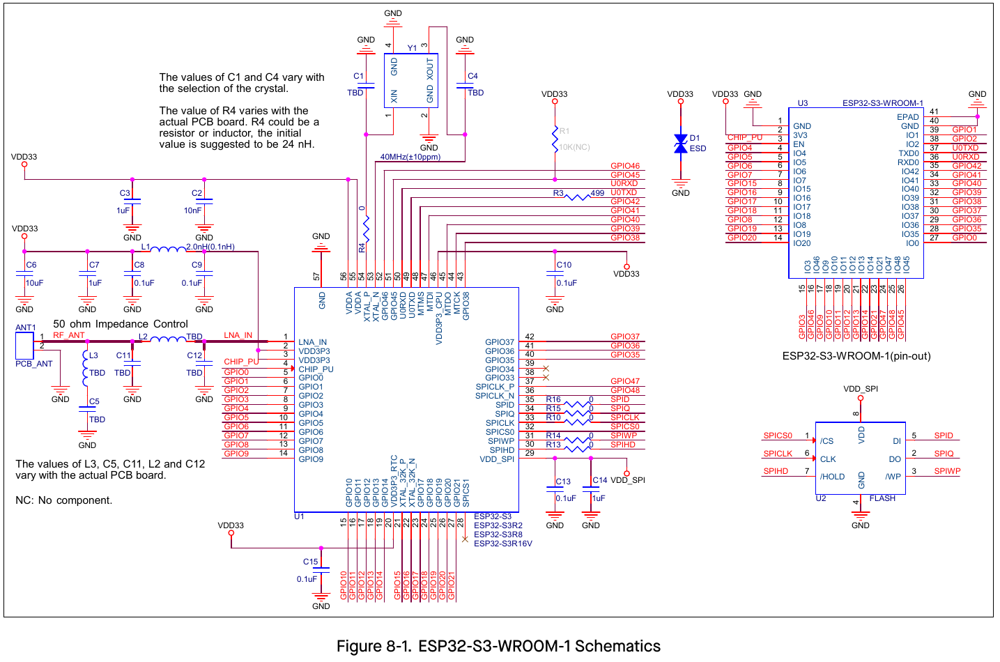

Notes shown in Figure M8-1: the values of L3, C5, C11, L2 and C12 vary with the actual PCB board. The values of C1 and C4 vary with the selection of the crystal. The value of R4 varies with the actual PCB board; R4 could be a resistor or inductor, the initial value is suggested to be 24 nH. NC: No component. The RF trace requires 50 ohm impedance control.

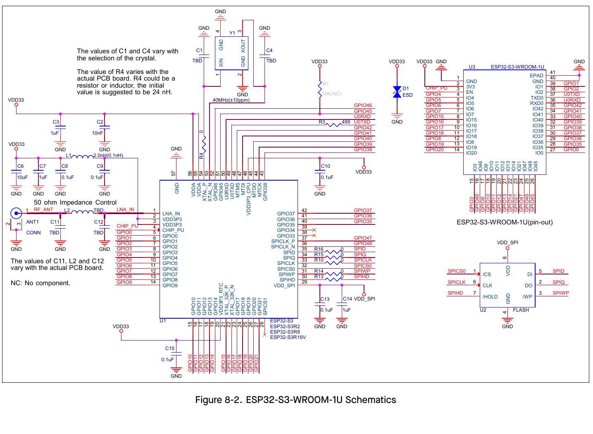

Notes shown in Figure M8-2: the values of C11, L2 and C12 vary with the actual PCB board. The values of C1 and C4 vary with the selection of the crystal. The value of R4 varies with the actual PCB board; R4 could be a resistor or inductor, the initial value is suggested to be 24 nH. NC: No component. The RF trace requires 50 ohm impedance control.

## M9 Peripheral Schematics

This is the typical application circuit of the module connected with peripheral components (for example, power supply, antenna, reset button, JTAG interface, and UART interface).

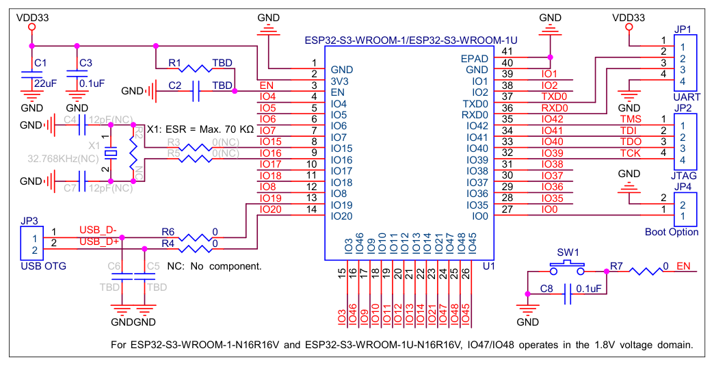

Note shown in Figure M9-1: for ESP32-S3-WROOM-1-N16R16V and ESP32-S3-WROOM-1U-N16R16V, IO47/IO48 operates in the 1.8 V voltage domain. NC: No component. X1: ESR = Max. 70 kΩ.

* Soldering the EPAD to the ground of the base board is not a must, however, it can optimize thermal performance. If you choose to solder it, please apply the correct amount of soldering paste. Too much soldering paste may increase the gap between the module and the baseboard. As a result, the adhesion between other pins and the baseboard may be poor.
* To ensure that the power supply to the ESP32-S3 chip is stable during power-up, it is advised to add an RC delay circuit at the EN pin. The recommended setting for the RC delay circuit is usually R = 10 kΩ and C = 1 µF. However, specific parameters should be adjusted based on the power-up timing of the module and the power-up and reset sequence timing of the chip. For ESP32-S3's power-up and reset sequence timing diagram, please refer to [M4.5 Chip Power-up and Reset](#m45-chip-power-up-and-reset).

## M10 Physical Dimensions

### M10.1 Module Dimensions

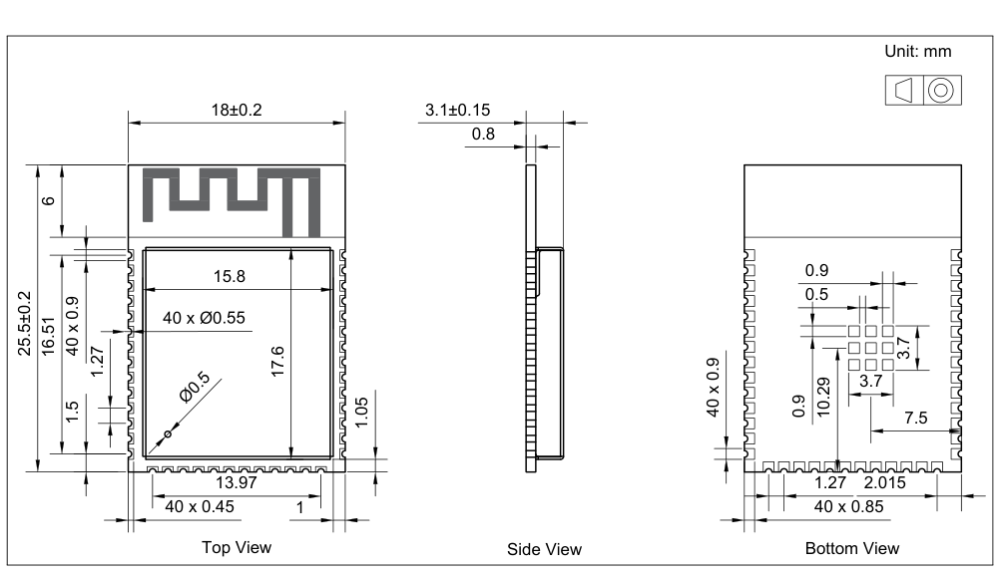

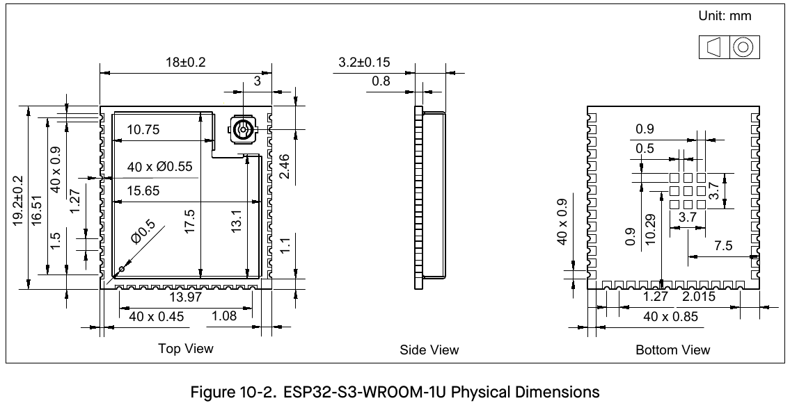

> **Note:** For information about tape, reel, and product marking, please refer to [ESP32-S3 Module Packaging Information](https://docs.espressif.com/projects/esp-packaging/en/latest/esp32s3/00-index/index_module.html).

### M10.2 Dimensions of External Antenna Connector

ESP32-S3-WROOM-1U uses the first generation external antenna connector as shown in Figure M10-3. This connector is compatible with the following connectors:

* U.FL Series connector from Hirose
* MHF I connector from I-PEX
* AMC connector from Amphenol

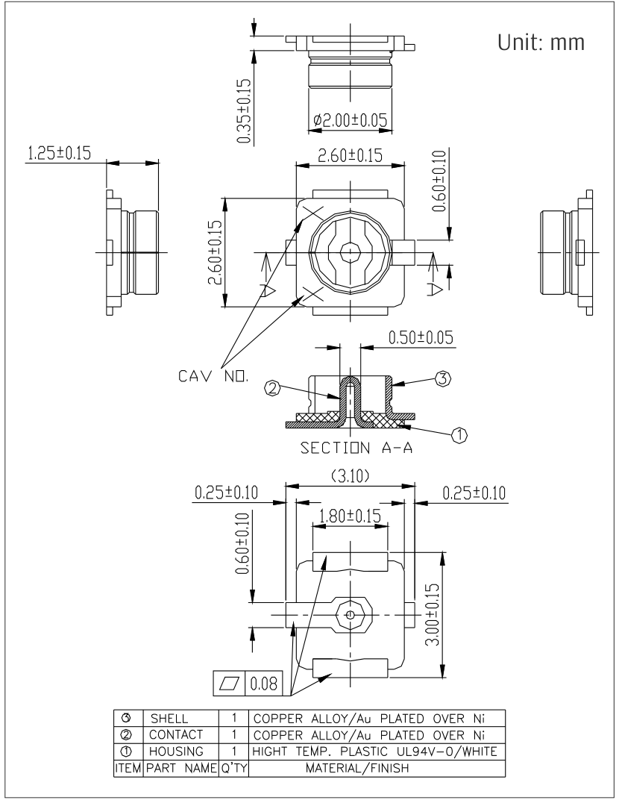

The external antenna used for ESP32-S3-WROOM-1U during certification testing is the first generation monopole antenna, with material code TFPD05H08750011.

The module does not include an external antenna upon shipment. If needed, select a suitable external antenna based on the product's usage environment and performance requirements.

It is recommended to select an antenna that meets the following requirements:

* 2.4 GHz band
* 50 Ω impedance
* The maximum gain does not exceed 2.33 dBi, the gain of the antenna used for certification
* The connector matches the specifications shown in Figure M10-3

> **Note:** If you use an external antenna of a different type or gain, additional testing, such as EMC, may be required beyond the existing antenna test reports for Espressif modules. Specific requirements depend on the certification type.

## M11 PCB Layout Recommendations

### M11.1 PCB Land Pattern

This section provides the following resources for your reference:

* Figures for recommended PCB land patterns with all the dimensions needed for PCB design. See Figure M11-1 and Figure M11-2.
* Source files of recommended PCB land patterns to measure dimensions not covered in Figure M11-1 and Figure M11-2. You can view the source files for [ESP32-S3-WROOM-1](https://www.espressif.com/sites/default/files/modules-dxf/ESP32-S3-WROOM-1%20PCB%20Footprint.dxf) and [ESP32-S3-WROOM-1U](https://www.espressif.com/sites/default/files/modules-dxf/ESP32-S3-WROOM-1U%20PCB%20Footprint.dxf) with [Autodesk Viewer](https://viewer.autodesk.com/).
* 3D models of [ESP32-S3-WROOM-1](https://www.espressif.com/sites/default/files/3dmodel/ESP32-S3-WROOM-1_20211021.STEP) and [ESP32-S3-WROOM-1U](https://www.espressif.com/sites/default/files/3dmodel/ESP32-S3-WROOM-1U%203D%20Model.STEP). Please make sure that you download the 3D model file in .STEP format (beware that some browsers might add .txt).

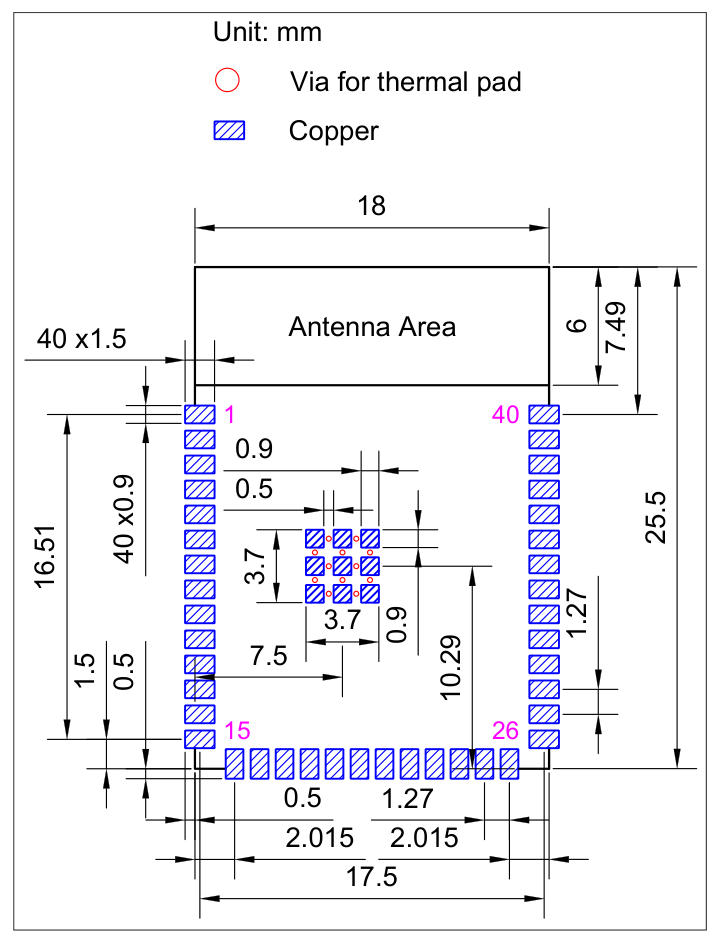

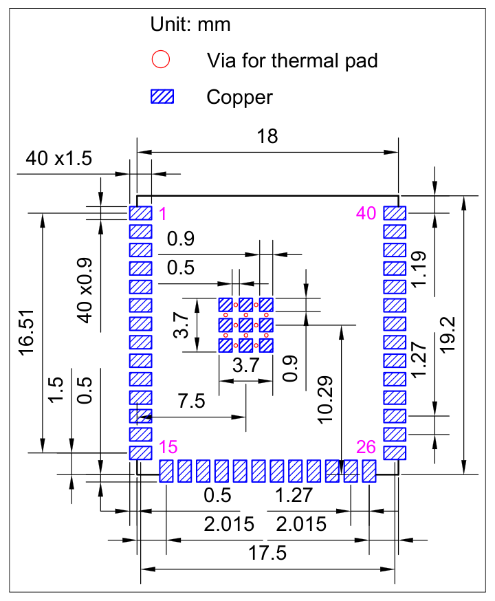

### M11.2 Module Placement for PCB Design

If module-on-board design is adopted, attention should be paid while positioning the module on the base board. The interference of the base board on the module's antenna performance should be minimized.

For details about module placement for PCB design, please refer to [ESP32-S3 Hardware Design Guidelines](https://espressif.com/documentation/esp32-s3_hardware_design_guidelines_en.pdf), Section *General Principles of PCB Layout for Modules*.

## M12 Product Handling

### M12.1 Storage Conditions

The products sealed in moisture barrier bags (MBB) should be stored in a non-condensing atmospheric environment of < 40 °C and 90%RH. The module is rated at the moisture sensitivity level (MSL) of 3.

After unpacking, the module must be soldered within 168 hours with the factory conditions 25±5 °C and 60%RH. If the above conditions are not met, the module needs to be baked.

### M12.2 Electrostatic Discharge (ESD)

* Human body model (HBM): ±2000 V
* Charged-device model (CDM): ±500 V

### M12.3 Reflow Profile

Solder the module in a single reflow.

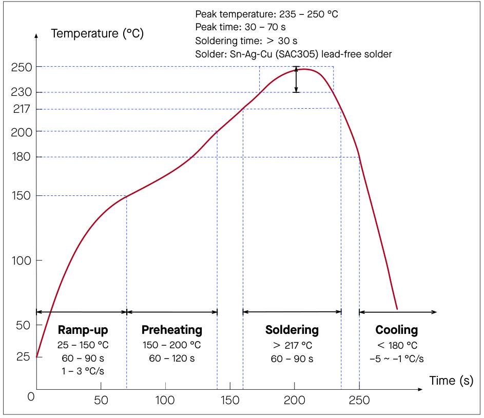

Profile values shown in the figure: ramp-up 25 – 150 °C, 60 – 90 s, 1 – 3 °C/s; preheating 150 – 200 °C, 60 – 120 s; soldering > 217 °C, 60 – 90 s; cooling < 180 °C, –5 ~ –1 °C/s. Peak temperature: 235 – 250 °C. Peak time: 30 – 70 s. Soldering time: > 30 s. Solder: Sn-Ag-Cu (SAC305) lead-free solder.

### M12.4 Ultrasonic Vibration

Avoid exposing Espressif modules to vibration from ultrasonic equipment, such as ultrasonic welders or ultrasonic cleaners. This vibration may induce resonance in the in-module crystal and lead to its malfunction or even failure. As a consequence, the module may stop working or its performance may deteriorate.

# Part C: ESP32-S3 Chip Datasheet

Source: ESP32-S3 Series Datasheet, Version 2.2. Xtensa 32-bit LX7 dual-core microprocessor; 2.4 GHz Wi-Fi (IEEE 802.11b/g/n) and Bluetooth 5 (LE); optional 1.8 V or 3.3 V flash and PSRAM in the chip's package; 45 GPIOs; QFN56 (7x7 mm) package.

Including: ESP32-S3, ESP32-S3FN8, ESP32-S3RH2, ESP32-S3R8, ESP32-S3R16V, ESP32-S3FH4R2, ESP32-S3R8V (End of life, EOL), ESP32-S3R2 (End of life, EOL, upgraded to ESP32-S3RH2).

The latest version of the datasheet is at <https://www.espressif.com/documentation/esp32-s3_datasheet_en.pdf>.

## C0 Product Overview

ESP32-S3 is a low-power MCU-based system on a chip (SoC) with integrated 2.4 GHz Wi-Fi and Bluetooth Low Energy (Bluetooth LE). It consists of high-performance dual-core microprocessor (Xtensa 32-bit LX7), a ULP coprocessor, a Wi-Fi baseband, a Bluetooth LE baseband, RF module, and numerous peripherals.

The functional block diagram of the SoC is shown below. In the diagram, components are marked either as "Normal" power consumption or as "Low power consumption components capable of working in Deep-sleep mode".

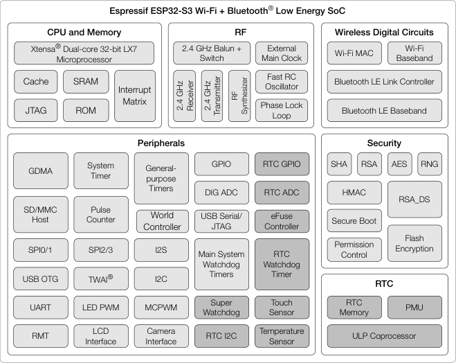

*ESP32-S3 Functional Block Diagram*

For more information on power consumption, see [C4 Power Management Unit (PMU)](#c4-functional-description).

### C0.1 Features

**Wi-Fi**

- Complies with IEEE 802.11b/g/n
- Supports 20 MHz and 40 MHz bandwidth in 2.4 GHz band
- 1T1R mode with data rate up to 150 Mbps
- Wi-Fi Multimedia (WMM)
- TX/RX A-MPDU, TX/RX A-MSDU
- Immediate Block ACK
- Fragmentation and defragmentation
- Automatic Beacon monitoring (hardware TSF)
- Four virtual Wi-Fi interfaces
- Simultaneous support for Infrastructure BSS in Station, SoftAP, or Station + SoftAP modes. Note that when ESP32-S3 scans in Station mode, the SoftAP channel will change along with the Station channel
- Antenna diversity
- 802.11mc FTM

**Bluetooth**

- Bluetooth LE: Bluetooth 5, Bluetooth Mesh
- High-power mode with up to 20 dBm transmission power
- Speed: 125 Kbps, 500 Kbps, 1 Mbps, 2 Mbps
- LE Advertising Extensions
- Multiple Advertising Sets
- LE Channel Selection Algorithm #2
- Internal co-existence mechanism between Wi-Fi and Bluetooth to share the same antenna

**CPU and Memory**

- Xtensa dual-core 32-bit LX7 microprocessor
- Clock speed: up to 240 MHz
- CoreMark score:
  - Two cores at 240 MHz: 1329.92 CoreMark; 5.54 CoreMark/MHz
- Five-stage pipeline
- 128-bit data bus and dedicated SIMD instructions
- Single precision floating point unit (FPU)
- Ultra-Low-Power (ULP) coprocessors:
  - ULP-RISC-V coprocessor
  - ULP-FSM coprocessor
- General DMA controller, with 5 transmit channels and 5 receive channels
- L1 cache
- ROM: 384 KB
- SRAM: 512 KB
- SRAM in RTC: 16 KB
- 4096-bit eFuse memory, up to 1792 bits for users
- Supported SPI protocols: SPI, Dual SPI, Quad SPI, Octal SPI, QPI and OPI interfaces that allow connection to flash, external RAM, and other SPI devices
- Flash controller with cache is supported
- Flash in-Circuit Programming (ICP) is supported

**Peripherals**

- 45 programmable GPIOs
  - 4 strapping GPIOs
  - GPIOs allocated for in-package memory:
    - 6 GPIOs for either in-package flash or PSRAM
    - 7 GPIOs when both in-package flash and PSRAM are integrated
- Connectivity interfaces:
  - Three UART interfaces
  - Two I2C interfaces
  - Two I2S interfaces
  - LCD interface
  - 8-bit ~ 16-bit DVP camera interface
  - Two SPI ports for communication with flash and RAM
  - Two general-purpose SPI ports
  - TWAI controller, compatible with ISO 11898-1 (CAN Specification 2.0)
  - Full-speed USB OTG
  - USB Serial/JTAG controller
  - SD/MMC host controller with 2 slots
  - LED PWM controller, up to 8 channels
  - Two Motor Control PWM (MCPWM)
  - RMT (TX/RX)
  - Pulse count controller
- Analog signal processing:
  - Two 12-bit SAR ADCs, up to 20 channels
  - Temperature sensor
  - 14 capacitive touch sensing IOs
- Timers:
  - Four 54-bit general-purpose timers
  - 52-bit system timer
  - Three watchdog timers

**Power Management**

- Fine-resolution power control, including clock frequency, duty cycle, Wi-Fi operating modes, and individual internal component control
- Four power modes designed for typical scenarios: Active, Modem-sleep, Light-sleep, Deep-sleep
- Power consumption in Deep-sleep mode is 7 µA
- RTC memory remains powered on in Deep-sleep mode

**Security**

- Secure boot - permission control on accessing internal and external memory
- Flash encryption - memory encryption and decryption
- Cryptographic hardware acceleration:
  - SHA Accelerator (FIPS PUB 180-4)
  - AES Accelerator (FIPS PUB 197)
  - RSA Accelerator
  - HMAC Accelerator
  - RSA Digital Signature Peripheral (RSA_DS)
  - Random Number Generator (RNG)

**RF Module**

- Antenna switches, RF balun, power amplifier, low-noise receive amplifier
- Up to +21 dBm of power for an 802.11b transmission
- Up to +19.5 dBm of power for an 802.11n transmission
- Up to -104.5 dBm of sensitivity for Bluetooth LE receiver (125 Kbps)

### C0.2 Applications

With low power consumption, ESP32-S3 is an ideal choice for IoT devices in the following areas:

- Smart Home
- Industrial Automation
- Health Care
- Consumer Electronics
- Smart Agriculture
- POS Machines
- Service Robot
- Audio Devices
- Generic Low-power IoT Sensor Hubs
- Generic Low-power IoT Data Loggers
- Cameras for Video Streaming
- USB Devices
- Speech Recognition
- Image Recognition
- Wi-Fi + Bluetooth Networking Card
- Touch and Proximity Sensing

## C1 ESP32-S3 Series Comparison

### C1.1 Nomenclature

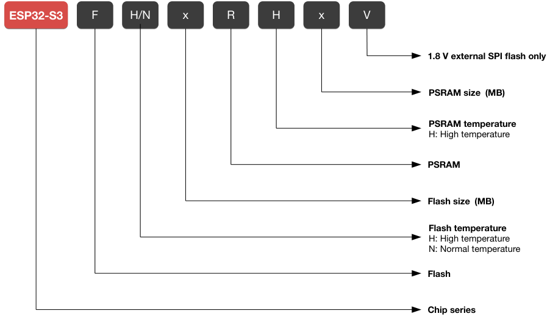

*Figure 1-1. ESP32-S3 Series Nomenclature*

The nomenclature is ESP32-S3 (chip series), F (Flash), H/N (flash temperature; H: High temperature, N: Normal temperature), x (flash size, MB), R (PSRAM), H (PSRAM temperature; H: High temperature), x (PSRAM size, MB), V (1.8 V external SPI flash only).

### C1.2 Comparison

**Table 1-1. ESP32-S3 Series Comparison**

| Part Number [1] | In-Package Flash [2] | In-Package PSRAM | Ambient Temp. [3] | VDD_SPI Voltage [4] | Chip Revision |
|---|---|---|---|---|---|
| ESP32-S3 | — | — | –40 ∼ 105 °C | 3.3 V/1.8 V | v0.1/v0.2 |
| ESP32-S3FN8 | 8 MB (Quad SPI) [5] | — | –40 ∼ 85 °C | 3.3 V | v0.1/v0.2 |
| ESP32-S3RH2 | — | 2 MB (Quad SPI) | –40 ∼ 105 °C | 3.3 V | v0.2 |
| ESP32-S3R8 | — | 8 MB (Octal SPI) | –40 ∼ 65 °C | 3.3 V | v0.1/v0.2 |
| ESP32-S3R16V | — | 16 MB (Octal SPI) | –40 ∼ 65 °C | 1.8 V | v0.2 |
| ESP32-S3FH4R2 | 4 MB (Quad SPI) | 2 MB (Quad SPI) | –40 ∼ 85 °C | 3.3 V | v0.1/v0.2 |
| ESP32-S3R8V (EOL) | — | 8 MB (Octal SPI) | –40 ∼ 65 °C | 1.8 V | v0.1/v0.2 |
| ESP32-S3R2 (EOL) [6] | — | 2 MB (Quad SPI) | –40 ∼ 85 °C | 3.3 V | v0.1/v0.2 |

1. For details on chip marking and packing, see [C7 Packaging](#c7-packaging).
2. For information about in-package flash, see also Section 4.1.2.1 Internal Memory (in the TRM memory chapters). By default, the SPI flash on the chip operates at a maximum clock frequency of 80 MHz and does not support the auto suspend feature. If you have a requirement for a higher flash clock frequency of 120 MHz or if you need the flash auto suspend feature, please [contact us](https://espressif.com/en/contact-us/sales-questions).
3. Ambient temperature specifies the recommended temperature range of the environment immediately outside an Espressif chip. For chips with Octal SPI PSRAM (ESP32-S3R8, ESP32-S3R8V, and ESP32-S3R16V), if the PSRAM ECC function is enabled, the maximum ambient temperature can be improved to 85 °C, while the usable size of PSRAM will be reduced by 1/16.
4. For more information on VDD_SPI, see [C2.5 Power Supply](#c25-power-supply).
5. For details about SPI modes, see [C2.6 Pin Mapping Between Chip and Flash/PSRAM](#c26-pin-mapping-between-chip-and-flashpsram).
6. ESP32-S3R2 has been upgraded to ESP32-S3RH2. For more information, see [PCN](https://documentation.espressif.com/en/PCN20251001_ESP32-S3R2_ESP32-D0WDR2-V3_升级.html).

### C1.3 Chip Revision

As shown in Table 1-1 *ESP32-S3 Series Comparison*, ESP32-S3 now has multiple chip revisions available on the market using the same part number.

For chip revision identification, ESP-IDF release that supports a specific chip revision, and errors fixed in each chip revision, please refer to [ESP32-S3 Series SoC Errata](https://espressif.com/sites/default/files/documentation/esp32-s3_errata_en.pdf#errata-chip-rev).

## C2 Pins

### C2.1 Pin Layout

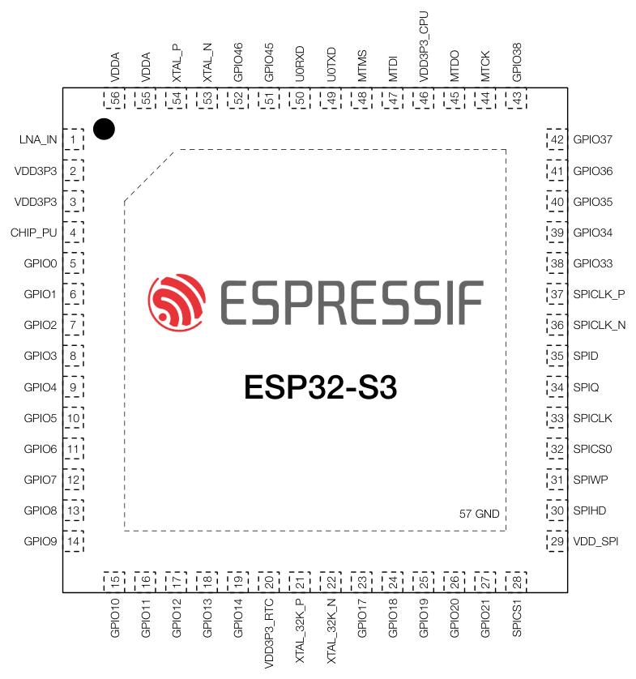

*Figure 2-1. ESP32-S3 Pin Layout (Top View)*

### C2.2 Pin Overview

The ESP32-S3 chip integrates multiple peripherals that require communication with the outside world. To keep the chip package size reasonably small, the number of available pins has to be limited. So the only way to route all the incoming and outgoing signals is through pin multiplexing. Pin muxing is controlled via software programmable registers (see [ESP32-S3 Technical Reference Manual](https://espressif.com/documentation/esp32-s3_technical_reference_manual_en.pdf#iomuxgpio-reg-summ) > Chapter *IO MUX and GPIO Matrix*).

All in all, the ESP32-S3 chip has the following types of pins:

- **IO pins** with the following predefined sets of functions to choose from:
  - Each IO pin has predefined **IO MUX functions** - see Table 2-4 *IO MUX Functions*
  - Some IO pins have predefined **RTC functions** - see Table 2-6 *RTC Functions*
  - Some IO pins have predefined **analog functions** - see Table 2-8 *Analog Functions*

  *Predefined functions* means that each IO pin has a set of direct connections to certain on-chip peripherals. During run-time, the user can configure which peripheral from a predefined set to connect to a certain pin at a certain time via memory mapped registers (see [ESP32-S3 Technical Reference Manual](https://espressif.com/documentation/esp32-s3_technical_reference_manual_en.pdf#iomuxgpio) > Chapter *IO MUX and GPIO pins*).
- **Analog pins** that have exclusively-dedicated analog functions - see Table 2-10 *Analog Pins*
- **Power pins** that supply power to the chip components and non-power pins - see Table 2-11 *Power Pins*

Table 2-1 *Pin Overview* gives an overview of all the pins. For more information, see the respective sections for each pin type below, or [C8 Consolidated Pin Overview](#c8-consolidated-pin-overview).

**Table 2-1. Pin Overview**

| Pin No. | Pin Name | Pin Type | Pin Providing Power [2-5] | At Reset [6] | After Reset [6] | IO MUX [1] | RTC IO MUX | Analog |
|---|---|---|---|---|---|---|---|---|
| 1 | LNA_IN | Analog |  |  |  |  |  |  |
| 2 | VDD3P3 | Power |  |  |  |  |  |  |
| 3 | VDD3P3 | Power |  |  |  |  |  |  |
| 4 | CHIP_PU | Analog | VDD3P3_RTC |  |  |  |  |  |
| 5 | GPIO0 | IO | VDD3P3_RTC | WPU, IE | WPU, IE | **IO MUX** | RTC IO MUX |  |
| 6 | GPIO1 | IO | VDD3P3_RTC | IE | IE | **IO MUX** | RTC IO MUX | Analog |
| 7 | GPIO2 | IO | VDD3P3_RTC | IE | IE | **IO MUX** | RTC IO MUX | Analog |
| 8 | GPIO3 | IO | VDD3P3_RTC | IE | IE | **IO MUX** | RTC IO MUX | Analog |
| 9 | GPIO4 | IO | VDD3P3_RTC |  |  | **IO MUX** | RTC IO MUX | Analog |
| 10 | GPIO5 | IO | VDD3P3_RTC |  |  | **IO MUX** | RTC IO MUX | Analog |
| 11 | GPIO6 | IO | VDD3P3_RTC |  |  | **IO MUX** | RTC IO MUX | Analog |
| 12 | GPIO7 | IO | VDD3P3_RTC |  |  | **IO MUX** | RTC IO MUX | Analog |
| 13 | GPIO8 | IO | VDD3P3_RTC |  |  | **IO MUX** | RTC IO MUX | Analog |
| 14 | GPIO9 | IO | VDD3P3_RTC |  | IE | **IO MUX** | RTC IO MUX | Analog |
| 15 | GPIO10 | IO | VDD3P3_RTC |  | IE | **IO MUX** | RTC IO MUX | Analog |
| 16 | GPIO11 | IO | VDD3P3_RTC |  | IE | **IO MUX** | RTC IO MUX | Analog |
| 17 | GPIO12 | IO | VDD3P3_RTC |  | IE | **IO MUX** | RTC IO MUX | Analog |
| 18 | GPIO13 | IO | VDD3P3_RTC |  | IE | **IO MUX** | RTC IO MUX | Analog |
| 19 | GPIO14 | IO | VDD3P3_RTC |  | IE | **IO MUX** | RTC IO MUX | Analog |
| 20 | VDD3P3_RTC | Power |  |  |  |  |  |  |
| 21 | XTAL_32K_P | IO | VDD3P3_RTC |  |  | **IO MUX** | RTC IO MUX | Analog |
| 22 | XTAL_32K_N | IO | VDD3P3_RTC |  |  | **IO MUX** | RTC IO MUX | Analog |
| 23 | GPIO17 | IO | VDD3P3_RTC |  | IE | **IO MUX** | RTC IO MUX | Analog |
| 24 | GPIO18 | IO | VDD3P3_RTC |  | IE | **IO MUX** | RTC IO MUX | Analog |
| 25 | GPIO19 | IO | VDD3P3_RTC |  |  | IO MUX | RTC IO MUX | **Analog** |
| 26 | GPIO20 | IO | VDD3P3_RTC | USB_PU | USB_PU | IO MUX | RTC IO MUX | **Analog** |
| 27 | GPIO21 | IO | VDD3P3_RTC |  |  | **IO MUX** | RTC IO MUX |  |
| 28 | SPICS1 | IO | VDD_SPI | WPU, IE | WPU, IE | **IO MUX** |  |  |
| 29 | VDD_SPI | Power |  |  |  |  |  |  |
| 30 | SPIHD | IO | VDD_SPI | WPU, IE | WPU, IE | **IO MUX** |  |  |
| 31 | SPIWP | IO | VDD_SPI | WPU, IE | WPU, IE | **IO MUX** |  |  |
| 32 | SPICS0 | IO | VDD_SPI | WPU, IE | WPU, IE | **IO MUX** |  |  |
| 33 | SPICLK | IO | VDD_SPI | WPU, IE | WPU, IE | **IO MUX** |  |  |
| 34 | SPIQ | IO | VDD_SPI | WPU, IE | WPU, IE | **IO MUX** |  |  |
| 35 | SPID | IO | VDD_SPI | WPU, IE | WPU, IE | **IO MUX** |  |  |
| 36 | SPICLK_N | IO | VDD_SPI/VDD3P3_CPU | IE | IE | **IO MUX** |  |  |
| 37 | SPICLK_P | IO | VDD_SPI/VDD3P3_CPU | IE | IE | **IO MUX** |  |  |
| 38 | GPIO33 | IO | VDD_SPI/VDD3P3_CPU |  | IE | **IO MUX** |  |  |
| 39 | GPIO34 | IO | VDD_SPI/VDD3P3_CPU |  | IE | **IO MUX** |  |  |
| 40 | GPIO35 | IO | VDD_SPI/VDD3P3_CPU |  | IE | **IO MUX** |  |  |
| 41 | GPIO36 | IO | VDD_SPI/VDD3P3_CPU |  | IE | **IO MUX** |  |  |
| 42 | GPIO37 | IO | VDD_SPI/VDD3P3_CPU |  | IE | **IO MUX** |  |  |
| 43 | GPIO38 | IO | VDD3P3_CPU |  | IE | **IO MUX** |  |  |
| 44 | MTCK | IO | VDD3P3_CPU |  | IE [7] | **IO MUX** |  |  |
| 45 | MTDO | IO | VDD3P3_CPU |  | IE | **IO MUX** |  |  |
| 46 | VDD3P3_CPU | Power |  |  |  |  |  |  |
| 47 | MTDI | IO | VDD3P3_CPU |  | IE | **IO MUX** |  |  |
| 48 | MTMS | IO | VDD3P3_CPU |  | IE | **IO MUX** |  |  |
| 49 | U0TXD | IO | VDD3P3_CPU | WPU, IE | WPU, IE | **IO MUX** |  |  |
| 50 | U0RXD | IO | VDD3P3_CPU | WPU, IE | WPU, IE | **IO MUX** |  |  |
| 51 | GPIO45 | IO | VDD3P3_CPU | WPD, IE | WPD, IE | **IO MUX** |  |  |
| 52 | GPIO46 | IO | VDD3P3_CPU | WPD, IE | WPD, IE | **IO MUX** |  |  |
| 53 | XTAL_N | Analog |  |  |  |  |  |  |
| 54 | XTAL_P | Analog |  |  |  |  |  |  |
| 55 | VDDA | Power |  |  |  |  |  |  |
| 56 | VDDA | Power |  |  |  |  |  |  |
| 57 | GND | Power |  |  |  |  |  |  |

1. Bold marks the pin function set in which a pin has its default function in the default boot mode. For more information about the boot mode, see [C3.1 Chip Boot Mode Control](#c31-chip-boot-mode-control).
2. In column Pin Providing Power, regarding pins powered by VDD_SPI:
   - Power actually comes from the internal power rail supplying power to VDD_SPI. For details, see [C2.5.2 Power Scheme](#c252-power-scheme).
3. In column Pin Providing Power, regarding pins powered by VDD3P3_CPU / VDD_SPI:
   - Pin Providing Power (either VDD3P3_CPU or VDD_SPI) is decided by eFuse bit EFUSE_PIN_POWER_SELECTION (see [ESP32-S3 Technical Reference Manual](https://espressif.com/documentation/esp32-s3_technical_reference_manual_en.pdf#efuse) > Chapter *eFuse Controller*) and can be configured via the IO_MUX_PAD_POWER_CTRL bit (see [ESP32-S3 Technical Reference Manual](https://espressif.com/documentation/esp32-s3_technical_reference_manual_en.pdf#iomuxgpio) > Chapter *IO MUX and GPIO pins*).
4. For ESP32-S3R8V and ESP32-S3R16V chip, as the VDD_SPI voltage has been set to 1.8 V, the working voltage for pins SPICLK_N and SPICLK_P (GPIO47 and GPIO48) would also be 1.8 V, which is different from other GPIOs.
5. The default drive strengths for each pin are as follows:
   - GPIO17 and GPIO18: 10 mA
   - GPIO19 and GPIO20: 40 mA
   - All other pins: 20 mA
6. Column Pin Settings shows predefined settings at reset and after reset with the following abbreviations:
   - IE - input enabled
   - WPU - internal weak pull-up resistor enabled
   - WPD - internal weak pull-down resistor enabled
   - USB_PU - USB pull-up resistor enabled
     - By default, the USB function is enabled for USB pins (i.e., GPIO19 and GPIO20), and the pin pull-up is decided by the USB pull-up. The USB pull-up is controlled by USB_SERIAL_JTAG_DP/DM_PULLUP and the pull-up resistor value is controlled by USB_SERIAL_JTAG_PULLUP_VALUE. For details, see [ESP32-S3 Technical Reference Manual](https://espressif.com/documentation/esp32-s3_technical_reference_manual_en.pdf#usbserialjtag) > Chapter *USB Serial/JTAG Controller*.
     - When the USB function is disabled, USB pins are used as regular GPIOs and the pin's internal weak pull-up and pull-down resistors are disabled by default (configurable by IO_MUX_FUN_WPU/WPD). For details, see [ESP32-S3 Technical Reference Manual](https://espressif.com/documentation/esp32-s3_technical_reference_manual_en.pdf#iomuxgpio) > Chapter *IO MUX and GPIO Matrix*.
7. Depends on the value of EFUSE_DIS_PAD_JTAG
   - 0 - WPU is enabled
   - 1 - pin floating

Some pins have glitches during power-up. See details in Table 2-2.

**Table 2-2. Power-Up Glitches on Pins**

| Pin | Glitch [1] | Typical Time Period (µs) |
|---|---|---|
| GPIO1 | Low-level glitch | 60 |
| GPIO2 | Low-level glitch | 60 |
| GPIO3 | Low-level glitch | 60 |
| GPIO4 | Low-level glitch | 60 |
| GPIO5 | Low-level glitch | 60 |
| GPIO6 | Low-level glitch | 60 |
| GPIO7 | Low-level glitch | 60 |
| GPIO8 | Low-level glitch | 60 |
| GPIO9 | Low-level glitch | 60 |
| GPIO10 | Low-level glitch | 60 |
| GPIO11 | Low-level glitch | 60 |
| GPIO12 | Low-level glitch | 60 |
| GPIO13 | Low-level glitch | 60 |
| GPIO14 | Low-level glitch | 60 |
| XTAL_32K_P | Low-level glitch | 60 |
| XTAL_32K_N | Low-level glitch | 60 |
| GPIO17 | Low-level glitch | 60 |
| GPIO18 | Low-level glitch | 60 |
| GPIO18 | High-level glitch | 60 |
| GPIO19 | Low-level glitch | 60 |
| GPIO19 | High-level glitch [2] | 60 |
| GPIO20 | Pull-down glitch | 60 |
| GPIO20 | High-level glitch [2] | 60 |

1. Low-level glitch: the pin is at a low level output status during the time period; High-level glitch: the pin is at a high level output status during the time period; Pull-down glitch: the pin is at an internal weak pulled-down status during the time period; Pull-up glitch: the pin is at an internal weak pulled-up status during the time period. Please refer to Table 5-4 *DC Characteristics (3.3 V, 25 °C)* ([C5.4](#c54-dc-characteristics-33-v-25-c)) for detailed parameters about low/high-level and pull-down/up.
2. GPIO19 and GPIO20 pins both have two high-level glitches during chip power-up, each lasting for about 60 µs. The total duration for the glitches and the delay are 3.2 ms and 2 ms respectively for GPIO19 and GPIO20.

### C2.3 IO Pins

#### C2.3.1 IO MUX Functions

The IO MUX allows multiple input/output signals to be connected to a single input/output pin. Each IO pin of ESP32-S3 can be connected to one of the five signals (IO MUX functions, i.e., F0-F4), as listed in Table 2-4 *IO MUX Functions*.

Among the five sets of signals:

- Some are routed via the GPIO Matrix (GPIO0, GPIO1, etc.), which incorporates internal signal routing circuitry for mapping signals programmatically. It gives the pin access to almost any peripheral signals. However, the flexibility of programmatic mapping comes at a cost as it might affect the latency of routed signals. For details about connecting to peripheral signals via GPIO Matrix, see [ESP32-S3 Technical Reference Manual](https://espressif.com/documentation/esp32-s3_technical_reference_manual_en.pdf#iomuxgpio-reg-summ) > Chapter *IO MUX and GPIO Matrix*.
- Some are directly routed from certain peripherals (U0TXD, MTCK, etc.), including UART0/1, JTAG, SPI0/1, and SPI2 - see Table 2-3 *Peripheral Signals Routed via IO MUX*.

**Table 2-3. Peripheral Signals Routed via IO MUX**

| Pin Function | Signal | Description |
|---|---|---|
| U…TXD | Transmit data | UART0/1 interface |
| U…RXD | Receive data | UART0/1 interface |
| U…RTS | Request to send | UART0/1 interface |
| U…CTS | Clear to send | UART0/1 interface |
| MTCK | Test clock | JTAG interface for debugging |
| MTDO | Test Data Out | JTAG interface for debugging |
| MTDI | Test Data In | JTAG interface for debugging |
| MTMS | Test Mode Select | JTAG interface for debugging |
| SPIQ | Master in, slave out | SPI0/1 interface (powered by VDD_SPI) for connection to in-package or off-package flash/PSRAM via the SPI bus. It supports 1-, 2-, 4-line SPI modes. See also [C2.6 Pin Mapping Between Chip and Flash/PSRAM](#c26-pin-mapping-between-chip-and-flashpsram) |
| SPID | Master out, slave in | SPI0/1 interface (powered by VDD_SPI) for connection to in-package or off-package flash/PSRAM via the SPI bus. It supports 1-, 2-, 4-line SPI modes. See also [C2.6 Pin Mapping Between Chip and Flash/PSRAM](#c26-pin-mapping-between-chip-and-flashpsram) |
| SPIHD | Hold | SPI0/1 interface (powered by VDD_SPI) for connection to in-package or off-package flash/PSRAM via the SPI bus. It supports 1-, 2-, 4-line SPI modes. See also [C2.6 Pin Mapping Between Chip and Flash/PSRAM](#c26-pin-mapping-between-chip-and-flashpsram) |
| SPIWP | Write protect | SPI0/1 interface (powered by VDD_SPI) for connection to in-package or off-package flash/PSRAM via the SPI bus. It supports 1-, 2-, 4-line SPI modes. See also [C2.6 Pin Mapping Between Chip and Flash/PSRAM](#c26-pin-mapping-between-chip-and-flashpsram) |
| SPICLK | Clock | SPI0/1 interface (powered by VDD_SPI) for connection to in-package or off-package flash/PSRAM via the SPI bus. It supports 1-, 2-, 4-line SPI modes. See also [C2.6 Pin Mapping Between Chip and Flash/PSRAM](#c26-pin-mapping-between-chip-and-flashpsram) |
| SPICS… | Chip select | SPI0/1 interface (powered by VDD_SPI) for connection to in-package or off-package flash/PSRAM via the SPI bus. It supports 1-, 2-, 4-line SPI modes. See also [C2.6 Pin Mapping Between Chip and Flash/PSRAM](#c26-pin-mapping-between-chip-and-flashpsram) |
| SPIIO… | Data | SPI0/1 interface (powered by VDD_SPI or VDD3P3_CPU) for the higher 4 bits data line interface and DQS interface in 8-line SPI mode |
| SPIDQS | Data strobe/data mask | SPI0/1 interface (powered by VDD_SPI or VDD3P3_CPU) for the higher 4 bits data line interface and DQS interface in 8-line SPI mode |
| SPICLK_N_DIFF | Negative clock signal | Differential clock negative/positive for the SPI bus |
| SPICLK_P_DIFF | Positive clock signal | Differential clock negative/positive for the SPI bus |
| SUBSPIQ | Master in, slave out | SPI0/1 interface (powered by VDD3P3_RTC or VDD3V3_CPU) for connection to in-package or off-package flash/PSRAM via the SUBSPI bus. It supports 1-, 2-, 4-line SPI modes |
| SUBSPID | Master out, slave in | SPI0/1 interface (powered by VDD3P3_RTC or VDD3V3_CPU) for connection to in-package or off-package flash/PSRAM via the SUBSPI bus. It supports 1-, 2-, 4-line SPI modes |
| SUBSPIHD | Hold | SPI0/1 interface (powered by VDD3P3_RTC or VDD3V3_CPU) for connection to in-package or off-package flash/PSRAM via the SUBSPI bus. It supports 1-, 2-, 4-line SPI modes |
| SUBSPIWP | Write protect | SPI0/1 interface (powered by VDD3P3_RTC or VDD3V3_CPU) for connection to in-package or off-package flash/PSRAM via the SUBSPI bus. It supports 1-, 2-, 4-line SPI modes |
| SUBSPICLK | Clock | SPI0/1 interface (powered by VDD3P3_RTC or VDD3V3_CPU) for connection to in-package or off-package flash/PSRAM via the SUBSPI bus. It supports 1-, 2-, 4-line SPI modes |
| SUBSPICS… | Chip select | SPI0/1 interface (powered by VDD3P3_RTC or VDD3V3_CPU) for connection to in-package or off-package flash/PSRAM via the SUBSPI bus. It supports 1-, 2-, 4-line SPI modes |
| SUBSPICLK_N_DIFF | Negative clock signal | Differential clock negative/positive for the SUBSPI bus |
| SUBSPICLK_P_DIFF | Positive clock signal | Differential clock negative/positive for the SUBSPI bus |
| FSPIQ | Master in, slave out | SPI2 interface for fast SPI connection. It supports 1-, 2-, 4-line SPI modes |
| FSPID | Master out, slave in | SPI2 interface for fast SPI connection. It supports 1-, 2-, 4-line SPI modes |
| FSPIHD | Hold | SPI2 interface for fast SPI connection. It supports 1-, 2-, 4-line SPI modes |
| FSPIWP | Write protect | SPI2 interface for fast SPI connection. It supports 1-, 2-, 4-line SPI modes |
| FSPICLK | Clock | SPI2 interface for fast SPI connection. It supports 1-, 2-, 4-line SPI modes |
| FSPICS0 | Chip select | SPI2 interface for fast SPI connection. It supports 1-, 2-, 4-line SPI modes |
| FSPIIO… | Data | The higher 4 bits data line interface and DQS interface for SPI2 interface in 8-line SPI mode |
| FSPIDQS | Data strobe/data mask | The higher 4 bits data line interface and DQS interface for SPI2 interface in 8-line SPI mode |
| CLK_OUT… | Clock output | Output clock signals generated by the chip's internal components |

Table 2-4 *IO MUX Functions* shows the IO MUX functions of IO pins.

**Table 2-4. IO MUX Functions**

| Pin No. | GPIO [2] | F0 | F0 Type [3] | F1 | F1 Type | F2 | F2 Type | F3 | F3 Type | F4 | F4 Type |
|---|---|---|---|---|---|---|---|---|---|---|---|
| 5 | GPIO0 [Y] | GPIO0 | I/O/T | **GPIO0** | I/O/T |  |  |  |  |  |  |
| 6 | GPIO1 | GPIO1 | I/O/T | **GPIO1** | I/O/T |  |  |  |  |  |  |
| 7 | GPIO2 | GPIO2 | I/O/T | **GPIO2** | I/O/T |  |  |  |  |  |  |
| 8 | GPIO3 [Y] | GPIO3 | I/O/T | **GPIO3** | I/O/T |  |  |  |  |  |  |
| 9 | GPIO4 | GPIO4 | I/O/T | **GPIO4** | I/O/T |  |  |  |  |  |  |
| 10 | GPIO5 | GPIO5 | I/O/T | **GPIO5** | I/O/T |  |  |  |  |  |  |
| 11 | GPIO6 | GPIO6 | I/O/T | **GPIO6** | I/O/T |  |  |  |  |  |  |
| 12 | GPIO7 | GPIO7 | I/O/T | **GPIO7** | I/O/T |  |  |  |  |  |  |
| 13 | GPIO8 | GPIO8 | I/O/T | **GPIO8** | I/O/T |  |  | SUBSPICS1 | O/T |  |  |
| 14 | GPIO9 | GPIO9 | I/O/T | **GPIO9** | I/O/T |  |  | SUBSPIHD | I1/O/T | FSPIHD | I1/O/T |
| 15 | GPIO10 | GPIO10 | I/O/T | **GPIO10** | I/O/T | FSPIIO4 | I1/O/T | SUBSPICS0 | O/T | FSPICS0 | I1/O/T |
| 16 | GPIO11 | GPIO11 | I/O/T | **GPIO11** | I/O/T | FSPIIO5 | I1/O/T | SUBSPID | I1/O/T | FSPID | I1/O/T |
| 17 | GPIO12 | GPIO12 | I/O/T | **GPIO12** | I/O/T | FSPIIO6 | I1/O/T | SUBSPICLK | O/T | FSPICLK | I1/O/T |
| 18 | GPIO13 | GPIO13 | I/O/T | **GPIO13** | I/O/T | FSPIIO7 | I1/O/T | SUBSPIQ | I1/O/T | FSPIQ | I1/O/T |
| 19 | GPIO14 | GPIO14 | I/O/T | **GPIO14** | I/O/T | FSPIDQS | O/T | SUBSPIWP | I1/O/T | FSPIWP | I1/O/T |
| 21 | GPIO15 | GPIO15 | I/O/T | **GPIO15** | I/O/T | U0RTS | O |  |  |  |  |
| 22 | GPIO16 | GPIO16 | I/O/T | **GPIO16** | I/O/T | U0CTS | I1 |  |  |  |  |
| 23 | GPIO17 | GPIO17 | I/O/T | **GPIO17** | I/O/T | U1TXD | O |  |  |  |  |
| 24 | GPIO18 | GPIO18 | I/O/T | **GPIO18** | I/O/T | U1RXD | I1 | CLK_OUT3 | O |  |  |
| 25 | GPIO19 | GPIO19 | I/O/T | GPIO19 | I/O/T | U1RTS | O | CLK_OUT2 | O |  |  |
| 26 | GPIO20 | GPIO20 | I/O/T | GPIO20 | I/O/T | U1CTS | I1 | CLK_OUT1 | O |  |  |
| 27 | GPIO21 | GPIO21 | I/O/T | **GPIO21** | I/O/T |  |  |  |  |  |  |
| 28 | GPIO26 | **SPICS1** [R] | O/T | GPIO26 | I/O/T |  |  |  |  |  |  |
| 30 | GPIO27 | **SPIHD** [R] | I1/O/T | GPIO27 | I/O/T |  |  |  |  |  |  |
| 31 | GPIO28 | **SPIWP** [R] | I1/O/T | GPIO28 | I/O/T |  |  |  |  |  |  |
| 32 | GPIO29 | **SPICS0** [R] | O/T | GPIO29 | I/O/T |  |  |  |  |  |  |
| 33 | GPIO30 | **SPICLK** [R] | O/T | GPIO30 | I/O/T |  |  |  |  |  |  |
| 34 | GPIO31 | **SPIQ** [R] | I1/O/T | GPIO31 | I/O/T |  |  |  |  |  |  |
| 35 | GPIO32 | **SPID** [R] | I1/O/T | GPIO32 | I/O/T |  |  |  |  |  |  |
| 36 | GPIO48 | SPICLK_N_DIFF | O/T | **GPIO48** | I/O/T | SUBSPICLK_N_DIFF | O/T |  |  |  |  |
| 37 | GPIO47 | SPICLK_P_DIFF | O/T | **GPIO47** | I/O/T | SUBSPICLK_P_DIFF | O/T |  |  |  |  |
| 38 | GPIO33 | GPIO33 | I/O/T | **GPIO33** | I/O/T | FSPIHD | I1/O/T | SUBSPIHD | I1/O/T | SPIIO4 [Y] | I1/O/T |
| 39 | GPIO34 | GPIO34 | I/O/T | **GPIO34** | I/O/T | FSPICS0 | I1/O/T | SUBSPICS0 | O/T | SPIIO5 [Y] | I1/O/T |
| 40 | GPIO35 | GPIO35 | I/O/T | **GPIO35** | I/O/T | FSPID | I1/O/T | SUBSPID | I1/O/T | SPIIO6 [Y] | I1/O/T |
| 41 | GPIO36 | GPIO36 | I/O/T | **GPIO36** | I/O/T | FSPICLK | I1/O/T | SUBSPICLK | O/T | SPIIO7 [Y] | I1/O/T |
| 42 | GPIO37 | GPIO37 | I/O/T | **GPIO37** | I/O/T | FSPIQ | I1/O/T | SUBSPIQ | I1/O/T | SPIDQS [Y] | I0/O/T |
| 43 | GPIO38 | GPIO38 | I/O/T | **GPIO38** | I/O/T | FSPIWP | I1/O/T | SUBSPIWP | I1/O/T |  |  |
| 44 | GPIO39 | **MTCK** [Y] | I1 | GPIO39 | I/O/T | CLK_OUT3 | O | SUBSPICS1 | O/T |  |  |
| 45 | GPIO40 | **MTDO** [Y] | O/T | GPIO40 | I/O/T | CLK_OUT2 | O |  |  |  |  |
| 47 | GPIO41 | **MTDI** [Y] | I1 | GPIO41 | I/O/T | CLK_OUT1 | O |  |  |  |  |
| 48 | GPIO42 | **MTMS** [Y] | I1 | GPIO42 | I/O/T |  |  |  |  |  |  |
| 49 | GPIO43 | **U0TXD** [Y] | O | GPIO43 | I/O/T | CLK_OUT1 | O |  |  |  |  |
| 50 | GPIO44 | **U0RXD** [Y] | I1 | GPIO44 | I/O/T | CLK_OUT2 | O |  |  |  |  |
| 51 | GPIO45 [Y] | GPIO45 | I/O/T | **GPIO45** | I/O/T |  |  |  |  |  |  |
| 52 | GPIO46 [Y] | GPIO46 | I/O/T | **GPIO46** | I/O/T |  |  |  |  |  |  |

1. Bold marks the default pin functions in the default boot mode. For more information about the boot mode, see [C3.1 Chip Boot Mode Control](#c31-chip-boot-mode-control).
2. Regarding highlighted cells, see [C2.3.4 Restrictions for GPIOs and RTC_GPIOs](#c234-restrictions-for-gpios-and-rtc_gpios). In this document, the datasheet's colour highlighting is shown as `[R]` (red: allocated for communication with in-package flash/PSRAM) and `[Y]` (yellow: pins with an important function).
3. Each IO MUX function (F*n*, *n* = 0 ~ 4) is associated with a *type*. The description of *type* is as follows:
   - I - input. O - output. T - high impedance.
   - I1 - input; if the pin is assigned a function other than F*n*, the input signal of F*n* is always 1.
   - I0 - input; if the pin is assigned a function other than F*n*, the input signal of F*n* is always 0.

#### C2.3.2 RTC Functions

When the chip is in Deep-sleep mode, the IO MUX described in [C2.3.1 IO MUX Functions](#c231-io-mux-functions) will not work. That is where the RTC IO MUX comes in. It allows multiple input/output signals to be a single input/output pin in Deep-sleep mode, as the pin is connected to the RTC system and powered by VDD3P3_RTC.

RTC IO pins can be assigned to RTC functions. They can

- Either work as RTC GPIOs (RTC_GPIO0, RTC_GPIO1, etc.), connected to the ULP coprocessor
- Or connect to RTC peripheral signals (sar_i2c_scl_0, sar_i2c_sda_0, etc.) - see Table 2-5 *RTC Peripheral Signals Routed via RTC IO MUX*

**Table 2-5. RTC Peripheral Signals Routed via RTC IO MUX**

| Pin Function | Signal | Description |
|---|---|---|
| sar_i2c_scl… | Serial clock | RTC I2C0/1 interface |
| sar_i2c_sda… | Serial data | RTC I2C0/1 interface |

Table 2-6 *RTC Functions* shows the RTC functions of RTC IO pins.

**Table 2-6. RTC Functions**

| Pin No. | RTC IO Name [1] | F0 | F1 | F2 | F3 |
|---|---|---|---|---|---|
| 5 | RTC_GPIO0 [Y] | RTC_GPIO0 |  |  | sar_i2c_scl_0 |
| 6 | RTC_GPIO1 | RTC_GPIO1 |  |  | sar_i2c_sda_0 |
| 7 | RTC_GPIO2 | RTC_GPIO2 |  |  | sar_i2c_scl_1 |
| 8 | RTC_GPIO3 [Y] | RTC_GPIO3 |  |  | sar_i2c_sda_1 |
| 9 | RTC_GPIO4 | RTC_GPIO4 |  |  |  |
| 10 | RTC_GPIO5 | RTC_GPIO5 |  |  |  |
| 11 | RTC_GPIO6 | RTC_GPIO6 |  |  |  |
| 12 | RTC_GPIO7 | RTC_GPIO7 |  |  |  |
| 13 | RTC_GPIO8 | RTC_GPIO8 |  |  |  |
| 14 | RTC_GPIO9 | RTC_GPIO9 |  |  |  |
| 15 | RTC_GPIO10 | RTC_GPIO10 |  |  |  |
| 16 | RTC_GPIO11 | RTC_GPIO11 |  |  |  |
| 17 | RTC_GPIO12 | RTC_GPIO12 |  |  |  |
| 18 | RTC_GPIO13 | RTC_GPIO13 |  |  |  |
| 19 | RTC_GPIO14 | RTC_GPIO14 |  |  |  |
| 21 | RTC_GPIO15 | RTC_GPIO15 |  |  |  |
| 22 | RTC_GPIO16 | RTC_GPIO16 |  |  |  |
| 23 | RTC_GPIO17 | RTC_GPIO17 |  |  |  |
| 24 | RTC_GPIO18 | RTC_GPIO18 |  |  |  |
| 25 | RTC_GPIO19 | RTC_GPIO19 |  |  |  |
| 26 | RTC_GPIO20 | RTC_GPIO20 |  |  |  |
| 27 | RTC_GPIO21 | RTC_GPIO21 |  |  |  |

1. This column lists the RTC GPIO names, since RTC functions are configured with RTC GPIO registers that use RTC GPIO numbering.
2. Regarding highlighted cells (`[Y]`), see [C2.3.4 Restrictions for GPIOs and RTC_GPIOs](#c234-restrictions-for-gpios-and-rtc_gpios).

#### C2.3.3 Analog Functions

Some IO pins also have analog functions, for analog peripherals (such as ADC) in any power mode. Internal analog signals are routed to these analog functions, see Table 2-7 *Analog Signals Routed to Analog Functions*.

**Table 2-7. Analog Signals Routed to Analog Functions**

| Pin Function | Signal | Description |
|---|---|---|
| TOUCH… | Touch sensor channel … signal | Touch sensor interface |
| ADC…_CH… | ADC1/2 channel … signal | ADC1/2 interface |
| XTAL_32K_N | Negative clock signal | 32 kHz external clock input/output connected to ESP32-S3's oscillator |
| XTAL_32K_P | Positive clock signal | 32 kHz external clock input/output connected to ESP32-S3's oscillator |
| USB_D- | Data - | USB OTG and USB Serial/JTAG function |
| USB_D+ | Data + | USB OTG and USB Serial/JTAG function |

Table 2-8 *Analog Functions* shows the analog functions of IO pins.

**Table 2-8. Analog Functions**

| Pin No. | GPIO [3] | F0 | F1 |
|---|---|---|---|
| 6 | RTC_GPIO1 | TOUCH1 | ADC1_CH0 |
| 7 | RTC_GPIO2 | TOUCH2 | ADC1_CH1 |
| 8 | RTC_GPIO3 [Y] | TOUCH3 | ADC1_CH2 |
| 9 | RTC_GPIO4 | TOUCH4 | ADC1_CH3 |
| 10 | RTC_GPIO5 | TOUCH5 | ADC1_CH4 |
| 11 | RTC_GPIO6 | TOUCH6 | ADC1_CH5 |
| 12 | RTC_GPIO7 | TOUCH7 | ADC1_CH6 |
| 13 | RTC_GPIO8 | TOUCH8 | ADC1_CH7 |
| 14 | RTC_GPIO9 | TOUCH9 | ADC1_CH8 |
| 15 | RTC_GPIO10 | TOUCH10 | ADC1_CH9 |
| 16 | RTC_GPIO11 | TOUCH11 | ADC2_CH0 |
| 17 | RTC_GPIO12 | TOUCH12 | ADC2_CH1 |
| 18 | RTC_GPIO13 | TOUCH13 | ADC2_CH2 |
| 19 | RTC_GPIO14 | TOUCH14 | ADC2_CH3 |
| 21 | RTC_GPIO15 | XTAL_32K_P | ADC2_CH4 |
| 22 | RTC_GPIO16 | XTAL_32K_N | ADC2_CH5 |
| 23 | RTC_GPIO17 |  | ADC2_CH6 |
| 24 | RTC_GPIO18 |  | ADC2_CH7 |
| 25 | RTC_GPIO19 | **USB_D-** [Y] | ADC2_CH8 |
| 26 | RTC_GPIO20 | **USB_D+** [Y] | ADC2_CH9 |

1. Bold marks the default pin functions in the default boot mode. For more information about the boot mode, see [C3.1 Chip Boot Mode Control](#c31-chip-boot-mode-control).
2. This column lists the RTC GPIO names, since analog functions are configured with RTC GPIO registers that use RTC GPIO numbering.
3. Regarding highlighted cells (`[Y]`), see [C2.3.4 Restrictions for GPIOs and RTC_GPIOs](#c234-restrictions-for-gpios-and-rtc_gpios).

#### C2.3.4 Restrictions for GPIOs and RTC_GPIOs

All IO pins of ESP32-S3 have GPIO and some have RTC_GPIO pin functions. However, the IO pins are multiplexed and can be configured for different purposes based on the requirements. Some IOs have restrictions for usage. It is essential to consider the multiplexed nature and the limitations when using these IO pins.

In tables of this chapter, some pin functions are in red (`[R]`) or yellow (`[Y]`). These functions indicate pins that require extra caution when used as GPIO / GPIO:

- **Red (`[R]`) IO Pins** - allocated for communication with in-package flash/PSRAM and NOT recommended for other uses. For details, see [C2.6 Pin Mapping Between Chip and Flash/PSRAM](#c26-pin-mapping-between-chip-and-flashpsram).
- **Yellow (`[Y]`) IO Pins** - have one of the following important functions:
  - Strapping pins - need to be at certain logic levels at startup. See [C3 Boot Configurations](#c3-boot-configurations). Note: Strapping pins are highlighted by *Pin Name* or configurations *At Reset*, instead of the pin functions.
  - USB_D+/- - by default, connected to the USB Serial/JTAG Controller. To function as GPIOs, these pins need to be reconfigured via the IO_MUX_MCU_SEL bit (see [ESP32-S3 Technical Reference Manual](https://espressif.com/documentation/esp32-s3_technical_reference_manual_en.pdf#iomuxgpio) > Chapter *IO MUX and GPIO Matrix* for details).
  - JTAG interface - often used for debugging. See Table 2-4 *IO MUX Functions*. To free these pins up, the pin functions USB_D+/- of the USB Serial/JTAG Controller can be used instead. See also [C3.4 JTAG Signal Source Control](#c34-jtag-signal-source-control).
  - UART0 interface - often used for debugging. See Table 2-4 *IO MUX Functions*.
  - 8-line SPI interface - no restrictions, unless the chip is connected to flash/PSRAM using 8-line SPI mode.

For more information about assigning pins, please see [C2.3.5 Peripheral Pin Assignment](#c235-peripheral-pin-assignment) and [C8 Consolidated Pin Overview](#c8-consolidated-pin-overview).

#### C2.3.5 Peripheral Pin Assignment

Table 2-9 *Peripheral Pin Assignment* highlights which pins can be assigned to each peripheral interface according to the following priorities:

- **Priority 1 (P1)**: Fixed pins connected directly to peripheral signals via IO MUX or RTC IO MUX. If a peripheral interface does not have priority 1 pins, such as UART2, it can be assigned to any GPIO pins from priority 2 to priority 4.
- Any GPIO pins mapping to peripheral signals via GPIO Matrix, can be priority 2, 3, or 4.
  - **Priority 2 (P2)**: GPIO pins can be freely used without restrictions.
  - **Priority 3 (P3)**: GPIO pins should be used with caution, as they may conflict with the following important functions described in [C2.3.4](#c234-restrictions-for-gpios-and-rtc_gpios):
    - GPIO0, GPIO3, GPIO45, GPIO46: Strapping pins.
    - GPIO19, GPIO20: USB Serial/JTAG interface.
    - GPIO39, GPIO40, GPIO41, GPIO42: JTAG interface.
    - GPIO43, GPIO44: UART0 interface.
    - GPIO33, GPIO34, GPIO35, GPIO36, GPIO37: The higher 4 bits data line interface and DQS interface for the SPI0/1 interface in 8-line SPI mode, and can be GPIO pins if the chip is not connected to flash or PSRAM in 8-line SPI mode.
  - **Priority 4 (P4)**: GPIO pins already allocated or not recommended for use, as described in [C2.3.4](#c234-restrictions-for-gpios-and-rtc_gpios):
    - GPIO26, GPIO27, GPIO28, GPIO29, GPIO30, GPIO31, GPIO32: SPI0/1 interface connected to the in-package flash and PSRAM, or recommended for the off-package flash and PSRAM.

If a peripheral interface does not have priority 2 to 4 pins, such as USB Serial/JTAG, it means it can be assigned only to priority 1 pins.

Note:

- For details about which peripheral signals are connected to IO MUX or RTC IO MUX pins, please refer to [C2.3.1 IO MUX Functions](#c231-io-mux-functions) or [C2.3.2 RTC Functions](#c232-rtc-functions).
- For details about which peripheral signals can be assigned to GPIO pins, please refer to [ESP32-S3 Technical Reference Manual](https://espressif.com/documentation/esp32-s3_technical_reference_manual_en.pdf#iomuxgpio) > Chapter IO MUX and GPIO Matrix > Section Peripheral Signal List.

**Table 2-9. Peripheral Pin Assignment**

|Pin No.|Pin Name|USB Serial/JTAG|Full-speed USB OTG|JTAG|ADC1|ADC2|Touch Sensor|UART0|UART1|SPI0/1 (recommended)|SPI0/1 (alternative)|SPI2 (recommended)|SPI2 (alternative)|UART2|I2C|TWAI|LED PWM|I2S|LCD and Camera|SPI3|SD/MMC|MCPWM|RMT|PCNT|
|---|---|---|---|---|---|---|---|---|---|---|---|---|---|---|---|---|---|---|---|---|---|---|---|---|
|1|LNA_IN||||||||||||||||||||||||
|2|VDD3P3||||||||||||||||||||||||
|3|VDD3P3||||||||||||||||||||||||
|4|CHIP_PU||||||||||||||||||||||||
|5|GPIO0|||||||GPIO0 (P3)|GPIO0 (P3)|GPIO0 (P3)|GPIO0 (P3)|GPIO0 (P3)|GPIO0 (P3)|GPIO0 (P3)|GPIO0 (P3)|GPIO0 (P3)|GPIO0 (P3)|GPIO0 (P3)|GPIO0 (P3)|GPIO0 (P3)|GPIO0 (P3)|GPIO0 (P3)|GPIO0 (P3)|GPIO0 (P3)|
|6|GPIO1||||ADC1_CH0 (P1)||TOUCH1 (P1)|GPIO1 (P2)|GPIO1 (P2)|GPIO1 (P2)|GPIO1 (P2)|GPIO1 (P2)|GPIO1 (P2)|GPIO1 (P2)|GPIO1 (P2)|GPIO1 (P2)|GPIO1 (P2)|GPIO1 (P2)|GPIO1 (P2)|GPIO1 (P2)|GPIO1 (P2)|GPIO1 (P2)|GPIO1 (P2)|GPIO1 (P2)|
|7|GPIO2||||ADC1_CH1 (P1)||TOUCH2 (P1)|GPIO2 (P2)|GPIO2 (P2)|GPIO2 (P2)|GPIO2 (P2)|GPIO2 (P2)|GPIO2 (P2)|GPIO2 (P2)|GPIO2 (P2)|GPIO2 (P2)|GPIO2 (P2)|GPIO2 (P2)|GPIO2 (P2)|GPIO2 (P2)|GPIO2 (P2)|GPIO2 (P2)|GPIO2 (P2)|GPIO2 (P2)|
|8|GPIO3||||ADC1_CH2 (P1)||TOUCH3 (P1)|GPIO3 (P3)|GPIO3 (P3)|GPIO3 (P3)|GPIO3 (P3)|GPIO3 (P3)|GPIO3 (P3)|GPIO3 (P3)|GPIO3 (P3)|GPIO3 (P3)|GPIO3 (P3)|GPIO3 (P3)|GPIO3 (P3)|GPIO3 (P3)|GPIO3 (P3)|GPIO3 (P3)|GPIO3 (P3)|GPIO3 (P3)|
|9|GPIO4||||ADC1_CH3 (P1)||TOUCH4 (P1)|GPIO4 (P2)|GPIO4 (P2)|GPIO4 (P2)|GPIO4 (P2)|GPIO4 (P2)|GPIO4 (P2)|GPIO4 (P2)|GPIO4 (P2)|GPIO4 (P2)|GPIO4 (P2)|GPIO4 (P2)|GPIO4 (P2)|GPIO4 (P2)|GPIO4 (P2)|GPIO4 (P2)|GPIO4 (P2)|GPIO4 (P2)|
|10|GPIO5||||ADC1_CH4 (P1)||TOUCH5 (P1)|GPIO5 (P2)|GPIO5 (P2)|GPIO5 (P2)|GPIO5 (P2)|GPIO5 (P2)|GPIO5 (P2)|GPIO5 (P2)|GPIO5 (P2)|GPIO5 (P2)|GPIO5 (P2)|GPIO5 (P2)|GPIO5 (P2)|GPIO5 (P2)|GPIO5 (P2)|GPIO5 (P2)|GPIO5 (P2)|GPIO5 (P2)|
|11|GPIO6||||ADC1_CH5 (P1)||TOUCH6 (P1)|GPIO6 (P2)|GPIO6 (P2)|GPIO6 (P2)|GPIO6 (P2)|GPIO6 (P2)|GPIO6 (P2)|GPIO6 (P2)|GPIO6 (P2)|GPIO6 (P2)|GPIO6 (P2)|GPIO6 (P2)|GPIO6 (P2)|GPIO6 (P2)|GPIO6 (P2)|GPIO6 (P2)|GPIO6 (P2)|GPIO6 (P2)|
|12|GPIO7||||ADC1_CH6 (P1)||TOUCH7 (P1)|GPIO7 (P2)|GPIO7 (P2)|GPIO7 (P2)|GPIO7 (P2)|GPIO7 (P2)|GPIO7 (P2)|GPIO7 (P2)|GPIO7 (P2)|GPIO7 (P2)|GPIO7 (P2)|GPIO7 (P2)|GPIO7 (P2)|GPIO7 (P2)|GPIO7 (P2)|GPIO7 (P2)|GPIO7 (P2)|GPIO7 (P2)|
|13|GPIO8||||ADC1_CH7 (P1)||TOUCH8 (P1)|GPIO8 (P2)|GPIO8 (P2)|GPIO8 (P2)|SUBSPICS1 (P1)|GPIO8 (P2)|GPIO8 (P2)|GPIO8 (P2)|GPIO8 (P2)|GPIO8 (P2)|GPIO8 (P2)|GPIO8 (P2)|GPIO8 (P2)|GPIO8 (P2)|GPIO8 (P2)|GPIO8 (P2)|GPIO8 (P2)|GPIO8 (P2)|
|14|GPIO9||||ADC1_CH8 (P1)||TOUCH9 (P1)|GPIO9 (P2)|GPIO9 (P2)|GPIO9 (P2)|SUBSPIHD (P1)|FSPIHD (P1)|GPIO9 (P2)|GPIO9 (P2)|GPIO9 (P2)|GPIO9 (P2)|GPIO9 (P2)|GPIO9 (P2)|GPIO9 (P2)|GPIO9 (P2)|GPIO9 (P2)|GPIO9 (P2)|GPIO9 (P2)|GPIO9 (P2)|
|15|GPIO10||||ADC1_CH9 (P1)||TOUCH10 (P1)|GPIO10 (P2)|GPIO10 (P2)|GPIO10 (P2)|SUBSPICS0 (P1)|FSPICS0 (P1)|FSPIIO4 (P1)|GPIO10 (P2)|GPIO10 (P2)|GPIO10 (P2)|GPIO10 (P2)|GPIO10 (P2)|GPIO10 (P2)|GPIO10 (P2)|GPIO10 (P2)|GPIO10 (P2)|GPIO10 (P2)|GPIO10 (P2)|
|16|GPIO11|||||ADC2_CH0 (P1)|TOUCH11 (P1)|GPIO11 (P2)|GPIO11 (P2)|GPIO11 (P2)|SUBSPID (P1)|FSPID (P1)|FSPIIO5 (P1)|GPIO11 (P2)|GPIO11 (P2)|GPIO11 (P2)|GPIO11 (P2)|GPIO11 (P2)|GPIO11 (P2)|GPIO11 (P2)|GPIO11 (P2)|GPIO11 (P2)|GPIO11 (P2)|GPIO11 (P2)|
|17|GPIO12|||||ADC2_CH1 (P1)|TOUCH12 (P1)|GPIO12 (P2)|GPIO12 (P2)|GPIO12 (P2)|SUBSPICLK (P1)|FSPICLK (P1)|FSPIIO6 (P1)|GPIO12 (P2)|GPIO12 (P2)|GPIO12 (P2)|GPIO12 (P2)|GPIO12 (P2)|GPIO12 (P2)|GPIO12 (P2)|GPIO12 (P2)|GPIO12 (P2)|GPIO12 (P2)|GPIO12 (P2)|
|18|GPIO13|||||ADC2_CH2 (P1)|TOUCH13 (P1)|GPIO13 (P2)|GPIO13 (P2)|GPIO13 (P2)|SUBSPIQ (P1)|FSPIQ (P1)|FSPIIO7 (P1)|GPIO13 (P2)|GPIO13 (P2)|GPIO13 (P2)|GPIO13 (P2)|GPIO13 (P2)|GPIO13 (P2)|GPIO13 (P2)|GPIO13 (P2)|GPIO13 (P2)|GPIO13 (P2)|GPIO13 (P2)|
|19|GPIO14|||||ADC2_CH3 (P1)|TOUCH14 (P1)|GPIO14 (P2)|GPIO14 (P2)|GPIO14 (P2)|SUBSPIWP (P1)|FSPIWP (P1)|FSPIDQS (P1)|GPIO14 (P2)|GPIO14 (P2)|GPIO14 (P2)|GPIO14 (P2)|GPIO14 (P2)|GPIO14 (P2)|GPIO14 (P2)|GPIO14 (P2)|GPIO14 (P2)|GPIO14 (P2)|GPIO14 (P2)|
|20|VDD3P3_RTC||||||||||||||||||||||||
|21|XTAL_32K_P|||||ADC2_CH4 (P1)||U0RTS (P1)|GPIO15 (P2)|GPIO15 (P2)|GPIO15 (P2)|GPIO15 (P2)|GPIO15 (P2)|GPIO15 (P2)|GPIO15 (P2)|GPIO15 (P2)|GPIO15 (P2)|GPIO15 (P2)|GPIO15 (P2)|GPIO15 (P2)|GPIO15 (P2)|GPIO15 (P2)|GPIO15 (P2)|GPIO15 (P2)|
|22|XTAL_32K_N|||||ADC2_CH5 (P1)||U0CTS (P1)|GPIO16 (P2)|GPIO16 (P2)|GPIO16 (P2)|GPIO16 (P2)|GPIO16 (P2)|GPIO16 (P2)|GPIO16 (P2)|GPIO16 (P2)|GPIO16 (P2)|GPIO16 (P2)|GPIO16 (P2)|GPIO16 (P2)|GPIO16 (P2)|GPIO16 (P2)|GPIO16 (P2)|GPIO16 (P2)|
|23|GPIO17|||||ADC2_CH6 (P1)||GPIO17 (P2)|U1TXD (P1)|GPIO17 (P2)|GPIO17 (P2)|GPIO17 (P2)|GPIO17 (P2)|GPIO17 (P2)|GPIO17 (P2)|GPIO17 (P2)|GPIO17 (P2)|GPIO17 (P2)|GPIO17 (P2)|GPIO17 (P2)|GPIO17 (P2)|GPIO17 (P2)|GPIO17 (P2)|GPIO17 (P2)|
|24|GPIO18|||||ADC2_CH7 (P1)||GPIO18 (P2)|U1RXD (P1)|GPIO18 (P2)|GPIO18 (P2)|GPIO18 (P2)|GPIO18 (P2)|GPIO18 (P2)|GPIO18 (P2)|GPIO18 (P2)|GPIO18 (P2)|GPIO18 (P2)|GPIO18 (P2)|GPIO18 (P2)|GPIO18 (P2)|GPIO18 (P2)|GPIO18 (P2)|GPIO18 (P2)|
|25|GPIO19|USB_D- (P1)|USB_D- (P1)|||ADC2_CH8 (P1)||GPIO19 (P3)|U1RTS (P1)|GPIO19 (P3)|GPIO19 (P3)|GPIO19 (P3)|GPIO19 (P3)|GPIO19 (P3)|GPIO19 (P3)|GPIO19 (P3)|GPIO19 (P3)|GPIO19 (P3)|GPIO19 (P3)|GPIO19 (P3)|GPIO19 (P3)|GPIO19 (P3)|GPIO19 (P3)|GPIO19 (P3)|
|26|GPIO20|USB_D+ (P1)|USB_D+ (P1)|||ADC2_CH9 (P1)||GPIO20 (P3)|U1CTS (P1)|GPIO20 (P3)|GPIO20 (P3)|GPIO20 (P3)|GPIO20 (P3)|GPIO20 (P3)|GPIO20 (P3)|GPIO20 (P3)|GPIO20 (P3)|GPIO20 (P3)|GPIO20 (P3)|GPIO20 (P3)|GPIO20 (P3)|GPIO20 (P3)|GPIO20 (P3)|GPIO20 (P3)|
|27|GPIO21|GPIO21 (P2)|GPIO21 (P2)|||||GPIO21 (P2)|GPIO21 (P2)|GPIO21 (P2)|GPIO21 (P2)|GPIO21 (P2)|GPIO21 (P2)|GPIO21 (P2)|GPIO21 (P2)|GPIO21 (P2)|GPIO21 (P2)|GPIO21 (P2)|GPIO21 (P2)|GPIO21 (P2)|GPIO21 (P2)|GPIO21 (P2)|GPIO21 (P2)|GPIO21 (P2)|
|28|SPICS1|||||||GPIO26 (P4)|GPIO26 (P4)|SPICS1 (P1)|GPIO26 (P4)|GPIO26 (P4)|GPIO26 (P4)|GPIO26 (P4)|GPIO26 (P4)|GPIO26 (P4)|GPIO26 (P4)|GPIO26 (P4)|GPIO26 (P4)|GPIO26 (P4)|GPIO26 (P4)|GPIO26 (P4)|GPIO26 (P4)|GPIO26 (P4)|
|29|VDD_SPI||||||||||||||||||||||||
|30|SPIHD|||||||GPIO27 (P4)|GPIO27 (P4)|SPIHD (P1)|GPIO27 (P4)|GPIO27 (P4)|GPIO27 (P4)|GPIO27 (P4)|GPIO27 (P4)|GPIO27 (P4)|GPIO27 (P4)|GPIO27 (P4)|GPIO27 (P4)|GPIO27 (P4)|GPIO27 (P4)|GPIO27 (P4)|GPIO27 (P4)|GPIO27 (P4)|
|31|SPIWP|||||||GPIO28 (P4)|GPIO28 (P4)|SPIWP (P1)|GPIO28 (P4)|GPIO28 (P4)|GPIO28 (P4)|GPIO28 (P4)|GPIO28 (P4)|GPIO28 (P4)|GPIO28 (P4)|GPIO28 (P4)|GPIO28 (P4)|GPIO28 (P4)|GPIO28 (P4)|GPIO28 (P4)|GPIO28 (P4)|GPIO28 (P4)|
|32|SPICS0|||||||GPIO29 (P4)|GPIO29 (P4)|SPICS0 (P1)|GPIO29 (P4)|GPIO29 (P4)|GPIO29 (P4)|GPIO29 (P4)|GPIO29 (P4)|GPIO29 (P4)|GPIO29 (P4)|GPIO29 (P4)|GPIO29 (P4)|GPIO29 (P4)|GPIO29 (P4)|GPIO29 (P4)|GPIO29 (P4)|GPIO29 (P4)|
|33|SPICLK|||||||GPIO30 (P4)|GPIO30 (P4)|SPICLK (P1)|GPIO30 (P4)|GPIO30 (P4)|GPIO30 (P4)|GPIO30 (P4)|GPIO30 (P4)|GPIO30 (P4)|GPIO30 (P4)|GPIO30 (P4)|GPIO30 (P4)|GPIO30 (P4)|GPIO30 (P4)|GPIO30 (P4)|GPIO30 (P4)|GPIO30 (P4)|
|34|SPIQ|||||||GPIO31 (P4)|GPIO31 (P4)|SPIQ (P1)|GPIO31 (P4)|GPIO31 (P4)|GPIO31 (P4)|GPIO31 (P4)|GPIO31 (P4)|GPIO31 (P4)|GPIO31 (P4)|GPIO31 (P4)|GPIO31 (P4)|GPIO31 (P4)|GPIO31 (P4)|GPIO31 (P4)|GPIO31 (P4)|GPIO31 (P4)|
|35|SPID|||||||GPIO32 (P4)|GPIO32 (P4)|SPID (P1)|GPIO32 (P4)|GPIO32 (P4)|GPIO32 (P4)|GPIO32 (P4)|GPIO32 (P4)|GPIO32 (P4)|GPIO32 (P4)|GPIO32 (P4)|GPIO32 (P4)|GPIO32 (P4)|GPIO32 (P4)|GPIO32 (P4)|GPIO32 (P4)|GPIO32 (P4)|
|36|SPICLK_N|||||||GPIO48 (P2)|GPIO48 (P2)|SPICLK_N_DIFF (P1)|SUBSPICLK_N_DIFF (P1)|GPIO48 (P2)|GPIO48 (P2)|GPIO48 (P2)|GPIO48 (P2)|GPIO48 (P2)|GPIO48 (P2)|GPIO48 (P2)|GPIO48 (P2)|GPIO48 (P2)|GPIO48 (P2)|GPIO48 (P2)|GPIO48 (P2)|GPIO48 (P2)|
|37|SPICLK_P|||||||GPIO47 (P2)|GPIO47 (P2)|SPICLK_P_DIFF (P1)|SUBSPICLK_P_DIFF (P1)|GPIO47 (P2)|GPIO47 (P2)|GPIO47 (P2)|GPIO47 (P2)|GPIO47 (P2)|GPIO47 (P2)|GPIO47 (P2)|GPIO47 (P2)|GPIO47 (P2)|GPIO47 (P2)|GPIO47 (P2)|GPIO47 (P2)|GPIO47 (P2)|
|38|GPIO33|||||||GPIO33 (P3)|GPIO33 (P3)|SPIIO4 (P1)|SUBSPIHD (P1)|GPIO33 (P3)|FSPIHD (P1)|GPIO33 (P3)|GPIO33 (P3)|GPIO33 (P3)|GPIO33 (P3)|GPIO33 (P3)|GPIO33 (P3)|GPIO33 (P3)|GPIO33 (P3)|GPIO33 (P3)|GPIO33 (P3)|GPIO33 (P3)|
|39|GPIO34|||||||GPIO34 (P3)|GPIO34 (P3)|SPIIO5 (P1)|SUBSPICS0 (P1)|GPIO34 (P3)|FSPICS0 (P1)|GPIO34 (P3)|GPIO34 (P3)|GPIO34 (P3)|GPIO34 (P3)|GPIO34 (P3)|GPIO34 (P3)|GPIO34 (P3)|GPIO34 (P3)|GPIO34 (P3)|GPIO34 (P3)|GPIO34 (P3)|
|40|GPIO35|||||||GPIO35 (P3)|GPIO35 (P3)|SPIIO6 (P1)|SUBSPID (P1)|GPIO35 (P3)|FSPID (P1)|GPIO35 (P3)|GPIO35 (P3)|GPIO35 (P3)|GPIO35 (P3)|GPIO35 (P3)|GPIO35 (P3)|GPIO35 (P3)|GPIO35 (P3)|GPIO35 (P3)|GPIO35 (P3)|GPIO35 (P3)|
|41|GPIO36|||||||GPIO36 (P3)|GPIO36 (P3)|SPIIO7 (P1)|SUBSPICLK (P1)|GPIO36 (P3)|FSPICLK (P1)|GPIO36 (P3)|GPIO36 (P3)|GPIO36 (P3)|GPIO36 (P3)|GPIO36 (P3)|GPIO36 (P3)|GPIO36 (P3)|GPIO36 (P3)|GPIO36 (P3)|GPIO36 (P3)|GPIO36 (P3)|
|42|GPIO37|||||||GPIO37 (P3)|GPIO37 (P3)|SPIDQS (P1)|SUBSPIQ (P1)|GPIO37 (P3)|FSPIQ (P1)|GPIO37 (P3)|GPIO37 (P3)|GPIO37 (P3)|GPIO37 (P3)|GPIO37 (P3)|GPIO37 (P3)|GPIO37 (P3)|GPIO37 (P3)|GPIO37 (P3)|GPIO37 (P3)|GPIO37 (P3)|
|43|GPIO38|GPIO38 (P2)|GPIO38 (P2)|||||GPIO38 (P2)|GPIO38 (P2)|GPIO38 (P2)|SUBSPIWP (P1)|GPIO38 (P2)|FSPIWP (P1)|GPIO38 (P2)|GPIO38 (P2)|GPIO38 (P2)|GPIO38 (P2)|GPIO38 (P2)|GPIO38 (P2)|GPIO38 (P2)|GPIO38 (P2)|GPIO38 (P2)|GPIO38 (P2)|GPIO38 (P2)|
|44|MTCK|MTCK (P1)|MTCK (P1)|MTCK (P1)||||GPIO39 (P3)|GPIO39 (P3)|GPIO39 (P3)|SUBSPICS1 (P1)|GPIO39 (P3)|GPIO39 (P3)|GPIO39 (P3)|GPIO39 (P3)|GPIO39 (P3)|GPIO39 (P3)|GPIO39 (P3)|GPIO39 (P3)|GPIO39 (P3)|GPIO39 (P3)|GPIO39 (P3)|GPIO39 (P3)|GPIO39 (P3)|
|45|MTDO|MTDO (P1)|MTDO (P1)|MTDO (P1)||||GPIO40 (P3)|GPIO40 (P3)|GPIO40 (P3)|GPIO40 (P3)|GPIO40 (P3)|GPIO40 (P3)|GPIO40 (P3)|GPIO40 (P3)|GPIO40 (P3)|GPIO40 (P3)|GPIO40 (P3)|GPIO40 (P3)|GPIO40 (P3)|GPIO40 (P3)|GPIO40 (P3)|GPIO40 (P3)|GPIO40 (P3)|
|46|VDD3P3_CPU||||||||||||||||||||||||
|47|MTDI|MTDI (P1)|MTDI (P1)|MTDI (P1)||||GPIO41 (P3)|GPIO41 (P3)|GPIO41 (P3)|GPIO41 (P3)|GPIO41 (P3)|GPIO41 (P3)|GPIO41 (P3)|GPIO41 (P3)|GPIO41 (P3)|GPIO41 (P3)|GPIO41 (P3)|GPIO41 (P3)|GPIO41 (P3)|GPIO41 (P3)|GPIO41 (P3)|GPIO41 (P3)|GPIO41 (P3)|
|48|MTMS|MTMS (P1)|MTMS (P1)|MTMS (P1)||||GPIO42 (P3)|GPIO42 (P3)|GPIO42 (P3)|GPIO42 (P3)|GPIO42 (P3)|GPIO42 (P3)|GPIO42 (P3)|GPIO42 (P3)|GPIO42 (P3)|GPIO42 (P3)|GPIO42 (P3)|GPIO42 (P3)|GPIO42 (P3)|GPIO42 (P3)|GPIO42 (P3)|GPIO42 (P3)|GPIO42 (P3)|
|49|U0TXD|||||||U0TXD (P1)|GPIO43 (P3)|GPIO43 (P3)|GPIO43 (P3)|GPIO43 (P3)|GPIO43 (P3)|GPIO43 (P3)|GPIO43 (P3)|GPIO43 (P3)|GPIO43 (P3)|GPIO43 (P3)|GPIO43 (P3)|GPIO43 (P3)|GPIO43 (P3)|GPIO43 (P3)|GPIO43 (P3)|GPIO43 (P3)|
|50|U0RXD|||||||U0RXD (P1)|GPIO44 (P3)|GPIO44 (P3)|GPIO44 (P3)|GPIO44 (P3)|GPIO44 (P3)|GPIO44 (P3)|GPIO44 (P3)|GPIO44 (P3)|GPIO44 (P3)|GPIO44 (P3)|GPIO44 (P3)|GPIO44 (P3)|GPIO44 (P3)|GPIO44 (P3)|GPIO44 (P3)|GPIO44 (P3)|
|51|GPIO45|||||||GPIO45 (P3)|GPIO45 (P3)|GPIO45 (P3)|GPIO45 (P3)|GPIO45 (P3)|GPIO45 (P3)|GPIO45 (P3)|GPIO45 (P3)|GPIO45 (P3)|GPIO45 (P3)|GPIO45 (P3)|GPIO45 (P3)|GPIO45 (P3)|GPIO45 (P3)|GPIO45 (P3)|GPIO45 (P3)|GPIO45 (P3)|
|52|GPIO46|||||||GPIO46 (P3)|GPIO46 (P3)|GPIO46 (P3)|GPIO46 (P3)|GPIO46 (P3)|GPIO46 (P3)|GPIO46 (P3)|GPIO46 (P3)|GPIO46 (P3)|GPIO46 (P3)|GPIO46 (P3)|GPIO46 (P3)|GPIO46 (P3)|GPIO46 (P3)|GPIO46 (P3)|GPIO46 (P3)|GPIO46 (P3)|
|53|XTAL_N||||||||||||||||||||||||
|54|XTAL_P||||||||||||||||||||||||
|55|VDDA||||||||||||||||||||||||
|56|VDDA||||||||||||||||||||||||
|57|GND||||||||||||||||||||||||

1. For USB Serial/JTAG and USB OTG, use USB_D- and USB_D+ when on internal PHY, and the USB_D- and USB_D+ can be swapped by configuring the USB_SERIAL_JTAG_EXCHG_PINS bit according to the ESP32-S3 Technical Reference Manual; use other fixed pins when on external PHY. For how to select PHY, see ESP32-S3 Technical Reference Manual > USB Serial/JTAG Controller > Internal/External PHY Selection.
2. Signals of UART0, UART1, SPI0/1, and SPI2 interfaces can be mapped to any GPIO pins through the GPIO Matrix, regardless of whether they are directly routed to fixed pins via IO MUX. (In the datasheet, cells for pins fixed via IO MUX are shaded green; here they are the entries marked P1.)

### C2.4 Analog Pins

**Table 2-10. Analog Pins**

| Pin No. | Pin Name | Pin Type | Pin Function |
|---|---|---|---|
| 1 | LNA_IN | I/O | Low Noise Amplifier (RF LNA) input/output signals |
| 4 | CHIP_PU | I | High: on, enables the chip (powered up). Low: off, disables the chip (powered down). Note: Do not leave the CHIP_PU pin floating. |
| 53 | XTAL_N | — | External clock input/output connected to chip's crystal or oscillator. P/N means differential clock positive/negative. |
| 54 | XTAL_P | — | External clock input/output connected to chip's crystal or oscillator. P/N means differential clock positive/negative. |

### C2.5 Power Supply

#### C2.5.1 Power Pins

The chip is powered via the power pins described in Table 2-11 *Power Pins*.

**Table 2-11. Power Pins**

| Pin No. | Pin Name | Direction | Power Domain/Other [1, 2] | IO Pins [5] |
|---|---|---|---|---|
| 2 | VDD3P3 | Input | Analog power domain | |
| 3 | VDD3P3 | Input | Analog power domain | |
| 20 | VDD3P3_RTC | Input | RTC and part of Digital power domains | RTC IO |
| 29 | VDD_SPI [3, 4] | Input | In-package memory (backup power line) | |
| 29 | VDD_SPI [3, 4] | Output | In-package and off-package flash/PSRAM | SPI IO |
| 46 | VDD3P3_CPU | Input | Digital power domain | Digital IO |
| 55 | VDDA | Input | Analog power domain | |
| 56 | VDDA | Input | Analog power domain | |
| 57 | GND | – | External ground connection | |

1. See in conjunction with [C2.5.2 Power Scheme](#c252-power-scheme).
2. For recommended and maximum voltage and current, see [C5.1 Absolute Maximum Ratings](#c51-absolute-maximum-ratings) and [C5.2 Recommended Operating Conditions](#c52-recommended-operating-conditions).
3. To configure VDD_SPI as input or output, see [ESP32-S3 Technical Reference Manual](https://espressif.com/documentation/esp32-s3_technical_reference_manual_en.pdf#lowpowm) > Chapter *Low-power Management*.
4. To configure output voltage, see [C3.2 VDD_SPI Voltage Control](#c32-vdd_spi-voltage-control) and [C5.3 VDD_SPI Output Characteristics](#c53-vdd_spi-output-characteristics).
5. RTC IO pins are those powered by VDD3P3_RTC and so on, as shown in Figure 2-2 *ESP32-S3 Power Scheme*. See also Table 2-1 *Pin Overview* - Column *Pin Providing Power*.

#### C2.5.2 Power Scheme

The power scheme is shown in Figure 2-2 *ESP32-S3 Power Scheme*. The components on the chip are powered via voltage regulators.

**Table 2-12. Voltage Regulators**

| Voltage Regulator | Output | Power Supply |
|---|---|---|
| Digital | 1.1 V | Digital power domain |
| Low-power | 1.1 V | RTC power domain |
| Flash | 1.8 V | Can be configured to power in-package flash/PSRAM or off-package memory |

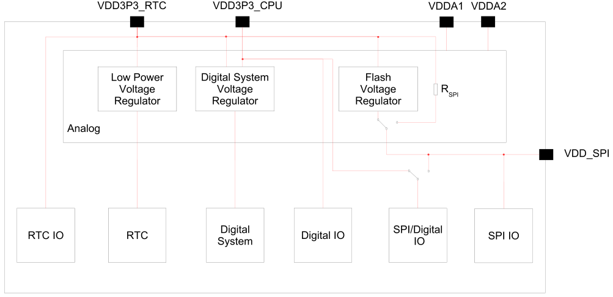

*Figure 2-2. ESP32-S3 Power Scheme*

#### C2.5.3 Chip Power-up and Reset

Once the power is supplied to the chip, its power rails need a short time to stabilize. After that, CHIP_PU - the pin used for power-up and reset - is pulled high to activate the chip. For information on CHIP_PU as well as power-up and reset timing, see Figure 2-3 and Table 2-13.

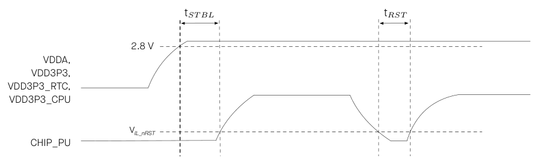

*Figure 2-3. Visualization of Timing Parameters for Power-up and Reset*

**Table 2-13. Description of Timing Parameters for Power-up and Reset**

| Parameter | Description | Min (µs) |
|---|---|---|
| t_STBL | Time reserved for the power rails of VDDA, VDD3P3, VDD3P3_RTC, and VDD3P3_CPU to stabilize before the CHIP_PU pin is pulled high to activate the chip | 50 |
| t_RST | Time reserved for CHIP_PU to stay below V_IL_nRST to reset the chip (see Table 5-4) | 50 |

### C2.6 Pin Mapping Between Chip and Flash/PSRAM

Table 2-14 lists the pin mapping between the chip and flash/PSRAM for all SPI modes.

For chip variants with in-package flash/PSRAM (see Table 1-1 *ESP32-S3 Series Comparison*), the pins allocated for communication with in-package flash/PSRAM can be identified depending on the SPI mode used. For off-package flash/PSRAM, these are the recommended pin mappings.

For more information on SPI controllers, see also [C4 Serial Peripheral Interface (SPI)](#c4-functional-description).

Notice: Do not use the pins connected to in-package flash/PSRAM for any other purposes.

**Table 2-14. Pin Mapping Between Chip and Flash or PSRAM**

| Pin No. | Pin Name | Single SPI Flash | Single SPI PSRAM | Dual SPI Flash | Dual SPI PSRAM | Quad SPI/QPI Flash | Quad SPI/QPI PSRAM | Octal SPI/OPI Flash | Octal SPI/OPI PSRAM |
|---|---|---|---|---|---|---|---|---|---|
| 28 | SPICS1 [2] | | CE# | | CE# | | CE# | | CE# |
| 30 | SPIHD | HOLD# | SIO3 | HOLD# | SIO3 | HOLD# | SIO3 | DQ3 | DQ3 |
| 31 | SPIWP | WP# | SIO2 | WP# | SIO2 | WP# | SIO2 | DQ2 | DQ2 |
| 32 | SPICS0 [1] | CS# | | CS# | | CS# | | CS# | |
| 33 | SPICLK | CLK | CLK | CLK | CLK | CLK | CLK | CLK | CLK |
| 34 | SPIQ | DO | SO/SIO1 | DO | SO/SIO1 | DO | SO/SIO1 | DQ1 | DQ1 |
| 35 | SPID | DI | SI/SIO0 | DI | SI/SIO0 | DI | SI/SIO0 | DQ0 | DQ0 |
| 38 | GPIO33 | | | | | | | DQ4 | DQ4 |
| 39 | GPIO34 | | | | | | | DQ5 | DQ5 |
| 40 | GPIO35 | | | | | | | DQ6 | DQ6 |
| 41 | GPIO36 | | | | | | | DQ7 | DQ7 |
| 42 | GPIO37 | | | | | | | DQS/DM | DQS/DM |

1. CS0 is for in-package flash
2. CS1 is for in-package PSRAM

## C3 Boot Configurations

The chip allows for configuring the following boot parameters through strapping pins and eFuse parameters at power-up or a hardware reset, without microcontroller interaction.

- Chip boot mode
  - Strapping pin: GPIO0 and GPIO46
- VDD_SPI voltage
  - Strapping pin: GPIO45
  - eFuse parameter: EFUSE_VDD_SPI_FORCE and EFUSE_VDD_SPI_TIEH
- ROM message printing
  - Strapping pin: GPIO46
  - eFuse parameter: EFUSE_UART_PRINT_CONTROL and EFUSE_DIS_USB_SERIAL_JTAG_ROM_PRINT
- JTAG signal source
  - Strapping pin: GPIO3
  - eFuse parameter: EFUSE_DIS_PAD_JTAG, EFUSE_DIS_USB_JTAG, and EFUSE_STRAP_JTAG_SEL

The default values of all the above eFuse parameters are 0, which means that they are not burnt. Given that eFuse is one-time programmable, once programmed to 1, it can never be reverted to 0. For how to program eFuse parameters, please refer to [ESP32-S3 Technical Reference Manual](https://espressif.com/documentation/esp32-s3_technical_reference_manual_en.pdf#efuse) > Chapter *eFuse Controller*.

The default values of the strapping pins, namely the logic levels, are determined by pins' internal weak pull-up/pull-down resistors at reset if the pins are not connected to any circuit, or connected to an external high-impedance circuit.

**Table 3-1. Default Configuration of Strapping Pins**

| Strapping Pin | Default Configuration | Bit Value |
|---|---|---|
| GPIO0 | Weak pull-up | 1 |
| GPIO3 | Floating | – |
| GPIO45 | Weak pull-down | 0 |
| GPIO46 | Weak pull-down | 0 |

To change the bit values, the strapping pins should be connected to external pull-down/pull-up resistances. If the ESP32-S3 is used as a device by a host MCU, the strapping pin voltage levels can also be controlled by the host MCU.

All strapping pins have latches. At Chip Reset, the latches sample the bit values of their respective strapping pins and store them until the chip is powered down or shut down. The states of latches cannot be changed in any other way. It makes the strapping pin values available during the entire chip operation, and the pins are freed up to be used as regular IO pins after reset. For details on Chip Reset, see [ESP32-S3 Technical Reference Manual](https://espressif.com/documentation/esp32-s3_technical_reference_manual_en.pdf#resclk) > Chapter *Reset and Clock*.

The timing of signals connected to the strapping pins should adhere to the *setup time* and *hold time* specifications in Table 3-2 and Figure 3-1.

**Table 3-2. Description of Timing Parameters for the Strapping Pins**

| Parameter | Description | Min (ms) |
|---|---|---|
| t_SU | *Setup time* is the time reserved for the power rails to stabilize before the CHIP_PU pin is pulled high to activate the chip. | 0 |
| t_H | *Hold time* is the time reserved for the chip to read the strapping pin values after CHIP_PU is already high and before these pins start operating as regular IO pins. | 3 |

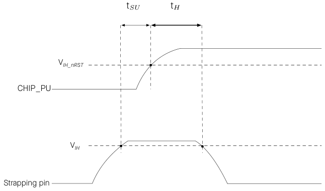

*Figure 3-1. Visualization of Timing Parameters for the Strapping Pins*

### C3.1 Chip Boot Mode Control

GPIO0 and GPIO46 control the boot mode after the reset is released. See Table 3-3 *Chip Boot Mode Control*.

**Table 3-3. Chip Boot Mode Control**

| Boot Mode | GPIO0 | GPIO46 |
|---|---|---|
| **SPI boot mode** | **1** | **Any value** |
| Joint download boot mode [2] | 0 | 0 |

1. Bold marks the default value and configuration.
2. Joint Download Boot mode supports the following download methods:
   - USB Download Boot:
     - USB-Serial-JTAG Download Boot
     - USB-OTG Download Boot
   - UART Download Boot

In addition to SPI Boot and Joint Download Boot modes, ESP32-S3 also supports SPI Download Boot mode. For details, please see [ESP32-S3 Technical Reference Manual](https://espressif.com/documentation/esp32-s3_technical_reference_manual_en.pdf#bootctrl) > Chapter *Chip Boot Control*.

### C3.2 VDD_SPI Voltage Control

The required VDD_SPI voltage for the chips of the ESP32-S3 Series can be found in Table 1-1 *ESP32-S3 Series Comparison*.

The VDD_SPI voltage can be:

- (Default) 3.3 V supplied by VDD3P3_RTC via R_SPI
- 1.8 V supplied by the Flash Voltage Regulator

The voltage is determined by EFUSE_VDD_SPI_FORCE, GPIO45, and EFUSE_VDD_SPI_TIEH.

**Table 3-4. VDD_SPI Voltage Control**

| VDD_SPI power source [2] | Voltage | EFUSE_VDD_SPI_FORCE | GPIO45 | EFUSE_VDD_SPI_TIEH |
|---|---|---|---|---|
| **VDD3P3_RTC via R_SPI** | **3.3 V** | **0** | **0** | **Ignored** |
| VDD3P3_RTC via R_SPI | 3.3 V | 1 | Ignored | 1 |
| Flash Voltage Regulator | 1.8 V | 0 | 1 | Ignored |
| Flash Voltage Regulator | 1.8 V | 1 | Ignored | 0 |

1. Bold marks the default value and configuration.
2. See [C2.5.2 Power Scheme](#c252-power-scheme).

### C3.3 ROM Messages Printing Control

During the boot process, the messages by the ROM code can be printed to:

- (Default) UART0 and USB Serial/JTAG controller
- USB Serial/JTAG controller
- UART0

The ROM messages printing to UART or USB Serial/JTAG controller can be respectively disabled by configuring registers and eFuse. For detailed information, please refer to [ESP32-S3 Technical Reference Manual](https://espressif.com/documentation/esp32-s3_technical_reference_manual_en.pdf#bootctrl) > Chapter *Chip Boot Control*.

### C3.4 JTAG Signal Source Control

The strapping pin GPIO3 can be used to control the source of JTAG signals during the early boot process. This pin does not have any internal pull resistors and the strapping value must be controlled by the external circuit that cannot be in a high impedance state.

As Table 3-5 *JTAG Signal Source Control* shows, GPIO3 is used in combination with EFUSE_DIS_PAD_JTAG, EFUSE_DIS_USB_JTAG, and EFUSE_STRAP_JTAG_SEL.

**Table 3-5. JTAG Signal Source Control**

| JTAG Signal Source | EFUSE_DIS_PAD_JTAG | EFUSE_DIS_USB_JTAG | EFUSE_STRAP_JTAG_SEL | GPIO3 |
|---|---|---|---|---|
| **USB Serial/JTAG Controller** | **0** | **0** | **0** | **Ignored** |
| USB Serial/JTAG Controller | 0 | 0 | 1 | 1 |
| USB Serial/JTAG Controller | 1 | 0 | Ignored | Ignored |
| JTAG pins [2] | 0 | 0 | 1 | 0 |
| JTAG pins [2] | 0 | 1 | Ignored | Ignored |
| JTAG is disabled | 1 | 1 | Ignored | Ignored |

1. Bold marks the default value and configuration.
2. JTAG pins refer to MTDI, MTCK, MTMS, and MTDO.

## C4 Functional Description

This chapter of the datasheet is organised in three sections: System (C4.1), Peripherals (C4.2) and Wireless Communication (C4.3). The descriptions of the system and peripheral blocks (feature lists and summaries) are merged into the Technical Reference Manual chapters of this document; [C4.1 and C4.2](#c41-system-and-c42-peripherals-where-each-block-is-described) below map every datasheet block to the chapter that holds it. The wireless communication section (C4.3) is kept here in full.

### C4.1 System and C4.2 Peripherals: where each block is described

**C4.1 System.** This section describes the core of the chip's operation, covering its microprocessor, memory organization, system components, and security features.

- **4.1.1 Microprocessor and Master.** This subsection describes the core processing units within the chip and their capabilities.
- **4.1.2 Memory Organization.** This subsection describes the memory arrangement to explain how data is stored, accessed, and managed for efficient operation.
- **4.1.3 System Components.** This subsection describes the essential components that contribute to the overall functionality and control of the system.
- **4.1.4 Cryptography and Security Component.** This subsection describes the security features incorporated into the chip, which safeguard data and operations.

**C4.2 Peripherals.** This section describes the chip's peripheral capabilities, covering connectivity interfaces and on-chip sensors that extend its functionality.

- **4.2.1 Connectivity Interface.** This subsection describes the connectivity interfaces on the chip that enable communication and interaction with external devices and networks.
- **4.2.2 Analog Signal Processing.** This subsection describes components on the chip that sense and process real-world data.

**Table C4-A. Datasheet section to Technical Reference Manual chapter**

| Datasheet section | Block | Described in |
|---|---|---|
| 4.1.1.1 | CPU | [Chapter 4 System and Memory](#4-system-and-memory) (CPU area) |
| 4.1.1.2 | Processor Instruction Extensions (PIE) | [Chapter 1 Processor Instruction Extensions (PIE)](#1-processor-instruction-extensions-pie) |
| 4.1.1.3 | Ultra-Low-Power Coprocessor (ULP) | [Chapter 2 ULP Coprocessor (ULP-FSM, ULP-RISC-V)](#2-ulp-coprocessor-ulp-fsm-ulp-risc-v) |
| 4.1.1.4 | GDMA Controller (GDMA) | [Chapter 3 GDMA Controller (GDMA)](#3-gdma-controller-gdma) |
| 4.1.2.1 | Internal Memory | [Chapter 4 System and Memory](#4-system-and-memory) |
| 4.1.2.2 | External Flash and RAM | [Chapter 4 System and Memory](#4-system-and-memory) |
| 4.1.2.3 | Cache | [Chapter 4 System and Memory](#4-system-and-memory) |
| 4.1.2.4 | eFuse Controller | [Chapter 5 eFuse Controller (EFUSE)](#5-efuse-controller-efuse) |
| 4.1.3.1 | IO MUX and GPIO Matrix | [Chapter 6 IO MUX and GPIO Matrix (GPIO, IO MUX)](#6-io-mux-and-gpio-matrix-gpio-io-mux) |
| 4.1.3.2 | Reset | [Chapter 7 Reset and Clock](#7-reset-and-clock) |
| 4.1.3.3 | Clock | [Chapter 7 Reset and Clock](#7-reset-and-clock) |
| 4.1.3.4 | Interrupt Matrix | [Chapter 9 Interrupt Matrix (INTERRUPT)](#9-interrupt-matrix-interrupt) |
| 4.1.3.5 | Power Management Unit (PMU) | [Chapter 10 Low-power Management (RTC_CNTL)](#10-low-power-management-rtc_cntl) |
| 4.1.3.6 | System Timer | [Chapter 11 System Timer (SYSTIMER)](#11-system-timer-systimer) |
| 4.1.3.7 | General Purpose Timers | [Chapter 12 Timer Group (TIMG)](#12-timer-group-timg) |
| 4.1.3.8 | Watchdog Timers | [Chapter 13 Watchdog Timers (WDT)](#13-watchdog-timers-wdt) |
| 4.1.3.9 | XTAL32K Watchdog Timers | [Chapter 14 XTAL32K Watchdog Timers (XTWDT)](#14-xtal32k-watchdog-timers-xtwdt) |
| 4.1.3.10 | Permission Control | [Chapter 15 Permission Control (PMS)](#15-permission-control-pms) |
| 4.1.3.11 | World Controller | [Chapter 16 World Controller (WCL)](#16-world-controller-wcl) |
| 4.1.3.12 | System Registers | [Chapter 17 System Registers (SYSTEM)](#17-system-registers-system) |
| 4.1.4.1 | SHA Accelerator | [Chapter 18 SHA Accelerator (SHA)](#18-sha-accelerator-sha) |
| 4.1.4.2 | AES Accelerator | [Chapter 19 AES Accelerator (AES)](#19-aes-accelerator-aes) |
| 4.1.4.3 | RSA Accelerator | [Chapter 20 RSA Accelerator (RSA)](#20-rsa-accelerator-rsa) |
| 4.1.4.4 | Secure Boot | [Secure Boot (from the chip datasheet)](#25a-secure-boot-from-the-chip-datasheet); related: [Chapter 5 eFuse Controller (EFUSE)](#5-efuse-controller-efuse), [Chapter 15 Permission Control (PMS)](#15-permission-control-pms), [Chapter 23 External Memory Encryption and Decryption (XTS_AES)](#23-external-memory-encryption-and-decryption-xts_aes) |
| 4.1.4.5 | HMAC Accelerator | [Chapter 21 HMAC Accelerator (HMAC)](#21-hmac-accelerator-hmac) |
| 4.1.4.6 | RSA Digital Signature Peripheral (RSA_DS) | [Chapter 22 Digital Signature (DS)](#22-digital-signature-ds) |
| 4.1.4.7 | External Memory Encryption and Decryption | [Chapter 23 External Memory Encryption and Decryption (XTS_AES)](#23-external-memory-encryption-and-decryption-xts_aes) |
| 4.1.4.8 | Clock Glitch Detection | [Chapter 24 Clock Glitch Detection](#24-clock-glitch-detection) |
| 4.1.4.9 | Random Number Generator | [Chapter 25 Random Number Generator (RNG)](#25-random-number-generator-rng) |
| 4.2.1.1 | UART Controller | [Chapter 26 UART Controller (UART)](#26-uart-controller-uart) |
| 4.2.1.2 | I2C Interface | [Chapter 27 I2C Controller (I2C)](#27-i2c-controller-i2c) |
| 4.2.1.3 | I2S Interface | [Chapter 28 I2S Controller (I2S)](#28-i2s-controller-i2s) |
| 4.2.1.4 | LCD and Camera Controller | [Chapter 29 LCD and Camera Controller (LCD_CAM)](#29-lcd-and-camera-controller-lcd_cam) |
| 4.2.1.5 | Serial Peripheral Interface (SPI) | [Chapter 30 SPI Controller (SPI)](#30-spi-controller-spi) |
| 4.2.1.6 | Two-Wire Automotive Interface (TWAI) | [Chapter 31 Two-wire Automotive Interface (TWAI)](#31-two-wire-automotive-interface-twai) |
| 4.2.1.7 | USB 2.0 OTG Full-Speed Interface | [Chapter 32 USB On-The-Go (USB)](#32-usb-on-the-go-usb) |
| 4.2.1.8 | USB Serial/JTAG Controller | [Chapter 33 USB Serial/JTAG Controller (USB_SERIAL_JTAG)](#33-usb-serialjtag-controller-usb_serial_jtag) |
| 4.2.1.9 | SD/MMC Host Controller | [Chapter 34 SD/MMC Host Controller (SDHOST)](#34-sdmmc-host-controller-sdhost) |
| 4.2.1.10 | Motor Control PWM (MCPWM) | [Chapter 36 Motor Control PWM (MCPWM)](#36-motor-control-pwm-mcpwm) |
| 4.2.1.11 | Remote Control Peripheral (RMT) | [Chapter 37 Remote Control Peripheral (RMT)](#37-remote-control-peripheral-rmt) |
| 4.2.1.12 | Pulse Count Controller (PCNT) | [Chapter 38 Pulse Count Controller (PCNT)](#38-pulse-count-controller-pcnt) |
| 4.2.2.1 | SAR ADC | [Chapter 39 On-Chip Sensors and Analog Signal Processing](#39-on-chip-sensors-and-analog-signal-processing) |
| 4.2.2.2 | Temperature Sensor | [Chapter 39 On-Chip Sensors and Analog Signal Processing](#39-on-chip-sensors-and-analog-signal-processing) |
| 4.2.2.3 | Touch Sensor | [Chapter 39 On-Chip Sensors and Analog Signal Processing](#39-on-chip-sensors-and-analog-signal-processing) |

The datasheet's Table 4-1 *Components and Power Domains* and Figure 4-1 *Address Mapping Structure* / Figure 4-2 *Components and Power Domains* belong to the memory (4.1.2) and PMU (4.1.3.5) blocks above and are kept with those TRM chapters.

### C4.3 Wireless Communication

This section describes the chip's wireless communication capabilities, spanning radio technology, Wi-Fi, Bluetooth, and 802.15.4.

#### C4.3.1 Radio

This subsection describes the fundamental radio technology embedded in the chip that facilitates wireless communication and data exchange.

##### C4.3.1.1 2.4 GHz Receiver

The 2.4 GHz receiver demodulates the 2.4 GHz RF signal to quadrature baseband signals and converts them to the digital domain with two high-resolution, high-speed ADCs. To adapt to varying signal channel conditions, ESP32-S3 integrates RF filters, Automatic Gain Control (AGC), DC offset cancelation circuits, and baseband filters.

##### C4.3.1.2 2.4 GHz Transmitter

The 2.4 GHz transmitter modulates the quadrature baseband signals to the 2.4 GHz RF signal, and drives the antenna with a high-powered CMOS power amplifier. The use of digital calibration further improves the linearity of the power amplifier.

To compensate for receiver imperfections, additional calibration methods are built into the chip, including:

- Carrier leakage compensation
- I/Q amplitude/phase matching
- Baseband nonlinearities suppression
- RF nonlinearities suppression
- Antenna matching

These built-in calibration routines reduce the cost and time to the market for your product, and eliminate the need for specialized testing equipment.

##### C4.3.1.3 Clock Generator

The clock generator produces quadrature clock signals of 2.4 GHz for both the receiver and the transmitter. All components of the clock generator are integrated into the chip, including inductors, varactors, filters, regulators, and dividers.

The clock generator has built-in calibration and self-test circuits. Quadrature clock phases and phase noise are optimized on chip with patented calibration algorithms which ensure the best performance of the receiver and the transmitter.

#### C4.3.2 Wi-Fi

This subsection describes the chip's Wi-Fi capabilities, which facilitate wireless communication at a high data rate.

##### C4.3.2.1 Wi-Fi Radio and Baseband

The ESP32-S3 Wi-Fi radio and baseband support the following features:

- 802.11b/g/n
- 802.11n MCS0-7 that supports 20 MHz and 40 MHz bandwidth
- 802.11n MCS32
- 802.11n 0.4 µs guard-interval
- Data rate up to 150 Mbps
- RX STBC (single spatial stream)
- Adjustable transmitting power
- Antenna diversity: ESP32-S3 supports antenna diversity with an external RF switch. This switch is controlled by one or more GPIOs, and used to select the best antenna to minimize the effects of channel imperfections.

##### C4.3.2.2 Wi-Fi MAC

ESP32-S3 implements the full 802.11b/g/n Wi-Fi MAC protocol. It supports the Basic Service Set (BSS) STA and SoftAP operations under the Distributed Control Function (DCF). Power management is handled automatically with minimal host interaction to minimize the active duty period.

The ESP32-S3 Wi-Fi MAC applies the following low-level protocol functions automatically:

- Four virtual Wi-Fi interfaces
- Simultaneous Infrastructure BSS Station mode, SoftAP mode, and Station + SoftAP mode
- RTS protection, CTS protection, Immediate Block ACK
- Fragmentation and defragmentation
- TX/RX A-MPDU, TX/RX A-MSDU
- TXOP
- WMM
- GCMP, CCMP, TKIP, WAPI, WEP, BIP, WPA2-PSK/WPA2-Enterprise, and WPA3-PSK/WPA3-Enterprise
- Automatic beacon monitoring (hardware TSF)
- 802.11mc FTM

##### C4.3.2.3 Networking Features

Users are provided with libraries for TCP/IP networking, ESP-WIFI-MESH networking, and other networking protocols over Wi-Fi. TLS 1.2 support is also provided.

#### C4.3.3 Bluetooth LE

This subsection describes the chip's Bluetooth capabilities, which facilitate wireless communication for low-power, short-range applications. ESP32-S3 includes a Bluetooth Low Energy subsystem that integrates a hardware link layer controller, an RF/modem block and a feature-rich software protocol stack. It supports the core features of Bluetooth 5 and Bluetooth Mesh.

##### C4.3.3.1 Bluetooth LE PHY

Bluetooth Low Energy radio and PHY in ESP32-S3 support:

- 1 Mbps PHY
- 2 Mbps PHY for high transmission speed and high data throughput
- Coded PHY for high RX sensitivity and long range (125 Kbps and 500 Kbps)
- Class 1 transmit power without external PA
- HW Listen Before Talk (LBT)

##### C4.3.3.2 Bluetooth LE Link Controller

Bluetooth Low Energy Link Layer Controller in ESP32-S3 supports:

- LE Advertising Extensions, to enhance broadcasting capacity and broadcast more intelligent data
- Multiple Advertising Sets
- Simultaneous Advertising and Scanning
- Multiple connections in simultaneous central and peripheral roles
- Adaptive Frequency Hopping (AFH) and Channel Assessment
- LE Channel Selection Algorithm #2
- Connection Parameter Update
- High Duty Cycle Non-Connectable Advertising
- LE Privacy v1.2
- LE Data Packet Length Extension
- Link Layer Extended Scanner Filter Policies
- Low Duty Cycle Directed Advertising
- Link Layer Encryption
- LE Ping

## C5 Electrical Characteristics

### C5.1 Absolute Maximum Ratings

Stresses above those listed in Table 5-1 *Absolute Maximum Ratings* may cause permanent damage to the device. These are stress ratings only and normal operation of the device at these or any other conditions beyond those indicated in [C5.2 Recommended Operating Conditions](#c52-recommended-operating-conditions) is not implied. Exposure to absolute-maximum-rated conditions for extended periods may affect device reliability.

**Table 5-1. Absolute Maximum Ratings**

| Parameter | Description | Min | Max | Unit |
|---|---|---|---|---|
| Input power pins [1] | Allowed input voltage | –0.3 | 3.6 | V |
| I_output [2] | Cumulative IO output current | — | 1500 | mA |
| T_STORE | Storage temperature | –40 | 150 | °C |

1. For more information on input power pins, see [C2.5.1 Power Pins](#c251-power-pins).
2. The product proved to be fully functional after all its IO pins were pulled high while being connected to ground for 24 consecutive hours at ambient temperature of 25 °C.

### C5.2 Recommended Operating Conditions

For recommended ambient temperature, see [C1 ESP32-S3 Series Comparison](#c1-esp32-s3-series-comparison).

**Table 5-2. Recommended Operating Conditions**

| Parameter [1] | Description | Min | Typ | Max | Unit |
|---|---|---|---|---|---|
| VDDA, VDD3P3 | Recommended input voltage | 3.0 | 3.3 | 3.6 | V |
| VDD3P3_RTC [2] | Recommended input voltage | 3.0 | 3.3 | 3.6 | V |
| VDD_SPI (as input) | — | 1.8 | 3.3 | 3.6 | V |
| VDD3P3_CPU [3] | Recommended input voltage | 3.0 | 3.3 | 3.6 | V |
| I_VDD [4] | Cumulative input current | 0.5 | — | — | A |

1. See in conjunction with [C2.5 Power Supply](#c25-power-supply).
2. If VDD3P3_RTC is used to power VDD_SPI (see [C2.5.2 Power Scheme](#c252-power-scheme)), the voltage drop on R_SPI should be accounted for. See also [C5.3 VDD_SPI Output Characteristics](#c53-vdd_spi-output-characteristics).
3. If writing to eFuses, the voltage on VDD3P3_CPU should not exceed 3.3 V as the circuits responsible for burning eFuses are sensitive to higher voltages.
4. If you use a single power supply, the recommended output current is 500 mA or more.

### C5.3 VDD_SPI Output Characteristics

**Table 5-3. VDD_SPI Internal and Output Characteristics**

| Parameter | Description [1] | Typ | Unit |
|---|---|---|---|
| R_SPI | VDD_SPI powered by VDD3P3_RTC via R_SPI for 3.3 V flash/PSRAM [2] | 14 | Ω |
| I_SPI | Output current when VDD_SPI is powered by Flash Voltage Regulator for 1.8 V flash/PSRAM | 40 | mA |

1. See in conjunction with [C2.5.2 Power Scheme](#c252-power-scheme).
2. VDD3P3_RTC must be more than *VDD_flash_min + I_flash_max * R_SPI*; where
   - *VDD_flash_min* - minimum operating voltage of flash/PSRAM
   - *I_flash_max* - maximum operating current of flash/PSRAM

### C5.4 DC Characteristics (3.3 V, 25 °C)

**Table 5-4. DC Characteristics (3.3 V, 25 °C)**

| Parameter | Description | Min | Typ | Max | Unit |
|---|---|---|---|---|---|
| C_IN | Pin capacitance | — | 2 | — | pF |
| V_IH | High-level input voltage | 0.75 × VDD [1] | — | VDD [1] + 0.3 | V |
| V_IL | Low-level input voltage | –0.3 | — | 0.25 × VDD [1] | V |
| I_IH | High-level input current | — | — | 50 | nA |
| I_IL | Low-level input current | — | — | 50 | nA |
| V_OH [2] | High-level output voltage | 0.8 × VDD [1] | — | — | V |
| V_OL [2] | Low-level output voltage | — | — | 0.1 × VDD [1] | V |
| I_OH | High-level source current (VDD [1] = 3.3 V, V_OH >= 2.64 V, PAD_DRIVER = 3) | — | 40 | — | mA |
| I_OL | Low-level sink current (VDD [1] = 3.3 V, V_OL = 0.495 V, PAD_DRIVER = 3) | — | 28 | — | mA |
| R_PU | Internal weak pull-up resistor | — | 45 | — | kΩ |
| R_PD | Internal weak pull-down resistor | — | 45 | — | kΩ |
| V_IH_nRST | Chip reset release voltage (CHIP_PU voltage is within the specified range) | 0.75 × VDD [1] | — | VDD [1] + 0.3 | V |
| V_IL_nRST | Chip reset voltage (CHIP_PU voltage is within the specified range) | –0.3 | — | 0.25 × VDD [1] | V |

1. VDD - voltage from a power pin of a respective power domain.
2. V_OH and V_OL are measured using high-impedance load.

### C5.5 ADC Characteristics

The measurements in this section are taken with an external 100 nF capacitor connected to the ADC, using DC signals as input, and at an ambient temperature of 25 °C with disabled Wi-Fi.

**Table 5-5. ADC Characteristics**

| Symbol | Min | Max | Unit |
|---|---|---|---|
| DNL (Differential nonlinearity) [1] | –4 | 4 | LSB |
| INL (Integral nonlinearity) | –8 | 8 | LSB |
| Sampling rate | — | 100 | kSPS [2] |

1. To get better DNL results, you can sample multiple times and apply a filter, or calculate the average value.
2. kSPS means kilo samples-per-second.

The calibrated ADC results after [hardware calibration and software calibration](https://docs.espressif.com/projects/esp-idf/en/latest/esp32s3/api-reference/peripherals/adc_calibration.html) are shown in Table 5-6. For higher accuracy, you may implement your own calibration methods.

**Table 5-6. ADC Calibration Results**

| Parameter | Description | Min | Max | Unit |
|---|---|---|---|---|
| Total error | ATTEN0, effective measurement range of 0 ~ 850 | –5 | 5 | mV |
| Total error | ATTEN1, effective measurement range of 0 ~ 1100 | –6 | 6 | mV |
| Total error | ATTEN2, effective measurement range of 0 ~ 1600 | –10 | 10 | mV |
| Total error | ATTEN3, effective measurement range of 0 ~ 2900 | –50 | 50 | mV |

### C5.6 Current Consumption

#### C5.6.1 Current Consumption in Active Mode

The current consumption measurements are taken with a 3.3 V supply at 25 °C ambient temperature.

TX current consumption is rated at a 100% duty cycle.

RX current consumption is rated when the peripherals are disabled and the CPU idle.

**Table 5-7. Current Consumption for Wi-Fi (2.4 GHz) in Active Mode**

| Work Mode | RF Condition | Description | Peak (mA) |
|---|---|---|---|
| Active (RF working) | TX | 802.11b, 1 Mbps, @21 dBm | 340 |
| Active (RF working) | TX | 802.11g, 54 Mbps, @19 dBm | 291 |
| Active (RF working) | TX | 802.11n, HT20, MCS7, @18.5 dBm | 283 |
| Active (RF working) | TX | 802.11n, HT40, MCS7, @18 dBm | 286 |
| Active (RF working) | RX | 802.11b/g/n, HT20 | 88 |
| Active (RF working) | RX | 802.11n, HT40 | 91 |

**Table 5-8. Current Consumption for Bluetooth LE in Active Mode**

| Work Mode | RF Condition | Description | Peak (mA) |
|---|---|---|---|
| Active (RF working) | TX | Bluetooth LE @ 21.0 dBm | 335 |
| Active (RF working) | TX | Bluetooth LE @ 9.0 dBm | 193 |
| Active (RF working) | TX | Bluetooth LE @ 0 dBm | 176 |
| Active (RF working) | TX | Bluetooth LE @ –15.0 dBm | 116 |
| Active (RF working) | RX | Bluetooth LE | 93 |

#### C5.6.2 Current Consumption in Other Modes

The measurements below are applicable to ESP32-S3 and ESP32-S3FH8. Since ESP32-S3R2, ESP32-S3RH2, ESP32-S3R8, ESP32-S3R8V, ESP32-S3R16V, and ESP32-S3FN4R2 are embedded with PSRAM, their current consumption might be higher.

**Table 5-9. Current Consumption in Modem-sleep Mode**

| Work mode | Frequency (MHz) | Description | Typ (mA) [1] | Typ (mA) [2] |
|---|---|---|---|---|
| Modem-sleep [3] | 40 | WAITI (Dual core in idle state) | 13.2 | 18.8 |
| Modem-sleep [3] | 40 | Single core running 32-bit data access instructions, the other core in idle state | 16.2 | 21.8 |
| Modem-sleep [3] | 40 | Dual core running 32-bit data access instructions | 18.7 | 24.4 |
| Modem-sleep [3] | 40 | Single core running 128-bit data access instructions, the other core in idle state | 19.9 | 25.4 |
| Modem-sleep [3] | 40 | Dual core running 128-bit data access instructions | 23.0 | 28.8 |
| Modem-sleep [3] | 80 | WAITI | 22.0 | 36.1 |
| Modem-sleep [3] | 80 | Single core running 32-bit data access instructions, the other core in idle state | 28.4 | 42.6 |
| Modem-sleep [3] | 80 | Dual core running 32-bit data access instructions | 33.1 | 47.3 |
| Modem-sleep [3] | 80 | Single core running 128-bit data access instructions, the other core in idle state | 35.1 | 49.6 |
| Modem-sleep [3] | 80 | Dual core running 128-bit data access instructions | 41.8 | 56.3 |
| Modem-sleep [3] | 160 | WAITI | 27.6 | 42.3 |
| Modem-sleep [3] | 160 | Single core running 32-bit data access instructions, the other core in idle state | 39.9 | 54.6 |
| Modem-sleep [3] | 160 | Dual core running 32-bit data access instructions | 49.6 | 64.1 |
| Modem-sleep [3] | 160 | Single core running 128-bit data access instructions, the other core in idle state | 54.4 | 69.2 |
| Modem-sleep [3] | 160 | Dual core running 128-bit data access instructions | 66.7 | 81.1 |
| Modem-sleep [3] | 240 | WAITI | 32.9 | 47.6 |
| Modem-sleep [3] | 240 | Single core running 32-bit data access instructions, the other core in idle state | 51.2 | 65.9 |
| Modem-sleep [3] | 240 | Dual core running 32-bit data access instructions | 66.2 | 81.3 |
| Modem-sleep [3] | 240 | Single core running 128-bit data access instructions, the other core in idle state | 72.4 | 87.9 |
| Modem-sleep [3] | 240 | Dual core running 128-bit data access instructions | 91.7 | 107.9 |

1. Current consumption when all peripheral clocks are disabled.
2. Current consumption when all peripheral clocks are enabled. In practice, the current consumption might be different depending on which peripherals are enabled.
3. In Modem-sleep mode, Wi-Fi is clock gated, and the current consumption might be higher when accessing flash. For a flash rated at 80 Mbit/s, in SPI 2-line mode the consumption is 10 mA.

**Table 5-10. Current Consumption in Low-Power Modes**

| Work mode | Description | Typ (µA) |
|---|---|---|
| Light-sleep [1] | VDD_SPI and Wi-Fi are powered down, and all GPIOs are high-impedance. | 240 |
| Deep-sleep | The ULP co-processor is powered on [2]: ULP-FSM | 170 |
| Deep-sleep | The ULP co-processor is powered on [2]: ULP-RISC-V | 190 |
| Deep-sleep | ULP sensor-monitored pattern [3] | 18 |
| Deep-sleep | RTC memory and RTC peripherals are powered up. | 8 |
| Deep-sleep | RTC memory is powered up. RTC peripherals are powered down. | 7 |
| Power off | CHIP_PU is set to low level. The chip is shut down. | 1 |

1. In Light-sleep mode, all related SPI pins are pulled up. For chips embedded with PSRAM, please add corresponding PSRAM consumption values, e.g., 140 µA for 8 MB 8-line PSRAM (3.3 V), 200 µA for 8 MB 8-line PSRAM (1.8 V) and 40 µA for 2 MB 4-line PSRAM (3.3 V).
2. During Deep-sleep, when the ULP co-processor is powered on, peripherals such as GPIO and I2C are able to operate.
3. The "ULP sensor-monitored pattern" refers to the mode where the ULP coprocessor or the sensor works periodically. When touch sensors work with a duty cycle of 1%, the typical current consumption is 18 µA.

### C5.7 Memory Specifications

The data below is sourced from the memory vendor datasheet. These values are guaranteed through design and/or characterization but are not fully tested in production. Devices are shipped with the memory erased.

**Table 5-11. Flash Specifications**

| Parameter | Description | Min | Typ | Max | Unit |
|---|---|---|---|---|---|
| VCC | Power supply voltage (1.8 V) | 1.65 | 1.80 | 2.00 | V |
| VCC | Power supply voltage (3.3 V) | 2.7 | 3.3 | 3.6 | V |
| F_C | Maximum clock frequency | 80 | — | — | MHz |
| — | Program/erase cycles | 100,000 | — | — | cycles |
| T_RET | Data retention time | 20 | — | — | years |
| T_PP | Page program time | — | 0.8 | 5 | ms |
| T_SE | Sector erase time (4 KB) | — | 70 | 500 | ms |
| T_BE1 | Block erase time (32 KB) | — | 0.2 | 2 | s |
| T_BE2 | Block erase time (64 KB) | — | 0.3 | 3 | s |
| T_CE | Chip erase time (16 Mb) | — | 7 | 20 | s |
| T_CE | Chip erase time (32 Mb) | — | 20 | 60 | s |
| T_CE | Chip erase time (64 Mb) | — | 25 | 100 | s |
| T_CE | Chip erase time (128 Mb) | — | 60 | 200 | s |
| T_CE | Chip erase time (256 Mb) | — | 70 | 300 | s |

**Table 5-12. PSRAM Specifications**

| Parameter | Description | Min | Typ | Max | Unit |
|---|---|---|---|---|---|
| VCC | Power supply voltage (1.8 V) | 1.62 | 1.80 | 1.98 | V |
| VCC | Power supply voltage (3.3 V) | 2.7 | 3.3 | 3.6 | V |
| F_C | Maximum clock frequency | 80 | — | — | MHz |

### C5.8 Reliability

**Table 5-13. Reliability Qualifications**

| Test Item | Test Conditions | Test Standard |
|---|---|---|
| HTOL (High Temperature Operating Life) | 125 °C, 1000 hours | JESD22-A108 |
| ESD (Electro-Static Discharge Sensitivity) | HBM (Human Body Mode) [1] ± 2000 V | JS-001 |
| ESD (Electro-Static Discharge Sensitivity) | CDM (Charge Device Mode) [2] ± 1000 V | JS-002 |
| Latch up | Current trigger ± 200 mA | JESD78 |
| Latch up | Voltage trigger 1.5 × VDD_max | JESD78 |
| Preconditioning | Bake 24 hours @125 °C; Moisture soak (level 3: 192 hours @30 °C, 60% RH); IR reflow solder: 260 + 0 °C, 20 seconds, three times | J-STD-020, JESD47, JESD22-A113 |
| TCT (Temperature Cycling Test) | –65 °C / 150 °C, 500 cycles | JESD22-A104 |
| uHAST (Highly Accelerated Stress Test, unbiased) | 130 °C, 85% RH, 96 hours | JESD22-A118 |
| HTSL (High Temperature Storage Life) | 150 °C, 1000 hours | JESD22-A103 |
| LTSL (Low Temperature Storage Life) | –40 °C, 1000 hours | JESD22-A119 |

1. JEDEC document JEP155 states that 500 V HBM allows safe manufacturing with a standard ESD control process.
2. JEDEC document JEP157 states that 250 V CDM allows safe manufacturing with a standard ESD control process.

## C6 RF Characteristics

This section contains tables with RF characteristics of the Espressif product.

The RF data is measured at the antenna port, where RF cable is connected, including the front-end loss. The front-end circuit is a 0 Ω resistor.

Devices should operate in the center frequency range allocated by regional regulatory authorities. The target center frequency range and the target transmit power are configurable by software. See [ESP RF Test Tool and Test Guide](https://www.espressif.com/en/support/download/other-tools?keys=RF+Test+Tool) for instructions.

Unless otherwise stated, the RF tests are conducted with a 3.3 V (±5%) supply at 25 ºC ambient temperature.

### C6.1 Wi-Fi Radio

**Table 6-1. Wi-Fi RF Characteristics**

| Name | Description |
|---|---|
| Center frequency range of operating channel | 2412 ~ 2484 MHz |
| Wi-Fi wireless standard | IEEE 802.11b/g/n |

#### C6.1.1 Wi-Fi RF Transmitter (TX) Characteristics

**Table 6-2. TX Power with Spectral Mask and EVM Meeting 802.11 Standards**

| Rate | Min (dBm) | Typ (dBm) | Max (dBm) |
|---|---|---|---|
| 802.11b, 1 Mbps | — | 21.0 | — |
| 802.11b, 11 Mbps | — | 21.0 | — |
| 802.11g, 6 Mbps | — | 20.5 | — |
| 802.11g, 54 Mbps | — | 19.0 | — |
| 802.11n, HT20, MCS0 | — | 19.5 | — |
| 802.11n, HT20, MCS7 | — | 18.5 | — |
| 802.11n, HT40, MCS0 | — | 19.5 | — |
| 802.11n, HT40, MCS7 | — | 18.0 | — |

**Table 6-3. TX EVM Test [1]**

| Rate | Min (dB) | Typ (dB) | Limit (dB) |
|---|---|---|---|
| 802.11b, 1 Mbps, @21 dBm | — | –24.5 | –10 |
| 802.11b, 11 Mbps, @21 dBm | — | –24.5 | –10 |
| 802.11g, 6 Mbps, @20.5 dBm | — | –21.5 | –5 |
| 802.11g, 54 Mbps, @19 dBm | — | –28.0 | –25 |
| 802.11n, HT20, MCS0, @19.5 dBm | — | –23.0 | –5 |
| 802.11n, HT20, MCS7, @18.5 dBm | — | –29.5 | –27 |
| 802.11n, HT40, MCS0, @19.5 dBm | — | –23.0 | –5 |
| 802.11n, HT40, MCS7, @18 dBm | — | –29.5 | –27 |

1. EVM is measured at the corresponding typical TX power provided in Table 6-2 *TX Power with Spectral Mask and EVM Meeting 802.11 Standards* above.

#### C6.1.2 Wi-Fi RF Receiver (RX) Characteristics

For RX tests, the PER (packet error rate) limit is 8% for 802.11b, and 10% for 802.11g/n.

**Table 6-4. RX Sensitivity**

| Rate | Min (dBm) | Typ (dBm) | Max (dBm) |
|---|---|---|---|
| 802.11b, 1 Mbps | — | –98.4 | — |
| 802.11b, 2 Mbps | — | –95.4 | — |
| 802.11b, 5.5 Mbps | — | –93.0 | — |
| 802.11b, 11 Mbps | — | –88.6 | — |
| 802.11g, 6 Mbps | — | –93.2 | — |
| 802.11g, 9 Mbps | — | –91.8 | — |
| 802.11g, 12 Mbps | — | –91.2 | — |
| 802.11g, 18 Mbps | — | –88.6 | — |
| 802.11g, 24 Mbps | — | –86.0 | — |
| 802.11g, 36 Mbps | — | –82.4 | — |
| 802.11g, 48 Mbps | — | –78.2 | — |
| 802.11g, 54 Mbps | — | –76.5 | — |
| 802.11n, HT20, MCS0 | — | –92.6 | — |
| 802.11n, HT20, MCS1 | — | –91.0 | — |
| 802.11n, HT20, MCS2 | — | –88.2 | — |
| 802.11n, HT20, MCS3 | — | –85.0 | — |
| 802.11n, HT20, MCS4 | — | –81.8 | — |
| 802.11n, HT20, MCS5 | — | –77.4 | — |
| 802.11n, HT20, MCS6 | — | –75.8 | — |
| 802.11n, HT20, MCS7 | — | –74.2 | — |
| 802.11n, HT40, MCS0 | — | –90.0 | — |
| 802.11n, HT40, MCS1 | — | –88.0 | — |
| 802.11n, HT40, MCS2 | — | –85.2 | — |
| 802.11n, HT40, MCS3 | — | –82.0 | — |
| 802.11n, HT40, MCS4 | — | –79.0 | — |
| 802.11n, HT40, MCS5 | — | –74.4 | — |
| 802.11n, HT40, MCS6 | — | –72.8 | — |
| 802.11n, HT40, MCS7 | — | –71.4 | — |

**Table 6-5. Maximum RX Level**

| Rate | Min (dBm) | Typ (dBm) | Max (dBm) |
|---|---|---|---|
| 802.11b, 1 Mbps | — | 5 | — |
| 802.11b, 11 Mbps | — | 5 | — |
| 802.11g, 6 Mbps | — | 5 | — |
| 802.11g, 54 Mbps | — | 0 | — |
| 802.11n, HT20, MCS0 | — | 5 | — |
| 802.11n, HT20, MCS7 | — | 0 | — |
| 802.11n, HT40, MCS0 | — | 5 | — |
| 802.11n, HT40, MCS7 | — | 0 | — |

**Table 6-6. RX Adjacent Channel Rejection**

| Rate | Min (dB) | Typ (dB) | Max (dB) |
|---|---|---|---|
| 802.11b, 1 Mbps | — | 35 | — |
| 802.11b, 11 Mbps | — | 35 | — |
| 802.11g, 6 Mbps | — | 31 | — |
| 802.11g, 54 Mbps | — | 20 | — |
| 802.11n, HT20, MCS0 | — | 31 | — |
| 802.11n, HT20, MCS7 | — | 16 | — |
| 802.11n, HT40, MCS0 | — | 25 | — |
| 802.11n, HT40, MCS7 | — | 11 | — |

### C6.2 Bluetooth LE Radio

**Table 6-7. Bluetooth LE Frequency**

| Parameter | Min (MHz) | Typ (MHz) | Max (MHz) |
|---|---|---|---|
| Center frequency of operating channel | 2402 | — | 2480 |

#### C6.2.1 Bluetooth LE RF Transmitter (TX) Characteristics

**Table 6-8. Transmitter Characteristics - Bluetooth LE 1 Mbps**

| Parameter | Description | Min | Typ | Max | Unit |
|---|---|---|---|---|---|
| RF transmit power | RF power control range | –24.00 | 0 | 20.00 | dBm |
| RF transmit power | Gain control step | — | 3.00 | — | dB |
| Carrier frequency offset and drift | Max \|f_n\|, n = 0, 1, 2, ..k | — | 2.50 | — | kHz |
| Carrier frequency offset and drift | Max \|f_0 − f_n\| | — | 2.00 | — | kHz |
| Carrier frequency offset and drift | Max \|f_n − f_n−5\| | — | 1.39 | — | kHz |
| Carrier frequency offset and drift | \|f_1 − f_0\| | — | 0.80 | — | kHz |
| Modulation characteristics | Δf1_avg | — | 249.00 | — | kHz |
| Modulation characteristics | Min Δf2_max (for at least 99.9% of all Δf2_max) | — | 198.00 | — | kHz |
| Modulation characteristics | Δf2_avg/Δf1_avg | — | 0.86 | — | — |
| In-band spurious emissions | ±2 MHz offset | — | –37.00 | — | dBm |
| In-band spurious emissions | ±3 MHz offset | — | –42.00 | — | dBm |
| In-band spurious emissions | >±3 MHz offset | — | –44.00 | — | dBm |

**Table 6-9. Transmitter Characteristics - Bluetooth LE 2 Mbps**

| Parameter | Description | Min | Typ | Max | Unit |
|---|---|---|---|---|---|
| RF transmit power | RF power control range | –24.00 | 0 | 20.00 | dBm |
| RF transmit power | Gain control step | — | 3.00 | — | dB |
| Carrier frequency offset and drift | Max \|f_n\|, n = 0, 1, 2, ..k | — | 2.50 | — | kHz |
| Carrier frequency offset and drift | Max \|f_0 − f_n\| | — | 1.90 | — | kHz |
| Carrier frequency offset and drift | Max \|f_n − f_n−5\| | — | 1.40 | — | kHz |
| Carrier frequency offset and drift | \|f_1 − f_0\| | — | 1.10 | — | kHz |
| Modulation characteristics | Δf1_avg | — | 499.00 | — | kHz |
| Modulation characteristics | Min Δf2_max (for at least 99.9% of all Δf2_max) | — | 416.00 | — | kHz |
| Modulation characteristics | Δf2_avg/Δf1_avg | — | 0.89 | — | — |
| In-band spurious emissions | ±4 MHz offset | — | –43.80 | — | dBm |
| In-band spurious emissions | ±5 MHz offset | — | –45.80 | — | dBm |
| In-band spurious emissions | >±5 MHz offset | — | –47.00 | — | dBm |

**Table 6-10. Transmitter Characteristics - Bluetooth LE 125 Kbps**

| Parameter | Description | Min | Typ | Max | Unit |
|---|---|---|---|---|---|
| RF transmit power | RF power control range | –24.00 | 0 | 20.00 | dBm |
| RF transmit power | Gain control step | — | 3.00 | — | dB |
| Carrier frequency offset and drift | Max \|f_n\|, n = 0, 1, 2, ..k | — | 0.80 | — | kHz |
| Carrier frequency offset and drift | Max \|f_0 − f_n\| | — | 0.98 | — | kHz |
| Carrier frequency offset and drift | \|f_n − f_n−3\| | — | 0.30 | — | kHz |
| Carrier frequency offset and drift | \|f_0 − f_3\| | — | 1.00 | — | kHz |
| Modulation characteristics | Δf1_avg | — | 248.00 | — | kHz |
| Modulation characteristics | Min Δf1_max (for at least 99.9% of allΔf1_max) | — | 222.00 | — | kHz |
| In-band spurious emissions | ±2 MHz offset | — | –37.00 | — | dBm |
| In-band spurious emissions | ±3 MHz offset | — | –42.00 | — | dBm |
| In-band spurious emissions | >±3 MHz offset | — | –44.00 | — | dBm |

**Table 6-11. Transmitter Characteristics - Bluetooth LE 500 Kbps**

| Parameter | Description | Min | Typ | Max | Unit |
|---|---|---|---|---|---|
| RF transmit power | RF power control range | –24.00 | 0 | 20.00 | dBm |
| RF transmit power | Gain control step | — | 3.00 | — | dB |
| Carrier frequency offset and drift | Max \|f_n\|, n = 0, 1, 2, ..k | — | 0.70 | — | kHz |
| Carrier frequency offset and drift | Max \|f_0 − f_n\| | — | 0.90 | — | kHz |
| Carrier frequency offset and drift | \|f_n − f_n−3\| | — | 0.85 | — | kHz |
| Carrier frequency offset and drift | \|f_0 − f_3\| | — | 0.34 | — | kHz |
| Modulation characteristics | Δf2_avg | — | 213.00 | — | kHz |
| Modulation characteristics | Min Δf2_max (for at least 99.9% of all Δf2_max) | — | 196.00 | — | kHz |
| In-band spurious emissions | ±2 MHz offset | — | –37.00 | — | dBm |
| In-band spurious emissions | ±3 MHz offset | — | –42.00 | — | dBm |
| In-band spurious emissions | >±3 MHz offset | — | –44.00 | — | dBm |

#### C6.2.2 Bluetooth LE RF Receiver (RX) Characteristics

**Table 6-12. Receiver Characteristics - Bluetooth LE 1 Mbps**

| Parameter | Description | Min | Typ | Max | Unit |
|---|---|---|---|---|---|
| Sensitivity @30.8% PER | — | — | –97.5 | — | dBm |
| Maximum received signal @30.8% PER | — | — | 8 | — | dBm |
| Co-channel C/I | F = F0 MHz | — | 9 | — | dB |
| Adjacent channel selectivity C/I | F = F0 + 1 MHz | — | –3 | — | dB |
| Adjacent channel selectivity C/I | F = F0 – 1 MHz | — | –3 | — | dB |
| Adjacent channel selectivity C/I | F = F0 + 2 MHz | — | –28 | — | dB |
| Adjacent channel selectivity C/I | F = F0 – 2 MHz | — | –30 | — | dB |
| Adjacent channel selectivity C/I | F = F0 + 3 MHz | — | –31 | — | dB |
| Adjacent channel selectivity C/I | F = F0 – 3 MHz | — | –33 | — | dB |
| Adjacent channel selectivity C/I | F > F0 + 3 MHz | — | –32 | — | dB |
| Adjacent channel selectivity C/I | F > F0 – 3 MHz | — | –36 | — | dB |
| Image frequency | — | — | –32 | — | dB |
| Adjacent channel to image frequency | F = F_image + 1 MHz | — | –39 | — | dB |
| Adjacent channel to image frequency | F = F_image – 1 MHz | — | –31 | — | dB |
| Out-of-band blocking performance | 30 MHz ~ 2000 MHz | — | –9 | — | dBm |
| Out-of-band blocking performance | 2003 MHz ~ 2399 MHz | — | –19 | — | dBm |
| Out-of-band blocking performance | 2484 MHz ~ 2997 MHz | — | –16 | — | dBm |
| Out-of-band blocking performance | 3000 MHz ~ 12.75 GHz | — | –5 | — | dBm |
| Intermodulation | — | — | –31 | — | dBm |

**Table 6-13. Receiver Characteristics - Bluetooth LE 2 Mbps**

| Parameter | Description | Min | Typ | Max | Unit |
|---|---|---|---|---|---|
| Sensitivity @30.8% PER | — | — | –93.5 | — | dBm |
| Maximum received signal @30.8% PER | — | — | 3 | — | dBm |
| Co-channel C/I | F = F0 MHz | — | 10 | — | dB |
| Adjacent channel selectivity C/I | F = F0 + 2 MHz | — | –8 | — | dB |
| Adjacent channel selectivity C/I | F = F0 – 2 MHz | — | –5 | — | dB |
| Adjacent channel selectivity C/I | F = F0 + 4 MHz | — | –31 | — | dB |
| Adjacent channel selectivity C/I | F = F0 – 4 MHz | — | –33 | — | dB |
| Adjacent channel selectivity C/I | F = F0 + 6 MHz | — | –37 | — | dB |
| Adjacent channel selectivity C/I | F = F0 – 6 MHz | — | –37 | — | dB |
| Adjacent channel selectivity C/I | F > F0 + 6 MHz | — | –40 | — | dB |
| Adjacent channel selectivity C/I | F > F0 – 6 MHz | — | –40 | — | dB |
| Image frequency | — | — | –31 | — | dB |
| Adjacent channel to image frequency | F = F_image + 2 MHz | — | –37 | — | dB |
| Adjacent channel to image frequency | F = F_image – 2 MHz | — | –8 | — | dB |
| Out-of-band blocking performance | 30 MHz ~ 2000 MHz | — | –16 | — | dBm |
| Out-of-band blocking performance | 2003 MHz ~ 2399 MHz | — | –20 | — | dBm |
| Out-of-band blocking performance | 2484 MHz ~ 2997 MHz | — | –16 | — | dBm |
| Out-of-band blocking performance | 3000 MHz ~ 12.75 GHz | — | –16 | — | dBm |
| Intermodulation | — | — | –30 | — | dBm |

**Table 6-14. Receiver Characteristics - Bluetooth LE 125 Kbps**

| Parameter | Description | Min | Typ | Max | Unit |
|---|---|---|---|---|---|
| Sensitivity @30.8% PER | — | — | –104.5 | — | dBm |
| Maximum received signal @30.8% PER | — | — | 8 | — | dBm |
| Co-channel C/I | F = F0 MHz | — | 6 | — | dB |
| Adjacent channel selectivity C/I | F = F0 + 1 MHz | — | –6 | — | dB |
| Adjacent channel selectivity C/I | F = F0 – 1 MHz | — | –5 | — | dB |
| Adjacent channel selectivity C/I | F = F0 + 2 MHz | — | –32 | — | dB |
| Adjacent channel selectivity C/I | F = F0 – 2 MHz | — | –39 | — | dB |
| Adjacent channel selectivity C/I | F = F0 + 3 MHz | — | –35 | — | dB |
| Adjacent channel selectivity C/I | F = F0 – 3 MHz | — | –45 | — | dB |
| Adjacent channel selectivity C/I | F > F0 + 3 MHz | — | –35 | — | dB |
| Adjacent channel selectivity C/I | F > F0 – 3 MHz | — | –48 | — | dB |
| Image frequency | — | — | –35 | — | dB |
| Adjacent channel to image frequency | F = F_image + 1 MHz | — | –49 | — | dB |
| Adjacent channel to image frequency | F = F_image – 1 MHz | — | –32 | — | dB |

**Table 6-15. Receiver Characteristics - Bluetooth LE 500 Kbps**

| Parameter | Description | Min | Typ | Max | Unit |
|---|---|---|---|---|---|
| Sensitivity @30.8% PER | — | — | –101 | — | dBm |
| Maximum received signal @30.8% PER | — | — | 8 | — | dBm |
| Co-channel C/I | F = F0 MHz | — | 4 | — | dB |
| Adjacent channel selectivity C/I | F = F0 + 1 MHz | — | –5 | — | dB |
| Adjacent channel selectivity C/I | F = F0 – 1 MHz | — | –5 | — | dB |
| Adjacent channel selectivity C/I | F = F0 + 2 MHz | — | –28 | — | dB |
| Adjacent channel selectivity C/I | F = F0 – 2 MHz | — | –36 | — | dB |
| Adjacent channel selectivity C/I | F = F0 + 3 MHz | — | –36 | — | dB |
| Adjacent channel selectivity C/I | F = F0 – 3 MHz | — | –38 | — | dB |
| Adjacent channel selectivity C/I | F > F0 + 3 MHz | — | –37 | — | dB |
| Adjacent channel selectivity C/I | F > F0 – 3 MHz | — | –41 | — | dB |
| Image frequency | — | — | –37 | — | dB |
| Adjacent channel to image frequency | F = F_image + 1 MHz | — | –44 | — | dB |
| Adjacent channel to image frequency | F = F_image – 1 MHz | — | –28 | — | dB |

## C7 Packaging

- For information about tape, reel, and product marking, please refer to [ESP32-S3 Chip Packaging Information](https://docs.espressif.com/projects/esp-packaging/en/latest/esp32s3/00-index/index_chip.html).
- The pins of the chip are numbered in anti-clockwise order starting from Pin 1 in the top view. For pin numbers and pin names, see also Figure 2-1 *ESP32-S3 Pin Layout (Top View)* ([C2.1](#c21-pin-layout)).
- The recommended land pattern [source file (asc)](https://www.espressif.com/sites/default/files/chips-dxf/ESP32-S3_Footprint.asc) is available for download. You can import the file with software such as PADS and Altium Designer.
- All ESP32-S3 chip variants have identical land pattern (see Figure 7-1) except ESP32-S3FH4R2 has a bigger EPAD (see Figure 7-2). The [source file (asc)](https://www.espressif.com/sites/default/files/chips-dxf/ESP32-S3_Footprint.asc) may be adopted for ESP32-S3FH4R2 by altering the size of the EPAD (see dimensions D2 and E2 in Figure 7-2).

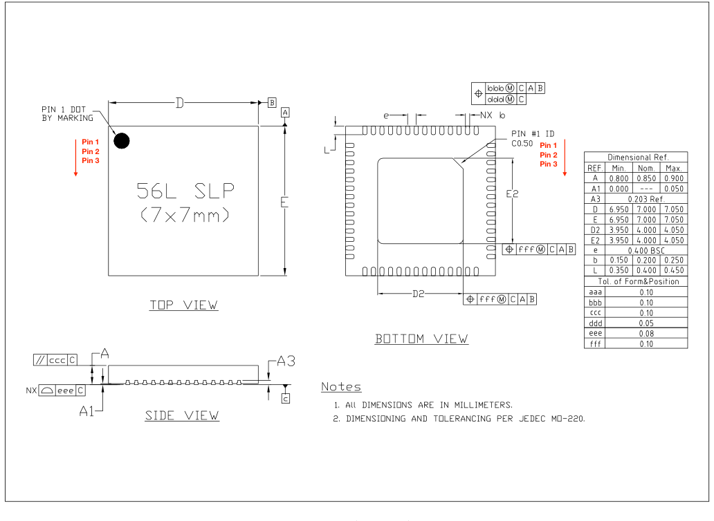

*Figure 7-1. QFN56 (7×7 mm) Package*

**Figure 7-1 dimensions (millimeters)**

| REF. | Min. | Nom. | Max. |
|---|---|---|---|
| A | 0.800 | 0.850 | 0.900 |
| A1 | 0.000 | --- | 0.050 |
| A3 | 0.203 Ref. | 0.203 Ref. | 0.203 Ref. |
| D | 6.950 | 7.000 | 7.050 |
| E | 6.950 | 7.000 | 7.050 |
| D2 | 3.950 | 4.000 | 4.050 |
| E2 | 3.950 | 4.000 | 4.050 |
| e | 0.400 BSC | 0.400 BSC | 0.400 BSC |
| b | 0.150 | 0.200 | 0.250 |
| L | 0.350 | 0.400 | 0.450 |

**Tol. of Form & Position**

| REF. | Value |
|---|---|
| aaa | 0.10 |
| bbb | 0.10 |
| ccc | 0.10 |
| ddd | 0.05 |
| eee | 0.08 |
| fff | 0.10 |

Notes: 1. All dimensions are in millimeters. 2. Dimensioning and tolerancing per JEDEC MO-220.

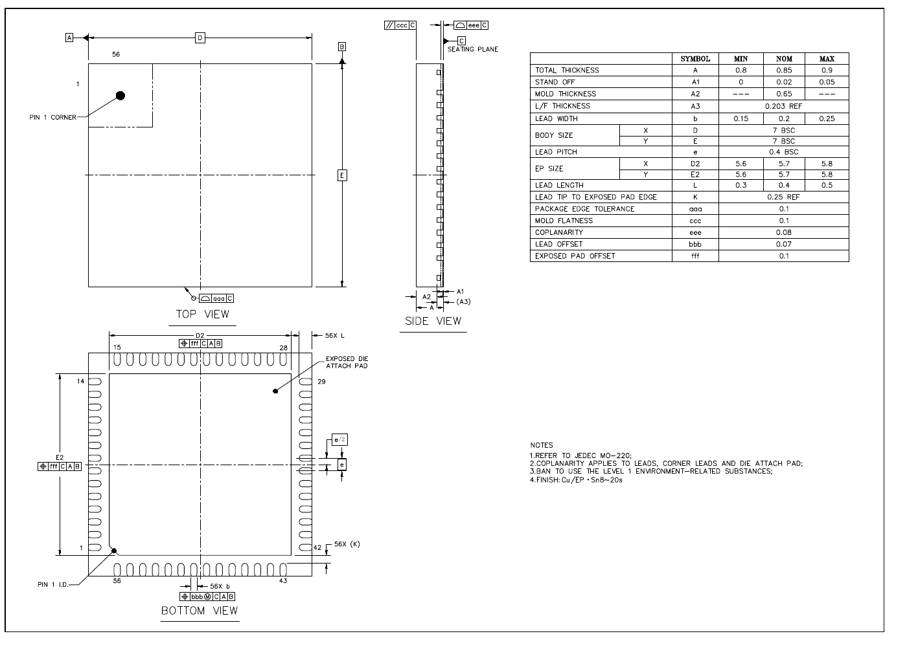

*Figure 7-2. QFN56 (7×7 mm) Package (Only for ESP32-S3FH4R2)*

**Figure 7-2 dimensions (millimeters)**

| Item | Symbol | Min | Nom | Max |
|---|---|---|---|---|
| Total thickness | A | 0.8 | 0.85 | 0.9 |
| Stand off | A1 | 0 | 0.02 | 0.05 |
| Mold thickness | A2 | --- | 0.65 | --- |
| L/F thickness | A3 | 0.203 REF | 0.203 REF | 0.203 REF |
| Lead width | b | 0.15 | 0.2 | 0.25 |
| Body size X | D | 7 BSC | 7 BSC | 7 BSC |
| Body size Y | E | 7 BSC | 7 BSC | 7 BSC |
| Lead pitch | e | 0.4 BSC | 0.4 BSC | 0.4 BSC |
| EP size X | D2 | 5.6 | 5.7 | 5.8 |
| EP size Y | E2 | 5.6 | 5.7 | 5.8 |
| Lead length | L | 0.3 | 0.4 | 0.5 |
| Lead tip to exposed pad edge | K | 0.25 REF | 0.25 REF | 0.25 REF |
| Package edge tolerance | aaa | 0.1 | 0.1 | 0.1 |
| Mold flatness | ccc | 0.1 | 0.1 | 0.1 |
| Coplanarity | eee | 0.08 | 0.08 | 0.08 |
| Lead offset | bbb | 0.07 | 0.07 | 0.07 |
| Exposed pad offset | fff | 0.1 | 0.1 | 0.1 |

Notes: 1. Refer to JEDEC MO-220; 2. Coplanarity applies to leads, corner leads and die attach pad; 3. Ban to use the Level 1 environment-related substances; 4. Finish: Cu/EP · Sn8~20s.


## C8 Consolidated Pin Overview

The datasheet's Table 7-1 *Consolidated Pin Overview* (datasheet page 79) is a single wide table that combines, for all 57 pins, the columns of [Table 2-1 Pin Overview](#c22-pin-overview) (pin type, pin providing power, At Reset / After Reset), [Table 2-6 RTC Functions](#c232-rtc-functions) (RTC IO MUX F0/F3), [Table 2-8 Analog Functions](#c233-analog-functions) (F0/F1) and [Table 2-4 IO MUX Functions](#c231-io-mux-functions) (F0-F4 with types). Its values repeat those tables and are not duplicated here; use the C2 tables. Its highlighting (red: in-package flash/PSRAM pins; yellow: pins with important functions) follows [C2.3.4](#c234-restrictions-for-gpios-and-rtc_gpios), and its footnote reads: "For details, see Section 2 Pins. Regarding highlighted cells, see Section 2.3.4 Restrictions for GPIOs and RTC_GPIOs."

Differences from C2, as printed in the datasheet (both values kept):

| Pin | Item | Table 2-4 (C2.3.1) | Table 7-1 (this chapter) |
|---|---|---|---|
| 36 (SPICLK_N) | IO MUX F0 / F2 | SPICLK_N_DIFF / SUBSPICLK_N_DIFF; F1 = GPIO48 | SPICLK_P_DIFF / SUBSPICLK_P_DIFF; F1 = GPIO48 |
| 37 (SPICLK_P) | IO MUX F0 / F2 | SPICLK_P_DIFF / SUBSPICLK_P_DIFF; F1 = GPIO47 | SPICLK_N_DIFF / SUBSPICLK_N_DIFF; F1 = GPIO47 |

# Part T: Technical Reference Manual

# Part T-I: Microprocessor and Master

This part covers the essential processing elements of the system, diving into the microprocessor architecture of the ultra-low-power processor. Details include CPU instruction extensions and controllers for Direct Memory Access (DMA).

## 1 Processor Instruction Extensions (PIE)

### 1.0 Overview (from the chip datasheet)

ESP32-S3 has a low-power Xtensa® dual-core 32-bit LX7 microprocessor. (Facts below come from the ESP32-S3 Series Datasheet, sections 4.1.1.1 CPU and 4.1.1.2 PIE. The PIE overview, features and structure are in [§1.1](#11-overview) to [§1.3](#13-structure-overview).)

CPU feature list:

- Five-stage pipeline that supports the clock frequency of up to 240 MHz (pipeline stages: [§1.7](#17-instruction-performance))
- 16-bit/24-bit instruction set providing high code density
- 32-bit customized instruction set and 128-bit data bus that provide high computing performance
- Support for single-precision floating-point unit (FPU)
- 32-bit multiplier and 32-bit divider
- Unbuffered GPIO instructions (see [§1.5.2](#152-fast-gpio-interface))
- 32 interrupts at six levels
- Windowed ABI with 64 physical general registers (see the note under [Table 1.5-1](#151-registers))
- Trace function with TRAX compressor, up to 16 KB trace memory
- JTAG for debugging

For information about the Xtensa® Instruction Set Architecture, refer to the [Xtensa® Instruction Set Architecture (ISA) Summary](https://www.cadence.com/content/dam/cadence-www/global/en_US/documents/tools/silicon-solutions/compute-ip/isa-summary.pdf).

PIE, as listed in the datasheet, additionally names complex multiplication among its 128-bit vector operations, and describes the combination of data handling and load/store operations in one instruction (see [§1.2](#12-features)).

### 1.1 Overview

The ESP32-S3 adds a series of extended instruction set in order to improve the operation efficiency of specific AI and DSP (Digital Signal Processing) algorithms. This instruction set is designed from the TIE (Tensilica Instruction Extension) language, and adds general-purpose registers with large bit width, various special registers and processor ports. Based on the SIMD (Single Instruction Multiple Data) concept, this instruction set supports 8-bit, 16-bit, and 32-bit vector operations, which greatly increases data operation efficiency. In addition, the arithmetic instructions, such as multiplication, shifting, and accumulation, can perform data operations and transfer data at the same time, thus further increasing execution efficiency of a single instruction.

### 1.2 Features

The PIE (Processor Instruction Extensions) has the following features:

- 128-bit general-purpose registers

- 128-bit vector operations, e.g., multiplication, addition, subtraction, accumulation, shifting, comparison, etc.

- Integration of data transfer into arithmetic instructions

- Support for non-aligned 128-bit vector data

- Support for saturation operation

### 1.3 Structure Overview

A structure overview should help to understand list of available instructions, instructions possibilities, and limits. It is not intended to describe hardware details.

The internal structure of PIE for multiplication-accumulation (MAC) instructions overview could be described as shown below:

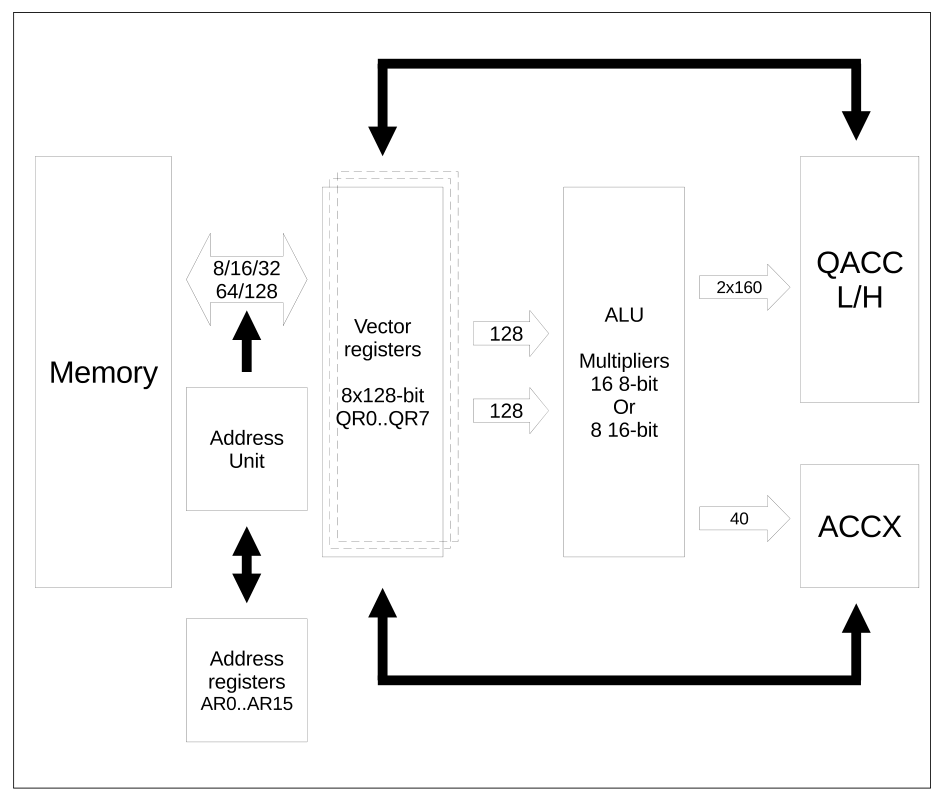

Figure 1.3-1. PIE Internal Structure (MAC)

The diagram above shows the data flow paths and PIE components.

The PIE unit contains:

- Address unit that reads 8/16/32/64/128-bit aligned data

- Bank of eight 128-bit vector QR registers

- Arithmetic logic unit (ALU) with
  - sixteen 8-bit multipliers
  - eight 16-bit multipliers

- QACC_H/QACC_L - 2 160-bit accumulators

- ACCX - 40-bit accumulator

#### 1.3.1 Bank of Vector Registers

Bank of vector registers contains 8 vector registers (QR). Each register could be represented as an array of 16 x 8-bit data words, array of 8 x 16-bit data words, or array of 4 x 32-bit data words. Depending on the used instructions, 8, 16 or 32-bit data format will be chosen.

#### 1.3.2 ALU

Arithmetic logic unit (ALU) could work for 8-bit input data, as 8-bit ALU, for 16-bit input data, as 16-bit ALU, or for 32-bit input data, as 32-bit ALU. 8-bit multiplication ALU contains 16 multipliers and is able to make up to 16 multiplications and accumulation in one instruction. With multiplication almost any other combinations of arithmetic operation are possible. For example, FFT instructions include multiplication, addition, and subtraction operations in one instruction. Also, ALU includes logic operations like AND, OR, shift, and so on.

The input for ALU operation comes from QR registers. The result of operations could be saved to the QR registers or special accumulator registers (ACCX, QACC).

#### 1.3.3 QACC Accumulator Register

The QACC accumulator register is used for multiplication-accumulation operations on 8-bit or 16-bit data. In the case of 8-bit data, QACC consists of 16 accumulator registers with 20-bit width. In the case of 16-bit data, QACC consists of 8 accumulator registers with 40-bit width. The following description reflects the case of 8-bit arithmetic. For 16-bit arithmetic, the logic is similar.

After multiplication and accumulation on two vector QR registers, the result of 16 operations will be written to 16 20-bit accumulator registers.

QACC is divided into two parts: 160-bit QACC_H and 160-bit QACC_L. The former stores the higher 160-bit data of QACC, and the latter stores the lower 160-bit data. To store the accumulator result in QR registers, it is possible to convert 20-bit result numbers to 8 bits by right-shifting it. For 16-bit multiplication-accumulation operation, convert the 40-bit result to 16-bit by right-shifting it.

It is possible to load data from memory to QACC or reset the initial value to 0.

#### 1.3.4 ACCX Accumulator Register

Some operations require accumulating the result of all multipliers to one value. In this case, the ACCX accumulator should be used.

ACCX is a 40-bit accumulator register. The result of the accumulators could be shifted and stored in the memory as an 8-bit or 16-bit value.

It is possible to load data from memory to ACCX or reset the initial value to 0.

#### 1.3.5 Address Unit

Most of the instructions in PIE allow loading or storing data from/to 128-bit Q registers in parallel in one cycle. In most cases, the data should be 128-bit aligned, and the lower 4 bits of address will be ignored. The Address unit provides functionality to manipulate address registers in parallel, which saves the time to update address registers.

It is possible to make address register operations like AR + signed constant, ARx + ARy, and AR + 16. The Address unit makes post-processing operations. It means that all operations with address registers are done after instructions are finished.

### 1.4 Syntax Description

This section provides introduction to the encoding order of instructions and the meaning of characters that appear in the instruction descriptions.

#### 1.4.1 Bit/Byte Order

The encoding order of instructions is divided into two types based on the granularity, i.e., bit order and byte order. According to the located side of the least bit or byte, there are big-endian order and little-endian order. That is to say, the most common encoding types for instructions are: little-endian bit order, big-endian bit order, little-endian byte order and big-endian byte order.

- Little-endian bit order: the instruction is encoded in bit order, with the least significant bit on the right.

- Big-endian bit order: the instruction is encoded in bit order, with the least significant bit on the left.

- Little-endian byte order: the instruction is encoded in byte order, with the least significant byte on the right.

- Big-endian byte order: the instruction is encoded in byte order, with the least significant byte on the left.

Among them, the instruction encoding bit sequences obtained using little-endian byte order and little-endian bit order are identical. Taking the 24-bit instruction EE.ZERO.QACC as an example, Figure 1.4-1, Figure 1.4-2, Figure 1.4-3 and Figure 1.4-4 show the code of this instruction in little-endian bit order, big-endian bit order, little-endian byte order and big-endian byte order, respectively.

Please note that all instructions and register descriptions appear in this chapter use little-endian bit order, which means the least significant bit is stored in the lowest addresses.

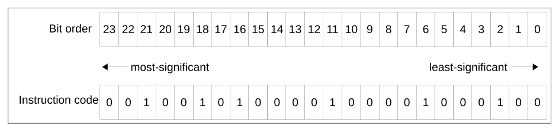

Figure 1.4-1. EE.ZERO.QACC in Little-Endian Bit Order

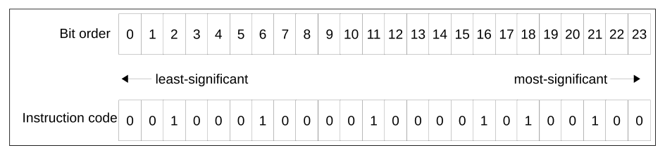

Figure 1.4-2. EE.ZERO.QACC in Big-Endian Bit Order

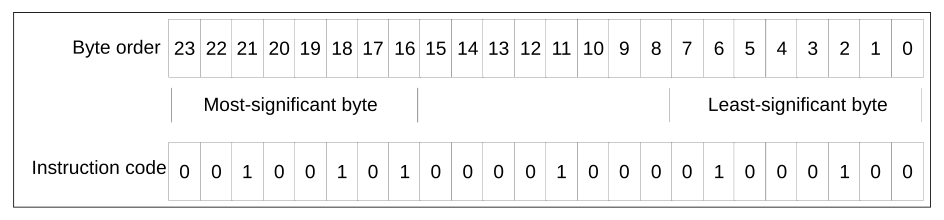

Figure 1.4-3. EE.ZERO.QACC in Little-Endian Byte Order

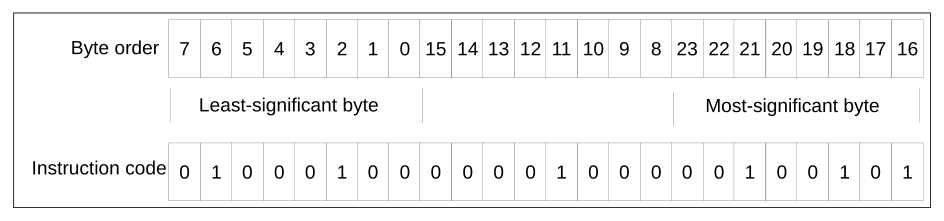

Figure 1.4-4. EE.ZERO.QACC in Big-Enidan Byte Order

#### 1.4.2 Instruction Field Definition

Table 1.4-1 provides the meaning of the characters covered in instruction descriptions. You can find such characters and corresponding descriptions in Section [1.8](#18-extended-instruction-functional-description).

**Table 1.4-1. Instruction Field Names and Descriptions**

|Name|Field|Description|
|---|---|---|
|a* (32-bit general-purpose registers)|as|In-out type (used as input/output operand). Stores address information for read/write operations, which is updated after such operations are completed.|
|a* (32-bit general-purpose registers)|at|In-out type. Temporarily stores operation results to the EE.FFT.AMS.S16.ST.INCP instruction, which will be part of the data to be written to memory.|
|a* (32-bit general-purpose registers)|ad|In type (used as input operand). Stores data used to update address information.|
|a* (32-bit general-purpose registers)|av|In type. Stores data to be written to memory.|
|a* (32-bit general-purpose registers)|ax,ay|In type. Stores data involved in arithmetic operations, e.g., shifting amounts, multipliers and etc.|
|a* (32-bit general-purpose registers)|au|Out type (used as output operand). Stores results of instruction operations.|
|q* (128-bit general-purpose registers)|qs|In type. Stores 128-bit data used for concatenation operations.|
|q* (128-bit general-purpose registers)|qa,qx,qy,qm|In type. Stores data used for vector operations.|
|q* (128-bit general-purpose registers)|qz|Out type. Stores results of vector operations.|
|q* (128-bit general-purpose registers)|qu|Out type. Stores data read from memory.|
|q* (128-bit general-purpose registers)|qv|In type. Stores data to be written to memory.|
|fu|fu|32-bit general-purpose floating-point register. Stores floating-point data read from memory.|
|fv|fv|32-bit general-purpose floating-point register. Stores floating-point data to be written to memory.|
|sel2|sel2|1-bit immediate value ranging from 0 to 1. Used to select signals.|
|sel4,upd4|sel4,upd4|2-bit immediate value ranging from 0 to 3. Used to select signals.|
|sel8|sel8|3-bit immediate value ranging from 0 to 7. Used to select signals.|
|sel16|sel16|4-bit immediate value ranging from 0 to 15. Used to select signals.|
|sar2|sar2|1-bit immediate value ranging from 0 to 1. Represents shifting numbers.|
|sar4|sar4|2-bit immediate value ranging from 0 to 3. Represents shifting numbers.|
|sar16|sar16|4-bit immediate value ranging from 0 to 15. Represents shifting numbers.|
|imm1|imm1|7-bit unsigned immediate value ranging from 0 to 127 with an interval of 1. This is used to show the size of the updated read/write operation address value.|
|imm2|imm2|7-bit unsigned immediate value ranging from 0 to 254 with an interval of 2. This is used to show the size of the updated read/write operation address value.|
|imm4|imm4|8-bit signed immediate value ranging from -256 to 252 with an interval of 8. This is used to show the size of the updated read/write operation address value.|
|imm16|imm16|8-bit signed immediate value ranging from -2048 to 2032 with an interval of 16. This is used to show the size of the updated read/write operation address value.|
|imm16f|imm16f|4-bit signed immediate value ranging from -128 to 112 with an interval of 16. This is used to show the size of the updated read/write operation address value.|

Some instructions have multiple operands with the same function. Those operands are distinguished by adding numbers after field names. For example, the EE.LDF.128.IP instruction has four fu registers, fu0 ~ 3. They are used to store 128-bit data read from memory.

### 1.5 Components of Extended Instruction Set

#### 1.5.1 Registers

This section introduces all kinds of registers related to ESP32-S3’s extended instruction set, including the original registers defined by Xtensa as well as customized registers. For register information, please refer to Table 1.5-1.

**Table 1.5-1. Register List of ESP32-S3 Extended Instruction Set**

|Register Mnemonics|Quantity|Bit Width|Access|Type|
|---|---|---|---|---|
|AR|16¹|32|R/W|General-purpose registers|
|FR|16|32|R/W|General-purpose registers to FPU|
|QR|8|128|R/W|Customized general-purpose registers|
|SAR|1|6|R/W|Special register|
|SAR_BYTE|1|4|R/W|Customized special register|
|ACCX|1|40|R/W|Customized special register|
|QACC_H|1|160|R/W|Customized special register|
|QACC_L|1|160|R/W|Customized special register|
|FFT_BIT_WIDTH|1|4|R/W|Customized special register|
|UA_STATE|1|128|R/W|Customized special register|

¹ The Xtensa processor has 64 internal AR registers. It is designed with the register windowing technique, so that the software can only access 16 of the 64 AR registers at any given time. The programming performance can be effectively improved by rotating windows, replacing function calls, and saving registers when exceptions are triggered.

##### 1.5.1.1 General-Purpose Registers

When using general-purpose register as operands in instructions, you need to explicitly declare the number of the assigned register. For example:

```text
EE.VADDS.S8 q2, q0, q1
```

This instruction uses No.0 and No.1 QR registers as input vectors and stores the vector addition result in the No.2 QR register.

**AR**

Each AR register operand in the instruction will occupy a 4-bit code length. You can select any of the 16 AR registers as operands, and the 4-bit code value indicates the number to declare. The row ”a*” in table 1.4-1 lists various purposes of AR registers in the extended instruction set, including address storage and data storage.

**FR**

Each FR register operand in the instruction will occupy a 4-bit code length. You can select any of the 16 FR registers as operands, and the 4-bit code value indicates the number to declare. In ESP32-S3 extended instruction set, there are only read and write instructions for floating-point data. They are 4 times more efficient than the 32-bit floating-point data R/W instructions that are native to the Xtensa processor, thanks to the 128-bit access bandwidth.

**QR**

In order to improve the execution efficiency of the program, operands are usually stored in general-purpose registers to save time spent in reading from memory. The AR registers native to Xtensa only have 32-bit width, while ESP32-S3 can access 128-bit data at a time, so they can only use 1/4 bandwidth capacity of the existing data bus. For this reason, ESP32-S3 has added eight 128-bit customized general-purpose registers, i.e., QR registers. QR registers are mainly used to store the data acquired/used by the 128-bit data bus to read or write memory, as well as to temporarily store the operation results generated from 128-bit data operations.

As the processor executes instructions, an individual QR register is treated as 16 8-bit or 8 16-bit or 4 32-bit operands depending on the vector operation bit width defined by the instruction, thus enabling a single instruction to perform operations on multiple operands.

##### 1.5.1.2 Special Registers

Different from general-purpose registers, special registers are implicitly called in specific instructions. You do not need to and cannot specify a certain special register when executing instructions. For example: ```text
EE.VMUL.S16 q2, q0, q1
```

This vector multiplication instruction uses q0 and q1 general-purpose registers as inputs. During the internal operation, the intermediate 32-bit multiplication result is shifted to the right, and then the lower 16-bit of the result is retained to form a 128-bit output to q2. The shift amount in the process is determined by the value in the Shift Amount Register (SAR) and this SAR register will not appear in the instruction operand list.

**SAR**

The Shift Amount Register (SAR) stores the shift value in bits. There are two types of instructions in ESP32-S3’s extended instruction set that use SAR. One is the type of instructions to shift vector data, including EE.VSR.32 and EE.VSL.32. The former uses the lower 5 bits of SAR as the right-shift value, and the latter uses the lower 5 bits of SAR as the left-shift value. The other type is multiplication instructions, including EE.VMUL.*, EE.CMUL.*, EE.FFT.AMS.* and EE.FFT.CMUL.*. This type of instructions uses the value in SAR as the value for the right shift of the intermediate multiplication result, which determines the accuracy of the final result.

**SAR_BYTE**

The SAR_BYTE stores the shift value in bytes. This special register is designed to handle the non-aligned 128-bit data (see Section [1.5.3](#153-data-format-and-alignment)). For vector arithmetic instructions, the data read or stored by extended instructions are forced to be 16-byte aligned, but in practice, there is no guarantee that the data addresses used are always 16-byte aligned.

EE.LD.128.USAR.IP and EE.LD.128.USAR.XP instructions write the lower 4-bit values of the memory access register that represent non-aligned data to SAR_BYTE while reading 128-bit data from memory.

There are two types of instruction in ESP32-S3’s extended instruction set that use SAR_BYTE. One is dedicated to handling non-aligned data in QR registers, including EE.SRCQ.* and EE.SRC.Q*. This type of instruction will read two 16-byte data from two aligned addresses, before and after the non-aligned address, put them together, and then shift it by the byte size of SAR_BYTE to get a 128-bit data from the non-aligned address. The other type of instruction handles non-aligned data while executing arithmetic operations, which usually has a suffix of ”.QUP”.

**ACCX**

Multiplier-accumulator. Instructions such as EE.VMULAS.*.ACCX* and EE.SRS.ACCX use this register during operations. The former uses ACCX to accumulate all vector multiplication results of two QR registers, and the latter right shifts the ACCX register.

**QACC_H,QACC_L**

Successive accumulators partitioned by segments. Instructions such as EE.VMULAS.*.QACC* and EE.SRCMB.*.QACC use this type of registers during operations. These registers are mainly used to accumulate vector multiplication results of two QR registers into the corresponding segments of QACC_H and QACC_L respectively. The 16-bit vector multiplication results are accumulated into the corresponding 16 20-bit segments respectively and the 32-bit results are accumulated into the corresponding 8 40-bit segment respectively.

**FFT_BIT_WIDTH**

This special register is dedicated to the EE.BITREV instruction. The value inside this register is used to indicate the operating mode of EE.BITREV. Its range is 0 ~ 7, indicating 3-bit ~ 10-bit operating mode respectively. For more details, please refer to instruction EE.BITREV.

**UA_STATE**

This special register is dedicated to the EE.FFT.AMS.S16.LD.INCP.UAUP instruction. This register is used to store the non-aligned 128-bit data read from memory. Next time when this instruction is called, the data in this register is concatenated to the newly read non-aligned data and then the result is shifted to obtain the 128-bit aligned data.

#### 1.5.2 Fast GPIO Interface

ESP32-S3’s Xtensa processor adds two signal ports, i.e., GPIO_OUT and GPIO_IN. You can route signals from the two ports to specified GPIO pins via the GPIO Matrix.

##### 1.5.2.1 GPIO_OUT

An 8-bit processor output interface. Firstly, configure the 8-bit port signals to specified pins via GPIO Matrix. For core0, their names are pro_alonegpio_out0~7. For core1, their names are core1_gpio_out0~7. Then you can set certain bits of GPIO_OUT to 1 via instructions EE.WR_MASK_GPIO_OUT and EE.SET_BIT_GPIO_OUT, or set certain bits to 0 via instruction EE.CLR_BIT_GPIO_OUT, so as to pull certain pins to high level or low level. Using this method, you can get faster response than pulling pins through register configurations.

##### 1.5.2.2 GPIO_IN

An 8-bit processor input interface. Firstly, configure the 8-bit port signals to specified pins via GPIO Matrix. For core0, their names are pro_alonegpio_in0~7. For core1, their names are core1_gpio_in0~7. Then you can read the eight GPIO pin levels and store them to the AR register through instruction EE.GET_GPIO_IN. Using this method, you can get and handle the level changes on GPIO pins faster than reading registers to get pin level status.

#### 1.5.3 Data Format and Alignment

The current extended instruction set supports 1-byte, 2-byte, 4-byte, 8-byte and 16-byte data formats. Besides, there is also a 20-byte format: QACC_H and QACC_L. However, there is no direct way to switch the data between the two special registers and memory. You can read and write data of QACC_H and QACC_L via five 4-byte (AR) registers or two 16-byte (QR) registers.

The table 1.5-2 lists bit length and alignment information for common data format (’x’ indicates that the bit is either 0 and 1). The Xtensa processor uses byte as the smallest unit for addresses stored in memory in all data formats. And little-endian byte order is used, with byte 0 stored in the lowest bit (the right side), as shown in Figure 1.4-3.

**Table 1.5-2. Data Format and Alignment**

|Data Format|Length|Aligned Addresses in Memory|
|---|---|---|
|1-byte|8 bits|xxxx|
|2-byte|16 bits|xxx0|
|4-byte|32 bits|xx00|
|8-byte|64 bits|x000|
|16-byte|128 bit|0000|

However, if data is stored in memory at a non-aligned address, direct access to this address may cause it being split into two accesses, which in turn affects the performance of the code. For example, if you expect to read a 16-byte data from memory, as shown in Table 1.5-2, the data is stored in memory at 0000 when the data is aligned. But actually the data is not aligned, so the low nibble of its address may be any one between 0000 ~ 1111 (binary). Assuming the lowest bit of its address is 0_0100, the processor will split the one-time access to this data into two accesses, i.e., to 0_0000 and 1_0000 respectively. The processor then put together the obtained two 16-byte data to get the required 16-byte data.

To avoid performance degradation caused by the above non-aligned access operations, all access addresses in the extended instruction set are forced to be aligned, i.e., the lowest bits will be replaced by 0. For example, if a read operation is initiated for 128-bit data at 0x3fc8_0024, the lowest 4-bit of this access address will be forced to be set to 0. Eventually, the 128-bit data stored at 0x3fc8_0020 will be read. Similarly, the lowest 3-bit of the access address for 64-bit data will be set to 0; the lowest 2-bit of the access address for 32-bit data will be set to 0; the lowest 1-bit of the access address for 16-bit data will be set to 0.

The above design requires aligned addresses of the access operations initiated. Otherwise, the data read will not be what you expected. In application code, you need to explicitly declare the alignment of the variable or array in memory. 16-byte alignment can meet the needs of most application scenarios.

The `aligned (16)` parameter declares that the variable is stored in a 16-byte aligned memory address. You can also request a data space with its starting address 16-byte aligned via heap_caps_aligned_alloc.

Since the memory address of the data involved in some operations is uncertain in specific application scenarios, this extended instruction set provides a special register SAR_BYTE and related instructions such as EE.LD.128.USAR.* and EE.SRC.*, to handle non-aligned data.

Assume that the 128-bit non-aligned data address is stored in the general-purpose register a8. This 128-bit data can be read into the specified QR register (q2 in the following example) by the following code: 

```text
EE.LD.128.USAR.IP q0, a8, 16
EE.VLD.128.IP q1, a8, 16
EE.SRC.Q q2, q0, q1
```

#### 1.5.4 Data Overflow and Saturation Handling

Data overflow means that the size of the operation result exceeds the maximum value that can be stored in the result register. Take the EE.VMUL.S8 instruction as an example, the result of two 8-bit multipliers is 16-bit, and it should still be 16-bit after right-shifting. However, the final result will be stored in the 8-bit register, which may cause the risk of data overflow.

In the design of the ESP32-S3’s instruction extensions, there are two ways to handle data overflow, namely taking saturation and truncating the least significant bit. The former controls the calculation result according the range of values that can be stored in the result register. If the result exceeds the maximum value of the result register, take the maximum value; if the result is smaller than the minimum value of the result register, take the minimum value. This approach will be explicitly indicated in the instruction descriptions. For example, the EE.VADDS.* instructions perform saturation to the results of addition operations. Regarding the data overflow handling for more instructions of their internal calculation results, the wraparound approach is used, i.e., only the lower bit of the result that is consistent with the bit width of the result register will be retained and stored in the result register.

Please note that for instructions that do not mention saturation handling method, the wraparound approach will be used.

### 1.6 Extended Instruction List

Table 1.6-1 lists instruction types and corresponding instruction information included in the extended instruction set. This section gives brief introduction to all types of instructions.

**Table 1.6-1. Extended Instruction List**

|Instruction Type|Instruction¹|Reference Section|
|---|---|---|
|Read instructions|LD.QR|1.6.1|
|Read instructions|EE.VLD.128.[XP/IP]|1.6.1|
|Read instructions|EE.VLD.[H/L].64.[XP/IP]|1.6.1|
|Read instructions|EE.VLDBC.[8/16/32].[-/XP/IP]|1.6.1|
|Read instructions|EE.VLDHBC.16.INCP|1.6.1|
|Read instructions|EE.LDF.[64/128].[XP/IP]|1.6.1|
|Read instructions|EE.LD.128.USAR.[XP/IP]|1.6.1|
|Read instructions|EE.LDQA.[U/S][8/16].128.[XP/IP]|1.6.1|
|Read instructions|EE.LD.QACC_[H/L].[H.32/L.128].IP|1.6.1|
|Read instructions|EE.LD.ACCX.IP|1.6.1|
|Read instructions|EE.LD.UA_STATE.IP|1.6.1|
|Read instructions|EE.LDXQ.32|1.6.1|
|Write instructions|ST.QR|1.6.2|
|Write instructions|EE.VST.128.[XP/IP]|1.6.2|
|Write instructions|EE.VST.[H/L].64.[XP/IP]|1.6.2|
|Write instructions|EE.STF.[64/128].[XP/IP]|1.6.2|
|Write instructions|EE.ST.QACC_[H/L].[H.32/L.128].IP|1.6.2|
|Write instructions|EE.ST.ACCX.IP|1.6.2|
|Write instructions|EE.ST.UA_STATE.IP|1.6.2|
|Write instructions|EE.STXQ.32|1.6.2|
|Data exchange instructions|MV.QR|1.6.3|
|Data exchange instructions|EE.MOVI.32.A|1.6.3|
|Data exchange instructions|EE.MOVI.32.Q|1.6.3|
|Data exchange instructions|EE.VZIP.[8/16/32]|1.6.3|
|Data exchange instructions|EE.VUNZIP.[8/16/32]|1.6.3|
|Data exchange instructions|EE.ZERO.Q|1.6.3|
|Data exchange instructions|EE.ZERO.QACC|1.6.3|
|Data exchange instructions|EE.ZERO.ACCX|1.6.3|
|Data exchange instructions|EE.MOV.S8.QACC|1.6.3|
|Data exchange instructions|EE.MOV.S16.QACC|1.6.3|
|Data exchange instructions|EE.MOV.U8.QACC|1.6.3|
|Data exchange instructions|EE.MOV.U16.QACC|1.6.3|
|Arithmetic instructions|EE.VADDS.S[8/16/32].[-/LD.INCP/ST.INCP]|1.6.4|
|Arithmetic instructions|EE.VSUBS.S[8/16/32].[-/LD.INCP/ST.INCP]|1.6.4|
|Arithmetic instructions|EE.VMUL.[U/S][8/16].[-/LD.INCP/ST.INCP]|1.6.4|
|Arithmetic instructions|EE.CMUL.S16.[-/LD.INCP/ST.INCP]|1.6.4|
|Arithmetic instructions|EE.VMULAS.[U/S][8/16].ACCX.[-/LD.IP/LD.XP]|1.6.4|
|Arithmetic instructions|EE.VMULAS.[U/S][8/16].QACC.[-/LD.IP/LD.XP/LDBC.INCP]|1.6.4|
|Arithmetic instructions|EE.VMULAS.[U/S][8/16].ACCX.[LD.IP/LD.XP].QUP|1.6.4|
|Arithmetic instructions|EE.VMULAS.[U/S][8/16].QACC.[LD.IP/LD.XP/LDBC.INCP].QUP|1.6.4|
|Arithmetic instructions|EE.VSMULAS.S[8/16].QACC.[-/LD.INCP]|1.6.4|
|Arithmetic instructions|EE.SRCMB.S[8/16].QACC|1.6.4|
|Arithmetic instructions|EE.SRS.ACCX|1.6.4|
|Arithmetic instructions|EE.VRELU.S[8/16]|1.6.4|
|Arithmetic instructions|EE.VPRELU.S[8/16]|1.6.4|
|Comparison instructions|EE.VMAX.S[8/16/32].[-/LD.INCP/ST.INCP]|1.6.5|
|Comparison instructions|EE.VMIN.S[8/16/32].[-/LD.INCP/ST.INCP]|1.6.5|
|Comparison instructions|EE.VCMP.[EQ/LT/GT].S[8/16/32]|1.6.5|
|Bitwise logic instructions|EE.ORQ|1.6.6|
|Bitwise logic instructions|EE.XORQ|1.6.6|
|Bitwise logic instructions|EE.ANDQ|1.6.6|
|Bitwise logic instructions|EE.NOTQ|1.6.6|
|Shift instructions|EE.SRC.Q|1.6.7|
|Shift instructions|EE.SRC.Q.QUP|1.6.7|
|Shift instructions|EE.SRC.Q.LD.[XP/IP]|1.6.7|
|Shift instructions|EE.SLCI.2Q|1.6.7|
|Shift instructions|EE.SLCXXP.2Q|1.6.7|
|Shift instructions|EE.SRCI.2Q|1.6.7|
|Shift instructions|EE.SRCXXP.2Q|1.6.7|
|Shift instructions|EE.SRCQ.128.ST.INCP|1.6.7|
|Shift instructions|EE.VSR.32|1.6.7|
|Shift instructions|EE.VSL.32|1.6.7|
|FFT dedicated instructions|EE.FFT.R2BF.S16.[-/ST.INCP]|1.6.8|
|FFT dedicated instructions|EE.FFT.CMUL.S16.[LD.XP/ST.XP]|1.6.8|
|FFT dedicated instructions|EE.BITREV|1.6.8|
|FFT dedicated instructions|EE.FFT.AMS.S16.[LD.INCP.UAUP/LD.INCP/LD.R32.DECP/ST.INCP]|1.6.8|
|FFT dedicated instructions|EE.FFT.VST.R32.DECP|1.6.8|
|GPIO control instructions|EE.WR_MASK_GPIO_OUT|1.6.9|
|GPIO control instructions|EE.SET_BIT_GPIO_OUT|1.6.9|
|GPIO control instructions|EE.CLR_BIT_GPIO_OUT|1.6.9|
|GPIO control instructions|EE.GET_GPIO_IN|1.6.9|
|Processor control instructions|RSR.*|1.6.10|
|Processor control instructions|WSR.*|1.6.10|
|Processor control instructions|XSR.*|1.6.10|
|Processor control instructions|RUR.*|1.6.10|
|Processor control instructions|WUR.*|1.6.10|

¹ For detailed information of these instructions, please refer to Section [1.8](#18-extended-instruction-functional-description).

#### 1.6.1 Read Instructions

Read instructions tell the processor to issue a virtual address to access memory based on the AR register that stores access address information. Most read instructions read memory first, and then update the access address. EE.LDXQ.32 is a special case where the instruction first selects a piece of 16-bit data in the QR register via an immediate value, adds it to the access address, and then issues the access operation.

Since access to non-aligned addresses will cause slower response, all virtual addresses issued by read instructions in the extended instruction set are forced to be aligned according to data formats. Depending on the size of the access data format, corresponding length of data will be returned by memory as 1-byte, 2-byte, 4-byte, 8-byte or 16-byte. When the data read after forced alignment is not as expected, the desired data can be extracted from multiple QR registers using instructions such as EE.SRC.Q.

The table below briefly describes the access operations performed by read instructions. For detailed information about read instructions, please see Section [1.8](#18-extended-instruction-functional-description).

**Table 1.6-2. Read Instructions**

|Instructions|Description|
|---|---|
|LD.QR|Load 16-byte data to QR.|
|EE.VLD.128.XP|Read the 16-byte data, then add the value stored in the AR register to the access address.|
|EE.VLD.128.IP|Read the 16-byte data, then add the immediate value to the access address.|
|EE.VLD.[H/L].64.XP|Read the 8-byte data, then add the value stored in the AR register to the access address.|
|EE.VLD.[H/L].64.IP|Read the 8-byte data, then add the immediate value to the access address.|
|EE.VLDBC.[8/16/32]|Read the 1-byte/2-byte/4-byte data.|
|EE.VLDBC.[8/16/32].XP|Read the 1-byte/2-byte/4-byte data, then add the value stored in the AR register to the access address.|
|EE.VLDBC.[8/16/32].IP|Read the 1-byte/2-byte/4-byte data, then add the immediate value to the access address.|
|EE.VLDHBC.16.INCP|Read the 16-byte data, then add 16 to the access address.|
|EE.LDF.[64/128].XP|Read the 8-byte/16-byte data, then add the value stored in the AR register to the access address.|
|EE.LDF.[64/128].IP|Read the 8-byte/16-byte data, then add the immediate value to the access address.|
|EE.LD.128.USAR.XP|Read the 16-byte data, then add the value stored in the AR register to the access address.|
|EE.LD.128.USAR.IP|Read the 16-byte data, then add the immediate value to the access address.|
|EE.LDQA.U8.128.[XP/IP]|Read the 16-byte data and slice it by 1-byte, and zero-extend it to 20-bit data, which then will be written to register QACC_H and QACC_L, and finally add the value stored in the AR register or the immediate value to the access address.|
|EE.LDQA.U16.128.XP|Read the 16-byte data and slice it by 2-byte, and zero-extend it to 40-bit data, which then will be written to register QACC_H and QACC_L, and finally add the value stored in the AR register or the immediate value to the access address.|
|EE.LDQA.S8.128.XP|Read the 16-byte data and slice it by 1-byte, then sign-extend it to 20-bit data, which then will be written to register QACC_H and QACC_L, and finally add the value stored in the AR register or the immediate value to the access address.|
|EE.LDQA.S16.128.XP|Read the 16-byte data and slice it by 1-byte, then sign-extend it to 40-bit data, which then will be written to register QACC_H and QACC_L, and finally add the value stored in the AR register or the immediate value to the access address.|
|EE.LD.QACC_[H/L].H.32.IP|Read the 4-byte data, then add the immediate value to the access address.|
|EE.LD.QACC_[H/L].L.128.IP|Read the 16-byte data, then add the immediate value to the access address.|
|EE.LD.ACCX.IP|Read the 8-byte data, then add the immediate value to the access address.|
|EE.LD.UA_STATE.IP|Read the 16-byte data, then add the immediate value to the access address.|
|EE.LDXQ.32|Update access address first, then read the 4-byte data.|

#### 1.6.2 Write Instructions

The write instructions tells the processor to issue a virtual address to access memory based on the AR register that stores the information about access addresses. Most write instructions write memory first then update the access addresses, except for the EE.STXQ.32 instruction, which selects a piece of 16-bit data first from the QR register via an immediate value, adds it to the access address, and then issues the access operation.

Since access to non-aligned addresses will cause slower response, all virtual addresses issued by write instructions in the extended instruction set are forced to be aligned according to data format. Depending on the size of the access data format, corresponding length of data will be written to memory as 1-byte, 2-byte, 4-byte, 8-byte or 16-byte. When the data length to be written to memory is less than the access bit length, it is necessary to perform zero extension or sign extension on this data.

The table below briefly describes the access operations performed by write instructions. For detailed information, please refer to Section [1.8](#18-extended-instruction-functional-description).

**Table 1.6-3. Write Instructions**

|Instructions|Description|
|---|---|
|ST.QR|Store 16-byte from QR to memory.|
|EE.VST.128.XP|Write the 16-byte data to memory, then add the value stored in the AR register to the access address.|
|EE.VST.128.IP|Write the 16-byte data to memory, then add the immediate value to the access address.|
|EE.VST.[H/L].64.XP|Write the 8-byte data to memory, then add the value stored in the AR register to the access address.|
|EE.VST.[H/L].64.IP|Write the 8-byte data to memory, then add the immediate value to the access address.|
|EE.STF.[64/128].XP|Write the 8-byte/16-byte data to memory, then add the value stored in the AR register to the access address.|
|EE.STF.[64/128].IP|Write the 8-byte/16-byte data to memory, then add the immediate value to the access address.|
|EE.ST.QACC_[H/L].H.32.IP|Write the 4-byte data to memory, then add the immediate value to the access address.|
|EE.ST.QACC_[H/L].L.128.IP|Write the 16-byte data to memory, then add the immediate value to the access address.|
|EE.ST.ACCX.IP|Zero-extend the value in the ACCX register to 8-byte data and write it to memory, then add the immediate value to the access address.|
|EE.ST.UA_STATE.IP|Write the 16-byte data to memory, then add the immediate value to the access address.|
|EE.STXQ.32|Update the access address first, then write the 4-byte data to memory.|

#### 1.6.3 Data Exchange Instructions

Data exchange instructions are mainly used to exchange data information between different registers. Considering the bit width of the exchange registers are different, the immediate value are added as the selection signal, and zero extension and sign extension instructions are provided also. A variety of data exchange instructions can meet the data exchange requirements for users under various scenarios.

For detailed information about data exchange instructions, please refer to Section [1.8](#18-extended-instruction-functional-description).

**Table 1.6-4. Data Exchange Instructions**

|Instructions|Description|
|---|---|
|MV.QR|Move the value from the source QR register to the target QR register.|
|EE.MOVI.32.A|Assign a piece of 32-bit data from the QR register to the AR register.|
|EE.MOVI.32.Q|Assign the data stored in the AR register to a piece of 32-bit data space in the QR register.|
|EE.VZIP.[8/16/32]|Encoding the two QR registers in 1-byte/2-byte/4-byte unit.|
|EE.VUNZIP.[8/16/32]|Decoding the two QR registers in 1-byte/2-byte/4-byte unit.|
|EE.ZERO.Q|Clear a specified QR register.|
|EE.ZERO.QACC|Clear QACC_H and QACC_L registers.|
|EE.ZERO.ACCX|Clear a specified ACCX register.|
|EE.MOV.S8.QACC|Slice the QR register by 1-byte, and sign-extend it to 20-bit data, then assign this value to QACC_H and QACC_L registers.|
|EE.MOV.S16.QACC|Slice the QR register by 2-byte, and sign-extend it to 40-bit data, then assign this value to QACC_H and QACC_L registers.|
|EE.MOV.U8.QACC|Slice the QR register by 1-byte, and zero-extend it to 20-bit, then assign this value to QACC_H and QACC_L registers.|
|EE.MOV.U16.QACC|Slice the QR register by 2-byte, and zero-extend it to 40-bit data, then assign this value to QACC_H and QACC_L registers.|

#### 1.6.4 Arithmetic Instructions

Arithmetic instructions mainly use the SIMD (Single Instruction Multiple Data) principle for vector data operations, including vector addition, vector multiplication, vector complex multiplication, vector multiplication accumulation, vector and scalar multiplication accumulation, etc.

**Vector Addition Instructions**

ESP32-S3 provides vector addition and subtraction instructions for data in 1-byte, 2-byte and 4-byte units.

Considering that the input and output operands required for vector operations are stored in memory, in order to reduce extra operations as reading memory and to improve the speed of code execution, vector addition instructions are designed to perform the addition and the 16-byte access at the same time, and the value in the address register is increased by 16 after the access, thus directly pointing to the next continuous 16-byte memory address. You can select the appropriate instruction according to the actual algorithm needs. In addition, vector addition instructions also saturate the result of addition and subtraction to ensure the accuracy of arithmetic operations.

**Table 1.6-5. Vector Addition Instructions**

|Instructions|Description|
|---|---|
|EE.VADDS.S[8/16/32]|Perform vector addition operation on 1-byte/2-byte/4-byte data.|
|EE.VADDS.S[8/16/32].LD.INCP|Perform vector addition operation on 1-byte/2-byte/4-byte data, and read 16-byte data from memory at the same time.|
|EE.VADDS.S[8/16/32].ST.INCP|Perform vector addition operation on 1-byte/2-byte/4-byte data, and write 16-byte data to memory at the same time.|
|EE.VSUBS.S[8/16/32]|Perform vector subtraction operation on 1-byte/2-byte/4-byte data.|
|EE.VSUBS.S[8/16/32].LD.INCP|Perform vector subtraction operation on 1-byte/2-byte/4-byte data, and read 16-byte data from memory at the same time.|
|EE.VSUBS.S[8/16/32].ST.INCP|Perform vector subtraction operation on 1-byte/2-byte/4-byte data, and write 16-byte data to memory at the same time.|

**Vector Multiplication Instructions**

ESP32-S3 provides vector multiplication instructions for data in 1-byte and 2-byte units, and supports unsigned and signed vector multiplication.

Considering that the input and output operands required for vector operations are stored in memory, in order to reduce extra operations as reading memory and improve the speed of code execution, vector multiplication instructions are designed to perform the multiplication and access 16 bytes at the same time, and the access address is increased by 16 after the access, thus directly pointing to the next 16-byte memory address. You can select the appropriate instruction according to the actual algorithm needs.

**Table 1.6-6. Vector Multiplication Instructions**

|Instructions|Description|
|---|---|
|EE.VMUL.U[8/16]|Perform vector multiplication operation on unsigned 1-byte/2-byte data.|
|EE.VMUL.S[8/16]|Perform vector multiplication operation on signed 1-byte/2-byte data.|
|EE.VMUL.U[8/16].LD.INCP|Perform vector multiplication operation on unsigned 1-byte/2-byte data, and read 16-byte data from memory at the same time.|
|EE.VMUL.S[8/16].LD.INCP|Perform vector multiplication operation on signed 1-byte/2-byte data, and read 16-byte data from memory at the same time.|
|EE.VMUL.U[8/16].ST.INCP|Perform vector multiplication operation on unsigned 1-byte/2-byte data, and write 16-byte data to memory at the same time.|
|EE.VMUL.S[8/16].ST.INCP|Perform vector multiplication operation on signed 1-byte/2-byte data, and write 16-byte data to memory at the same time.|

**Vector Complex Multiplication Instructions**

ESP32-S3 provides vector complex multiplication instructions for data in 2-byte unit. The instruction operands are executed as signed data.

Considering that the input and output operands required for vector operations are stored in memory, in order to reduce extra operations as reading memory and improve the speed of code execution, vector complex multiplication instructions are designed to perform the multiplication and access 16 bytes at the same time, and the access address is increased by 16 after the access, thus directly pointing to the next 16-byte memory address. You can select the appropriate instruction according to the actual algorithm needs.

**Table 1.6-7. Vector Complex Multiplication Instructions**

|Instructions|Description|
|---|---|
|EE.CMUL.S16|Perform vector complex multiplication operation to 2-byte data.|
|EE.CMUL.S16.LD.INCP|Perform vector complex multiplication operation to 2-byte data, and read 16-byte data from memory at the same time.|
|EE.CMUL.S16.ST.INCP|Perform vector complex multiplication operation to 2-byte data, and write 16-byte data to memory at the same time.|

**Vector Multiplication Accumulation Instructions**

ESP32-S3 provides two types of vector multiplication accumulation instructions: one is based on the ACCX register, accumulating multiple vector multiplication results to a 40-bit ACCX register; and the other is based on QACC_H and QACC_L registers, accumulating vector multiplication results to the corresponding bit segments of QACC_H and QACC_L registers respectively. Both types of above-mentioned instructions support multiplication accumulation on 1-byte and 2-byte segments.

In order to reduce extra operations as reading memory and improve the speed of code execution, vector multiplication accumulation instructions are designed to perform the multiplication accumulation and access 16 bytes at the same time, and the access address is increased by the value in the AR register or by the immediate value after the access.

In addition, instructions with the ”QUP” suffix in the vector multiplication accumulation instructions also support extracting 16-byte aligned data from the unaligned address.

**Table 1.6-8. Vector Multiplication Accumulation Instructions**

|Instructions|Description|
|---|---|
|EE.VMULAS.[U/S][8/16].ACCX|Perform vector multiplication accumulation to signed/unsigned data in 1-byte/2-byte segment, and store the result to the ACCX register temporarily.|
|EE.VMULAS.[U/S][8/16].ACCX.LD.IP|Perform vector multiplication accumulation to signed/unsigned data in 1-byte/2-byte segment, and store the result to the ACCX register temporarily, then read 16-byte data from memory. Add immediate to address register.|
|EE.VMULAS.[U/S][8/16].ACCX.LD.XP|Perform vector multiplication accumulation to signed/unsigned data in 1-byte/2-byte segment, and store the result to the ACCX register temporarily, then read 16-byte data from memory. Add the value of AR register to address register.|
|EE.VMULAS.[U/S][8/16].ACCX.LD.IP.QUP|Perform vector multiplication accumulation to signed/unsigned data in 1-byte/2-byte segment, and store the result to the ACCX register temporarily. Then read 16-byte data from memory and output a 16-byte aligned data. Add immediate to address register.|
|EE.VMULAS.[U/S][8/16].ACCX.LD.XP.QUP|Perform vector multiplication accumulation to signed/unsigned data in 1-byte/2-byte segment, and store the result to the ACCX register temporarily. Then read 16-byte data from memory and output a 16-byte aligned data. Add the value of AR register to address register.|
|EE.VMULAS.[U/S][8/16].QACC|Perform vector multiplication operation on signed/unsigned data in 1-byte/2-byte segment, and accumulate the results to corresponding bit segments in QACC_H and QACC_L registers.|
|EE.VMULAS.[U/S][8/16].QACC.LD.IP|Perform vector multiplication operation on signed/unsigned data in 1-byte/2-byte segment, and accumulate the results to corresponding bit segments in QACC_H and QACC_L registers, then read 16-byte data from memory. Add immediate to address register.|
|EE.VMULAS.[U/S][8/16].QACC.LD.XP|Perform vector multiplication operation on signed/unsigned data in 1-byte/2-byte segment, and accumulate the results to corresponding bit segments in QACC_H and QACC_L registers, then read 16-byte data from memory. Add the value of AR register to address register.|
|EE.VMULAS.[U/S][8/16].QACC.LDBC.INCP|Perform vector multiplication operation on signed/unsigned data in 1-byte/2-byte segment, and accumulate the results to corresponding bit segments in QACC_H and QACC_L registers. Then read 1-byte/2-byte data from memory and broadcast it to the 128-bit QR register. Add 16 to address register.|
|EE.VMULAS.[U/S][8/16].QACC.LD.IP.QUP|Perform vector multiplication operation on signed/unsigned data in 1-byte/2-byte segment, and accumulate the results to the corresponding bit segments in QACC_H and QACC_L registers. At the same time, read 16-byte data from memory and output a 16-byte aligned data. Add immediate to address register.|
|EE.VMULAS.[U/S][8/16].QACC.LD.XP.QUP|Perform vector multiplication operation on signed/unsigned data in 1-byte/2-byte segment, and accumulate the results to the corresponding bit segments in QACC_H and QACC_L registers. At the same time, read 16-byte data from memory and output a 16-byte aligned data. Add the value of AR register to address register.|
|EE.VMULAS.[U/S][8/16].QACC.LDBC.INCP.QUP|Perform vector multiplication operation on signed/unsigned data in 1-byte/2-byte segment, and accumulate the results to the corresponding bit segments in QACC_H and QACC_L registers. At the same time, read 1-byte/2-byte data from memory and broadcast it to the 128-bit QR register, then output a 16-byte aligned data. Add 16 to address register.|

**Vector and Scalar Multiplication Accumulation Instructions**

The function of this type of instructions is similar to that of the vector multiplication accumulation instructions based on QACC_H and QACC_L registers, except that one of the binocular operands is a vector and the other is a scalar. It also contains instructions that can execute access operation while vector operations are performed.

**Table 1.6-9. Vector and Scalar Multiplication Accumulation Instructions**

|Instructions|Description|
|---|---|
|EE.VSMULAS.S[8/16].QACC|Perform vector and scalar multiplication accumulation on signed data in 1-byte/2-byte segment.|
|EE.VSMULAS.S[8/16].QACC.LD.INCP|Perform vector and scalar multiplication accumulation on signed data in 1-byte/2-byte segment, and read 16-byte data from memory at the same time. Add 16 to address register.|

**Other Instructions**

This section contains instructions that perform arithmetic right-shifting on multiplication accumulation results in QACC_H, QACC_L and ACCX. You can set the shifting value to obtain the multiplication accumulation results within the expected accuracy range.

In addition, it also contains vector multiplication instructions with enabling conditions.

**Table 1.6-10. Other Instructions**

|Instructions|Description|
|---|---|
|EE.SRCMB.S[8/16].QACC|Perform signed right-shifting on data in QACC_H and QACC_L registers in segment unit.|
|EE.SRS.ACCX|Perform signed right-shifting on data in the ACCX register.|
|EE.VRELU.S[8/16]|Perform vector and scalar multiplication based on enabling conditions.|
|EE.VPRELU.S[8/16]|Perform vector-to-vector multiplication based on enabling conditions.|

#### 1.6.5 Comparison Instructions

Vector comparison instructions compare data in the unit of 1 byte, 2 bytes, or 4 bytes, including the instructions that take the larger/smaller one between the compared two values, that set all bits to 1 when the two values are equal and set them to 0 when they are not equal, that set all bits to 1 when the former value is larger than the latter and otherwise set them to 0, and that set all bits to 1 when the former value is smaller than the latter and otherwise set them to 0.

Considering that the input and output operands required for vector operations are stored in memory, in order to reduce extra operations as reading memory and improve the speed of code execution, access instructions to 16-byte addresses are performed at the same time as vector operations, and the access address is increased by 16 after the access, thus directly pointing to the next 16-byte memory address. You can select the appropriate instruction according to the actual algorithm needs.

**Table 1.6-11. Comparison Instructions**

|Instructions|Description|
|---|---|
|EE.VMAX.S[8/16/32]|Take the larger value between the two 1-byte/2-byte/4-byte values.|
|EE.VMAX.S[8/16/32].LD.INCP|Take the larger value between the two 1-byte/2-byte/4-byte values, and read 16-byte data from memory at the same time.|
|EE.VMAX.S[8/16/32].ST.INCP|Take the larger value between the two 1-byte/2-byte/4-byte values, and write 16-byte data to memory at the same time.|
|EE.VMIN.S[8/16/32]|Take the smaller value between the two 1-byte/2-byte/4-byte values.|
|EE.VMIN.S[8/16/32].LD.INCP|Take the smaller value between the two 1-byte/2-byte/4-byte values, and read 16-byte data from memory at the same time.|
|EE.VMIN.S[8/16/32].ST.INCP|Take the smaller value between the two 1-byte/2-byte/4-byte values, and write 16-byte data to memory at the same time.|
|EE.VCMP.EQ.S[8/16/32]|Compare two 1-byte/2-byte/4-byte values, set all bits to 1 when the two values are equal, or set all bits to 0 when they are not equal.|
|EE.VCMP.LT.S[8/16/32]|Compare two 1-byte/2-byte/4-byte values, set all bits to 1 when the former value is smaller than the latter one, or set them to 0 otherwise.|
|EE.VCMP.GT.S[8/16/32]|Compare two 1-byte/2-byte/4-byte values, set all bits to 1 when the former value is larger than the latter one, or set them to 0 otherwise.|

#### 1.6.6 Bitwise Logical Instructions

Bitwise logical instructions include bitwise logical OR, bitwise logical AND, bitwise logical XOR and bitwise NOT instructions.

**Table 1.6-12. Bitwise Logical Instructions**

|Instructions|Description|
|---|---|
|EE.ORQ|Bitwise logical OR_ qa_ =_ qx|qy_|
|EE.XORQ|Bitwise logical XOR_ qa_ =_ qx_ ^_ qy_|
|EE.ANDQ|Bitwise logical AND_ qa_ =_ qx_&_qy_|
|EE.NOTQ|Bitwise NOT_qa_ = ~_qx_|

#### 1.6.7 Shift Instructions

Shift instructions include vector left-shift and vector right-shift instructions in 4-byte processing units as well as left-shift and right-shift instructions for spliced 16-byte data. The shift value of the former type is determined by the SAR register; while the shift value of the latter type can be determined by the SAR_BYTE register, the immediate value, or the lower bits in the AR register. You can select appropriate instructions based on you application needs.

All the shift instructions mentioned above are performed based on signed bits.

**Table 1.6-13. Shift Instructions**

|Instructions|Description|
|---|---|
|EE.SRC.Q|Perform logical right-shift on the spliced 16-byte data, and the shift value is determined by the SAR_BYTE register.|
|EE.SRC.Q.QUP|Perform logical right-shift on the spliced 16-byte data, and the shift value is determined by the SAR_BYTE register. Meanwhile, the higher 8-byte data is saved.|
|EE.SRC.Q.LD.XP|Perform logical right-shift on the spliced 16-byte data, and the shift value is determined by the SAR_BYTE register. At the same time, read 16-byte data from memory and add a register value to the read address.|
|EE.SRC.Q.LD.IP|Perform logical right-shift on the spliced 16-byte data, and the shift value is determined by the SAR_BYTE register. At the same time, read 16-byte data from memory and add an immediate number to the read address.|
|EE.SLCI.2Q|Perform logical left-shift on the spliced 16-byte data, and the shift value is determined by the immediate value.|
|EE.SLCXXP.2Q|Perform logical left-shift on the spliced 16-byte data, and the shift value is determined by the value in the AR register.|
|EE.SRCI.2Q|Perform logical right-shift on the spliced 16-byte data, and the shift value is determined by the immediate value.|
|EE.SRCXXP.2Q|Perform logical right-shift on the spliced 16-byte data, and the shift value is determined by the value in the AR register.|
|EE.SRCQ.128.ST.INCP|Perform logical right-shift on the spliced 16-byte data, which will be written to memory after the shift.|
|EE.VSR.32|Perform vector arithmetic right-shift on the 4-byte data.|
|EE.VSL.32|Perform vector arithmetic left-shift on the 4-byte data.|

#### 1.6.8 FFT Dedicated Instructions

FFT (Fast Fourier Transform) dedicated instructions include butterfly computation instructions, bit reverse instruction, and real number FFT instructions.

**Butterfly Computation Instructions**

Butterfly computation instructions support radix-2 butterfly computation.

**Table 1.6-14. Butterfly Computation Instructions**

|Instructions|Description|
|---|---|
|EE.FFT.R2BF.S16.|Perform radix-2 butterfly computation.|
|EE.FFT.R2BF.S16.ST.INCP|Perform radix-2 butterfly computation, and write the 16-byte result to memory at the same time.|
|EE.FFT.CMUL.S16.LD.XP|Perform radix-2 complex butterfly computation, and read 16-byte data from memory at the same time.|
|EE.FFT.CMUL.S16.ST.XP|Perform radix-2 complex butterfly computation, and write the 16-byte data (consists of the result and partial data segments in QR register) to memory at the same time.|

**Bit Reverse Instruction**

The reverse bit width of this instruction is determined by the value in the FFT_BIT_WIDTH register.

**Table 1.6-15. Bit Reverse Instruction**

|Instruction|Description|
|---|---|
|EE.BITREV|Bit reverse instruction.|

**Real Number FFT Instructions**

A single real number FFT instruction can perform a series of complex calculations including addition, multiplication, shifting, etc.

**Table 1.6-16. Real Number FFT Instructions**

|Instructions|Description|
|---|---|
|EE.FFT.AMS.S16.LD.INCP.UAUP|Perform complex calculations and read 16-byte data from memory at the same time, then output 16-byte aligned data.|
|EE.FFT.AMS.S16.LD.INCP|Perform complex calculations and read 16-byte data from memory at the same time. Add 16 to address register.|
|EE.FFT.AMS.S16.LD.R32.DECP|Perform complex calculations and read 16-byte data from memory at the same time. Reverse the word order of read data. Add 16 to address register.|
|EE.FFT.AMS.S16.ST.INCP|Perform complex calculation and write 16-byte data (consists of the data in AR and partial data segments in QR) to memory at the same time.|
|EE.FFT.VST.R32.DECP|Splice the QR register in 2-byte unit, shift the result and write this 16-byte data to memory.|

#### 1.6.9 GPIO Control Instructions

GPIO control instructions include instructions to drive GPIO_OUT and get the status of GPIO_IN.

**Table 1.6-17. GPIO Control Instructions**

|Instruction|Description|
|---|---|
|EE.WR_MASK_GPIO_OUT|Set GPIO_OUT by mask.|
|EE.SET_BIT_GPIO_OUT|Set GPIO_OUT.|
|EE.CLR_BIT_GPIO_OUT|Clear GPIO_OUT.|
|EE.GET_GPIO_IN|Get the status of GPIO_IN.|

#### 1.6.10 Processor Control Instructions

As illustrated in Section [1.5.1.2](#1512-special-registers), there are various special registers inside the ESP32-S3 processor. In order to facilitate the read and write of the values in such special registers, the following types of processor control instructions are provided to realize the data transfer between the special registers and the AR registers.

**RSR.* (Read Special register)**

Can read the value from special registers that come with the processor to the AR register. “ _∗_ ” stands for special registers, which only include the SAR register.

**WSR.* (Write Special register)**

Can modify the value in special registers that come with the processor via the AR register. “ _∗_ ” stands for special registers, which only include the SAR register.

**XSR.* (Exchange Special register)**

Can exchange the values inside the AR register and special registers. “ _∗_ ” stands for special registers, which only include the SAR register.

**RUR.* (Read User-defined register)**

Can read the value from user-defined special registers in the processor to the AR register. “ _∗_ ” stands for special registers, which include SAR_BYTE, ACCX, QACC_H, QACC_L, FFT_BIT_WIDTH and UA_STATE registers.

**WUR.* (Write User-defined register)**

Can modify the value in user-defined special registers via the AR register. “ _∗_ ” stands for special registers, which include SAR_BYTE, ACCX, QACC_H, QACC_L, FFT_BIT_WIDTH and UA_STATE registers.

For special registers that exceed 32-bit width, the ”_n” suffix is used to distinguish the instructions that read or write different 32-bit segments from the same special register. Taking reading data from the ACCX register as an example, there are two RUR.* instructions, namely RUR.ACCX_0 and RUR.ACCX_1. The former reads the lower 32-bit data from the ACCX register and write it to the AR register; the latter read the left higher 8-bit data from the ACCX register, perform zero extension and write the result to the AR register. Accordingly, QACC_H and QACC_L registers realize data transfer via the five AR registers.

### 1.7 Instruction Performance

For processors designed based on a pipeline, it is ideal that CPU issues one instruction onto the pipeline per processor cycle. The ESP32-S3 Xtensa processor adopts the 5-stage pipeline technology: I (instruction fetch), R (decode), E (execute), M (memory access), and W (write back). Table 1.7-1 shows what the processor does at each pipeline stage.

**Table 1.7-1. Five-Stage Pipeline of Xtensa Processor**

|Pipeline Stage|Number|Operation|
|---|---|---|
|I|-|Align instructions (24-bit and 32-bit instructions supported)|
|R|0|Read the general-purpose registers AR and QR Decode instructions, detect interlocks, and forward operands|
|E|1|For arithmetic instructions, the ALU (addition, subtraction, multiplication, etc.) works For read memory instructions, generate virtual addresses for memory access For branch jump instructions, select jump addresses|
|M|2|Issue read and write memory accesses|
|W|3|Write back to registers the calculated results and the data read from memory|

The processor cannot issue an instruction to the pipeline until all the operands and hardware resources required for the operation are ready. However, there are the following hazards in the actual program running process, which can cause stopped pipeline and delayed implementation of instructions.

#### 1.7.1 Data Hazard

When instruction A writes the result to register X (including explicit general-purpose registers and implicit special registers), and instruction B needs to use the same register as an input operand, this case is referred to as that instruction B depends on instruction A. If instruction A prepares the result to be written to register X at the end of the SA pipeline stage, and instruction B reads the data in register X at the beginning of the SB pipeline stage, then instruction A must be issued D=max(SA-SB+1, 0) cycles before instruction B.

If the processor fetches instruction B less than D cycles after instruction A, the processor delays issuing instruction B until D cycles have passed. The act of a processor delaying an instruction because of pipeline interactions is called an interlock.

Suppose the SA pipeline stage of instruction A is W and the SB pipeline stage of instruction B is E, instruction B is issued to the pipeline D=max(2-1+1, 0)=2 cycles later than instruction A as shown in Figure 1.7-1.

When the output operand of an instruction is designed to be available at the end of a pipeline stage, it means that the operation of the instruction is over. Usually, instructions that depend on this result data must wait until the output operand is written to the corresponding register before retrieving it from the corresponding register.

The Xtensa processor supports the ”bypass” operation. It detects when the input operand of an instruction is generated at which pipeline stage of the instruction and does not need to wait for the data to be written to the register. It can directly forward the data from the pipeline stage where it is generated to the stage where it is needed.

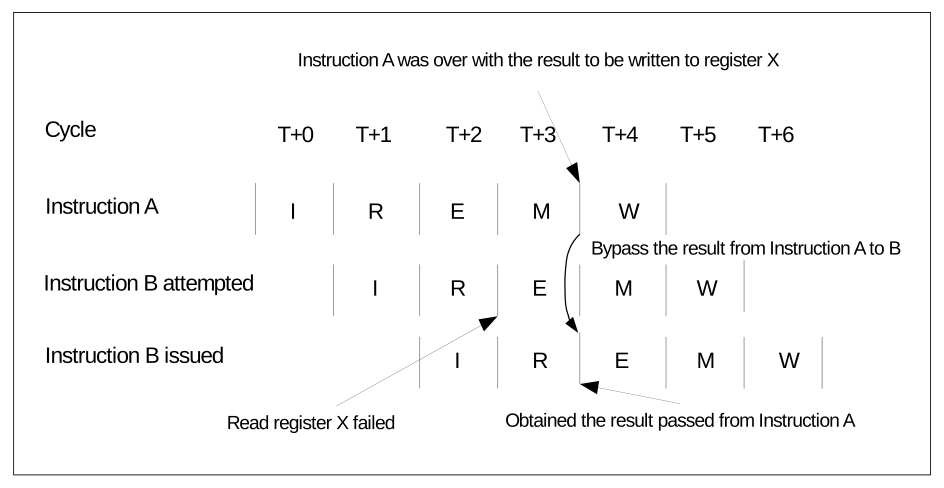

Figure 1.7-1. Interlock Caused by Instruction Operand Dependency

Data dependencies between instructions are determined by the dependencies between operands and the pipeline stage at which reads and writes happen. Table 1.7-2 lists all operands of the ESP32-S3 extended instructions, including implicit special register write (def) and read (use) pipeline stage information.

**Table 1.7-2. Extended Instruction Pipeline Stages**

|Instruction|Operand Pipeline Stage: Use|Operand Pipeline Stage: Def|Special Register Pipeline Stage: Use|Special Register Pipeline Stage: Def|
|---|---|---|---|---|
|EE.ANDQ|qx 1, qy 1|qa 1|—|—|
|EE.BITREV|ax 1|qa 1, ax 1|FFT_BIT_WIDTH 1|—|
|EE.CLR_BIT_GPIO_OUT|—|—|GPIO_OUT 1|GPIO_OUT 1|
|EE.CMUL.S16|qx 1, qy 1|qz 2|SAR 1|—|
|EE.CMUL.S16.LD.INCP|as 1, qx 1, qy 1|qu 2, as 1, qz 2|SAR 1|—|
|EE.CMUL.S16.ST.INCP|qv 2, as 1, qx 1, qy 1|as 1, qz 2|SAR 1|—|
|EE.FFT.AMS.S16.LD.INCP|as 1, qx 1, qy 1, qm 1|qu 2, as 1, qz 2, qz1 2|SAR 1|—|
|EE.FFT.AMS.S16.LD.INCP.UAUP|as 1, qx 1, qy 1, qm 1|qu 2, as 1, qz 2, qz1 2|SAR 1, SAR_BYTE 1, UA_STATE 1|UA_STATE 1|
|EE.FFT.AMS.S16.LD.R32.DECP|as 1, qx 1, qy 1, qm 1|qu 2, as 1, qz 2, qz1 2|SAR 1|—|
|EE.FFT.AMS.S16.ST.INCP|qv 2, as0 1, as 1, qx 1, qy 1, qm 1|qz1 2, as0 2, as 1|SAR 1|—|
|EE.FFT.CMUL.S16.LD.XP|as 1, ad 1, qx 1, qy 1|qu 2, as 1, qz 2|SAR 1|—|
|EE.FFT.CMUL.S16.ST.XP|qx 1, qy 1, qv 2, as 1, ad 1|as 1|SAR 1|—|
|EE.FFT.R2BF.S16|qx 1, qy 1|qa0 1, qa1 1|—|—|
|EE.FFT.R2BF.S16.ST.INCP|qx 1, qy 1, as 1|qa0 1, as 1|—|—|
|EE.FFT.VST.R32.DECP|qv 2, as 1|as 1|—|—|
|EE.GET_GPIO_IN|—|au 1|GPIO_IN 1|—|
|EE.LD.128.USAR.IP|as 1|qu 2, as 1|—|SAR_BYTE 1|
|EE.LD.128.USAR.XP|as 1, ad 1|qu 2, as 1|—|SAR_BYTE 1|
|EE.LD.ACCX.IP|as 1|as 1|—|ACCX 2|
|EE.LD.QACC_H.H.32.IP|as 1|as 1|QACC_H 1|QACC_H 2|
|EE.LD.QACC_H.L.128.IP|as 1|as 1|QACC_H 1|QACC_H 2|
|EE.LD.QACC_L.H.32.IP|as 1|as 1|QACC_L 1|QACC_L 2|
|EE.LD.QACC_L.L.128.IP|as 1|as 1|QACC_L 1|QACC_L 2|
|EE.LD.UA_STATE.IP|as 1|as 1|—|UA_STATE 2|
|EE.LDF.128.IP|as 1|fu3 2, fu2 2, fu1 2, fu0 2, as 1|—|—|
|EE.LDF.128.XP|as 1, ad 1|fu3 2, fu2 2, fu1 2, fu0 2, as 1|—|—|
|EE.LDF.64.IP|as 1|fu1 2, fu0 2, as 1|—|—|
|EE.LDF.64.XP|as 1, ad 1|fu1 2, fu0 2, as 1|—|—|
|EE.LDQA.S16.128.IP|as 1|as 1|—|QACC_L 2, QACC_H 2|
|EE.LDQA.S16.128.XP|as 1, ad 1|as 1|—|QACC_L 2, QACC_H 2|
|EE.LDQA.S8.128.IP|as 1|as 1|—|QACC_L 2, QACC_H 2|
|EE.LDQA.S8.128.XP|as 1, ad 1|as 1|—|QACC_L 2, QACC_H 2|
|EE.LDQA.U16.128.IP|as 1|as 1|—|QACC_L 2, QACC_H 2|
|EE.LDQA.U16.128.XP|as 1, ad 1|as 1|—|QACC_L 2, QACC_H 2|
|EE.LDQA.U8.128.IP|as 1|as 1|—|QACC_L 2, QACC_H 2|
|EE.LDQA.U8.128.XP|as 1, ad 1|as 1|—|QACC_L 2, QACC_H 2|
|EE.LDXQ.32|qs 1, as 1|qu 2|—|—|
|EE.MOV.S16.QACC|qs 1|—|—|QACC_L 1, QACC_H 1|
|EE.MOV.S8.QACC|qs 1|—|—|QACC_L 1, QACC_H 1|
|EE.MOV.U16.QACC|qs 1|—|—|QACC_L 1, QACC_H 1|
|EE.MOV.U8.QACC|qs 1|—|—|QACC_L 1, QACC_H 1|
|EE.MOVI.32.A|qs 1|au 1|—|—|
|EE.MOVI.32.Q|as 1|qu 1|—|—|
|EE.NOTQ|qx 1|qa 1|—|—|
|EE.ORQ|qx 1, qy 1|qa 1|—|—|
|EE.SET_BIT_GPIO_OUT|—|—|GPIO_OUT 1|GPIO_OUT 1|
|EE.SLCI.2Q|qs1 1, qs0 1|qs1 1, qs0 1|—|—|
|EE.SLCXXP.2Q|qs1 1, qs0 1, as 1, ad 1|qs1 1, qs0 1, as 1|—|—|
|EE.SRC.Q|qs0 1, qs1 1|qa 1|SAR_BYTE 1|—|
|EE.SRC.Q.LD.IP|as 1, qs0 1, qs1 1|qu 2, as 1, qs0 1|SAR_BYTE 1|—|
|EE.SRC.Q.LD.XP|as 1, ad 1, qs0 1, qs1 1|qu 2, as 1, qs0 1|SAR_BYTE 1|—|
|EE.SRC.Q.QUP|qs0 1, qs1 1|qa 1, qs0 1|SAR_BYTE 1|—|
|EE.SRCI.2Q|qs1 1, qs0 1|qs1 1, qs0 1|—|—|
|EE.SRCMB.S16.QACC|as 1|qu 1|QACC_H 1, QACC_L 1|QACC_H 1, QACC_L 1|
|EE.SRCMB.S8.QACC|as 1|qu 1|QACC_H 1, QACC_L 1|QACC_H 1, QACC_L 1|
|EE.SRCQ.128.ST.INCP|qs0 1, qs1 1, as 1|as 1|SAR_BYTE 1|—|
|EE.SRCXXP.2Q|qs1 1, qs0 1, as 1, ad 1|qs1 1, qs0 1, as 1|—|—|
|EE.SRS.ACCX|as 1|au 1|ACCX 1|ACCX 1|
|EE.ST.ACCX.IP|as 1|as 1|ACCX 1|—|
|EE.ST.QACC_H.H.32.IP|as 1|as 1|QACC_H 1|—|
|EE.ST.QACC_H.L.128.IP|as 1|as 1|QACC_H 1|—|
|EE.ST.QACC_L.H.32.IP|as 1|as 1|QACC_L 1|—|
|EE.ST.QACC_L.L.128.IP|as 1|as 1|QACC_L 1|—|
|EE.ST.UA_STATE.IP|as 1|as 1|UA_STATE 1|—|
|EE.STF.128.IP|fv3 1, fv2 1, fv1 1, fv0 1, as 1|as 1|—|—|
|EE.STF.128.XP|fv3 1, fv2 1, fv1 1, fv0 1, as 1, ad 1|as 1|—|—|
|EE.STF.64.IP|fv1 1, fv0 1, as 1|as 1|—|—|
|EE.STF.64.XP|fv1 1, fv0 1, as 1, ad 1|as 1|—|—|
|EE.STXQ.32|qv 1, qs 1, as 1|—|—|—|
|EE.VADDS.S16|qx 1, qy 1|qa 1|—|—|
|EE.VADDS.S16.LD.INCP|as 1, qx 1, qy 1|qu 2, as 1, qa 1|—|—|
|EE.VADDS.S16.ST.INCP|qv 1, as 1, qx 1, qy 1|as 1, qa 1|—|—|
|EE.VADDS.S32|qx 1, qy 1|qa 1|—|—|
|EE.VADDS.S32.LD.INCP|as 1, qx 1, qy 1|qu 2, as 1, qa 1|—|—|
|EE.VADDS.S32.ST.INCP|qv 1, as 1, qx 1, qy 1|as 1, qa 1|—|—|
|EE.VADDS.S8|qx 1, qy 1|qa 1|—|—|
|EE.VADDS.S8.LD.INCP|as 1, qx 1, qy 1|qu 2, as 1, qa 1|—|—|
|EE.VADDS.S8.ST.INCP|qv 1, as 1, qx 1, qy 1|as 1, qa 1|—|—|
|EE.VCMP.EQ.S16|qx 1, qy 1|qa 1|—|—|
|EE.VCMP.EQ.S32|qx 1, qy 1|qa 1|—|—|
|EE.VCMP.EQ.S8|qx 1, qy 1|qa 1|—|—|
|EE.VCMP.GT.S16|qx 1, qy 1|qa 1|—|—|
|EE.VCMP.GT.S32|qx 1, qy 1|qa 1|—|—|
|EE.VCMP.GT.S8|qx 1, qy 1|qa 1|—|—|
|EE.VCMP.LT.S16|qx 1, qy 1|qa 1|—|—|
|EE.VCMP.LT.S32|qx 1, qy 1|qa 1|—|—|
|EE.VCMP.LT.S8|qx 1, qy 1|qa 1|—|—|
|EE.VLD.128.IP|as 1|qu 2, as 1|—|—|
|EE.VLD.128.XP|as 1, ad 1|qu 2, as 1|—|—|
|EE.VLD.H.64.IP|as 1|qu 2, as 1|—|—|
|EE.VLD.H.64.XP|as 1, ad 1|qu 2, as 1|—|—|
|EE.VLD.L.64.IP|as 1|qu 2, as 1|—|—|
|EE.VLD.L.64.XP|as 1, ad 1|qu 2, as 1|—|—|
|EE.VLDBC.16|as 1|qu 2|—|—|
|EE.VLDBC.16.IP|as 1|qu 2, as 1|—|—|
|EE.VLDBC.16.XP|as 1, ad 1|qu 2, as 1|—|—|
|EE.VLDBC.32|as 1|qu 2|—|—|
|EE.VLDBC.32.IP|as 1|qu 2, as 1|—|—|
|EE.VLDBC.32.XP|as 1, ad 1|qu 2, as 1|—|—|
|EE.VLDBC.8|as 1|qu 2|—|—|
|EE.VLDBC.8.IP|as 1|qu 2, as 1|—|—|
|EE.VLDBC.8.XP|as 1, ad 1|qu 2, as 1|—|—|
|EE.VLDHBC.16.INCP|as 1|qu 2, qu1 2, as 1|—|—|
|EE.VMAX.S16|qx 1, qy 1|qa 1|—|—|
|EE.VMAX.S16.LD.INCP|as 1, qx 1, qy 1|qu 2, as 1, qa 1|—|—|
|EE.VMAX.S16.ST.INCP|qv 1, as 1, qx 1, qy 1|as 1, qa 1|—|—|
|EE.VMAX.S32|qx 1, qy 1|qa 1|—|—|
|EE.VMAX.S32.LD.INCP|as 1, qx 1, qy 1|qu 2, as 1, qa 1|—|—|
|EE.VMAX.S32.ST.INCP|qv 1, as 1, qx 1, qy 1|as 1, qa 1|—|—|
|EE.VMAX.S8|qx 1, qy 1|qa 1|—|—|
|EE.VMAX.S8.LD.INCP|as 1, qx 1, qy 1|qu 2, as 1, qa 1|—|—|
|EE.VMAX.S8.ST.INCP|qv 1, as 1, qx 1, qy 1|as 1, qa 1|—|—|
|EE.VMIN.S16|qx 1, qy 1|qa 1|—|—|
|EE.VMIN.S16.LD.INCP|as 1, qx 1, qy 1|qu 2, as 1, qa 1|—|—|
|EE.VMIN.S16.ST.INCP|qv 1, as 1, qx 1, qy 1|as 1, qa 1|—|—|
|EE.VMIN.S32|qx 1, qy 1|qa 1|—|—|
|EE.VMIN.S32.LD.INCP|as 1, qx 1, qy 1|qu 2, as 1, qa 1|—|—|
|EE.VMIN.S32.ST.INCP|qv 1, as 1, qx 1, qy 1|as 1, qa 1|—|—|
|EE.VMIN.S8|qx 1, qy 1|qa 1|—|—|
|EE.VMIN.S8.LD.INCP|as 1, qx 1, qy 1|qu 2, as 1, qa 1|—|—|
|EE.VMIN.S8.ST.INCP|qv 1, as 1, qx 1, qy 1|as 1, qa 1|—|—|
|EE.VMUL.S16|qx 1, qy 1|qz 2|SAR 1|—|
|EE.VMUL.S16.LD.INCP|as 1, qx 1, qy 1|qu 2, as 1, qz 2|SAR 1|—|
|EE.VMUL.S16.ST.INCP|qv 1, as 1, qx 1, qy 1|as 1, qz 2|SAR 1|—|
|EE.VMUL.S8|qx 1, qy 1|qz 2|SAR 1|—|
|EE.VMUL.S8.LD.INCP|as 1, qx 1, qy 1|qu 2, as 1, qz 2|SAR 1|—|
|EE.VMUL.S8.ST.INCP|qv 1, as 1, qx 1, qy 1|as 1, qz 2|SAR 1|—|
|EE.VMUL.U16|qx 1, qy 1|qz 2|SAR 1|—|
|EE.VMUL.U16.LD.INCP|as 1, qx 1, qy 1|qu 2, as 1, qz 2|SAR 1|—|
|EE.VMUL.U16.ST.INCP|qv 1, as 1, qx 1, qy 1|as 1, qz 2|SAR 1|—|
|EE.VMUL.U8|qx 1, qy 1|qz 2|SAR 1|—|
|EE.VMUL.U8.LD.INCP|as 1, qx 1, qy 1|qu 2, as 1, qz 2|SAR 1|—|
|EE.VMUL.U8.ST.INCP|qv 1, as 1, qx 1, qy 1|as 1, qz 2|SAR 1|—|
|EE.VMULAS.S16.ACCX|qx 1, qy 1|—|ACCX 2|ACCX 2|
|EE.VMULAS.S16.ACCX.LD.IP|as 1, qx 1, qy 1|qu 2, as 1|ACCX 2|ACCX 2|
|EE.VMULAS.S16.ACCX.LD.IP.QUP|as 1, qx 1, qy 1, qs0 1, qs1 1|qu 2, as 1, qs0 1|SAR_BYTE 1, ACCX 2|ACCX 2|
|EE.VMULAS.S16.ACCX.LD.XP|as 1, ad 1, qx 1, qy 1|qu 2, as 1|ACCX 2|ACCX 2|
|EE.VMULAS.S16.ACCX.LD.XP.QUP|as 1, ad 1, qx 1, qy 1, qs0 1, qs1 1|qu 2, as 1, qs0 1|SAR_BYTE 1, ACCX 2|ACCX 2|
|EE.VMULAS.S16.QACC|qx 1, qy 1|—|QACC_H 2, QACC_L 2|QACC_H 2, QACC_L 2|
|EE.VMULAS.S16.QACC.LD.IP|as 1, qx 1, qy 1|qu 2, as 1|QACC_H 2, QACC_L 2|QACC_H 2, QACC_L 2|
|EE.VMULAS.S16.QACC.LD.IP.QUP|as 1, qx 1, qy 1, qs0 1, qs1 1|qu 2, as 1, qs0 1|SAR_BYTE 1, QACC_H 2, QACC_L 2|QACC_H 2, QACC_L 2|
|EE.VMULAS.S16.QACC.LD.XP|as 1, ad 1, qx 1, qy 1|qu 2, as 1|QACC_H 2, QACC_L 2|QACC_H 2, QACC_L 2|
|EE.VMULAS.S16.QACC.LD.XP.QUP|as 1, ad 1, qx 1, qy 1, qs0 1, qs1 1|qu 2, as 1, qs0 1|SAR_BYTE 1, QACC_H 2, QACC_L 2|QACC_H 2, QACC_L 2|
|EE.VMULAS.S16.QACC.LDBC.INCP|as 1, qx 1, qy 1|qu 2, as 1|QACC_H 2, QACC_L 2|QACC_H 2, QACC_L 2|
|EE.VMULAS.S16.QACC.LDBC.INCP.QUP|as 1, qx 1, qy 1, qs0 1, qs1 1|qu 2, as 1, qs0 1|SAR_BYTE 1, QACC_H 2, QACC_L 2|QACC_H 2, QACC_L 2|
|EE.VMULAS.S8.ACCX|qx 1, qy 1|—|ACCX 2|ACCX 2|
|EE.VMULAS.S8.ACCX.LD.IP|as 1, qx 1, qy 1|qu 2, as 1|ACCX 2|ACCX 2|
|EE.VMULAS.S8.ACCX.LD.IP.QUP|as 1, qx 1, qy 1, qs0 1, qs1 1|qu 2, as 1, qs0 1|SAR_BYTE 1, ACCX 2|ACCX 2|
|EE.VMULAS.S8.ACCX.LD.XP|as 1, ad 1, qx 1, qy 1|qu 2, as 1|ACCX 2|ACCX 2|
|EE.VMULAS.S8.ACCX.LD.XP.QUP|as 1, ad 1, qx 1, qy 1, qs0 1, qs1 1|qu 2, as 1, qs0 1|SAR_BYTE 1, ACCX 2|ACCX 2|
|EE.VMULAS.S8.QACC|qx 1, qy 1|—|QACC_L 2, QACC_H 2|QACC_L 2, QACC_H 2|
|EE.VMULAS.S8.QACC.LD.IP|as 1, qx 1, qy 1|qu 2, as 1|QACC_H 2, QACC_L 2|QACC_H 2, QACC_L 2|
|EE.VMULAS.S8.QACC.LD.IP.QUP|as 1, qx 1, qy 1, qs0 1, qs1 1|qu 2, as 1, qs0 1|SAR_BYTE 1, QACC_H 2, QACC_L 2|QACC_H 2, QACC_L 2|
|EE.VMULAS.S8.QACC.LD.XP|as 1, ad 1, qx 1, qy 1|qu 2, as 1|QACC_H 2, QACC_L 2|QACC_H 2, QACC_L 2|
|EE.VMULAS.S8.QACC.LD.XP.QUP|as 1, ad 1, qx 1, qy 1, qs0 1, qs1 1|qu 2, as 1, qs0 1|SAR_BYTE 1, QACC_H 2, QACC_L 2|QACC_H 2, QACC_L 2|
|EE.VMULAS.S8.QACC.LDBC.INCP|as 1, qx 1, qy 1|qu 2, as 1|QACC_H 2, QACC_L 2|QACC_H 2, QACC_L 2|
|EE.VMULAS.S8.QACC.LDBC.INCP.QUP|as 1, qx 1, qy 1, qs0 1, qs1 1|qu 2, as 1, qs0 1|SAR_BYTE 1, QACC_H 2, QACC_L 2|QACC_H 2, QACC_L 2|
|EE.VMULAS.U16.ACCX|qx 1, qy 1|—|ACCX 2|ACCX 2|
|EE.VMULAS.U16.ACCX.LD.IP|as 1, qx 1, qy 1|qu 2, as 1|ACCX 2|ACCX 2|
|EE.VMULAS.U16.ACCX.LD.IP.QUP|as 1, qx 1, qy 1, qs0 1, qs1 1|qu 2, as 1, qs0 1|SAR_BYTE 1, ACCX 2|ACCX 2|
|EE.VMULAS.U16.ACCX.LD.XP|as 1, ad 1, qx 1, qy 1|qu 2, as 1|ACCX 2|ACCX 2|
|EE.VMULAS.U16.ACCX.LD.XP.QUP|as 1, ad 1, qx 1, qy 1, qs0 1, qs1 1|qu 2, as 1, qs0 1|SAR_BYTE 1, ACCX 2|ACCX 2|
|EE.VMULAS.U16.QACC|qx 1, qy 1|—|QACC_L 2, QACC_H 2|QACC_L 2, QACC_H 2|
|EE.VMULAS.U16.QACC.LD.IP|as 1, qx 1, qy 1|qu 2, as 1|QACC_L 2, QACC_H 2|QACC_L 2, QACC_H 2|
|EE.VMULAS.U16.QACC.LD.IP.QUP|as 1, qx 1, qy 1, qs0 1, qs1 1|qu 2, as 1, qs0 1|SAR_BYTE 1, QACC_H 2, QACC_L 2|QACC_H 2, QACC_L 2|
|EE.VMULAS.U16.QACC.LD.XP|as 1, ad 1, qx 1, qy 1|qu 2, as 1|QACC_L 2, QACC_H 2|QACC_L 2, QACC_H 2|
|EE.VMULAS.U16.QACC.LD.XP.QUP|as 1, ad 1, qx 1, qy 1, qs0 1, qs1 1|qu 2, as 1, qs0 1|SAR_BYTE 1, QACC_H 2, QACC_L 2|QACC_H 2, QACC_L 2|
|EE.VMULAS.U16.QACC.LDBC.INCP|as 1, qx 1, qy 1|qu 2, as 1|QACC_L 2, QACC_H 2|QACC_L 2, QACC_H 2|
|EE.VMULAS.U16.QACC.LDBC.INCP.QUP|as 1, qx 1, qy 1, qs0 1, qs1 1|qu 2, as 1, qs0 1|SAR_BYTE 1, QACC_H 2, QACC_L 2|QACC_H 2, QACC_L 2|
|EE.VMULAS.U8.ACCX|qx 1, qy 1|—|ACCX 2|ACCX 2|
|EE.VMULAS.U8.ACCX.LD.IP|as 1, qx 1, qy 1|qu 2, as 1|ACCX 2|ACCX 2|
|EE.VMULAS.U8.ACCX.LD.IP.QUP|as 1, qx 1, qy 1, qs0 1, qs1 1|qu 2, as 1, qs0 1|SAR_BYTE 1, ACCX 2|ACCX 2|
|EE.VMULAS.U8.ACCX.LD.XP|as 1, ad 1, qx 1, qy 1|qu 2, as 1|ACCX 2|ACCX 2|
|EE.VMULAS.U8.ACCX.LD.XP.QUP|as 1, ad 1, qx 1, qy 1, qs0 1, qs1 1|qu 2, as 1, qs0 1|SAR_BYTE 1, ACCX 2|ACCX 2|
|EE.VMULAS.U8.QACC|qx 1, qy 1|—|QACC_L 2, QACC_H 2|QACC_L 2, QACC_H 2|
|EE.VMULAS.U8.QACC.LD.IP|as 1, qx 1, qy 1|qu 2, as 1|QACC_L 2, QACC_H 2|QACC_L 2, QACC_H 2|
|EE.VMULAS.U8.QACC.LD.IP.QUP|as 1, qx 1, qy 1, qs0 1, qs1 1|qu 2, as 1, qs0 1|SAR_BYTE 1, QACC_H 2, QACC_L 2|QACC_H 2, QACC_L 2|
|EE.VMULAS.U8.QACC.LD.XP|as 1, ad 1, qx 1, qy 1|qu 2, as 1|QACC_L 2, QACC_H 2|QACC_L 2, QACC_H 2|
|EE.VMULAS.U8.QACC.LD.XP.QUP|as 1, ad 1, qx 1, qy 1, qs0 1, qs1 1|qu 2, as 1, qs0 1|SAR_BYTE 1, QACC_H 2, QACC_L 2|QACC_H 2, QACC_L 2|
|EE.VMULAS.U8.QACC.LDBC.INCP|as 1, qx 1, qy 1|qu 2, as 1|QACC_L 2, QACC_H 2|QACC_L 2, QACC_H 2|
|EE.VMULAS.U8.QACC.LDBC.INCP.QUP|as 1, qx 1, qy 1, qs0 1, qs1 1|qu 2, as 1, qs0 1|SAR_BYTE 1, QACC_H 2, QACC_L 2|QACC_H 2, QACC_L 2|
|EE.VPRELU.S16|qx 1, qy 1, ay 1|qz 2|—|—|
|EE.VPRELU.S8|qx 1, qy 1, ay 1|qz 2|—|—|
|EE.VRELU.S16|qs 1, ax 1, ay 1|qs 2|—|—|
|EE.VRELU.S8|qs 1, ax 1, ay 1|qs 2|—|—|
|EE.VSL.32|qs 1|qa 1|SAR 1|—|
|EE.VSMULAS.S16.QACC|qx 1, qy 1|—|QACC_H 2, QACC_L 2|QACC_H 2, QACC_L 2|
|EE.VSMULAS.S16.QACC.LD.INCP|as 1, qx 1, qy 1|qu 2, as 1|QACC_H 2, QACC_L 2|QACC_H 2, QACC_L 2|
|EE.VSMULAS.S8.QACC|qx 1, qy 1|—|QACC_L 2, QACC_H 2|QACC_L 2, QACC_H 2|
|EE.VSMULAS.S8.QACC.LD.INCP|as 1, qx 1, qy 1|qu 2, as 1|QACC_H 2, QACC_L 2|QACC_H 2, QACC_L 2|
|EE.VSR.32|qs 1|qa 1|SAR 1|—|
|EE.VST.128.IP|qv 1, as 1|as 1|—|—|
|EE.VST.128.XP|qv 1, as 1, ad 1|as 1|—|—|
|EE.VST.H.64.IP|qv 1, as 1|as 1|—|—|
|EE.VST.H.64.XP|qv 1, as 1, ad 1|as 1|—|—|
|EE.VST.L.64.IP|qv 1, as 1|as 1|—|—|
|EE.VST.L.64.XP|qv 1, as 1, ad 1|as 1|—|—|
|EE.VSUBS.S16|qx 1, qy 1|qa 1|—|—|
|EE.VSUBS.S16.LD.INCP|as 1, qx 1, qy 1|qu 2, as 1, qa 1|—|—|
|EE.VSUBS.S16.ST.INCP|qv 1, as 1, qx 1, qy 1|as 1, qa 1|—|—|
|EE.VSUBS.S32|qx 1, qy 1|qa 1|—|—|
|EE.VSUBS.S32.LD.INCP|as 1, qx 1, qy 1|qu 2, as 1, qa 1|—|—|
|EE.VSUBS.S32.ST.INCP|qv 1, as 1, qx 1, qy 1|as 1, qa 1|—|—|
|EE.VSUBS.S8|qx 1, qy 1|qa 1|—|—|
|EE.VSUBS.S8.LD.INCP|as 1, qx 1, qy 1|qu 2, as 1, qa 1|—|—|
|EE.VSUBS.S8.ST.INCP|qv 1, as 1, qx 1, qy 1|as 1, qa 1|—|—|
|EE.VUNZIP.16|qs0 1, qs1 1|qs0 1, qs1 1|—|—|
|EE.VUNZIP.32|qs0 1, qs1 1|qs0 1, qs1 1|—|—|
|EE.VUNZIP.8|qs0 1, qs1 1|qs0 1, qs1 1|—|—|
|EE.VZIP.16|qs0 1, qs1 1|qs0 1, qs1 1|—|—|
|EE.VZIP.32|qs0 1, qs1 1|qs0 1, qs1 1|—|—|
|EE.VZIP.8|qs0 1, qs1 1|qs0 1, qs1 1|—|—|
|EE.WR_MASK_GPIO_OUT|as 1, ax 1|—|GPIO_OUT 1|GPIO_OUT 1|
|EE.XORQ|qx 1, qy 1|qa 1|—|—|
|EE.ZERO.ACCX|—|—|—|ACCX 1|
|EE.ZERO.Q|—|qa 1|—|—|
|EE.ZERO.QACC|—|—|—|QACC_L 1, QACC_H 1|

#### 1.7.2 Hardware Resource Hazard

When multiple instructions call the same hardware resource at the same time, the processor allows only one of the instructions to occupy the hardware resource, and the rest of them will be delayed. For example, there are only eight 16-bit multipliers in the processor; instruction C requires eight of them in pipeline stage M, and instruction D requires four of them in pipeline stage E. As shown in Figure 1.7-2, instruction C is issued in cycle T+0, and instruction D is issued in cycle T+1, so four multipliers are applied to be occupied simultaneously in cycle T+3; at this time, the processor will delay the issue of instruction D into the pipeline by one cycle to avoid conflict with instruction C.

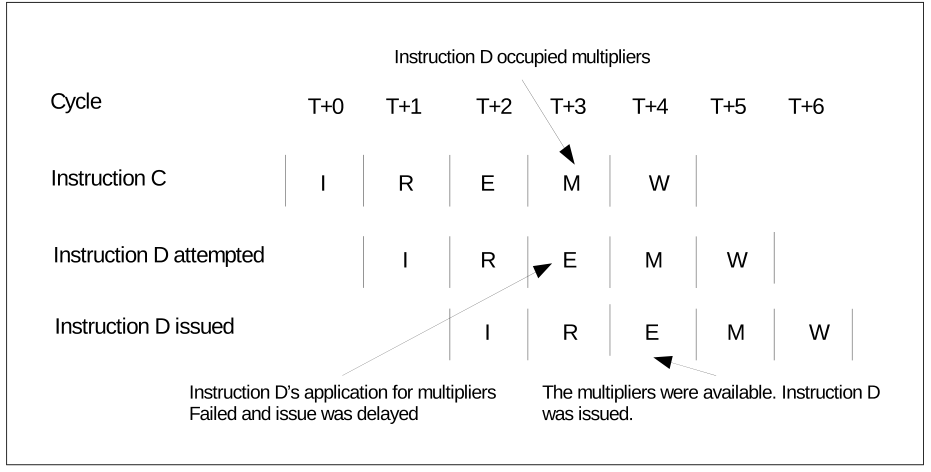

Figure 1.7-2. Hardware Resource Hazard

#### 1.7.3 Control Hazard

Data and hardware resource hazards can be optimized by adjusting the code order, but the control hazard is difficult to optimize. Program code usually has many conditional select statements that execute different code depending on whether the condition is met or not. The compiler will process the above conditional statements into branch and jump instructions: if the condition is satisfied, it will jump to the target address to execute the corresponding code; if not, the subsequent instructions will be processed in order. When the conditions are met, as shown in Figure 1.7-3, the processor will re-fetch the instruction from the new target address. At this time, the instructions at the R and E stages on the pipeline will be removed, which means the pipeline remains stagnant for 2 cycles.

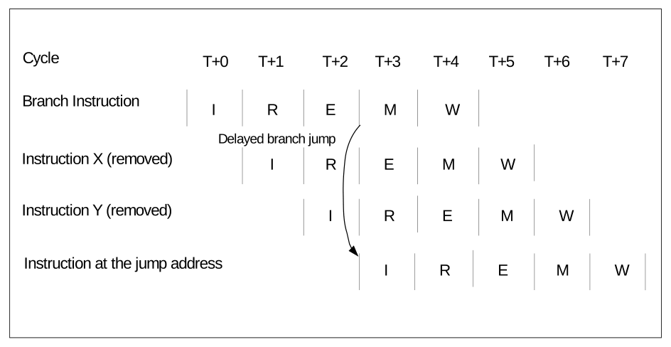

Figure 1.7-3. Control Hazard

### 1.8 Extended Instruction Functional Description

Before reading this section, you are recommended to read Table 1.4-1 in [§1.4.2](#142-instruction-field-definition), which introduces instruction field names and their meanings in instruction encoding.

[N:M] is used to represent the field. It means the width of the field is (N-M+1), namely, both bits N and M are included. For example, qa[2:0] has a total of 3 bits, which are bit0, bit1 and bit2, and qa[1] represents the value of bit1.

This chapter describes all the instructions mentioned in [Section 1.6](#16-extended-instruction-list) in alphabetical order by the instruction name. Each instruction is encoded in little-endian bit order as shown in Figure 1.4-1.

In each instruction entry below, the Instruction Word table lists the fields from the most significant bit (left) to the least significant bit (right), with each field's width in bits in the second row of the table.

#### 1.8.1 EE.ANDQ

**Instruction Word** (bit layout, little-endian bit order)

|11|qa[2:1]|1101|qa[0]|011|qy[2:1]|00|qx[2:1]|qy[0]|qx[0]|0100|
|---|---|---|---|---|---|---|---|---|---|---|
|2|2|4|1|3|2|2|2|1|1|4|

**Assembler Syntax**

```text
EE.ANDQ qa, qx, qy
```

**Description**

This instruction performs a bitwise AND operation on registers qx and qy and writes the result of the logical operation to register qa.

**Operation**

```text
qa = qx & qy
```


#### 1.8.2 EE.BITREV

**Instruction Word** (bit layout, little-endian bit order)

|11|qa[2:1]|1101|qa[0]|1111011|as[3:0]|0100|
|---|---|---|---|---|---|---|
|2|2|4|1|7|4|4|

**Assembler Syntax**

```text
EE.BITREV qa, as
```

**Description**

This instruction swaps the bit order of data of different bit widths according to the value of special register FFT_BIT_WIDTH. Then, it compares the data before and after the swap, takes the larger value, pads the higher bits with 0 until it has 16 bits, and writes the result into the corresponding data segment of register qa. In the following, Switchx is a function that represents the bit inversion of the x-bit. Switch5(0b10100) = 0b00101. Here 0b10100 means 5-bit binary data.

**Operation**

```text
  temp0[15:0] = as[15:0]
  temp1[15:0] = as[15:0] + 1
  temp2[15:0] = as[15:0] + 2
  temp3[15:0] = as[15:0] + 3
  temp4[15:0] = as[15:0] + 4
  temp5[15:0] = as[15:0] + 5
  temp6[15:0] = as[15:0] + 6
  temp7[15:0] = as[15:0] + 7
if FFT_BIT_WIDTH==3:
  Switch3(X[2:0]) = X[0:2]
  qa[ 15: 0] = {13’h0, max(tmp0[2:0], Switch3(tmp0[2:0]))}
  qa[ 31: 16] = {13’h0, max(tmp1[2:0], Switch3(tmp1[2:0]))}
  qa[ 47: 32] = {13’h0, max(tmp2[2:0], Switch3(tmp2[2:0]))}
  qa[ 63: 48] = {13’h0, max(tmp3[2:0], Switch3(tmp3[2:0]))}
  qa[ 79: 64] = {13’h0, max(tmp4[2:0], Switch3(tmp4[2:0]))}
  qa[ 95: 80] = {13’h0, max(tmp5[2:0], Switch3(tmp5[2:0]))}
  qa[127: 96] = 0
if FFT_BIT_WIDTH==4:
  Switch4(X[3:0]) = X[0:3]
  qa[ 15: 0] = {12’h0, max(tmp0[3:0], Switch4(tmp0[3:0]))}
  qa[ 31: 16] = {12’h0, max(tmp1[3:0], Switch4(tmp1[3:0]))}
  qa[ 47: 32] = {12’h0, max(tmp2[3:0], Switch4(tmp2[3:0]))}
  qa[ 63: 48] = {12’h0, max(tmp3[3:0], Switch4(tmp3[3:0]))}
  qa[ 79: 64] = {12’h0, max(tmp4[3:0], Switch4(tmp4[3:0]))}
  qa[ 95: 80] = {12’h0, max(tmp5[3:0], Switch4(tmp5[3:0]))}
  qa[111: 96] = {12’h0, max(tmp6[3:0], Switch4(tmp6[3:0]))}
  qa[127:112] = {12’h0, max(tmp7[3:0], Switch4(tmp7[3:0]))}
  ...
if FFT_BIT_WIDTH==10:
  Switch10(X[9:0]) = X[0:9]
  qa[ 15: 0] = {6’h0, max(tmp0[9:0], Switch10(tmp0[9:0]))}
  qa[ 31: 16] = {6’h0, max(tmp1[9:0], Switch10(tmp1[9:0]))}
  qa[ 47: 32] = {6’h0, max(tmp2[9:0], Switch10(tmp2[9:0]))}
  qa[ 63: 48] = {6’h0, max(tmp3[9:0], Switch10(tmp3[9:0]))}
  qa[ 79: 64] = {6’h0, max(tmp4[9:0], Switch10(tmp4[9:0]))}
  qa[ 95: 80] = {6’h0, max(tmp5[9:0], Switch10(tmp5[9:0]))}
  qa[111: 96] = {6’h0, max(tmp6[9:0], Switch10(tmp6[9:0]))}
  qa[127:112] = {6’h0, max(tmp7[9:0], Switch10(tmp7[9:0]))}

  as[31:0] = as[31:0] + 8
```


#### 1.8.3 EE.CLR_BIT_GPIO_OUT

**Instruction Word** (bit layout, little-endian bit order)

|011101100100|imm256[7:0]|0100|
|---|---|---|
|12|8|4|

**Assembler Syntax**

```text
EE.CLR_BIT_GPIO_OUT 0..255
```

**Description**

It is a dedicated CPU GPIO instruction to clear certain GPIO_OUT bits. The content to clear depends on the 8-bit immediate number imm256.

**Operation**

```text
GPIO_OUT[7:0] = (GPIO_OUT[7:0] & ~imm256[7:0])
```


#### 1.8.4 EE.CMUL.S16

**Instruction Word** (bit layout, little-endian bit order)

|10|qz[2:1]|1110|qz[0]|qy[2]|0|qy[1:0]|qx[2:0]|00|sel4[1:0]|0100|
|---|---|---|---|---|---|---|---|---|---|---|
|2|2|4|1|1|1|2|3|2|2|4|

**Assembler Syntax**

```text
EE.CMUL.S16 qz, qx, qy, 0..3
```

**Description**

This instruction performs a 16-bit signed complex multiplication. The range of the immediate number sel4 is 0 ~ 3, which specifies the 32 bits in the two QR registers qx and qy for complex multiplication. The real and imaginary parts of complex numbers are stored in the upper 16 bits and lower 16 bits of the 32 bits respectively. The calculated real part and imaginary part results are stored in the corresponding 32 bits of register qz.

**Operation**

```text
if sel4 == 0:
  qz[ 15: 0] = (qx[ 15: 0] * qy[ 15: 0] - qx[ 31: 16] * qy[ 31: 16]) >> SAR[5:0]
  qz[ 31: 16] = (qx[ 15: 0] * qy[ 31: 16] + qx[ 31: 16] * qy[ 15: 0]) >> SAR[5:0]
  qz[ 47: 32] = (qx[ 47: 32] * qy[ 47: 32] - qx[ 63: 48] * qy[ 63: 48]) >> SAR[5:0]
  qz[ 63: 48] = (qx[ 47: 32] * qy[ 63: 48] + qx[ 63: 48] * qy[ 47: 32]) >> SAR[5:0]
if sel4 == 1:
  qz[ 79: 64] = (qx[ 79: 64] * qy[ 79: 64] - qx[ 95: 80] * qy[ 95: 80]) >> SAR[5:0]
  qz[ 95: 80] = (qx[ 79: 64] * qy[ 95: 80] + qx[ 95: 80] * qy[ 79: 64]) >> SAR[5:0]
  qz[111: 96] = (qx[111: 96] * qy[111: 96] - qx[127:112] * qy[127:112]) >> SAR[5:0]
  qz[127:112] = (qx[111: 96] * qy[127:112] + qx[127:112] * qy[111: 96]) >> SAR[5:0]
if sel4 == 2:
  qz[ 15: 0] = (qx[ 15: 0] * qy[ 15: 0] + qx[ 31: 16] * qy[ 31: 16]) >> SAR[5:0]
  qz[ 31: 16] = (qx[ 15: 0] * qy[ 31: 16] - qx[ 31: 16] * qy[ 15: 0]) >> SAR[5:0]
  qz[ 47: 32] = (qx[ 47: 32] * qy[ 47: 32] + qx[ 63: 48] * qy[ 63: 48]) >> SAR[5:0]
  qz[ 63: 48] = (qx[ 47: 32] * qy[ 63: 48] - qx[ 63: 48] * qy[ 47: 32]) >> SAR[5:0]
if sel4 == 3:
  qz[ 79: 64] = (qx[ 79: 64] * qy[ 79: 64] + qx[ 95: 80] * qy[ 95: 80]) >> SAR[5:0]
  qz[ 95: 80] = (qx[ 79: 64] * qy[ 95: 80] - qx[ 95: 80] * qy[ 79: 64]) >> SAR[5:0]
  qz[111: 96] = (qx[111: 96] * qy[111: 96] + qx[127:112] * qy[127:112]) >> SAR[5:0]
  qz[127:112] = (qx[111: 96] * qy[127:112] - qx[127:112] * qy[111: 96]) >> SAR[5:0]
```


#### 1.8.5 EE.CMUL.S16.LD.INCP

**Instruction Word** (bit layout, little-endian bit order)

|111000|qu[2:1]|qy[0]|000|qu[0]|qz[2:0]|qx[1:0]|qy[2:1]|11|sel4[1:0]|as[3:0]|111|qx[2]|
|---|---|---|---|---|---|---|---|---|---|---|---|---|
|6|2|1|3|1|3|2|2|2|2|4|3|1|

**Assembler Syntax**

```text
EE.CMUL.S16.LD.INCP qu, as, qz, qx, qy, 0..3
```

**Description**

This instruction performs a 16-bit signed complex multiplication. The range of the immediate number sel4 is 0 ~ 7, which specifies the 32 bits in the two QR registers qx and qy for complex multiplication. The real and imaginary parts of complex numbers are stored in the upper 16 bits and lower 16 bits of the 32 bits respectively. The calculated real part and imaginary part results are stored in the corresponding 32 bits of register qz. During the operation, the lower 4 bits of the access address in register as are forced to be 0, and then the 16-byte data is loaded from the memory to register qu. After the access, the value in register as is incremented by 16.

**Operation**

```text
if sel4 == 0:
  qz[ 15: 0] = (qx[ 15: 0] * qy[ 15: 0] - qx[ 31: 16] * qy[ 31: 16]) >> SAR[5:0]
  qz[ 31: 16] = (qx[ 15: 0] * qy[ 31: 16] + qx[ 31: 16] * qy[ 15: 0]) >> SAR[5:0]
  qz[ 47: 32] = (qx[ 47: 32] * qy[ 47: 32] - qx[ 63: 48] * qy[ 63: 48]) >> SAR[5:0]
  qz[ 63: 48] = (qx[ 47: 32] * qy[ 63: 48] + qx[ 63: 48] * qy[ 47: 32]) >> SAR[5:0]
if sel4 == 1:
  qz[ 79: 64] = (qx[ 79: 64] * qy[ 79: 64] - qx[ 95: 80] * qy[ 95: 80]) >> SAR[5:0]
  qz[ 95: 80] = (qx[ 79: 64] * qy[ 95: 80] + qx[ 95: 80] * qy[ 79: 64]) >> SAR[5:0]
  qz[111: 96] = (qx[111: 96] * qy[111: 96] - qx[127:112] * qy[127:112]) >> SAR[5:0]
  qz[127:112] = (qx[111: 96] * qy[127:112] + qx[127:112] * qy[111: 96]) >> SAR[5:0]
if sel4 == 2:
  qz[ 15: 0] = (qx[ 15: 0] * qy[ 15: 0] + qx[ 31: 16] * qy[ 31: 16]) >> SAR[5:0]
  qz[ 31: 16] = (qx[ 15: 0] * qy[ 31: 16] - qx[ 31: 16] * qy[ 15: 0]) >> SAR[5:0]
  qz[ 47: 32] = (qx[ 47: 32] * qy[ 47: 32] + qx[ 63: 48] * qy[ 63: 48]) >> SAR[5:0]
  qz[ 63: 48] = (qx[ 47: 32] * qy[ 63: 48] - qx[ 63: 48] * qy[ 47: 32]) >> SAR[5:0]
if sel4 == 3:
  qz[ 79: 64] = (qx[ 79: 64] * qy[ 79: 64] + qx[ 95: 80] * qy[ 95: 80]) >> SAR[5:0]
  qz[ 95: 80] = (qx[ 79: 64] * qy[ 95: 80] - qx[ 95: 80] * qy[ 79: 64]) >> SAR[5:0]
  qz[111: 96] = (qx[111: 96] * qy[111: 96] + qx[127:112] * qy[127:112]) >> SAR[5:0]
  qz[127:112] = (qx[111: 96] * qy[127:112] - qx[127:112] * qy[111: 96]) >> SAR[5:0]

  qu[127:0] = load128({as[31:4],4{0}})
  as[31:0] = as[31:0] + 16
```


#### 1.8.6 EE.CMUL.S16.ST.INCP

**Instruction Word** (bit layout, little-endian bit order)

|11100100|qy[0]|qv[2:0]|0|qz[2:0]|qx[1:0]|qy[2:1]|00|sel4[1:0]|as[3:0]|111|qx[2]|
|---|---|---|---|---|---|---|---|---|---|---|---|
|8|1|3|1|3|2|2|2|2|4|3|1|

**Assembler Syntax**

```text
EE.CMUL.S16.ST.INCP qv, as, qz, qx, qy, sel4
```

**Description**

This instruction performs a 16-bit signed complex multiplication. The range of the immediate number sel4 is 0 ~ 7, which specifies the 32 bits in the two QR registers qx and qy for complex multiplication. The real and imaginary parts of complex numbers are stored in the upper 16 bits and lower 16 bits of the 32 bits respectively. The calculated real part and imaginary part results are stored in the corresponding 32 bits of register qz. During the operation, the lower 4 bits of the access address in register as are forced to be 0, and then stores the 16-byte data of qv to memory. After the access, the value in register as is incremented by 16.

**Operation**

```text
if sel4 == 0:
  qz[ 15: 0] = (qx[ 15: 0] * qy[ 15: 0] - qx[ 31: 16] * qy[ 31: 16]) >> SAR[5:0]
  qz[ 31: 16] = (qx[ 15: 0] * qy[ 31: 16] + qx[ 31: 16] * qy[ 15: 0]) >> SAR[5:0]
  qz[ 47: 32] = (qx[ 47: 32] * qy[ 47: 32] - qx[ 63: 48] * qy[ 63: 48]) >> SAR[5:0]
  qz[ 63: 48] = (qx[ 47: 32] * qy[ 63: 48] + qx[ 63: 48] * qy[ 47: 32]) >> SAR[5:0]
if sel4 == 1:
  qz[ 79: 64] = (qx[ 79: 64] * qy[ 79: 64] - qx[ 95: 80] * qy[ 95: 80]) >> SAR[5:0]
  qz[ 95: 80] = (qx[ 79: 64] * qy[ 95: 80] + qx[ 95: 80] * qy[ 79: 64]) >> SAR[5:0]
  qz[111: 96] = (qx[111: 96] * qy[111: 96] - qx[127:112] * qy[127:112]) >> SAR[5:0]
  qz[127:112] = (qx[111: 96] * qy[127:112] + qx[127:112] * qy[111: 96]) >> SAR[5:0]
if sel4 == 2:
  qz[ 15: 0] = (qx[ 15: 0] * qy[ 15: 0] + qx[ 31: 16] * qy[ 31: 16]) >> SAR[5:0]
  qz[ 31: 16] = (qx[ 15: 0] * qy[ 31: 16] - qx[ 31: 16] * qy[ 15: 0]) >> SAR[5:0]
  qz[ 47: 32] = (qx[ 47: 32] * qy[ 47: 32] + qx[ 63: 48] * qy[ 63: 48]) >> SAR[5:0]
  qz[ 63: 48] = (qx[ 47: 32] * qy[ 63: 48] - qx[ 63: 48] * qy[ 47: 32]) >> SAR[5:0]
if sel4 == 3:
  qz[ 79: 64] = (qx[ 79: 64] * qy[ 79: 64] + qx[ 95: 80] * qy[ 95: 80]) >> SAR[5:0]
  qz[ 95: 80] = (qx[ 79: 64] * qy[ 95: 80] - qx[ 95: 80] * qy[ 79: 64]) >> SAR[5:0]
  qz[111: 96] = (qx[111: 96] * qy[111: 96] + qx[127:112] * qy[127:112]) >> SAR[5:0]
  qz[127:112] = (qx[111: 96] * qy[127:112] - qx[127:112] * qy[111: 96]) >> SAR[5:0]

  qv[127:0] => store128({as[31:4],4{0}})
  as[31:0] = as[31:0] + 16
```


#### 1.8.7 EE.FFT.AMS.S16.LD.INCP

**Instruction Word** (bit layout, little-endian bit order)

|110100|sel2[0]|qz1[2]|qz[0]|qy[2:0]|qz1[1]|qm[2:0]|qx[1:0]|qz[2:1]|qz1[0]|qu[2:0]|as[3:0]|111|qx[2]|
|---|---|---|---|---|---|---|---|---|---|---|---|---|---|
|6|1|1|1|3|1|3|2|2|1|3|4|3|1|

**Assembler Syntax**

```text
EE.FFT.AMS.S16.LD.INCP qu, as, qz, qz1, qx, qy, qm, sel2
```

**Description**

It is a dedicated FFT instruction to perform addition, subtraction, multiplication, addition and subtraction, and shift operations on 16-bit data segments.

During the operation, the lower 4 bits of the access address in register as are forced to be 0, and then the 16-byte data is loaded from the memory to register qu. After the access, the value in register as is incremented by 16.

**Operation**

```text
  temp0[15:0] = qx[ 47: 32] + qy[ 47: 32]
  temp1[15:0] = qx[ 63: 48] - qy[ 63: 48]

if sel2==0:
  temp2[15:0] = ((qx[ 47: 32] - qy[ 47: 32]) * qm[ 47: 32] - (qx[ 63: 48] + qy[ 63: 48]) * qm[ 63: 48]) >> SAR
  temp3[15:0] = ((qx[ 47: 32] - qy[ 47: 32]) * qm[ 63: 48] + (qx[ 63: 48] + qy[ 63: 48]) * qm[ 47: 32]) >> SAR
if sel2==1:
  temp2[15:0] = ((qx[ 63: 48] + qy[ 63: 48]) * qm[ 63: 48] + (qx[ 47: 32] - qy[ 47: 32]) * qm[ 47: 32]) >> SAR
  temp3[15:0] = ((qx[ 63: 48] + qy[ 63: 48]) * qm[ 47: 32] - (qx[ 47: 32] - qy[ 47: 32]) * qm[ 63: 48]) >> SAR

  qz[47: 32] = temp0[15:0] + temp2[15:0]
  qz[63: 48] = temp1[15:0] + temp3[15:0]
  qz1[47: 32] = temp0[15:0] - temp2[15:0]
  qz1[63: 48] = temp3[15:0] - temp1[15:0]
  qu = load128({as[31:4],4{0}})
  as[31:0] = as[31:0] + 16
```


#### 1.8.8 EE.FFT.AMS.S16.LD.INCP.UAUP

**Instruction Word** (bit layout, little-endian bit order)

|110101|sel2[0]|qz1[2]|qz[0]|qy[2:0]|qz1[1]|qm[2:0]|qx[1:0]|qz[2:1]|qz1[0]|qu[2:0]|as[3:0]|111|qx[2]|
|---|---|---|---|---|---|---|---|---|---|---|---|---|---|
|6|1|1|1|3|1|3|2|2|1|3|4|3|1|

**Assembler Syntax**

```text
EE.FFT.AMS.S16.LD.INCP.UAUP qu, as, qz, qz1, qx, qy, qm, sel2
```

**Description**

It is a dedicated FFT instruction to perform addition, subtraction, multiplication, addition and subtraction, and shift operations on 16-bit data segments.

During the operation, the lower 4 bits of the access address in the register as are forced to be 0, and then the 16-byte data is loaded from the memory. The instruction joins the loaded data and the data in special register UA_STATE into 32-byte data, right-shifts the 32-byte data by the result of the SAR_BYTE value multiplied by 8, and assigns the lower 128 bits of the shifted result to register qu. Meanwhile, register UA_STATE is updated with the loaded 16-byte data. After the access, the value in register as is incremented by 16.

**Operation**

```text
  temp0[15:0] = qx[ 15: 0] + qy[ 15: 0]
  temp1[15:0] = qx[ 31: 16] - qy[ 31: 16]

if sel2==0:
  temp2[15:0] = ((qx[ 15: 0] - qy[ 15: 0]) * qm[ 15: 0] - (qx[ 31: 16] + qy[ 31: 16]) * qm[ 31: 16]) >> SAR
  temp3[15:0] = ((qx[ 15: 0] - qy[ 15: 0]) * qm[ 31: 16] + (qx[ 31: 16] + qy[ 31: 16]) * qm[ 15: 0]) >> SAR
if sel2==1:
  temp2[15:0] = ((qx[ 31: 16] + qy[ 31: 16]) * qm[ 31: 16] + (qx[ 15: 0] - qy[ 15: 0]) * qm[ 15: 0]) >> SAR
  temp3[15:0] = ((qx[ 31: 16] + qy[ 31: 16]) * qm[ 15: 0] - (qx[ 15: 0] - qy[ 15: 0]) * qm[ 31: 16]) >> SAR

  dataIn[127:0] = load128({as[31:4],4{0}})
  qz[15: 0] = temp0[15:0] + temp2[15:0]
  qz[31: 16] = temp1[15:0] + temp3[15:0]
  qz1[15: 0] = temp0[15:0] - temp2[15:0]
  qz1[31:16] = temp3[15:0] - temp1[15:0]
  qu[127: 0] = {dataIn[127:0], UA_STATE[127:0]} >> {SAR_BYTE[3:0] << 3}
  UA_STATE[127:0] = dataIn[127:0]
  as[31:0] = as[31:0] + 16
```


#### 1.8.9 EE.FFT.AMS.S16.LD.R32.DECP

**Instruction Word** (bit layout, little-endian bit order)

|110110|sel2[0]|qz1[2]|qz[0]|qy[2:0]|qz1[1]|qm[2:0]|qx[1:0]|qz[2:1]|qz1[0]|qu[2:0]|as[3:0]|111|qx[2]|
|---|---|---|---|---|---|---|---|---|---|---|---|---|---|
|6|1|1|1|3|1|3|2|2|1|3|4|3|1|

**Assembler Syntax**

```text
EE.FFT.AMS.S16.LD.R32.DECP qu, as, qz, qz1, qx, qy, qm, sel2
```

**Description**

It is a dedicated FFT instruction to perform addition, subtraction, multiplication, addition and subtraction, and shift operations on 16-bit data segments.

During the operation, the instruction forces the lower 4 bits of the access address in register as to 0 and loads the 16-byte data from the memory to register qu in the big-endian word order, namely, loads the segment [127: 96] of the data to [31:0] of qu. After the access is completed, the value in register as is decreased by 16.

**Operation**

```text
  temp0[15:0] = qx[ 79: 64] + qy[ 79: 64]
  temp1[15:0] = qx[ 95: 80] - qy[ 95: 80]

if sel2==0:
  temp2[15:0] = ((qx[ 79: 64] - qy[ 79: 64]) * qm[ 79: 64] - (qx[ 95: 80] + qy[ 95: 80]) * qm[ 95: 80]) >> SAR
  temp3[15:0] = ((qx[ 79: 64] - qy[ 79: 64]) * qm[ 95: 80] + (qx[ 95: 80] + qy[ 95: 80]) * qm[ 79: 64]) >> SAR
if sel2==1:
  temp2[15:0] = ((qx[ 95: 80] + qy[ 95: 80]) * qm[ 95: 80] + (qx[ 79: 64] - qy[ 79: 64]) * qm[ 79: 64]) >> SAR
  temp3[15:0] = ((qx[ 95: 80] + qy[ 95: 80]) * qm[ 79: 64] - (qx[ 79: 64] - qy[ 79: 64]) * qm[ 95: 80]) >> SAR

  qz[79: 64] = temp0[15:0] + temp2[15:0]
  qz[95: 80] = temp1[15:0] + temp3[15:0]
  qz1[79:64] = temp0[15:0] - temp2[15:0]
  qz1[95:80] = temp3[15:0] - temp1[15:0]
  {qu[31: 0], qu[63: 32], qu[95: 64], qu[127: 96]} = load128({as[31:4],4{0}})
  as[31:0] = as[31:0] - 16
```


#### 1.8.10 EE.FFT.AMS.S16.ST.INCP

**Instruction Word** (bit layout, little-endian bit order)

|10100|sel2[0]|qz1[2:1]|qm[0]|qv[2:0]|qz1[0]|qx[2:0]|qy[1:0]|qm[2:1]|as[3:0]|at[3:0]|111|qy[2]|
|---|---|---|---|---|---|---|---|---|---|---|---|---|
|5|1|2|1|3|1|3|2|2|4|4|3|1|

**Assembler Syntax**

```text
EE.FFT.AMS.S16.ST.INCP qv, qz1, at, as, qx, qy, qm, sel2
```

**Description**

It is a dedicated FFT instruction to perform addition, subtraction, multiplication, addition and subtraction, and shift operations on 16-bit data segments.

During the operation, the instruction forces the lower 4 bits of the access address in register as to 0, splices the values in registers qv and at into 16-byte data, and stores the spliced result to memory. After the access is completed, the value in register as is incremented by 16. Besides, the operation result is updated to register at.

**Operation**

```text
  temp0[15:0] = qx[111: 96] + qy[111: 96]
  temp1[15:0] = qx[127:112] - qy[127:112]

if sel2==0:
  temp2[15:0] = ((qx[111: 96] - qy[111: 96]) * qm[111: 96] - (qx[127:112] + qy [127:112]) * qm[127:112]) >> SAR[5:0]
  temp3[15:0] = ((qx[111: 96] - qy[111: 96]) * qm[127:112] + (qx[127:112] + qy [127:112]) * qm[111: 96]) >> SAR[5:0]
  {qv[ 95: 80] >> 1, qv[ 79: 64] >> 1, qv[ 63: 48] >> 1, qv[ 47: 32] >> 1, qv[ 31: 16] >> 1, qv[ 15: 0] >> 1, at[31: 16] >> 1, at[15:0] >> 1} => store128({as [31:4],4{0}})
if sel2==1:
  temp2[15:0] = ((qx[127:112] + qy[127:112]) * qm[127:112] + (qx[111: 96] - qy[111: 96]) * qm[111: 96]) >> SAR[5:0]
  temp3[15:0] = ((qx[127:112] + qy[127:112]) * qm[111: 96] - (qx[111: 96] - qy[111: 96]) * qm[127:112]) >> SAR[5:0]
  {qv[ 95: 64], qv[ 63: 32], qv[ 31: 0], at[31:0]} => store128({as[31:4],4{0}})

  temp4[16:0] = temp1[15:0] + temp3[15:0]
  temp5[16:0] = temp0[15:0] + temp2[15:0]
  qz1[111: 96] = temp0[15:0] - temp2[15:0]
  qz1[127:112] = temp3[15:0] - temp1[15:0]
  at = {temp4[15:0], temp5[15:0]}
  as[31:0] = as[31:0] +16
```


#### 1.8.11 EE.FFT.CMUL.S16.LD.XP

**Instruction Word** (bit layout, little-endian bit order)

|110111|sel8[2:1]|qu[0]|qy[2:0]|sel8[0]|qz[2:0]|qx[1:0]|qu[2:1]|ad[3:0]|as[3:0]|111|qx[2]|
|---|---|---|---|---|---|---|---|---|---|---|---|
|6|2|1|3|1|3|2|2|4|4|3|1|

**Assembler Syntax**

```text
EE.FFT.CMUL.S16.LD.XP qu, as, ad, qz, qx, qy, sel8
```

**Description**

This instruction performs a 16-bit signed complex multiplication. It is similar to EE.CMUL.S16 except that the order of registers qx and qy is reversed.

During the operation, the lower 4 bits of the access address in register as are forced to be 0, and then the 16-byte data is loaded from the memory to register qu. After the access is completed, the value in register as is incremented by the value in register ad.

**Operation**

```text
if sel8 == 0:
  qz[ 15: 0] = (qx[ 15: 0] * qy[ 15: 0] + qx[ 31: 16] * qy[ 31: 16]) >> SAR[5:0]
  qz[ 31: 16] = (qx[ 31: 16] * qy[ 15: 0] - qx[ 15: 0] * qy[ 31: 16]) >> SAR[5:0]
if sel8 == 1:
  qz[ 15: 0] = (qx[ 15: 0] * qy[ 15: 0] - qx[ 31: 16] * qy[ 31: 16]) >> SAR[5:0]
  qz[ 31: 16] = (qx[ 31: 16] * qy[ 15: 0] + qx[ 15: 0] * qy[ 31: 16]) >> SAR[5:0]
if sel8 == 2:
  qz[ 47: 32] = (qx[ 47: 32] * qy[ 47: 32] + qx[ 63: 48] * qy[ 63: 48]) >> SAR[5:0]
  qz[ 63: 48] = (qx[ 63: 48] * qy[ 47: 32] - qx[ 47: 32] * qy[ 63: 48]) >> SAR[5:0]
if sel8 == 3:
  qz[ 47: 32] = (qx[ 47: 32] * qy[ 47: 32] - qx[ 63: 48] * qy[ 63: 48]) >> SAR[5:0]
  qz[ 63: 48] = (qx[ 63: 48] * qy[ 47: 32] + qx[ 47: 32] * qy[ 63: 48]) >> SAR[5:0]
if sel8 == 4:
  qz[ 79: 64] = (qx[ 79: 64] * qy[ 79: 64] + qx[ 95: 80] * qy[ 95: 80]) >> SAR[5:0]
  qz[ 95: 80] = (qx[ 95: 80] * qy[ 79: 64] - qx[ 79: 64] * qy[ 95: 80]) >> SAR[5:0]
if sel8 == 5:
  qz[ 79: 64] = (qx[ 79: 64] * qy[ 79: 64] - qx[ 95: 80] * qy[ 95: 80]) >> SAR[5:0]
  qz[ 95: 80] = (qx[ 95: 80] * qy[ 79: 64] + qx[ 79: 64] * qy[ 95: 80]) >> SAR[5:0]

  qu[127:0] = load128({as[31:4],4{0}})
  as[31:0] = as[31:0] + ad[31:0]
```


#### 1.8.12 EE.FFT.CMUL.S16.ST.XP

**Instruction Word** (bit layout, little-endian bit order)

|10101|sar4[1:0]|upd4[1]|sel8[0]|qy[2:0]|upd4[0]|qv[2:0]|qx[1:0]|sel8[2:1]|ad[3:0]|as[3:0]|111|qx[2]|
|---|---|---|---|---|---|---|---|---|---|---|---|---|
|5|2|1|1|3|1|3|2|2|4|4|3|1|

**Assembler Syntax**

```text
EE.FFT.CMUL.S16.ST.XP qx, qy, qv, as, ad, sel8, upd4, sar4
```

**Description**

This instruction performs a 16-bit signed complex multiplication. It is similar to EE.CMUL.S16 except that the order of registers qx and qy is reversed.

The result of the operation and the data segments in registers qx and qv specified by the immediate data upd4 are concatenated into 128 bits, which then are written into memory. After the access is completed, the value in register as is incremented by the value in register ad. Operation 1    if sel8 == 6:

2      temp[15:0] = (qx[111: 96] * qy[111: 96] + qx[127:112] * qy[127:112]) >> SAR[5:0] 3      temp[31:16] = (qx[127:112] * qy[111: 96] - qx[111: 96] * qy[127:112]) >> SAR[5:0] 4    if sel8 == 7:

5      temp[15:0] = (qx[111: 96] * qy[111: 96] - qx[127:112] * qy[127:112]) >> SAR[5:0] 6      temp[31:16] = (qx[127:112] * qy[111: 96] + qx[111: 96] * qy[127:112]) >> SAR[5:0] 7 8    if upd4 == 0:    // normal radix 2 9      {temp[31:0], qv[ 95:       0]} => store128({as[31:4],4{0}}) 10    if upd4 == 1:    // radix2 last second stage 11     { 12           temp[31:0], 13           qv[ 95: 64], 14           qx[ 63: 48] >> sar4, 15           qx[ 47: 32] >> sar4, 16           qx[ 31: 16] >> sar4, 17           qx[ 15:     0] >> sar4 18      } => store128({as[31:4],4{0}}) 19    if upd4 == 2:    // radix2 last stage 20      { 21           temp[31:0], 22           qx[ 63: 48] >> sar4, 23           qx[ 47: 32] >> sar4, 24           qv[ 95: 64], 25           qx[ 31: 16] >> sar4, 26           qx[ 15:     0] >> sar4 27      } => store128({as[31:4],4{0}}) 28 29      as[31:0] = as[31:0] + ad[31:0]


#### 1.8.13 EE.FFT.R2BF.S16

**Instruction Word** (bit layout, little-endian bit order)

|11|qa0[2:1]|1100|qa0[0]|qa1[2:0]|qy[2:1]|0|sel2[0]|qx[2:1]|qy[0]|qx[0]|0100|
|---|---|---|---|---|---|---|---|---|---|---|---|
|2|2|4|1|3|2|1|1|2|1|1|4|

**Assembler Syntax**

```text
EE.FFT.R2BF.S16 qa0, qa1, qx, qy, sel2
```

**Description**

This instruction performs the radix-2 butterfly operation on the 16-byte values in registers qx and qy, and the data bit width is 16 bits. Some of the calculation results are written to register qa0, and others are written to register qa1.

**Operation**

```text
if sel2==0:
  op_a[127: 0] = {qy[ 63: 0], qx[ 63: 0]}
  op_b[127: 0] = {qy[127: 64], qx[127: 64]}
if sel2==1:
  op_a[127: 0] = {qy[ 95: 64], qy[ 31: 0], qx[ 95: 64], qx[ 31: 0]}
  op_b[127: 0] = {qy[127: 96], qy[ 63: 32], qx[127: 96], qx[ 63: 32]}

qa0[ 15: 0] = op_a[ 15: 0] + op_b[ 15: 0]
  qa0[ 31: 16] = op_a[ 31: 16] + op_b[ 31: 16]
qa0[ 47: 32] = op_a[ 47: 32] + op_b[ 47: 32]
  qa0[ 63: 48] = op_a[ 63: 48] + op_b[ 63: 48]
       qa0[ 79: 64] = op_a[ 15: 0] - op_b[ 15: 0]
       qa0[ 95: 80] = op_a[ 31: 16] - op_b[ 31: 16]
       qa0[111: 96] = op_a[ 47: 32] - op_b[ 47: 32]
       qa0[127:112] = op_a[ 63: 48] - op_b[ 63: 48]

       qa1[ 15: 0] = op_a[ 79: 64] + op_b[ 79: 64]
  qa1[ 31: 16] = op_a[ 95: 80] + op_b[ 95: 80]
qa1[ 47: 32] = op_a[111: 96] + op_b[111: 96]
  qa1[ 63: 48] = op_a[127:112] + op_b[127:112]
       qa1[ 79: 64] = op_a[ 79: 64] - op_b[ 79: 64]
       qa1[ 95: 80] = op_a[ 95: 80] - op_b[ 95: 80]
       qa1[111: 96] = op_a[111: 96] - op_b[111: 96]
       qa1[127:112] = op_a[127:112] - op_b[127:112]
```


#### 1.8.14 EE.FFT.R2BF.S16.ST.INCP

**Instruction Word** (bit layout, little-endian bit order)

|11101000|sar4[0]|qy[2:0]|1|qa0[2:0]|qx[1:0]|0|sar4[1]|0100|as[3:0]|111|qx[2]|
|---|---|---|---|---|---|---|---|---|---|---|---|
|8|1|3|1|3|2|1|1|4|4|3|1|

**Assembler Syntax**

```text
EE.FFT.R2BF.S16.ST.INCP qa0, qx, qy, as, 0..3
```

**Description**

This instruction performs the radix-2 butterfly operation on the 16-byte values in registers qx and qy, and the data bit width is 16 bits. Some of the calculation results are written to register qa0, and others implement an arithmetic shift and are written into the memory address indicated by as. After the access is completed, the value in register as is incremented by 16.

**Operation**

```text
qa0[ 15: 0] = qx[ 15: 0] - qy[ 15: 0]
  qa0[ 31: 16] = qx[ 31: 16] - qy[ 31: 16]
  qa0[ 47: 32] = qx[ 47: 32] - qy[ 47: 32]
qa0[ 63: 48] = qx[ 63: 48] - qy[ 63: 48]
  qa0[ 79: 64] = qx[ 79: 64] - qy[ 79: 64]
  qa0[ 95: 80] = qx[ 95: 80] - qy[ 95: 80]
qa0[111: 96] = qx[111: 96] - qy[111: 96]
  qa0[127:112] = qx[127:112] - qy[127:112]

  {
  (qx[127:112] + qy[127:112]) >> sar4,
  (qx[111: 96] + qy[111: 96]) >> sar4,
  (qx[ 95: 80] + qy[ 95: 80]) >> sar4,
  (qx[ 79: 64] + qy[ 79: 64]) >> sar4,
  (qx[ 63: 48] + qy[ 63: 48]) >> sar4,
(qx[ 47: 32] + qy[ 47: 32]) >> sar4,
  (qx[ 31: 16] + qy[ 31: 16]) >> sar4,
  (qx[ 15: 0] + qy[ 15: 0]) >> sar4
  } => store128({as[31:4],4{0}})
  as[31:0] = as[31:0] + 16
```


#### 1.8.15 EE.FFT.VST.R32.DECP

**Instruction Word** (bit layout, little-endian bit order)

|11|qv[2:1]|1101|qv[0]|0110|sar2[0]|11|as[3:0]|0100|
|---|---|---|---|---|---|---|---|---|
|2|2|4|1|4|1|2|4|4|

**Assembler Syntax**

```text
EE.FFT.VST.R32.DECP qv, as, sar2
```

**Description**

It is a dedicated FFT instruction. This instruction divides data in register qv into 8 segments of 16-bit data and performs an arithmetic right shift on them by 0 or 1 depending on the immediate number sar2, and finally writes the result to the memory address indicated by register as in word big-endian order. After the access is completed, the value in register as is decreased by 16.

**Operation**

```text
{
qv[ 31: 16] >> sar2,
qv[ 15: 0] >> sar2,
qv[ 63: 48] >> sar2,
qv[ 47: 32] >> sar2,
qv[ 95: 80] >> sar2,
qv[ 79: 64] >> sar2,
qv[127:112] >> sar2,
qv[111: 96] >> sar2
} => store128({as[31:4],4{0}})
  as[31:0] = as[31:0] - 16
```


#### 1.8.16 EE.GET_GPIO_IN

**Instruction Word** (bit layout, little-endian bit order)

|0110010100001000|au[3:0]|0100|
|---|---|---|
|16|4|4|

**Assembler Syntax**

```text
EE.GET_GPIO_IN au
```

**Description**

It is a dedicated CPU GPIO instruction to assign the content of GPIO_IN to the lower 8 bits of register au.

**Operation**

```text
au = {24’h0, GPIO_IN[7:0]}
```


#### 1.8.17 EE.LD.128.USAR.IP

**Instruction Word** (bit layout, little-endian bit order)

|1|imm16[7]|qu[2:1]|0001|qu[0]|imm16[6:0]|as[3:0]|0100|
|---|---|---|---|---|---|---|---|
|1|1|2|4|1|7|4|4|

**Assembler Syntax**

```text
EE.LD.128.USAR.IP qu, as, -2048..2032
```

**Description**

This instruction forces the lower 4 bits of the access address in register as to 0 and loads 16-byte data from memory to register qu. Meanwhile, it saves the value of the lower 4 bits in as to the special register SAR_BYTE. After the access is completed, the value in register as is incremented by 8-bit sign-extended constant in the instruction code segment left-shifted by 4.

**Operation**

```text
qu[127:0] = load128({as[31:4],4{0}})
SAR_BYTE = as[3:0]
as[31:0] = as[31:0] + {20{imm16[7]},imm16[7:0],4{0}}
```


#### 1.8.18 EE.LD.128.USAR.XP

**Instruction Word** (bit layout, little-endian bit order)

|10|qu[2:1]|1101|qu[0]|000|ad[3:0]|as[3:0]|0100|
|---|---|---|---|---|---|---|---|
|2|2|4|1|3|4|4|4|

**Assembler Syntax**

```text
EE.LD.128.USAR.XP qu, as, ad
```

**Description**

This instruction forces the lower 4 bits of the access address in register as to 0 and loads 16-byte data from memory to register qu. Meanwhile, it saves the value of the lower 4 bits in as to the special register SAR_BYTE. After the access is completed, the value in register as is incremented by the value in register ad.

**Operation**

```text
qu[127:0] = load128({as[31:4],4{0}})
SAR_BYTE = as[3:0]
as[31:0] = as[31:0] + ad[31:0]
```


#### 1.8.19 EE.LD.ACCX.IP

**Instruction Word** (bit layout, little-endian bit order)

|0|imm8[7]|0011100|imm8[6:0]|as[3:0]|0100|
|---|---|---|---|---|---|
|1|1|7|7|4|4|

**Assembler Syntax**

```text
EE.LD.ACCX.IP as, -1024..1016
```

**Description**

This instruction forces the lower 3 bits of the access address in register as to 0, loads 64-bit data from memory, and save its lower 40 bits to the special register ACCX. After the access is completed, the value in register as is incremented by 8-bit sign-extended constant in the instruction code segment left-shifted by 3.

**Operation**

```text
ACCX[39:0] = load64({as[31:3],3{0}})
as[31:0] = as[31:0] + {21{imm8[7]},imm8[7:0],3{0}}
```


#### 1.8.20 EE.LD.QACC_H.H.32.IP

**Instruction Word** (bit layout, little-endian bit order)

|0|imm4[7]|0111100|imm4[6:0]|as[3:0]|0100|
|---|---|---|---|---|---|
|1|1|7|7|4|4|

**Assembler Syntax**

```text
EE.LD.QACC_H.H.32.IP as, -512..508
```

**Description**

This instruction forces the lower 2 bits of the access address in register as to 0 and loads 32-bit data from memory to the special register QACC_H[159:128]. After the access is completed, the value in register as is incremented by 8-bit sign-extended constant in the instruction code segment left-shifted by 2.

**Operation**

```text
QACC_H[159:128] = load32({as[31:2],2{0}})
as[31:0] = as[31:0] + {22{imm4[7]},imm4[7:0],2{0}}
```


#### 1.8.21 EE.LD.QACC_H.L.128.IP

**Instruction Word** (bit layout, little-endian bit order)

|0|imm16[7]|0001100|imm16[6:0]|as[3:0]|0100|
|---|---|---|---|---|---|
|1|1|7|7|4|4|

**Assembler Syntax**

```text
EE.LD.QACC_H.L.128.IP as, -2048..2032
```

**Description**

This instruction forces the lower 4 bits of the access address in register as to 0 and loads 16-byte data from memory to the special register QACC_H[127:0]. After the access is completed, the value in register as is incremented by 8-bit sign-extended constant in the instruction code segment left-shifted by 4.

**Operation**

```text
QACC_H[127: 0] = load128({as[31:4],4{0}})
as[31:0] = as[31:0] + {20{imm16[7]},imm16[7:0],4{0}}
```


#### 1.8.22 EE.LD.QACC_L.H.32.IP

**Instruction Word** (bit layout, little-endian bit order)

|0|imm4[7]|0101100|imm4[6:0]|as[3:0]|0100|
|---|---|---|---|---|---|
|1|1|7|7|4|4|

**Assembler Syntax**

```text
EE.LD.QACC_L.H.32.IP as, -512..508
```

**Description**

This instruction forces the lower 2 bits of the access address in register as to 0 and loads 32-bit data from memory to the special register QACC_L[159:128]. After the access is completed, the value in register as is incremented by 8-bit sign-extended constant in the instruction code segment left-shifted by 2.

**Operation**

```text
QACC_L[159:128] = load32({as[31:2],2{0}})
as[31:0] = as[31:0] + {22{imm4[7]},imm4[7:0],2{0}}
```


#### 1.8.23 EE.LD.QACC_L.L.128.IP

**Instruction Word** (bit layout, little-endian bit order)

|0|imm16[7]|0000000|imm16[6:0]|as[3:0]|0100|
|---|---|---|---|---|---|
|1|1|7|7|4|4|

**Assembler Syntax**

```text
EE.LD.QACC_L.L.128.IP as, -2048..2032
```

**Description**

This instruction forces the lower 4 bits of the access address in register as to 0 and loads 16-byte data from memory to the special register QACC_L[127:0]. After the access is completed, the value in register as is incremented by 8-bit sign-extended constant in the instruction code segment left-shifted by 4.

**Operation**

```text
QACC_L[127:0] = load128({as[31:4],4{0}})
as[31:0] = as[31:0] + {20{imm16[7]},imm16[7:0],4{0}}
```


#### 1.8.24 EE.LD.UA_STATE.IP

**Instruction Word** (bit layout, little-endian bit order)

|0|imm16[7]|0100000|imm16[6:0]|as[3:0]|0100|
|---|---|---|---|---|---|
|1|1|7|7|4|4|

**Assembler Syntax**

```text
EE.LD.UA_STATE.IP as, -2048..2032
```

**Description**

This instruction forces the lower 4 bits of the access address in register as to 0 and loads 16-byte data from memory to the special register UA_STATE. After the access is completed, the value in register as is incremented by 8-bit sign-extended constant in the instruction code segment left-shifted by 4.

**Operation**

```text
UA_STATE[127:0] = load128({as[31:4],4{0}})
as[31:0] = as[31:0] + {20{imm16[7]},imm16[7:0],4{0}}
```


#### 1.8.25 EE.LDF.128.IP

**Instruction Word** (bit layout, little-endian bit order)

|10000|fu3[3:1]|fu0[3:0]|fu3[0]|fu2[3:1]|fu1[3:0]|imm16f[3:0]|as[3:0]|111|fu2[0]|
|---|---|---|---|---|---|---|---|---|---|
|5|3|4|1|3|4|4|4|3|1|

**Assembler Syntax**

```text
EE.LDF.128.IP fu3, fu2, fu1, fu0, as, -128..112
```

**Description**

This instruction forces the lower 4 bits of the access address in register as to 0, loads 16-byte data from memory, and stores it in order from low bit to high bit to floating-point registers fu0, fu1, fu2, and fu3. After the access is completed, the value in register as is incremented by 4-bit sign-extended constant in the instruction code segment left-shifted by 4.

**Operation**

```text
dataIn[127:0] = load128({as[31:4],4{0}})
fu3 = dataIn[127: 96]
fu2 = dataIn[ 95: 64]
fu1 = dataIn[ 63: 32]
fu0 = dataIn[ 31: 0]
as[31:0] = as[31:0] + {24{imm16f[3]},imm16f[3:0],4{0}}
```


#### 1.8.26 EE.LDF.128.XP

**Instruction Word** (bit layout, little-endian bit order)

|10001|fu3[3:1]|fu0[3:0]|fu3[0]|fu2[3:1]|fu1[3:0]|ad[3:0]|as[3:0]|111|fu2[0]|
|---|---|---|---|---|---|---|---|---|---|
|5|3|4|1|3|4|4|4|3|1|

**Assembler Syntax**

```text
EE.LDF.128.XP fu3, fu2, fu1, fu0, as, ad
```

**Description**

This instruction forces the lower 4 bits of the access address in register as to 0, loads 16-byte data from memory, and stores it in order from low bit to high bit to floating-point registers fu0, fu1, fu2, and fu3. After the access is completed, the value in register as is incremented by the value in register ad.

**Operation**

```text
dataIn[127:0] = load128({as[31:4],4{0}})
fu3 = dataIn[127: 96]
fu2 = dataIn[ 95: 64]
fu1 = dataIn[ 63: 32]
fu0 = dataIn[ 31: 0]
as[31:0] = as[31:0] + ad[31:0]
```


#### 1.8.27 EE.LDF.64.IP

**Instruction Word** (bit layout, little-endian bit order)

|111000|imm8[7:6]|fu0[3:0]|imm8[5:2]|fu1[3:0]|010|imm8[0]|as[3:0]|111|imm8[1]|
|---|---|---|---|---|---|---|---|---|---|
|6|2|4|4|4|3|1|4|3|1|

**Assembler Syntax**

```text
EE.LDF.64.IP fu1, fu0, as, -1024..1016
```

**Description**

This instruction forces the lower 3 bits of the access address in register as to 0, loads 64-bit data from memory, and stores it in order from low bit to high bit to floating-point registers fu0 and fu1. After the access is completed, the value in register as is incremented by 8-bit sign-extended constant in the instruction code segment left-shifted by 3.

**Operation**

```text
dataIn[63:0] = load64({as[31:3],3{0}})
fu1 = dataIn[63:32]
fu0 = dataIn[31: 0]
as[31:0] = as[31:0] + {21{imm8[7]},imm8[7:0],3{0}}
```


#### 1.8.28 EE.LDF.64.XP

**Instruction Word** (bit layout, little-endian bit order)

|fu0[3:0]|0110|fu1[3:0]|ad[3:0]|as[3:0]|0000|
|---|---|---|---|---|---|
|4|4|4|4|4|4|

**Assembler Syntax**

```text
EE.LDF.64.XP fu1, fu0, as, ad
```

**Description**

This instruction forces the lower 3 bits of the access address in register as to 0, loads 64-bit data from memory, and stores it in order from low bit to high bit to floating-point registers fu0 and fu1. After the access is completed, the value in register as is incremented by the value in register ad.

**Operation**

```text
dataIn[63:0] = load64({as[31:3],3{0}})
fu1 = dataIn[63:32]
fu0 = dataIn[31: 0]
as[31:0] = as[31:0] + ad[31:0]
```


#### 1.8.29 EE.LDQA.S16.128.IP

**Instruction Word** (bit layout, little-endian bit order)

|0|imm16[7]|0000010|imm16[6:0]|as[3:0]|0100|
|---|---|---|---|---|---|
|1|1|7|7|4|4|

**Assembler Syntax**

```text
EE.LDQA.S16.128.IP as, -2048..2032
```

**Description**

This instruction forces the lower 4 bits of the access address in register as to 0, loads 16-byte data from memory, divides it into 8 segments of 16 bits, sign-extends each segment to 40 bits, and then store the results to the 160-bit special registers QACC_L and QACC_H respectively. After the access is completed, the value in register as is incremented by 8-bit sign-extended constant in the instruction code segment left-shifted by 4.

**Operation**

```text
dataIn[127:0] = load128({as[31:4],4{0}})
QACC_L[ 39: 0] = {24{dataIn[15]}, dataIn[ 15: 0]}
QACC_L[ 79: 40] = {24{dataIn[31]}, dataIn[ 31: 16]}
...
QACC_H[ 39: 0] = {24{dataIn[79]}, dataIn[ 79: 64]}
QACC_H[ 79: 40] = {24{dataIn[95]}, dataIn[ 95: 80]}

as[31:0] = as[31:0] + {20{imm16[7]},imm16[7:0],4{0}}
```


#### 1.8.30 EE.LDQA.S16.128.XP

**Instruction Word** (bit layout, little-endian bit order)

|011111100100|ad[3:0]|as[3:0]|0100|
|---|---|---|---|
|12|4|4|4|

**Assembler Syntax**

```text
EE.LDQA.S16.128.XP as, ad
```

**Description**

This instruction forces the lower 4 bits of the access address in register as to 0, loads 16-byte data from memory, divides it into 8 segments of 16 bits, sign-extends each segment to 40 bits, and then store the results to the 160-bit special registers QACC_L and QACC_H respectively. After the access is completed, the value in register as is incremented by the value in register ad.

**Operation**

```text
dataIn[127:0] = load128({as[31:4],4{0}})
QACC_L[ 39: 0] = {24{dataIn[15]}, dataIn[ 15: 0]}
QACC_L[ 79: 40] = {24{dataIn[31]}, dataIn[ 31: 16]}
...
QACC_H[ 39: 0] = {24{dataIn[79]}, dataIn[ 79: 64]}
QACC_H[ 79: 40] = {24{dataIn[95]}, dataIn[ 95: 80]}
as[31:0] = as[31:0] + ad[31:0]
```


#### 1.8.31 EE.LDQA.S8.128.IP

**Instruction Word** (bit layout, little-endian bit order)

|0|imm16[7]|0100010|imm16[6:0]|as[3:0]|0100|
|---|---|---|---|---|---|
|1|1|7|7|4|4|

**Assembler Syntax**

```text
EE.LDQA.S8.128.IP as, -2048..2032
```

**Description**

This instruction forces the lower 4 bits of the access address in register as to 0, loads 16-byte data from memory, divides it into 16 segments of 8 bits, sign-extends each segment to 20 bits, and then store the results to the 160-bit special registers QACC_L and QACC_H respectively. After the access is completed, the value in register as is incremented by 8-bit sign-extended constant in the instruction code segment left-shifted by 4.

**Operation**

```text
dataIn[127:0] = load128({as[31:4],4{0}})
QACC_L[19:0] = {12{dataIn[7]}, dataIn[7:0]}
QACC_L[39:20] = {12{dataIn[15]}, dataIn[15:8]}
...
QACC_H[159:140] = {12{dataIn[127]}, dataIn[127:120]}
as[31:0] = as[31:0] + {20{imm16[7]},imm16[7:0],4{0}}
```


#### 1.8.32 EE.LDQA.S8.128.XP

**Instruction Word** (bit layout, little-endian bit order)

|011100010100|ad[3:0]|as[3:0]|0100|
|---|---|---|---|
|12|4|4|4|

**Assembler Syntax**

```text
EE.LDQA.S8.128.XP as, ad
```

**Description**

This instruction forces the lower 4 bits of the access address in register as to 0, loads 16-byte data from memory, divides it into 16 segments of 8 bits, sign-extends each segment to 20 bits, and then store the results to the 160-bit special registers QACC_L and QACC_H respectively. After the access is completed, the value in register as is incremented by the value in register ad.

**Operation**

```text
dataIn[127:0] = load128({as[31:4],4{0}})
QACC_L[19:0] = {12{dataIn[7]}, dataIn[7:0]}
QACC_L[39:20] = {12{dataIn[15]}, dataIn[15:8]}
...
QACC_H[159:140] = {12{dataIn[127]}, dataIn[127:120]}
as[31:0] = as[31:0] + ad[31:0]
```


#### 1.8.33 EE.LDQA.U16.128.IP

**Instruction Word** (bit layout, little-endian bit order)

|0|imm16[7]|0001010|imm16[6:0]|as[3:0]|0100|
|---|---|---|---|---|---|
|1|1|7|7|4|4|

**Assembler Syntax**

```text
EE.LDQA.U16.128.IP as, -2048..2032
```

**Description**

This instruction forces the lower 4 bits of the access address in register as to 0, loads 16-byte data from memory, divides it into 8 segments of 16 bits, zero-extends each segment to 40 bits, and then store the results to the 160-bit special registers QACC_L and QACC_H respectively. After the access is completed, the value in register as is incremented by 8-bit sign-extended constant in the instruction code segment left-shifted by 4.

**Operation**

```text
dataIn[127:0] = load128({as[31:4],4{0}})
QACC_L[ 39: 0] = {24{0}, dataIn[ 15: 0]}
QACC_L[ 79: 40] = {24{0}, dataIn[ 31: 16]}
QACC_L[119: 80] = {24{0}, dataIn[ 47: 32]}
QACC_L[159:120] = {24{0}, dataIn[ 63: 48]}
QACC_H[ 39: 0] = {24{0}, dataIn[ 79: 64]}
QACC_H[ 79: 40] = {24{0}, dataIn[ 95: 80]}
QACC_H[119: 80] = {24{0}, dataIn[111: 96]}
QACC_H[159:120] = {24{0}, dataIn[127:112]}
as[31:0] = as[31:0] + {20{imm16[7]},imm16[7:0],4{0}}
```


#### 1.8.34 EE.LDQA.U16.128.XP

**Instruction Word** (bit layout, little-endian bit order)

|011110100100|ad[3:0]|as[3:0]|0100|
|---|---|---|---|
|12|4|4|4|

**Assembler Syntax**

```text
EE.LDQA.U16.128.XP as, ad
```

**Description**

This instruction forces the lower 4 bits of the access address in register as to 0, loads 16-byte data from memory, divides it into 8 segments of 16 bits, zero-extends each segment to 40 bits, and then store the results to the 160-bit special registers QACC_L and QACC_H respectively. After the access is completed, the value in register as is incremented by the value in register ad.

**Operation**

```text
dataIn[127:0] = load128({as[31:4],4{0}})
QACC_L[ 39: 0] = {24{0}, dataIn[ 15: 0]}
...
QACC_H[159:120] = {24{0}, dataIn[127:112]}
as[31:0] = as[31:0] + ad[31:0]
```


#### 1.8.35 EE.LDQA.U8.128.IP

**Instruction Word** (bit layout, little-endian bit order)

|0|imm16[7]|0101010|imm16[6:0]|as[3:0]|0100|
|---|---|---|---|---|---|
|1|1|7|7|4|4|

**Assembler Syntax**

```text
EE.LDQA.U8.128.IP as, -2048..2032
```

**Description**

This instruction forces the lower 4 bits of the access address in register as to 0, loads 16-byte data from memory, divides it into 16 segments of 8 bits, zero-extends each segment to 20 bits, and then store the results to the 160-bit special registers QACC_L and QACC_H respectively. After the access is completed, the value in register as is incremented by 8-bit sign-extended constant in the instruction code segment left-shifted by 4.

**Operation**

```text
dataIn[127:0] = load128({as[31:4],4{0}})
QACC_L[ 19: 0] = {12{0}, dataIn[ 7: 0]}
QACC_L[ 39: 20] = {12{0}, dataIn[ 15: 8]}
QACC_L[ 59: 40] = {12{0}, dataIn[ 23: 16]}
...
QACC_L[159:140] = {12{0}, dataIn[ 63: 56]}
QACC_H[ 19: 0] = {12{0}, dataIn[ 71: 64]}
QACC_H[ 39: 20] = {12{0}, dataIn[ 79: 72]}
QACC_H[ 59: 40] = {12{0}, dataIn[ 87: 80]}
...
QACC_H[159:140] = {12{0}, dataIn[127:120]}
as[31:0] = as[31:0] + {20{imm16[7]},imm16[7:0],4{0}}
```


#### 1.8.36 EE.LDQA.U8.128.XP

**Instruction Word** (bit layout, little-endian bit order)

|011100000100|ad[3:0]|as[3:0]|0100|
|---|---|---|---|
|12|4|4|4|

**Assembler Syntax**

```text
EE.LDQA.U8.128.XP as, ad
```

**Description**

This instruction forces the lower 4 bits of the access address in register as to 0, loads 16-byte data from memory, divides it into 16 segments of 8 bits, zero-extends each segment to 20 bits, and then store the results to the 160-bit special registers QACC_L and QACC_H respectively. After the access is completed, the value in register as is incremented by the value in register ad.

**Operation**

```text
dataIn[127:0] = load128({as[31:4],4{0}})
QACC_L[ 19: 0] = {12{0}, dataIn[ 7: 0]}
...
QACC_L[159:140] = {12{0}, dataIn[ 63: 56]}
QACC_H[ 19: 0] = {12{0}, dataIn[ 71: 64]}
...
QACC_H[159:140] = {12{0}, dataIn[127:120]}
as[31:0] = as[31:0] + ad[31:0]
```


#### 1.8.37 EE.LDXQ.32

**Instruction Word** (bit layout, little-endian bit order)

|1110000|sel4[1]|sel8[0]|111|sel4[0]|qu[2:0]|qs[1:0]|sel8[2:1]|1101|as[3:0]|111|qs[2]|
|---|---|---|---|---|---|---|---|---|---|---|---|
|7|1|1|3|1|3|2|2|4|4|3|1|

**Assembler Syntax**

```text
EE.LDXQ.32 qu, qs, as, 0..3, 0..7
```

**Description**

This instruction selects one of the 8 segments of 16-bit data in qs as the addend according to the immediate number sel8. It adds the addend left-shifted by 2 bits to the value of the address register as, uses the result as the access address, aligns it to 32 bits (its lower 2 bits are set to 0), and stores loaded data to a 32-bit data segment in register qu according to the value of the immediate number sel4.

**Operation**

```text
  vaddr0[31:0] = as[31:0] + qs[ 15: 0] * 4
  vaddr1[31:0] = as[31:0] + qs[ 31: 16] * 4
  vaddr2[31:0] = as[31:0] + qs[ 47: 32] * 4
  vaddr3[31:0] = as[31:0] + qs[ 63: 47] * 4
  vaddr4[31:0] = as[31:0] + qs[ 79: 64] * 4
  vaddr5[31:0] = as[31:0] + qs[ 95: 80] * 4
  vaddr6[31:0] = as[31:0] + qs[111: 96] * 4
  vaddr7[31:0] = as[31:0] + qs[127:112] * 4

if sel8 == 0:
  dataIn[31:0] = load32({vaddr0[31:2],2{0}})
if sel8 == 1:
  dataIn[31:0] = load32({vaddr1[31:2],2{0}})
if sel8 == 2:
  dataIn[31:0] = load32({vaddr2[31:2],2{0}})
if sel8 == 3:
  dataIn[31:0] = load32({vaddr3[31:2],2{0}})
if sel8 == 4:
  dataIn[31:0] = load32({vaddr4[31:2],2{0}})
if sel8 == 5:
  dataIn[31:0] = load32({vaddr5[31:2],2{0}})
if sel8 == 6:
  dataIn[31:0] = load32({vaddr6[31:2],2{0}})
if sel8 == 7:
  dataIn[31:0] = load32({vaddr7[31:2],2{0}})

  qu[32*sel4+31:32*sel4] = dataIn[31:0]
```


#### 1.8.38 EE.MOV.S16.QACC

**Instruction Word** (bit layout, little-endian bit order)

|11|qs[2:1]|1101|qs[0]|111111100100100|
|---|---|---|---|---|
|2|2|4|1|15|

**Assembler Syntax**

```text
EE.MOV.S16.QACC qs
```

**Description**

This instruction sign-extends the 8 segments of 16-bit data in register qs to 40 bits and writes the result to the special registers QACC_H and QACC_L.

**Operation**

```text
QACC_L[ 39: 0] = {24{qs[15]}, qs[ 15: 0]}
QACC_L[ 79: 40] = {24{qs[31]}, qs[ 31: 16]}
QACC_L[119: 80] = {24{qs[47]}, qs[ 47: 32]}
QACC_L[159:120] = {24{qs[63]}, qs[ 63: 48]}
QACC_H[ 39: 0] = {24{qs[79]}, qs[ 79: 64]}
QACC_H[ 79: 40] = {24{qs[95]}, qs[ 95: 80]}
QACC_H[119: 80] = {24{qs[79]}, qs[111: 96]}
QACC_H[159:120] = {24{qs[95]}, qs[127:112]}
```


#### 1.8.39 EE.MOV.S8.QACC

**Instruction Word** (bit layout, little-endian bit order)

|11|qs[2:1]|1101|qs[0]|111111100110100|
|---|---|---|---|---|
|2|2|4|1|15|

**Assembler Syntax**

```text
EE.MOV.S8.QACC qs
```

**Description**

This instruction sign-extends the 16 segments of 8-bit data in the register qs to 20 bits and writes the result to special registers QACC_H and QACC_L.

**Operation**

```text
QACC_L[ 19: 0] = {12{qs[7]}, qs[ 7: 0]}
QACC_L[ 39: 20] = {12{qs[15]}, qs[ 15: 8]}
...
QACC_H[159:140] = {12{qs[127]}, qs[127:120]}
```


#### 1.8.40 EE.MOV.U16.QACC

**Instruction Word** (bit layout, little-endian bit order)

|11|qs[2:1]|1101|qs[0]|111111101100100|
|---|---|---|---|---|
|2|2|4|1|15|

**Assembler Syntax**

```text
EE.MOV.U16.QACC qs
```

**Description**

This instruction zero-extends the 8 segments of 16-bit data in register qs to 40 bits and writes the result to special registers QACC_H and QACC_L.

**Operation**

```text
QACC_L[ 39: 0] = {24{0}, qs[ 15: 0]}
QACC_L[ 79: 40] = {24{0}, qs[ 31: 16]}
QACC_L[119: 80] = {24{0}, qs[ 47: 32]}
QACC_L[159:120] = {24{0}, qs[ 63: 48]}
QACC_H[ 39: 0] = {24{0}, qs[ 79: 64]}
QACC_H[ 79: 40] = {24{0}, qs[ 95: 80]}
QACC_H[119: 80] = {24{0}, qs[111: 96]}
QACC_H[159:120] = {24{0}, qs[127:112]}
```


#### 1.8.41 EE.MOV.U8.QACC

**Instruction Word** (bit layout, little-endian bit order)

|11|qs[2:1]|1101|qs[0]|111111101110100|
|---|---|---|---|---|
|2|2|4|1|15|

**Assembler Syntax**

```text
EE.MOV.U8.QACC qs
```

**Description**

This instruction zero-extends the 16 segments of 8-bit data in register qs to 20 bits and writes the result to special registers QACC_H and QACC_L.

**Operation**

```text
QACC_L[ 19: 0] = {12{0}, qs[ 7: 0]}
QACC_L[ 39: 20] = {12{0}, qs[ 15: 8]}
QACC_L[ 59: 40] = {12{0}, qs[ 23: 16]}
...
QACC_L[159:140] = {12{0}, qs[ 63: 56]}
QACC_H[ 19: 0] = {12{0}, qs[ 71: 64]}
QACC_H[ 39: 20] = {12{0}, qs[ 79: 72]}
QACC_H[ 59: 40] = {12{0}, qs[ 87: 80]}
...
QACC_H[159:140] = {12{0}, qs[127:120]}
```


#### 1.8.42 EE.MOVI.32.A

**Instruction Word** (bit layout, little-endian bit order)

|11|qs[2:1]|1101|qs[0]|111|sel4[1:0]|01|au[3:0]|0100|
|---|---|---|---|---|---|---|---|---|
|2|2|4|1|3|2|2|4|4|

**Assembler Syntax**

```text
EE.MOVI.32.A qs, au, 0..3
```

**Description**

This instruction selects one data segment of 32 bits from register qs according to immediate number sel4 and assigns it to register au.

**Operation**

```text
if sel4 == 0:
  au = qs[ 31: 0]
if sel4 == 1:
  au = qs[ 63: 32]
if sel4 == 2:
  au = qs[ 95: 64]
if sel4 == 3:
  au = qs[127: 96]
```


#### 1.8.43 EE.MOVI.32.Q

**Instruction Word** (bit layout, little-endian bit order)

|11|qu[2:1]|1101|qu[0]|011|sel4[1:0]|10|as[3:0]|0100|
|---|---|---|---|---|---|---|---|---|
|2|2|4|1|3|2|2|4|4|

**Assembler Syntax**

```text
EE.MOVI.32.Q qu, as, 0..3
```

**Description**

This instruction assigns the value in register as to one data segment of 32 bits in register qu according to immediate number sel4.

**Operation**

```text
if sel4 == 0:
  qu[ 31: 0] = as
if sel4 == 1:
  qu[ 63: 32] = as
if sel4 == 2:
  qu[ 95: 64] = as
if sel4 == 3:
  qu[127: 96] = as
```


#### 1.8.44 EE.NOTQ

**Instruction Word** (bit layout, little-endian bit order)

|11|qa[2:1]|1101|qa[0]|1111111|qx[2:1]|0|qx[0]|0100|
|---|---|---|---|---|---|---|---|---|
|2|2|4|1|7|2|1|1|4|

**Assembler Syntax**

```text
EE.NOTQ qa, qx
```

**Description**

This instruction performs a bitwise NOT operation on register qx and writes the result to register qa.

**Operation**

```text
qa = ~qx
```


#### 1.8.45 EE.ORQ

**Instruction Word** (bit layout, little-endian bit order)

|11|qa[2:1]|1101|qa[0]|111|qy[2:1]|00|qx[2:1]|qy[0]|qx[0]|0100|
|---|---|---|---|---|---|---|---|---|---|---|
|2|2|4|1|3|2|2|2|1|1|4|

**Assembler Syntax**

```text
EE.ORQ qa, qx, qy
```

**Description**

This instruction performs a bitwise OR operation on registers qx and qy and writes the result of the logical operation to register qa.

**Operation**

```text
qa = qx | qy
```


#### 1.8.46 EE.SET_BIT_GPIO_OUT

**Instruction Word** (bit layout, little-endian bit order)

|011101010100|imm256[7:0]|0100|
|---|---|---|
|12|8|4|

**Assembler Syntax**

```text
EE.SET_BIT_GPIO_OUT 0..255
```

**Description**

It is a dedicated CPU GPIO instruction to set certain bits of GPIO_OUT. The assignment content depends on the 8-bit immediate number imm256.

**Operation**

```text
GPIO_OUT[7:0] = (GPIO_OUT[7:0] | imm256[7:0])
```


#### 1.8.47 EE.SLCI.2Q

**Instruction Word** (bit layout, little-endian bit order)

|11|qs1[2:1]|1100|qs1[0]|qs0[2:0]|0110|sar16[3:0]|0100|
|---|---|---|---|---|---|---|---|
|2|2|4|1|3|4|4|4|

**Assembler Syntax**

```text
EE.SLCI.2Q qs1, qs0, 0..15
```

**Description**

This instruction performs a left shift on the 32-byte concatenation of registers qs0 and qs1 and pads the lower bits with 0. The upper 128 bits of the shift result is written to register qs1 and the lower 128 bits is written to qs0. The left shift amount is 8 times the sum of sar16 and 1.

**Operation**

```text
{qs1[127: 0], qs0[127: 0]} = {qs1[127: 0], qs0[127: 0]} << ((sar16[3:0]+1)*8)
```


#### 1.8.48 EE.SLCXXP.2Q

**Instruction Word** (bit layout, little-endian bit order)

|10|qs1[2:1]|0110|qs1[0]|qs0[2:0]|ad[3:0]|as[3:0]|0100|
|---|---|---|---|---|---|---|---|
|2|2|4|1|3|4|4|4|

**Assembler Syntax**

```text
EE.SLCXXP.2Q qs1, qs0, as, ad
```

**Description**

This instruction performs a left shift on the 32-byte concatenation of registers qs0 and qs1 and pads the lower bits with 0. The upper 128 bits of the shift result is written to register qs1 and the lower 128 bits is written to qs0. The left shift amount is 8 multiplied by the sum of 1 plus the lower 4-bit value of register as. After the above operations, the value in as is incremented by the value in ad.

**Operation**

```text
{qs1[127: 0], qs0[127: 0]} = {qs1[127: 0], qs0[127: 0]} << ((as[3:0]+1)*8)
as[31:0] = as[31:0] + ad[31:0]
```


#### 1.8.49 EE.SRC.Q

**Instruction Word** (bit layout, little-endian bit order)

|11|qs1[2:1]|1100|qs1[0]|qs0[2:0]|00110|qa[2:0]|0100|
|---|---|---|---|---|---|---|---|
|2|2|4|1|3|5|3|4|

**Assembler Syntax**

```text
EE.SRC.Q qa, qs0, qs1
```

**Description**

This instruction performs an arithmetic right shift on the 32-byte concatenation of registers qs0 and qs1 that hold the loaded data of two consecutive aligned addresses. By this way, you can obtain unaligned 16-byte data, which will be written to register qa. The right shift amount is SAR_BYTE multiplied by 8.

**Operation**

```text
qa[127: 0] = {qs1[127: 0], qs0[127: 0]} >> {SAR_BYTE[3:0] << 3}
```


#### 1.8.50 EE.SRC.Q.LD.IP

**Instruction Word** (bit layout, little-endian bit order)

|111000|imm16[7:6]|imm16[2]|qs1[2:0]|imm16[5]|qu[2:0]|qs0[1:0]|imm16[4:3]|00|imm16[1:0]|as[3:0]|111|qs0[2]|
|---|---|---|---|---|---|---|---|---|---|---|---|---|
|6|2|1|3|1|3|2|2|2|2|4|3|1|

**Assembler Syntax**

```text
EE.SRC.Q.LD.IP qu, as, -2048..2032, qs0, qs1
```

**Description**

This instruction performs an arithmetic right shift on the 32-byte concatenation of registers qs0 and qs1 that hold the loaded data of two consecutive aligned addresses. By this way, you can obtain unaligned 16-byte data, which will be written to register qs0. The right shift amount is SAR_BYTE multiplied by 8.

At the same time, the lower 4 bits of the access address in register as are forced to be 0, and then the 16-byte data is loaded from the memory to register qu. After the access is completed, the value in register as is incremented by 8-bit sign-extended constant in the instruction code segment left-shifted by 4.

**Operation**

```text
qs0[127:0] = {qs1[127:0], qs0[127:0]} >> {SAR_BYTE[3:0] << 3}
qu[127:0] = load128({as[31:4],4{0}})
as[31:0] = as[31:0] + {20{imm16[7]},imm16[7:0],4{0}}
```


#### 1.8.51 EE.SRC.Q.LD.XP

**Instruction Word** (bit layout, little-endian bit order)

|111010000|qs1[2:0]|0|qu[2:0]|qs0[1:0]|00|ad[3:0]|as[3:0]|111|qs0[2]|
|---|---|---|---|---|---|---|---|---|---|
|9|3|1|3|2|2|4|4|3|1|

**Assembler Syntax**

```text
EE.SRC.Q.LD.XP qu, as, ad, qs0, qs1
```

**Description**

This instruction performs an arithmetic right shift on the 32-byte concatenation of registers qs0 and qs1 that hold the loaded data of two consecutive aligned addresses. By this way, you can obtain unaligned 16-byte data, which will be written to register qs0. The right shift amount is SAR_BYTE multiplied by 8.

At the same time, the lower 4 bits of the access address in register as are forced to be 0, and then the 16-byte data is loaded from the memory to register qu. After the access is completed, the value in register as is incremented by the value in register ad.

**Operation**

```text
qs0[127:0] = {qs1[127: 0], qs0[127: 0]} >> {SAR_BYTE[3:0] << 3}
qu[127:0] = load128({as[31:4],4{0}})
as[31:0] = as[31:0] + ad[31:0]
```


#### 1.8.52 EE.SRC.Q.QUP

**Instruction Word** (bit layout, little-endian bit order)

|11|qs1[2:1]|1100|qs1[0]|qs0[2:0]|01110|qa[2:0]|0100|
|---|---|---|---|---|---|---|---|
|2|2|4|1|3|5|3|4|

**Assembler Syntax**

```text
EE.SRC.Q.QUP qa, qs0, qs1
```

**Description**

This instruction performs an arithmetic right shift on the 32-byte concatenation of registers qs0 and qs1 that hold the loaded data of two consecutive aligned addresses. In this way, you can obtain unaligned 16-byte data, which will be written to register qa. The right shift amount is SAR_BYTE multiplied by 8. At the same time, the value of register qs1 is updated to qs0.

**Operation**

```text
qa[127: 0] = {qs1[127: 0], qs0[127: 0]} >> {SAR_BYTE[3:0] << 3}
qs0 = qs1
```


#### 1.8.53 EE.SRCI.2Q

**Instruction Word** (bit layout, little-endian bit order)

|11|qs1[2:1]|1100|qs1[0]|qs0[2:0]|1010|sar16[3:0]|0100|
|---|---|---|---|---|---|---|---|
|2|2|4|1|3|4|4|4|

**Assembler Syntax**

```text
EE.SRCI.2Q qs1, qs0, sar16
```

**Description**

This instruction performs a logical right shift on the 32-byte concatenation of registers qs0 and qs1 and pads the higher bits with 0. The upper 128 bits of the shift result is written to register qs1 and the lower 128 bits is written to qs0. The right shift amount is 8 times the sum of sar16 and 1.

**Operation**

```text
{qs1[127: 0], qs0[127: 0]} = {qs1[127: 0], qs0[127: 0]} >> ((sar16+1)*8)
qs1[127:127-8*sar16] = 0
```


#### 1.8.54 EE.SRCMB.S16.QACC

**Instruction Word** (bit layout, little-endian bit order)

|11|qu[2:1]|1101|qu[0]|1110|010|as[3:0]|0100|
|---|---|---|---|---|---|---|---|
|2|2|4|1|4|3|4|4|

**Assembler Syntax**

```text
EE.SRCMB.S16.QACC qu, as, 0
```

**Description**

This instruction extracts 8 data segments of 40 bits from special registers QACC_H and QACC_L and perform arithmetic right shift operations respectively. While writing the shift result back to QACC_H and QACC_L, the instruction saturates the result to 16-bit signed numbers and writes the 8 16-bit data obtained after saturation into register qu.

**Operation**

```text
temp0[39:0] = QACC_L[ 39: 0]
...
temp3[39:0] = QACC_L[159:120]
temp4[39:0] = QACC_H[ 39: 0]
...
temp7[39:0] = QACC_H[159:120]

temp_shf0[39:0] = temp0[39:0] >> as[5:0]
temp_shf1[39:0] = temp1[39:0] >> as[5:0]
...
temp_shf7[39:0] = temp7[39:0] >> as[5:0]

QACC_L[ 39: 0] = temp_shf0[39:0]
...
QACC_L[159:120] = temp_shf3[39:0]
QACC_H[ 39: 0] = temp_shf4[39:0]
...
QACC_H[159:120] = temp_shf7[39:0]

qu[ 15: 0] = min(max(temp_shf0[39:0], -2^{15}), 2^{15}-1)
...
qu[ 63: 48] = min(max(temp_shf3[39:0], -2^{15}), 2^{15}-1)
qu[ 79: 64] = min(max(temp_shf4[39:0], -2^{15}), 2^{15}-1)
...
qu[127:112] = min(max(temp_shf7[39:0], -2^{15}), 2^{15}-1)
```


#### 1.8.55 EE.SRCMB.S8.QACC

**Instruction Word** (bit layout, little-endian bit order)

|11|qu[2:1]|1101|qu[0]|1111|010|as[3:0]|0100|
|---|---|---|---|---|---|---|---|
|2|2|4|1|4|3|4|4|

**Assembler Syntax**

```text
EE.SRCMB.S8.QACC qu, as, 0
```

**Description**

This instruction extracts 16 data segments of 20 bits from special registers QACC_H and QACC_L and perform arithmetic right shift operations respectively. While writing the shift result back to QACC_H and QACC_L, the instruction saturates the result to 8-bit signed numbers and writes the 16 8-bit data obtained after saturation into register qu.

**Operation**

```text
temp0[19:0] = QACC_L[ 19: 0]
temp1[19:0] = QACC_L[ 39: 20]
...
temp7[19:0] = QACC_L[159:140]
temp8[19:0] = QACC_H[ 19: 0]
temp9[19:0] = QACC_H[ 39: 20]
...
temp15[19:0] = QACC_H[159:140]

temp_shf0[19:0] = temp0[19:0] >> as[4:0]
temp_shf1[19:0] = temp1[19:0] >> as[4:0]
...
temp_shf15[19:0] = temp15[19:0] >> as[4:0]

QACC_L[ 19: 0] = temp_shf0[19:0]
...
QACC_L[159:140] = temp_shf7[19:0]
QACC_H[ 19: 0] = temp_shf8[19:0]
...
QACC_H[159:140] = temp_shf15[19:0]

qu[ 7: 0] = min(max(temp_shf0[19:0], -2^{7}), 2^{7}-1)
qu[ 15: 8] = min(max(temp_shf1[19:0], -2^{7}), 2^{7}-1)
...
qu[ 63: 56] = min(max(temp_shf7[19:0], -2^{7}), 2^{7}-1)
qu[ 71: 64] = min(max(temp_shf8[19:0], -2^{7}), 2^{7}-1)
qu[ 79: 72] = min(max(temp_shf9[19:0], -2^{7}), 2^{7}-1)
...
qu[127:120] = min(max(temp_shf15[19:0], -2^{7}), 2^{7}-1)
```


#### 1.8.56 EE.SRCQ.128.ST.INCP

**Instruction Word** (bit layout, little-endian bit order)

|11|qs1[2:1]|1100|qs1[0]|qs0[2:0]|1110|as[3:0]|0100|
|---|---|---|---|---|---|---|---|
|2|2|4|1|3|4|4|4|

**Assembler Syntax**

```text
EE.SRCQ.128.ST.INCP qs0, qs1, as
```

**Description**

This instruction performs an arithmetic right shift on the 32-byte concatenation of registers qs0 and qs1. Then, it writes the lower 128 bits of the shift result to memory. After the access, the value in register as is incremented by 16.

**Operation**

```text
{qs1[127: 0], qs0[127: 0]} >> {SAR_BYTE[3:0] << 3} => store128({as[31:4],4{0}})
as[31:0] = as[31:0] + 16
```


#### 1.8.57 EE.SRCXXP.2Q

**Instruction Word** (bit layout, little-endian bit order)

|11|qs1[2:1]|0110|qs1[0]|qs0[2:0]|ad[3:0]|as[3:0]|0100|
|---|---|---|---|---|---|---|---|
|2|2|4|1|3|4|4|4|

**Assembler Syntax**

```text
EE.SRCXXP.2Q qs1, qs0, as, ad
```

**Description**

This instruction performs a logical right shift on the 32-byte concatenation of registers qs0 and qs1 and pads the higher bits with 0. The upper 128 bits of the shift result is written to register qs1 and the lower 128 bits is written to qs0. The right shift amount is 8 multiplied by the sum of 1 plus the lower 4-bit value of register as. After the above operations, the value in as is incremented by the value in ad.

**Operation**

```text
{qs1[127: 0], qs0[127: 0]} = {qs1[127: 0], qs0[127: 0]} >> ((as[3:0]+1)*8)
qs1[127:127-8*as[3: 0]] = 0
as[31:0] = as[31:0] + ad[31:0]
```


#### 1.8.58 EE.SRS.ACCX

**Instruction Word** (bit layout, little-endian bit order)

|011111100|001|au[3:0]|as[3:0]|0100|
|---|---|---|---|---|
|9|3|4|4|4|

**Assembler Syntax**

```text
EE.SRS.ACCX au, as, 0
```

**Description**

This instruction performs an arithmetic right shift on special register ACCX. While writing the shift result back to ACCX, the instruction saturates shift result to a 32-bit signed number and writes the saturated result into register au.

**Operation**

```text
temp_shf[39:0] = ACCX[39:0] >> as[5:0]
ACCX = temp_shf[39:0]
au = min(max(temp_shf[39:0], -2^{31}), 2^{31}-1)
```


#### 1.8.59 EE.ST.ACCX.IP

**Instruction Word** (bit layout, little-endian bit order)

|0|imm8[7]|0000100|imm8[6:0]|as[3:0]|0100|
|---|---|---|---|---|---|
|1|1|7|7|4|4|

**Assembler Syntax**

```text
EE.ST.ACCX.IP as, -512..508
```

**Description**

This instruction forces the lower 3 bits of the access address in register as to 0, zero-extends special register ACCX to 64 bits, and stores the result to memory. After the access is completed, the value in register as is incremented by 8-bit sign-extended constant in the instruction code segment left-shifted by 3.

**Operation**

```text
{24{0},ACCX[39:0]} => store64({as[31:3],3{0}})
as += imm8
```


#### 1.8.60 EE.ST.QACC_H.H.32.IP

**Instruction Word** (bit layout, little-endian bit order)

|0|imm4[7]|0100100|imm4[6:0]|as[3:0]|0100|
|---|---|---|---|---|---|
|1|1|7|7|4|4|

**Assembler Syntax**

```text
EE.ST.QACC_H.H.32.IP as, -512..508
```

**Description**

This instruction forces the lower 2 bits of the access address in register as to 0 and stores the upper 32 bits in special register QACC_H to memory. After the access is completed, the value in register as is incremented by 8-bit sign-extended constant in the instruction code segment left-shifted by 2.

**Operation**

```text
QACC_H[159:128] => store32({as[31:2],2{0}})
as[31:0] = as[31:0] + {23{imm4[7]},imm4[7:0],2{0}}
```


#### 1.8.61 EE.ST.QACC_H.L.128.IP

**Instruction Word** (bit layout, little-endian bit order)

|0|imm16[7]|0011010|imm16[6:0]|as[3:0]|0100|
|---|---|---|---|---|---|
|1|1|7|7|4|4|

**Assembler Syntax**

```text
EE.ST.QACC_H.L.128.IP as, -2048..2032
```

**Description**

This instruction forces the lower 4 bits of the access address in register as to 0 and stores the lower 128 bits in special register QACC_H to memory. After the access is completed, the value in register as is incremented by 8-bit sign-extended constant in the instruction code segment left-shifted by 4.

**Operation**

```text
QACC_H[127: 0] => store128({as[31:4],4{0}})
as[31:0] = as[31:0] + {23{imm4[7]},imm4[7:0],2{0}}
```


#### 1.8.62 EE.ST.QACC_L.H.32.IP

**Instruction Word** (bit layout, little-endian bit order)

|0|imm4[7]|0111010|imm4[6:0]|as[3:0]|0100|
|---|---|---|---|---|---|
|1|1|7|7|4|4|

**Assembler Syntax**

```text
EE.ST.QACC_L.H.32.IP as, -512..508
```

**Description**

This instruction forces the lower 2 bits of the access address in register as to 0 and stores the upper 32 bits in special register QACC_L to memory. After the access is completed, the value in register as is incremented by 8-bit sign-extended constant in the instruction code segment left-shifted by 2.

**Operation**

```text
QACC_L[159:128] => store32({as[31:2],2{0}})
as[31:0] = as[31:0] + {23{imm4[7]},imm4[7:0],2{0}}
```


#### 1.8.63 EE.ST.QACC_L.L.128.IP

**Instruction Word** (bit layout, little-endian bit order)

|0|imm16[7]|0011000|imm16[6:0]|as[3:0]|0100|
|---|---|---|---|---|---|
|1|1|7|7|4|4|

**Assembler Syntax**

```text
EE.ST.QACC_L.L.128.IP as, -2048..2032
```

**Description**

This instruction forces the lower 4 bits of the access address in register as to 0 and stores the lower 128 bits in special register QACC_L to memory. After the access is completed, the value in register as is incremented by 8-bit sign-extended constant in the instruction code segment left-shifted by 4.

**Operation**

```text
QACC_L[127:0] => store128({as[31:4],4{0}})
as[31:0] = as[31:0] + {23{imm4[7]},imm4[7:0],2{0}}
```


#### 1.8.64 EE.ST.UA_STATE.IP

**Instruction Word** (bit layout, little-endian bit order)

|0|imm16[7]|0111000|imm16[6:0]|as[3:0]|0100|
|---|---|---|---|---|---|
|1|1|7|7|4|4|

**Assembler Syntax**

```text
EE.ST.UA_STATE.IP as, -2048..2032
```

**Description**

This instruction forces the lower 4 bits of the access address in register as to 0 and stores the 128 bits data in special register UA_STATE to memory. After the access is completed, the value in register as is incremented by 8-bit sign-extended constant in the instruction code segment left-shifted by 4.

**Operation**

```text
UA_STATE[127:0] => store128({as[31:4],4{0}})
as[31:0] = as[31:0] + {20{imm16[7]},imm16[7:0],4{0}}
```


#### 1.8.65 EE.STF.128.IP

**Instruction Word** (bit layout, little-endian bit order)

|10010|fv3[3:1]|fv0[3:0]|fv3[0]|fv2[3:1]|fv1[3:0]|imm16f[3:0]|as[3:0]|111|fv2[0]|
|---|---|---|---|---|---|---|---|---|---|
|5|3|4|1|3|4|4|4|3|1|

**Assembler Syntax**

```text
EE.STF.128.IP fv3, fv2, fv1, fv0, as, -128..112
```

**Description**

This instruction forces the lower 4 bits of the access address in register as to 0 and stores the 16-byte data concatenated from four floating-point registers fu0, fu1, fu2, and fu3 in order from low bit to high bit to memory. After the access is completed, the value in register as is incremented by 4-bit sign-extended constant in the instruction code segment left-shifted by 4.

**Operation**

```text
{fv3,fv2,fv1,fv0} => store128({as[31:4],4{0}})
as[31:0] = as[31:0] + {24{imm16f[3]},imm16f[3:0],4{0}}
```


#### 1.8.66 EE.STF.128.XP

**Instruction Word** (bit layout, little-endian bit order)

|10011|fv3[3:1]|fv0[3:0]|fv3[0]|fv2[3:1]|fv1[3:0]|ad[3:0]|as[3:0]|111|fv2[0]|
|---|---|---|---|---|---|---|---|---|---|
|5|3|4|1|3|4|4|4|3|1|

**Assembler Syntax**

```text
EE.STF.128.XP fv3, fv2, fv1, fv0, as, ad
```

**Description**

This instruction forces the lower 4 bits of the access address in register as to 0 and stores the 16-byte data concatenated from four floating-point registers fu0, fu1, fu2, and fu3 in order from low bit to high bit to memory. After the access is completed, the value in register as is incremented by the value in register ad.

**Operation**

```text
{fv3,fv2,fv1,fv0} => store128({as[31:4],4{0}})
as[31:0] = as[31:0] + ad[31:0]
```


#### 1.8.67 EE.STF.64.IP

**Instruction Word** (bit layout, little-endian bit order)

|111000|imm8[7:6]|fv0[3:0]|imm8[5:2]|fv1[3:0]|011|imm8[0]|as[3:0]|111|imm8[1]|
|---|---|---|---|---|---|---|---|---|---|
|6|2|4|4|4|3|1|4|3|1|

**Assembler Syntax**

```text
EE.STF.64.IP fv1, fv0, as, imm8
```

**Description**

This instruction forces the lower 3 bits of the access address in register as to 0 and stores the 64-bit data concatenated from two floating-point registers fu0 and fu1 in order from low bit to high bit to memory. After the access is completed, the value in register as is incremented by 8-bit sign-extended constant in the instruction code segment left-shifted by 3.

**Operation**

```text
{fv1,fv0} => store64({as[31:3],3{0}})
as[31:0] = as[31:0] + {21{imm8[7]},imm8[7:0],3{0}}
```


#### 1.8.68 EE.STF.64.XP

**Instruction Word** (bit layout, little-endian bit order)

|fv0[3:0]|0111|fv1[3:0]|ad[3:0]|as[3:0]|0000|
|---|---|---|---|---|---|
|4|4|4|4|4|4|

**Assembler Syntax**

```text
EE.STF.64.XP fv1, fv0, as, ad
```

**Description**

This instruction forces the lower 3 bits of the access address in register as to 0 and stores the 64-bit data concatenated from two floating-point registers fu0 and fu1 in order from low bit to high bit to memory. After the access is completed, the value in register as is incremented by the value in register ad.

**Operation**

```text
{fv1,fv0} => store64({as[31:3],3{0}})
as[31:0] = as[31:0] + ad[31:0]
```


#### 1.8.69 EE.STXQ.32

**Instruction Word** (bit layout, little-endian bit order)

|1110011|sel4[1]|sel8[0]|qv[2:0]|sel4[0]|000|qs[1:0]|sel8[2:1]|0000|as[3:0]|111|qs[2]|
|---|---|---|---|---|---|---|---|---|---|---|---|
|7|1|1|3|1|3|2|2|4|4|3|1|

**Assembler Syntax**

```text
EE.STXQ.32 qv, qs, as, sel4, sel8
```

**Description**

This instruction selects one of the four data segments of 32 bits in register qv according to immediate number sel4. Then, it selects an addend from the 8 data segments of 16 bits in register qs according to immediate number sel8, adds the addend left-shifted by 2 bits to the value of the address register as, aligns the sum to 32 bits (its lower 2 bits are set to 0), and uses the result as the written address.

**Operation**

```text
  vaddr0[31:0] = as[31:0] + qs[ 15: 0] * 4
  vaddr1[31:0] = as[31:0] + qs[ 31: 16] * 4
  vaddr2[31:0] = as[31:0] + qs[ 47: 32] * 4
  vaddr3[31:0] = as[31:0] + qs[ 63: 47] * 4
  vaddr4[31:0] = as[31:0] + qs[ 79: 64] * 4
  vaddr5[31:0] = as[31:0] + qs[ 95: 80] * 4
  vaddr6[31:0] = as[31:0] + qs[111: 96] * 4
  vaddr7[31:0] = as[31:0] + qs[127:112] * 4

if sel8 == 0:
  qv[32*sel4+31:32*sel4] =>store32({vaddr0[31:2],2{0}})
if sel8 == 1:
  qv[32*sel4+31:32*sel4] =>store32({vaddr1[31:2],2{0}})
if sel8 == 2:
  qv[32*sel4+31:32*sel4] =>store32({vaddr2[31:2],2{0}})
if sel8 == 3:
  qv[32*sel4+31:32*sel4] =>store32({vaddr3[31:2],2{0}})
if sel8 == 4:
  qv[32*sel4+31:32*sel4] =>store32({vaddr4[31:2],2{0}})
if sel8 == 5:
  qv[32*sel4+31:32*sel4] =>store32({vaddr5[31:2],2{0}})
if sel8 == 6:
  qv[32*sel4+31:32*sel4] =>store32({vaddr6[31:2],2{0}})
if sel8 == 7:
  qv[32*sel4+31:32*sel4] =>store32({vaddr7[31:2],2{0}})
```


#### 1.8.70 EE.VADDS.S16

**Instruction Word** (bit layout, little-endian bit order)

|10|qa[2:1]|1110|qa[0]|qy[2]|0|qy[1:0]|qx[2:0]|01100100|
|---|---|---|---|---|---|---|---|---|
|2|2|4|1|1|1|2|3|8|

**Assembler Syntax**

```text
EE.VADDS.S16 qa, qx, qy
```

**Description**

This instruction performs a vector addition on 16-bit data in the two registers qx and qy. Then, the 8 results obtained from the calculation are saturated, and the saturated results are written to register qa.

**Operation**

```text
qa[ 15: 0] = min(max(qx[ 15: 0] + qy[ 15: 0], -2^{15}), 2^{15}-1)
qa[ 31: 16] = min(max(qx[ 31: 16] + qy[ 31: 16], -2^{15}), 2^{15}-1)
...
```


#### 1.8.71 EE.VADDS.S16.LD.INCP

**Instruction Word** (bit layout, little-endian bit order)

|111000|qu[2:1]|qy[0]|010|qu[0]|qa[2:0]|qx[1:0]|qy[2:1]|1101|as[3:0]|111|qx[2]|
|---|---|---|---|---|---|---|---|---|---|---|---|
|6|2|1|3|1|3|2|2|4|4|3|1|

**Assembler Syntax**

```text
EE.VADDS.S16.LD.INCP qu, as, qa, qx, qy
```

**Description**

This instruction performs a vector addition on 16-bit data in the two registers qx and qy. Then, the 8 results obtained from the calculation are saturated, and the saturated results are written to register qa. During the operation, the lower 4 bits of the access address in register as are forced to be 0, and then the 16-byte data is loaded from the memory to register qu. After the access, the value in register as is incremented by 16.

**Operation**

```text
qa[ 15: 0] = min(max(qx[ 15: 0] + qy[ 15: 0], -2^{15}), 2^{15}-1)
qa[ 31: 16] = min(max(qx[ 31: 16] + qy[ 31: 16], -2^{15}), 2^{15}-1)
...

qu[127:0] = load128({as[31:4],4{0}})
as[31:0] = as[31:0] + 16
```


#### 1.8.72 EE.VADDS.S16.ST.INCP

**Instruction Word** (bit layout, little-endian bit order)

|11100100|qy[0]|qv[2:0]|1|qa[2:0]|qx[1:0]|qy[2:1]|0000|as[3:0]|111|qx[2]|
|---|---|---|---|---|---|---|---|---|---|---|
|8|1|3|1|3|2|2|4|4|3|1|

**Assembler Syntax**

```text
EE.VADDS.S16.ST.INCP qv, as, qa, qx, qy
```

**Description**

This instruction performs a vector addition on 16-bit data in the two registers qx and qy. Then, the 8 results obtained from the calculation are saturated, and the saturated results are written to register qa. During the operation, the instruction forces the lower 4 bits of the access address in register as to 0 and stores the value in register qv to memory. After the access, the value in register as is incremented by 16.

**Operation**

```text
qa[ 15: 0] = min(max(qx[ 15: 0] + qy[ 15: 0], -2^{15}), 2^{15}-1)
qa[ 31: 16] = min(max(qx[ 31: 16] + qy[ 31: 16], -2^{15}), 2^{15}-1)
...

qv[127:0] => store128({as[31:4],4{0}})
as[31:0] = as[31:0] + 16
```


#### 1.8.73 EE.VADDS.S32

**Instruction Word** (bit layout, little-endian bit order)

|10|qa[2:1]|1110|qa[0]|qy[2]|0|qy[1:0]|qx[2:0]|01110100|
|---|---|---|---|---|---|---|---|---|
|2|2|4|1|1|1|2|3|8|

**Assembler Syntax**

```text
EE.VADDS.S32 qa, qx, qy
```

**Description**

This instruction performs a vector addition on 32-bit data in the two registers qx and qy. Then, the 4 results obtained from the calculation are saturated, and the saturated results are written to register qa.

**Operation**

```text
qa[ 31: 0] = min(max(qx[ 31: 0] + qy[ 31: 0], -2^{31}), 2^{31}-1)
qa[ 63: 32] = min(max(qx[ 63: 32] + qy[ 63: 32], -2^{31}), 2^{31}-1)
...
```

#### 1.8.74 EE.VADDS.S32.LD.INCP

**Instruction Word** (bit layout, little-endian bit order)

|111000|qu[2:1]|qy[0]|011|qu[0]|qa[2:0]|qx[1:0]|qy[2:1]|1101|as[3:0]|111|qx[2]|
|---|---|---|---|---|---|---|---|---|---|---|---|
|6|2|1|3|1|3|2|2|4|4|3|1|

**Assembler Syntax**

```text
EE.VADDS.S32.LD.INCP qu, as, qa, qx, qy
```

**Description**

This instruction performs a vector addition on 32-bit data in the two registers qx and qy. Then, the 4 results obtained from the calculation are saturated, and the saturated results are written to register qa. During the operation, the lower 4 bits of the access address in register as are forced to be 0, and then the 16-byte data is loaded from the memory to register qu. After the access, the value in register as is incremented by 16.

**Operation**

```text
qa[ 31: 0] = min(max(qx[ 31: 0] + qy[ 31: 0], -2^{31}), 2^{31}-1)
qa[ 63: 32] = min(max(qx[ 63: 32] + qy[ 63: 32], -2^{31}), 2^{31}-1)
...

qu[127:0] = load128({as[31:4],4{0}})
as[31:0] = as[31:0] + 16
```

#### 1.8.75 EE.VADDS.S32.ST.INCP

**Instruction Word** (bit layout, little-endian bit order)

|11100100|qy[0]|qv[2:0]|1|qa[2:0]|qx[1:0]|qy[2:1]|0001|as[3:0]|111|qx[2]|
|---|---|---|---|---|---|---|---|---|---|---|
|8|1|3|1|3|2|2|4|4|3|1|

**Assembler Syntax**

```text
EE.VADDS.S32.ST.INCP qv, as, qa, qx, qy
```

**Description**

This instruction performs a vector addition on 32-bit data in the two registers qx and qy. Then, the 4 results obtained from the calculation are saturated, and the saturated results are written to register qa. During the operation, the instruction forces the lower 4 bits of the access address in register as to 0 and stores the value in register qv to memory. After the access, the value in register as is incremented by 16.

**Operation**

```text
qa[ 31: 0] = min(max(qx[ 31: 0] + qy[ 31: 0], -2^{31}), 2^{31}-1)
qa[ 63: 32] = min(max(qx[ 63: 32] + qy[ 63: 32], -2^{31}), 2^{31}-1)
...

qv[127:0] => store128({as[31:4],4{0}})
as[31:0] = as[31:0] + 16
```

#### 1.8.76 EE.VADDS.S8

**Instruction Word** (bit layout, little-endian bit order)

|10|qa[2:1]|1110|qa[0]|qy[2]|0|qy[1:0]|qx[2:0]|10000100|
|---|---|---|---|---|---|---|---|---|
|2|2|4|1|1|1|2|3|8|

**Assembler Syntax**

```text
EE.VADDS.S8 qa, qx, qy
```

**Description**

This instruction performs a vector addition on 8-bit data in the two registers qx and qy. Then, the 16 results obtained from the calculation are saturated, and the saturated results are written to register qa.

**Operation**

```text
qa[ 7: 0] = min(max(qx[ 7: 0] + qy[ 7: 0], -2^{7}), 2^{7}-1)
qa[ 15: 8] = min(max(qx[ 15: 8] + qy[ 15: 8], -2^{7}), 2^{7}-1)
...
qa[127:120] = min(max(qx[127:120] + qy[127:120], -2^{7}), 2^{7}-1)
```

#### 1.8.77 EE.VADDS.S8.LD.INCP

**Instruction Word** (bit layout, little-endian bit order)

|111000|qu[2:1]|qy[0]|001|qu[0]|qa[2:0]|qx[1:0]|qy[2:1]|1100|as[3:0]|111|qx[2]|
|---|---|---|---|---|---|---|---|---|---|---|---|
|6|2|1|3|1|3|2|2|4|4|3|1|

**Assembler Syntax**

```text
EE.VADDS.S8.LD.INCP qu, as, qa, qx, qy
```

**Description**

This instruction performs a vector addition on 8-bit data in the two registers qx and qy. Then, the 16 results obtained from the calculation are saturated, and the saturated results are written to register qa. During the operation, the lower 4 bits of the access address in register as are forced to be 0, and then the 16-byte data is loaded from the memory to register qu. After the access, the value in register as is incremented by 16.

**Operation**

```text
qa[ 7: 0] = min(max(qx[ 7: 0] + qy[ 7: 0], -2^{7}), 2^{7}-1)
qa[ 15: 8] = min(max(qx[ 15: 8] + qy[ 15: 8], -2^{7}), 2^{7}-1)
...

qu[127:0] = load128({as[31:4],4{0}})
as[31:0] = as[31:0] + 16
```

#### 1.8.78 EE.VADDS.S8.ST.INCP

**Instruction Word** (bit layout, little-endian bit order)

|11100100|qy[0]|qv[2:0]|1|qa[2:0]|qx[1:0]|qy[2:1]|0010|as[3:0]|111|qx[2]|
|---|---|---|---|---|---|---|---|---|---|---|
|8|1|3|1|3|2|2|4|4|3|1|

**Assembler Syntax**

```text
EE.VADDS.S8.ST.INCP qv, as, qa, qx, qy
```

**Description**

This instruction performs a vector addition on 8-bit data in the two registers qx and qy. Then, the 16 results obtained from the calculation are saturated, and the saturated results are written to register qa. During the operation, the instruction forces the lower 4 bits of the access address in register as to 0 and stores the value in register qv to memory. After the access, the value in register as is incremented by 16.

**Operation**

```text
qa[ 7: 0] = min(max(qx[ 7: 0] + qy[ 7: 0], -2^{7}), 2^{7}-1)
qa[ 15: 8] = min(max(qx[ 15: 8] + qy[ 15: 8], -2^{7}), 2^{7}-1)
...

qv[127:0] => store128({as[31:4],4{0}})
as[31:0] = as[31:0] + 16
```

#### 1.8.79 EE.VCMP.EQ.S16

**Instruction Word** (bit layout, little-endian bit order)

|10|qa[2:1]|1110|qa[0]|qy[2]|0|qy[1:0]|qx[2:0]|10010100|
|---|---|---|---|---|---|---|---|---|
|2|2|4|1|1|1|2|3|8|

**Assembler Syntax**

```text
EE.VCMP.EQ.S16 qa, qx, qy
```

**Description**

This instruction compares 16-bit vector data. It compares the numerical values of the eight 16-bit data segments in registers qx and qy. If the values are equal, it writes 0xFFFF into the corresponding 16-bit data segment in register qa. Otherwise, it writes 0 to the segment.

**Operation**

```text
qa[ 15: 0] = (qx[ 15: 0]==qy[ 15: 0]) ? 0x{}FFFF : 0
qa[ 31: 16] = (qx[ 31: 16]==qy[ 31: 16]) ? 0x{}FFFF : 0
...
qa[127:112] = (qx[127:112]==qy[127:112]) ? 0x{}FFFF : 0
```

#### 1.8.80 EE.VCMP.EQ.S32

**Instruction Word** (bit layout, little-endian bit order)

|10|qa[2:1]|1110|qa[0]|qy[2]|0|qy[1:0]|qx[2:0]|10100100|
|---|---|---|---|---|---|---|---|---|
|2|2|4|1|1|1|2|3|8|

**Assembler Syntax**

```text
EE.VCMP.EQ.S32 qa, qx, qy
```

**Description**

This instruction compares 32-bit vector data. It compares the numerical values of the four 32-bit data segments in registers qx and qy. If the values are equal, it writes 0xFFFFFFFF into the corresponding 32-bit data segment in register qa. Otherwise, it writes 0 to the segment.

**Operation**

```text
qa[ 31: 0] = (qx[ 31: 0]==qy[ 31: 0]) ? 0x{}FFFFFFFF : 0
qa[ 63: 32] = (qx[ 63: 32]==qy[ 63: 32]) ? 0x{}FFFFFFFF : 0
...
qa[127: 96] = (qx[127: 96]==qy[127: 96]) ? 0x{}FFFFFFFF : 0
```

#### 1.8.81 EE.VCMP.EQ.S8

**Instruction Word** (bit layout, little-endian bit order)

|10|qa[2:1]|1110|qa[0]|qy[2]|0|qy[1:0]|qx[2:0]|10110100|
|---|---|---|---|---|---|---|---|---|
|2|2|4|1|1|1|2|3|8|

**Assembler Syntax**

```text
EE.VCMP.EQ.S8 qa, qx, qy
```

**Description**

This instruction compares 8-bit vector data. It compares the numerical values of the 16 8-bit data segments in registers qx and qy. If the values are equal, it writes 0xFF into the corresponding 8-bit data segment in register qa. Otherwise, it writes 0 to the segment.

**Operation**

```text
qa[ 7: 0] = (qx[ 7: 0]==qy[ 7: 0]) ? 0x{}FF : 0
qa[ 15: 8] = (qx[ 15: 8]==qy[ 15: 8]) ? 0x{}FF : 0
...
qa[127:120] = (qx[127:120]==qy[127:120]) ? 0x{}FF : 0
```

#### 1.8.82 EE.VCMP.GT.S16

**Instruction Word** (bit layout, little-endian bit order)

|10|qa[2:1]|1110|qa[0]|qy[2]|0|qy[1:0]|qx[2:0]|11000100|
|---|---|---|---|---|---|---|---|---|
|2|2|4|1|1|1|2|3|8|

**Assembler Syntax**

```text
EE.VCMP.GT.S16 qa, qx, qy
```

**Description**

This instruction compares 16-bit vector data. It compares the numerical values of the eight 16-bit data segments in registers qx and qy. If the former is larger than the latter, it writes 0xFFFF into the corresponding 16-bit data segment in register qa. Otherwise, it writes 0 to the segment.

**Operation**

```text
qa[ 15: 0] = (qx[ 15: 0]>qy[ 15: 0]) ? 0x{}FFFF : 0
qa[ 31: 16] = (qx[ 31: 16]>qy[ 31: 16]) ? 0x{}FFFF : 0
...
qa[127:112] = (qx[127:112]>qy[127:112]) ? 0x{}FFFF : 0
```

#### 1.8.83 EE.VCMP.GT.S32

**Instruction Word** (bit layout, little-endian bit order)

|10|qa[2:1]|1110|qa[0]|qy[2]|0|qy[1:0]|qx[2:0]|11010100|
|---|---|---|---|---|---|---|---|---|
|2|2|4|1|1|1|2|3|8|

**Assembler Syntax**

```text
EE.VCMP.GT.S32 qa, qx, qy
```

**Description**

This instruction compares 32-bit vector data. It compares the numerical values of the four 32-bit data segments in registers qx and qy. If the former is larger than the latter, it writes 0xFFFFFFFF into the corresponding 32-bit data segment in register qa. Otherwise, it writes 0 to the segment.

**Operation**

```text
qa[ 31: 0] = (qx[ 31: 0]>qy[ 31: 0]) ? 0x{}FFFFFFFF : 0
qa[ 63: 32] = (qx[ 63: 32]>qy[ 63: 32]) ? 0x{}FFFFFFFF : 0
...
qa[127: 96] = (qx[127: 96]>qy[127: 96]) ? 0x{}FFFFFFFF : 0
```

#### 1.8.84 EE.VCMP.GT.S8

**Instruction Word** (bit layout, little-endian bit order)

|10|qa[2:1]|1110|qa[0]|qy[2]|0|qy[1:0]|qx[2:0]|11100100|
|---|---|---|---|---|---|---|---|---|
|2|2|4|1|1|1|2|3|8|

**Assembler Syntax**

```text
EE.VCMP.GT.S8 qa, qx, qy
```

**Description**

This instruction compares 8-bit vector data. It compares the numerical values of the 16 8-bit data segments in registers qx and qy. If the former is larger than the latter, it writes 0xFF into the corresponding 8-bit data segment in register qa. Otherwise, it writes 0 to the segment.

**Operation**

```text
qa[ 7: 0] = (qx[ 7: 0]>qy[ 7: 0]) ? 0x{}FF : 0
qa[ 15: 8] = (qx[ 15: 8]>qy[ 15: 8]) ? 0x{}FF : 0
...
qa[127:120] = (qx[127:120]>qy[127:120]) ? 0x{}FF : 0
```

#### 1.8.85 EE.VCMP.LT.S16

**Instruction Word** (bit layout, little-endian bit order)

|10|qa[2:1]|1110|qa[0]|qy[2]|0|qy[1:0]|qx[2:0]|11110100|
|---|---|---|---|---|---|---|---|---|
|2|2|4|1|1|1|2|3|8|

**Assembler Syntax**

```text
EE.VCMP.LT.S16 qa, qx, qy
```

**Description**

This instruction compares 16-bit vector data. It compares the numerical values of the eight 16-bit data segments in registers qx and qy. If the former is smaller than the latter, it writes 0xFFFF into the corresponding 16-bit data segment in register qa. Otherwise, it writes 0 to the segment.

**Operation**

```text
qa[ 15: 0] = (qx[ 15: 0]<qy[ 15: 0]) ? 0x{}FFFF : 0
qa[ 31: 16] = (qx[ 31: 16]<qy[ 31: 16]) ? 0x{}FFFF : 0
...
qa[127:112] = (qx[127:112]<qy[127:112]) ? 0x{}FFFF : 0
```

#### 1.8.86 EE.VCMP.LT.S32

**Instruction Word** (bit layout, little-endian bit order)

|10|qa[2:1]|1110|qa[0]|qy[2]|1|qy[1:0]|qx[2:0]|00000100|
|---|---|---|---|---|---|---|---|---|
|2|2|4|1|1|1|2|3|8|

**Assembler Syntax**

```text
EE.VCMP.LT.S32 qa, qx, qy
```

**Description**

This instruction compares 32-bit vector data. It compares the numerical values of the four 32-bit data segments in registers qx and qy. If the former is smaller than the latter, it writes 0xFFFFFFFF into the corresponding 32-bit data segment in register qa. Otherwise, it writes 0 to the segment.

**Operation**

```text
qa[ 31: 0] = (qx[ 31: 0]<qy[ 31: 0]) ? 0x{}FFFFFFFF : 0
qa[ 63: 32] = (qx[ 63: 32]<qy[ 63: 32]) ? 0x{}FFFFFFFF : 0
...
qa[127: 96] = (qx[127: 96]<qy[127: 96]) ? 0x{}FFFFFFFF : 0
```

#### 1.8.87 EE.VCMP.LT.S8

**Instruction Word** (bit layout, little-endian bit order)

|10|qa[2:1]|1110|qa[0]|qy[2]|1|qy[1:0]|qx[2:0]|00010100|
|---|---|---|---|---|---|---|---|---|
|2|2|4|1|1|1|2|3|8|

**Assembler Syntax**

```text
EE.VCMP.LT.S8 qa, qx, qy
```

**Description**

This instruction compares 8-bit vector data. It compares the numerical values of the 16 8-bit data segments in registers qx and qy. If the former is smaller than the latter, it writes 0xFF into the corresponding 8-bit data segment in register qa. Otherwise, it writes 0 to the segment.

**Operation**

```text
qa[ 7: 0] = (qx[ 7: 0]<qy[ 7: 0]) ? 0x{}FF : 0
qa[ 15: 8] = (qx[ 15: 8]<qy[ 15: 8]) ? 0x{}FF : 0
...
qa[127:120] = (qx[127:120]<qy[127:120]) ? 0x{}FF : 0
```

#### 1.8.88 EE.VLD.128.IP

**Instruction Word** (bit layout, little-endian bit order)

|1|imm16[7]|qu[2:1]|0011|qu[0]|imm16[6:0]|as[3:0]|0100|
|---|---|---|---|---|---|---|---|
|1|1|2|4|1|7|4|4|

**Assembler Syntax**

```text
EE.VLD.128.IP qu, as, -2048..2032
```

**Description**

This instruction forces the lower 4 bits of the access address in register as to 0 and loads 16-byte data from memory to register qu. After the access is completed, the value in register as is incremented by 8-bit sign-extended constant in the instruction code segment left-shifted by 4.

**Operation**

```text
qu[127:0] = load128({as[31:4],4{0}})
as[31:0] = as[31:0] + {20{imm16[7]},imm16[7:0],4{0}}
```

#### 1.8.89 EE.VLD.128.XP

**Instruction Word** (bit layout, little-endian bit order)

|10|qu[2:1]|1101|qu[0]|010|ad[3:0]|as[3:0]|0100|
|---|---|---|---|---|---|---|---|
|2|2|4|1|3|4|4|4|

**Assembler Syntax**

```text
EE.VLD.128.XP qu, as, ad
```

**Description**

This instruction forces the lower 4 bits of the access address in register as to 0 and loads 16-byte data from memory to register qu. After the access is completed, the value in register as is incremented by the value in register ad.

**Operation**

```text
qu[127:0] = load128({as[31:4],4{0}})
as[31:0] = as[31:0] + ad[31:0]
```

#### 1.8.90 EE.VLD.H.64.IP

**Instruction Word** (bit layout, little-endian bit order)

|1|imm8[7]|qu[2:1]|1000|qu[0]|imm8[6:0]|as[3:0]|0100|
|---|---|---|---|---|---|---|---|
|1|1|2|4|1|7|4|4|

**Assembler Syntax**

```text
EE.VLD.H.64.IP qu, as, -1024..1016
```

**Description**

This instruction forces the lower 3 bits of the access address in register as to 0 and loads 64-bit data from memory to the upper 64-bit segment in register qu. After the access is completed, the value in register as is incremented by 8-bit sign-extended constant in the instruction code segment left-shifted by 3.

**Operation**

```text
qu[127: 64] = load64({as[31: 3],3{0}})
as[31:0] = as[31:0] + {21{imm8[7]},imm8[7:0],3{0}}
```

#### 1.8.91 EE.VLD.H.64.XP

**Instruction Word** (bit layout, little-endian bit order)

|10|qu[2:1]|1101|qu[0]|110|ad[3:0]|as[3:0]|0100|
|---|---|---|---|---|---|---|---|
|2|2|4|1|3|4|4|4|

**Assembler Syntax**

```text
EE.VLD.H.64.XP qu, as, ad
```

**Description**

This instruction forces the lower 3 bits of the access address in register as to 0 and loads 64-bit data from memory to the upper 64-bit segment in register qu. After the access is completed, the value in register as is incremented by the value in register ad.

**Operation**

```text
qu[127: 64] = load64({as[31: 3],3{0}})
as[31:0] = as[31:0] + ad[31:0]
```

#### 1.8.92 EE.VLD.L.64.IP

**Instruction Word** (bit layout, little-endian bit order)

|1|imm8[7]|qu[2:1]|1001|qu[0]|imm8[6:0]|as[3:0]|0100|
|---|---|---|---|---|---|---|---|
|1|1|2|4|1|7|4|4|

**Assembler Syntax**

```text
EE.VLD.L.64.IP qu, as, -1024..1016
```

**Description**

This instruction forces the lower 3 bits of the access address in register as to 0 and loads 64-bit data from memory to the lower 64-bit segment in register qu. After the access is completed, the value in register as is incremented by 8-bit sign-extended constant in the instruction code segment left-shifted by 3.

**Operation**

```text
qu[ 63: 0] = load64({as[31:3],3{0}})
as[31:0] = as[31:0] + {21{imm8[7]},imm8[7:0],3{0}}
```

#### 1.8.93 EE.VLD.L.64.XP

**Instruction Word** (bit layout, little-endian bit order)

|10|qu[2:1]|1101|qu[0]|011|ad[3:0]|as[3:0]|0100|
|---|---|---|---|---|---|---|---|
|2|2|4|1|3|4|4|4|

**Assembler Syntax**

```text
EE.VLD.L.64.XP qu, as, ad
```

**Description**

This instruction forces the lower 3 bits of the access address in register as to 0 and loads 64-bit data from memory to the lower 64-bit segment in register qu. After the access is completed, the value in register as is incremented by the value in register ad.

**Operation**

```text
qu[ 63: 0] = load64({as[31:3],3{0}})
as[31:0] = as[31:0] + ad[31:0]
```

#### 1.8.94 EE.VLDBC.16

**Instruction Word** (bit layout, little-endian bit order)

|11|qu[2:1]|1101|qu[0]|1110011|as[3:0]|0100|
|---|---|---|---|---|---|---|
|2|2|4|1|7|4|4|

**Assembler Syntax**

```text
EE.VLDBC.16 qu, as
```

**Description**

This instruction forces the lower 1 bit of the access address in register as to 0, loads 16-bit data from memory, and broadcasts it to the eight 16-bit data segments in register qu.

**Operation**

```text
qu[127:0] = {8{load16({as[31:1],1{0}})}}
```

#### 1.8.95 EE.VLDBC.16.IP

**Instruction Word** (bit layout, little-endian bit order)

|10|qu[2:1]|0101|qu[0]|imm2[6:0]|as[3:0]|0100|
|---|---|---|---|---|---|---|
|2|2|4|1|7|4|4|

**Assembler Syntax**

```text
EE.VLDBC.16.IP qu, as, 0..254
```

**Description**

This instruction forces the lower 1 bit of the access address in register as to 0, loads 16-bit data from memory, and broadcasts it to the eight 16-bit data segments in register qu. After the access is completed, the value in register as is incremented by 7-bit unsign-extended constant in the instruction code segment left-shifted by 1.

**Operation**

```text
qu[127:0] = {8{load16({as[31:1],1{0}})}}
as[31:0] = as[31:0] + {24{0},imm2[6:0],0}
```

#### 1.8.96 EE.VLDBC.16.XP

**Instruction Word** (bit layout, little-endian bit order)

|10|qu[2:1]|1101|qu[0]|100|ad[3:0]|as[3:0]|0100|
|---|---|---|---|---|---|---|---|
|2|2|4|1|3|4|4|4|

**Assembler Syntax**

```text
EE.VLDBC.16.XP qu, as, ad
```

**Description**

This instruction forces the lower 1 bit of the access address in register as to 0, loads 16-bit data from memory, and broadcasts it to the eight 16-bit data segments in register qu. After the access is completed, the value in register as is incremented by the value in register ad.

**Operation**

```text
qu[127:0] = {8{load16({as[31:1],1{0}})}}
as = as + ad[31:0]
```

#### 1.8.97 EE.VLDBC.32

**Instruction Word** (bit layout, little-endian bit order)

|11|qu[2:1]|1101|qu[0]|1110111|as[3:0]|0100|
|---|---|---|---|---|---|---|
|2|2|4|1|7|4|4|

**Assembler Syntax**

```text
EE.VLDBC.32 qu, as
```

**Description**

This instruction forces the lower 2 bits of the access address in register as to 0 and loads 32-bit data from memory and broadcasts it to the four 32-bit data segments in register qu.

**Operation**

```text
qu[127:0] = {4{load32({as[31:2],2{0}})}}
```

#### 1.8.98 EE.VLDBC.32.IP

**Instruction Word** (bit layout, little-endian bit order)

|1|imm4[7]|qu[2:1]|0010|qu[0]|imm4[6:0]|as[3:0]|0100|
|---|---|---|---|---|---|---|---|
|1|1|2|4|1|7|4|4|

**Assembler Syntax**

```text
EE.VLDBC.32.IP qu, as, -256..252
```

**Description**

This instruction forces the lower 2 bits of the access address in register as to 0 and loads 32-bit data from memory and broadcasts it to the four 32-bit data segments in register qu. After the access is completed, the value in register as is incremented by 8-bit sign-extended constant in the instruction code segment left-shifted by 2.

**Operation**

```text
qu[127:0] = {4{load32({as[31:2],2{0}})}}
as[31:0] = as[31:0] + {22{imm4[7]},imm4[7:0],2{0}}
```

#### 1.8.99 EE.VLDBC.32.XP

**Instruction Word** (bit layout, little-endian bit order)

|10|qu[2:1]|1101|qu[0]|001|ad[3:0]|as[3:0]|0100|
|---|---|---|---|---|---|---|---|
|2|2|4|1|3|4|4|4|

**Assembler Syntax**

```text
EE.VLDBC.32.XP qu, as, ad
```

**Description**

This instruction forces the lower 2 bits of the access address in register as to 0, loads 32-bit data from memory and broadcasts it to the four 32-bit data segments in register qu. After the access is completed, the value in register as is incremented by the value in register ad.

**Operation**

```text
qu[127:0] = {4{load32({as[31:2],2{0}})}}
as = as + ad[31:0]
```

#### 1.8.100 EE.VLDBC.8

**Instruction Word** (bit layout, little-endian bit order)

|11|qu[2:1]|1101|qu[0]|0111011|as[3:0]|0100|
|---|---|---|---|---|---|---|
|2|2|4|1|7|4|4|

**Assembler Syntax**

```text
EE.VLDBC.8 qu, as
```

**Description**

This instruction loads 8-bit data from memory at the address given by the access register as and broadcasts it to the 16 8-bit data segments in register qu.

**Operation**

```text
qu[127:0] = {16{load8(as[31:0])}}
```

#### 1.8.101 EE.VLDBC.8.IP

**Instruction Word** (bit layout, little-endian bit order)

|11|qu[2:1]|0101|qu[0]|imm1[6:0]|as[3:0]|0100|
|---|---|---|---|---|---|---|
|2|2|4|1|7|4|4|

**Assembler Syntax**

```text
EE.VLDBC.8.IP qu, as, 0..127
```

**Description**

This instruction loads 8-bit data from memory at the address given by the access register as and broadcasts it to the 16 8-bit data segments in register qu. After the access is completed, the value in register as is incremented by 7-bit unsign-extended constant in the instruction code segment.

**Operation**

```text
qu[127:0] = {16{load8(as[31:0])}}
as[31:0] = as[31:0] + {25{0},imm1[6:0]}
```

#### 1.8.102 EE.VLDBC.8.XP

**Instruction Word** (bit layout, little-endian bit order)

|10|qu[2:1]|1101|qu[0]|101|ad[3:0]|as[3:0]|0100|
|---|---|---|---|---|---|---|---|
|2|2|4|1|3|4|4|4|

**Assembler Syntax**

```text
EE.VLDBC.8.XP qu, as, ad
```

**Description**

This instruction loads 8-bit data from memory at the address given by the access register as and broadcasts it to the 16 8-bit data segments in register qu. After the access is completed, the value in register as is incremented by the value in register ad.

**Operation**

```text
qu[127:0] = {16{load8(as[31:0])}}
as = as + ad[31:0]
```

#### 1.8.103 EE.VLDHBC.16.INCP

**Instruction Word** (bit layout, little-endian bit order)

|11|qu[2:1]|1100|qu[0]|qu1[2:0]|0010|as[3:0]|0100|
|---|---|---|---|---|---|---|---|
|2|2|4|1|3|4|4|4|

**Assembler Syntax**

```text
EE.VLDHBC.16.INCP qu, qu1, as
```

**Description**

This instruction forces the lower 4 bits of the access address in register as to 0, loads 16-byte data from memory, extends it to 256 bits according to the following way, and assigns the result to registers qu and qu1. After the access, the value in register as is incremented by 16.

**Operation**

```text
dataIn[127:0] = load128({as[31:4],4{0}})
qu = {2{dataIn[ 63: 48]}, 2{dataIn[ 47: 32]}, 2{dataIn[ 31: 16]}, 2{dataIn[ 15: 0]} }
qu1 = {2{dataIn[127:112]}, 2{dataIn[111: 96]}, 2{dataIn[ 95: 80]}, 2{dataIn[ 79: 64]} }
as[31:0] = as[31:0] + 16
```

#### 1.8.104 EE.VMAX.S16

**Instruction Word** (bit layout, little-endian bit order)

|10|qa[2:1]|1110|qa[0]|qy[2]|1|qy[1:0]|qx[2:0]|00100100|
|---|---|---|---|---|---|---|---|---|
|2|2|4|1|1|1|2|3|8|

**Assembler Syntax**

```text
EE.VMAX.S16 qa, qx, qy
```

**Description**

This instruction compares numerical values of the eight 16-bit vector data segments in registers qx and qy. The data segment with the larger value is written into the corresponding 16-bit data segment in register qa.

**Operation**

```text
qa[ 15: 0] = (qx[ 15: 0]>=qy[ 15: 0]) ? qx[ 15: 0] : qy[ 15: 0]
qa[ 31: 16] = (qx[ 31: 16]>=qy[ 31: 16]) ? qx[ 31: 16] : qy[ 31: 16]
...
qa[127:112] = (qx[127:112]>=qy[127:112]) ? qx[127:112] : qy[127:112]
```

#### 1.8.105 EE.VMAX.S16.LD.INCP

**Instruction Word** (bit layout, little-endian bit order)

|111000|qu[2:1]|qy[0]|001|qu[0]|qa[2:0]|qx[1:0]|qy[2:1]|1101|as[3:0]|111|qx[2]|
|---|---|---|---|---|---|---|---|---|---|---|---|
|6|2|1|3|1|3|2|2|4|4|3|1|

**Assembler Syntax**

```text
EE.VMAX.S16.LD.INCP qu, as, qa, qx, qy
```

**Description**

This instruction compares numerical values of the eight 16-bit vector data segments in registers qx and qy. The data segment with the larger value is written into the corresponding 16-bit data segment in register qa. During the operation, the lower 4 bits of the access address in register as are forced to be 0, and then the 16-byte data is loaded from the memory to register qu. After the access, the value in register as is incremented by 16.

**Operation**

```text
qa[ 15: 0] = (qx[ 15: 0]>=qy[ 15: 0]) ? qx[ 15: 0] : qy[ 15: 0]
qa[ 31: 16] = (qx[ 31: 16]>=qy[ 31: 16]) ? qx[ 31: 16] : qy[ 31: 16]
...
qa[127:112] = (qx[127:112]>=qy[127:112]) ? qx[127:112] : qy[127:112]

qu[127:0] = load128({as[31:4],4{0}})
as[31:0] = as[31:0] + 16
```

#### 1.8.106 EE.VMAX.S16.ST.INCP

**Instruction Word** (bit layout, little-endian bit order)

|11100100|qy[0]|qv[2:0]|1|qa[2:0]|qx[1:0]|qy[2:1]|0011|as[3:0]|111|qx[2]|
|---|---|---|---|---|---|---|---|---|---|---|
|8|1|3|1|3|2|2|4|4|3|1|

**Assembler Syntax**

```text
EE.VMAX.S16.ST.INCP qv, as, qa, qx, qy
```

**Description**

This instruction compares numerical values of the eight 16-bit vector data segments in registers qx and qy. The data segment with the larger value is written into the corresponding 16-bit data segment in register qa. During the operation, the instruction forces the lower 4 bits of the access address in register as to 0 and stores the value in register qv to memory. After the access, the value in register as is incremented by 16.

**Operation**

```text
qa[ 15: 0] = (qx[ 15: 0]>=qy[ 15: 0]) ? qx[ 15: 0] : qy[ 15: 0]
qa[ 31: 16] = (qx[ 31: 16]>=qy[ 31: 16]) ? qx[ 31: 16] : qy[ 31: 16]
...
qa[127:112] = (qx[127:112]>=qy[127:112]) ? qx[127:112] : qy[127:112]

qv[127:0] => store128({as[31:4],4{0}})
as[31:0] = as[31:0] + 16
```

#### 1.8.107 EE.VMAX.S32

**Instruction Word** (bit layout, little-endian bit order)

|10|qa[2:1]|1110|qa[0]|qy[2]|1|qy[1:0]|qx[2:0]|00110100|
|---|---|---|---|---|---|---|---|---|
|2|2|4|1|1|1|2|3|8|

**Assembler Syntax**

```text
EE.VMAX.S32 qa, qx, qy
```

**Description**

This instruction compares numerical values of the four 32-bit vector data segments in registers qx and qy. The data segment with the larger value is written into the corresponding 32-bit data segment in register qa.

**Operation**

```text
qa[ 31: 0] = (qx[ 31: 0]>=qy[ 31: 0]) ? qx[ 31: 0] : qy[ 31: 0]
qa[ 63: 32] = (qx[ 63: 32]>=qy[ 63: 32]) ? qx[ 63: 32] : qy[ 63: 32]
...
qa[127: 96] = (qx[127: 96]>=qy[127: 96]) ? qx[127: 96] : qy[127: 96]
```

#### 1.8.108 EE.VMAX.S32.LD.INCP

**Instruction Word** (bit layout, little-endian bit order)

|111000|qu[2:1]|qy[0]|001|qu[0]|qa[2:0]|qx[1:0]|qy[2:1]|1110|as[3:0]|111|qx[2]|
|---|---|---|---|---|---|---|---|---|---|---|---|
|6|2|1|3|1|3|2|2|4|4|3|1|

**Assembler Syntax**

```text
EE.VMAX.S32.LD.INCP qu, as, qa, qx, qy
```

**Description**

This instruction compares numerical values of the four 32-bit vector data segments in registers qx and qy. The data segment with the larger value is written into the corresponding 32-bit data segment in register qa. During the operation, the lower 4 bits of the access address in register as are forced to be 0, and then the 16-byte data is loaded from the memory to register qu. After the access, the value in register as is incremented by 16.

**Operation**

```text
qa[ 31: 0] = (qx[ 31: 0]>=qy[ 31: 0]) ? qx[ 31: 0] : qy[ 31: 0]
qa[ 63: 32] = (qx[ 63: 32]>=qy[ 63: 32]) ? qx[ 63: 32] : qy[ 63: 32]
...
qa[127: 96] = (qx[127: 96]>=qy[127: 96]) ? qx[127: 96] : qy[127: 96]

qu[127:0] = load128({as[31:4],4{0}})
as[31:0] = as[31:0] + 16
```

#### 1.8.109 EE.VMAX.S32.ST.INCP

**Instruction Word** (bit layout, little-endian bit order)

|11100101|qy[0]|qv[2:0]|0|qa[2:0]|qx[1:0]|qy[2:1]|0000|as[3:0]|111|qx[2]|
|---|---|---|---|---|---|---|---|---|---|---|
|8|1|3|1|3|2|2|4|4|3|1|

**Assembler Syntax**

```text
EE.VMAX.S32.ST.INCP qv, as, qa, qx, qy
```

**Description**

This instruction compares numerical values of the four 32-bit vector data segments in registers qx and qy. The data segment with the larger value is written into the corresponding 32-bit data segment in register qa. During the operation, the instruction forces the lower 4 bits of the access address in register as to 0 and stores the value in register qv to memory. After the access, the value in register as is incremented by 16.

**Operation**

```text
qa[ 31: 0] = (qx[ 31: 0]>=qy[ 31: 0]) ? qx[ 31: 0] : qy[ 31: 0]
qa[ 63: 32] = (qx[ 63: 32]>=qy[ 63: 32]) ? qx[ 63: 32] : qy[ 63: 32]
...
qa[127: 96] = (qx[127: 96]>=qy[127: 96]) ? qx[127: 96] : qy[127: 96]

qv[127:0] => store128({as[31:4],4{0}})
as[31:0] = as[31:0] + 16
```

#### 1.8.110 EE.VMAX.S8

**Instruction Word** (bit layout, little-endian bit order)

|10|qa[2:1]|1110|qa[0]|qy[2]|1|qy[1:0]|qx[2:0]|01000100|
|---|---|---|---|---|---|---|---|---|
|2|2|4|1|1|1|2|3|8|

**Assembler Syntax**

```text
EE.VMAX.S8 qa, qx, qy
```

**Description**

This instruction compares numerical values of the 16 8-bit vector data segments in registers qx and qy. The data segment with the larger value is written into the corresponding 8-bit data segment in register qa.

**Operation**

```text
qa[ 7: 0] = (qx[ 7: 0]>=qy[ 7: 0]) ? qx[ 7: 0] : qy[ 7: 0]
qa[ 15: 8] = (qx[ 15: 8]>=qy[ 15: 8]) ? qx[ 15: 8] : qy[ 15: 8]
...
qa[127:120] = (qx[127:120]>=qy[127:120]) ? qx[127:120] : qy[127:120]
```

#### 1.8.111 EE.VMAX.S8.LD.INCP

**Instruction Word** (bit layout, little-endian bit order)

|111000|qu[2:1]|qy[0]|001|qu[0]|qa[2:0]|qx[1:0]|qy[2:1]|1111|as[3:0]|111|qx[2]|
|---|---|---|---|---|---|---|---|---|---|---|---|
|6|2|1|3|1|3|2|2|4|4|3|1|

**Assembler Syntax**

```text
EE.VMAX.S8.LD.INCP qu, as, qa, qx, qy
```

**Description**

This instruction compares numerical values of the 16 8-bit vector data segments in registers qx and qy. The data segment with the larger value is written into the corresponding 8-bit data segment in register qa. During the operation, the lower 4 bits of the access address in register as are forced to be 0, and then the 16-byte data is loaded from the memory to register qu. After the access, the value in register as is incremented by 16.

**Operation**

```text
qa[ 7: 0] = (qx[ 7: 0]>=qy[ 7: 0]) ? qx[ 7: 0] : qy[ 7: 0]
qa[ 15: 8] = (qx[ 15: 8]>=qy[ 15: 8]) ? qx[ 15: 8] : qy[ 15: 8]
...
qa[127:120] = (qx[127:120]>=qy[127:120]) ? qx[127:120] : qy[127:120]

qu[127:0] = load128({as[31:4],4{0}})
as[31:0] = as[31:0] + 16
```

#### 1.8.112 EE.VMAX.S8.ST.INCP

**Instruction Word** (bit layout, little-endian bit order)

|11100101|qy[0]|qv[2:0]|1|qa[2:0]|qx[1:0]|qy[2:1]|0000|as[3:0]|111|qx[2]|
|---|---|---|---|---|---|---|---|---|---|---|
|8|1|3|1|3|2|2|4|4|3|1|

**Assembler Syntax**

```text
EE.VMAX.S8.ST.INCP qv, as, qa, qx, qy
```

**Description**

This instruction compares numerical values of the 16 8-bit vector data segments in registers qx and qy. The data segment with the larger value is written into the corresponding 8-bit data segment in register qa. During the operation, the instruction forces the lower 4 bits of the access address in register as to 0 and stores the value in register qv to memory. After the access, the value in register as is incremented by 16.

**Operation**

```text
qa[ 7: 0] = (qx[ 7: 0]>=qy[ 7: 0]) ? qx[ 7: 0] : qy[ 7: 0]
qa[ 15: 8] = (qx[ 15: 8]>=qy[ 15: 8]) ? qx[ 15: 8] : qy[ 15: 8]
...
qa[127:120] = (qx[127:120]>=qy[127:120]) ? qx[127:120] : qy[127:120]

qv[127:0] => store128({as[31:4],4{0}})
as[31:0] = as[31:0] + 16
```

#### 1.8.113 EE.VMIN.S16

**Instruction Word** (bit layout, little-endian bit order)

|10|qa[2:1]|1110|qa[0]|qy[2]|1|qy[1:0]|qx[2:0]|01010100|
|---|---|---|---|---|---|---|---|---|
|2|2|4|1|1|1|2|3|8|

**Assembler Syntax**

```text
EE.VMIN.S16 qa, qx, qy
```

**Description**

This instruction compares numerical values of the eight 16-bit vector data segments in registers qx and qy. The data segment with the smaller value is written into the corresponding 16-bit data segment in register qa.

**Operation**

```text
qa[ 15: 0] = (qx[ 15: 0]<=qy[ 15: 0]) ? qx[ 15: 0] : qy[ 15: 0]
qa[ 31: 16] = (qx[ 31: 16]<=qy[ 31: 16]) ? qx[ 31: 16] : qy[ 31: 16]
...
qa[127:112] = (qx[127:112]<=qy[127:112]) ? qx[127:112] : qy[127:112]
```

#### 1.8.114 EE.VMIN.S16.LD.INCP

**Instruction Word** (bit layout, little-endian bit order)

|111000|qu[2:1]|qy[0]|010|qu[0]|qa[2:0]|qx[1:0]|qy[2:1]|1110|as[3:0]|111|qx[2]|
|---|---|---|---|---|---|---|---|---|---|---|---|
|6|2|1|3|1|3|2|2|4|4|3|1|

**Assembler Syntax**

```text
EE.VMIN.S16.LD.INCP qu, as, qa, qx, qy
```

**Description**

This instruction compares numerical values of the eight 16-bit vector data segments in registers qx and qy. The data segment with the smaller value is written into the corresponding 16-bit data segment in register qa. During the operation, the lower 4 bits of the access address in register as are forced to be 0, and then the 16-byte data is loaded from the memory to register qu. After the access, the value in register as is incremented by 16.

**Operation**

```text
qa[ 15: 0] = (qx[ 15: 0]<=qy[ 15: 0]) ? qx[ 15: 0] : qy[ 15: 0]
qa[ 31: 16] = (qx[ 31: 16]<=qy[ 31: 16]) ? qx[ 31: 16] : qy[ 31: 16]
...
qa[127:112] = (qx[127:112]<=qy[127:112]) ? qx[127:112] : qy[127:112]

qu[127:0] = load128({as[31:4],4{0}})
as[31:0] = as[31:0] + 16
```

#### 1.8.115 EE.VMIN.S16.ST.INCP

**Instruction Word** (bit layout, little-endian bit order)

|11100101|qy[0]|qv[2:0]|0|qa[2:0]|qx[1:0]|qy[2:1]|0001|as[3:0]|111|qx[2]|
|---|---|---|---|---|---|---|---|---|---|---|
|8|1|3|1|3|2|2|4|4|3|1|

**Assembler Syntax**

```text
EE.VMIN.S16.ST.INCP qv, as, qa, qx, qy
```

**Description**

This instruction compares numerical values of the eight 16-bit vector data segments in registers qx and qy. The data segment with the smaller value is written into the corresponding 16-bit data segment in register qa. During the operation, the instruction forces the lower 4 bits of the access address in register as to 0 and stores the value in register qv to memory. After the access, the value in register as is incremented by 16.

**Operation**

```text
qa[ 15: 0] = (qx[ 15: 0]<=qy[ 15: 0]) ? qx[ 15: 0] : qy[ 15: 0]
qa[ 31: 16] = (qx[ 31: 16]<=qy[ 31: 16]) ? qx[ 31: 16] : qy[ 31: 16]
...
qa[127:112] = (qx[127:112]<=qy[127:112]) ? qx[127:112] : qy[127:112]

qv[127:0] => store128({as[31:4],4{0}})
as[31:0] = as[31:0] + 16
```

#### 1.8.116 EE.VMIN.S32

**Instruction Word** (bit layout, little-endian bit order)

|10|qa[2:1]|1110|qa[0]|qy[2]|1|qy[1:0]|qx[2:0]|01100100|
|---|---|---|---|---|---|---|---|---|
|2|2|4|1|1|1|2|3|8|

**Assembler Syntax**

```text
EE.VMIN.S32 qa, qx, qy
```

**Description**

This instruction compares numerical values of the four 32-bit vector data segments in registers qx and qy. The data segment with the smaller value is written into the corresponding 32-bit data segment in register qa.

**Operation**

```text
qa[ 31: 0] = (qx[ 31: 0]<=qy[ 31: 0]) ? qx[ 31: 0] : qy[ 31: 0]
qa[ 63: 32] = (qx[ 63: 32]<=qy[ 63: 32]) ? qx[ 63: 32] : qy[ 63: 32]
...
qa[127: 96] = (qx[127: 96]<=qy[127: 96]) ? qx[127: 96] : qy[127: 96]
```

#### 1.8.117 EE.VMIN.S32.LD.INCP

**Instruction Word** (bit layout, little-endian bit order)

|111000|qu[2:1]|qy[0]|011|qu[0]|qa[2:0]|qx[1:0]|qy[2:1]|1110|as[3:0]|111|qx[2]|
|---|---|---|---|---|---|---|---|---|---|---|---|
|6|2|1|3|1|3|2|2|4|4|3|1|

**Assembler Syntax**

```text
EE.VMIN.S32.LD.INCP qu, as, qa, qx, qy
```

**Description**

This instruction compares numerical values of the four 32-bit vector data segments in registers qx and qy. The data segment with the smaller value is written into the corresponding 32-bit data segment in register qa. During the operation, the lower 4 bits of the access address in register as are forced to be 0, and then the 16-byte data is loaded from the memory to register qu. After the access, the value in register as is incremented by 16.

**Operation**

```text
qa[ 31: 0] = (qx[ 31: 0]<=qy[ 31: 0]) ? qx[ 31: 0] : qy[ 31: 0]
qa[ 63: 32] = (qx[ 63: 32]<=qy[ 63: 32]) ? qx[ 63: 32] : qy[ 63: 32]
...
qa[127: 96] = (qx[127: 96]<=qy[127: 96]) ? qx[127: 96] : qy[127: 96]

qu[127:0] = load128({as[31:4],4{0}})
as[31:0] = as[31:0] + 16
```

#### 1.8.118 EE.VMIN.S32.ST.INCP

**Instruction Word** (bit layout, little-endian bit order)

|11100101|qy[0]|qv[2:0]|1|qa[2:0]|qx[1:0]|qy[2:1]|0001|as[3:0]|111|qx[2]|
|---|---|---|---|---|---|---|---|---|---|---|
|8|1|3|1|3|2|2|4|4|3|1|

**Assembler Syntax**

```text
EE.VMIN.S32.ST.INCP qv, as, qa, qx, qy
```

**Description**

This instruction compares numerical values of the four 32-bit vector data segments in registers qx and qy. The data segment with the smaller value is written into the corresponding 32-bit data segment in register qa. During the operation, the instruction forces the lower 4 bits of the access address in register as to 0 and stores the value in register qv to memory. After the access, the value in register as is incremented by 16.

**Operation**

```text
qa[ 31: 0] = (qx[ 31: 0]<=qy[ 31: 0]) ? qx[ 31: 0] : qy[ 31: 0]
qa[ 63: 32] = (qx[ 63: 32]<=qy[ 63: 32]) ? qx[ 63: 32] : qy[ 63: 32]
...
qa[127: 96] = (qx[127: 96]<=qy[127: 96]) ? qx[127: 96] : qy[127: 96]

qv[127:0] => store128({as[31:4],4{0}})
as[31:0] = as[31:0] + 16
```

#### 1.8.119 EE.VMIN.S8

**Instruction Word** (bit layout, little-endian bit order)

|10|qa[2:1]|1110|qa[0]|qy[2]|1|qy[1:0]|qx[2:0]|01110100|
|---|---|---|---|---|---|---|---|---|
|2|2|4|1|1|1|2|3|8|

**Assembler Syntax**

```text
EE.VMIN.S8 qa, qx, qy
```

**Description**

This instruction compares numerical values of the 16 8-bit vector data segments in registers qx and qy. The data segment with the smaller value is written into the corresponding 8-bit data segment in register qa.

**Operation**

```text
qa[ 7: 0] = (qx[ 7: 0]<=qy[ 7: 0]) ? qx[ 7: 0] : qy[ 7: 0]
qa[ 15: 8] = (qx[ 15: 8]<=qy[ 15: 8]) ? qx[ 15: 8] : qy[ 15: 8]
...
qa[127:120] = (qx[127:120]<=qy[127:120]) ? qx[127:120] : qy[127:120]
```

#### 1.8.120 EE.VMIN.S8.LD.INCP

**Instruction Word** (bit layout, little-endian bit order)

|111000|qu[2:1]|qy[0]|010|qu[0]|qa[2:0]|qx[1:0]|qy[2:1]|1111|as[3:0]|111|qx[2]|
|---|---|---|---|---|---|---|---|---|---|---|---|
|6|2|1|3|1|3|2|2|4|4|3|1|

**Assembler Syntax**

```text
EE.VMIN.S8.LD.INCP qu, as, qa, qx, qy
```

**Description**

This instruction compares numerical values of the 16 8-bit vector data segments in registers qx and qy. The data segment with the smaller value is written into the corresponding 8-bit data segment in register qa. During the operation, the lower 4 bits of the access address in register as are forced to be 0, and then the 16-byte data is loaded from the memory to register qu. After the access, the value in register as is incremented by 16.

**Operation**

```text
qa[ 7: 0] = (qx[ 7: 0]<=qy[ 7: 0]) ? qx[ 7: 0] : qy[ 7: 0]
qa[ 15: 8] = (qx[ 15: 8]<=qy[ 15: 8]) ? qx[ 15: 8] : qy[ 15: 8]
...
qa[127:120] = (qx[127:120]<=qy[127:120]) ? qx[127:120] : qy[127:120]

qu[127:0] = load128({as[31:4],4{0}})
as[31:0] = as[31:0] + 16
```

#### 1.8.121 EE.VMIN.S8.ST.INCP

**Instruction Word** (bit layout, little-endian bit order)

|11100101|qy[0]|qv[2:0]|0|qa[2:0]|qx[1:0]|qy[2:1]|0010|as[3:0]|111|qx[2]|
|---|---|---|---|---|---|---|---|---|---|---|
|8|1|3|1|3|2|2|4|4|3|1|

**Assembler Syntax**

```text
EE.VMIN.S8.ST.INCP qv, as, qa, qx, qy
```

**Description**

This instruction compares numerical values of the 16 8-bit vector data segments in registers qx and qy. The data segment with the smaller value is written into the corresponding 8-bit data segment in register qa. During the operation, the instruction forces the lower 4 bits of the access address in register as to 0 and stores the value in register qv to memory. After the access, the value in register as is incremented by 16.

**Operation**

```text
qa[ 7: 0] = (qx[ 7: 0]<=qy[ 7: 0]) ? qx[ 7: 0] : qy[ 7: 0]
qa[ 15: 8] = (qx[ 15: 8]<=qy[ 15: 8]) ? qx[ 15: 8] : qy[ 15: 8]
...
qa[127:120] = (qx[127:120]<=qy[127:120]) ? qx[127:120] : qy[127:120]

qv[127:0] => store128({as[31:4],4{0}})
as[31:0] = as[31:0] + 16
```

#### 1.8.122 EE.VMUL.S16

**Instruction Word** (bit layout, little-endian bit order)

|10|qz[2:1]|1110|qz[0]|qy[2]|1|qy[1:0]|qx[2:0]|10000100|
|---|---|---|---|---|---|---|---|---|
|2|2|4|1|1|1|2|3|8|

**Assembler Syntax**

```text
EE.VMUL.S16 qz, qx, qy
```

**Description**

This instruction performs a signed vector multiplication on 16-bit data. Registers qx and qy are the multiplier and the multiplicand respectively. The eight 32-bit data results obtained from the calculation is arithmetically right-shifted by the value in special register SAR. Then, the lower 16-bit data of the shift result is written into corresponding segment of register qz.

**Operation**

```text
qz[ 15: 0] = (qx[ 15: 0] * qy[ 15: 0]) >> SAR[5:0]
qz[ 31: 16] = (qx[ 31: 16] * qy[ 31: 16]) >> SAR[5:0]
qz[ 47: 32] = (qx[ 47: 32] * qy[ 47: 32]) >> SAR[5:0]
qz[ 63: 48] = (qx[ 63: 48] * qy[ 63: 48]) >> SAR[5:0]
qz[ 79: 64] = (qx[ 79: 64] * qy[ 79: 64]) >> SAR[5:0]
qz[ 95: 80] = (qx[ 95: 80] * qy[ 95: 80]) >> SAR[5:0]
qz[111: 96] = (qx[111: 96] * qy[111: 96]) >> SAR[5:0]
qz[127:112] = (qx[127:112] * qy[127:112]) >> SAR[5:0]
```

#### 1.8.123 EE.VMUL.S16.LD.INCP

**Instruction Word** (bit layout, little-endian bit order)

|111000|qu[2:1]|qy[0]|011|qu[0]|qz[2:0]|qx[1:0]|qy[2:1]|1111|as[3:0]|111|qx[2]|
|---|---|---|---|---|---|---|---|---|---|---|---|
|6|2|1|3|1|3|2|2|4|4|3|1|

**Assembler Syntax**

```text
EE.VMUL.S16.LD.INCP qu, as, qz, qx, qy
```

**Description**

This instruction performs a signed vector multiplication on 16-bit data. Registers qx and qy are the multiplier and the multiplicand respectively. The eight 32-bit data results obtained from the calculation is arithmetically right-shifted by the value in special register SAR. Then, the lower 16-bit data of the shift result is written into corresponding segment of register qz. During the operation, the lower 4 bits of the access address in register as are forced to be 0, and then the 16-byte data is loaded from the memory to register qu. After the access, the value in register as is incremented by 16.

**Operation**

```text
qz[ 15: 0] = (qx[ 15: 0] * qy[ 15: 0]) >> SAR[5:0]
qz[ 31: 16] = (qx[ 31: 16] * qy[ 31: 16]) >> SAR[5:0]
qz[ 47: 32] = (qx[ 47: 32] * qy[ 47: 32]) >> SAR[5:0]
qz[ 63: 48] = (qx[ 63: 48] * qy[ 63: 48]) >> SAR[5:0]
qz[ 79: 64] = (qx[ 79: 64] * qy[ 79: 64]) >> SAR[5:0]
qz[ 95: 80] = (qx[ 95: 80] * qy[ 95: 80]) >> SAR[5:0]
qz[111: 96] = (qx[111: 96] * qy[111: 96]) >> SAR[5:0]
qz[127:112] = (qx[127:112] * qy[127:112]) >> SAR[5:0]

qu[127:0] = load128({as[31:4],4{0}})
as[31:0] = as[31:0] + 16
```

#### 1.8.124 EE.VMUL.S16.ST.INCP

**Instruction Word** (bit layout, little-endian bit order)

|11100101|qy[0]|qv[2:0]|1|qz[2:0]|qx[1:0]|qy[2:1]|0010|as[3:0]|111|qx[2]|
|---|---|---|---|---|---|---|---|---|---|---|
|8|1|3|1|3|2|2|4|4|3|1|

**Assembler Syntax**

```text
EE.VMUL.S16.ST.INCP qv, as, qz, qx, qy
```

**Description**

This instruction performs a signed vector multiplication on 16-bit data. Registers qx and qy are the multiplier and the multiplicand respectively. The eight 32-bit data results obtained from the calculation is arithmetically right-shifted by the value in special register SAR. Then, the lower 16-bit data of the shift result is written into corresponding segment of register qz. During the operation, the instruction forces the lower 4 bits of the access address in register as to 0 and stores the value in register qv to memory. After the access, the value in register as is incremented by 16.

**Operation**

```text
qz[ 15: 0] = (qx[ 15: 0] * qy[ 15: 0]) >> SAR[5:0]
qz[ 31: 16] = (qx[ 31: 16] * qy[ 31: 16]) >> SAR[5:0]
qz[ 47: 32] = (qx[ 47: 32] * qy[ 47: 32]) >> SAR[5:0]
qz[ 63: 48] = (qx[ 63: 48] * qy[ 63: 48]) >> SAR[5:0]
qz[ 79: 64] = (qx[ 79: 64] * qy[ 79: 64]) >> SAR[5:0]
qz[ 95: 80] = (qx[ 95: 80] * qy[ 95: 80]) >> SAR[5:0]
qz[111: 96] = (qx[111: 96] * qy[111: 96]) >> SAR[5:0]
qz[127:112] = (qx[127:112] * qy[127:112]) >> SAR[5:0]

qv[127:0] => store128({as[31:4],4{0}})
as[31:0] = as[31:0] + 16
```

#### 1.8.125 EE.VMUL.S8

**Instruction Word** (bit layout, little-endian bit order)

|10|qz[2:1]|1110|qz[0]|qy[2]|1|qy[1:0]|qx[2:0]|10010100|
|---|---|---|---|---|---|---|---|---|
|2|2|4|1|1|1|2|3|8|

**Assembler Syntax**

```text
EE.VMUL.S8 qz, qx, qy
```

**Description**

This instruction performs a signed vector multiplication on 8-bit data. Registers qx and qy are the multiplier and the multiplicand respectively. The 16 16-bit data results obtained from the calculation is arithmetically right-shifted by the value in special register SAR. Then, the lower 8-bit data of the shift result is written into corresponding segment of register qz.

**Operation**

```text
qz[ 7: 0] = (qx[ 7: 0] * qy[ 7: 0]) >> SAR[5:0]
qz[ 15: 8] = (qx[ 15: 8] * qy[ 15: 8]) >> SAR[5:0]
qz[ 23: 16] = (qx[ 23: 16] * qy[ 23: 16]) >> SAR[5:0]
qz[ 31: 24] = (qx[ 31: 24] * qy[ 31: 24]) >> SAR[5:0]
qz[ 39: 32] = (qx[ 39: 32] * qy[ 39: 32]) >> SAR[5:0]
qz[ 47: 40] = (qx[ 47: 40] * qy[ 47: 40]) >> SAR[5:0]
qz[ 55: 48] = (qx[ 55: 48] * qy[ 55: 48]) >> SAR[5:0]
qz[ 63: 56] = (qx[ 63: 56] * qy[ 63: 56]) >> SAR[5:0]
qz[ 71: 64] = (qx[ 71: 64] * qy[ 71: 64]) >> SAR[5:0]
qz[ 79: 72] = (qx[ 79: 72] * qy[ 79: 72]) >> SAR[5:0]
qz[ 87: 80] = (qx[ 87: 80] * qy[ 87: 80]) >> SAR[5:0]
qz[ 95: 88] = (qx[ 95: 88] * qy[ 95: 88]) >> SAR[5:0]
qz[103: 96] = (qx[103: 96] * qy[103: 96]) >> SAR[5:0]
qz[111:104] = (qx[111:104] * qy[111:104]) >> SAR[5:0]
qz[119:112] = (qx[119:112] * qy[119:112]) >> SAR[5:0]
qz[127:120] = (qx[127:120] * qy[127:120]) >> SAR[5:0]
```

#### 1.8.126 EE.VMUL.S8.LD.INCP

**Instruction Word** (bit layout, little-endian bit order)

|111000|qu[2:1]|qy[0]|100|qu[0]|qz[2:0]|qx[1:0]|qy[2:1]|1100|as[3:0]|111|qx[2]|
|---|---|---|---|---|---|---|---|---|---|---|---|
|6|2|1|3|1|3|2|2|4|4|3|1|

**Assembler Syntax**

```text
EE.VMUL.S8.LD.INCP qu, as, qz, qx, qy
```

**Description**

This instruction performs a signed vector multiplication on 8-bit data. Registers qx and qy are the multiplier and the multiplicand respectively. The 16 16-bit data results obtained from the calculation is arithmetically right-shifted by the value in special register SAR. Then, the lower 8-bit data of the shift result is written into corresponding segment of register qz. During the operation, the lower 4 bits of the access address in register as are forced to be 0, and then the 16-byte data is loaded from the memory to register qu. After the access, the value in register as is incremented by 16.

**Operation**

```text
qz[ 7: 0] = (qx[ 7: 0] * qy[ 7: 0]) >> SAR[5:0]
qz[ 15: 8] = (qx[ 15: 8] * qy[ 15: 8]) >> SAR[5:0]
qz[ 23: 16] = (qx[ 23: 16] * qy[ 23: 16]) >> SAR[5:0]
qz[ 31: 24] = (qx[ 31: 24] * qy[ 31: 24]) >> SAR[5:0]
qz[ 39: 32] = (qx[ 39: 32] * qy[ 39: 32]) >> SAR[5:0]
qz[ 47: 40] = (qx[ 47: 40] * qy[ 47: 40]) >> SAR[5:0]
qz[ 55: 48] = (qx[ 55: 48] * qy[ 55: 48]) >> SAR[5:0]
qz[ 63: 56] = (qx[ 63: 56] * qy[ 63: 56]) >> SAR[5:0]
qz[ 71: 64] = (qx[ 71: 64] * qy[ 71: 64]) >> SAR[5:0]
qz[ 79: 72] = (qx[ 79: 72] * qy[ 79: 72]) >> SAR[5:0]
qz[ 87: 80] = (qx[ 87: 80] * qy[ 87: 80]) >> SAR[5:0]
qz[ 95: 88] = (qx[ 95: 88] * qy[ 95: 88]) >> SAR[5:0]
qz[103: 96] = (qx[103: 96] * qy[103: 96]) >> SAR[5:0]
qz[111:104] = (qx[111:104] * qy[111:104]) >> SAR[5:0]
qz[119:112] = (qx[119:112] * qy[119:112]) >> SAR[5:0]
qz[127:120] = (qx[127:120] * qy[127:120]) >> SAR[5:0]

qu[127:0] = load128({as[31:4],4{0}})
as[31:0] = as[31:0] + 16
```

#### 1.8.127 EE.VMUL.S8.ST.INCP

**Instruction Word** (bit layout, little-endian bit order)

|11100101|qy[0]|qv[2:0]|0|qz[2:0]|qx[1:0]|qy[2:1]|0011|as[3:0]|111|qx[2]|
|---|---|---|---|---|---|---|---|---|---|---|
|8|1|3|1|3|2|2|4|4|3|1|

**Assembler Syntax**

```text
EE.VMUL.S8.ST.INCP qv, as, qz, qx, qy
```

**Description**

This instruction performs a signed vector multiplication on 8-bit data. Registers qx and qy are the multiplier and the multiplicand respectively. The 16 16-bit data results obtained from the calculation is arithmetically right-shifted by the value in special register SAR. Then, the lower 8-bit data of the shift result is written into corresponding segment of register qz. During the operation, the instruction forces the lower 4 bits of the access address in register as to 0 and stores the value in register qv to memory. After the access, the value in register as is incremented by 16.

**Operation**

```text
qz[ 7: 0] = (qx[ 7: 0] * qy[ 7: 0]) >> SAR[5:0]
qz[ 15: 8] = (qx[ 15: 8] * qy[ 15: 8]) >> SAR[5:0]
qz[ 23: 16] = (qx[ 23: 16] * qy[ 23: 16]) >> SAR[5:0]
qz[ 31: 24] = (qx[ 31: 24] * qy[ 31: 24]) >> SAR[5:0]
qz[ 39: 32] = (qx[ 39: 32] * qy[ 39: 32]) >> SAR[5:0]
qz[ 47: 40] = (qx[ 47: 40] * qy[ 47: 40]) >> SAR[5:0]
qz[ 55: 48] = (qx[ 55: 48] * qy[ 55: 48]) >> SAR[5:0]
qz[ 63: 56] = (qx[ 63: 56] * qy[ 63: 56]) >> SAR[5:0]
qz[ 71: 64] = (qx[ 71: 64] * qy[ 71: 64]) >> SAR[5:0]
qz[ 79: 72] = (qx[ 79: 72] * qy[ 79: 72]) >> SAR[5:0]
qz[ 87: 80] = (qx[ 87: 80] * qy[ 87: 80]) >> SAR[5:0]
qz[ 95: 88] = (qx[ 95: 88] * qy[ 95: 88]) >> SAR[5:0]
qz[103: 96] = (qx[103: 96] * qy[103: 96]) >> SAR[5:0]
qz[111:104] = (qx[111:104] * qy[111:104]) >> SAR[5:0]
qz[119:112] = (qx[119:112] * qy[119:112]) >> SAR[5:0]
qz[127:120] = (qx[127:120] * qy[127:120]) >> SAR[5:0]

qv[127:0] => store128({as[31:4],4{0}})
as[31:0] = as[31:0] + 16
```

#### 1.8.128 EE.VMUL.U16

**Instruction Word** (bit layout, little-endian bit order)

|10|qz[2:1]|1110|qz[0]|qy[2]|1|qy[1:0]|qx[2:0]|10100100|
|---|---|---|---|---|---|---|---|---|
|2|2|4|1|1|1|2|3|8|

**Assembler Syntax**

```text
EE.VMUL.U16 qz, qx, qy
```

**Description**

This instruction performs an unsigned vector multiplication on 16-bit data. Registers qx and qy are the multiplier and the multiplicand respectively. The eight 32-bit data results obtained from the calculation is logically right-shifted by the value in special register SAR. Then, the lower 16-bit data of the shift result is written into corresponding segment of register qz.

**Operation**

```text
qz[ 15: 0] = (qx[ 15: 0] * qy[ 15: 0]) >> SAR[5:0]
qz[ 31: 16] = (qx[ 31: 16] * qy[ 31: 16]) >> SAR[5:0]
qz[ 47: 32] = (qx[ 47: 32] * qy[ 47: 32]) >> SAR[5:0]
qz[ 63: 48] = (qx[ 63: 48] * qy[ 63: 48]) >> SAR[5:0]
qz[ 79: 64] = (qx[ 79: 64] * qy[ 79: 64]) >> SAR[5:0]
qz[ 95: 80] = (qx[ 95: 80] * qy[ 95: 80]) >> SAR[5:0]
qz[111: 96] = (qx[111: 96] * qy[111: 96]) >> SAR[5:0]
qz[127:112] = (qx[127:112] * qy[127:112]) >> SAR[5:0]
```

#### 1.8.129 EE.VMUL.U16.LD.INCP

**Instruction Word** (bit layout, little-endian bit order)

|111000|qu[2:1]|qy[0]|101|qu[0]|qz[2:0]|qx[1:0]|qy[2:1]|1100|as[3:0]|111|qx[2]|
|---|---|---|---|---|---|---|---|---|---|---|---|
|6|2|1|3|1|3|2|2|4|4|3|1|

**Assembler Syntax**

```text
EE.VMUL.U16.LD.INCP qu, as, qz, qx, qy
```

**Description**

This instruction performs an unsigned vector multiplication on 16-bit data. Registers qx and qy are the multiplier and the multiplicand respectively. The eight 32-bit data results obtained from the calculation is logically right-shifted by the value in special register SAR. Then, the lower 16-bit data of the shift result is written into corresponding segment of register qz. During the operation, the lower 4 bits of the access address in register as are forced to be 0, and then the 16-byte data is loaded from the memory to register qu. After the access, the value in register as is incremented by 16.

**Operation**

```text
qz[ 15: 0] = (qx[ 15: 0] * qy[ 15: 0]) >> SAR[5:0]
qz[ 31: 16] = (qx[ 31: 16] * qy[ 31: 16]) >> SAR[5:0]
qz[ 47: 32] = (qx[ 47: 32] * qy[ 47: 32]) >> SAR[5:0]
qz[ 63: 48] = (qx[ 63: 48] * qy[ 63: 48]) >> SAR[5:0]
qz[ 79: 64] = (qx[ 79: 64] * qy[ 79: 64]) >> SAR[5:0]
qz[ 95: 80] = (qx[ 95: 80] * qy[ 95: 80]) >> SAR[5:0]
qz[111: 96] = (qx[111: 96] * qy[111: 96]) >> SAR[5:0]
qz[127:112] = (qx[127:112] * qy[127:112]) >> SAR[5:0]

qu[127:0] = load128({as[31:4],4{0}})
as[31:0] = as[31:0] + 16
```

#### 1.8.130 EE.VMUL.U16.ST.INCP

**Instruction Word** (bit layout, little-endian bit order)

|11100101|qy[0]|qv[2:0]|1|qz[2:0]|qx[1:0]|qy[2:1]|0011|as[3:0]|111|qx[2]|
|---|---|---|---|---|---|---|---|---|---|---|
|8|1|3|1|3|2|2|4|4|3|1|

**Assembler Syntax**

```text
EE.VMUL.U16.ST.INCP qv, as, qz, qx, qy
```

**Description**

This instruction performs an unsigned vector multiplication on 16-bit data. Registers qx and qy are the multiplier and the multiplicand respectively. The eight 32-bit data results obtained from the calculation is logically right-shifted by the value in special register SAR. Then, the lower 16-bit data of the shift result is written into corresponding segment of register qz. During the operation, the instruction forces the lower 4 bits of the access address in register as to 0 and stores the value in register qv to memory. After the access, the value in register as is incremented by 16.

**Operation**

```text
qz[ 15: 0] = (qx[ 15: 0] * qy[ 15: 0]) >> SAR[5:0]
qz[ 31: 16] = (qx[ 31: 16] * qy[ 31: 16]) >> SAR[5:0]
qz[ 47: 32] = (qx[ 47: 32] * qy[ 47: 32]) >> SAR[5:0]
qz[ 63: 48] = (qx[ 63: 48] * qy[ 63: 48]) >> SAR[5:0]
qz[ 79: 64] = (qx[ 79: 64] * qy[ 79: 64]) >> SAR[5:0]
qz[ 95: 80] = (qx[ 95: 80] * qy[ 95: 80]) >> SAR[5:0]
qz[111: 96] = (qx[111: 96] * qy[111: 96]) >> SAR[5:0]
qz[127:112] = (qx[127:112] * qy[127:112]) >> SAR[5:0]

qv[127:0] => store128({as[31:4],4{0}})
as[31:0] = as[31:0] + 16
```

#### 1.8.131 EE.VMUL.U8

**Instruction Word** (bit layout, little-endian bit order)

|10|qz[2:1]|1110|qz[0]|qy[2]|1|qy[1:0]|qx[2:0]|10110100|
|---|---|---|---|---|---|---|---|---|
|2|2|4|1|1|1|2|3|8|

**Assembler Syntax**

```text
EE.VMUL.U8 qz, qx, qy
```

**Description**

This instruction performs an unsigned vector multiplication on 8-bit data. Registers qx and qy are the multiplier and the multiplicand respectively. The 16 16-bit data results obtained from the calculation is logically right-shifted by the value in special register SAR. Then, the lower 8-bit data of the shift result is written into corresponding segment of register qz.

**Operation**

```text
qz[ 7: 0] = (qx[ 7: 0] * qy[ 7: 0]) >> SAR[5:0]
qz[ 15: 8] = (qx[ 15: 8] * qy[ 15: 8]) >> SAR[5:0]
qz[ 23: 16] = (qx[ 23: 16] * qy[ 23: 16]) >> SAR[5:0]
qz[ 31: 24] = (qx[ 31: 24] * qy[ 31: 24]) >> SAR[5:0]
qz[ 39: 32] = (qx[ 39: 32] * qy[ 39: 32]) >> SAR[5:0]
qz[ 47: 40] = (qx[ 47: 40] * qy[ 47: 40]) >> SAR[5:0]
qz[ 55: 48] = (qx[ 55: 48] * qy[ 55: 48]) >> SAR[5:0]
qz[ 63: 56] = (qx[ 63: 56] * qy[ 63: 56]) >> SAR[5:0]
qz[ 71: 64] = (qx[ 71: 64] * qy[ 71: 64]) >> SAR[5:0]
qz[ 79: 72] = (qx[ 79: 72] * qy[ 79: 72]) >> SAR[5:0]
qz[ 87: 80] = (qx[ 87: 80] * qy[ 87: 80]) >> SAR[5:0]
qz[ 95: 88] = (qx[ 95: 88] * qy[ 95: 88]) >> SAR[5:0]
qz[103: 96] = (qx[103: 96] * qy[103: 96]) >> SAR[5:0]
qz[111:104] = (qx[111:104] * qy[111:104]) >> SAR[5:0]
qz[119:112] = (qx[119:112] * qy[119:112]) >> SAR[5:0]
qz[127:120] = (qx[127:120] * qy[127:120]) >> SAR[5:0]
```

#### 1.8.132 EE.VMUL.U8.LD.INCP

**Instruction Word** (bit layout, little-endian bit order)

|111000|qu[2:1]|qy[0]|110|qu[0]|qz[2:0]|qx[1:0]|qy[2:1]|1100|as[3:0]|111|qx[2]|
|---|---|---|---|---|---|---|---|---|---|---|---|
|6|2|1|3|1|3|2|2|4|4|3|1|

**Assembler Syntax**

```text
EE.VMUL.U8.LD.INCP qu, as, qz, qx, qy
```

**Description**

This instruction performs an unsigned vector multiplication on 8-bit data. Registers qx and qy are the multiplier and the multiplicand respectively. The 16 32-bit data results obtained from the calculation is logically right-shifted by the value in special register SAR. Then, the lower 8-bit data of the shift result is written into corresponding segment of register qz. During the operation, the lower 4 bits of the access address in register as are forced to be 0, and then the 16-byte data is loaded from the memory to register qu. After the access, the value in register as is incremented by 16.

**Operation**

```text
qz[ 7: 0] = (qx[ 7: 0] * qy[ 7: 0]) >> SAR[5:0]
qz[ 15: 8] = (qx[ 15: 8] * qy[ 15: 8]) >> SAR[5:0]
qz[ 23: 16] = (qx[ 23: 16] * qy[ 23: 16]) >> SAR[5:0]
qz[ 31: 24] = (qx[ 31: 24] * qy[ 31: 24]) >> SAR[5:0]
qz[ 39: 32] = (qx[ 39: 32] * qy[ 39: 32]) >> SAR[5:0]
qz[ 47: 40] = (qx[ 47: 40] * qy[ 47: 40]) >> SAR[5:0]
qz[ 55: 48] = (qx[ 55: 48] * qy[ 55: 48]) >> SAR[5:0]
qz[ 63: 56] = (qx[ 63: 56] * qy[ 63: 56]) >> SAR[5:0]
qz[ 71: 64] = (qx[ 71: 64] * qy[ 71: 64]) >> SAR[5:0]
qz[ 79: 72] = (qx[ 79: 72] * qy[ 79: 72]) >> SAR[5:0]
qz[ 87: 80] = (qx[ 87: 80] * qy[ 87: 80]) >> SAR[5:0]
qz[ 95: 88] = (qx[ 95: 88] * qy[ 95: 88]) >> SAR[5:0]
qz[103: 96] = (qx[103: 96] * qy[103: 96]) >> SAR[5:0]
qz[111:104] = (qx[111:104] * qy[111:104]) >> SAR[5:0]
qz[119:112] = (qx[119:112] * qy[119:112]) >> SAR[5:0]
qz[127:120] = (qx[127:120] * qy[127:120]) >> SAR[5:0]

qu[127:0] = load128({as[31:4],4{0}})
as[31:0] = as[31:0] + 16
```

#### 1.8.133 EE.VMUL.U8.ST.INCP

**Instruction Word** (bit layout, little-endian bit order)

|11101000|qy[0]|qv[2:0]|1|qz[2:0]|qx[1:0]|qy[2:1]|0000|as[3:0]|111|qx[2]|
|---|---|---|---|---|---|---|---|---|---|---|
|8|1|3|1|3|2|2|4|4|3|1|

**Assembler Syntax**

```text
EE.VMUL.U8.ST.INCP qv, as, qz, qx, qy
```

**Description**

This instruction performs an unsigned vector multiplication on 8-bit data. Registers qx and qy are the multiplier and the multiplicand respectively. The 16 16-bit data results obtained from the calculation is logically right-shifted by the value in special register SAR. Then, the lower 8-bit data of the shift result is written into corresponding segment of register qz. During the operation, the instruction forces the lower 4 bits of the access address in register as to 0 and stores the value in register qv to memory. After the access, the value in register as is incremented by 16.

**Operation**

```text
qz[ 7: 0] = (qx[ 7: 0] * qy[ 7: 0]) >> SAR[5:0]
qz[ 15: 8] = (qx[ 15: 8] * qy[ 15: 8]) >> SAR[5:0]
qz[ 23: 16] = (qx[ 23: 16] * qy[ 23: 16]) >> SAR[5:0]
qz[ 31: 24] = (qx[ 31: 24] * qy[ 31: 24]) >> SAR[5:0]
qz[ 39: 32] = (qx[ 39: 32] * qy[ 39: 32]) >> SAR[5:0]
qz[ 47: 40] = (qx[ 47: 40] * qy[ 47: 40]) >> SAR[5:0]
qz[ 55: 48] = (qx[ 55: 48] * qy[ 55: 48]) >> SAR[5:0]
qz[ 63: 56] = (qx[ 63: 56] * qy[ 63: 56]) >> SAR[5:0]
qz[ 71: 64] = (qx[ 71: 64] * qy[ 71: 64]) >> SAR[5:0]
qz[ 79: 72] = (qx[ 79: 72] * qy[ 79: 72]) >> SAR[5:0]
qz[ 87: 80] = (qx[ 87: 80] * qy[ 87: 80]) >> SAR[5:0]
qz[ 95: 88] = (qx[ 95: 88] * qy[ 95: 88]) >> SAR[5:0]
qz[103: 96] = (qx[103: 96] * qy[103: 96]) >> SAR[5:0]
qz[111:104] = (qx[111:104] * qy[111:104]) >> SAR[5:0]
qz[119:112] = (qx[119:112] * qy[119:112]) >> SAR[5:0]
qz[127:120] = (qx[127:120] * qy[127:120]) >> SAR[5:0]

qv[127:0] => store128({as[31:4],4{0}})
as[31:0] = as[31:0] + 16
```

#### 1.8.134 EE.VMULAS.S16.ACCX

**Instruction Word** (bit layout, little-endian bit order)

|000110100|qy[2]|0|qy[1:0]|qx[2:0]|10000100|
|---|---|---|---|---|---|
|9|1|1|2|3|8|

**Assembler Syntax**

```text
EE.VMULAS.S16.ACCX qx, qy
```

**Description**

This instruction divides registers qx and qy into 8 data segments by 16 bits. Then, it performs a signed multiply-accumulate operation on the 8 sets of segments respectively. The accumulated result is added to the value in special register ACCX. Then, the sum obtained is saturated and then stored in ACCX.

**Operation**

```text
add0[31:0] = qx[ 15: 0] * qy[ 15: 0]
add1[31:0] = qx[ 31: 16] * qy[ 31: 16]
...
add7[31:0] = qx[127:112] * qy[127:112]
sum[40:0] = ACCX[39:0] + ad[31:0]d0[31:0] + ad[31:0]d1[31:0] + ... + ad[31:0]d 7[31:0]

ACCX[39:0] = min(max(sum[40:0], -2^{39}), 2^{39}-1)
```

#### 1.8.135 EE.VMULAS.S16.ACCX.LD.IP

**Instruction Word** (bit layout, little-endian bit order)

|1111|imm16[5:4]|qu[2:1]|qy[0]|000|qu[0]|000|qx[1:0]|qy[2:1]|imm16[3:0]|as[3:0]|111|qx[2]|
|---|---|---|---|---|---|---|---|---|---|---|---|---|
|4|2|2|1|3|1|3|2|2|4|4|3|1|

**Assembler Syntax**

```text
EE.VMULAS.S16.ACCX.LD.IP qu, as, -512..496, qx, qy
```

**Description**

This instruction divides registers qx and qy into 8 data segments by 16 bits. Then, it performs a signed multiply-accumulate operation on the 8 sets of segments respectively. The accumulated result is added to the value in special register ACCX. Then, the sum obtained is saturated and then stored in ACCX. During the operation, the lower 4 bits of the access address in register as are forced to be 0, and then the 16-byte data is loaded from the memory to register qu. After the access is completed, the value in register as is incremented by 6-bit sign-extended constant in the instruction code segment left-shifted by 4.

**Operation**

```text
add0[31:0] = qx[ 15: 0] * qy[ 15: 0]
add1[31:0] = qx[ 31: 16] * qy[ 31: 16]
...
add7[31:0] = qx[127:112] * qy[127:112]
sum[40:0] = ACCX[39:0] + ad[31:0]d0[31:0] + ad[31:0]d1[31:0] + ... + ad[31:0]d 7[31:0]
ACCX[39:0] = min(max(sum[40:0], -2^{39}), 2^{39}-1)

qu[127:0] = load128({as[31:4],4{0}})
as[31:0] = as[31:0] + {20{imm16[7]},imm16[7:0],4{0}}
```

#### 1.8.136 EE.VMULAS.S16.ACCX.LD.IP.QUP

**Instruction Word** (bit layout, little-endian bit order)

|0000|imm16[5:4]|qu[2:1]|qy[0]|qs0[2:0]|qu[0]|qs1[2:0]|qx[1:0]|qy[2:1]|imm16[3:0]|as[3:0]|111|qx[2]|
|---|---|---|---|---|---|---|---|---|---|---|---|---|
|4|2|2|1|3|1|3|2|2|4|4|3|1|

**Assembler Syntax**

```text
EE.VMULAS.S16.ACCX.LD.IP.QUP qu, as, imm16, qx, qy, qs0, qs1
```

**Description**

This instruction divides registers qx and qy into 8 data segments by 16 bits. Then, it performs a signed multiply-accumulate operation on the 8 sets of segments respectively. The accumulated result is added to the value in special register ACCX. Then, the sum obtained is saturated and then stored in ACCX. During the operation, the lower 4 bits of the access address in register as are forced to be 0, and then the 16-byte data is loaded from the memory to register qu. After the access is completed, the value in register as is incremented by 6-bit sign-extended constant in the instruction code segment left-shifted by 4. At the same time, this instruction also obtains 16-byte unaligned data by concatenating and shifting consecutive aligned data stored in the two registers qs0 and qs1 and stores it to qs0. The shift byte is stored in special register SAR_BYTE.

**Operation**

```text
add0[31:0] = qx[ 15: 0] * qy[ 15: 0]
add1[31:0] = qx[ 31: 16] * qy[ 31: 16]
...
add7[31:0] = qx[127:112] * qy[127:112]
sum[40:0] = ACCX[39:0] + ad[31:0]d0[31:0] + ad[31:0]d1[31:0] + ... + ad[31:0]d 7[31:0]
ACCX[39:0] = min(max(sum[40:0], -2^{39}), 2^{39}-1)

qu[127:0] = load128({as[31:4],4{0}})
as[31:0] = as[31:0] + {20{imm16[7]},imm16[7:0],4{0}}
qs0[127:0] = {qs1[127:0], qs0[127:0]} >> {SAR_BYTE[3:0] << 3}
```

#### 1.8.137 EE.VMULAS.S16.ACCX.LD.XP

**Instruction Word** (bit layout, little-endian bit order)

|111100|qu[2:1]|qy[0]|001|qu[0]|000|qx[1:0]|qy[2:1]|ad[3:0]|as[3:0]|111|qx[2]|
|---|---|---|---|---|---|---|---|---|---|---|---|
|6|2|1|3|1|3|2|2|4|4|3|1|

**Assembler Syntax**

```text
EE.VMULAS.S16.ACCX.LD.XP qu, as, ad, qx, qy
```

**Description**

This instruction divides registers qx and qy into 8 data segments by 16 bits. Then, it performs a signed multiply-accumulate operation on the 8 sets of segments respectively. The accumulated result is added to the value in special register ACCX. Then, the sum obtained is saturated and then stored in ACCX. During the operation, the lower 4 bits of the access address in register as are forced to be 0, and then the 16-byte data is loaded from the memory to register qu. After the access is completed, the value in register as is incremented by the value in register ad.

**Operation**

```text
add0[31:0] = qx[ 15: 0] * qy[ 15: 0]
add1[31:0] = qx[ 31: 16] * qy[ 31: 16]
...
add7[31:0] = qx[127:112] * qy[127:112]
sum[40:0] = ACCX[39:0] + ad[31:0]d0[31:0] + ad[31:0]d1[31:0] + ... + ad[31:0]d 7[31:0]
ACCX[39:0] = min(max(sum[40:0], -2^{39}), 2^{39}-1)

qu[127:0] = load128({as[31:4],4{0}})
as[31:0] = as[31:0] + ad[31:0]
```

#### 1.8.138 EE.VMULAS.S16.ACCX.LD.XP.QUP

**Instruction Word** (bit layout, little-endian bit order)

|101100|qu[2:1]|qy[0]|qs0[2:0]|qu[0]|qs1[2:0]|qx[1:0]|qy[2:1]|ad[3:0]|as[3:0]|111|qx[2]|
|---|---|---|---|---|---|---|---|---|---|---|---|
|6|2|1|3|1|3|2|2|4|4|3|1|

**Assembler Syntax**

```text
EE.VMULAS.S16.ACCX.LD.XP.QUP qu, as, ad, qx, qy, qs0, qs1
```

**Description**

This instruction divides registers qx and qy into 8 data segments by 16 bits. Then, it performs a signed multiply-accumulate operation on the 8 sets of segments respectively. The accumulated result is added to the value in special register ACCX. Then, the sum obtained is saturated and then stored in ACCX. During the operation, the lower 4 bits of the access address in register as are forced to be 0, and then the 16-byte data is loaded from the memory to register qu. After the access is completed, the value in register as is incremented by the value in register ad. At the same time, this instruction also obtains 16-byte unaligned data by concatenating and shifting consecutive aligned data stored in the two registers qs0 and qs1 and stores it to qs0. The shift byte is stored in special register SAR_BYTE.

**Operation**

```text
add0[31:0] = qx[ 15: 0] * qy[ 15: 0]
add1[31:0] = qx[ 31: 16] * qy[ 31: 16]
...
add7[31:0] = qx[127:112] * qy[127:112]
sum[40:0] = ACCX[39:0] + ad[31:0]d0[31:0] + ad[31:0]d1[31:0] + ... + ad[31:0]d 7[31:0]
ACCX[39:0] = min(max(sum[40:0], -2^{39}), 2^{39}-1)

qu[127:0] = load128({as[31:4],4{0}})
as[31:0] = as[31:0] + ad[31:0]
qs0[127:0] = {qs1[127: 0], qs0[127: 0]} >> {SAR_BYTE[3:0] << 3}
```

#### 1.8.139 EE.VMULAS.S16.QACC

**Instruction Word** (bit layout, little-endian bit order)

|000110100|qy[2]|1|qy[1:0]|qx[2:0]|10000100|
|---|---|---|---|---|---|
|9|1|1|2|3|8|

**Assembler Syntax**

```text
EE.VMULAS.S16.QACC qx, qy
```

**Description**

This instruction divides registers qx and qy into 8 data segments by 16 bits. Then, the signed multiplication result of 8 sets of segments is added to the corresponding 40-bit data segment in special registers QACC_H and QACC_L respectively. The calculated result is saturated to a 40-bit signed number and then stored to the corresponding 40-bit data segment in QACC_H and QACC_L.

**Operation**

```text
QACC_L[ 39: 0] = min(max(QACC_L[ 39: 0] + qx[ 15: 0] * qy[ 15: 0], -2^{39}), 2^{39}-1)
QACC_L[ 79: 40] = min(max(QACC_L[ 79: 40] + qx[ 31: 16] * qy[ 31: 16], -2^{39}), 2^{39}-1)
QACC_L[119: 80] = min(max(QACC_L[119: 80] + qx[ 47: 32] * qy[ 47: 32], -2^{39}), 2^{39}-1)
QACC_L[159:120] = min(max(QACC_L[159:120] + qx[ 63: 48] * qy[ 63: 48], -2^{39}), 2^{39}-1)
QACC_H[ 39: 0] = min(max(QACC_H[ 39: 0] + qx[ 79: 64] * qy[ 79: 64], -2^{39}), 2^{39}-1)
QACC_H[ 79: 40] = min(max(QACC_H[ 79: 40] + qx[ 95: 80] * qy[ 95: 80], -2^{39}), 2^{39}-1)
QACC_H[119: 80] = min(max(QACC_H[119: 80] + qx[111: 96] * qy[111: 96], -2^{39}), 2^{39}-1)
QACC_H[159:120] = min(max(QACC_H[159:120] + qx[127:112] * qy[127:112], -2^{39}), 2^{39}-1)
```

#### 1.8.140 EE.VMULAS.S16.QACC.LD.IP

**Instruction Word** (bit layout, little-endian bit order)

|1111|imm16[5:4]|qu[2:1]|qy[0]|000|qu[0]|001|qx[1:0]|qy[2:1]|imm16[3:0]|as[3:0]|111|qx[2]|
|---|---|---|---|---|---|---|---|---|---|---|---|---|
|4|2|2|1|3|1|3|2|2|4|4|3|1|

**Assembler Syntax**

```text
EE.VMULAS.S16.QACC.LD.IP qu, as, imm16, qx, qy
```

**Description**

This instruction divides registers qx and qy into 8 data segments by 16 bits. Then, the signed multiplication result of 8 sets of segments is added to the corresponding 40-bit data segment in special registers QACC_H and QACC_L respectively. The calculated result is saturated to a 40-bit signed number and then stored to the corresponding 40-bit data segment in QACC_H and QACC_L. During the operation, the lower 4 bits of the access address in register as are forced to be 0, and then the 16-byte data is loaded from the memory to register qu. After the access is completed, the value in register as is incremented by 6-bit sign-extended constant in the instruction code segment left-shifted by 4.

**Operation**

```text
QACC_L[ 39: 0] = min(max(QACC_L[ 39: 0] + qx[ 15: 0] * qy[ 15: 0], -2^{39}), 2^{39}-1)
QACC_L[ 79: 40] = min(max(QACC_L[ 79: 40] + qx[ 31: 16] * qy[ 31: 16], -2^{39}), 2^{39}-1)
QACC_L[119: 80] = min(max(QACC_L[119: 80] + qx[ 47: 32] * qy[ 47: 32], -2^{39}), 2^{39}-1)
QACC_L[159:120] = min(max(QACC_L[159:120] + qx[ 63: 48] * qy[ 63: 48], -2^{39}), 2^{39}-1)
QACC_H[ 39: 0] = min(max(QACC_H[ 39: 0] + qx[ 79: 64] * qy[ 79: 64], -2^{39}), 2^{39}-1)
QACC_H[ 79: 40] = min(max(QACC_H[ 79: 40] + qx[ 95: 80] * qy[ 95: 80], -2^{39}), 2^{39}-1)
QACC_H[119: 80] = min(max(QACC_H[119: 80] + qx[111: 96] * qy[111: 96], -2^{39}), 2^{39}-1)
QACC_H[159:120] = min(max(QACC_H[159:120] + qx[127:112] * qy[127:112], -2^{39}), 2^{39}-1)

qu[127:0] = load128({as[31:4],4{0}})
as[31:0] = as[31:0] + {22{imm16[5]},imm16[5:0],4{0}}
```

#### 1.8.141 EE.VMULAS.S16.QACC.LD.IP.QUP

**Instruction Word** (bit layout, little-endian bit order)

|0001|imm16[5:4]|qu[2:1]|qy[0]|qs0[2:0]|qu[0]|qs1[2:0]|qx[1:0]|qy[2:1]|imm16[3:0]|as[3:0]|111|qx[2]|
|---|---|---|---|---|---|---|---|---|---|---|---|---|
|4|2|2|1|3|1|3|2|2|4|4|3|1|

**Assembler Syntax**

```text
EE.VMULAS.S16.QACC.LD.IP.QUP qu, as, imm16, qx, qy, qs0, qs1
```

**Description**

This instruction divides registers qx and qy into 8 data segments by 16 bits. Then, the signed multiplication result of 8 sets of segments is added to the corresponding 40-bit data segment in special registers QACC_H and QACC_L respectively. The calculated result is saturated to a 40-bit signed number and then stored to the corresponding 40-bit data segment in QACC_H and QACC_L. During the operation, the lower 4 bits of the access address in register as are forced to be 0, and then the 16-byte data is loaded from the memory to register qu. After the access is completed, the value in register as is incremented by 6-bit sign-extended constant in the instruction code segment left-shifted by 4. At the same time, this instruction also obtains 16-byte unaligned data by concatenating and shifting consecutive aligned data stored in the two registers qs0 and qs1 and stores it to qs0. The shift byte is stored in special register SAR_BYTE.

**Operation**

```text
QACC_L[ 39: 0] = min(max(QACC_L[ 39: 0] + qx[ 15: 0] * qy[ 15: 0], -2^{39}), 2^{39}-1)
QACC_L[ 79: 40] = min(max(QACC_L[ 79: 40] + qx[ 31: 16] * qy[ 31: 16], -2^{39}), 2^{39}-1)
QACC_L[119: 80] = min(max(QACC_L[119: 80] + qx[ 47: 32] * qy[ 47: 32], -2^{39}), 2^{39}-1)
QACC_L[159:120] = min(max(QACC_L[159:120] + qx[ 63: 48] * qy[ 63: 48], -2^{39}), 2^{39}-1)
QACC_H[ 39: 0] = min(max(QACC_H[ 39: 0] + qx[ 79: 64] * qy[ 79: 64], -2^{39}), 2^{39}-1)
QACC_H[ 79: 40] = min(max(QACC_H[ 79: 40] + qx[ 95: 80] * qy[ 95: 80], -2^{39}), 2^{39}-1)
QACC_H[119: 80] = min(max(QACC_H[119: 80] + qx[111: 96] * qy[111: 96], -2^{39}), 2^{39}-1)
QACC_H[159:120] = min(max(QACC_H[159:120] + qx[127:112] * qy[127:112], -2^{39}), 2^{39}-1)

qu[127:0] = load128({as[31:4],4{0}})
as[31:0] = as[31:0] + {22{imm16[5]},imm16[5:0],4{0}}
qs0[127:0] = {qs1[127:0], qs0[127:0]} >> {SAR_BYTE[3:0] << 3}
```

#### 1.8.142 EE.VMULAS.S16.QACC.LD.XP

**Instruction Word** (bit layout, little-endian bit order)

|111100|qu[2:1]|qy[0]|001|qu[0]|001|qx[1:0]|qy[2:1]|ad[3:0]|as[3:0]|111|qx[2]|
|---|---|---|---|---|---|---|---|---|---|---|---|
|6|2|1|3|1|3|2|2|4|4|3|1|

**Assembler Syntax**

```text
EE.VMULAS.S16.QACC.LD.XP qu, as, ad, qx, qy
```

**Description**

This instruction divides registers qx and qy into 8 data segments by 16 bits. Then, the signed multiplication result of 8 sets of segments is added to the corresponding 40-bit data segment in special registers QACC_H and QACC_L respectively. The calculated result is saturated to a 40-bit signed number and then stored to the corresponding 40-bit data segment in QACC_H and QACC_L. During the operation, the lower 4 bits of the access address in register as are forced to be 0, and then the 16-byte data is loaded from the memory to register qu. After the access is completed, the value in register as is incremented by the value in register ad.

**Operation**

```text
QACC_L[ 39: 0] = min(max(QACC_L[ 39: 0] + qx[ 15: 0] * qy[ 15: 0], -2^{39}), 2^{39}-1)
QACC_L[ 79: 40] = min(max(QACC_L[ 79: 40] + qx[ 31: 16] * qy[ 31: 16], -2^{39}), 2^{39}-1)
QACC_L[119: 80] = min(max(QACC_L[119: 80] + qx[ 47: 32] * qy[ 47: 32], -2^{39}), 2^{39}-1)
QACC_L[159:120] = min(max(QACC_L[159:120] + qx[ 63: 48] * qy[ 63: 48], -2^{39}), 2^{39}-1)
QACC_H[ 39: 0] = min(max(QACC_H[ 39: 0] + qx[ 79: 64] * qy[ 79: 64], -2^{39}), 2^{39}-1)
QACC_H[ 79: 40] = min(max(QACC_H[ 79: 40] + qx[ 95: 80] * qy[ 95: 80], -2^{39}), 2^{39}-1)
QACC_H[119: 80] = min(max(QACC_H[119: 80] + qx[111: 96] * qy[111: 96], -2^{39}), 2^{39}-1)
QACC_H[159:120] = min(max(QACC_H[159:120] + qx[127:112] * qy[127:112], -2^{39}), 2^{39}-1)

qu[127:0] = load128({as[31:4],4{0}})
as[31:0] = as[31:0] + ad[31:0]
```

#### 1.8.143 EE.VMULAS.S16.QACC.LD.XP.QUP

**Instruction Word** (bit layout, little-endian bit order)

|101101|qu[2:1]|qy[0]|qs0[2:0]|qu[0]|qs1[2:0]|qx[1:0]|qy[2:1]|ad[3:0]|as[3:0]|111|qx[2]|
|---|---|---|---|---|---|---|---|---|---|---|---|
|6|2|1|3|1|3|2|2|4|4|3|1|

**Assembler Syntax**

```text
EE.VMULAS.S16.QACC.LD.XP.QUP qu, as, ad, qx, qy, qs0, qs1
```

**Description**

This instruction divides registers qx and qy into 8 data segments by 16 bits. Then, the signed multiplication result of 8 sets of segments is added to the corresponding 40-bit data segment in special registers QACC_H and QACC_L respectively. The calculated result is saturated to a 40-bit signed number and then stored to the corresponding 40-bit data segment in QACC_H and QACC_L. During the operation, the lower 4 bits of the access address in register as are forced to be 0, and then the 16-byte data is loaded from the memory to register qu. After the access is completed, the value in register as is incremented by the value in register ad. At the same time, this instruction also obtains 16-byte unaligned data by concatenating and shifting consecutive aligned data stored in the two registers qs0 and qs1 and stores it to qs0. The shift byte is stored in special register SAR_BYTE.

**Operation**

```text
QACC_L[ 39: 0] = min(max(QACC_L[ 39: 0] + qx[ 15: 0] * qy[ 15: 0], -2^{39}), 2^{39}-1)
QACC_L[ 79: 40] = min(max(QACC_L[ 79: 40] + qx[ 31: 16] * qy[ 31: 16], -2^{39}), 2^{39}-1)
QACC_L[119: 80] = min(max(QACC_L[119: 80] + qx[ 47: 32] * qy[ 47: 32], -2^{39}), 2^{39}-1)
QACC_L[159:120] = min(max(QACC_L[159:120] + qx[ 63: 48] * qy[ 63: 48], -2^{39}), 2^{39}-1)
QACC_H[ 39: 0] = min(max(QACC_H[ 39: 0] + qx[ 79: 64] * qy[ 79: 64], -2^{39}), 2^{39}-1)
QACC_H[ 79: 40] = min(max(QACC_H[ 79: 40] + qx[ 95: 80] * qy[ 95: 80], -2^{39}), 2^{39}-1)
QACC_H[119: 80] = min(max(QACC_H[119: 80] + qx[111: 96] * qy[111: 96], -2^{39}), 2^{39}-1)
QACC_H[159:120] = min(max(QACC_H[159:120] + qx[127:112] * qy[127:112], -2^{39}), 2^{39}-1)

qu[127:0] = load128({as[31:4],4{0}})
as[31:0] = as[31:0] + ad[31:0]
qs0[127:0] = {qs1[127:0], qs0[127:0]} >> {SAR_BYTE[3:0] << 3}
```

#### 1.8.144 EE.VMULAS.S16.QACC.LDBC.INCP

**Instruction Word** (bit layout, little-endian bit order)

|100|qu[2]|0111|qu[1]|qy[2]|qu[0]|qy[1:0]|qx[2:0]|as[3:0]|0100|
|---|---|---|---|---|---|---|---|---|---|
|3|1|4|1|1|1|2|3|4|4|

**Assembler Syntax**

```text
EE.VMULAS.S16.QACC.LDBC.INCP qu, as, qx, qy
```

**Description**

This instruction divides registers qx and qy into 8 data segments by 16 bits. Then, the signed multiplication result of 8 sets of segments is added to the corresponding 40-bit data segment in special registers QACC_H and QACC_L respectively. The calculated result is saturated to a 40-bit signed number and then stored to the corresponding 40-bit data segment in QACC_H and QACC_L. At the same time, this instruction forces the lower 1 bit of the access address in register as to 0, loads 16-bit data from memory, and broadcasts it to the eight 16-bit data segments in register qu. After the access, the value in register as is incremented by 2.

**Operation**

```text
QACC_L[ 39: 0] = min(max(QACC_L[ 39: 0] + qx[ 15: 0] * qy[ 15: 0], -2^{39}), 2^{39}-1)
QACC_L[ 79: 40] = min(max(QACC_L[ 79: 40] + qx[ 31: 16] * qy[ 31: 16], -2^{39}), 2^{39}-1)
QACC_L[119: 80] = min(max(QACC_L[119: 80] + qx[ 47: 32] * qy[ 47: 32], -2^{39}), 2^{39}-1)
QACC_L[159:120] = min(max(QACC_L[159:120] + qx[ 63: 48] * qy[ 63: 48], -2^{39}), 2^{39}-1)
QACC_H[ 39: 0] = min(max(QACC_H[ 39: 0] + qx[ 79: 64] * qy[ 79: 64], -2^{39}), 2^{39}-1)
QACC_H[ 79: 40] = min(max(QACC_H[ 79: 40] + qx[ 95: 80] * qy[ 95: 80], -2^{39}), 2^{39}-1)
QACC_H[119: 80] = min(max(QACC_H[119: 80] + qx[111: 96] * qy[111: 96], -2^{39}), 2^{39}-1)
QACC_H[159:120] = min(max(QACC_H[159:120] + qx[127:112] * qy[127:112], -2^{39}), 2^{39}-1)

qu[127:0] = {8{load16({as[31:1],1{0}})}}
as[31:0] = as[31:0] + 2
```

#### 1.8.145 EE.VMULAS.S16.QACC.LDBC.INCP.QUP

**Instruction Word** (bit layout, little-endian bit order)

|111000|qu[2:1]|qy[0]|qs0[2:0]|qu[0]|qs1[2:0]|qx[1:0]|qy[2:1]|1000|as[3:0]|111|qx[2]|
|---|---|---|---|---|---|---|---|---|---|---|---|
|6|2|1|3|1|3|2|2|4|4|3|1|

**Assembler Syntax**

```text
EE.VMULAS.S16.QACC.LDBC.INCP.QUP qu, as, qx, qy, qs0, qs1
```

**Description**

This instruction divides registers qx and qy into 8 data segments by 16 bits. Then, the signed multiplication result of 8 sets of segments is added to the corresponding 40-bit data segment in special registers QACC_H and QACC_L respectively. The calculated result is saturated to a 40-bit signed number and then stored to the corresponding 40-bit data segment in QACC_H and QACC_L. At the same time, this instruction forces the lower 1 bit of the access address in register as to 0, loads 16-bit data from memory, and broadcasts it to the eight 16-bit data segments in register qu. After the access, the value in register as is incremented by 2. At the same time, this instruction also obtains 16-byte unaligned data by concatenating and shifting consecutive aligned data stored in the two registers qs0 and qs1 and stores it to qs0. The shift byte is stored in special register SAR_BYTE.

**Operation**

```text
QACC_L[ 39: 0] = min(max(QACC_L[ 39: 0] + qx[ 15: 0] * qy[ 15: 0], -2^{39}), 2^{39}-1)
QACC_L[ 79: 40] = min(max(QACC_L[ 79: 40] + qx[ 31: 16] * qy[ 31: 16], -2^{39}), 2^{39}-1)
QACC_L[119: 80] = min(max(QACC_L[119: 80] + qx[ 47: 32] * qy[ 47: 32], -2^{39}), 2^{39}-1)
QACC_L[159:120] = min(max(QACC_L[159:120] + qx[ 63: 48] * qy[ 63: 48], -2^{39}), 2^{39}-1)
QACC_H[ 39: 0] = min(max(QACC_H[ 39: 0] + qx[ 79: 64] * qy[ 79: 64], -2^{39}), 2^{39}-1)
QACC_H[ 79: 40] = min(max(QACC_H[ 79: 40] + qx[ 95: 80] * qy[ 95: 80], -2^{39}), 2^{39}-1)
QACC_H[119: 80] = min(max(QACC_H[119: 80] + qx[111: 96] * qy[111: 96], -2^{39}), 2^{39}-1)
QACC_H[159:120] = min(max(QACC_H[159:120] + qx[127:112] * qy[127:112], -2^{39}), 2^{39}-1)

qu[127:0] = {8{load16({as[31:1],1{0}})}}
as[31:0] = as[31:0] + 2
qs0[127:0] = {qs1[127:0], qs0[127:0]} >> {SAR_BYTE[3:0] << 3}
```

#### 1.8.146 EE.VMULAS.S8.ACCX

**Instruction Word** (bit layout, little-endian bit order)

|000110100|qy[2]|0|qy[1:0]|qx[2:0]|11000100|
|---|---|---|---|---|---|
|9|1|1|2|3|8|

**Assembler Syntax**

```text
EE.VMULAS.S8.ACCX qx, qy
```

**Description**

This instruction divides registers qx and qy into 16 data segments by 8 bits. Then, it performs a signed multiply-accumulate operation on the 16 sets of segments respectively. The accumulated result is added to the value in special register ACCX. Then, the sum obtained is saturated and then stored in ACCX.

**Operation**

```text
add0[15:0] = qx[ 7: 0] * qy[ 7: 0]
add1[15:0] = qx[ 15: 8] * qy[ 15: 8]
...
add15[15:0] = qx[127:120] * qy[127:120]
sum[40:0] = ACCX[39:0] + ad[31:0]d0[15:0] + ad[31:0]d1[15:0] + ... + ad[31:0]d 15[15:0]

ACCX[39:0] = min(max(sum[40:0], -2^{39}), 2^{39}-1)
```

#### 1.8.147 EE.VMULAS.S8.ACCX.LD.IP

**Instruction Word** (bit layout, little-endian bit order)

|1111|imm16[5:4]|qu[2:1]|qy[0]|000|qu[0]|010|qx[1:0]|qy[2:1]|imm16[3:0]|as[3:0]|111|qx[2]|
|---|---|---|---|---|---|---|---|---|---|---|---|---|
|4|2|2|1|3|1|3|2|2|4|4|3|1|

**Assembler Syntax**

```text
EE.VMULAS.S8.ACCX.LD.IP qu, as, -512..496, qx, qy
```

**Description**

This instruction divides registers qx and qy into 16 data segments by 8 bits. Then, it performs a signed multiply-accumulate operation on the 16 sets of segments respectively. The accumulated result is added to the value in special register ACCX. Then, the sum obtained is saturated and then stored in ACCX. During the operation, the lower 4 bits of the access address in register as are forced to be 0, and then the 16-byte data is loaded from the memory to register qu. After the access is completed, the value in register as is incremented by 6-bit sign-extended constant in the instruction code segment left-shifted by 4.

**Operation**

```text
add0[15:0] = qx[ 7: 0] * qy[ 7: 0]
add1[15:0] = qx[ 15: 8] * qy[ 15: 8]
...
add15[15:0] = qx[127:120] * qy[127:120]
sum[40:0] = ACCX[39:0] + ad[31:0]d0[15:0] + ad[31:0]d1[15:0] + ... + ad[31:0]d 15[15:0]

qu[127:0] = load128({as[31:4],4{0}})
as[31:0] = as[31:0] + {20{imm16[7]},imm16[7:0],4{0}}
```

#### 1.8.148 EE.VMULAS.S8.ACCX.LD.IP.QUP

**Instruction Word** (bit layout, little-endian bit order)

|0010|imm16[5:4]|qu[2:1]|qy[0]|qs0[2:0]|qu[0]|qs1[2:0]|qx[1:0]|qy[2:1]|imm16[3:0]|as[3:0]|111|qx[2]|
|---|---|---|---|---|---|---|---|---|---|---|---|---|
|4|2|2|1|3|1|3|2|2|4|4|3|1|

**Assembler Syntax**

```text
EE.VMULAS.S8.ACCX.LD.IP.QUP qu, as, imm16, qx, qy, qs0, qs1
```

**Description**

This instruction divides registers qx and qy into 16 data segments by 8 bits. Then, it performs a signed multiply-accumulate operation on the 16 sets of segments respectively. The accumulated result is added to the value in special register ACCX. Then, the sum obtained is saturated and then stored in ACCX. During the operation, the lower 4 bits of the access address in register as are forced to be 0, and then the 16-byte data is loaded from the memory to register qu. After the access is completed, the value in register as is incremented by 6-bit sign-extended constant in the instruction code segment left-shifted by 4. At the same time, this instruction also obtains 16-byte unaligned data by concatenating and shifting consecutive aligned data stored in the two registers qs0 and qs1 and stores it to qs0. The shift byte is stored in special register SAR_BYTE.

**Operation**

```text
add0[15:0] = qx[ 7: 0] * qy[ 7: 0]
add1[15:0] = qx[ 15: 8] * qy[ 15: 8]
...
add15[15:0] = qx[127:120] * qy[127:120]
sum[40:0] = ACCX[39:0] + ad[31:0]d0[15:0] + ad[31:0]d1[15:0] + ... + ad[31:0]d 15[15:0]

qu[127:0] = load128({as[31:4],4{0}})
as[31:0] = as[31:0] + {20{imm16[7]},imm16[7:0],4{0}}
qs0[127:0] = {qs1[127:0], qs0[127:0]} >> {SAR_BYTE[3:0] << 3}
```

#### 1.8.149 EE.VMULAS.S8.ACCX.LD.XP

**Instruction Word** (bit layout, little-endian bit order)

|111100|qu[2:1]|qy[0]|001|qu[0]|010|qx[1:0]|qy[2:1]|ad[3:0]|as[3:0]|111|qx[2]|
|---|---|---|---|---|---|---|---|---|---|---|---|
|6|2|1|3|1|3|2|2|4|4|3|1|

**Assembler Syntax**

```text
EE.VMULAS.S8.ACCX.LD.XP qu, as, ad, qx, qy
```

**Description**

This instruction divides registers qx and qy into 16 data segments by 8 bits. Then, it performs a signed multiply-accumulate operation on the 16 sets of segments respectively. The accumulated result is added to the value in special register ACCX. Then, the sum obtained is saturated and then stored in ACCX. During the operation, the lower 4 bits of the access address in register as are forced to be 0, and then the 16-byte data is loaded from the memory to register qu. After the access is completed, the value in register as is incremented by the value in register ad.

**Operation**

```text
add0[15:0] = qx[ 7: 0] * qy[ 7: 0]
add1[15:0] = qx[ 15: 8] * qy[ 15: 8]
...
add15[15:0] = qx[127:120] * qy[127:120]
sum[40:0] = ACCX[39:0] + ad[31:0]d0[15:0] + ad[31:0]d1[15:0] + ... + ad[31:0]d 15[15:0]
ACCX[39:0] = min(max(sum[40:0], -2^{39}), 2^{39}-1)

qu[127:0] = load128({as[31:4],4{0}})
as[31:0] = as[31:0] + ad[31:0]
```

#### 1.8.150 EE.VMULAS.S8.ACCX.LD.XP.QUP

**Instruction Word** (bit layout, little-endian bit order)

|101110|qu[2:1]|qy[0]|qs0[2:0]|qu[0]|qs1[2:0]|qx[1:0]|qy[2:1]|ad[3:0]|as[3:0]|111|qx[2]|
|---|---|---|---|---|---|---|---|---|---|---|---|
|6|2|1|3|1|3|2|2|4|4|3|1|

**Assembler Syntax**

```text
EE.VMULAS.S8.ACCX.LD.XP.QUP qu, as, ad, qx, qy, qs0, qs1
```

**Description**

This instruction divides registers qx and qy into 16 data segments by 8 bits. Then, it performs a signed multiply-accumulate operation on the 16 sets of segments respectively. The accumulated result is added to the value in special register ACCX. Then, the sum obtained is saturated and then stored in ACCX. During the operation, the lower 4 bits of the access address in register as are forced to be 0, and then the 16-byte data is loaded from the memory to register qu. After the access is completed, the value in register as is incremented by the value in register ad. At the same time, this instruction also obtains 16-byte unaligned data by concatenating and shifting consecutive aligned data stored in the two registers qs0 and qs1 and stores it to qs0. The shift byte is stored in special register SAR_BYTE.

**Operation**

```text
add0[15:0] = qx[ 7: 0] * qy[ 7: 0]
add1[15:0] = qx[ 15: 8] * qy[ 15: 8]
...
add15[15:0] = qx[127:120] * qy[127:120]
sum[40:0] = ACCX[39:0] + ad[31:0]d0[15:0] + ad[31:0]d1[15:0] + ... + ad[31:0]d 15[15:0]
ACCX[39:0] = min(max(sum[40:0], -2^{39}), 2^{39}-1)

qu[127:0] = load128({as[31:4],4{0}})
as[31:0] = as[31:0] + ad[31:0]
qs0[127:0] = {qs1[127: 0], qs0[127: 0]} >> {SAR_BYTE[3:0] << 3}
```

#### 1.8.151 EE.VMULAS.S8.QACC

**Instruction Word** (bit layout, little-endian bit order)

|000110100|qy[2]|1|qy[1:0]|qx[2:0]|11000100|
|---|---|---|---|---|---|
|9|1|1|2|3|8|

**Assembler Syntax**

```text
EE.VMULAS.S8.QACC qx, qy
```

**Description**

This instruction divides registers qx and qy into 16 data segments by 8 bits. Then, the signed multiplication result of the 16 sets of segments is added to the corresponding 20-bit data segment in special registers QACC_H and QACC_L respectively. The calculated result is saturated to a 20-bit signed number and then stored to the corresponding 20-bit data segment in QACC_H and QACC_L.

**Operation**

```text
QACC_L[ 19: 0] = min(max(QACC_L[ 19: 0] + qx[ 7: 0] * qy[ 7: 0], -2^{19}), 2^{19}-1)
QACC_L[ 39: 20] = min(max(QACC_L[ 39: 20] + qx[ 15: 8] * qy[ 15: 8], -2^{19}), 2^{19}-1)
QACC_L[ 59: 40] = min(max(QACC_L[ 59: 40] + qx[ 23: 16] * qy[ 23: 16], -2^{19}), 2^{19}-1)
QACC_L[ 79: 60] = min(max(QACC_L[ 79: 60] + qx[ 31: 24] * qy[ 31: 24], -2^{19}), 2^{19}-1)
QACC_L[ 99: 80] = min(max(QACC_L[ 99: 80] + qx[ 39: 32] * qy[ 39: 32], -2^{19}), 2^{19}-1)
QACC_L[119:100] = min(max(QACC_L[119:100] + qx[ 47: 40] * qy[ 47: 40], -2^{19}), 2^{19}-1)
QACC_L[139:120] = min(max(QACC_L[139:120] + qx[ 55: 48] * qy[ 55: 48], -2^{19}), 2^{19}-1)
QACC_L[159:140] = min(max(QACC_L[159:140] + qx[ 63: 56] * qy[ 63: 56], -2^{19}), 2^{19}-1)
QACC_H[ 19: 0] = min(max(QACC_H[ 19: 0] + qx[ 71: 64] * qy[ 71: 64], -2^{19}), 2^{19}-1)
QACC_H[ 39: 20] = min(max(QACC_H[ 39: 20] + qx[ 79: 72] * qy[ 79: 72], -2^{19}), 2^{19}-1)
QACC_H[ 59: 40] = min(max(QACC_H[ 59: 40] + qx[ 87: 80] * qy[ 87: 80], -2^{19}), 2^{19}-1)
QACC_H[ 79: 60] = min(max(QACC_H[ 79: 60] + qx[ 95: 88] * qy[ 95: 88], -2^{19}), 2^{19}-1)
QACC_H[ 99: 80] = min(max(QACC_H[ 99: 80] + qx[103: 96] * qy[103: 96], -2^{19}), 2^{19}-1)
QACC_H[119:100] = min(max(QACC_H[119:100] + qx[111:104] * qy[111:104], -2^{19}), 2^{19}-1)
QACC_H[139:120] = min(max(QACC_H[139:120] + qx[119:112] * qy[119:112], -2^{19}), 2^{19}-1)
QACC_H[159:140] = min(max(QACC_H[159:140] + qx[127:120] * qy[127:120], -2^{19}), 2^{19}-1)
```

#### 1.8.152 EE.VMULAS.S8.QACC.LD.IP

**Instruction Word** (bit layout, little-endian bit order)

|1111|imm16[5:4]|qu[2:1]|qy[0]|000|qu[0]|011|qx[1:0]|qy[2:1]|imm16[3:0]|as[3:0]|111|qx[2]|
|---|---|---|---|---|---|---|---|---|---|---|---|---|
|4|2|2|1|3|1|3|2|2|4|4|3|1|

**Assembler Syntax**

```text
EE.VMULAS.S8.QACC.LD.IP qu, as, imm16, qx, qy
```

**Description**


**Operation**

```text
QACC_L[ 19: 0] = min(max(QACC_L[ 19: 0] + qx[ 7: 0] * qy[ 7: 0], -2^{19}), 2^{19}-1)
QACC_L[ 39: 20] = min(max(QACC_L[ 39: 20] + qx[ 15: 8] * qy[ 15: 8], -2^{19}), 2^{19}-1)
QACC_L[ 59: 40] = min(max(QACC_L[ 59: 40] + qx[ 23: 16] * qy[ 23: 16], -2^{19}), 2^{19}-1)
QACC_L[ 79: 60] = min(max(QACC_L[ 79: 60] + qx[ 31: 24] * qy[ 31: 24], -2^{19}), 2^{19}-1)
QACC_L[ 99: 80] = min(max(QACC_L[ 99: 80] + qx[ 39: 32] * qy[ 39: 32], -2^{19}), 2^{19}-1)
QACC_L[119:100] = min(max(QACC_L[119:100] + qx[ 47: 40] * qy[ 47: 40], -2^{19}), 2^{19}-1)
QACC_L[139:120] = min(max(QACC_L[139:120] + qx[ 55: 48] * qy[ 55: 48], -2^{19}), 2^{19}-1)
QACC_L[159:140] = min(max(QACC_L[159:140] + qx[ 63: 56] * qy[ 63: 56], -2^{19}), 2^{19}-1)
QACC_H[ 19: 0] = min(max(QACC_H[ 19: 0] + qx[ 71: 64] * qy[ 71: 64], -2^{19}), 2^{19}-1)
QACC_H[ 39: 20] = min(max(QACC_H[ 39: 20] + qx[ 79: 72] * qy[ 79: 72], -2^{19}), 2^{19}-1)
QACC_H[ 59: 40] = min(max(QACC_H[ 59: 40] + qx[ 87: 80] * qy[ 87: 80], -2^{19}), 2^{19}-1)
QACC_H[ 79: 60] = min(max(QACC_H[ 79: 60] + qx[ 95: 88] * qy[ 95: 88], -2^{19}), 2^{19}-1)
QACC_H[ 99: 80] = min(max(QACC_H[ 99: 80] + qx[103: 96] * qy[103: 96], -2^{19}), 2^{19}-1)
QACC_H[119:100] = min(max(QACC_H[119:100] + qx[111:104] * qy[111:104], -2^{19}), 2^{19}-1)
QACC_H[139:120] = min(max(QACC_H[139:120] + qx[119:112] * qy[119:112], -2^{19}), 2^{19}-1)
QACC_H[159:140] = min(max(QACC_H[159:140] + qx[127:120] * qy[127:120], -2^{19}), 2^{19}-1)

qu[127:0] = load128({as[31:4],4{0}})
as[31:0] = as[31:0] + {22{imm16[5]},imm16[5:0],4{0}}
```

#### 1.8.153 EE.VMULAS.S8.QACC.LD.IP.QUP

**Instruction Word** (bit layout, little-endian bit order)

|0011|imm16[5:4]|qu[2:1]|qy[0]|qs0[2:0]|qu[0]|qs1[2:0]|qx[1:0]|qy[2:1]|imm16[3:0]|as[3:0]|111|qx[2]|
|---|---|---|---|---|---|---|---|---|---|---|---|---|
|4|2|2|1|3|1|3|2|2|4|4|3|1|

**Assembler Syntax**

```text
EE.VMULAS.S8.QACC.LD.IP.QUP qu, as, imm16, qx, qy, qs0, qs1
```

**Description**

This instruction divides registers qx and qy into 16 data segments by 8 bits. Then, the signed multiplication result of the 16 sets of segments is added to the corresponding 20-bit data segment in special registers QACC_H and QACC_L respectively. The calculated result is saturated to a 20-bit signed number and then stored to the corresponding 20-bit data segment in QACC_H and QACC_L. During the operation, the lower 4 bits of the access address in register as are forced to be 0, and then the 16-byte data is loaded from the memory to register qu. After the access is completed, the value in register as is incremented by 6-bit sign-extended constant in the instruction code segment left-shifted by 4. At the same time, this instruction also obtains 16-byte unaligned data by concatenating and shifting the two registers qs0 and qs1 that store consecutive aligned data and stores it to qs0. The shift byte is stored in special register SAR_BYTE.

**Operation**

```text
QACC_L[ 19: 0] = min(max(QACC_L[ 19: 0] + qx[ 7: 0] * qy[ 7: 0], -2^{19}), 2^{19}-1)
QACC_L[ 39: 20] = min(max(QACC_L[ 39: 20] + qx[ 15: 8] * qy[ 15: 8], -2^{19}), 2^{19}-1)
QACC_L[ 59: 40] = min(max(QACC_L[ 59: 40] + qx[ 23: 16] * qy[ 23: 16], -2^{19}), 2^{19}-1)
QACC_L[ 79: 60] = min(max(QACC_L[ 79: 60] + qx[ 31: 24] * qy[ 31: 24], -2^{19}), 2^{19}-1)
QACC_L[ 99: 80] = min(max(QACC_L[ 99: 80] + qx[ 39: 32] * qy[ 39: 32], -2^{19}), 2^{19}-1)
QACC_L[119:100] = min(max(QACC_L[119:100] + qx[ 47: 40] * qy[ 47: 40], -2^{19}), 2^{19}-1)
QACC_L[139:120] = min(max(QACC_L[139:120] + qx[ 55: 48] * qy[ 55: 48], -2^{19}), 2^{19}-1)
QACC_L[159:140] = min(max(QACC_L[159:140] + qx[ 63: 56] * qy[ 63: 56], -2^{19}), 2^{19}-1)
QACC_H[ 19: 0] = min(max(QACC_H[ 19: 0] + qx[ 71: 64] * qy[ 71: 64], -2^{19}), 2^{19}-1)
QACC_H[ 39: 20] = min(max(QACC_H[ 39: 20] + qx[ 79: 72] * qy[ 79: 72], -2^{19}), 2^{19}-1)
QACC_H[ 59: 40] = min(max(QACC_H[ 59: 40] + qx[ 87: 80] * qy[ 87: 80], -2^{19}), 2^{19}-1)
QACC_H[ 79: 60] = min(max(QACC_H[ 79: 60] + qx[ 95: 88] * qy[ 95: 88], -2^{19}), 2^{19}-1)
QACC_H[ 99: 80] = min(max(QACC_H[ 99: 80] + qx[103: 96] * qy[103: 96], -2^{19}), 2^{19}-1)
QACC_H[119:100] = min(max(QACC_H[119:100] + qx[111:104] * qy[111:104], -2^{19}), 2^{19}-1)
QACC_H[139:120] = min(max(QACC_H[139:120] + qx[119:112] * qy[119:112], -2^{19}), 2^{19}-1)
QACC_H[159:140] = min(max(QACC_H[159:140] + qx[127:120] * qy[127:120], -2^{19}), 2^{19}-1)

qu[127:0] = load128({as[31:4],4{0}})
as[31:0] = as[31:0] + {22{imm16[5]},imm16[5:0],4{0}}
qs0[127:0] = {qs1[127:0], qs0[127:0]} >> {SAR_BYTE[3:0] << 3}
```

#### 1.8.154 EE.VMULAS.S8.QACC.LD.XP

**Instruction Word** (bit layout, little-endian bit order)

|111100|qu[2:1]|qy[0]|001|qu[0]|011|qx[1:0]|qy[2:1]|ad[3:0]|as[3:0]|111|qx[2]|
|---|---|---|---|---|---|---|---|---|---|---|---|
|6|2|1|3|1|3|2|2|4|4|3|1|

**Assembler Syntax**

```text
EE.VMULAS.S8.QACC.LD.XP qu, as, ad, qx, qy
```

**Description**

This instruction divides registers qx and qy into 16 data segments by 8 bits. Then, the signed multiplication result of the 16 sets of segments is added to the corresponding 20-bit data segment in special registers QACC_H and QACC_L respectively. The calculated result is saturated to a 20-bit signed number and then stored to the corresponding 20-bit data segment in QACC_H and QACC_L. During the operation, the lower 4 bits of the access address in register as are forced to be 0, and then the 16-byte data is loaded from the memory to register qu. After the access is completed, the value in register as is incremented by the value in register ad.

**Operation**

```text
QACC_L[ 19: 0] = min(max(QACC_L[ 19: 0] + qx[ 7: 0] * qy[ 7: 0], -2^{19}), 2^{19}-1)
QACC_L[ 39: 20] = min(max(QACC_L[ 39: 20] + qx[ 15: 8] * qy[ 15: 8], -2^{19}), 2^{19}-1)
QACC_L[ 59: 40] = min(max(QACC_L[ 59: 40] + qx[ 23: 16] * qy[ 23: 16], -2^{19}), 2^{19}-1)
QACC_L[ 79: 60] = min(max(QACC_L[ 79: 60] + qx[ 31: 24] * qy[ 31: 24], -2^{19}), 2^{19}-1)
QACC_L[ 99: 80] = min(max(QACC_L[ 99: 80] + qx[ 39: 32] * qy[ 39: 32], -2^{19}), 2^{19}-1)
QACC_L[119:100] = min(max(QACC_L[119:100] + qx[ 47: 40] * qy[ 47: 40], -2^{19}), 2^{19}-1)
QACC_L[139:120] = min(max(QACC_L[139:120] + qx[ 55: 48] * qy[ 55: 48], -2^{19}), 2^{19}-1)
QACC_L[159:140] = min(max(QACC_L[159:140] + qx[ 63: 56] * qy[ 63: 56], -2^{19}), 2^{19}-1)
QACC_H[ 19: 0] = min(max(QACC_H[ 19: 0] + qx[ 71: 64] * qy[ 71: 64], -2^{19}), 2^{19}-1)
QACC_H[ 39: 20] = min(max(QACC_H[ 39: 20] + qx[ 79: 72] * qy[ 79: 72], -2^{19}), 2^{19}-1)
QACC_H[ 59: 40] = min(max(QACC_H[ 59: 40] + qx[ 87: 80] * qy[ 87: 80], -2^{19}), 2^{19}-1)
QACC_H[ 79: 60] = min(max(QACC_H[ 79: 60] + qx[ 95: 88] * qy[ 95: 88], -2^{19}), 2^{19}-1)
QACC_H[ 99: 80] = min(max(QACC_H[ 99: 80] + qx[103: 96] * qy[103: 96], -2^{19}), 2^{19}-1)
QACC_H[119:100] = min(max(QACC_H[119:100] + qx[111:104] * qy[111:104], -2^{19}), 2^{19}-1)
QACC_H[139:120] = min(max(QACC_H[139:120] + qx[119:112] * qy[119:112], -2^{19}), 2^{19}-1)
QACC_H[159:140] = min(max(QACC_H[159:140] + qx[127:120] * qy[127:120], -2^{19}), 2^{19}-1)

qu[127:0] = load128({as[31:4],4{0}})
as[31:0] = as[31:0] + ad[31:0]
```

#### 1.8.155 EE.VMULAS.S8.QACC.LD.XP.QUP

**Instruction Word** (bit layout, little-endian bit order)

|101111|qu[2:1]|qy[0]|qs0[2:0]|qu[0]|qs1[2:0]|qx[1:0]|qy[2:1]|ad[3:0]|as[3:0]|111|qx[2]|
|---|---|---|---|---|---|---|---|---|---|---|---|
|6|2|1|3|1|3|2|2|4|4|3|1|

**Assembler Syntax**

```text
EE.VMULAS.S8.QACC.LD.XP.QUP qu, as, ad, qx, qy, qs0, qs1
```

**Description**

This instruction divides registers qx and qy into 16 data segments by 8 bits. Then, the signed multiplication result of the 16 sets of segments is added to the corresponding 20-bit data segment in special registers QACC_H and QACC_L respectively. The calculated result is saturated to a 20-bit signed number and then stored to the corresponding 20-bit data segment in QACC_H and QACC_L. During the operation, the lower 4 bits of the access address in register as are forced to be 0, and then the 16-byte data is loaded from the memory to register qu. After the access is completed, the value in register as is incremented by the value in register ad. At the same time, this instruction also obtains 16-byte unaligned data by concatenating and shifting consecutive aligned data stored in the two registers qs0 and qs1 and stores it to qs0. The shift byte is stored in special register SAR_BYTE.

**Operation**

```text
QACC_L[ 19: 0] = min(max(QACC_L[ 19: 0] + qx[ 7: 0] * qy[ 7: 0], -2^{19}), 2^{19}-1)
QACC_L[ 39: 20] = min(max(QACC_L[ 39: 20] + qx[ 15: 8] * qy[ 15: 8], -2^{19}), 2^{19}-1)
QACC_L[ 59: 40] = min(max(QACC_L[ 59: 40] + qx[ 23: 16] * qy[ 23: 16], -2^{19}), 2^{19}-1)
QACC_L[ 79: 60] = min(max(QACC_L[ 79: 60] + qx[ 31: 24] * qy[ 31: 24], -2^{19}), 2^{19}-1)
QACC_L[ 99: 80] = min(max(QACC_L[ 99: 80] + qx[ 39: 32] * qy[ 39: 32], -2^{19}), 2^{19}-1)
QACC_L[119:100] = min(max(QACC_L[119:100] + qx[ 47: 40] * qy[ 47: 40], -2^{19}), 2^{19}-1)
QACC_L[139:120] = min(max(QACC_L[139:120] + qx[ 55: 48] * qy[ 55: 48], -2^{19}), 2^{19}-1)
QACC_L[159:140] = min(max(QACC_L[159:140] + qx[ 63: 56] * qy[ 63: 56], -2^{19}), 2^{19}-1)
QACC_H[ 19: 0] = min(max(QACC_H[ 19: 0] + qx[ 71: 64] * qy[ 71: 64], -2^{19}), 2^{19}-1)
QACC_H[ 39: 20] = min(max(QACC_H[ 39: 20] + qx[ 79: 72] * qy[ 79: 72], -2^{19}), 2^{19}-1)
QACC_H[ 59: 40] = min(max(QACC_H[ 59: 40] + qx[ 87: 80] * qy[ 87: 80], -2^{19}), 2^{19}-1)
QACC_H[ 79: 60] = min(max(QACC_H[ 79: 60] + qx[ 95: 88] * qy[ 95: 88], -2^{19}), 2^{19}-1)
QACC_H[ 99: 80] = min(max(QACC_H[ 99: 80] + qx[103: 96] * qy[103: 96], -2^{19}), 2^{19}-1)
QACC_H[119:100] = min(max(QACC_H[119:100] + qx[111:104] * qy[111:104], -2^{19}), 2^{19}-1)
QACC_H[139:120] = min(max(QACC_H[139:120] + qx[119:112] * qy[119:112], -2^{19}), 2^{19}-1)
QACC_H[159:140] = min(max(QACC_H[159:140] + qx[127:120] * qy[127:120], -2^{19}), 2^{19}-1)

qu[127:0] = load128({as[31:4],4{0}})
as[31:0] = as[31:0] + ad[31:0]
qs0[127:0] = {qs1[127:0], qs0[127:0]} >> {SAR_BYTE[3:0] << 3}
```

#### 1.8.156 EE.VMULAS.S8.QACC.LDBC.INCP

**Instruction Word** (bit layout, little-endian bit order)

|101|qu[2]|0111|qu[1]|qy[2]|qu[0]|qy[1:0]|qx[2:0]|as[3:0]|0100|
|---|---|---|---|---|---|---|---|---|---|
|3|1|4|1|1|1|2|3|4|4|

**Assembler Syntax**

```text
EE.VMULAS.S8.QACC.LDBC.INCP qu, as, qx, qy
```

**Description**

This instruction divides registers qx and qy into 16 data segments by 8 bits. Then, the signed multiplication result of the 16 sets of segments is added to the corresponding 20-bit data segment in special registers QACC_H and QACC_L respectively. The calculated result is saturated to a 20-bit signed number and then stored to the corresponding 20-bit data segment in QACC_H and QACC_L. At the same time, this instruction loads 8-bit data from memory at the address given by the access register as and broadcasts it to the 16 8-bit data segments in register qu. After the access, the value in register as is incremented by 1.

**Operation**

```text
QACC_L[ 19: 0] = min(max(QACC_L[ 19: 0] + qx[ 7: 0] * qy[ 7: 0], -2^{19}), 2^{19}-1)
QACC_L[ 39: 20] = min(max(QACC_L[ 39: 20] + qx[ 15: 8] * qy[ 15: 8], -2^{19}), 2^{19}-1)
QACC_L[ 59: 40] = min(max(QACC_L[ 59: 40] + qx[ 23: 16] * qy[ 23: 16], -2^{19}), 2^{19}-1)
QACC_L[ 79: 60] = min(max(QACC_L[ 79: 60] + qx[ 31: 24] * qy[ 31: 24], -2^{19}), 2^{19}-1)
QACC_L[ 99: 80] = min(max(QACC_L[ 99: 80] + qx[ 39: 32] * qy[ 39: 32], -2^{19}), 2^{19}-1)
QACC_L[119:100] = min(max(QACC_L[119:100] + qx[ 47: 40] * qy[ 47: 40], -2^{19}), 2^{19}-1)
QACC_L[139:120] = min(max(QACC_L[139:120] + qx[ 55: 48] * qy[ 55: 48], -2^{19}), 2^{19}-1)
QACC_L[159:140] = min(max(QACC_L[159:140] + qx[ 63: 56] * qy[ 63: 56], -2^{19}), 2^{19}-1)
QACC_H[ 19: 0] = min(max(QACC_H[ 19: 0] + qx[ 71: 64] * qy[ 71: 64], -2^{19}), 2^{19}-1)
QACC_H[ 39: 20] = min(max(QACC_H[ 39: 20] + qx[ 79: 72] * qy[ 79: 72], -2^{19}), 2^{19}-1)
QACC_H[ 59: 40] = min(max(QACC_H[ 59: 40] + qx[ 87: 80] * qy[ 87: 80], -2^{19}), 2^{19}-1)
QACC_H[ 79: 60] = min(max(QACC_H[ 79: 60] + qx[ 95: 88] * qy[ 95: 88], -2^{19}), 2^{19}-1)
QACC_H[ 99: 80] = min(max(QACC_H[ 99: 80] + qx[103: 96] * qy[103: 96], -2^{19}), 2^{19}-1)
QACC_H[119:100] = min(max(QACC_H[119:100] + qx[111:104] * qy[111:104], -2^{19}), 2^{19}-1)
QACC_H[139:120] = min(max(QACC_H[139:120] + qx[119:112] * qy[119:112], -2^{19}), 2^{19}-1)
QACC_H[159:140] = min(max(QACC_H[159:140] + qx[127:120] * qy[127:120], -2^{19}), 2^{19}-1)

qu[127:0] = {16{load8(as[31:0])}}
as[31:0] = as[31:0] + 1
```

#### 1.8.157 EE.VMULAS.S8.QACC.LDBC.INCP.QUP

**Instruction Word** (bit layout, little-endian bit order)

|111000|qu[2:1]|qy[0]|qs0[2:0]|qu[0]|qs1[2:0]|qx[1:0]|qy[2:1]|1001|as[3:0]|111|qx[2]|
|---|---|---|---|---|---|---|---|---|---|---|---|
|6|2|1|3|1|3|2|2|4|4|3|1|

**Assembler Syntax**

```text
EE.VMULAS.S8.QACC.LDBC.INCP.QUP qu, as, qx, qy, qs0, qs1
```

**Description**

This instruction divides registers qx and qy into 16 data segments by 8 bits. Then, the signed multiplication result of the 16 sets of segments is added to the corresponding 20-bit data segment in special registers QACC_H and QACC_L respectively. The calculated result is saturated to a 20-bit signed number and then stored to the corresponding 20-bit data segment in QACC_H and QACC_L. At the same time, this instruction loads 8-bit data from memory at the address given by the access register as and broadcasts it to the 16 8-bit data segments in register qu. After the access, the value in register as is incremented by 1. At the same time, this instruction also obtains 16-byte unaligned data by concatenating and shifting consecutive aligned data stored in the two registers qs0 and qs1 and stores it to qs0. The shift byte is stored in special register SAR_BYTE.

**Operation**

```text
QACC_L[ 19: 0] = min(max(QACC_L[ 19: 0] + qx[ 7: 0] * qy[ 7: 0], -2^{19}), 2^{19}-1)
QACC_L[ 39: 20] = min(max(QACC_L[ 39: 20] + qx[ 15: 8] * qy[ 15: 8], -2^{19}), 2^{19}-1)
QACC_L[ 59: 40] = min(max(QACC_L[ 59: 40] + qx[ 23: 16] * qy[ 23: 16], -2^{19}), 2^{19}-1)
QACC_L[ 79: 60] = min(max(QACC_L[ 79: 60] + qx[ 31: 24] * qy[ 31: 24], -2^{19}), 2^{19}-1)
QACC_L[ 99: 80] = min(max(QACC_L[ 99: 80] + qx[ 39: 32] * qy[ 39: 32], -2^{19}), 2^{19}-1)
QACC_L[119:100] = min(max(QACC_L[119:100] + qx[ 47: 40] * qy[ 47: 40], -2^{19}), 2^{19}-1)
QACC_L[139:120] = min(max(QACC_L[139:120] + qx[ 55: 48] * qy[ 55: 48], -2^{19}), 2^{19}-1)
QACC_L[159:140] = min(max(QACC_L[159:140] + qx[ 63: 56] * qy[ 63: 56], -2^{19}), 2^{19}-1)
QACC_H[ 19: 0] = min(max(QACC_H[ 19: 0] + qx[ 71: 64] * qy[ 71: 64], -2^{19}), 2^{19}-1)
QACC_H[ 39: 20] = min(max(QACC_H[ 39: 20] + qx[ 79: 72] * qy[ 79: 72], -2^{19}), 2^{19}-1)
QACC_H[ 59: 40] = min(max(QACC_H[ 59: 40] + qx[ 87: 80] * qy[ 87: 80], -2^{19}), 2^{19}-1)
QACC_H[ 79: 60] = min(max(QACC_H[ 79: 60] + qx[ 95: 88] * qy[ 95: 88], -2^{19}), 2^{19}-1)
QACC_H[ 99: 80] = min(max(QACC_H[ 99: 80] + qx[103: 96] * qy[103: 96], -2^{19}), 2^{19}-1)
QACC_H[119:100] = min(max(QACC_H[119:100] + qx[111:104] * qy[111:104], -2^{19}), 2^{19}-1)
QACC_H[139:120] = min(max(QACC_H[139:120] + qx[119:112] * qy[119:112], -2^{19}), 2^{19}-1)
QACC_H[159:140] = min(max(QACC_H[159:140] + qx[127:120] * qy[127:120], -2^{19}), 2^{19}-1)

qu[127:0] = {16{load8(as[31:0])}}
as[31:0] = as[31:0] + 1
qs0[127:0] = {qs1[127:0], qs0[127:0]} >> {SAR_BYTE[3:0] << 3}
```

#### 1.8.158 EE.VMULAS.U16.ACCX

**Instruction Word** (bit layout, little-endian bit order)

|000010100|qy[2]|0|qy[1:0]|qx[2:0]|10000100|
|---|---|---|---|---|---|
|9|1|1|2|3|8|

**Assembler Syntax**

```text
EE.VMULAS.U16.ACCX qx, qy
```

**Description**

This instruction divides registers qx and qy into 8 data segments by 16 bits. Then, it performs an unsigned multiply-accumulate operation on the 8 sets of segments respectively. The accumulated result is added to the value in special register ACCX. Then, the sum obtained is saturated and then stored in ACCX.

**Operation**

```text
add0[31:0] = qx[ 15: 0] * qy[ 15: 0]
add1[31:0] = qx[ 31: 16] * qy[ 31: 16]
...
add7[31:0] = qx[127:112] * qy[127:112]
sum[40:0] = ACCX[39:0] + ad[31:0]d0[31:0] + ad[31:0]d1[31:0] + ... + ad[31:0]d 7[31:0]

ACCX[39:0] = min(max(sum[40:0], 0), 2^{40}-1)
```

#### 1.8.159 EE.VMULAS.U16.ACCX.LD.IP

**Instruction Word** (bit layout, little-endian bit order)

|1111|imm16[5:4]|qu[2:1]|qy[0]|000|qu[0]|100|qx[1:0]|qy[2:1]|imm16[3:0]|as[3:0]|111|qx[2]|
|---|---|---|---|---|---|---|---|---|---|---|---|---|
|4|2|2|1|3|1|3|2|2|4|4|3|1|

**Assembler Syntax**

```text
EE.VMULAS.U16.ACCX.LD.IP qu, as, -512..496, qx, qy
```

**Description**

This instruction divides registers qx and qy into 8 data segments by 16 bits. Then, it performs an unsigned multiply-accumulate operation on the 8 sets of segments respectively. The accumulated result is added to the value in special register ACCX. Then, the sum obtained is saturated and then stored in ACCX. During the operation, the lower 4 bits of the access address in register as are forced to be 0, and then the 16-byte data is loaded from the memory to register qu. After the access is completed, the value in register as is incremented by 6-bit sign-extended constant in the instruction code segment left-shifted by 4.

**Operation**

```text
add0[31:0] = qx[ 15: 0] * qy[ 15: 0]
add1[31:0] = qx[ 31: 16] * qy[ 31: 16]
...
add7[31:0] = qx[127:112] * qy[127:112]
sum[40:0] = ACCX[39:0] + ad[31:0]d0[31:0] + ad[31:0]d1[31:0] + ... + ad[31:0]d 7[31:0]
ACCX[40:0] = min(max(sum[40:0], 0), 2^{40}-1)

qu[127:0] = load128({as[31:4],4{0}})
as[31:0] = as[31:0] + {20{imm16[7]},imm16[7:0],4{0}}
```

#### 1.8.160 EE.VMULAS.U16.ACCX.LD.IP.QUP

**Instruction Word** (bit layout, little-endian bit order)

|0100|imm16[5:4]|qu[2:1]|qy[0]|qs0[2:0]|qu[0]|qs1[2:0]|qx[1:0]|qy[2:1]|imm16[3:0]|as[3:0]|111|qx[2]|
|---|---|---|---|---|---|---|---|---|---|---|---|---|
|4|2|2|1|3|1|3|2|2|4|4|3|1|

**Assembler Syntax**

```text
EE.VMULAS.U16.ACCX.LD.IP.QUP qu, as, imm16, qx, qy, qs0, qs1
```

**Description**

This instruction divides registers qx and qy into 8 data segments by 16 bits. Then, it performs a signed multiply-accumulate operation on the 8 sets of segments respectively. The accumulated result is added to the value in special register ACCX. Then, the sum obtained is saturated and then stored in ACCX. During the operation, the lower 4 bits of the access address in register as are forced to be 0, and then the 16-byte data is loaded from the memory to register qu. After the access is completed, the value in register as is incremented by 6-bit sign-extended constant in the instruction code segment left-shifted by 4. At the same time, this instruction also obtains 16-byte unaligned data by concatenating and shifting consecutive aligned data stored in the two registers qs0 and qs1 and stores it to qs0. The shift byte is stored in special register SAR_BYTE.

**Operation**

```text
add0[31:0] = qx[ 15: 0] * qy[ 15: 0]
add1[31:0] = qx[ 31: 16] * qy[ 31: 16]
...
add7[31:0] = qx[127:112] * qy[127:112]
sum[40:0] = ACCX[39:0] + ad[31:0]d0[31:0] + ad[31:0]d1[31:0] + ... + ad[31:0]d 7[31:0]
ACCX[40:0] = min(max(sum[40:0], 0), 2^{40}-1)

qu[127:0] = load128({as[31:4],4{0}})
as[31:0] = as[31:0] + {20{imm16[7]},imm16[7:0],4{0}}
qs0[127:0] = {qs1[127:0], qs0[127:0]} >> {SAR_BYTE[3:0] << 3}
```

#### 1.8.161 EE.VMULAS.U16.ACCX.LD.XP

**Instruction Word** (bit layout, little-endian bit order)

|111100|qu[2:1]|qy[0]|001|qu[0]|100|qx[1:0]|qy[2:1]|ad[3:0]|as[3:0]|111|qx[2]|
|---|---|---|---|---|---|---|---|---|---|---|---|
|6|2|1|3|1|3|2|2|4|4|3|1|

**Assembler Syntax**

```text
EE.VMULAS.U16.ACCX.LD.XP qu, as, ad, qx, qy
```

**Description**

This instruction divides registers qx and qy into 8 data segments by 16 bits. Then, it performs an unsigned multiply-accumulate operation on the 8 sets of segments respectively. The accumulated result is added to the value in special register ACCX. Then, the sum obtained is saturated and then stored in ACCX. During the operation, the lower 4 bits of the access address in register as are forced to be 0, and then the 16-byte data is loaded from the memory to register qu. After the access is completed, the value in register as is incremented by the value in register ad.

**Operation**

```text
add0[31:0] = qx[ 15: 0] * qy[ 15: 0]
add1[31:0] = qx[ 31: 16] * qy[ 31: 16]
...
add7[31:0] = qx[127:112] * qy[127:112]
sum[40:0] = ACCX[39:0] + ad[31:0]d0[31:0] + ad[31:0]d1[31:0] + ... + ad[31:0]d 7[31:0]
ACCX[40:0] = min(max(sum[40:0], 0), 2^{40}-1)

qu[127:0] = load128({as[31:4],4{0}})
as[31:0] = as[31:0] + ad[31:0]
```

#### 1.8.162 EE.VMULAS.U16.ACCX.LD.XP.QUP

**Instruction Word** (bit layout, little-endian bit order)

|110000|qu[2:1]|qy[0]|qs0[2:0]|qu[0]|qs1[2:0]|qx[1:0]|qy[2:1]|ad[3:0]|as[3:0]|111|qx[2]|
|---|---|---|---|---|---|---|---|---|---|---|---|
|6|2|1|3|1|3|2|2|4|4|3|1|

**Assembler Syntax**

```text
EE.VMULAS.U16.ACCX.LD.XP.QUP qu, as, ad, qx, qy, qs0, qs1
```

**Description**

This instruction divides registers qx and qy into 8 data segments by 16 bits. Then, it performs an unsigned multiply-accumulate operation on the 8 sets of segments respectively. The accumulated result is added to the value in special register ACCX. Then, the sum obtained is saturated and then stored in ACCX. During the operation, the lower 4 bits of the access address in register as are forced to be 0, and then the 16-byte data is loaded from the memory to register qu. After the access is completed, the value in register as is incremented by the value in register ad. At the same time, this instruction also obtains 16-byte unaligned data by concatenating and shifting consecutive aligned data stored in the two registers qs0 and qs1 and stores it to qs0. The shift byte is stored in special register SAR_BYTE.

**Operation**

```text
add0[31:0] = qx[ 15: 0] * qy[ 15: 0]
add1[31:0] = qx[ 31: 16] * qy[ 31: 16]
...
add7[31:0] = qx[127:112] * qy[127:112]
sum[40:0] = ACCX[39:0] + ad[31:0]d0[31:0] + ad[31:0]d1[31:0] + ... + ad[31:0]d 7[31:0]
ACCX[40:0] = min(max(sum[40:0], 0), 2^{40}-1)

qu[127:0] = load128({as[31:4],4{0}})
as[31:0] = as[31:0] + ad[31:0]
qs0[127:0] = {qs1[127:0], qs0[127:0]} >> {SAR_BYTE[3:0] << 3}
```

#### 1.8.163 EE.VMULAS.U16.QACC

**Instruction Word** (bit layout, little-endian bit order)

|000010100|qy[2]|1|qy[1:0]|qx[2:0]|10000100|
|---|---|---|---|---|---|
|9|1|1|2|3|8|

**Assembler Syntax**

```text
EE.VMULAS.U16.QACC qx, qy
```

**Description**

This instruction divides registers qx and qy into 8 data segments by 16 bits. Then, the unsigned multiplication result of the 8 sets of segments is added to the corresponding 40-bit data segment in special registers QACC_H and QACC_L respectively. The calculated result is saturated to a 40-bit unsigned number and then stored to the corresponding 40-bit data segment in QACC_H and QACC_L.

**Operation**

```text
QACC_L[ 39: 0] = min(QACC_L[ 39: 0] + qx[ 15: 0] * qy[ 15: 0], 2^{40}-1)
QACC_L[ 79: 40] = min(QACC_L[ 79: 40] + qx[ 31: 16] * qy[ 31: 16], 2^{40}-1)
...
QACC_L[159:120] = min(QACC_L[159:120] + qx[ 63: 48] * qy[ 63: 48], 2^{40}-1)
QACC_H[ 39: 0] = min(QACC_H[ 39: 0] + qx[ 79: 64] * qy[ 79: 64], 2^{40}-1)
QACC_H[ 79: 40] = min(QACC_H[ 79: 40] + qx[ 95: 80] * qy[ 95: 80], 2^{40}-1)
...
QACC_H[159:120] = min(QACC_H[159:120] + qx[127:112] * qy[127:112], 2^{40}-1)
```

#### 1.8.164 EE.VMULAS.U16.QACC.LD.IP

**Instruction Word** (bit layout, little-endian bit order)

|1111|imm16[5:4]|qu[2:1]|qy[0]|000|qu[0]|101|qx[1:0]|qy[2:1]|imm16[3:0]|as[3:0]|111|qx[2]|
|---|---|---|---|---|---|---|---|---|---|---|---|---|
|4|2|2|1|3|1|3|2|2|4|4|3|1|

**Assembler Syntax**

```text
EE.VMULAS.U16.QACC.LD.IP qu, as, imm16, qx, qy
```

**Description**

This instruction divides registers qx and qy into 8 data segments by 16 bits. Then, the unsigned multiplication result of the 8 sets of segments is added to the corresponding 40-bit data segment in special registers QACC_H and QACC_L respectively. The calculated result is saturated to a 40-bit unsigned number and then stored to the corresponding 40-bit data segment in QACC_H and QACC_L. During the operation, the lower 4 bits of the access address in register as are forced to be 0, and then the 16-byte data is loaded from the memory to register qu. After the access is completed, the value in register as is incremented by 6-bit sign-extended constant in the instruction code segment left-shifted by 4.

**Operation**

```text
QACC_L[ 39: 0] = min(QACC_L[ 39: 0] + qx[ 15: 0] * qy[ 15: 0], 2^{40}-1)
QACC_L[ 79: 40] = min(QACC_L[ 79: 40] + qx[ 31: 16] * qy[ 31: 16], 2^{40}-1)
...
QACC_L[159:120] = min(QACC_L[159:120] + qx[ 63: 48] * qy[ 63: 48], 2^{40}-1)
QACC_H[ 39: 0] = min(QACC_H[ 39: 0] + qx[ 79: 64] * qy[ 79: 64], 2^{40}-1)
QACC_H[ 79: 40] = min(QACC_H[ 79: 40] + qx[ 95: 80] * qy[ 95: 80], 2^{40}-1)
...
QACC_H[159:120] = min(QACC_H[159:120] + qx[127:112] * qy[127:112], 2^{40}-1)

qu[127:0] = load128({as[31:4],4{0}})
as[31:0] = as[31:0] + {22{imm16[5]},imm16[5:0],4{0}}
```

#### 1.8.165 EE.VMULAS.U16.QACC.LD.IP.QUP

**Instruction Word** (bit layout, little-endian bit order)

|0101|imm16[5:4]|qu[2:1]|qy[0]|qs0[2:0]|qu[0]|qs1[2:0]|qx[1:0]|qy[2:1]|imm16[3:0]|as[3:0]|111|qx[2]|
|---|---|---|---|---|---|---|---|---|---|---|---|---|
|4|2|2|1|3|1|3|2|2|4|4|3|1|

**Assembler Syntax**

```text
EE.VMULAS.U16.QACC.LD.IP.QUP qu, as, imm16, qx, qy, qs0, qs1
```

**Description**

This instruction divides registers qx and qy into 8 data segments by 16 bits. Then, the unsigned multiplication result of the 8 sets of segments is added to the corresponding 40-bit data segment in special registers QACC_H and QACC_L respectively. The calculated result is saturated to a 40-bit unsigned number and then stored to the corresponding 40-bit data segment in QACC_H and QACC_L. During the operation, the lower 4 bits of the access address in register as are forced to be 0, and then the 16-byte data is loaded from the memory to register qu. After the access is completed, the value in register as is incremented by 6-bit sign-extended constant in the instruction code segment left-shifted by 4. At the same time, this instruction also obtains 16-byte unaligned data by concatenating and shifting consecutive aligned data stored in the two registers qs0 and qs1 and stores it to qs0. The shift byte is stored in special register SAR_BYTE.

**Operation**

```text
QACC_L[ 39: 0] = min(QACC_L[ 39: 0] + qx[ 15: 0] * qy[ 15: 0], 2^{40}-1)
QACC_L[ 79: 40] = min(QACC_L[ 79: 40] + qx[ 31: 16] * qy[ 31: 16], 2^{40}-1)
...
QACC_L[159:120] = min(QACC_L[159:120] + qx[ 63: 48] * qy[ 63: 48], 2^{40}-1)
QACC_H[ 39: 0] = min(QACC_H[ 39: 0] + qx[ 79: 64] * qy[ 79: 64], 2^{40}-1)
QACC_H[ 79: 40] = min(QACC_H[ 79: 40] + qx[ 95: 80] * qy[ 95: 80], 2^{40}-1)
...
QACC_H[159:120] = min(QACC_H[159:120] + qx[127:112] * qy[127:112], 2^{40}-1)

qu[127:0] = load128({as[31:4],4{0}})
as[31:0] = as[31:0] + {22{imm16[5]},imm16[5:0],4{0}}
qs0[127:0] = {qs1[127:0], qs0[127:0]} >> {SAR_BYTE[3:0] << 3}
```

#### 1.8.166 EE.VMULAS.U16.QACC.LD.XP

**Instruction Word** (bit layout, little-endian bit order)

|111100|qu[2:1]|qy[0]|001|qu[0]|101|qx[1:0]|qy[2:1]|ad[3:0]|as[3:0]|111|qx[2]|
|---|---|---|---|---|---|---|---|---|---|---|---|
|6|2|1|3|1|3|2|2|4|4|3|1|

**Assembler Syntax**

```text
EE.VMULAS.U16.QACC.LD.XP qu, as, ad, qx, qy
```

**Description**

This instruction divides registers qx and qy into 8 data segments by 16 bits. Then, the unsigned multiplication result of the 8 sets of segments is added to the corresponding 40-bit data segment in special registers QACC_H and QACC_L respectively. The calculated result is saturated to a 40-bit unsigned number and then stored to the corresponding 40-bit data segment in QACC_H and QACC_L. During the operation, the lower 4 bits of the access address in register as are forced to be 0, and then the 16-byte data is loaded from the memory to register qu. After the access is completed, the value in register as is incremented by the value in register ad.

**Operation**

```text
QACC_L[ 39: 0] = min(QACC_L[ 39: 0] + qx[ 15: 0] * qy[ 15: 0], 2^{40}-1)
QACC_L[ 79: 40] = min(QACC_L[ 79: 40] + qx[ 31: 16] * qy[ 31: 16], 2^{40}-1)
...
QACC_L[159:120] = min(QACC_L[159:120] + qx[ 63: 48] * qy[ 63: 48], 2^{40}-1)
QACC_H[ 39: 0] = min(QACC_H[ 39: 0] + qx[ 79: 64] * qy[ 79: 64], 2^{40}-1)
QACC_H[ 79: 40] = min(QACC_H[ 79: 40] + qx[ 95: 80] * qy[ 95: 80], 2^{40}-1)
...
QACC_H[159:120] = min(QACC_H[159:120] + qx[127:112] * qy[127:112], 2^{40}-1)

qu[127:0] = load128({as[31:4],4{0}})
as[31:0] = as[31:0] + ad[31:0]
```

#### 1.8.167 EE.VMULAS.U16.QACC.LD.XP.QUP

**Instruction Word** (bit layout, little-endian bit order)

|110001|qu[2:1]|qy[0]|qs0[2:0]|qu[0]|qs1[2:0]|qx[1:0]|qy[2:1]|ad[3:0]|as[3:0]|111|qx[2]|
|---|---|---|---|---|---|---|---|---|---|---|---|
|6|2|1|3|1|3|2|2|4|4|3|1|

**Assembler Syntax**

```text
EE.VMULAS.U16.QACC.LD.XP.QUP qu, as, ad, qx, qy, qs0, qs1
```

**Description**

This instruction divides registers qx and qy into 8 data segments by 16 bits. Then, the unsigned multiplication result of the 8 sets of segments is added to the corresponding 40-bit data segment in special registers QACC_H and QACC_L respectively. The calculated result is saturated to a 40-bit unsigned number and then stored to the corresponding 40-bit data segment in QACC_H and QACC_L. During the operation, the lower 4 bits of the access address in register as are forced to be 0, and then the 16-byte data is loaded from the memory to register qu. After the access is completed, the value in register as is incremented by the value in register ad. At the same time, this instruction also obtains 16-byte unaligned data by concatenating and shifting consecutive aligned data stored in the two registers qs0 and qs1 and stores it to qs0. The shift byte is stored in special register SAR_BYTE.

**Operation**

```text
QACC_L[ 39: 0] = min(QACC_L[ 39: 0] + qx[ 15: 0] * qy[ 15: 0], 2^{40}-1)
QACC_L[ 79: 40] = min(QACC_L[ 79: 40] + qx[ 31: 16] * qy[ 31: 16], 2^{40}-1)
...
QACC_L[159:120] = min(QACC_L[159:120] + qx[ 63: 48] * qy[ 63: 48], 2^{40}-1)
QACC_H[ 39: 0] = min(QACC_H[ 39: 0] + qx[ 79: 64] * qy[ 79: 64], 2^{40}-1)
QACC_H[ 79: 40] = min(QACC_H[ 79: 40] + qx[ 95: 80] * qy[ 95: 80], 2^{40}-1)
...
QACC_H[159:120] = min(QACC_H[159:120] + qx[127:112] * qy[127:112], 2^{40}-1)

qu[127:0] = load128({as[31:4],4{0}})
as[31:0] = as[31:0] + ad[31:0]
qs0[127:0] = {qs1[127:0], qs0[127:0]} >> {SAR_BYTE[3:0] << 3}
```

#### 1.8.168 EE.VMULAS.U16.QACC.LDBC.INCP

**Instruction Word** (bit layout, little-endian bit order)

|110|qu[2]|0111|qu[1]|qy[2]|qu[0]|qy[1:0]|qx[2:0]|as[3:0]|0100|
|---|---|---|---|---|---|---|---|---|---|
|3|1|4|1|1|1|2|3|4|4|

**Assembler Syntax**

```text
EE.VMULAS.U16.QACC.LDBC.INCP qu, as, qx, qy
```

**Description**

This instruction divides registers qx and qy into 8 data segments by 16 bits. Then, the unsigned multiplication result of the 8 sets of segments is added to the corresponding 40-bit data segment in special registers QACC_H and QACC_L respectively. The calculated result is saturated to a 40-bit unsigned number and then stored to the corresponding 40-bit data segment in QACC_H and QACC_L. At the same time, this instruction forces the lower 1 bit of the access address in register as to 0, loads 16-bit data from memory, and broadcasts it to the eight 16-bit data segments in register qu. After the access, the value in register as is incremented by 2.

**Operation**

```text
QACC_L[ 39: 0] = min(QACC_L[ 39: 0] + qx[ 15: 0] * qy[ 15: 0], 2^{40}-1)
QACC_L[ 79: 40] = min(QACC_L[ 79: 40] + qx[ 31: 16] * qy[ 31: 16], 2^{40}-1)
...
QACC_L[159:120] = min(QACC_L[159:120] + qx[ 63: 48] * qy[ 63: 48], 2^{40}-1)
QACC_H[ 39: 0] = min(QACC_H[ 39: 0] + qx[ 79: 64] * qy[ 79: 64], 2^{40}-1)
QACC_H[ 79: 40] = min(QACC_H[ 79: 40] + qx[ 95: 80] * qy[ 95: 80], 2^{40}-1)
...
QACC_H[159:120] = min(QACC_H[159:120] + qx[127:112] * qy[127:112], 2^{40}-1)

qu[127:0] = {8{load16({as[31:1],1{0}})}}
as[31:0] = as[31:0] + 2
```

#### 1.8.169 EE.VMULAS.U16.QACC.LDBC.INCP.QUP

**Instruction Word** (bit layout, little-endian bit order)

|111000|qu[2:1]|qy[0]|qs0[2:0]|qu[0]|qs1[2:0]|qx[1:0]|qy[2:1]|1010|as[3:0]|111|qx[2]|
|---|---|---|---|---|---|---|---|---|---|---|---|
|6|2|1|3|1|3|2|2|4|4|3|1|

**Assembler Syntax**

```text
EE.VMULAS.U16.QACC.LDBC.INCP.QUP qu, as, qx, qy, qs0, qs1
```

**Description**

This instruction divides registers qx and qy into 8 data segments by 16 bits. Then, the unsigned multiplication result of the 8 sets of segments is added to the corresponding 40-bit data segment in special registers QACC_H and QACC_L respectively. The calculated result is saturated to a 40-bit unsigned number and then stored to the corresponding 40-bit data segment in QACC_H and QACC_L. At the same time, this instruction forces the lower 1 bit of the access address in register as to 0, loads 16-bit data from memory, and broadcasts it to the eight 16-bit data segments in register qu. After the access, the value in register as is incremented by 2. At the same time, this instruction also obtains 16-byte unaligned data by concatenating and shifting consecutive aligned data stored in the two registers qs0 and qs1 and stores it to qs0. The shift byte is stored in special register SAR_BYTE.

**Operation**

```text
QACC_L[ 39: 0] = min(QACC_L[ 39: 0] + qx[ 15: 0] * qy[ 15: 0], 2^{40}-1)
QACC_L[ 79: 40] = min(QACC_L[ 79: 40] + qx[ 31: 16] * qy[ 31: 16], 2^{40}-1)
...
QACC_L[159:120] = min(QACC_L[159:120] + qx[ 63: 48] * qy[ 63: 48], 2^{40}-1)
QACC_H[ 39: 0] = min(QACC_H[ 39: 0] + qx[ 79: 64] * qy[ 79: 64], 2^{40}-1)
QACC_H[ 79: 40] = min(QACC_H[ 79: 40] + qx[ 95: 80] * qy[ 95: 80], 2^{40}-1)
...
QACC_H[159:120] = min(QACC_H[159:120] + qx[127:112] * qy[127:112], 2^{40}-1)

qu[127:0] = {8{load16({as[31:1],1{0}})}}
as[31:0] = as[31:0] + 2
qs0[127:0] = {qs1[127:0], qs0[127:0]} >> {SAR_BYTE[3:0] << 3}
```

#### 1.8.170 EE.VMULAS.U8.ACCX

**Instruction Word** (bit layout, little-endian bit order)

|000010100|qy[2]|0|qy[1:0]|qx[2:0]|11000100|
|---|---|---|---|---|---|
|9|1|1|2|3|8|

**Assembler Syntax**

```text
EE.VMULAS.U8.ACCX qx, qy
```

**Description**

This instruction divides registers qx and qy into 16 data segments by 8 bits. Then, it performs an unsigned multiply-accumulate operation on the 16 sets of segments respectively. The accumulated result is added to the value in special register ACCX. Then, the sum obtained is saturated and then stored in ACCX.

**Operation**

```text
add0[15:0] = qx[ 7: 0] * qy[ 7: 0]
add1[15:0] = qx[ 15: 8] * qy[ 15: 8]
...
add15[15:0] = qx[127:120] * qy[127:120]
sum[40:0] = ACCX[39:0] + ad[31:0]d0[15:0] + ad[31:0]d1[15:0] + ... + ad[31:0]d 15[15:0]

ACCX[40:0] = min(max(sum[40:0], 0), 2^{40}-1)
```

#### 1.8.171 EE.VMULAS.U8.ACCX.LD.IP

**Instruction Word** (bit layout, little-endian bit order)

|1111|imm16[5:4]|qu[2:1]|qy[0]|000|qu[0]|110|qx[1:0]|qy[2:1]|imm16[3:0]|as[3:0]|111|qx[2]|
|---|---|---|---|---|---|---|---|---|---|---|---|---|
|4|2|2|1|3|1|3|2|2|4|4|3|1|

**Assembler Syntax**

```text
EE.VMULAS.U8.ACCX.LD.IP qu, as, -512..496, qx, qy
```

**Description**

This instruction divides registers qx and qy into 16 data segments by 8 bits. Then, it performs an unsigned multiply-accumulate operation on the 16 sets of segments respectively. The accumulated result is added to the value in special register ACCX. Then, the sum obtained is saturated and then stored in ACCX. During the operation, the lower 4 bits of the access address in register as are forced to be 0, and then the 16-byte data is loaded from the memory to register qu. After the access is completed, the value in register as is incremented by 6-bit sign-extended constant in the instruction code segment left-shifted by 4.

**Operation**

```text
add0[15:0] = qx[ 7: 0] * qy[ 7: 0]
add1[15:0] = qx[ 15: 8] * qy[ 15: 8]
...
add15[15:0] = qx[127:120] * qy[127:120]
sum[40:0] = ACCX[39:0] + ad[31:0]d0[15:0] + ad[31:0]d1[15:0] + ... + ad[31:0]d 15[15:0]
ACCX[40:0] = min(max(sum[40:0], 0), 2^{40}-1)

qu[127:0] = load128({as[31:4],4{0}})
as[31:0] = as[31:0] + {20{imm16[7]},imm16[7:0],4{0}}
```

#### 1.8.172 EE.VMULAS.U8.ACCX.LD.IP.QUP

**Instruction Word** (bit layout, little-endian bit order)

|0110|imm16[5:4]|qu[2:1]|qy[0]|qs0[2:0]|qu[0]|qs1[2:0]|qx[1:0]|qy[2:1]|imm16[3:0]|as[3:0]|111|qx[2]|
|---|---|---|---|---|---|---|---|---|---|---|---|---|
|4|2|2|1|3|1|3|2|2|4|4|3|1|

**Assembler Syntax**

```text
EE.VMULAS.U8.ACCX.LD.IP.QUP qu, as, imm16, qx, qy, qs0, qs1
```

**Description**

This instruction divides registers qx and qy into 16 data segments by 8 bits. Then, it performs an unsigned multiply-accumulate operation on the 16 sets of segments respectively. The accumulated result is added to the value in special register ACCX. Then, the sum obtained is saturated and then stored in ACCX. During the operation, the lower 4 bits of the access address in register as are forced to be 0, and then the 16-byte data is loaded from the memory to register qu. After the access is completed, the value in register as is incremented by 6-bit sign-extended constant in the instruction code segment left-shifted by 4. At the same time, this instruction also obtains 16-byte unaligned data by concatenating and shifting consecutive aligned data stored in the two registers qs0 and qs1 and stores it to qs0. The shift byte is stored in special register SAR_BYTE.

**Operation**

```text
add0[15:0] = qx[ 7: 0] * qy[ 7: 0]
add1[15:0] = qx[ 15: 8] * qy[ 15: 8]
...
add15[15:0] = qx[127:120] * qy[127:120]
sum[40:0] = ACCX[39:0] + ad[31:0]d0[15:0] + ad[31:0]d1[15:0] + ... + ad[31:0]d 15[15:0]
ACCX[40:0] = min(max(sum[40:0], 0), 2^{40}-1)

qu[127:0] = load128({as[31:4],4{0}})
as[31:0] = as[31:0] + {20{imm16[7]},imm16[7:0],4{0}}
qs0[127:0] = {qs1[127:0], qs0[127:0]} >> {SAR_BYTE[3:0] << 3}
```

#### 1.8.173 EE.VMULAS.U8.ACCX.LD.XP

**Instruction Word** (bit layout, little-endian bit order)

|111100|qu[2:1]|qy[0]|001|qu[0]|110|qx[1:0]|qy[2:1]|ad[3:0]|as[3:0]|111|qx[2]|
|---|---|---|---|---|---|---|---|---|---|---|---|
|6|2|1|3|1|3|2|2|4|4|3|1|

**Assembler Syntax**

```text
EE.VMULAS.U8.ACCX.LD.XP qu, as, ad, qx, qy
```

**Description**

This instruction divides registers qx and qy into 16 data segments by 8 bits. Then, it performs an unsigned multiply-accumulate operation on the 16 sets of segments respectively. The accumulated result is added to the value in special register ACCX. Then, the sum obtained is saturated and then stored in ACCX. During the operation, the lower 4 bits of the access address in register as are forced to be 0, and then the 16-byte data is loaded from the memory to register qu. After the access is completed, the value in register as is incremented by the value in register ad.

**Operation**

```text
add0[15:0] = qx[ 7: 0] * qy[ 7: 0]
add1[15:0] = qx[ 15: 8] * qy[ 15: 8]
...
add15[15:0] = qx[127:120] * qy[127:120]
sum[40:0] = ACCX[39:0] + ad[31:0]d0[15:0] + ad[31:0]d1[15:0] + ... + ad[31:0]d 15[15:0]
ACCX[40:0] = min(max(sum[40:0], 0), 2^{40}-1)

qu[127:0] = load128({as[31:4],4{0}})
as[31:0] = as[31:0] + ad[31:0]
```

#### 1.8.174 EE.VMULAS.U8.ACCX.LD.XP.QUP

**Instruction Word** (bit layout, little-endian bit order)

|110010|qu[2:1]|qy[0]|qs0[2:0]|qu[0]|qs1[2:0]|qx[1:0]|qy[2:1]|ad[3:0]|as[3:0]|111|qx[2]|
|---|---|---|---|---|---|---|---|---|---|---|---|
|6|2|1|3|1|3|2|2|4|4|3|1|

**Assembler Syntax**

```text
EE.VMULAS.U8.ACCX.LD.XP.QUP qu, as, ad, qx, qy, qs0, qs1
```

**Description**

This instruction divides registers qx and qy into 16 data segments by 8 bits. Then, it performs an unsigned multiply-accumulate operation on the 16 sets of segments respectively. The accumulated result is added to the value in special register ACCX. Then, the sum obtained is saturated and then stored in ACCX. During the operation, the lower 4 bits of the access address in register as are forced to be 0, and then the 16-byte data is loaded from the memory to register qu. After the access is completed, the value in register as is incremented by the value in register ad. At the same time, this instruction also obtains 16-byte unaligned data by concatenating and shifting consecutive aligned data stored in the two registers qs0 and qs1 and stores it to qs0. The shift byte is stored in special register SAR_BYTE.

**Operation**

```text
add0[15:0] = qx[ 7: 0] * qy[ 7: 0]
add1[15:0] = qx[ 15: 8] * qy[ 15: 8]
...
add15[15:0] = qx[127:120] * qy[127:120]
sum[40:0] = ACCX[39:0] + ad[31:0]d0[15:0] + ad[31:0]d1[15:0] + ... + ad[31:0]d 15[15:0]
ACCX[40:0] = min(max(sum[40:0], 0), 2^{40}-1)

qu[127:0] = load128({as[31:4],4{0}})
as[31:0] = as[31:0] + ad[31:0]
qs0[127:0] = {qs1[127: 0], qs0[127: 0]} >> {SAR_BYTE[3:0] << 3}
```

#### 1.8.175 EE.VMULAS.U8.QACC

**Instruction Word** (bit layout, little-endian bit order)

|000010100|qy[2]|1|qy[1:0]|qx[2:0]|11000100|
|---|---|---|---|---|---|
|9|1|1|2|3|8|

**Assembler Syntax**

```text
EE.VMULAS.U8.QACC qx, qy
```

**Description**

This instruction divides registers qx and qy into 16 data segments by 8 bits. Then, the unsigned multiplication result of the 16 sets of segments is added to the corresponding 20-bit data segment in special registers QACC_H and QACC_L respectively. The calculated result is saturated to a 20-bit unsigned number and then stored to the corresponding 20-bit data segment in QACC_H and QACC_L.

**Operation**

```text
QACC_L[ 19: 0] = min(QACC_L[ 19: 0] + qx[ 7: 0] * qy[ 7: 0], 2^{20}-1)
QACC_L[ 39: 20] = min(QACC_L[ 39: 20] + qx[ 15: 8] * qy[ 15: 8], 2^{w0}-1)
...
QACC_L[159:140] = min(QACC_L[159:140] + qx[ 63: 56] * qy[ 63: 56], 2^{20}-1)
QACC_H[ 19: 0] = min(QACC_H[ 19: 0] + qx[ 71: 64] * qy[ 71: 64], 2^{20}-1)
QACC_H[ 39: 20] = min(QACC_H[ 39: 20] + qx[ 79: 72] * qy[ 79: 72], 2^{20}-1)
...
QACC_H[159:140] = min(QACC_H[159:140] + qx[127:120] * qy[127:120], 2^{20}-1)
```

#### 1.8.176 EE.VMULAS.U8.QACC.LD.IP

**Instruction Word** (bit layout, little-endian bit order)

|1111|imm16[5:4]|qu[2:1]|qy[0]|000|qu[0]|111|qx[1:0]|qy[2:1]|imm16[3:0]|as[3:0]|111|qx[2]|
|---|---|---|---|---|---|---|---|---|---|---|---|---|
|4|2|2|1|3|1|3|2|2|4|4|3|1|

**Assembler Syntax**

```text
EE.VMULAS.U8.QACC.LD.IP qu, as, imm16, qx, qy
```

**Description**

This instruction divides registers qx and qy into 16 data segments by 8 bits. Then, the unsigned multiplication result of the 16 sets of segments is added to the corresponding 20-bit data segment in special registers QACC_H and QACC_L respectively. The calculated result is saturated to a 20-bit unsigned number and then stored to the corresponding 20-bit data segment in QACC_H and QACC_L. During the operation, the lower 4 bits of the access address in register as are forced to be 0, and then the 16-byte data is loaded from the memory to register qu. After the access is completed, the value in register as is incremented by 6-bit sign-extended constant in the instruction code segment left-shifted by 4.

**Operation**

```text
QACC_L[ 19: 0] = min(QACC_L[ 19: 0] + qx[ 7: 0] * qy[ 7: 0], 2^{20}-1)
QACC_L[ 39: 20] = min(QACC_L[ 39: 20] + qx[ 15: 8] * qy[ 15: 8], 2^{w0}-1)
...
QACC_L[159:140] = min(QACC_L[159:140] + qx[ 63: 56] * qy[ 63: 56], 2^{20}-1)
QACC_H[ 19: 0] = min(QACC_H[ 19: 0] + qx[ 71: 64] * qy[ 71: 64], 2^{20}-1)
QACC_H[ 39: 20] = min(QACC_H[ 39: 20] + qx[ 79: 72] * qy[ 79: 72], 2^{20}-1)
...
QACC_H[159:140] = min(QACC_H[159:140] + qx[127:120] * qy[127:120], 2^{20}-1)

qu[127:0] = load128({as[31:4],4{0}})
as[31:0] = as[31:0] + {22{imm16[5]},imm16[5:0],4{0}}
```

#### 1.8.177 EE.VMULAS.U8.QACC.LD.IP.QUP

**Instruction Word** (bit layout, little-endian bit order)

|0111|imm16[5:4]|qu[2:1]|qy[0]|qs0[2:0]|qu[0]|qs1[2:0]|qx[1:0]|qy[2:1]|imm16[3:0]|as[3:0]|111|qx[2]|
|---|---|---|---|---|---|---|---|---|---|---|---|---|
|4|2|2|1|3|1|3|2|2|4|4|3|1|

**Assembler Syntax**

```text
EE.VMULAS.U8.QACC.LD.IP.QUP qu, as, imm16, qx, qy, qs0, qs1
```

**Description**

This instruction divides registers qx and qy into 16 data segments by 8 bits. Then, the unsigned multiplication result of the 16 sets of segments is added to the corresponding 20-bit data segment in special registers QACC_H and QACC_L respectively. The calculated result is saturated to a 20-bit unsigned number and then stored to the corresponding 20-bit data segment in QACC_H and QACC_L. During the operation, the lower 4 bits of the access address in register as are forced to be 0, and then the 16-byte data is loaded from the memory to register qu. After the access is completed, the value in register as is incremented by 6-bit sign-extended constant in the instruction code segment left-shifted by 4. At the same time, this instruction also obtains 16-byte unaligned data by concatenating and shifting consecutive aligned data stored in the two registers qs0 and qs1 and stores it to qs0. The shift byte is stored in special register SAR_BYTE.

**Operation**

```text
QACC_L[ 19: 0] = min(QACC_L[ 19: 0] + qx[ 7: 0] * qy[ 7: 0], 2^{20}-1)
QACC_L[ 39: 20] = min(QACC_L[ 39: 20] + qx[ 15: 8] * qy[ 15: 8], 2^{w0}-1)
...
QACC_L[159:140] = min(QACC_L[159:140] + qx[ 63: 56] * qy[ 63: 56], 2^{20}-1)
QACC_H[ 19: 0] = min(QACC_H[ 19: 0] + qx[ 71: 64] * qy[ 71: 64], 2^{20}-1)
QACC_H[ 39: 20] = min(QACC_H[ 39: 20] + qx[ 79: 72] * qy[ 79: 72], 2^{20}-1)
...
QACC_H[159:140] = min(QACC_H[159:140] + qx[127:120] * qy[127:120], 2^{20}-1)

qu[127:0] = load128({as[31:4],4{0}})
as[31:0] = as[31:0] + {22{imm16[5]},imm16[5:0],4{0}}
qs0[127:0] = {qs1[127:0], qs0[127:0]} >> {SAR_BYTE[3:0] << 3}
```

#### 1.8.178 EE.VMULAS.U8.QACC.LD.XP

**Instruction Word** (bit layout, little-endian bit order)

|111100|qu[2:1]|qy[0]|001|qu[0]|111|qx[1:0]|qy[2:1]|ad[3:0]|as[3:0]|111|qx[2]|
|---|---|---|---|---|---|---|---|---|---|---|---|
|6|2|1|3|1|3|2|2|4|4|3|1|

**Assembler Syntax**

```text
EE.VMULAS.U8.QACC.LD.XP qu, as, ad, qx, qy
```

**Description**

This instruction divides registers qx and qy into 16 data segments by 8 bits. Then, the unsigned multiplication result of the 16 sets of segments is added to the corresponding 20-bit data segment in special registers QACC_H and QACC_L respectively. The calculated result is saturated to a 20-bit unsigned number and then stored to the corresponding 20-bit data segment in QACC_H and QACC_L. During the operation, the lower 4 bits of the access address in register as are forced to be 0, and then the 16-byte data is loaded from the memory to register qu. After the access is completed, the value in register as is incremented by the value in register ad.

**Operation**

```text
QACC_L[ 19: 0] = min(QACC_L[ 19: 0] + qx[ 7: 0] * qy[ 7: 0], 2^{20}-1)
QACC_L[ 39: 20] = min(QACC_L[ 39: 20] + qx[ 15: 8] * qy[ 15: 8], 2^{w0}-1)
...
QACC_L[159:140] = min(QACC_L[159:140] + qx[ 63: 56] * qy[ 63: 56], 2^{20}-1)
QACC_H[ 19: 0] = min(QACC_H[ 19: 0] + qx[ 71: 64] * qy[ 71: 64], 2^{20}-1)
QACC_H[ 39: 20] = min(QACC_H[ 39: 20] + qx[ 79: 72] * qy[ 79: 72], 2^{20}-1)
...
QACC_H[159:140] = min(QACC_H[159:140] + qx[127:120] * qy[127:120], 2^{20}-1)

qu[127:0] = load128({as[31:4],4{0}})
as[31:0] = as[31:0] + ad[31:0]
```

#### 1.8.179 EE.VMULAS.U8.QACC.LD.XP.QUP

**Instruction Word** (bit layout, little-endian bit order)

|110011|qu[2:1]|qy[0]|qs0[2:0]|qu[0]|qs1[2:0]|qx[1:0]|qy[2:1]|ad[3:0]|as[3:0]|111|qx[2]|
|---|---|---|---|---|---|---|---|---|---|---|---|
|6|2|1|3|1|3|2|2|4|4|3|1|

**Assembler Syntax**

```text
EE.VMULAS.U8.QACC.LD.XP.QUP qu, as, ad, qx, qy, qs0, qs1
```

**Description**

This instruction divides registers qx and qy into 16 data segments by 8 bits. Then, the unsigned multiplication result of the 16 sets of segments is added to the corresponding 20-bit data segment in special registers QACC_H and QACC_L respectively. The calculated result is saturated to a 20-bit unsigned number and then stored to the corresponding 20-bit data segment in QACC_H and QACC_L. During the operation, the lower 4 bits of the access address in register as are forced to be 0, and then the 16-byte data is loaded from the memory to register qu. After the access is completed, the value in register as is incremented by the value in register ad. At the same time, this instruction also obtains 16-byte unaligned data by concatenating and shifting consecutive aligned data stored in the two registers qs0 and qs1 and stores it to qs0. The shift byte is stored in special register SAR_BYTE.

**Operation**

```text
QACC_L[ 19: 0] = min(QACC_L[ 19: 0] + qx[ 7: 0] * qy[ 7: 0], 2^{20}-1)
QACC_L[ 39: 20] = min(QACC_L[ 39: 20] + qx[ 15: 8] * qy[ 15: 8], 2^{w0}-1)
...
QACC_L[159:140] = min(QACC_L[159:140] + qx[ 63: 56] * qy[ 63: 56], 2^{20}-1)
QACC_H[ 19: 0] = min(QACC_H[ 19: 0] + qx[ 71: 64] * qy[ 71: 64], 2^{20}-1)
QACC_H[ 39: 20] = min(QACC_H[ 39: 20] + qx[ 79: 72] * qy[ 79: 72], 2^{20}-1)
...
QACC_H[159:140] = min(QACC_H[159:140] + qx[127:120] * qy[127:120], 2^{20}-1)

qu[127:0] = load128({as[31:4],4{0}})
as[31:0] = as[31:0] + ad[31:0]
qs0[127:0] = {qs1[127:0], qs0[127:0]} >> {SAR_BYTE[3:0] << 3}
```

#### 1.8.180 EE.VMULAS.U8.QACC.LDBC.INCP

**Instruction Word** (bit layout, little-endian bit order)

|111|qu[2]|0111|qu[1]|qy[2]|qu[0]|qy[1:0]|qx[2:0]|as[3:0]|0100|
|---|---|---|---|---|---|---|---|---|---|
|3|1|4|1|1|1|2|3|4|4|

**Assembler Syntax**

```text
EE.VMULAS.U8.QACC.LDBC.INCP qu, as, qx, qy
```

**Description**

This instruction divides registers qx and qy into 16 data segments by 8 bits. Then, the unsigned multiplication result of the 16 sets of segments is added to the corresponding 20-bit data segment in special registers QACC_H and QACC_L respectively. The calculated result is saturated to a 20-bit unsigned number and then stored to the corresponding 20-bit data segment in QACC_H and QACC_L. At the same time, this instruction loads 8-bit data from memory at the address given by the access register as and broadcasts it to the 16 8-bit data segments in register qu. After the access, the value in register as is incremented by 1.

**Operation**

```text
QACC_L[ 19: 0] = min(QACC_L[ 19: 0] + qx[ 7: 0] * qy[ 7: 0], 2^{20}-1)
QACC_L[ 39: 20] = min(QACC_L[ 39: 20] + qx[ 15: 8] * qy[ 15: 8], 2^{w0}-1)
...
QACC_L[159:140] = min(QACC_L[159:140] + qx[ 63: 56] * qy[ 63: 56], 2^{20}-1)
QACC_H[ 19: 0] = min(QACC_H[ 19: 0] + qx[ 71: 64] * qy[ 71: 64], 2^{20}-1)
QACC_H[ 39: 20] = min(QACC_H[ 39: 20] + qx[ 79: 72] * qy[ 79: 72], 2^{20}-1)
...
QACC_H[159:140] = min(QACC_H[159:140] + qx[127:120] * qy[127:120], 2^{20}-1)

qu[127:0] = {16{load8(as[31:0])}}
as[31:0] = as[31:0] + 1
```

#### 1.8.181 EE.VMULAS.U8.QACC.LDBC.INCP.QUP

**Instruction Word** (bit layout, little-endian bit order)

|111000|qu[2:1]|qy[0]|qs0[2:0]|qu[0]|qs1[2:0]|qx[1:0]|qy[2:1]|1011|as[3:0]|111|qx[2]|
|---|---|---|---|---|---|---|---|---|---|---|---|
|6|2|1|3|1|3|2|2|4|4|3|1|

**Assembler Syntax**

```text
EE.VMULAS.U8.QACC.LDBC.INCP.QUP qu, as, qx, qy, qs0, qs1
```

**Description**

This instruction divides registers qx and qy into 16 data segments by 8 bits. Then, the unsigned multiplication result of the 16 sets of segments is added to the corresponding 20-bit data segment in special registers QACC_H and QACC_L respectively. The calculated result is saturated to a 20-bit unsigned number and then stored to the corresponding 20-bit data segment in QACC_H and QACC_L. At the same time, this instruction loads 8-bit data from memory at the address given by the access register as and broadcasts it to the 16 8-bit data segments in register qu. After the access, the value in register as is incremented by 1. At the same time, this instruction also obtains 16-byte unaligned data by concatenating and shifting consecutive aligned data stored in the two registers qs0 and qs1 and stores it to qs0. The shift byte is stored in special register SAR_BYTE.

**Operation**

```text
QACC_L[ 19: 0] = min(QACC_L[ 19: 0] + qx[ 7: 0] * qy[ 7: 0], 2^{20}-1)
QACC_L[ 39: 20] = min(QACC_L[ 39: 20] + qx[ 15: 8] * qy[ 15: 8], 2^{w0}-1)
...
QACC_L[159:140] = min(QACC_L[159:140] + qx[ 63: 56] * qy[ 63: 56], 2^{20}-1)
QACC_H[ 19: 0] = min(QACC_H[ 19: 0] + qx[ 71: 64] * qy[ 71: 64], 2^{20}-1)
QACC_H[ 39: 20] = min(QACC_H[ 39: 20] + qx[ 79: 72] * qy[ 79: 72], 2^{20}-1)
...
QACC_H[159:140] = min(QACC_H[159:140] + qx[127:120] * qy[127:120], 2^{20}-1)

qu[127:0] = {16{load8(as[31:0])}}
as[31:0] = as[31:0] + 1
qs0[127:0] = {qs1[127:0], qs0[127:0]} >> {SAR_BYTE[3:0] << 3}
```

#### 1.8.182 EE.VPRELU.S16

**Instruction Word** (bit layout, little-endian bit order)

|10|qz[2:1]|1100|qz[0]|qy[2]|0|qy[1:0]|qx[2:0]|ay[3:0]|0100|
|---|---|---|---|---|---|---|---|---|---|
|2|2|4|1|1|1|2|3|4|4|

**Assembler Syntax**

```text
EE.VPRELU.S16 qz, qx, qy, ay
```

**Description**

This instruction divides register qx into 8 data segments by 16 bits. If the value of the segment is not greater than 0, it will be multiplied by the value of the corresponding 16-bit segment in register qy right-shifted by the lower 6-bit value in register ay, and then the result obtained will be assigned to the corresponding 16-bit data segment in register qz. Otherwise, the value of the segment in qx will be assigned to qz.

**Operation**

```text
qz[ 15: 0] = (qx[ 15: 0]<=0) ? (qx[ 15: 0] * qy[ 15: 0]) >> ay[5:0] : qx[ 15: 0]
qz[ 31: 16] = (qx[ 31: 16]<=0) ? (qx[ 31: 16] * qy[ 31: 16]) >> ay[5:0] : qx[ 31: 16]
...
qz[127:112] = (qx[127:112]<=0) ? (qx[127:112] * qy[127:112]) >> ay[5:0] : qx [127:112]
```

#### 1.8.183 EE.VPRELU.S8

**Instruction Word** (bit layout, little-endian bit order)

|10|qz[2:1]|1100|qz[0]|qy[2]|1|qy[1:0]|qx[2:0]|ay[3:0]|0100|
|---|---|---|---|---|---|---|---|---|---|
|2|2|4|1|1|1|2|3|4|4|

**Assembler Syntax**

```text
EE.VPRELU.S8 qz, qx, qy, ay
```

**Description**

This instruction divides register qx into 16 data segments by 8 bits. If the value of the segment is not greater than 0, it will be multiplied by the value of the corresponding 8-bit segment in register qy and right-shifted by the lower 5-bit value in register ay, and then the calculated result will be assigned to the corresponding 8-bit data segment in register qz. Otherwise, the value of the segment in qx will be assigned to qz.

**Operation**

```text
qz[ 7: 0] = (qx[ 7: 0]<=0) ? (qx[ 7: 0] * qy[ 7: 0]) >> ay[4:0] : qx[ 7: 0]
qz[ 15: 8] = (qx[ 15: 8]<=0) ? (qx[ 15: 8] * qy[ 15: 8]) >> ay[4:0] : qx[ 15: 8]
...
qz[127:120] = (qx[127:120]<=0) ? (qx[127:120] * qy[127:120]) >> ay[4:0] : qx [127:120]
```

#### 1.8.184 EE.VRELU.S16

**Instruction Word** (bit layout, little-endian bit order)

|11|qs[2:1]|1101|qs[0]|001|ax[3:0]|ay[3:0]|0100|
|---|---|---|---|---|---|---|---|
|2|2|4|1|3|4|4|4|

**Assembler Syntax**

```text
EE.VRELU.S16 qs, ax, ay
```

**Description**

This instruction divides register qs into 8 data segments by 16 bits. If the value of the segment is not greater than 0, it will be multiplied by the value of the lower 16 bits in register ax and right-shifted by the value of the lower 6 bits in register ay, and then the result obtained will overwrite the value of the segment. Otherwise, the value of the segment will remain unchanged.

**Operation**

```text
qs[ 15: 0] = (qs[ 15: 0]<=0) ? (qs[ 15: 0] * ax[15:0]) >> ay[5:0] : qs[ 15: 0]
qs[ 31: 16] = (qs[ 31: 16]<=0) ? (qs[ 31: 16] * ax[15:0]) >> ay[5:0] : qs[ 31: 16]
...
qs[127:112] = (qs[127:112]<=0) ? (qs[127:112] * ax[15:0]) >> ay[5:0] : qs[127:112]
```

#### 1.8.185 EE.VRELU.S8

**Instruction Word** (bit layout, little-endian bit order)

|11|qs[2:1]|1101|qs[0]|101|ax[3:0]|ay[3:0]|0100|
|---|---|---|---|---|---|---|---|
|2|2|4|1|3|4|4|4|

**Assembler Syntax**

```text
EE.VRELU.S8 qs, ax, ay
```

**Description**

This instruction divides register qs into 16 data segments by 8 bits. If the value of the segment is not greater than 0, it will be multiplied by the value of the lower 8 bits in register ax and right-shifted by the value of the lower 5 bits in register ay, and then the result obtained will overwrite the value of the segment. Otherwise, the value of the segment will remain unchanged.

**Operation**

```text
qs[ 7: 0] = (qs[ 7: 0]<=0) ? (qs[ 7: 0] * ax[7:0]) >> ay[4:0] : qs[ 7: 0]
qs[ 15: 8] = (qs[ 15: 8]<=0) ? (qs[ 15: 8] * ax[7:0]) >> ay[4:0] : qs[ 15: 8]
...
qs[127:120] = (qs[127:120]<=0) ? (qs[127:120] * ax[7:0]) >> ay[4:0] : qs[127:120]
```

#### 1.8.186 EE.VSL.32

**Instruction Word** (bit layout, little-endian bit order)

|11|qs[2:1]|1101|qs[0]|01111110|qa[2:0]|0100|
|---|---|---|---|---|---|---|
|2|2|4|1|8|3|4|

**Assembler Syntax**

```text
EE.VSL.32 qa, qs
```

**Description**

This instruction performs a left shift on the four 32-bit data segments in register qs respectively. The left shift amount is the value in the 6-bit special register SAR. During the shift process, the lower bits are padded with 0. The lower 32 bits of the shift result are stored in the corresponding data segment in register qa.

**Operation**

```text
qa[ 31: 0] = (qs[ 31: 0] << SAR[5:0])
qa[ 63: 32] = (qs[ 63: 32] << SAR[5:0])
qa[ 95: 64] = (qs[ 95: 64] << SAR[5:0])
qa[127: 96] = (qs[127: 96] << SAR[5:0])
```

#### 1.8.187 EE.VSMULAS.S16.QACC

**Instruction Word** (bit layout, little-endian bit order)

|10|sel8[2:1]|1110|sel8[0]|qy[2]|1|qy[1:0]|qx[2:0]|11000100|
|---|---|---|---|---|---|---|---|---|
|2|2|4|1|1|1|2|3|8|

**Assembler Syntax**

```text
EE.VSMULAS.S16.QACC qx, qy, sel8
```

**Description**

This instruction selects one out of the eight 16-bit data segments in register qy according to immediate number sel8 and performs a signed multiplication on it and the eight 16-bit data segments in register qx respectively. The 8 results obtained are added to the corresponding 40-bit data segment in special registers QACC_H and QACC_L respectively. Then, the result is saturated to a 40-bit signed number and then stored to the corresponding 40-bit data segment in QACC_H and QACC_L.

**Operation**

```text
temp[15:0] = qy[sel8*16+15:sel8*16]
QACC_L[ 39: 0] = min(max(QACC_L[ 39: 0] + qx[ 15: 0] * temp[15:0], -2^{39}), 2^{39}-1)
QACC_L[ 79: 40] = min(max(QACC_L[ 79: 40] + qx[ 31: 16] * temp[15:0], -2^{39}), 2^{39}-1)
QACC_L[119: 80] = min(max(QACC_L[119: 80] + qx[ 47: 32] * temp[15:0], -2^{39}), 2^{39}-1)
QACC_L[159:120] = min(max(QACC_L[159:120] + qx[ 63: 48] * temp[15:0], -2^{39}), 2^{39}-1)
QACC_H[ 39: 0] = min(max(QACC_H[ 39: 0] + qx[ 79: 64] * temp[15:0], -2^{39}), 2^{39}-1)
QACC_H[ 79: 40] = min(max(QACC_H[ 79: 40] + qx[ 95: 80] * temp[15:0], -2^{39}), 2^{39}-1)
QACC_H[119: 80] = min(max(QACC_H[119: 80] + qx[111: 96] * temp[15:0], -2^{39}), 2^{39}-1)
QACC_H[159:120] = min(max(QACC_H[159:120] + qx[127:112] * temp[15:0], -2^{39}), 2^{39}-1)
```

#### 1.8.188 EE.VSMULAS.S16.QACC.LD.INCP

**Instruction Word** (bit layout, little-endian bit order)

|111000|qu[2:1]|qy[0]|111|qu[0]|sel8[2:0]|qx[1:0]|qy[2:1]|1100|as[3:0]|111|qx[2]|
|---|---|---|---|---|---|---|---|---|---|---|---|
|6|2|1|3|1|3|2|2|4|4|3|1|

**Assembler Syntax**

```text
EE.VSMULAS.S16.QACC.LD.INCP qu, as, qx, qy, sel8
```

**Description**

This instruction selects one out of the eight 16-bit data segments in register qy according to immediate number sel8 and performs a signed multiplication on it and the eight 16-bit data segments in register qx respectively. The 8 results obtained are added to the corresponding 40-bit data segment in special registers QACC_H and QACC_L respectively. Then, the result is saturated to a 40-bit signed number and then stored to the corresponding 40-bit data segment in QACC_H and QACC_L. During the operation, the lower 4 bits of the access address in register as are forced to be 0, and then the 16-byte data is loaded from the memory to register qu. After the access, the value in register as is incremented by 16.

**Operation**

```text
temp[15:0] = qy[sel8*16+15:sel8*16]
QACC_L[ 39: 0] = min(max(QACC_L[ 39: 0] + qx[ 15: 0] * temp[15:0], -2^{39}), 2^{39}-1)
QACC_L[ 79: 40] = min(max(QACC_L[ 79: 40] + qx[ 31: 16] * temp[15:0], -2^{39}), 2^{39}-1)
QACC_L[119: 80] = min(max(QACC_L[119: 80] + qx[ 47: 32] * temp[15:0], -2^{39}), 2^{39}-1)
QACC_L[159:120] = min(max(QACC_L[159:120] + qx[ 63: 48] * temp[15:0], -2^{39}), 2^{39}-1)
QACC_H[ 39: 0] = min(max(QACC_H[ 39: 0] + qx[ 79: 64] * temp[15:0], -2^{39}), 2^{39}-1)
QACC_H[ 79: 40] = min(max(QACC_H[ 79: 40] + qx[ 95: 80] * temp[15:0], -2^{39}), 2^{39}-1)
QACC_H[119: 80] = min(max(QACC_H[119: 80] + qx[111: 96] * temp[15:0], -2^{39}), 2^{39}-1)
QACC_H[159:120] = min(max(QACC_H[159:120] + qx[127:112] * temp[15:0], -2^{39}), 2^{39}-1)

qu[127:0] = load128({as[31:4],4{0}})
as[31:0] = as[31:0] + 16
```

#### 1.8.189 EE.VSMULAS.S8.QACC

**Instruction Word** (bit layout, little-endian bit order)

|10|sel16[3:2]|1110|sel16[1]|qy[2]|0|qy[1:0]|qx[2:0]|010|sel16[0]|0100|
|---|---|---|---|---|---|---|---|---|---|---|
|2|2|4|1|1|1|2|3|3|1|4|

**Assembler Syntax**

```text
EE.VSMULAS.S8.QACC qx, qy, sel16
```

**Description**

This instruction selects one out of the 16 8-bit data segments in register qy according to immediate number sel16 and performs a signed multiplication on it and the 16 8-bit data segments in register qx respectively. The 16 results obtained are added to the corresponding 20-bit data segment in special registers QACC_H and QACC_L respectively. Then, the result is saturated to a 20-bit signed number and then stored to the corresponding 20-bit data segment in QACC_H and QACC_L.

**Operation**

```text
temp[7:0] = qy[sel16*8+7:sel16*8]
QACC_L[ 19: 0] = min(max(QACC_L[ 19: 0] + qx[ 7: 0] * temp[7:0], -2^{19}), 2^{19}-1)
QACC_L[ 39: 20] = min(max(QACC_L[ 39: 20] + qx[ 15: 8] * temp[7:0], -2^{19}), 2^{19}-1)
QACC_L[ 59: 40] = min(max(QACC_L[ 59: 40] + qx[ 23: 16] * temp[7:0], -2^{19}), 2^{19}-1)
QACC_L[ 79: 60] = min(max(QACC_L[ 79: 60] + qx[ 31: 24] * temp[7:0], -2^{19}), 2^{19}-1)
QACC_L[ 99: 80] = min(max(QACC_L[ 99: 80] + qx[ 39: 32] * temp[7:0], -2^{19}), 2^{19}-1)
QACC_L[119:100] = min(max(QACC_L[119:100] + qx[ 47: 40] * temp[7:0], -2^{19}), 2^{19}-1)
QACC_L[139:120] = min(max(QACC_L[139:120] + qx[ 55: 48] * temp[7:0], -2^{19}), 2^{19}-1)
QACC_L[159:140] = min(max(QACC_L[159:140] + qx[ 63: 56] * temp[7:0], -2^{19}), 2^{19}-1)
QACC_H[ 19: 0] = min(max(QACC_H[ 19: 0] + qx[ 71: 64] * temp[7:0], -2^{19}), 2^{19}-1)
QACC_H[ 39: 20] = min(max(QACC_H[ 39: 20] + qx[ 79: 72] * temp[7:0], -2^{19}), 2^{19}-1)
QACC_H[ 59: 40] = min(max(QACC_H[ 59: 40] + qx[ 87: 80] * temp[7:0], -2^{19}), 2^{19}-1)
QACC_H[ 79: 60] = min(max(QACC_H[ 79: 60] + qx[ 95: 88] * temp[7:0], -2^{19}), 2^{19}-1)
QACC_H[ 99: 80] = min(max(QACC_H[ 99: 80] + qx[103: 96] * temp[7:0], -2^{19}), 2^{19}-1)
QACC_H[119:100] = min(max(QACC_H[119:100] + qx[111:104] * temp[7:0], -2^{19}), 2^{19}-1)
QACC_H[139:120] = min(max(QACC_H[139:120] + qx[119:112] * temp[7:0], -2^{19}), 2^{19}-1)
QACC_H[159:140] = min(max(QACC_H[159:140] + qx[127:120] * temp[7:0], -2^{19}), 2^{19}-1)
```

#### 1.8.190 EE.VSMULAS.S8.QACC.LD.INCP

**Instruction Word** (bit layout, little-endian bit order)

|111000|qu[2:1]|qy[0]|01|sel16[0]|qu[0]|sel16[3:1]|qx[1:0]|qy[2:1]|1100|as[3:0]|111|qx[2]|
|---|---|---|---|---|---|---|---|---|---|---|---|---|
|6|2|1|2|1|1|3|2|2|4|4|3|1|

**Assembler Syntax**

```text
EE.VSMULAS.S8.QACC.LD.INCP qu, as, qx, qy, sel16
```

**Description**

This instruction selects one out of the 16 8-bit data segments in register qy according to immediate number sel16 and performs a signed multiplication on it and the 16 8-bit data segments in register qx respectively. The 16 results obtained are added to the corresponding 20-bit data segment in special registers QACC_H and QACC_L respectively. Then, the result is saturated to a 20-bit signed number and then stored to the corresponding 20-bit data segment in QACC_H and QACC_L. During the operation, the lower 4 bits of the access address in register as are forced to be 0, and then the 16-byte data is loaded from the memory to register qu. After the access, the value in register as is incremented by 16.

**Operation**

```text
temp[7:0] = qy[sel16*8+7:sel16*8]
QACC_L[ 19: 0] = min(max(QACC_L[ 19: 0] + qx[ 7: 0] * temp[7:0], -2^{19}), 2^{19}-1)
QACC_L[ 39: 20] = min(max(QACC_L[ 39: 20] + qx[ 15: 8] * temp[7:0], -2^{19}), 2^{19}-1)
QACC_L[ 59: 40] = min(max(QACC_L[ 59: 40] + qx[ 23: 16] * temp[7:0], -2^{19}), 2^{19}-1)
QACC_L[ 79: 60] = min(max(QACC_L[ 79: 60] + qx[ 31: 24] * temp[7:0], -2^{19}), 2^{19}-1)
QACC_L[ 99: 80] = min(max(QACC_L[ 99: 80] + qx[ 39: 32] * temp[7:0], -2^{19}), 2^{19}-1)
QACC_L[119:100] = min(max(QACC_L[119:100] + qx[ 47: 40] * temp[7:0], -2^{19}), 2^{19}-1)
QACC_L[139:120] = min(max(QACC_L[139:120] + qx[ 55: 48] * temp[7:0], -2^{19}), 2^{19}-1)
QACC_L[159:140] = min(max(QACC_L[159:140] + qx[ 63: 56] * temp[7:0], -2^{19}), 2^{19}-1)
QACC_H[ 19: 0] = min(max(QACC_H[ 19: 0] + qx[ 71: 64] * temp[7:0], -2^{19}), 2^{19}-1)
QACC_H[ 39: 20] = min(max(QACC_H[ 39: 20] + qx[ 79: 72] * temp[7:0], -2^{19}), 2^{19}-1)
QACC_H[ 59: 40] = min(max(QACC_H[ 59: 40] + qx[ 87: 80] * temp[7:0], -2^{19}), 2^{19}-1)
QACC_H[ 79: 60] = min(max(QACC_H[ 79: 60] + qx[ 95: 88] * temp[7:0], -2^{19}), 2^{19}-1)
QACC_H[ 99: 80] = min(max(QACC_H[ 99: 80] + qx[103: 96] * temp[7:0], -2^{19}), 2^{19}-1)
QACC_H[119:100] = min(max(QACC_H[119:100] + qx[111:104] * temp[7:0], -2^{19}), 2^{19}-1)
QACC_H[139:120] = min(max(QACC_H[139:120] + qx[119:112] * temp[7:0], -2^{19}), 2^{19}-1)
QACC_H[159:140] = min(max(QACC_H[159:140] + qx[127:120] * temp[7:0], -2^{19}), 2^{19}-1)

qu[127:0] = load128({as[31:4],4{0}})
as[31:0] = as[31:0] + 16
```

#### 1.8.191 EE.VSR.32

**Instruction Word** (bit layout, little-endian bit order)

|11|qs[2:1]|1101|qs[0]|01111111|qa[2:0]|0100|
|---|---|---|---|---|---|---|
|2|2|4|1|8|3|4|

**Assembler Syntax**

```text
EE.VSR.32 qa, qs
```

**Description**

This instruction performs an arithmetic right shift on the four 32-bit data segments in register qs respectively. The shift amount is the value in the 6-bit special register SAR. During the shift process, the higher bits are padded with signed bit. The lower 32 bits of the shift result are stored in the corresponding data segment in register qa.

**Operation**

```text
qa[ 31: 0] = (qs[ 31: 0] >> SAR[5:0])
qa[ 63: 32] = (qs[ 63: 32] >> SAR[5:0])
qa[ 95: 64] = (qs[ 95: 64] >> SAR[5:0])
qa[127: 96] = (qs[127: 96] >> SAR[5:0])
```

#### 1.8.192 EE.VST.128.IP

**Instruction Word** (bit layout, little-endian bit order)

|1|imm16[7]|qv[2:1]|1010|qv[0]|imm16[6:0]|as[3:0]|0100|
|---|---|---|---|---|---|---|---|
|1|1|2|4|1|7|4|4|

**Assembler Syntax**

```text
EE.VST.128.IP qv, as, -2048..2032
```

**Description**

This instruction forces the lower 4 bits of the access address in register as to 0 and stores the 128 bits in register qv to memory. After the access is completed, the value in register as is incremented by 8-bit sign-extended constant in the instruction code segment left-shifted by 4.

**Operation**

```text
qv[127:0] => store128({as[31:4],4{0}})
as[31:0] = as[31:0] + {20{imm16[7]},imm16[7:0],4{0}}
```

#### 1.8.193 EE.VST.128.XP

**Instruction Word** (bit layout, little-endian bit order)

|10|qv[2:1]|1101|qv[0]|111|ad[3:0]|as[3:0]|0100|
|---|---|---|---|---|---|---|---|
|2|2|4|1|3|4|4|4|

**Assembler Syntax**

```text
EE.VST.128.XP qv, as, ad
```

**Description**

This instruction forces the lower 4 bits of the access address in register as to 0 and stores the 128 bits in register qv to memory. After the access is completed, the value in register as is incremented by the value in register ad.

**Operation**

```text
qv[127:0] => store128({as[31:4],4{0}})
as[31:0] = as[31:0] + ad[31:0]
```

#### 1.8.194 EE.VST.H.64.IP

**Instruction Word** (bit layout, little-endian bit order)

|1|imm8[7]|qv[2:1]|1011|qv[0]|imm8[6:0]|as[3:0]|0100|
|---|---|---|---|---|---|---|---|
|1|1|2|4|1|7|4|4|

**Assembler Syntax**

```text
EE.VST.H.64.IP qv, as, -1024..1016
```

**Description**

This instruction forces the lower 3 bits of the access address in register as to 0 and stores the upper 64 bits in register qv to memory. After the access is completed, the value in register as is incremented by 8-bit sign-extended constant in the instruction code segment left-shifted by 3.

**Operation**

```text
qv[127: 64] => store64({as[31:3],3{0}})
as[31:0] = as[31:0] + {21{imm8[7]},imm8[7:0],3{0}}
```

#### 1.8.195 EE.VST.H.64.XP

**Instruction Word** (bit layout, little-endian bit order)

|11|qv[2:1]|1101|qv[0]|000|ad[3:0]|as[3:0]|0100|
|---|---|---|---|---|---|---|---|
|2|2|4|1|3|4|4|4|

**Assembler Syntax**

```text
EE.VST.H.64.XP qv, as, ad
```

**Description**

This instruction forces the lower 3 bits of the access address in register as to 0 and stores the upper 64 bits in register qv to memory. After the access is completed, the value in register as is incremented by the value in register ad.

**Operation**

```text
qv[127: 64] => store64({as[31:3],3{0}})
as = as + ad[31:0]
```

#### 1.8.196 EE.VST.L.64.IP

**Instruction Word** (bit layout, little-endian bit order)

|1|imm8[7]|qv[2:1]|0100|qv[0]|imm8[6:0]|as[3:0]|0100|
|---|---|---|---|---|---|---|---|
|1|1|2|4|1|7|4|4|

**Assembler Syntax**

```text
EE.VST.L.64.IP qv, as, -1024..1016
```

**Description**

This instruction forces the lower 3 bits of the access address in register as to 0 and stores the lower 64 bits in register qv to memory. After the access is completed, the value in register as is incremented by 8-bit sign-extended constant in the instruction code segment left-shifted by 3.

**Operation**

```text
qv[ 63: 0] => store64({as[31:3],3{0}})
as[31:0] = as[31:0] + {21{imm8[7]},imm8[7:0],3{0}}
```

#### 1.8.197 EE.VST.L.64.XP

**Instruction Word** (bit layout, little-endian bit order)

|11|qv[2:1]|1101|qv[0]|100|ad[3:0]|as[3:0]|0100|
|---|---|---|---|---|---|---|---|
|2|2|4|1|3|4|4|4|

**Assembler Syntax**

```text
EE.VST.L.64.XP qv, as, ad
```

**Description**

This instruction forces the lower 3 bits of the access address in register as to 0 and stores the lower 64 bits in register qv to memory. After the access is completed, the value in register as is incremented by the value in register ad.

**Operation**

```text
qv[63:0] => store64({as[31:3],3{0}})
as = as + ad[31:0]
```

#### 1.8.198 EE.VSUBS.S16

**Instruction Word** (bit layout, little-endian bit order)

|10|qa[2:1]|1110|qa[0]|qy[2]|1|qy[1:0]|qx[2:0]|11010100|
|---|---|---|---|---|---|---|---|---|
|2|2|4|1|1|1|2|3|8|

**Assembler Syntax**

```text
EE.VSUBS.S16 qa, qx, qy
```

**Description**

This instruction performs a vector subtraction on 16-bit data. Registers qx and qy are the subtrahend and the minuend respectively. Then, the 8 results obtained from the calculation are saturated and then written into register qa.

**Operation**

```text
qa[ 15: 0] = min(max(qx[ 15: 0] - qy[ 15: 0], -2^{15}), 2^{15}-1)
qa[ 31: 16] = min(max(qx[ 31: 16] - qy[ 31: 16], -2^{15}), 2^{15}-1)
...
```

#### 1.8.199 EE.VSUBS.S16.LD.INCP

**Instruction Word** (bit layout, little-endian bit order)

|111000|qu[2:1]|qy[0]|100|qu[0]|qa[2:0]|qx[1:0]|qy[2:1]|1101|as[3:0]|111|qx[2]|
|---|---|---|---|---|---|---|---|---|---|---|---|
|6|2|1|3|1|3|2|2|4|4|3|1|

**Assembler Syntax**

```text
EE.VSUBS.S16.LD.INCP qu, as, qa, qx, qy
```

**Description**

This instruction performs a vector subtraction on 16-bit data. Registers qx and qy are the subtrahend and the minuend respectively. Then, the 8 results obtained from the calculation are saturated and then written into register qa. During the operation, the lower 4 bits of the access address in register as are forced to be 0, and then the 16-byte data is loaded from the memory to register qu. After the access, the value in register as is incremented by 16.

**Operation**

```text
qa[ 15: 0] = min(max(qx[ 15: 0] - qy[ 15: 0], -2^{15}), 2^{15}-1)
qa[ 31: 16] = min(max(qx[ 31: 16] - qy[ 31: 16], -2^{15}), 2^{15}-1)
...

qu[127:0] = load128({as[31:4],4{0}})
as[31:0] = as[31:0] + 16
```

#### 1.8.200 EE.VSUBS.S16.ST.INCP

**Instruction Word** (bit layout, little-endian bit order)

|11101000|qy[0]|qv[2:0]|1|qa[2:0]|qx[1:0]|qy[2:1]|0001|as[3:0]|111|qx[2]|
|---|---|---|---|---|---|---|---|---|---|---|
|8|1|3|1|3|2|2|4|4|3|1|

**Assembler Syntax**

```text
EE.VSUBS.S16.ST.INCP qv, as, qa, qx, qy
```

**Description**

This instruction performs a vector subtraction on 16-bit data. Registers qx and qy are the subtrahend and the minuend respectively. Then, the 8 results obtained from the calculation are saturated and then written into register qa. During the operation, the instruction forces the lower 4 bits of the access address in register as to 0 and stores the value in register qv to memory. After the access, the value in register as is incremented by 16.

**Operation**

```text
qa[ 15: 0] = min(max(qx[ 15: 0] - qy[ 15: 0], -2^{15}), 2^{15}-1)
qa[ 31: 16] = min(max(qx[ 31: 16] - qy[ 31: 16], -2^{15}), 2^{15}-1)
...

qv[127:0] => store128({as[31:4],4{0}})
as[31:0] = as[31:0] + 16
```

#### 1.8.201 EE.VSUBS.S32

**Instruction Word** (bit layout, little-endian bit order)

|10|qa[2:1]|1110|qa[0]|qy[2]|1|qy[1:0]|qx[2:0]|11100100|
|---|---|---|---|---|---|---|---|---|
|2|2|4|1|1|1|2|3|8|

**Assembler Syntax**

```text
EE.VSUBS.S32 qa, qx, qy
```

**Description**

This instruction performs a vector subtraction on 32-bit data. Registers qx and qy are the subtrahend and the minuend respectively. Then, the 4 results obtained from the calculation are saturated and then written into register qa.

**Operation**

```text
qa[ 31: 0] = min(max(qx[ 31: 0] - qy[ 31: 0], -2^{31}), 2^{31}-1)
qa[ 63: 32] = min(max(qx[ 63: 32] - qy[ 63: 32], -2^{31}), 2^{31}-1)
...
```

#### 1.8.202 EE.VSUBS.S32.LD.INCP

**Instruction Word** (bit layout, little-endian bit order)

|111000|qu[2:1]|qy[0]|101|qu[0]|qa[2:0]|qx[1:0]|qy[2:1]|1101|as[3:0]|111|qx[2]|
|---|---|---|---|---|---|---|---|---|---|---|---|
|6|2|1|3|1|3|2|2|4|4|3|1|

**Assembler Syntax**

```text
EE.VSUBS.S32.LD.INCP qu, as, qa, qx, qy
```

**Description**

This instruction performs a vector subtraction on 32-bit data. Registers qx and qy are the subtrahend and the minuend respectively. Then, the 4 results obtained from the calculation are saturated and then written into register qa. During the operation, the lower 4 bits of the access address in register as are forced to be 0, and then the 16-byte data is loaded from the memory to register qu. After the access, the value in register as is incremented by 16.

**Operation**

```text
qa[31: 0] = min(max(qx[31: 0] - qy[31: 0], -2^{31}), 2^{31}-1)
qa[63:32] = min(max(qx[63:32] - qy[63:32], -2^{31}), 2^{31}-1)
...

qu[127:0] = load128({as[31:4],4{0}})
as[31:0] = as[31:0] + 16
```

#### 1.8.203 EE.VSUBS.S32.ST.INCP

**Instruction Word** (bit layout, little-endian bit order)

|11101000|qy[0]|qv[2:0]|1|qa[2:0]|qx[1:0]|qy[2:1]|0010|as[3:0]|111|qx[2]|
|---|---|---|---|---|---|---|---|---|---|---|
|8|1|3|1|3|2|2|4|4|3|1|

**Assembler Syntax**

```text
EE.VSUBS.S32.ST.INCP qv, as, qa, qx, qy
```

**Description**

This instruction performs a vector subtraction on 32-bit data. Registers qx and qy are the subtrahend and the minuend respectively. Then, the 4 results obtained from the calculation are saturated and then written into register qa. During the operation, the instruction forces the lower 4 bits of the access address in register as to 0 and stores the value in register qv to memory. After the access, the value in register as is incremented by 16.

**Operation**

```text
qa[ 31: 0] = min(max(qx[ 31: 0] - qy[ 31: 0], -2^{31}), 2^{31}-1)
qa[ 63: 32] = min(max(qx[ 63: 32] - qy[ 63: 32], -2^{31}), 2^{31}-1)
...

qv[127:0] => store128({as[31:4],4{0}})
as[31:0] = as[31:0] + 16
```

#### 1.8.204 EE.VSUBS.S8

**Instruction Word** (bit layout, little-endian bit order)

|10|qa[2:1]|1110|qa[0]|qy[2]|1|qy[1:0]|qx[2:0]|11110100|
|---|---|---|---|---|---|---|---|---|
|2|2|4|1|1|1|2|3|8|

**Assembler Syntax**

```text
EE.VSUBS.S8 qa, qx, qy
```

**Description**

This instruction performs a vector subtraction on 8-bit data. Registers qx and qy are the subtrahend and the minuend respectively. Then, the 16 results obtained from the calculation are saturated and then written into register qa.

**Operation**

```text
qa[ 7: 0] = min(max(qx[ 7: 0] - qy[ 7: 0], -2^{7}), 2^{7}-1)
qa[ 15: 8] = min(max(qx[ 15: 8] - qy[ 15: 8], -2^{7}), 2^{7}-1)
...
```

#### 1.8.205 EE.VSUBS.S8.LD.INCP

**Instruction Word** (bit layout, little-endian bit order)

|111000|qu[2:1]|qy[0]|110|qu[0]|qa[2:0]|qx[1:0]|qy[2:1]|1101|as[3:0]|111|qx[2]|
|---|---|---|---|---|---|---|---|---|---|---|---|
|6|2|1|3|1|3|2|2|4|4|3|1|

**Assembler Syntax**

```text
EE.VSUBS.S8.LD.INCP qu, as, qa, qx, qy
```

**Description**

This instruction performs a vector subtraction on 8-bit data. Registers qx and qy are the subtrahend and the minuend respectively. Then, the 16 results obtained from the calculation are saturated and then written into register qa. During the operation, the lower 4 bits of the access address in register as are forced to be 0, and then the 16-byte data is loaded from the memory to register qu. After the access, the value in register as is incremented by 16.

**Operation**

```text
qa[ 7: 0] = min(max(qx[ 7: 0] - qy[ 7: 0], -2^{7}), 2^{7}-1)
qa[ 15: 8] = min(max(qx[ 15: 8] - qy[ 15: 8], -2^{7}), 2^{7}-1)
...

qu[127:0] = load128({as[31:4],4{0}})
as[31:0] = as[31:0] + 16
```

#### 1.8.206 EE.VSUBS.S8.ST.INCP

**Instruction Word** (bit layout, little-endian bit order)

|11101000|qy[0]|qv[2:0]|1|qa[2:0]|qx[1:0]|qy[2:1]|0011|as[3:0]|111|qx[2]|
|---|---|---|---|---|---|---|---|---|---|---|
|8|1|3|1|3|2|2|4|4|3|1|

**Assembler Syntax**

```text
EE.VSUBS.S8.ST.INCP qv, as, qa, qx, qy
```

**Description**

This instruction performs a vector subtraction on 8-bit data. Registers qx and qy are the subtrahend and the minuend respectively. Then, the 16 results obtained from the calculation are saturated and then written into register qa. During the operation, the instruction forces the lower 4 bits of the access address in register as to 0 and stores the value in register qv to memory. After the access, the value in register as is incremented by 16.

**Operation**

```text
qa[ 7: 0] = min(max(qx[ 7: 0] - qy[ 7: 0], -2^{7}), 2^{7}-1)
qa[ 15: 8] = min(max(qx[ 15: 8] - qy[ 15: 8], -2^{7}), 2^{7}-1)
...

qv[127:0] => store128({as[31:4],4{0}})
as[31:0] = as[31:0] + 16
```

#### 1.8.207 EE.VUNZIP.16

**Instruction Word** (bit layout, little-endian bit order)

|11|qs1[2:1]|1100|qs1[0]|qs0[2:0]|001110000100|
|---|---|---|---|---|---|
|2|2|4|1|3|12|

**Assembler Syntax**

```text
EE.VUNZIP.16 qs0, qs1
```

**Description**

This instruction implements the unzip algorithm on 16-bit vector data.

**Operation**

```text
qs0[ 15: 0] = qs0[ 15: 0]
qs0[ 31: 16] = qs0[ 47: 32]
qs0[ 47: 32] = qs0[ 79: 64]
qs0[ 63: 48] = qs0[111: 96]
qs0[ 79: 64] = qs1[ 15: 0]
qs0[ 95: 80] = qs1[ 47: 32]
qs0[111: 96] = qs1[ 79: 64]
qs0[127:112] = qs1[111: 96]
qs1[ 15: 0] = qs0[ 31: 16]
qs1[ 31: 16] = qs0[ 63: 48]
qs1[ 47: 32] = qs0[ 95: 80]
qs1[ 63: 48] = qs0[127:112]
qs1[ 79: 64] = qs1[ 31: 16]
qs1[ 95: 80] = qs1[ 63: 48]
qs1[111: 96] = qs1[ 95: 80]
qs1[127:112] = qs1[127:112]
```

#### 1.8.208 EE.VUNZIP.32

**Instruction Word** (bit layout, little-endian bit order)

|11|qs1[2:1]|1100|qs1[0]|qs0[2:0]|001110010100|
|---|---|---|---|---|---|
|2|2|4|1|3|12|

**Assembler Syntax**

```text
EE.VUNZIP.32 qs0, qs1
```

**Description**

This instruction implements the unzip algorithm on 32-bit vector data.

**Operation**

```text
qs0[ 31: 0] = qs0[ 31: 0]
qs0[ 63: 32] = qs0[ 95: 64]
qs0[ 95: 64] = qs1[ 31: 0]
qs0[127: 96] = qs1[ 95: 64]
qs1[ 31: 0] = qs0[ 63: 32]
qs1[ 63: 32] = qs0[127: 96]
qs1[ 95: 64] = qs1[ 63: 32]
qs1[127: 96] = qs1[127: 96]
```

#### 1.8.209 EE.VUNZIP.8

**Instruction Word** (bit layout, little-endian bit order)

|11|qs1[2:1]|1100|qs1[0]|qs0[2:0]|001110100100|
|---|---|---|---|---|---|
|2|2|4|1|3|12|

**Assembler Syntax**

```text
EE.VUNZIP.8 qs0, qs1
```

**Description**

This instruction implements the unzip algorithm on 8-bit vector data.

**Operation**

```text
qs0[ 7: 0] = qs0[ 7: 0]
qs0[ 15: 8] = qs0[ 23: 16]
qs0[ 23: 16] = qs0[ 39: 32]
qs0[ 31: 24] = qs0[ 55: 48]
qs0[ 39: 32] = qs0[ 71: 64]
qs0[ 47: 40] = qs0[ 87: 80]
qs0[ 55: 48] = qs0[103: 96]
qs0[ 63: 56] = qs0[119:112]
qs0[ 71: 64] = qs1[ 7: 0]
qs0[ 79: 72] = qs1[ 23: 16]
qs0[ 87: 80] = qs1[ 39: 32]
qs0[ 95: 88] = qs1[ 55: 48]
qs0[103: 96] = qs1[ 71: 64]
qs0[111:104] = qs1[ 87: 80]
qs0[119:112] = qs1[103: 96]
qs0[127:120] = qs1[119:112]
qs1[ 7: 0] = qs0[ 15: 8]
qs1[ 15: 8] = qs0[ 31: 24]
qs1[ 23: 16] = qs0[ 47: 40]
qs1[ 31: 24] = qs0[ 63: 56]
qs1[ 39: 32] = qs0[ 79: 72]
qs1[ 47: 40] = qs0[ 95: 88]
qs1[ 55: 48] = qs0[111:104]
qs1[ 63: 56] = qs0[127:120]
qs1[ 71: 64] = qs1[ 15: 8]
qs1[ 79: 72] = qs1[ 31: 24]
qs1[ 87: 80] = qs1[ 47: 40]
qs1[ 95: 88] = qs1[ 63: 56]
qs1[103: 96] = qs1[ 79: 72]
qs1[111:104] = qs1[ 95: 88]
qs1[119:112] = qs1[111:104]
qs1[127:120] = qs1[127:120]
```

#### 1.8.210 EE.VZIP.16

**Instruction Word** (bit layout, little-endian bit order)

|11|qs1[2:1]|1100|qs1[0]|qs0[2:0]|001110110100|
|---|---|---|---|---|---|
|2|2|4|1|3|12|

**Assembler Syntax**

```text
EE.VZIP.16 qs0, qs1
```

**Description**

This instruction implements the zip algorithm on 16-bit vector data.

**Operation**

```text
qs0[ 15: 0] = qs0[ 15: 0]
qs0[ 31: 16] = qs1[ 15: 0]
qs0[ 47: 32] = qs0[ 31: 16]
qs0[ 63: 48] = qs1[ 31: 16]
qs0[ 79: 64] = qs0[ 47: 32]
qs0[ 95: 80] = qs1[ 47: 32]
qs0[111: 96] = qs0[ 63: 48]
qs0[127:112] = qs1[ 63: 48]
qs1[ 15: 0] = qs0[ 79: 64]
qs1[ 31: 16] = qs1[ 79: 64]
qs1[ 47: 32] = qs0[ 95: 80]
qs1[ 63: 48] = qs1[ 95: 80]
qs1[ 79: 64] = qs0[111: 96]
qs1[ 95: 80] = qs1[111: 96]
qs1[111: 96] = qs0[127:112]
qs1[127:112] = qs1[127:112]
```

#### 1.8.211 EE.VZIP.32

**Instruction Word** (bit layout, little-endian bit order)

|11|qs1[2:1]|1100|qs1[0]|qs0[2:0]|001111000100|
|---|---|---|---|---|---|
|2|2|4|1|3|12|

**Assembler Syntax**

```text
EE.VZIP.32 qs0, qs1
```

**Description**

This instruction implements the zip algorithm on 32-bit vector data.

**Operation**

```text
qs0[ 31: 0] = qs0[ 31: 0]
qs0[ 63: 32] = qs1[ 31: 0]
qs0[ 95: 64] = qs0[ 63: 32]
qs0[127: 96] = qs1[ 63: 32]
qs1[ 31: 0] = qs0[ 95: 64]
qs1[ 63: 32] = qs1[ 95: 64]
qs1[ 95: 64] = qs0[127: 96]
qs1[127: 96] = qs1[127: 96]
```

#### 1.8.212 EE.VZIP.8

**Instruction Word** (bit layout, little-endian bit order)

|11|qs1[2:1]|1100|qs1[0]|qs0[2:0]|001111010100|
|---|---|---|---|---|---|
|2|2|4|1|3|12|

**Assembler Syntax**

```text
EE.VZIP.8 qs0, qs1
```

**Description**

This instruction implements the zip algorithm on 8-bit vector data.

**Operation**

```text
qs0[ 7: 0] = qs0[ 7: 0]
qs0[ 15: 8] = qs1[ 7: 0]
qs0[ 23: 16] = qs0[ 15: 8]
qs0[ 31: 24] = qs1[ 15: 8]
qs0[ 39: 32] = qs0[ 23: 16]
qs0[ 47: 40] = qs1[ 23: 16]
qs0[ 55: 48] = qs0[ 31: 24]
qs0[ 63: 56] = qs1[ 31: 24]
qs0[ 71: 64] = qs0[ 39: 32]
qs0[ 79: 72] = qs1[ 39: 32]
qs0[ 87: 80] = qs0[ 47: 40]
qs0[ 95: 88] = qs1[ 47: 40]
qs0[103: 96] = qs0[ 55: 48]
qs0[111:104] = qs1[ 55: 48]
qs0[119:112] = qs0[ 63: 56]
qs0[127:120] = qs1[ 63: 56]
qs1[ 7: 0] = qs0[ 71: 64]
qs1[ 15: 8] = qs1[ 71: 64]
qs1[ 23: 16] = qs0[ 79: 72]
qs1[ 31: 24] = qs1[ 79: 72]
qs1[ 39: 32] = qs0[ 87: 80]
qs1[ 47: 40] = qs1[ 87: 80]
qs1[ 55: 48] = qs0[ 95: 88]
qs1[ 63: 56] = qs1[ 95: 88]
qs1[ 71: 64] = qs0[103: 96]
qs1[ 79: 72] = qs1[103: 96]
qs1[ 87: 80] = qs0[111:104]
qs1[ 95: 88] = qs1[111:104]
qs1[103: 96] = qs0[119:112]
qs1[111:104] = qs1[119:112]
qs1[119:112] = qs0[127:120]
qs1[127:120] = qs1[127:120]
```

#### 1.8.213 EE.WR_MASK_GPIO_OUT

**Instruction Word** (bit layout, little-endian bit order)

|011100100100|ax[3:0]|as[3:0]|0100|
|---|---|---|---|
|12|4|4|4|

**Assembler Syntax**

```text
EE.WR_MASK_GPIO_OUT as, ax
```

**Description**

It is a dedicated CPU GPIO instruction to set specified bits in GPIO_OUT. The lower 8 bits in register ax store the mask, and the lower 8 bits in register as store the assignment content.

**Operation**

```text
GPIO_OUT[7:0] = (GPIO_OUT[7:0] & ~ax[7:0]) | (as[7:0] & ax[7:0])
```

#### 1.8.214 EE.XORQ

**Instruction Word** (bit layout, little-endian bit order)

|11|qa[2:1]|1101|qa[0]|011|qy[2:1]|01|qx[2:1]|qy[0]|qx[0]|0100|
|---|---|---|---|---|---|---|---|---|---|---|
|2|2|4|1|3|2|2|2|1|1|4|

**Assembler Syntax**

```text
EE.XORQ qa, qx, qy
```

**Description**

This instruction performs a bitwise XOR operation on registers qx and qy and writes the result of the logical operation to register qa.

**Operation**

```text
qa = qx ^ qy
```

#### 1.8.215 EE.ZERO.ACCX

**Instruction Word** (bit layout, little-endian bit order)

|001001010000100000000100|
|---|
|24|

**Assembler Syntax**

```text
EE.ZERO.ACCX
```

**Description**

This instruction clears the value in special register ACCX to 0.

**Operation**

```text
ACCX = 0
```

#### 1.8.216 EE.ZERO.Q

**Instruction Word** (bit layout, little-endian bit order)

|11|qa[2:1]|1101|qa[0]|111111110100100|
|---|---|---|---|---|
|2|2|4|1|15|

**Assembler Syntax**

```text
EE.ZERO.Q qa
```

**Description**

This instruction clears the value in register qa to 0.

**Operation**

```text
qa = 0
```

#### 1.8.217 EE.ZERO.QACC

**Instruction Word** (bit layout, little-endian bit order)

|001001010000100001000100|
|---|
|24|

**Assembler Syntax**

```text
EE.ZERO.QACC
```

**Description**

This instruction clears the values in special registers QACC_L and QACC_H to 0.

**Operation**

```text
QACC_L = 0
QACC_H = 0
```

#### 1.8.218 LD.QR

**Instruction Word** (bit layout, little-endian bit order)

|11|qu[2:1]|1101|qu[0]|010|imm[3:0]|as[3:0]|0100|
|---|---|---|---|---|---|---|---|
|2|2|4|1|3|4|4|4|

**Assembler Syntax**

```text
LD.QR qu, as, imm, -128..112
```

**Description**

This instruction loads 128 bits from memory to the target QR register qu.

**Operation**

```text
qu = load128(as + imm)
```

#### 1.8.219 ST.QR

**Instruction Word** (bit layout, little-endian bit order)

|11|qs[2:1]|1101|qs[0]|110|imm[3:0]|as[3:0]|0100|
|---|---|---|---|---|---|---|---|
|2|2|4|1|3|4|4|4|

**Assembler Syntax**

```text
LD.QR qs, as, imm, -128..112
```

**Description**

This instruction stores 128 bits from the source QR register qs to memory.

**Operation**

```text
qs => store128(as + imm)
```

#### 1.8.220 MV.QR

**Instruction Word** (bit layout, little-endian bit order)

|10|qu[2:1]|1111|qu[0]|000|qs[2:1]|000|qs[0]|00100|
|---|---|---|---|---|---|---|---|---|
|2|2|4|1|3|2|3|1|5|

Note: these fields total 23 bits. The TRM (page 303) prints the instruction word this way.

**Assembler Syntax**

```text
MV.QR qu, qs
```

**Description**

This instruction moves the value from the source QR register qs to the target QR register qu.

**Operation**

```text
qu = qs
```

## 2 ULP Coprocessor (ULP-FSM, ULP-RISC-V)

### 2.0 Overview (from the chip datasheet)

The ULP coprocessor is designed as a simplified, low-power replacement of the CPU in sleep modes. It can also be used to supplement the functions of the CPU in normal working mode. The ULP coprocessor and RTC memory remain powered up during Deep-sleep mode. The clock of the coprocessors is the internal fast RC oscillator.

Additional facts from the datasheet (not repeated in the sections below):

- ULP-RISC-V: supports the RV32IMC instruction set, thirty-two 32-bit general-purpose registers, a 32-bit multiplier and divider, and interrupts. It is booted by the CPU, its dedicated timer, or RTC GPIO.
- ULP-FSM: supports common instructions including arithmetic, jump, and program control instructions, and on-board sensor measurement instructions. It is booted by the CPU, its dedicated timer, or RTC GPIO.
- The two coprocessors cannot work simultaneously.

### 2.1 Overview

The ULP coprocessor is an ultra-low-power processor that remains powered on when the chip is in Deep-sleep (see [Chapter 10 Low-power Management (RTC_CNTL)](#10-low-power-management-rtc_cntl)). Hence, users can store in RTC memory a program for the ULP coprocessor to access RTC peripherals, internal sensors, and RTC registers during Deep-sleep.

In power-sensitive scenarios, the main CPU goes to sleep mode to lower power consumption. Meanwhile, the coprocessor is woken up by ULP timer, and then monitors the external environment or interacts with the external circuit by controlling peripherals such as RTC GPIO, RTC I2C, SAR ADC, or temperature sensor (TSENS). The coprocessor wakes the main CPU up once a wakeup condition is reached.

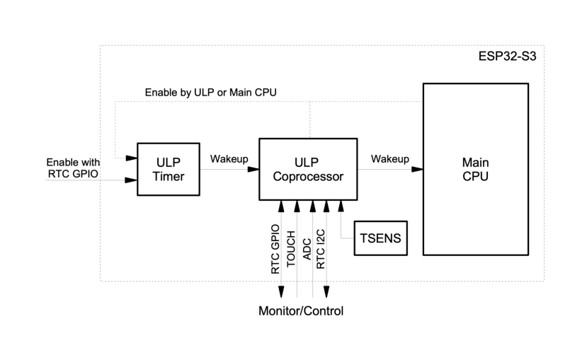

ESP32-S3 has two ULP coprocessors, with one based on RISC-V instruction set architecture (ULP-RISC-V) and the other on finite state machine (ULP-FSM). Users can choose between the two coprocessors depending on their needs.

### 2.2 Features

- Access up to 8 KB of SRAM RTC slow memory for instructions and data
- Clocked with 17.5 MHz RTC_FAST_CLK
- Support working in normal mode and in monitor mode
- Wake up the CPU or send an interrupt to the CPU
- Access peripherals, internal sensors and RTC registers

ULP-FSM and ULP-RISC-V can not be used simultaneously. Users can only choose one of them as the ULP coprocessor of ESP32-S3. The differences between the two coprocessors are shown in the table below.

**Table 2.2-1. Comparison of the Two Coprocessors**

| Feature | Sub-feature | ULP-FSM | ULP-RISC-V |
|---|---|---|---|
| Memory (RTC Slow Memory) | | 8 KB | 8 KB |
| Work Clock Frequency | | 17.5 MHz | 17.5 MHz |
| Wakeup Source | | ULP Timer | ULP Timer |
| Work Mode | Normal Mode | Assist the main CPU to complete some tasks after the chip is woken up. | Assist the main CPU to complete some tasks after the chip is woken up. |
| Work Mode | Monitor Mode | Retrieve data from sensors to monitor environment, when the chip is in sleep. | Retrieve data from sensors to monitor environment, when the chip is in sleep. |
| Control Low-Power Peripherals | | ADC1/ADC2 | ADC1/ADC2 |
| Control Low-Power Peripherals | | RTC I2C | RTC I2C |
| Control Low-Power Peripherals | | RTC GPIO | RTC GPIO |
| Control Low-Power Peripherals | | Touch Sensors | Touch Sensors |
| Control Low-Power Peripherals | | Temperature Sensor | Temperature Sensor |
| Architecture | | Programmable FSM | RISC-V |
| Development | | Special instruction set | Standard C compiler |

ULP coprocessor can access the modules in RTC domain via RTC registers. In many cases the ULP coprocessor can be a good supplement to, or replacement of, the main CPU, especially for power-sensitive applications. Figure 2.2-1 shows the overall layout of ESP32-S3 coprocessor.

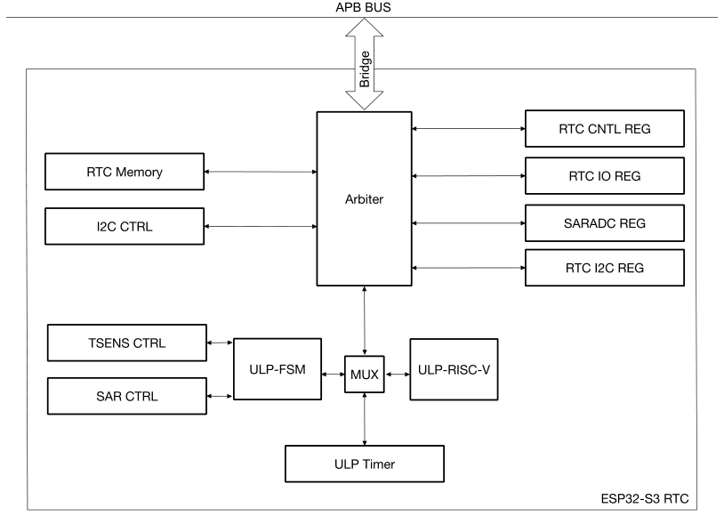

### 2.3 Programming Workflow

The ULP-RISC-V is intended for programming using C language. The program in C is then compiled to [RV32IMC](https://riscv.org/specifications/) standard instruction code. The ULP-FSM is using custom instructions normally not supported by high-level programming language. Users develop their programs using ULP-FSM instructions (see [Section 2.5.2](#252-instruction-set)).

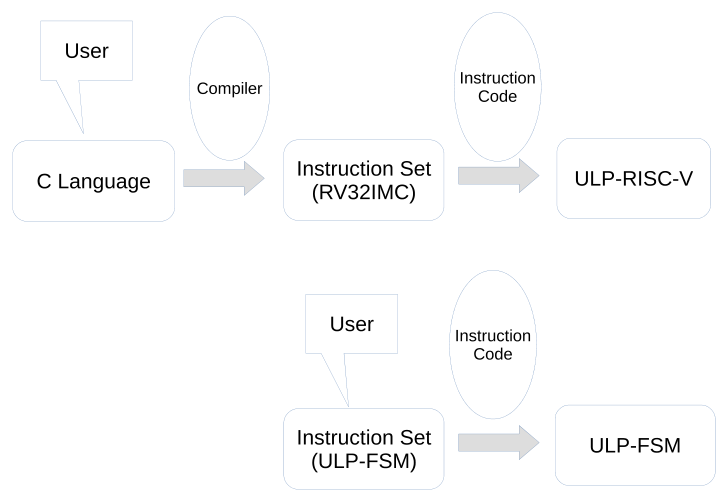

### 2.4 ULP Coprocessor Sleep and Wake-Up Workflow

ULP coprocessor is designed to operate independently of the CPU, while the CPU is either in sleep or running.

In a typical power-saving scenario, the chip goes to Deep-sleep mode to lower power consumption. Before setting the chip to sleep mode, users should complete the following operations.

1. Flash the program to be executed by ULP coprocessor into RTC slow memory.
2. Select the working ULP coprocessor by configuring RTC_CNTL_COCPU_SEL.
   - 0: select ULP-RISC-V
   - 1: select ULP-FSM
3. If ULP-RISC-V is selected as working ULP coprocessor, please
   - set and reset RTC_CNTL_COCPU_CLK_FO;
   - set RTC_CNTL_COCPU_CLKGATE_EN.
4. Set sleep cycles for the timer by configuring RTC_CNTL_ULP_CP_TIMER_1_REG.
5. Enable the timer by software or by RTC GPIO;
   - By software: set RTC_CNTL_ULP_CP_SLP_TIMER_EN.
   - By RTC GPIO: set RTC_CNTL_ULP_CP_GPIO_WAKEUP_ENA. For more information, see [Chapter 10 Low-power Management (RTC_CNTL)](#10-low-power-management-rtc_cntl).
6. Set the system into sleep mode.

When the system is in Deep-sleep mode:

1. The timer periodically sets the low-power controller (see [Chapter 10 Low-power Management (RTC_CNTL)](#10-low-power-management-rtc_cntl)) to Monitor mode and then wakes up the coprocessor.
2. Coprocessor executes some necessary operations, such as monitoring external environment via low-power sensors.
3. After the operations are finished, the system goes back to Deep-sleep mode.
4. ULP coprocessor goes back to halt mode and waits for next wakeup.

In monitor mode, ULP coprocessor is woken up and goes to halt as shown in Figure 2.4-1.

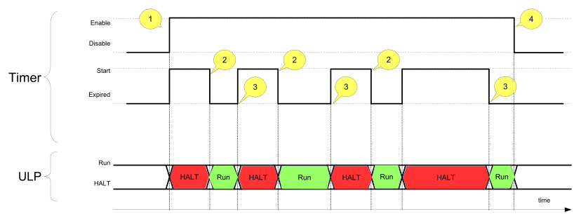

1. Enable the timer and the timer starts counting.
2. The timer expires and wakes up the ULP coprocessor. ULP coprocessor starts running and executes the program flashed in RTC slow memory.
3. ULP coprocessor goes to halt and the timer starts counting again.
   - Put ULP-RISC-V into HALT: set RTC_CNTL_COCPU_DONE.
   - Put ULP-FSM into HALT: execute HALT instruction.
4. Disable the timer by ULP program or by software. ULP coprocessor exits from monitor mode.
   - Disabled by software: clear RTC_CNTL_ULP_CP_SLP_TIMER_EN.
   - Disabled by RTC GPIO: clear RTC_CNTL_ULP_CP_GPIO_WAKEUP_ENA and set RTC_CNTL_ULP_CP_GPIO_WAKEUP_CLR.

Note:

- If the timer is enabled by software (RTC GPIO), it should be disabled by software (RTC GPIO).
- Before setting ULP-RISC-V to HALT, users should configure RTC_CNTL_COCPU_DONE first, therefore, it is recommended to end the flashed program with the following pattern:
  - Set RTC_CNTL_COCPU_DONE to end the operation of ULP-RISC-V and put it into halt;
  - Set RTC_CNTL_COCPU_SHUT_RESET_EN to reset ULP-RISC-V.

  Enough time is reserved for the ULP-RISC-V to complete the operations above before it goes to halt.

Figure 2.4-2 shows the relationship between the signals and register bits.

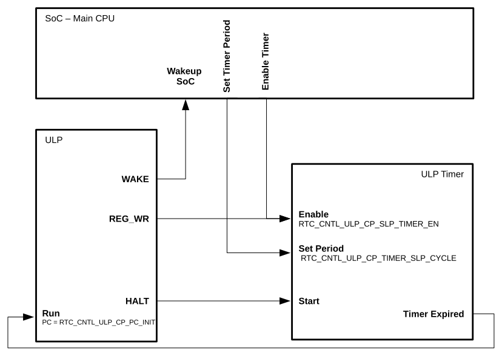

### 2.5 ULP-FSM

#### 2.5.1 Features

ULP-FSM is a programmable finite state machine that can work while the main CPU is in Deep-sleep. ULP-FSM supports instructions for complex logic and arithmetic operations, and also provides dedicated instructions for RTC controllers or peripherals. ULP-FSM can access up to 8 KB of SRAM RTC slow memory (accessible by the CPU) for instructions and data. Hence, such memory is usually used to store instructions and share data between the ULP coprocessor and the CPU. ULP-FSM can be stopped by running HALT instruction.

ULP-FSM has the following features.

- Provides four 16-bit general-purpose registers (R0, R1, R2, and R3) for manipulating data and accessing memory.
- Provides one 8-bit stage count register (Stage_cnt) which can be manipulated by ALU and used in JUMP instructions.
- Supports built-in instructions specially for direct control of low-power peripherals, such as SAR ADC and temperature sensor.

#### 2.5.2 Instruction Set

ULP-FSM supports the following instructions.

- ALU: perform arithmetic and logic operations
- LD, ST, REG_RD and REG_WR: load and store data
- JUMP: jump to a certain address
- WAIT/HALT: manage program execution
- WAKE: wake up CPU or communicate with CPU
- TSENS and ADC: take measurements

Figure 2.5-1 shows the format of ULP-FSM instructions.

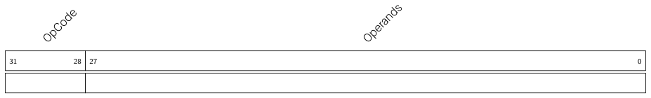

An instruction, which has one OpCode, can perform various operations, depending on the setting of Operands bits. A good example is the ALU instruction, which is able to perform 10 arithmetic and logic operations; or the JUMP instruction, which may be conditional or unconditional, absolute or relative.

Each instruction has a fixed width of 32 bits. A series of instructions can make a program be executed by the coprocessor. The execution flow inside the program uses 32-bit addressing. The program is stored in a dedicated region called Slow Memory, which is visible to the main CPU under an address range of 0x5000_0000 to 0x5000_1FFF (8 KB).

##### 2.5.2.1 ALU - Perform Arithmetic and Logic Operations

ALU (Arithmetic and Logic Unit) performs arithmetic and logic operations on values stored in ULP coprocessor registers, and on immediate values stored in the instruction itself. The following operations are supported.

- Arithmetic: ADD and SUB
- Logic: bitwise logical AND and bitwise logical OR
- Bit shifting: LSH and RSH
- Moving data to register: MOVE
- PC register operations - STAGE_RST, STAGE_INC, and STAGE_DEC

The ALU instruction, which has one OpCode (7), can perform various arithmetic and logic operations, depending on the setting of the instruction bits [27:21].

**Operations Among Registers**

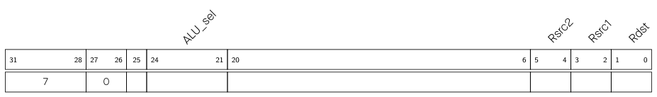

When bits [27:26] of the instruction in Figure 2.5-2 are set to 0, ALU performs operations on the data stored in ULP-FSM registers R[0-3]. The types of operations depend on the setting of the instruction bits ALU_sel[24:21] presented in Table 2.5-1.

Operand description (see Figure 2.5-2):

- *Rdst*: Register R[0-3], destination
- *Rsrc1*: Register R[0-3], source
- *Rsrc2*: Register R[0-3], source
- *ALU_sel*: ALU operation selection, see Table 2.5-1

**Table 2.5-1. ALU Operations Among Registers**

| ALU_sel | Instruction | Operation | Description |
|---|---|---|---|
| 0 | ADD | Rdst = Rsrc1 + Rsrc2 | Add to register |
| 1 | SUB | Rdst = Rsrc1 - Rsrc2 | Subtract from register |
| 2 | AND | Rdst = Rsrc1 & Rsrc2 | Bitwise logical AND of two operands |
| 3 | OR | Rdst = Rsrc1 \| Rsrc2 | Bitwise logical OR of two operands |
| 4 | MOVE | Rdst = Rsrc1 | Move to register |
| 5 | LSH | Rdst = Rsrc1 << Rsrc2 | Bit shifting left |
| 6 | RSH | Rdst = Rsrc1 >> Rsrc2 | Bit shifting right |

Note:

- ADD or SUB operations can be used to set or clear the overflow flag in ALU.
- All ALU operations can be used to set or clear the zero flag in ALU.

**Operations with Immediate Value**

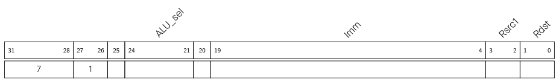

When bits [27:26] of the instruction in Figure 2.5-3 are set to 1, ALU performs operations using register R[0-3] and the immediate value stored in instruction bits [19:4]. The types of operations depend on the setting of the instruction bits ALU_sel[24:21] presented in Table 2.5-2.

Operand description (see Figure 2.5-3):

- *Rdst*: Register R[0-3], destination
- *Rsrc1*: Register R[0-3], source
- *Imm*: 16-bit signed immediate value
- *ALU_sel*: ALU operation selection, see Table 2.5-2

**Table 2.5-2. ALU Operations with Immediate Value**

| ALU_sel | Instruction | Operation | Description |
|---|---|---|---|
| 0 | ADD | Rdst = Rsrc1 + Imm | Add to register |
| 1 | SUB | Rdst = Rsrc1 - Imm | Subtract from register |
| 2 | AND | Rdst = Rsrc1 & Imm | Bitwise logical AND of two operands |
| 3 | OR | Rdst = Rsrc1 \| Imm | Bitwise logical OR of two operands |
| 4 | MOVE | Rdst = Imm | Move to register |
| 5 | LSH | Rdst = Rsrc1 << Imm | Bit shifting left |
| 6 | RSH | Rdst = Rsrc1 >> Imm | Bit shifting right |

Note:

- ADD or SUB operations can be used to set or clear the overflow flag in ALU.
- All ALU operations can be used to set or clear the zero flag in ALU.

**Operations with Stage Count Register**


ALU is also able to increment or decrement by a given value, or reset the 8-bit register Stage_cnt. To do so, bits [27:26] of instruction in Figure 2.5-4 should be set to 2. The type of operation depends on the setting of the instruction bits ALU_sel[24:21] presented in Table 2.5-3. The Stage_cnt is a separate register and is not a part of the instruction in Figure 2.5-4.

Operand description (see Figure 2.5-4):

- *Imm*: 8-bit signed immediate value
- *ALU_sel*: ALU operation selection, see Table 2.5-3
- *Stage_cnt*: Stage count register, a 8-bit separate register used to store variables, such as loop index

**Table 2.5-3. ALU Operations with Stage Count Register**

| ALU_sel | Instruction | Operation | Description |
|---|---|---|---|
| 0 | STAGE_INC | Stage_cnt = Stage_cnt + Imm | Increment stage count register |
| 1 | STAGE_DEC | Stage_cnt = Stage_cnt - Imm | Decrement stage count register |
| 2 | STAGE_RST | Stage_cnt = 0 | Reset stage count register |

Note: This instruction is mainly used with JUMPS instruction based on the stage count register to form a stage count for-loop. For the usage, please refer to the following pseudocode:

```
STAGE_RST                                   // clear stage count register
STAGE_INC                                   // stage count register ++
{...}                                       // loop body, containing n instructions
JUMPS (step = n, cond = 0, threshold = m)   // If the value of stage count register is less than m, then jump to
                                            // STAGE_INC, otherwise jump out of the loop. By such way, a
                                            // cumulative for-loop with threshold m is implemented.
```

##### 2.5.2.2 ST – Store Data in Memory

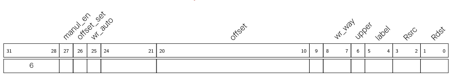

Operand description (see Figure 2.5-5):

- *Rdst*: Register R[0-3], address of the destination, expressed in 32-bit words
- *Rsrc*: Register R[0-3], 16-bit value to store
- *label*: Data label, 2-bit user defined unsigned value
- *upper*: 0: write the low half-word; 1: write the high half-word
- *wr_way*: 0: write the full-word; 1: with the label; 3: without the label
- *offset*: 11-bit signed value, expressed in 32-bit words
- *wr_auto*: Enable automatic storage mode
- *offset_set*: Offset enable bit. 0: Do not configure the offset for automatic storage mode. 1: Configure the offset for automatic storage mode.
- *manul_en*: Enable manual storage mode

**Automatic Storage Mode**

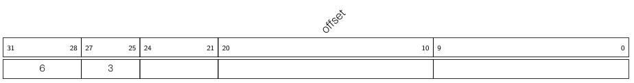

Operand description (see Figure 2.5-6):

- *offset*: Initial address offset, 11-bit signed value, expressed in 32-bit words

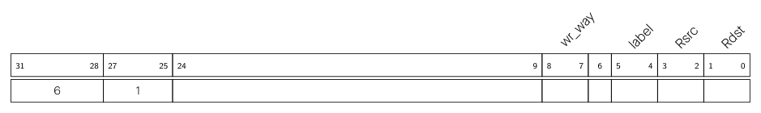

Operand description (see Figure 2.5-7):

- *Rdst*: Register R[0-3], address of the destination, expressed in 32-bit words
- *Rsrc*: Register R[0-3], 16-bit value to store
- *label*: Data label, 2-bit user defined unsigned value
- *wr_way*: 0: write the full-word; 1: with the label; 3: without the label

Description: This mode is used to access continuous addresses. Before using this mode for the first time, please configure the initial address using ST-OFFSET instruction. Executing the instruction ST-AUTO-DATA will store the 16-bit data in *Rsrc* into the memory address *Rdst* + *Offset*, see Table 2.5-4. Write_cnt here indicates the times of the instruction ST-AUTO-DATA executed.

**Table 2.5-4. Data Storage Type - Automatic Storage Mode**

| wr_way | write_cnt | Store Data | Operation |
|---|---|---|---|
| 0 | - | Mem [Rdst + Offset]{31:0} = {PC[10:0],3'b0,Label[1:0],Rsrc[15:0]} | Write full-word, including the pointer and the data |
| 1 | odd | Mem [Rdst + Offset]{15:0} = {Label[1:0],Rsrc[13:0]} | Store the data with label in the low half-word |
| 1 | even | Mem [Rdst + Offset]{31:16} = {Label[1:0],Rscr[13:0]} | Store the data with label in the high half-word |
| 3 | odd | Mem [Rdst + Offset]{15:0} = Rsrc[15:0] | Store the data without label in the low half-word |
| 3 | even | Mem [Rdst + Offset]{31:16} = Rsrc[15:0] | Store the data without label in the high half-word |

The full-word written to RTC memory is built as follows:

![Figure 2.5-8. Data Structure of RTC_SLOW_MEM[Rdst + Offset]](images/trm-fig-2_5-8.png)

Bits description (see Figure 2.5-8):

- *bits [15:0]*: store the content of Rsrc
- *bits [17:16]*: data label, 2-bit user defined unsigned value
- *bits [20:18]*: 3'b0 by default
- *bits [31:21]*: hold the PC of current instruction, expressed in 32-bit words

Note:

- When full-word is written, the offset will be automatically incremented by 1 after each ST-AUTO-DATA execution.
- When half-word is written (low half-word first), the offset will be automatically incremented by 1 after twice ST-AUTO-DATA execution.
- This instruction can only access 32-bit memory words.
- The "Mem" written is the RTC_SLOW_MEM memory. Address 0, as seen by the ULP coprocessor, corresponds to address 0x50000000, as seen by the main CPU.

**Manual Storage Mode**

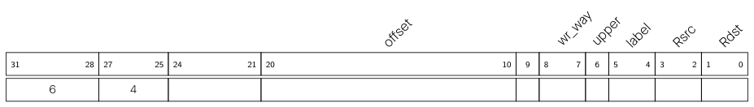

Operand description (see Figure 2.5-9):

- *Rdst*: Register R[0-3], address of the destination, expressed in 32-bit words
- *Rsrc*: Register R[0-3], 16-bit value to store
- *label*: Data label, 2-bit user defined unsigned value
- *upper*: 0: Write the low half-word; 1: write the high half-word
- *wr_way*: 0: Write the full-word; 1: with the label; 3: without the label
- *offset*: 11-bit signed value, expressed in 32-bit words

Description: Manual storage mode is mainly used for storing data into discontinuous addresses. Each instruction needs a storage address and offset. The detailed storage methods are shown in Table 2.5-5.

**Table 2.5-5. Data Storage - Manual Storage Mode**

| wr_way | upper | Data | Operation |
|---|---|---|---|
| 0 | - | Mem [Rdst + Offset]{31:0} = {PC[10:0],3'b0, Label[1:0],Rsrc[15:0]} | Write full-word, including the pointer and the data |
| 1 | 0 | Mem [Rdst + Offset]{15:0} = {Label[1:0],Rsrc[13:0]} | Store the data with label in the low half-word |
| 1 | 1 | Mem [Rdst + Offset]{31:16} = {Label[1:0],Rsrc[13:0]} | Store the data with label in the high half-word |
| 3 | 0 | Mem [Rdst + Offset]{15:0} = Rsrc[15:0] | Store the data without label in the low half-word |
| 3 | 1 | Mem [Rdst + Offset]{31:16} = Rsrc[15:0] | Store the data without label in the high half-word |

##### 2.5.2.3 LD – Load Data from Memory

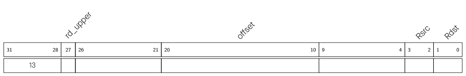

Operand description (see Figure 2.5-10):

- *Rdst*: Register R[0-3], destination
- *Rsrc*: Register R[0-3], address of destination memory, expressed in 32-bit words
- *Offset*: 11-bit signed value, expressed in 32-bit words
- *rd_upper*: Choose which half-word to read: 1 - read the high half-word; 0 - read the low half-word

Description: This instruction loads the low or high 16-bit half-word, depending on *rd_upper*, from memory with address *Rsrc* + *offset* into the destination register *Rdst*:

`Rdst[15:0] = Mem[Rsrc + Offset]`

Note:

- This instruction can only access 32-bit memory words.
- The "Mem" loaded is the RTC_SLOW_MEM memory. Address 0, as seen by the ULP coprocessor, corresponds to address 0x50000000, as seen by the main CPU.

##### 2.5.2.4 JUMP – Jump to an Absolute Address

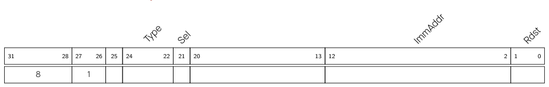

Operand description (see Figure 2.5-11):

- *Rdst*: Register R[0-3], containing address to jump to (expressed in 32-bit words)
- *ImmAddr*: 11-bit address, expressed in 32-bit words
- *Sel*: Select the address to jump to: 0 - jump to the address stored in *ImmAddr*; 1 - jump to the address stored in *Rdst*
- *Type*: Jump type: 0 - make an unconditional jump; 1 - jump only if the last ALU operation has set zero flag; 2 - jump only if the last ALU operation has set overflow flag

Note: All jump addresses are expressed in 32-bit words.

Description: The instruction executes a jump to a specified address. The jump can be either unconditional or based on the ALU flag.

##### 2.5.2.5 JUMPR – Jump to a Relative Address (Conditional upon R0)


Operand description (see Figure 2.5-12):

- *Threshold*: Threshold value for condition (see *Cond* below) to jump
- *Cond*: Condition to jump: 0 - jump if R0 < *Threshold*; 1 - jump if R0 > *Threshold*; 2 - jump if R0 = *Threshold*
- *Step*: Relative shift from current position, expressed in 32-bit words: if Step[7] = 0, then PC = PC + Step[6:0]; if Step[7] = 1, then PC = PC - Step[6:0]

Note: All jump addresses are expressed in 32-bit words.

Description: The instruction executes a jump to a relative address, if the condition is true. The condition is the result of comparing the R0 register value and the *Threshold* value.

##### 2.5.2.6 JUMPS – Jump to a Relative Address (Conditional upon Stage Count Register)


Operand description (see Figure 2.5-13):

- *Threshold*: Threshold value for condition (see *Cond* below) to jump
- *Cond*: Condition to jump: 1X - jump if *Stage_cnt* <= *Threshold*; 00 - jump if *Stage_cnt* < *Threshold*; 01 - jump if *Stage_cnt* >= *Threshold*
- *Step*: Relative shift from current position, expressed in 32-bit words: if Step[7] = 0, then PC = PC + Step[6:0]; if Step[7] = 1, then PC = PC - Step[6:0]

Note:

- For more information about the stage count register, please refer to [Section 2.5.2.1](#2521-alu---perform-arithmetic-and-logic-operations).
- All jump addresses are expresses in 32-bit words.

Description: The instruction executes a jump to a relative address if the condition is true. The condition itself is the result of comparing the value of *Stage_cnt* (stage count register) and the *Threshold* value.

##### 2.5.2.7 HALT – End the Program

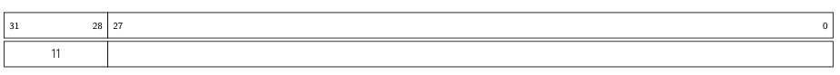

Description: The instruction ends the operation of the ULP-FSM and puts it into power-down mode.

Note: After executing this instruction, the ULP coprocessor wakeup timer gets started.

##### 2.5.2.8 WAKE – Wake up the Chip

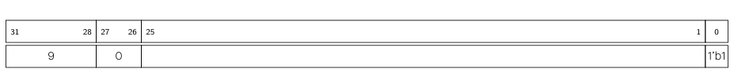

Description: This instruction sends an interrupt from the ULP-FSM to the RTC controller.

- If the chip is in Deep-sleep mode, and the ULP wakeup timer is enabled, the above-mentioned interrupt will wake up the chip.
- If the chip is not in Deep-sleep mode, and the ULP interrupt bit RTC_CNTL_ULP_CP_INT_ENA is set in register RTC_CNTL_INT_ENA_REG, an RTC interrupt will be triggered.

##### 2.5.2.9 WAIT – Wait for a Number of Cycles


Operand description (see Figure 2.5-16):

- *Cycles*: The number of cycles to wait

Description: The instruction will delay the ULP-FSM for a given number of cycles.

##### 2.5.2.10 TSENS – Take Measurement with Temperature Sensor

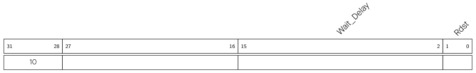

Operand description (see Figure 2.5-17):

- *Rdst*: Destination Register R[0-3], results will be stored in this register.
- *Wait_Delay*: Number of cycles used to perform the measurement.

Description: Increasing the measurement cycles *Wait_Delay* helps improve the accuracy and optimize the result. The instruction performs measurement via temperature sensor and stores the result into a general purpose register.

##### 2.5.2.11 ADC – Take Measurement with ADC

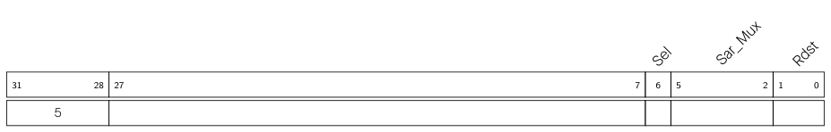

Operand description (see Figure 2.5-18):

- *Rdst*: Destination Register R[0-3], results will be stored in this register.
- *Sar_Mux*: Enable SAR ADC channel. Channel No. is [Sar_Mux - 1]. For more information, see [Chapter 39](#39-on-chip-sensors-and-analog-signal-processing) On-Chip Sensors and Analog Signal Processing.
- *Sel*: Select ADC. 0: select SAR ADC1; 1: select SAR ADC2, see Table 2.5-6.

**Table 2.5-6. Input Signals Measured Using the ADC Instruction**

| Pad/Signal/GPIO | Sar Mux | ADC Selection (Sel) |
|---|---|---|
| GPIO1 | 1 | Sel = 0, select SAR ADC1 |
| GPIO2 | 2 | Sel = 0, select SAR ADC1 |
| GPIO3 | 3 | Sel = 0, select SAR ADC1 |
| GPIO4 | 4 | Sel = 0, select SAR ADC1 |
| GPIO5 | 5 | Sel = 0, select SAR ADC1 |
| GPIO6 | 6 | Sel = 0, select SAR ADC1 |
| GPIO7 | 7 | Sel = 0, select SAR ADC1 |
| GPIO8 | 8 | Sel = 0, select SAR ADC1 |
| GPIO9 | 9 | Sel = 0, select SAR ADC1 |
| GPIO10 | 10 | Sel = 0, select SAR ADC1 |
| GPIO11 | 1 | Sel = 1, select SAR ADC2 |
| GPIO12 | 2 | Sel = 1, select SAR ADC2 |
| GPIO13 | 3 | Sel = 1, select SAR ADC2 |
| GPIO14 | 4 | Sel = 1, select SAR ADC2 |
| XTAL_32k_P | 5 | Sel = 1, select SAR ADC2 |
| XTAL_32k_N | 6 | Sel = 1, select SAR ADC2 |
| GPIO17 | 7 | Sel = 1, select SAR ADC2 |
| GPIO18 | 8 | Sel = 1, select SAR ADC2 |
| GPIO19 | 9 | Sel = 1, select SAR ADC2 |
| GPIO20 | 10 | Sel = 1, select SAR ADC2 |

##### 2.5.2.12 REG_RD – Read from Peripheral Register


Operand description (see Figure 2.5-19):

- *Addr*: Peripheral register address, in 32-bit words
- *Low*: Register start bit number
- *High*: Register end bit number

Description: The instruction reads up to 16 bits from a peripheral register into a general-purpose register:

`R0 = REG[Addr][High:Low]`

In case of more than 16 bits being requested, i.e., *High* - *Low* + 1 > 16, then the instruction will return [Low+15:Low].

Note:

- This instruction can access registers in RTC_CNTL, RTC_IO, SENS, and RTC_I2C peripherals. Address of the register, as seen from the ULP coprocessor (addr_ulp), can be calculated from the address of the same register on the main bus (addr_bus), as follows: `addr_ulp = (addr_bus - DR_REG_RTCCNTL_BASE)/4`
- The *addr_ulp* is expressed in 32-bit words (not in bytes), and value 0 maps onto the DR_REG_RTCCNTL_BASE (as seen from the main CPU). Thus, 10 bits of address cover a 4096-byte range of peripheral register space, including regions DR_REG_RTCCNTL_BASE (0x6000800), DR_REG_RTCIO_BASE (0x60008400), DR_REG_SENS_BASE (0x60008800), and DR_REG_RTC_I2C_BASE (0x60008C00). For more information about address mapping, see [Section 2.8](#28-address-mapping).

##### 2.5.2.13 REG_WR – Write to Peripheral Register


Operand description (see Figure 2.5-20):

- *Addr*: Register address, expressed in 32-bit words
- *Data*: Value to write, 8 bits
- *Low*: Register start bit number
- *High*: Register end bit number

Description: This instruction writes up to 8 bits from an immediate data value into a peripheral register:

`REG[Addr][High:Low] = Data`

If more than 8 bits are requested, i.e., *High* - *Low* + 1 > 8, then the instruction will pad with zeros the bits above the eighth bit.

Note: See notes regarding *addr_ulp* in [Section 2.5.2.12](#25212-reg_rd--read-from-peripheral-register).

### 2.6 ULP-RISC-V

#### 2.6.1 Features

- Support RV32IMC instruction set
- Thirty-two 32-bit general-purpose registers
- 32-bit multiplier and divider
- Support for interrupts

#### 2.6.2 Multiplier and Divider

ULP-RISC-V has an independent multiplication and division unit. The efficiency of multiplication and division instructions is shown in the following table.

**Table 2.6-1. Instruction Efficiency**

| Operation | Instruction | Execution Cycle | Instruction Description |
|---|---|---|---|
| Multiply | MUL | 34 | Multiply two 32-bit integers and return the lower 32-bit of the result |
| Multiply | MULH | 66 | Multiply two 32-bit signed integers and return the higher 32-bit of the result |
| Multiply | MULHU | 66 | Multiply two 32-bit unsigned integers and return the higher 32-bit of the result |
| Multiply | MULHSU | 66 | Multiply a 32-bit signed integer with a unsigned integer and return the higher 32-bit of the result |
| Divide | DIV | 34 | Divide a 32-bit integer by a 32-bit integer and return the quotient |
| Divide | DIVU | 34 | Divide a 32-bit unsigned integer by a 32-bit unsigned integer and return the quotient |
| Divide | REM | 34 | Divide a 32-bit signed integer by a 32-bit signed integer and return the remainder |
| Divide | REMU | 34 | Divide a 32-bit unsigned integer by a 32-bit unsigned integer and return the remainder |

#### 2.6.3 ULP-RISC-V Interrupts

##### 2.6.3.1 Introduction

The interrupt controller of ULP-RISC-V is implemented by using a customized instruction set, instead of RISC-V Privileged ISA specification, aiming to reduce the size of ULP-RISC-V.

##### 2.6.3.2 Interrupt Controller

ULP-RISC-V has 32 interrupt sources, but only four of them are available in the real design, as shown in the table below, including:

- internal sources: INT 0 ~ INT 2, triggered by internal interrupt events.
- external source: INT 31, triggered by the peripheral interrupts of ESP32-S3.

**Table 2.6-2. ULP-RISC-V Interrupt Sources**

| Type | IRQ | Triggered by |
|---|---|---|
| Internal | 0 | Internal timer interrupt |
| Internal | 1 | EBREAK/ECALL or Illegal Instruction |
| Internal | 2 | BUS Error (Unaligned Memory Access) |
| External | 31 | RTC peripheral interrupts |

Note: If illegal instruction interrupt or bus error interrupt is disabled, ULP-RISC-V goes to HALT when the two errors occur.

ULP-RISC-V provides four 32-bit interrupt registers, Q0 ~ Q3, to handle interrupt service routine (ISR). Table 2.6-3 shows the function of each register.

**Table 2.6-3. ULP-RISC-V Interrupt Registers**

| Register | Function |
|---|---|
| Q0 | Store the returned address. If the interrupt instruction is a compressed one, the lowest bit of this register will be set. |
| Q1 | Contain a bitmask of all IRQs to be handled. This means one call to the interrupt handler needs to service more than one IRQ when more than one bit is set in Q1. |
| Q2 | Reserved. An option for ISR to store data. |
| Q3 | Reserved. An option for ISR to store data. |

Note:

- If more than one bits in Q1 are set, all the corresponding interrupts will call the same ISR. For such reason, users need to program ISR to check the interrupt number and execute corresponding program.
- After ULP-RISC-V is reset, all the interrupts are disabled.
- All ISR entries are located at 0x10, and the reset entry is at 0x0.

##### 2.6.3.3 Interrupt Handling

When an interrupt occurs, ULP-RISC-V performs the following operations:

1. Saves the current PC to Q0.
2. Saves the interrupt being responded to in Q1.
3. Jumps to the interrupt entry point (0x10).

After ULP-RISC-V enters the interrupt entry point, please save the context and use Q2 and Q3 as temporary storage registers for backup. Before it exits the interrupt, restore the context. Then, exit the interrupt by executing the retirq instruction and jump to Q0. ULP does not support interrupt nesting and is not interrupted by any other interrupt before retirq is executed.

##### 2.6.3.4 Interrupt Instructions

All these interrupt instructions are standard R-type instructions, with the same OpCode of custom0 (0001011). Figure 2.6-1 shows the format of standard R-type instructions. Note the fields funct3 (f3) and rs2 are ignored in these instructions.


**Instruction: getq rd,qs**

This instruction copies the value of Q*x* into a general purpose register rd.


Operand description (see Figure 2.6-2):

- *rd*: Target general purpose register, holds the value of interrupt register specified by qs.
- *qs*: Address of interrupt register Q*x*.
- *f7*: Interrupt instruction number.

**Instruction: setq qd,rs**

This instruction copies the value of general purpose register rs to Q*x*.


Operand description (see Figure 2.6-3):

- *qd*: Target interrupt register
- *rs*: Source general purpose register, stores the value to be written to interrupt register.
- *f7*: Interrupt instruction number.

**Instruction: retirq**

This instruction copies the value of Q0 to CPU PC, and enables interrupt again.


Operand description (see Figure 2.6-4):

- *f7*: Interrupt instruction number.

**Instruction: maskirq rd,rs**

This instruction copies the value of the register IRQ Mask to the register rd, and copies the value of register rs to IRQ Mask.

Figure 2.6-5. Interrupt Instruction — Maskirq rd rs (no captioned figure image is available for this drawing; fields: f7 = 0000011, rs2 ignored, rs, f3 ignored, rd, OpCode 0001011.)

Operand description (see Figure 2.6-5):

- *rd*: Target general purpose register, stores current value of register Q1.
- *rs*: Source general purpose register, stores the value to be written to Q1.
- *f7*: Interrupt instruction number.

##### 2.6.3.5 RTC Peripheral Interrupts

The interrupts from some sensors, software, and RTC I2C can be routed to ULP-RISC-V. To enable the interrupts, please set the register SENS_SAR_COCPU_INT_ENA_REG, see Table 2.6-4.

**Table 2.6-4. ULP-RISC-V Interrupt List**

| Enable bit | Interrupt | Description |
|---|---|---|
| 0 | TOUCH_DONE_INT | Triggered when the touch sensor completes the scan of a channel |
| 1 | TOUCH_INACTIVE_INT | Triggered when the touch pad is released |
| 2 | TOUCH_ACTIVE_INT | Triggered when the touch pad is touched |
| 3 | SARADC1_DONE_INT | Triggered when SAR ADC1 completes the conversion one time |
| 4 | SARADC2_DONE_INT | Triggered when SAR ADC2 completes the conversion one time |
| 5 | TSENS_DONE_INT | Triggered when the temperature sensor completes the dump of its data |
| 6 | RISCV_START_INT | Triggered when ULP-RISC-V powers on and starts working |
| 7 | SW_INT | Triggered by software |
| 8 | SWD_INT | Triggered by timeout of Super Watchdog (SWD) |
| 9 | TOUCH_TIME_OUT_INT | Triggered by touch pad sampling timeout |
| 10 | TOUCH_APPROACH_LOOP_DONE_INT | Triggered when touch pad completes an APPROACH sampling |
| 11 | TOUCH_SCAN_DONE_INT | Triggered when touch pad completes the scan of the final channel |

Note:

- Besides the above-mentioned interrupts, ULP-RISC-V can also handle the interrupt from RTC_IO by simply configuring RTC_IO as input mode. Users can configure RTCIO_GPIO_PIN*n*_INT_TYPE to select the interrupt trigger modes. For more details about RTC_IO configuration, see [Chapter 6](#6-io-mux-and-gpio-matrix-gpio-io-mux) IO MUX and GPIO Matrix (GPIO, IO MUX).
- The interrupt from RTC_IO can be cleared by releasing RTC_IO and its source can be read from the register RTCIO_RTC_GPIO_STATUS_REG.
- The SW_INT interrupt is generated by configuring the register RTC_CNTL_COCPU_SW_INT_TRIGGER.
- For the information about RTC I2C interrupts, please refer to [Section 2.7.4](#274-rtc-i2c-interrupts).

### 2.7 RTC I2C Controller

ULP coprocessor reads from or writes to external I2C slave devices via RTC I2C controller.

#### 2.7.1 Connecting RTC I2C Signals

SDA and SCL signals can be mapped onto two out of the four GPIO pins, which are identified in Table RTC_MUX Pad List in [Chapter 6](#6-io-mux-and-gpio-matrix-gpio-io-mux) IO MUX and GPIO Matrix (GPIO, IO MUX), using the register RTCIO_SAR_I2C_IO_REG.

#### 2.7.2 Configuring RTC I2C

Before ULP coprocessor can communicate using I2C instruction, RTC I2C need to be configured. Configuration is performed by writing certain timing parameters into the RTC I2C registers. This can be done by the program running on the main CPU, or by the ULP coprocessor itself.

Note: The timing parameters are configured in cycles of RTC_FAST_CLK running at 17.5 MHz.

1. Set the low and high SCL half-periods by configuring RTC_I2C_SCL_LOW_PERIOD_REG and RTC_I2C_SCL_HIGH_PERIOD_REG in RTC_FAST_CLK cycles (e.g., RTC_I2C_SCL_LOW_PERIOD_REG = 40, RTC_I2C_SCL_HIGH_PERIOD_REG = 40 for 100 kHz frequency).
2. Set the number of cycles between the SDA switch and the falling edge of SCL by using RTC_I2C_SDA_DUTY_REG in RTC_FAST_CLK (e.g., RTC_I2C_SDA_DUTY_REG = 16).
3. Set the waiting time after the START signal by using RTC_I2C_SCL_START_PERIOD_REG (e.g., RTC_I2C_SCL_START_PERIOD = 30).
4. Set the waiting time before the END signal by using RTC_I2C_SCL_STOP_PERIOD_REG (e.g., RTC_I2C_SCL_STOP_PERIOD = 44).
5. Set the transaction timeout by using RTC_I2C_TIME_OUT_REG (e.g., RTC_I2C_TIME_OUT_REG = 200).
6. Configure the RTC I2C controller into master mode by setting the bit RTC_I2C_MS_MODE in RTC_I2C_CTRL_REG.
7. Configure the address(es) of external slave(s):
   - If ULP-RISC-V or main CPU is used, then write the slave address to SENS_SAR_I2C_SLAVE_ADDR.
   - If ULP-FSM is used, then write the slave address to SENS_I2C_SLAVE_ADDR*n* (*n*: 0-7). Up to eight slave addresses can be pre-programmed. One of these addresses can then be selected for each transaction as part of the RTC I2C instruction.

Once RTC I2C is configured, the main CPU or the ULP coprocessor can communicate with the external I2C devices.

#### 2.7.3 Using RTC I2C

##### 2.7.3.1 Instruction Format

The format of RTC I2C instruction is basically consistent with that of I2C0/I2C1, see Section I2C CMD Controller in [Chapter 27](#27-i2c-controller-i2c) I2C Controller (I2C) except the following:

- RTC I2C has different op_code mapping:
  - RSTART: op_code = 0
  - WRITE: op_code = 1
  - READ: op_code = 2
  - STOP: op_code = 3
  - END: op_code = 4
- RTC I2C provides fixed instructions for different operations, as follows:
  - Command 0 ~ Command 1: specifically for I2C write operation
  - Command 2 ~ Command 6: specifically for I2C read operation

Note: All slave addresses are expressed in 7 bits.

##### 2.7.3.2 I2C_RD - I2C Read Workflow

Preparation for RTC I2C read:

- Configure the instruction list of RTC I2C (see Section CMD_Controller in [Chapter 27](#27-i2c-controller-i2c) I2C Controller (I2C)), including instruction order, instruction code, read data number (byte_num), and other information.
- Configure the slave register address by setting the register SENS_SAR_I2C_REG_ADDR.
- Start RTC I2C transmission by setting SENS_SAR_I2C_START_FORCE and SENS_SAR_I2C_START.
- When an RTC_I2C_RX_DATA_INT interrupt is received, transfer the read data stored in RTC_I2C_RDATA to SRAM RTC slow memory, or use the data directly.

The I2C_RD instruction performs the following operations (see Figure 2.7-1):

1. Master generates a START signal.
2. Master sends slave address, with r/w bit set to 0 ("write"). Slave address is obtained from SENS_I2C_SLAVE_ADDR*n*.
3. Slave generates ACK.
4. Master sends slave register address.
5. Slave generates ACK.
6. Master generates a repeated START (RSTART) signal.
7. Master sends slave address, with r/w bit set to 1 ("read").
8. Slave sends one byte of data.
9. Master checks whether the number of transmitted bytes reaches the number set by the current instruction (byte_num). If yes, master jumps out of the read instruction and sends an NACK signal. Otherwise master repeats Step 8 and waits for the slave to send the next byte.
10. Master generates a STOP signal and stops reading.


Note: The RTC I2C peripheral samples the SDA signals on the falling edge of SCL. If the slave changes SDA in less than 0.38 ms, the master may receive incorrect data.

##### 2.7.3.3 I2C_WR - I2C Write Workflow

Preparation for RTC I2C write:

- Configure RTC I2C instruction list, including instruction order, instruction code, and the data to be written in byte (byte_num). See the configuration of I2C0/I2C1 in Section CMD_Controller in [Chapter 27](#27-i2c-controller-i2c) I2C Controller (I2C).
- Configure the slave register address by setting the register SENS_SAR_I2C_REG_ADDR, and the data to be transmitted in SENS_SAR_I2C_WDATA.
- Set SENS_SAR_I2C_START_FORCE and SENS_SAR_I2C_START to start the transmission.
- Update the next data to be transmitted in SENS_SAR_I2C_WDATA, each time when an RTC_I2C_TX_DATA_INT interrupt is received.

The I2C_WR instruction performs the following operations, see Figure 2.7-2.

1. Master generates a START signal.
2. Master sends slave address, with r/w bit set to 0 ("write"). Slave address is obtained from SENS_I2C_SLAVE_ADDR*n*.
3. Slave generates ACK.
4. Master sends slave register address.
5. Slave generates ACK.
6. Master generates a repeated START (RSTART) signal.
7. Master sends slave address, with r/w bit set to 0 ("write").
8. Master sends one byte of data.
9. Slave generates ACK. Master checks whether the number of transmitted bytes reaches the number set by the current instruction (byte_num). If yes, master jumps out of the write instruction and starts the next instruction. Otherwise the master repeats Step 8 and sends the next byte.
10. Master generates a STOP signal and stops the transmission.


##### 2.7.3.4 Detecting Error Conditions

Applications can query specific bits in the RTC_I2C_INT_ST_REG register to check if the transaction is successful. To enable checking for specific communication events, their corresponding bits should be set in register RTC_I2C_INT_ENA_REG. Note that the bit map is shifted by 1. If a specific communication event is detected and its corresponding bit in register RTC_I2C_INT_ST_REG is set, the event can then be cleared using register RTC_I2C_INT_CLR_REG.

#### 2.7.4 RTC I2C Interrupts

- RTC_I2C_SLAVE_TRAN_COMP_INT: Triggered when the slave finishes the transaction.
- RTC_I2C_ARBITRATION_LOST_INT: Triggered when the master loses control of the bus.
- RTC_I2C_MASTER_TRAN_COMP_INT: Triggered when the master completes the transaction.
- RTC_I2C_TRANS_COMPLETE_INT: Triggered when a STOP signal is detected.
- RTC_I2C_TIME_OUT_INT: Triggered by time out event.
- RTC_I2C_ACK_ERR_INT: Triggered by ACK error.
- RTC_I2C_RX_DATA_INT: Triggered when data is received.
- RTC_I2C_TX_DATA_INT: Triggered when data is transmitted.
- RTC_I2C_DETECT_START_INT: Triggered when a START signal is detected.

### 2.8 Address Mapping

Table 2.8-1 shows the address mapping and available base registers for the peripherals accessible by ULP coprocessors.

**Table 2.8-1. Address Mapping**

| Peripheral(s) | Base Register | Main Bus Address | ULP-FSM Base | ULP-RISC-V Base |
|---|---|---|---|---|
| RTC Control | DR_REG_RTCCNTL_BASE | 0x60008000 | 0x8000 | 0x8000 |
| RTC GPIO | DR_REG_RTC_IO_BASE | 0x60008400 | 0x8400 | 0xA400 |
| ADC, Touch, TSENS | DR_REG_SENS_BASE | 0x60008800 | 0x8800 | 0xC800 |
| RTC I2C | DR_REG_RTC_I2C_BASE | 0x60008C00 | 0x8C00 | 0xEC00 |

To find more information about registers for these peripherals, please check the following chapters.

**Table 2.8-2. Description of Registers for Peripherals Accessible by ULP Coprocessors**

| Registers Available for Peripherals | Described in Which Chapter |
|---|---|
| Registers for RTC Control | [Chapter 10](#10-low-power-management-rtc_cntl) Low-power Management (RTC_CNTL) |
| Registers for RTC GPIO | [Chapter 6](#6-io-mux-and-gpio-matrix-gpio-io-mux) IO MUX and GPIO Matrix (GPIO, IO MUX) |
| Registers for ARC, Touch, TSENS | [Chapter 39](#39-on-chip-sensors-and-analog-signal-processing) On-Chip Sensors and Analog Signal Processing |
| Registers for RTC I2C | Section 2.9 Register Summary in this chapter |

### 2.9 Register Summary

The following registers are used in ULP coprocessor:

- ULP (ALWAYS_ON) registers: not reset due to power down of RTC_PERI domain. See [Chapter 10](#10-low-power-management-rtc_cntl) Low-power Management (RTC_CNTL).
- ULP (RTC_PERI) registers: reset due to power down of RTC_PERI domain. See [Chapter 10](#10-low-power-management-rtc_cntl) Low-power Management (RTC_CNTL).
- RTC I2C registers: I2C related registers, including RTC I2C (RTC_PERI) and RTC I2C (I2C) registers.

#### 2.9.1 ULP (ALWAYS_ON) Register Summary

The addresses in this section are relative to low-power management base address provided in Table 4.3-3 in [Chapter 4 System and Memory](#4-system-and-memory).

| Name | Description | Address | Access |
|---|---|---|---|
| **ULP Timer Registers** | | | |
| RTC_CNTL_ULP_CP_TIMER_REG | Configure the timer | 0x00FC | varies |
| RTC_CNTL_ULP_CP_TIMER_1_REG | Configure sleep cycle of the timer | 0x0134 | R/W |
| **ULP-FSM Register** | | | |
| RTC_CNTL_ULP_CP_CTRL_REG | ULP-FSM configuration register | 0x0100 | R/W |
| **ULP-RISC-V Register** | | | |
| RTC_CNTL_COCPU_CTRL_REG | ULP-RISC-V configuration register | 0x0104 | varies |

#### 2.9.2 ULP (RTC_PERI) Register Summary

The addresses in this section are relative to low-power management base address provided in Table 4.3-3 in [Chapter 4 System and Memory](#4-system-and-memory).

| Name | Description | Address | Access |
|---|---|---|---|
| **ULP-RISC-V Registers** | | | |
| SENS_SAR_COCPU_INT_RAW_REG | Interrupt raw bit of ULP-RISC-V | 0x00E8 | RO |
| SENS_SAR_COCPU_INT_ENA_REG | Interrupt enable bit of ULP-RISC-V | 0x00EC | R/W |
| SENS_SAR_COCPU_INT_ST_REG | Interrupt status bit of ULP-RISC-V | 0x00F0 | RO |
| SENS_SAR_COCPU_INT_CLR_REG | Interrupt clear bit of ULP-RISC-V | 0x00F4 | WO |

#### 2.9.3 RTC I2C (RTC_PERI) Register Summary

The addresses in this section are relative to low-power management base address + 0x0800 provided in Table 4.3-3 in [Chapter 4 System and Memory](#4-system-and-memory).

| Name | Description | Address | Access |
|---|---|---|---|
| **RTC I2C Controller Register** | | | |
| SENS_SAR_I2C_CTRL_REG | Configure RTC I2C transmission | 0x0058 | R/W |
| **RTC I2C Slave Address Registers** | | | |
| SENS_SAR_SLAVE_ADDR1_REG | Configure slave addresses 0-1 of RTC I2C | 0x0040 | R/W |
| SENS_SAR_SLAVE_ADDR2_REG | Configure slave addresses 2-3 of RTC I2C | 0x0044 | R/W |
| SENS_SAR_SLAVE_ADDR3_REG | Configure slave addresses 4-5 of RTC I2C | 0x0048 | R/W |
| SENS_SAR_SLAVE_ADDR4_REG | Configure slave addresses 6-7 of RTC I2C | 0x004C | R/W |

#### 2.9.4 RTC I2C (I2C) Register Summary

The addresses in this section are relative to low-power management base address + 0x0C00 provided in Table 4.3-3 in [Chapter 4 System and Memory](#4-system-and-memory).

| Name | Description | Address | Access |
|---|---|---|---|
| **RTC I2C Signal Setting Registers** | | | |
| RTC_I2C_SCL_LOW_REG | Configure the low level width of SCL | 0x0000 | R/W |
| RTC_I2C_SCL_HIGH_REG | Configure the high level width of SCL | 0x0014 | R/W |
| RTC_I2C_SDA_DUTY_REG | Configure the SDA hold time after a negative SCL edge | 0x0018 | R/W |
| RTC_I2C_SCL_START_PERIOD_REG | Configure the delay between the SDA and SCL negative edge for a start condition | 0x001C | R/W |
| RTC_I2C_SCL_STOP_PERIOD_REG | Configure the delay between SDA and SCL positive edge for a stop condition | 0x0020 | R/W |
| **RTC I2C Control Registers** | | | |
| RTC_I2C_CTRL_REG | Transmission setting | 0x0004 | R/W |
| RTC_I2C_STATUS_REG | RTC I2C status | 0x0008 | RO |
| RTC_I2C_TO_REG | Configure RTC I2C timeout | 0x000C | R/W |
| RTC_I2C_SLAVE_ADDR_REG | Configure slave address | 0x0010 | R/W |
| **RTC I2C Interrupt Registers** | | | |
| RTC_I2C_INT_CLR_REG | Clear RTC I2C interrupt | 0x0024 | WO |
| RTC_I2C_INT_RAW_REG | RTC I2C raw interrupt | 0x0028 | RO |
| RTC_I2C_INT_ST_REG | RTC I2C interrupt status | 0x002C | RO |
| RTC_I2C_INT_ENA_REG | Enable RTC I2C interrupt | 0x0030 | R/W |
| **RTC I2C Status Register** | | | |
| RTC_I2C_DATA_REG | RTC I2C read data | 0x0034 | varies |
| **RTC I2C Command Registers** | | | |
| RTC_I2C_CMD0_REG | RTC I2C Command 0 | 0x0038 | varies |
| RTC_I2C_CMD1_REG | RTC I2C Command 1 | 0x003C | varies |
| RTC_I2C_CMD2_REG | RTC I2C Command 2 | 0x0040 | varies |
| RTC_I2C_CMD3_REG | RTC I2C Command 3 | 0x0044 | varies |
| RTC_I2C_CMD4_REG | RTC I2C Command 4 | 0x0048 | varies |
| RTC_I2C_CMD5_REG | RTC I2C Command 5 | 0x004C | varies |
| RTC_I2C_CMD6_REG | RTC I2C Command 6 | 0x0050 | varies |
| RTC_I2C_CMD7_REG | RTC I2C Command 7 | 0x0054 | varies |
| RTC_I2C_CMD8_REG | RTC I2C Command 8 | 0x0058 | varies |
| RTC_I2C_CMD9_REG | RTC I2C Command 9 | 0x005C | varies |
| RTC_I2C_CMD10_REG | RTC I2C Command 10 | 0x0060 | varies |
| RTC_I2C_CMD11_REG | RTC I2C Command 11 | 0x0064 | varies |
| RTC_I2C_CMD12_REG | RTC I2C Command 12 | 0x0068 | varies |
| RTC_I2C_CMD13_REG | RTC I2C Command 13 | 0x006C | varies |
| RTC_I2C_CMD14_REG | RTC I2C Command 14 | 0x0070 | varies |
| RTC_I2C_CMD15_REG | RTC I2C Command 15 | 0x0074 | varies |
| **Version register** | | | |
| RTC_I2C_DATE_REG | Version control register | 0x00FC | R/W |

### 2.10 Registers

#### 2.10.1 ULP (ALWAYS_ON) Registers

The addresses in this section are relative to low-power management base address provided in Table 4.3-3 in [Chapter 4 System and Memory](#4-system-and-memory).

##### Register 2.1. RTC_CNTL_ULP_CP_TIMER_REG (0x00FC)

| Bits | Field | Access | Reset | Description |
|---|---|---|---|---|
| 31 | RTC_CNTL_ULP_CP_SLP_TIMER_EN | R/W | 0 | ULP coprocessor timer enable bit. 0: Disable hardware timer; 1: Enable hardware timer. |
| 30 | RTC_CNTL_ULP_CP_GPIO_WAKEUP_CLR | WO | 0 | Disable the option of ULP timer woken up by RTC GPIO. |
| 29 | RTC_CNTL_ULP_CP_GPIO_WAKEUP_ENA | R/W | 0 | Enable the option of ULP timer woken up by RTC GPIO. |
| 28:11 | (reserved) | - | 0 | Reserved. |
| 10:0 | RTC_CNTL_ULP_CP_PC_INIT | R/W | 0 | ULP coprocessor PC initial address. |

##### Register 2.2. RTC_CNTL_ULP_CP_TIMER_1_REG (0x0134)

| Bits | Field | Access | Reset | Description |
|---|---|---|---|---|
| 31:8 | RTC_CNTL_ULP_CP_TIMER_SLP_CYCLE | R/W | 200 | Set sleep cycles for ULP coprocessor timer. |
| 7:0 | (reserved) | - | 0 | Reserved. |

##### Register 2.3. RTC_CNTL_ULP_CP_CTRL_REG (0x0100)

| Bits | Field | Access | Reset | Description |
|---|---|---|---|---|
| 31 | RTC_CNTL_ULP_CP_START_TOP | R/W | 0 | Write 1 to start ULP-FSM. |
| 30 | RTC_CNTL_ULP_CP_FORCE_START_TOP | R/W | 0 | Write 1 to start ULP-FSM by software. |
| 29 | RTC_CNTL_ULP_CP_RESET | R/W | 0 | ULP-FSM clock software reset. |
| 28 | RTC_CNTL_ULP_CP_CLK_FO | R/W | 0 | ULP-FSM clock force on. |
| 27:0 | (reserved) | - | 0 | Reserved. |

##### Register 2.4. RTC_CNTL_COCPU_CTRL_REG (0x0104)

| Bits | Field | Access | Reset | Description |
|---|---|---|---|---|
| 31:28 | (reserved) | - | 0 | Reserved. |
| 27 | RTC_CNTL_COCPU_CLKGATE_EN | WO | 0 | Enable ULP-RICS-V clock gate. |
| 26 | RTC_CNTL_COCPU_SW_INT_TRIGGER | WO | 0 | Trigger ULP-RISC-V register interrupt. |
| 25 | RTC_CNTL_COCPU_DONE | R/W | 0 | DONE signal. Write 1 to this bit, ULP-RISC-V will go to HALT and the timer starts counting. |
| 24 | RTC_CNTL_COCPU_DONE_FORCE | R/W | 0 | 0: select ULP-FSM DONE signal; 1: select ULP-RISC-V DONE signal. |
| 23 | RTC_CNTL_COCPU_SEL | R/W | 1 | 0: select ULP-RISC-V; 1: select ULP-FSM. |
| 22 | RTC_CNTL_COCPU_SHUT_RESET_EN | R/W | 0 | This bit is used to reset ULP-RISC-V. |
| 21:14 | RTC_CNTL_COCPU_SHUT_2_CLK_DIS | R/W | 40 | Time from shut down ULP-RISC-V to disable clock. |
| 13 | RTC_CNTL_COCPU_SHUT | R/W | 0 | Shut down ULP-RISC-V. |
| 12:7 | RTC_CNTL_COCPU_START_2_INTR_EN | R/W | 16 | Time from ULP-RISC-V startup to send out RISCV_START_INT interrupt. |
| 6:1 | RTC_CNTL_COCPU_START_2_RESET_DIS | R/W | 8 | Time from ULP-RISC-V startup to pull down reset. |
| 0 | RTC_CNTL_COCPU_CLK_FO | R/W | 0 | ULP-RISC-V clock force on. |

#### 2.10.2 ULP (RTC_PERI) Registers

The addresses in this section are relative to low-power management base address provided in Table 4.3-3 in [Chapter 4 System and Memory](#4-system-and-memory).

##### Register 2.5. SENS_SAR_COCPU_INT_RAW_REG (0x00E8)

| Bits | Field | Access | Reset | Description |
|---|---|---|---|---|
| 31:12 | (reserved) | - | 0 | Reserved. |
| 11 | SENS_COCPU_TOUCH_SCAN_DONE_INT_RAW | RO | 0 | TOUCH_SCAN_DONE_INT interrupt raw bit. |
| 10 | SENS_COCPU_TOUCH_APPROACH_LOOP_DONE_INT_RAW | RO | 0 | TOUCH_APPROACH_LOOP_DONE_INT interrupt raw bit. |
| 9 | SENS_COCPU_TOUCH_TIMEOUT_INT_RAW | RO | 0 | TOUCH_TIME_OUT interrupt raw bit. |
| 8 | SENS_COCPU_SWD_INT_RAW | RO | 0 | SWD_INT interrupt raw bit. |
| 7 | SENS_COCPU_SW_INT_RAW | RO | 0 | SW_INT interrupt raw bit. |
| 6 | SENS_COCPU_START_INT_RAW | RO | 0 | RISCV_START_INT interrupt raw bit. |
| 5 | SENS_COCPU_TSENS_INT_RAW | RO | 0 | TSENS_DONE_INT interrupt raw bit. |
| 4 | SENS_COCPU_SARADC2_INT_RAW | RO | 0 | SARADC2_DONE_INT interrupt raw bit. |
| 3 | SENS_COCPU_SARADC1_INT_RAW | RO | 0 | SARADC1_DONE_INT interrupt raw bit. |
| 2 | SENS_COCPU_TOUCH_ACTIVE_INT_RAW | RO | 0 | TOUCH_ACTIVE_INT interrupt raw bit. |
| 1 | SENS_COCPU_TOUCH_INACTIVE_INT_RAW | RO | 0 | TOUCH_INACTIVE_INT interrupt raw bit. |
| 0 | SENS_COCPU_TOUCH_DONE_INT_RAW | RO | 0 | TOUCH_DONE_INT interrupt raw bit. |

##### Register 2.6. SENS_SAR_COCPU_INT_ENA_REG (0x00EC)

| Bits | Field | Access | Reset | Description |
|---|---|---|---|---|
| 31:12 | (reserved) | - | 0 | Reserved. |
| 11 | SENS_COCPU_TOUCH_SCAN_DONE_INT_ENA | R/W | 0 | TOUCH_SCAN_DONE_INT interrupt enable bit. |
| 10 | SENS_COCPU_TOUCH_APPROACH_LOOP_DONE_INT_ENA | R/W | 0 | TOUCH_APPROACH_LOOP_DONE_INT interrupt enable bit. |
| 9 | SENS_COCPU_TOUCH_TIMEOUT_INT_ENA | R/W | 0 | TOUCH_TIME_OUT interrupt enable bit. |
| 8 | SENS_COCPU_SWD_INT_ENA | R/W | 0 | SWD_INT interrupt enable bit. |
| 7 | SENS_COCPU_SW_INT_ENA | R/W | 0 | SW_INT interrupt enable bit. |
| 6 | SENS_COCPU_START_INT_ENA | R/W | 0 | RISCV_START_INT interrupt enable bit. |
| 5 | SENS_COCPU_TSENS_INT_ENA | R/W | 0 | TSENS_DONE_INT interrupt enable bit. |
| 4 | SENS_COCPU_SARADC2_INT_ENA | R/W | 0 | SARADC2_DONE_INT interrupt enable bit. |
| 3 | SENS_COCPU_SARADC1_INT_ENA | R/W | 0 | SARADC1_DONE_INT interrupt enable bit. |
| 2 | SENS_COCPU_TOUCH_ACTIVE_INT_ENA | R/W | 0 | TOUCH_ACTIVE_INT interrupt enable bit. |
| 1 | SENS_COCPU_TOUCH_INACTIVE_INT_ENA | R/W | 0 | TOUCH_INACTIVE_INT interrupt enable bit. |
| 0 | SENS_COCPU_TOUCH_DONE_INT_ENA | R/W | 0 | TOUCH_DONE_INT interrupt enable bit. |

##### Register 2.7. SENS_SAR_COCPU_INT_ST_REG (0x00F0)

| Bits | Field | Access | Reset | Description |
|---|---|---|---|---|
| 31:12 | (reserved) | - | 0 | Reserved. |
| 11 | SENS_COCPU_TOUCH_SCAN_DONE_INT_ST | RO | 0 | TOUCH_SCAN_DONE_INT interrupt status bit. |
| 10 | SENS_COCPU_TOUCH_APPROACH_LOOP_DONE_INT_ST | RO | 0 | TOUCH_APPROACH_LOOP_DONE_INT interrupt status bit. |
| 9 | SENS_COCPU_TOUCH_TIMEOUT_INT_ST | RO | 0 | TOUCH_TIME_OUT interrupt status bit. |
| 8 | SENS_COCPU_SWD_INT_ST | RO | 0 | SWD_INT interrupt status bit. |
| 7 | SENS_COCPU_SW_INT_ST | RO | 0 | SW_INT interrupt status bit. |
| 6 | SENS_COCPU_START_INT_ST | RO | 0 | RISCV_START_INT interrupt status bit. |
| 5 | SENS_COCPU_TSENS_INT_ST | RO | 0 | TSENS_DONE_INT interrupt status bit. |
| 4 | SENS_COCPU_SARADC2_INT_ST | RO | 0 | SARADC2_DONE_INT interrupt status bit. |
| 3 | SENS_COCPU_SARADC1_INT_ST | RO | 0 | SARADC1_DONE_INT interrupt status bit. |
| 2 | SENS_COCPU_TOUCH_ACTIVE_INT_ST | RO | 0 | TOUCH_ACTIVE_INT interrupt status bit. |
| 1 | SENS_COCPU_TOUCH_INACTIVE_INT_ST | RO | 0 | TOUCH_INACTIVE_INT interrupt status bit. |
| 0 | SENS_COCPU_TOUCH_DONE_INT_ST | RO | 0 | TOUCH_DONE_INT interrupt status bit. |

##### Register 2.8. SENS_SAR_COCPU_INT_CLR_REG (0x00F4)

| Bits | Field | Access | Reset | Description |
|---|---|---|---|---|
| 31:12 | (reserved) | - | 0 | Reserved. |
| 11 | SENS_COCPU_TOUCH_SCAN_DONE_INT_CLR | WO | 0 | TOUCH_SCAN_DONE_INT interrupt clear bit. |
| 10 | SENS_COCPU_TOUCH_APPROACH_LOOP_DONE_INT_CLR | WO | 0 | TOUCH_APPROACH_LOOP_DONE_INT interrupt clear bit. |
| 9 | SENS_COCPU_TOUCH_TIMEOUT_INT_CLR | WO | 0 | TOUCH_TIME_OUT interrupt clear bit. |
| 8 | SENS_COCPU_SWD_INT_CLR | WO | 0 | SWD_INT interrupt clear bit. |
| 7 | SENS_COCPU_SW_INT_CLR | WO | 0 | SW_INT interrupt clear bit. |
| 6 | SENS_COCPU_START_INT_CLR | WO | 0 | RISCV_START_INT interrupt clear bit. |
| 5 | SENS_COCPU_TSENS_INT_CLR | WO | 0 | TSENS_DONE_INT interrupt clear bit. |
| 4 | SENS_COCPU_SARADC2_INT_CLR | WO | 0 | SARADC2_DONE_INT interrupt clear bit. |
| 3 | SENS_COCPU_SARADC1_INT_CLR | WO | 0 | SARADC1_DONE_INT interrupt clear bit. |
| 2 | SENS_COCPU_TOUCH_ACTIVE_INT_CLR | WO | 0 | TOUCH_ACTIVE_INT interrupt clear bit. |
| 1 | SENS_COCPU_TOUCH_INACTIVE_INT_CLR | WO | 0 | TOUCH_INACTIVE_INT interrupt clear bit. |
| 0 | SENS_COCPU_TOUCH_DONE_INT_CLR | WO | 0 | TOUCH_DONE_INT interrupt clear bit. |

#### 2.10.3 RTC I2C (RTC_PERI) Registers

The addresses in this section are relative to low-power management base address + 0x0800 provided in Table 4.3-3 in [Chapter 4 System and Memory](#4-system-and-memory).

##### Register 2.9. SENS_SAR_I2C_CTRL_REG (0x0058)

| Bits | Field | Access | Reset | Description |
|---|---|---|---|---|
| 31:30 | (reserved) | - | 0 | Reserved. |
| 29 | SENS_SAR_I2C_START_FORCE | R/W | 0 | 0: RTC I2C started by FSM; 1: RTC I2C started by software. |
| 28 | SENS_SAR_I2C_START | R/W | 0 | Start RTC I2C; active only when SENS_SAR_I2C_START_FORCE = 1. |
| 27 | SENS_SAR_I2C_WR_EN | R/W | 0 | Configures whether to use write command. 0: Use read command; 1: Use write command. |
| 26:19 | SENS_SAR_I2C_WDATA | R/W | 0 | Configures the data to write. |
| 18:11 | SENS_SAR_I2C_REG_ADDR | R/W | 0 | Configures the register address. |
| 10 | SENS_SAR_I2C_SLAVE_ADDR_10BIT_EN | R/W | 0 | Configures whether to expand the slave address to 10 bits. 0: Not expand; 1: Expand. |
| 9:0 | SENS_SAR_I2C_SLAVE_ADDR | R/W | 0 | Configures the slave address. |

##### Register 2.10. SENS_SAR_SLAVE_ADDR1_REG (0x0040)

| Bits | Field | Access | Reset | Description |
|---|---|---|---|---|
| 31:22 | (reserved) | - | 0 | Reserved. |
| 21:11 | SENS_I2C_SLAVE_ADDR0 | R/W | 0x0 | RTC I2C slave address 0. |
| 10:0 | SENS_I2C_SLAVE_ADDR1 | R/W | 0x0 | RTC I2C slave address 1. |

##### Register 2.11. SENS_SAR_SLAVE_ADDR2_REG (0x0044)

| Bits | Field | Access | Reset | Description |
|---|---|---|---|---|
| 31:22 | (reserved) | - | 0 | Reserved. |
| 21:11 | SENS_I2C_SLAVE_ADDR2 | R/W | 0x0 | RTC I2C slave address 2. |
| 10:0 | SENS_I2C_SLAVE_ADDR3 | R/W | 0x0 | RTC I2C slave address 3. |

##### Register 2.12. SENS_SAR_SLAVE_ADDR3_REG (0x0048)

| Bits | Field | Access | Reset | Description |
|---|---|---|---|---|
| 31:22 | (reserved) | - | 0 | Reserved. |
| 21:11 | SENS_I2C_SLAVE_ADDR4 | R/W | 0x0 | RTC I2C slave address 4. |
| 10:0 | SENS_I2C_SLAVE_ADDR5 | R/W | 0x0 | RTC I2C slave address 5. |

##### Register 2.13. SENS_SAR_SLAVE_ADDR4_REG (0x004C)

| Bits | Field | Access | Reset | Description |
|---|---|---|---|---|
| 31:22 | (reserved) | - | 0 | Reserved. |
| 21:11 | SENS_I2C_SLAVE_ADDR6 | R/W | 0x0 | RTC I2C slave address 6. |
| 10:0 | SENS_I2C_SLAVE_ADDR7 | R/W | 0x0 | RTC I2C slave address 7. |

#### 2.10.4 RTC I2C (I2C) Registers

The addresses in this section are relative to low-power management base address + 0x0C00 provided in Table 4.3-3 in [Chapter 4 System and Memory](#4-system-and-memory).

##### Register 2.14. RTC_I2C_SCL_LOW_REG (0x0000)

| Bits | Field | Access | Reset | Description |
|---|---|---|---|---|
| 31:20 | (reserved) | - | 0 | Reserved. |
| 19:0 | RTC_I2C_SCL_LOW_PERIOD | R/W | 0x100 | This register is used to configure how many clock cycles SCL remains low. |

##### Register 2.15. RTC_I2C_SCL_HIGH_REG (0x0014)

| Bits | Field | Access | Reset | Description |
|---|---|---|---|---|
| 31:20 | (reserved) | - | 0 | Reserved. |
| 19:0 | RTC_I2C_SCL_HIGH_PERIOD | R/W | 0x100 | This register is used to configure how many cycles SCL remains high. |

##### Register 2.16. RTC_I2C_SDA_DUTY_REG (0x0018)

| Bits | Field | Access | Reset | Description |
|---|---|---|---|---|
| 31:20 | (reserved) | - | 0 | Reserved. |
| 19:0 | RTC_I2C_SDA_DUTY_NUM | R/W | 0x010 | The number of clock cycles between the SDA switch and the falling edge of SCL. |

##### Register 2.17. RTC_I2C_SCL_START_PERIOD_REG (0x001C)

| Bits | Field | Access | Reset | Description |
|---|---|---|---|---|
| 31:20 | (reserved) | - | 0 | Reserved. |
| 19:0 | RTC_I2C_SCL_START_PERIOD | R/W | 8 | Number of clock cycles to wait after generating a start condition. |

##### Register 2.18. RTC_I2C_SCL_STOP_PERIOD_REG (0x0020)

| Bits | Field | Access | Reset | Description |
|---|---|---|---|---|
| 31:20 | (reserved) | - | 0 | Reserved. |
| 19:0 | RTC_I2C_SCL_STOP_PERIOD | R/W | 8 | Number of clock cycles to wait before generating a stop condition. |

##### Register 2.19. RTC_I2C_CTRL_REG (0x0004)

| Bits | Field | Access | Reset | Description |
|---|---|---|---|---|
| 31 | (reserved) | - | 0 | Reserved. |
| 30 | RTC_I2C_RESET | R/W | 0 | RTC I2C software reset. |
| 29 | RTC_I2C_CTRL_CLK_GATE_EN | R/W | 0 | RTC I2C controller clock gate. |
| 28:6 | (reserved) | - | 0 | Reserved. |
| 5 | RTC_I2C_RX_LSB_FIRST | R/W | 0 | This bit is used to control the storage mode for received data. 0: receive data from the most significant bit; 1: receive data from the least significant bit. |
| 4 | RTC_I2C_TX_LSB_FIRST | R/W | 0 | This bit is used to control the sending mode. 0: send data from the most significant bit; 1: send data from the least significant bit. |
| 3 | RTC_I2C_TRANS_START | R/W | 0 | Set this bit to 1, RTC I2C starts sending data. |
| 2 | RTC_I2C_MS_MODE | R/W | 0 | Set this bit to configure RTC I2C as a master. |
| 1 | RTC_I2C_SCL_FORCE_OUT | R/W | 0 | SCL output mode. 0: open drain; 1: push pull. |
| 0 | RTC_I2C_SDA_FORCE_OUT | R/W | 0 | SDA output mode. 0: open drain; 1: push pull. |

##### Register 2.20. RTC_I2C_STATUS_REG (0x0008)

| Bits | Field | Access | Reset | Description |
|---|---|---|---|---|
| 31:8 | (reserved) | - | 0 | Reserved. |
| 7:6 | RTC_I2C_OP_CNT | RO | 0 | Indicate which operation is working. |
| 5 | RTC_I2C_BYTE_TRANS | RO | 0 | This field changes to 1 when one byte is transferred. |
| 4 | RTC_I2C_SLAVE_ADDRESSED | RO | 0 | When the address sent by the master matches the address of the slave, then this bit will be set. |
| 3 | RTC_I2C_BUS_BUSY | RO | 0 | 0: RTC I2C bus is in idle state; 1: RTC I2C bus is busy transferring data. |
| 2 | RTC_I2C_ARB_LOST | RO | 0 | When the RTC I2C loses control of SCL line, the register changes to 1. |
| 1 | RTC_I2C_SLAVE_RW | RO | 0 | 0: master writes to slave; 1: master reads from slave. |
| 0 | RTC_I2C_ACK_REC | RO | 0 | The received ACK value. 0: ACK; 1: NACK. |

##### Register 2.21. RTC_I2C_TIMEOUT_REG (0x000C)

| Bits | Field | Access | Reset | Description |
|---|---|---|---|---|
| 31:20 | (reserved) | - | 0 | Reserved. |
| 19:0 | RTC_I2C_TIMEOUT | R/W | 0x10000 | Timeout threshold. |

##### Register 2.22. RTC_I2C_SLAVE_ADDR_REG (0x0010)

| Bits | Field | Access | Reset | Description |
|---|---|---|---|---|
| 31 | RTC_I2C_ADDR_10BIT_EN | R/W | 0 | This field is used to enable the slave 10-bit addressing mode. |
| 30:0 | (reserved) | - | 0 | Reserved. |

##### Register 2.23. RTC_I2C_INT_CLR_REG (0x0024)

| Bits | Field | Access | Reset | Description |
|---|---|---|---|---|
| 31:9 | (reserved) | - | 0 | Reserved. |
| 8 | RTC_I2C_DETECT_START_INT_CLR | WO | 0 | RTC_I2C_DETECT_START_INT interrupt clear bit. |
| 7 | RTC_I2C_TX_DATA_INT_CLR | WO | 0 | RTC_I2C_TX_DATA_INT interrupt clear bit. |
| 6 | RTC_I2C_RX_DATA_INT_CLR | WO | 0 | RTC_I2C_RX_DATA_INT interrupt clear bit. |
| 5 | RTC_I2C_ACK_ERR_INT_CLR | WO | 0 | RTC_I2C_ACK_ERR_INT interrupt clear bit. |
| 4 | RTC_I2C_TIMEOUT_INT_CLR | WO | 0 | RTC_I2C_TIMEOUT_INT interrupt clear bit. |
| 3 | RTC_I2C_TRANS_COMPLETE_INT_CLR | WO | 0 | RTC_I2C_TRANS_COMPLETE_INT interrupt clear bit. |
| 2 | RTC_I2C_MASTER_TRAN_COMP_INT_CLR | WO | 0 | RTC_I2C_MASTER_TRAN_COMP_INT interrupt clear bit. |
| 1 | RTC_I2C_ARBITRATION_LOST_INT_CLR | WO | 0 | RTC_I2C_ARBITRATION_LOST_INT interrupt clear bit. |
| 0 | RTC_I2C_SLAVE_TRAN_COMP_INT_CLR | WO | 0 | RTC_I2C_SLAVE_TRAN_COMP_INT interrupt clear bit. |

##### Register 2.24. RTC_I2C_INT_RAW_REG (0x0028)

| Bits | Field | Access | Reset | Description |
|---|---|---|---|---|
| 31:9 | (reserved) | - | 0 | Reserved. |
| 8 | RTC_I2C_DETECT_START_INT_RAW | RO | 0 | RTC_I2C_DETECT_START_INT interrupt raw bit. |
| 7 | RTC_I2C_TX_DATA_INT_RAW | RO | 0 | RTC_I2C_TX_DATA_INT interrupt raw bit. |
| 6 | RTC_I2C_RX_DATA_INT_RAW | RO | 0 | RTC_I2C_RX_DATA_INT interrupt raw bit. |
| 5 | RTC_I2C_ACK_ERR_INT_RAW | RO | 0 | RTC_I2C_ACK_ERR_INT interrupt raw bit. |
| 4 | RTC_I2C_TIMEOUT_INT_RAW | RO | 0 | RTC_I2C_TIMEOUT_INT interrupt raw bit. |
| 3 | RTC_I2C_TRANS_COMPLETE_INT_RAW | RO | 0 | RTC_I2C_TRANS_COMPLETE_INT interrupt raw bit. |
| 2 | RTC_I2C_MASTER_TRAN_COMP_INT_RAW | RO | 0 | RTC_I2C_MASTER_TRAN_COMP_INT interrupt raw bit. |
| 1 | RTC_I2C_ARBITRATION_LOST_INT_RAW | RO | 0 | RTC_I2C_ARBITRATION_LOST_INT interrupt raw bit. |
| 0 | RTC_I2C_SLAVE_TRAN_COMP_INT_RAW | RO | 0 | RTC_I2C_SLAVE_TRAN_COMP_INT interrupt raw bit. |

##### Register 2.25. RTC_I2C_INT_ST_REG (0x002C)

| Bits | Field | Access | Reset | Description |
|---|---|---|---|---|
| 31:9 | (reserved) | - | 0 | Reserved. |
| 8 | RTC_I2C_DETECT_START_INT_ST | RO | 0 | RTC_I2C_DETECT_START_INT interrupt status bit. |
| 7 | RTC_I2C_TX_DATA_INT_ST | RO | 0 | RTC_I2C_TX_DATA_INT interrupt status bit. |
| 6 | RTC_I2C_RX_DATA_INT_ST | RO | 0 | RTC_I2C_RX_DATA_INT interrupt status bit. |
| 5 | RTC_I2C_ACK_ERR_INT_ST | RO | 0 | RTC_I2C_ACK_ERR_INT interrupt status bit. |
| 4 | RTC_I2C_TIMEOUT_INT_ST | RO | 0 | RTC_I2C_TIMEOUT_INT interrupt status bit. |
| 3 | RTC_I2C_TRANS_COMPLETE_INT_ST | RO | 0 | RTC_I2C_TRANS_COMPLETE_INT interrupt status bit. |
| 2 | RTC_I2C_MASTER_TRAN_COMP_INT_ST | RO | 0 | RTC_I2C_MASTER_TRAN_COMP_INT interrupt status bit. |
| 1 | RTC_I2C_ARBITRATION_LOST_INT_ST | RO | 0 | RTC_I2C_ARBITRATION_LOST_INT interrupt status bit. |
| 0 | RTC_I2C_SLAVE_TRAN_COMP_INT_ST | RO | 0 | RTC_I2C_SLAVE_TRAN_COMP_INT interrupt status bit. |

##### Register 2.26. RTC_I2C_INT_ENA_REG (0x0030)

| Bits | Field | Access | Reset | Description |
|---|---|---|---|---|
| 31:9 | (reserved) | - | 0 | Reserved. |
| 8 | RTC_I2C_DETECT_START_INT_ENA | R/W | 0 | RTC_I2C_DETECT_START_INT interrupt enable bit. |
| 7 | RTC_I2C_TX_DATA_INT_ENA | R/W | 0 | RTC_I2C_TX_DATA_INT interrupt enable bit. |
| 6 | RTC_I2C_RX_DATA_INT_ENA | R/W | 0 | RTC_I2C_RX_DATA_INT interrupt enable bit. |
| 5 | RTC_I2C_ACK_ERR_INT_ENA | R/W | 0 | RTC_I2C_ACK_ERR_INT interrupt enable bit. |
| 4 | RTC_I2C_TIMEOUT_INT_ENA | R/W | 0 | RTC_I2C_TIMEOUT_INT interrupt enable bit. |
| 3 | RTC_I2C_TRANS_COMPLETE_INT_ENA | R/W | 0 | RTC_I2C_TRANS_COMPLETE_INT interrupt enable bit. |
| 2 | RTC_I2C_MASTER_TRAN_COMP_INT_ENA | R/W | 0 | RTC_I2C_MASTER_TRAN_COMP_INT interrupt enable bit. |
| 1 | RTC_I2C_ARBITRATION_LOST_INT_ENA | R/W | 0 | RTC_I2C_ARBITRATION_LOST_INT interrupt enable bit. |
| 0 | RTC_I2C_SLAVE_TRAN_COMP_INT_ENA | R/W | 0 | RTC_I2C_SLAVE_TRAN_COMP_INT interrupt enable bit. |

##### Register 2.27. RTC_I2C_DATA_REG (0x0034)

| Bits | Field | Access | Reset | Description |
|---|---|---|---|---|
| 31 | RTC_I2C_DONE | RO | 0 | RTC I2C transmission is done. |
| 30:16 | (reserved) | - | 0 | Reserved. |
| 15:8 | RTC_I2C_SLAVE_TX_DATA | R/W | 0x0 | The data sent by slave. |
| 7:0 | RTC_I2C_RDATA | RO | 0x0 | Data received. |

##### Register 2.28. RTC_I2C_CMD0_REG (0x0038)

| Bits | Field | Access | Reset | Description |
|---|---|---|---|---|
| 31 | RTC_I2C_COMMAND0_DONE | RO | 0 | When command 0 is done, this bit changes to 1. |
| 30:14 | (reserved) | - | 0 | Reserved. |
| 13:0 | RTC_I2C_COMMAND0 | R/W | 0x903 | Content of command 0. For more information, please refer to the register I2C_COMD0_REG in Chapter I2C Controller. |

##### Register 2.29. RTC_I2C_CMD1_REG (0x003C)

| Bits | Field | Access | Reset | Description |
|---|---|---|---|---|
| 31 | RTC_I2C_COMMAND1_DONE | RO | 0 | When command 1 is done, this bit changes to 1. |
| 30:14 | (reserved) | - | 0 | Reserved. |
| 13:0 | RTC_I2C_COMMAND1 | R/W | 0x1901 | Content of command 1. For more information, please refer to the register I2C_COMD1_REG in Chapter I2C Controller. |

##### Register 2.30. RTC_I2C_CMD2_REG (0x0040)

| Bits | Field | Access | Reset | Description |
|---|---|---|---|---|
| 31 | RTC_I2C_COMMAND2_DONE | RO | 0 | When command 2 is done, this bit changes to 1. |
| 30:14 | (reserved) | - | 0 | Reserved. |
| 13:0 | RTC_I2C_COMMAND2 | R/W | 0x902 | Content of command 2. For more information, please refer to the register I2C_COMD2_REG in Chapter I2C Controller. |

##### Register 2.31. RTC_I2C_CMD3_REG (0x0044)

| Bits | Field | Access | Reset | Description |
|---|---|---|---|---|
| 31 | RTC_I2C_COMMAND3_DONE | RO | 0 | When command 3 is done, this bit changes to 1. |
| 30:14 | (reserved) | - | 0 | Reserved. |
| 13:0 | RTC_I2C_COMMAND3 | R/W | 0x101 | Content of command 3. For more information, please refer to the register I2C_COMD3_REG in Chapter I2C Controller. |

##### Register 2.32. RTC_I2C_CMD4_REG (0x0048)

| Bits | Field | Access | Reset | Description |
|---|---|---|---|---|
| 31 | RTC_I2C_COMMAND4_DONE | RO | 0 | When command 4 is done, this bit changes to 1. |
| 30:14 | (reserved) | - | 0 | Reserved. |
| 13:0 | RTC_I2C_COMMAND4 | R/W | 0x901 | Content of command 4. For more information, please refer to the register I2C_COMD4_REG in Chapter I2C Controller. |

##### Register 2.33. RTC_I2C_CMD5_REG (0x004C)

| Bits | Field | Access | Reset | Description |
|---|---|---|---|---|
| 31 | RTC_I2C_COMMAND5_DONE | RO | 0 | When command 5 is done, this bit changes to 1. |
| 30:14 | (reserved) | - | 0 | Reserved. |
| 13:0 | RTC_I2C_COMMAND5 | R/W | 0x1701 | Content of command 5. For more information, please refer to the register I2C_COMD5_REG in Chapter I2C Controller. |

##### Register 2.34. RTC_I2C_CMD6_REG (0x0050)

| Bits | Field | Access | Reset | Description |
|---|---|---|---|---|
| 31 | RTC_I2C_COMMAND6_DONE | RO | 0 | When command 6 is done, this bit changes to 1. |
| 30:14 | (reserved) | - | 0 | Reserved. |
| 13:0 | RTC_I2C_COMMAND6 | R/W | 0x1901 | Content of command 6. For more information, please refer to the register I2C_COMD6_REG in Chapter I2C Controller. |

##### Register 2.35. RTC_I2C_CMD7_REG (0x0054)

| Bits | Field | Access | Reset | Description |
|---|---|---|---|---|
| 31 | RTC_I2C_COMMAND7_DONE | RO | 0 | When command 7 is done, this bit changes to 1. |
| 30:14 | (reserved) | - | 0 | Reserved. |
| 13:0 | RTC_I2C_COMMAND7 | R/W | 0x904 | Content of command 7. For more information, please refer to the register I2C_COMD7_REG in Chapter I2C Controller. |

##### Register 2.36. RTC_I2C_CMD8_REG (0x0058)

| Bits | Field | Access | Reset | Description |
|---|---|---|---|---|
| 31 | RTC_I2C_COMMAND8_DONE | RO | 0 | When command 8 is done, this bit changes to 1. |
| 30:14 | (reserved) | - | 0 | Reserved. |
| 13:0 | RTC_I2C_COMMAND8 | R/W | 0x1901 | Content of command 8. For more information, please refer to the register I2C_COMD8_REG in Chapter I2C Controller. |

##### Register 2.37. RTC_I2C_CMD9_REG (0x005C)

| Bits | Field | Access | Reset | Description |
|---|---|---|---|---|
| 31 | RTC_I2C_COMMAND9_DONE | RO | 0 | When command 9 is done, this bit changes to 1. |
| 30:14 | (reserved) | - | 0 | Reserved. |
| 13:0 | RTC_I2C_COMMAND9 | R/W | 0x903 | Content of command 9. For more information, please refer to the register I2C_COMD9_REG in Chapter I2C Controller. |

##### Register 2.38. RTC_I2C_CMD10_REG (0x0060)

| Bits | Field | Access | Reset | Description |
|---|---|---|---|---|
| 31 | RTC_I2C_COMMAND10_DONE | RO | 0 | When command 10 is done, this bit changes to 1. |
| 30:14 | (reserved) | - | 0 | Reserved. |
| 13:0 | RTC_I2C_COMMAND10 | R/W | 0x101 | Content of command 10. For more information, please refer to the register I2C_COMD10_REG in Chapter I2C Controller. |

##### Register 2.39. RTC_I2C_CMD11_REG (0x0064)

| Bits | Field | Access | Reset | Description |
|---|---|---|---|---|
| 31 | RTC_I2C_COMMAND11_DONE | RO | 0 | When command 11 is done, this bit changes to 1. |
| 30:14 | (reserved) | - | 0 | Reserved. |
| 13:0 | RTC_I2C_COMMAND11 | R/W | 0x901 | Content of command 11. For more information, please refer to the register I2C_COMD11_REG in Chapter I2C Controller. |

##### Register 2.40. RTC_I2C_CMD12_REG (0x0068)

| Bits | Field | Access | Reset | Description |
|---|---|---|---|---|
| 31 | RTC_I2C_COMMAND12_DONE | RO | 0 | When command 12 is done, this bit changes to 1. |
| 30:14 | (reserved) | - | 0 | Reserved. |
| 13:0 | RTC_I2C_COMMAND12 | R/W | 0x1701 | Content of command 12. For more information, please refer to the register I2C_COMD12_REG in Chapter I2C Controller. |

##### Register 2.41. RTC_I2C_CMD13_REG (0x006C)

| Bits | Field | Access | Reset | Description |
|---|---|---|---|---|
| 31 | RTC_I2C_COMMAND13_DONE | RO | 0 | When command 13 is done, this bit changes to 1. |
| 30:14 | (reserved) | - | 0 | Reserved. |
| 13:0 | RTC_I2C_COMMAND13 | R/W | 0x1901 | Content of command 13. For more information, please refer to the register I2C_COMD13_REG in Chapter I2C Controller. |

##### Register 2.42. RTC_I2C_CMD14_REG (0x0070)

| Bits | Field | Access | Reset | Description |
|---|---|---|---|---|
| 31 | RTC_I2C_COMMAND14_DONE | RO | 0 | When command 14 is done, this bit changes to 1. |
| 30:14 | (reserved) | - | 0 | Reserved. |
| 13:0 | RTC_I2C_COMMAND14 | R/W | 0x00 | Content of command 14. For more information, please refer to the register I2C_COMD14_REG in Chapter I2C Controller. |

##### Register 2.43. RTC_I2C_CMD15_REG (0x0074)

| Bits | Field | Access | Reset | Description |
|---|---|---|---|---|
| 31 | RTC_I2C_COMMAND15_DONE | RO | 0 | When command 15 is done, this bit changes to 1. |
| 30:14 | (reserved) | - | 0 | Reserved. |
| 13:0 | RTC_I2C_COMMAND15 | R/W | 0x00 | Content of command 15. For more information, please refer to the register I2C_COMD15_REG in Chapter I2C Controller. |

##### Register 2.44. RTC_I2C_DATE_REG (0x00FC)

| Bits | Field | Access | Reset | Description |
|---|---|---|---|---|
| 31:28 | (reserved) | - | 0 | Reserved. |
| 27:0 | RTC_I2C_DATE | R/W | 0x1905310 | Version control register |


## 3 GDMA Controller (GDMA)

### 3.0 Overview (from the chip datasheet)

The ten GDMA channels (five transmit, five receive) are shared by the peripherals that have DMA feature and, according to the datasheet, support dynamic priority. The GDMA controller controls data transfer using linked lists and allows peripheral-to-memory and memory-to-memory data transfer at a high speed. All channels can access internal and external RAM. (The remaining datasheet statements, including the list of the ten peripherals, repeat [Section 3.1](#31-overview).)

### 3.1 Overview

General Direct Memory Access (GDMA) is a feature that allows peripheral-to-memory, memory-to-peripheral, and memory-to-memory data transfer at a high speed. The CPU is not involved in the GDMA transfer, and therefore it becomes more efficient with less workload.

The GDMA controller in ESP32-S3 has ten independent channels, i.e., five transmit channels and five receive channels. These ten channels are shared by peripherals with GDMA feature, namely SPI2, SPI3, UHCI0, I2S0, I2S1, LCD/CAM, AES, SHA, ADC, and RMT. You can assign the ten channels to any of these peripherals. Every channel supports access to internal RAM or external RAM.

The GDMA controller uses fixed-priority and round-robin channel arbitration schemes to manage peripherals' needs for bandwidth.


### 3.2 Features

The GDMA controller has the following features:

- AHB bus architecture
- Programmable length of data to be transferred in bytes
- Linked list of descriptors
- INCR burst transfer when accessing internal RAM
- Access to an address space of 480 KB at most in internal RAM
- Access to an address space of 32 MB at most in external RAM
- Five transmit channels and five receive channels
- Access to internal and external RAM supported by every channel
- Software-configurable selection of peripheral requesting its service supported by every channel
- Fixed channel priority and round-robin channel arbitration

### 3.3 Architecture

In ESP32-S3, all modules that need high-speed data transfer support GDMA. The GDMA controller and CPU data bus have access to the same address space in internal and external RAM. Figure 3.3-1 shows the basic architecture of the GDMA engine.


The GDMA controller has ten independent channels, i.e., five transmit channels and five receive channels. Every channel can be connected to different peripherals. In other words, channels are general-purpose, shared by peripherals.

The GDMA engine has two independent AHB bus referred to as AHB_BUS1 and AHB_BUS2 respectively. AHB_BUS1 is used to read data from or write data to internal RAM, whereas AHB_BUS2 is used to read data from or write data to external RAM. Before this, the GDMA controller uses fixed-priority arbitration scheme for channels requesting read or write access. For available address range of RAM, please see [Chapter 4 System and Memory](#4-system-and-memory).

Software can use the GDMA engine through linked lists. These linked lists, stored in internal RAM, consist of outlink *n* and inlink *n*, where *n* indicates the channel number (ranging from 0 to 4). The GDMA controller reads an outlink *n* (i.e., a linked list of transmit descriptors) from internal RAM and transmits data in corresponding RAM according to the outlink *n*, or reads an inlink *n* (i.e., a linked list of receive descriptors) and stores received data into specific address space in RAM according to the inlink *n*.

### 3.4 Functional Description

#### 3.4.1 Linked List


Figure 3.4-1 shows the structure of a linked list. An outlink and an inlink have the same structure. A linked list is formed by one or more descriptors, and each descriptor consists of three words. Linked lists should be in internal RAM for the GDMA engine to be able to use them. The meaning of each field is as follows:

- Owner (DW0) [31]: Specifies who is allowed to access the buffer that this descriptor points to.
  - 1'b0: CPU can access the buffer;
  - 1'b1: The GDMA controller can access the buffer.

  When the GDMA controller stops using the buffer, this bit in a receive descriptor is automatically cleared by hardware, and this bit in a transmit descriptor is automatically cleared by hardware only if GDMA_OUT_AUTO_WRBACK_CH*n* is set to 1. When software loads a linked list, this bit should be set to 1.

  Note: GDMA_OUT is the prefix of transmit channel registers, and GDMA_IN is the prefix of receive channel registers.
- suc_eof (DW0) [30]: Specifies whether the GDMA_IN_SUC_EOF_CH*n*_INT or GDMA_OUT_EOF_CH*n*_INT interrupt will be triggered when the data corresponding to this descriptor has been received or transmitted.
  - 1'b0: No interrupt will be triggered after the current descriptor's successful transfer;
  - 1'b1: An interrupt will be triggered after the current descriptor's successful transfer.

  For receive descriptors, software needs to clear this bit to 0, and hardware will set it to 1 after receiving data containing the EOF flag. For transmit descriptors, software needs to set this bit to 1 as needed. If software configures this bit to 1 in a descriptor, the GDMA will include the EOF flag in the data sent to the corresponding peripheral, indicating to the peripheral that this data segment marks the end of one transfer phase.
- Reserved (DW0) [29]: Reserved. Value of this bit does not matter.
- err_eof (DW0) [28]: Specifies whether the received data have errors. This bit is used only when UHCI0 uses GDMA to receive data. When an error is detected in the received data segment corresponding to a descriptor, this bit in the receive descriptor is set to 1 by hardware.
- Reserved (DW0) [27:24]: Reserved.
- Length (DW0) [23:12]: Specifies the number of valid bytes in the buffer that this descriptor points to. This field in a transmit descriptor is written by software and indicates how many bytes can be read from the buffer; this field in a receive descriptor is written by hardware automatically and indicates how many valid bytes have been stored into the buffer.
- Size (DW0) [11:0]: Specifies the size of the buffer that this descriptor points to.
- Buffer address pointer (DW1): Address of the buffer.
- Next descriptor address (DW2): Address of the next descriptor. If the current descriptor is the last one, this value is 0. This field can only point to internal RAM.

If the length of data received is smaller than the size of the buffer, the GDMA controller will not use available space of the buffer in the next transaction.

#### 3.4.2 Peripheral-to-Memory and Memory-to-Peripheral Data Transfer

The GDMA controller can transfer data from memory to peripheral (transmit) and from peripheral to memory (receive). A transmit channel transfers data in the specified memory location to a peripheral's transmitter via an outlink *n*, whereas a receive channel transfers data received by a peripheral to the specified memory location via an inlink *n*.

Every transmit and receive channel can be connected to any peripheral with GDMA feature. Table 3.4-1 illustrates how to select the peripheral to be connected via registers. When a channel is connected to a peripheral, the rest channels can not be connected to that peripheral. All transmit and receive channels support access to internal and external RAM. For details, please refer to [Section 3.4.8](#348-accessing-internal-ram) and [Section 3.4.9](#349-accessing-external-ram).

**Table 3.4-1. Selecting Peripherals via Register Configuration**

| GDMA_PERI_IN_SEL_CH*n* / GDMA_PERI_OUT_SEL_CH*n* | Peripheral |
|---|---|
| 0 | SPI2 |
| 1 | SPI3 |
| 2 | UHCI0 |
| 3 | I2S0 |
| 4 | I2S1 |
| 5 | LCD/CAM |
| 6 | AES |
| 7 | SHA |
| 8 | ADC |
| 9 | RMT |
| 10 ~ 63 | Invalid |

#### 3.4.3 Memory-to-Memory Data Transfer

The GDMA controller also allows memory-to-memory data transfer. Such data transfer can be enabled by setting GDMA_MEM_TRANS_EN_CH*n*, which connects the output of transmit channel *n* to the input of receive channel *n*. Note that a transmit channel is only connected to the receive channel with the same number (*n*).

As every transmit and receive channel can be used to access internal and external RAM, there are four data transfer modes:

- from internal RAM to internal RAM
- from internal RAM to external RAM
- from external RAM to internal RAM
- from external RAM to external RAM

#### 3.4.4 Channel Buffer

Every transmit and receive channel contains FIFOs at three levels, i.e., L1FIFO, L2FIFO, and L3FIFO. As Figure 3.4-2 shows, L1FIFO is close to the memory, L3FIFO is close to peripherals, and L2FIFO falls in between L1FIFO and L3FIFO. L1FIFO, L2FIFO and L3FIFO have fixed depth: 24, 128, and 16 bytes, respectively.


#### 3.4.5 Enabling GDMA

Software uses the GDMA controller through linked lists. When the GDMA controller receives data, software loads an inlink, configures GDMA_INLINK_ADDR_CH*n* field with address of the first receive descriptor, and sets GDMA_INLINK_START_CH*n* bit to enable GDMA. When the GDMA controller transmits data, software loads an outlink, prepares data to be transmitted, configures GDMA_OUTLINK_ADDR_CH*n* field with address of the first transmit descriptor, and sets GDMA_OUTLINK_START_CH*n* bit to enable GDMA. GDMA_INLINK_START_CH*n* bit and GDMA_OUTLINK_START_CH*n* bit are cleared automatically by hardware.

In some cases, you may want to append more descriptors to a DMA transfer that is already started. Naively, it would seem to be possible to do this by clearing the EOF bit of the final descriptor in the existing list and setting its next descriptor address pointer field (DW2) to the first descriptor of the to-be-added list. However, this strategy fails if the existing DMA transfer is almost or entirely finished. Instead, the GDMA engine has specialized logic to make sure a DMA transfer can be continued or restarted: if it is still ongoing, it will make sure to take the appended descriptors into account; if the transfer has already finished, it will restart with the new descriptors. This is implemented in the Restart function.

When using the Restart function, software needs to rewrite the address of the first descriptor in the new list to DW2 of the last descriptor in the loaded list, and set GDMA_INLINK_RESTART_CH*n* bit or GDMA_OUTLINK_RESTART_CH*n* bit (these two bits are cleared automatically by hardware). As shown in Figure 3.4-3, by doing so hardware can obtain the address of the first descriptor in the new list when reading the last descriptor in the loaded list, and then read the new list.


#### 3.4.6 Linked List Reading Process

Once configured and enabled by software, the GDMA controller starts to read the linked list from internal RAM. The GDMA performs checks on descriptors in the linked list. Only if the descriptors pass the checks, will the corresponding GDMA channel transfer data. If the descriptors fail any of the checks, hardware will trigger descriptor error interrupt (either GDMA_IN_DSCR_ERR_CH*n*_INT or GDMA_OUT_DSCR_ERR_CH*n*_INT), and the channel will halt.

The checks performed on descriptors are:

- Owner bit check when GDMA_IN_CHECK_OWNER_CH*n* or GDMA_OUT_CHECK_OWNER_CH*n* is set to 1. If the owner bit is 0, the buffer is accessed by the CPU. In this case, the owner bit fails the check. The owner bit will not be checked if GDMA_IN_CHECK_OWNER_CH*n* or GDMA_OUT_CHECK_OWNER_CH*n* is 0;
- Buffer address pointer (DW1) check. If the buffer address pointer points to 0x3FC88000 ~ 0x3FCFFFFF or 0x3C000000 ~ 0x3DFFFFFF (please refer to [Section 3.4.8](#348-accessing-internal-ram)), it passes the check.

After software detects a descriptor error interrupt, it must reset the corresponding channel, and enable GDMA by setting GDMA_OUTLINK_START_CH*n* or GDMA_INLINK_START_CH*n* bit.

Note: The third word (DW2) in a descriptor can only point to a location in internal RAM, given that the third word points to the next descriptor to use and that all descriptors must be in internal memory.

#### 3.4.7 EOF

The GDMA controller uses EOF (end of frame) flags to indicate the end of data segment transfer corresponding to a specific descriptor.

Before the GDMA controller transmits data, GDMA_OUT_TOTAL_EOF_CH*n*_INT_ENA bit should be set to enable GDMA_OUT_TOTAL_EOF_CH*n*_INT interrupt. If data in the buffer pointed by the last descriptor (with EOF) have been transmitted, a GDMA_OUT_TOTAL_EOF_CH*n*_INT interrupt is generated.

Before the GDMA controller receives data, GDMA_IN_SUC_EOF_CH*n*_INT_ENA bit should be set to enable GDMA_IN_SUC_EOF_CH*n*_INT interrupt. If a data segment with an EOF flag has been received successfully, a GDMA_IN_SUC_EOF_CH*n*_INT interrupt is generated. In addition, when GDMA channel is connected to UHCI0, the GDMA controller also supports GDMA_IN_ERR_CH*n*_EOF_INT interrupt. This interrupt is enabled by setting GDMA_IN_ERR_EOF_CH*n*_INT_ENA bit, and it indicates that a data segment corresponding to a descriptor has been received with errors.

When detecting a GDMA_OUT_TOTAL_EOF_CH*n*_INT or a GDMA_IN_SUC_EOF_CH*n*_INT interrupt, software can record the value of GDMA_OUT_EOF_DES_ADDR_CH*n* or GDMA_IN_SUC_EOF_DES_ADDR_CH*n* field, i.e., address of the last descriptor. Therefore, software can tell which descriptors have been used and reclaim them.

Note: In this chapter, EOF of transmit descriptors refers to suc_eof, while EOF of receive descriptors refers to both suc_eof and err_eof.

#### 3.4.8 Accessing Internal RAM

Any transmit and receive channels of GDMA can access 0x3FC88000 ~ 0x3FCFFFFF in internal RAM. To improve data transfer efficiency, GDMA can send data in burst mode, which is disabled by default. This mode is enabled for receive channels by setting GDMA_IN_DATA_BURST_EN_CH*n*, and enabled for transmit channels by setting GDMA_OUT_DATA_BURST_EN_CH*n*.

**Table 3.4-2. Descriptor Field Alignment Requirements for Accessing Internal RAM**

| Inlink/Outlink | Burst Mode | Size | Length | Buffer Address Pointer |
|---|---|---|---|---|
| Inlink | 0 | — | — | — |
| Inlink | 1 | Word-aligned | — | Word-aligned |
| Outlink | 0 | — | — | — |
| Outlink | 1 | — | — | — |

Table 3.4-2 lists the requirements for descriptor field alignment when GDMA accesses internal RAM.

When burst mode is disabled, size, length, and buffer address pointer in both transmit and receive descriptors do not need to be word-aligned. That is to say, GDMA can read data of specified length (1 ~ 4095 bytes) from any start addresses in the accessible address range, or write received data of the specified length (1 ~ 4095 bytes) to any contiguous addresses in the accessible address range.

When burst mode is enabled, size, length, and buffer address pointer in transmit descriptors are also not necessarily word-aligned. However, size and buffer address pointer in receive descriptors except length should be word-aligned.

#### 3.4.9 Accessing External RAM

Any transmit and receive channels of GDMA can access 0x3C000000 ~ 0x3DFFFFFF in external RAM. GDMA can send data only in burst mode. The number of data bytes to transfer in one burst is defined as block size. Block size can be 16 bytes, 32 bytes or 64 bytes, configured via GDMA_IN_EXT_MEM_BK_SIZE_CH*n* for transmit channels and GDMA_OUT_EXT_MEM_BK_SIZE_CH*n* for receive channels.

**Table 3.4-3. Descriptor Field Alignment Requirements for Accessing External RAM**

| Inlink/Outlink | Size | Length | Buffer Address Pointer |
|---|---|---|---|
| Inlink | Block-aligned | — | Block-aligned |
| Outlink | — | — | — |

Table 3.4-3 lists the requirements for descriptor field alignment when GDMA accesses internal RAM. Size, length, and buffer address pointer in transmit descriptors do not need to be aligned. However, size and buffer address pointer in receive descriptors except length should be aligned with block size. Table 3.4-4 illustrates the value of GDMA_IN_EXT_MEM_BK_SIZE_CH*n* or GDMA_OUT_EXT_MEM_BK_SIZE_CH*n* bit when fields in linked list descriptors are 16-byte, 32-byte and 64-byte aligned respectively.

**Table 3.4-4. Relationship Between Configuration Register, Block Size and Alignment**

| GDMA_IN_EXT_MEM_BK_SIZE_CH*n* or GDMA_OUT_EXT_MEM_BK_SIZE_CH*n* | Block Size | Alignment |
|---|---|---|
| 0 | 16 bytes | 16-byte aligned |
| 1 | 32 bytes | 32-byte aligned |
| 2 | 64 bytes | 64-byte aligned |

Note: For receive descriptors, if the data length received are not aligned with block size, GDMA will pad the data received with 0 until they are aligned to initiate burst transfer. You can read the length field in receive descriptors to obtain the length of valid data received.

#### 3.4.10 External RAM Access Permissions

GDMA in ESP32-S3 has a permission control module for access to external RAM. As Figure 3.4-4 shows, the permission control module divided the 32 MB external RAM into four areas through three configurable boundaries, namely boundary 0, boundary 1, and boundary 2.

- Area 0: 0x3C000000 ~ boundary 0 (include 0x3C000000 but exclude boundary 0)
- Area 1: boundary 0 ~ boundary 1 (include boundary 0 but exclude boundary 1)
- Area 2: boundary 1 ~ boundary 2 (include boundary 1 but exclude boundary 2)
- Area 3: boundary 2 ~ 0x3DFFFFFF (include boundary 0)

Boundary 0, 1, and 2 are configured via PMS_EDMA_BOUNDARY_0, PMS_EDMA_BOUNDARY_1, and PMS_EDMA_BOUNDARY_2, respectively. For details about these fields, please refer to [Chapter 15](#15-permission-control-pms) Permission Control (PMS). The unit of these fields is 4 KB. For example, if PMS_EDMA_BOUNDARY_0 is 0x80, the address of boundary 0 should be 0x3C000000 + 0x80 * 4 KB = 3c080000, in which 0x3C000000 is the starting address of accessible external RAM.


All peripherals with GDMA feature (i.e., SPI2, SPI3, UHCI0, I2S0, I2S1, LCD/CAM, AES, SHA, ADC, and RMT) do not have access permissions for Area 0 and Area 3, but their permissions for Area 1 and Area 2 can be independently managed. The permission control module contains registers to manage such access permissions for Area 1 and Area 2. For example, the PMS_EDMA_PMS_SPI2_ATTR1 field configures SPI2's permissions to read and write Area 1. Specifically, when bit 0 of this field is 1, SPI2 is granted read permission; when bit 1 of this field is 1, SPI2 is granted write permission. Likewise, the PMS_EDMA_PMS_SPI2_ATTR2 field configures SPI2's permissions to read and write Area 2.

Access violations are logged and can trigger the GDMA_ETXMEN_REJECT_INT interrupt. You can check the address where the address violation occurs, the peripheral involved, channel number and read or write attribute via GDMA_ETXMEM_REJECT_ADDR, GDMA_ETXMEN_REJECT_PERI_NUM, GDMA_ETXMEN_REJECT_CHANNEL_NUM, and GDMA_ETXMEM_REJECT_ATTR respectively.

#### 3.4.11 Seamless Access to Internal and External RAM

In some application scenarios, a data frame or packet contains data from both internal RAM and external RAM. To ensure real-time data processing, GDMA is designed in such a way that some descriptors in the linked list can be used to access internal RAM, while the other descriptors in the same linked list can be used to access external RAM. This design allows seamless access to internal and external RAM.

#### 3.4.12 Arbitration

To ensure timely response to peripherals running at a high speed with low latency (such as SPI, LCD/CAM), the GDMA controller implements a fixed-priority channel arbitration scheme. That is to say, each channel can be assigned a priority from 0 ~ 9. The larger the number, the higher the priority, and the more timely the response. When several channels are assigned the same priority, the GDMA controller adopts a round-robin arbitration scheme.

Please note that the overall throughput of peripherals with GDMA feature cannot exceed the maximum bandwidth of the GDMA, so that requests from low-priority peripherals can be responded to.

### 3.5 GDMA Interrupts

- GDMA_OUT_TOTAL_EOF_CH*n*_INT: Triggered when all data corresponding to a linked list (including multiple descriptors) have been sent via transmit channel *n*.
- GDMA_IN_DSCR_EMPTY_CH*n*_INT: Triggered when the size of the buffer pointed by receive descriptors is smaller than the length of data to be received via receive channel *n*.
- GDMA_OUT_DSCR_ERR_CH*n*_INT: Triggered when an error is detected in a transmit descriptor on transmit channel *n*.
- GDMA_IN_DSCR_ERR_CH*n*_INT: Triggered when an error is detected in a receive descriptor on receive channel *n*.
- GDMA_OUT_EOF_CH*n*_INT: Triggered when EOF in a transmit descriptor is 1 and data corresponding to this descriptor have been sent via transmit channel *n*. If GDMA_OUT_EOF_MODE_CH*n* is 0, this interrupt will be triggered when the last byte of data corresponding to this descriptor enters GDMA's transmit channel; if GDMA_OUT_EOF_MODE_CH*n* is 1, this interrupt is triggered when the last byte of data is taken from GDMA's transmit channel.
- GDMA_OUT_DONE_CH*n*_INT: Triggered when all data corresponding to a transmit descriptor have been sent via transmit channel *n*.
- GDMA_IN_ERR_EOF_CH*n*_INT: Triggered when an error is detected in the data segment corresponding to a descriptor received via receive channel *n*. This interrupt is used only for UHCI0 peripheral (UART0 or UART1).
- GDMA_IN_SUC_EOF_CH*n*_INT: Triggered when the suc_eof bit in a receive descriptor is 1 and the data corresponding to this receive descriptor has been received via receive channel *n*.
- GDMA_IN_DONE_CH*n*_INT: Triggered when all data corresponding to a receive descriptor have been received via receive channel *n*.

### 3.6 Programming Procedures

#### 3.6.1 Programming Procedure for GDMA Clock and Reset

GDMA's clock and reset should be configured as follows:

1. Set SYSTEM_DMA_CLK_EN to enable GDMA's clock;
2. Clear SYSTEM_DMA_RST to reset GDMA.

#### 3.6.2 Programming Procedures for GDMA's Transmit Channel

To transmit data, GDMA's transmit channel should be configured by software as follows:

1. Set GDMA_OUT_RST_CH*n* first to 1 and then to 0, to reset the state machine of GDMA's transmit channel and FIFO pointer;
2. Load an outlink, and configure GDMA_OUTLINK_ADDR_CH*n* with address of the first transmit descriptor;
3. Configure GDMA_PERI_OUT_SEL_CH*n* with the value corresponding to the peripheral to be connected, as shown in Table 3.4-1;
4. Set GDMA_OUTLINK_START_CH*n* to enable GDMA's transmit channel for data transfer;
5. Configure and enable the corresponding peripheral (SPI2, SPI3, UHCI0 (UART0, UART1, or UART2), I2S0, I2S1, AES, SHA, and ADC). See details in individual chapters of these peripherals;
6. Wait for GDMA_OUT_TOTAL_EOF_CH*n*_INT interrupt, which indicates the completion of data transfer.

#### 3.6.3 Programming Procedures for GDMA's Receive Channel

To receive data, GDMA's receive channel should be configured by software as follows:

1. Set GDMA_IN_RST_CH*n* first to 1 and then to 0, to reset the state machine of GDMA's receive channel and FIFO pointer;
2. Load an inlink, and configure GDMA_INLINK_ADDR_CH*n* with address of the first receive descriptor;
3. Configure GDMA_PERI_IN_SEL_CH*n* with the value corresponding to the peripheral to be connected, as shown in Table 3.4-1;
4. Set GDMA_INLINK_START_CH*n* to enable GDMA's receive channel for data transfer;
5. Configure and enable the corresponding peripheral (SPI2, SPI3, UHCI0 (UART0, UART1, or UART2), I2S0, I2S1, AES, SHA, and ADC). See details in individual chapters of these peripherals;

#### 3.6.4 Programming Procedures for Memory-to-Memory Transfer

To transfer data from one memory location to another, GDMA should be configured by software as follows:

1. Set GDMA_OUT_RST_CH*n* first to 1 and then to 0, to reset the state machine of GDMA's transmit channel and FIFO pointer;
2. Set GDMA_IN_RST_CH*n* first to 1 and then to 0, to reset the state machine of GDMA's receive channel and FIFO pointer;
3. Load an outlink, and configure GDMA_OUTLINK_ADDR_CH*n* with address of the first transmit descriptor;
4. Load an inlink, and configure GDMA_INLINK_ADDR_CH*n* with address of the first receive descriptor;
5. Set GDMA_MEM_TRANS_EN_CH*n* to enable memory-to-memory transfer;
6. Set GDMA_OUTLINK_START_CH*n* to enable GDMA's transmit channel for data transfer;
7. Set GDMA_INLINK_START_CH*n* to enable GDMA's receive channel for data transfer;
8. If the suc_eof bit is set in a transmit descriptor, a GDMA_IN_SUC_EOF_CH*n*_INT interrupt will be triggered when the data segment corresponding to this descriptor has been transmitted.

### 3.7 Register Summary

The addresses in this section are relative to GDMA base address provided in Table 4.3-3 in [Chapter 4 System and Memory](#4-system-and-memory).

The abbreviations given in Column Access are explained in Section *Access Types for Registers*.

| Name | Description | Address | Access |
|---|---|---|---|
| **Configuration Registers** | | | |
| GDMA_IN_CONF0_CH0_REG | Configuration register 0 of RX channel 0 | 0x0000 | R/W |
| GDMA_IN_CONF1_CH0_REG | Configuration register 1 of RX channel 0 | 0x0004 | R/W |
| GDMA_IN_POP_CH0_REG | Pop control register of RX channel 0 | 0x001C | varies |
| GDMA_IN_LINK_CH0_REG | Link descriptor configuration and control register of RX channel 0 | 0x0020 | varies |
| GDMA_OUT_CONF0_CH0_REG | Configuration register 0 of TX channel 0 | 0x0060 | R/W |
| GDMA_OUT_CONF1_CH0_REG | Configuration register 1 of TX channel 0 | 0x0064 | R/W |
| GDMA_OUT_PUSH_CH0_REG | Push control register of RX channel 0 | 0x007C | varies |
| GDMA_OUT_LINK_CH0_REG | Link descriptor configuration and control register of TX channel 0 | 0x0080 | varies |
| GDMA_IN_CONF0_CH1_REG | Configuration register 0 of RX channel 1 | 0x00C0 | R/W |
| GDMA_IN_CONF1_CH1_REG | Configuration register 1 of RX channel 1 | 0x00C4 | R/W |
| GDMA_IN_POP_CH1_REG | Pop control register of RX channel 1 | 0x00DC | varies |
| GDMA_IN_LINK_CH1_REG | Link descriptor configuration and control register of RX channel 1 | 0x00E0 | varies |
| GDMA_OUT_CONF0_CH1_REG | Configuration register 0 of TX channel 1 | 0x0120 | R/W |
| GDMA_OUT_CONF1_CH1_REG | Configuration register 1 of TX channel 1 | 0x0124 | R/W |
| GDMA_OUT_PUSH_CH1_REG | Push control register of RX channel 1 | 0x013C | varies |
| GDMA_OUT_LINK_CH1_REG | Link descriptor configuration and control register of TX channel 1 | 0x0140 | varies |
| GDMA_IN_CONF0_CH2_REG | Configuration register 0 of RX channel 2 | 0x0180 | R/W |
| GDMA_IN_CONF1_CH2_REG | Configuration register 1 of RX channel 2 | 0x0184 | R/W |
| GDMA_IN_POP_CH2_REG | Pop control register of RX channel 2 | 0x019C | varies |
| GDMA_IN_LINK_CH2_REG | Link descriptor configuration and control register of RX channel 2 | 0x01A0 | varies |
| GDMA_OUT_CONF0_CH2_REG | Configuration register 0 of TX channel 2 | 0x01E0 | R/W |
| GDMA_OUT_CONF1_CH2_REG | Configuration register 1 of TX channel 2 | 0x01E4 | R/W |
| GDMA_OUT_PUSH_CH2_REG | Push control register of RX channel 2 | 0x01FC | varies |
| GDMA_OUT_LINK_CH2_REG | Link descriptor configuration and control register of TX channel 2 | 0x0200 | varies |
| GDMA_IN_CONF0_CH3_REG | Configuration register 0 of RX channel 3 | 0x0240 | R/W |
| GDMA_IN_CONF1_CH3_REG | Configuration register 1 of RX channel 3 | 0x0244 | R/W |
| GDMA_IN_POP_CH3_REG | Pop control register of RX channel 3 | 0x025C | varies |
| GDMA_IN_LINK_CH3_REG | Link descriptor configuration and control register of RX channel 3 | 0x0260 | varies |
| GDMA_OUT_CONF0_CH3_REG | Configuration register 0 of TX channel 3 | 0x02A0 | R/W |
| GDMA_OUT_CONF1_CH3_REG | Configuration register 1 of TX channel 3 | 0x02A4 | R/W |
| GDMA_OUT_PUSH_CH3_REG | Push control register of RX channel 3 | 0x02BC | varies |
| GDMA_OUT_LINK_CH3_REG | Link descriptor configuration and control register of TX channel 3 | 0x02C0 | varies |
| GDMA_IN_CONF0_CH4_REG | Configuration register 0 of RX channel 4 | 0x0300 | R/W |
| GDMA_IN_CONF1_CH4_REG | Configuration register 1 of RX channel 4 | 0x0304 | R/W |
| GDMA_IN_POP_CH4_REG | Pop control register of RX channel 4 | 0x031C | varies |
| GDMA_IN_LINK_CH4_REG | Link descriptor configuration and control register of RX channel 4 | 0x0320 | varies |
| GDMA_OUT_CONF0_CH4_REG | Configuration register 0 of TX channel 4 | 0x0360 | R/W |
| GDMA_OUT_CONF1_CH4_REG | Configuration register 1 of TX channel 4 | 0x0364 | R/W |
| GDMA_OUT_PUSH_CH4_REG | Push control register of RX channel 4 | 0x037C | varies |
| GDMA_OUT_LINK_CH4_REG | Link descriptor configuration and control register of TX channel 4 | 0x0380 | varies |
| GDMA_PD_CONF_REG | reserved | 0x03C4 | R/W |
| GDMA_MISC_CONF_REG | Miscellaneous register | 0x03C8 | R/W |
| **Interrupt Registers** | | | |
| GDMA_IN_INT_RAW_CH0_REG | Raw status interrupt of RX channel 0 | 0x0008 | R/WTC/SS |
| GDMA_IN_INT_ST_CH0_REG | Masked interrupt of RX channel 0 | 0x000C | RO |
| GDMA_IN_INT_ENA_CH0_REG | Interrupt enable bits of RX channel 0 | 0x0010 | R/W |
| GDMA_IN_INT_CLR_CH0_REG | Interrupt clear bits of RX channel 0 | 0x0014 | WT |
| GDMA_OUT_INT_RAW_CH0_REG | Raw status interrupt of TX channel 0 | 0x0068 | R/WTC/SS |
| GDMA_OUT_INT_ST_CH0_REG | Masked interrupt of TX channel 0 | 0x006C | RO |
| GDMA_OUT_INT_ENA_CH0_REG | Interrupt enable bits of TX channel 0 | 0x0070 | R/W |
| GDMA_OUT_INT_CLR_CH0_REG | Interrupt clear bits of TX channel 0 | 0x0074 | WT |
| GDMA_IN_INT_RAW_CH1_REG | Raw status interrupt of RX channel 1 | 0x00C8 | R/WTC/SS |
| GDMA_IN_INT_ST_CH1_REG | Masked interrupt of RX channel 1 | 0x00CC | RO |
| GDMA_IN_INT_ENA_CH1_REG | Interrupt enable bits of RX channel 1 | 0x00D0 | R/W |
| GDMA_IN_INT_CLR_CH1_REG | Interrupt clear bits of RX channel 1 | 0x00D4 | WT |
| GDMA_OUT_INT_RAW_CH1_REG | Raw status interrupt of TX channel 1 | 0x0128 | R/WTC/SS |
| GDMA_OUT_INT_ST_CH1_REG | Masked interrupt of TX channel 1 | 0x012C | RO |
| GDMA_OUT_INT_ENA_CH1_REG | Interrupt enable bits of TX channel 1 | 0x0130 | R/W |
| GDMA_OUT_INT_CLR_CH1_REG | Interrupt clear bits of TX channel 1 | 0x0134 | WT |
| GDMA_IN_INT_RAW_CH2_REG | Raw status interrupt of RX channel 2 | 0x0188 | R/WTC/SS |
| GDMA_IN_INT_ST_CH2_REG | Masked interrupt of RX channel 2 | 0x018C | RO |
| GDMA_IN_INT_ENA_CH2_REG | Interrupt enable bits of RX channel 2 | 0x0190 | R/W |
| GDMA_IN_INT_CLR_CH2_REG | Interrupt clear bits of RX channel 2 | 0x0194 | WT |
| GDMA_OUT_INT_RAW_CH2_REG | Raw status interrupt of TX channel 2 | 0x01E8 | R/WTC/SS |
| GDMA_OUT_INT_ST_CH2_REG | Masked interrupt of TX channel 2 | 0x01EC | RO |
| GDMA_OUT_INT_ENA_CH2_REG | Interrupt enable bits of TX channel 2 | 0x01F0 | R/W |
| GDMA_OUT_INT_CLR_CH2_REG | Interrupt clear bits of TX channel 2 | 0x01F4 | WT |
| GDMA_IN_INT_RAW_CH3_REG | Raw status interrupt of RX channel 3 | 0x0248 | R/WTC/SS |
| GDMA_IN_INT_ST_CH3_REG | Masked interrupt of RX channel 3 | 0x024C | RO |
| GDMA_IN_INT_ENA_CH3_REG | Interrupt enable bits of RX channel 3 | 0x0250 | R/W |
| GDMA_IN_INT_CLR_CH3_REG | Interrupt clear bits of RX channel 3 | 0x0254 | WT |
| GDMA_OUT_INT_RAW_CH3_REG | Raw status interrupt of TX channel 3 | 0x02A8 | R/WTC/SS |
| GDMA_OUT_INT_ST_CH3_REG | Masked interrupt of TX channel 3 | 0x02AC | RO |
| GDMA_OUT_INT_ENA_CH3_REG | Interrupt enable bits of TX channel 3 | 0x02B0 | R/W |
| GDMA_OUT_INT_CLR_CH3_REG | Interrupt clear bits of TX channel 3 | 0x02B4 | WT |
| GDMA_IN_INT_RAW_CH4_REG | Raw status interrupt of RX channel 4 | 0x0308 | R/WTC/SS |
| GDMA_IN_INT_ST_CH4_REG | Masked interrupt of RX channel 4 | 0x030C | RO |
| GDMA_IN_INT_ENA_CH4_REG | Interrupt enable bits of RX channel 4 | 0x0310 | R/W |
| GDMA_IN_INT_CLR_CH4_REG | Interrupt clear bits of RX channel 4 | 0x0314 | WT |
| GDMA_OUT_INT_RAW_CH4_REG | Raw status interrupt of TX channel 4 | 0x0368 | R/WTC/SS |
| GDMA_OUT_INT_ST_CH4_REG | Masked interrupt of TX channel 4 | 0x036C | RO |
| GDMA_OUT_INT_ENA_CH4_REG | Interrupt enable bits of TX channel 4 | 0x0370 | R/W |
| GDMA_OUT_INT_CLR_CH4_REG | Interrupt clear bits of TX channel 4 | 0x0374 | WT |
| GDMA_EXTMEM_REJECT_INT_RAW_REG | Raw interrupt status of external RAM permission | 0x03FC | R/WTC/SS |
| GDMA_EXTMEM_REJECT_INT_ST_REG | Masked interrupt status of external RAM permission | 0x0400 | RO |
| GDMA_EXTMEM_REJECT_INT_ENA_REG | Interrupt enable bits of external RAM permission | 0x0404 | R/W |
| GDMA_EXTMEM_REJECT_INT_CLR_REG | Interrupt clear bits of external RAM permission | 0x0408 | WT |
| **Status Registers** | | | |
| GDMA_INFIFO_STATUS_CH0_REG | Receive FIFO status of RX channel 0 | 0x0018 | RO |
| GDMA_IN_STATE_CH0_REG | Receive status of RX channel 0 | 0x0024 | RO |
| GDMA_IN_SUC_EOF_DES_ADDR_CH0_REG | Inlink descriptor address when EOF occurs of RX channel 0 | 0x0028 | RO |
| GDMA_IN_ERR_EOF_DES_ADDR_CH0_REG | Inlink descriptor address when errors occur of RX channel 0 | 0x002C | RO |
| GDMA_IN_DSCR_CH0_REG | Address of the next receive descriptor pointed by the current pre-read receive descriptor on RX channel 0 | 0x0030 | RO |
| GDMA_IN_DSCR_BF0_CH0_REG | Address of the current pre-read receive descriptor on RX channel 0 | 0x0034 | RO |
| GDMA_IN_DSCR_BF1_CH0_REG | Address of the previous pre-read receive descriptor on RX channel 0 | 0x0038 | RO |
| GDMA_OUTFIFO_STATUS_CH0_REG | Transmit FIFO status of TX channel 0 | 0x0078 | RO |
| GDMA_OUT_STATE_CH0_REG | Transmit status of TX channel 0 | 0x0084 | RO |
| GDMA_OUT_EOF_DES_ADDR_CH0_REG | Outlink descriptor address when EOF occurs of TX channel 0 | 0x0088 | RO |
| GDMA_OUT_EOF_BFR_DES_ADDR_CH0_REG | The last outlink descriptor address when EOF occurs of TX channel 0 | 0x008C | RO |
| GDMA_OUT_DSCR_CH0_REG | Address of the next transmit descriptor pointed by the current pre-read transmit descriptor on TX channel 0 | 0x0090 | RO |
| GDMA_OUT_DSCR_BF0_CH0_REG | Address of the current pre-read transmit descriptor on TX channel 0 | 0x0094 | RO |
| GDMA_OUT_DSCR_BF1_CH0_REG | Address of the previous pre-read transmit descriptor on TX channel 0 | 0x0098 | RO |
| GDMA_INFIFO_STATUS_CH1_REG | Receive FIFO status of RX channel 1 | 0x00D8 | RO |
| GDMA_IN_STATE_CH1_REG | Receive status of RX channel 1 | 0x00E4 | RO |
| GDMA_IN_SUC_EOF_DES_ADDR_CH1_REG | Inlink descriptor address when EOF occurs of RX channel 1 | 0x00E8 | RO |
| GDMA_IN_ERR_EOF_DES_ADDR_CH1_REG | Inlink descriptor address when errors occur of RX channel 1 | 0x00EC | RO |
| GDMA_IN_DSCR_CH1_REG | Address of the next receive descriptor pointed by the current pre-read receive descriptor on RX channel 1 | 0x00F0 | RO |
| GDMA_IN_DSCR_BF0_CH1_REG | Address of the current pre-read receive descriptor on RX channel 1 | 0x00F4 | RO |
| GDMA_IN_DSCR_BF1_CH1_REG | Address of the previous pre-read receive descriptor on RX channel 1 | 0x00F8 | RO |
| GDMA_OUTFIFO_STATUS_CH1_REG | Transmit FIFO status of TX channel 1 | 0x0138 | RO |
| GDMA_OUT_STATE_CH1_REG | Transmit status of TX channel 1 | 0x0144 | RO |
| GDMA_OUT_EOF_DES_ADDR_CH1_REG | Outlink descriptor address when EOF occurs of TX channel 1 | 0x0148 | RO |
| GDMA_OUT_EOF_BFR_DES_ADDR_CH1_REG | The last outlink descriptor address when EOF occurs of TX channel 1 | 0x014C | RO |
| GDMA_OUT_DSCR_CH1_REG | Address of the next transmit descriptor pointed by the current pre-read transmit descriptor on TX channel 1 | 0x0150 | RO |
| GDMA_OUT_DSCR_BF0_CH1_REG | Address of the current pre-read transmit descriptor on TX channel 1 | 0x0154 | RO |
| GDMA_OUT_DSCR_BF1_CH1_REG | Address of the previous pre-read transmit descriptor on TX channel 1 | 0x0158 | RO |
| GDMA_INFIFO_STATUS_CH2_REG | Receive FIFO status of RX channel 2 | 0x0198 | RO |
| GDMA_IN_STATE_CH2_REG | Receive status of RX channel 2 | 0x01A4 | RO |
| GDMA_IN_SUC_EOF_DES_ADDR_CH2_REG | Inlink descriptor address when EOF occurs of RX channel 2 | 0x01A8 | RO |
| GDMA_IN_ERR_EOF_DES_ADDR_CH2_REG | Inlink descriptor address when errors occur of RX channel 2 | 0x01AC | RO |
| GDMA_IN_DSCR_CH2_REG | Address of the next receive descriptor pointed by the current pre-read receive descriptor on RX channel 2 | 0x01B0 | RO |
| GDMA_IN_DSCR_BF0_CH2_REG | Address of the current pre-read receive descriptor on RX channel 2 | 0x01B4 | RO |
| GDMA_IN_DSCR_BF1_CH2_REG | Address of the previous pre-read receive descriptor on RX channel 2 | 0x01B8 | RO |
| GDMA_OUTFIFO_STATUS_CH2_REG | Transmit FIFO status of TX channel 2 | 0x01F8 | RO |
| GDMA_OUT_STATE_CH2_REG | Transmit status of TX channel 2 | 0x0204 | RO |
| GDMA_OUT_EOF_DES_ADDR_CH2_REG | Outlink descriptor address when EOF occurs of TX channel 2 | 0x0208 | RO |
| GDMA_OUT_EOF_BFR_DES_ADDR_CH2_REG | The last outlink descriptor address when EOF occurs of TX channel 2 | 0x020C | RO |
| GDMA_OUT_DSCR_CH2_REG | Address of the next transmit descriptor pointed by the current pre-read transmit descriptor on TX channel 2 | 0x0210 | RO |
| GDMA_OUT_DSCR_BF0_CH2_REG | Address of the current pre-read transmit descriptor on TX channel 2 | 0x0214 | RO |
| GDMA_OUT_DSCR_BF1_CH2_REG | Address of the previous pre-read transmit descriptor on TX channel 2 | 0x0218 | RO |
| GDMA_INFIFO_STATUS_CH3_REG | Receive FIFO status of RX channel 3 | 0x0258 | RO |
| GDMA_IN_STATE_CH3_REG | Receive status of RX channel 3 | 0x0264 | RO |
| GDMA_IN_SUC_EOF_DES_ADDR_CH3_REG | Inlink descriptor address when EOF occurs of RX channel 3 | 0x0268 | RO |
| GDMA_IN_ERR_EOF_DES_ADDR_CH3_REG | Inlink descriptor address when errors occur of RX channel 3 | 0x026C | RO |
| GDMA_IN_DSCR_CH3_REG | Address of the next receive descriptor pointed by the current pre-read receive descriptor on RX channel 3 | 0x0270 | RO |
| GDMA_IN_DSCR_BF0_CH3_REG | Address of the current pre-read receive descriptor on RX channel 3 | 0x0274 | RO |
| GDMA_IN_DSCR_BF1_CH3_REG | Address of the previous pre-read receive descriptor on RX channel 3 | 0x0278 | RO |
| GDMA_OUTFIFO_STATUS_CH3_REG | Transmit FIFO status of TX channel 3 | 0x02B8 | RO |
| GDMA_OUT_STATE_CH3_REG | Transmit status of TX channel 3 | 0x02C4 | RO |
| GDMA_OUT_EOF_DES_ADDR_CH3_REG | Outlink descriptor address when EOF occurs of TX channel 3 | 0x02C8 | RO |
| GDMA_OUT_EOF_BFR_DES_ADDR_CH3_REG | The last outlink descriptor address when EOF occurs of TX channel 3 | 0x02CC | RO |
| GDMA_OUT_DSCR_CH3_REG | Address of the next transmit descriptor pointed by the current pre-read transmit descriptor on TX channel 3 | 0x02D0 | RO |
| GDMA_OUT_DSCR_BF0_CH3_REG | Address of the current pre-read transmit descriptor on TX channel 3 | 0x02D4 | RO |
| GDMA_OUT_DSCR_BF1_CH3_REG | Address of the previous pre-read transmit descriptor on TX channel 3 | 0x02D8 | RO |
| GDMA_INFIFO_STATUS_CH4_REG | Receive FIFO status of RX channel 4 | 0x0318 | RO |
| GDMA_IN_STATE_CH4_REG | Receive status of RX channel 4 | 0x0324 | RO |
| GDMA_IN_SUC_EOF_DES_ADDR_CH4_REG | Inlink descriptor address when EOF occurs of RX channel 4 | 0x0328 | RO |
| GDMA_IN_ERR_EOF_DES_ADDR_CH4_REG | Inlink descriptor address when errors occur of RX channel 4 | 0x032C | RO |
| GDMA_IN_DSCR_CH4_REG | Address of the next receive descriptor pointed by the current pre-read receive descriptor on RX channel 4 | 0x0330 | RO |
| GDMA_IN_DSCR_BF0_CH4_REG | Address of the current pre-read receive descriptor on RX channel 4 | 0x0334 | RO |
| GDMA_IN_DSCR_BF1_CH4_REG | Address of the previous pre-read receive descriptor on RX channel 4 | 0x0338 | RO |
| GDMA_OUTFIFO_STATUS_CH4_REG | Transmit FIFO status of TX channel 4 | 0x0378 | RO |
| GDMA_OUT_STATE_CH4_REG | Transmit status of TX channel 4 | 0x0384 | RO |
| GDMA_OUT_EOF_DES_ADDR_CH4_REG | Outlink descriptor address when EOF occurs of TX channel 4 | 0x0388 | RO |
| GDMA_OUT_EOF_BFR_DES_ADDR_CH4_REG | The last outlink descriptor address when EOF occurs of TX channel 4 | 0x038C | RO |
| GDMA_OUT_DSCR_CH4_REG | Address of the next transmit descriptor pointed by the current pre-read transmit descriptor on TX channel 4 | 0x0390 | RO |
| GDMA_OUT_DSCR_BF0_CH4_REG | Address of the current pre-read transmit descriptor on TX channel 4 | 0x0394 | RO |
| GDMA_OUT_DSCR_BF1_CH4_REG | Address of the previous pre-read transmit descriptor on TX channel 4 | 0x0398 | RO |
| **Priority Registers** | | | |
| GDMA_IN_PRI_CH0_REG | Priority register of RX channel 0 | 0x0044 | R/W |
| GDMA_OUT_PRI_CH0_REG | Priority register of TX channel 0 | 0x00A4 | R/W |
| GDMA_IN_PRI_CH1_REG | Priority register of RX channel 1 | 0x0104 | R/W |
| GDMA_OUT_PRI_CH1_REG | Priority register of TX channel 1 | 0x0164 | R/W |
| GDMA_IN_PRI_CH2_REG | Priority register of RX channel 2 | 0x01C4 | R/W |
| GDMA_OUT_PRI_CH2_REG | Priority register of TX channel 2 | 0x0224 | R/W |
| GDMA_IN_PRI_CH3_REG | Priority register of RX channel 3 | 0x0284 | R/W |
| GDMA_OUT_PRI_CH3_REG | Priority register of TX channel 3 | 0x02E4 | R/W |
| GDMA_IN_PRI_CH4_REG | Priority register of RX channel 4 | 0x0344 | R/W |
| GDMA_OUT_PRI_CH4_REG | Priority register of TX channel 4 | 0x03A4 | R/W |
| **Peripheral Selection Registers** | | | |
| GDMA_IN_PERI_SEL_CH0_REG | Peripheral selection of RX channel 0 | 0x0048 | R/W |
| GDMA_OUT_PERI_SEL_CH0_REG | Peripheral selection of TX channel 0 | 0x00A8 | R/W |
| GDMA_IN_PERI_SEL_CH1_REG | Peripheral selection of RX channel 1 | 0x0108 | R/W |
| GDMA_OUT_PERI_SEL_CH1_REG | Peripheral selection of TX channel 1 | 0x0168 | R/W |
| GDMA_IN_PERI_SEL_CH2_REG | Peripheral selection of RX channel 2 | 0x01C8 | R/W |
| GDMA_OUT_PERI_SEL_CH2_REG | Peripheral selection of TX channel 2 | 0x0228 | R/W |
| GDMA_IN_PERI_SEL_CH3_REG | Peripheral selection of RX channel 3 | 0x0288 | R/W |
| GDMA_OUT_PERI_SEL_CH3_REG | Peripheral selection of TX channel 3 | 0x02E8 | R/W |
| GDMA_IN_PERI_SEL_CH4_REG | Peripheral selection of RX channel 4 | 0x0348 | R/W |
| GDMA_OUT_PERI_SEL_CH4_REG | Peripheral selection of TX channel 4 | 0x03A8 | R/W |
| **Permission Status Registers** | | | |
| GDMA_EXTMEM_REJECT_ADDR_REG | External RAM address where access violation occurs | 0x03F4 | RO |
| GDMA_EXTMEM_REJECT_ST_REG | Status of external RAM where access violation occurs | 0x03F8 | RO |
| **Version Register** | | | |
| GDMA_DATE_REG | Version control register | 0x040C | R/W |

### 3.8 Registers

The addresses in this section are relative to GDMA base address provided in Table 4.3-3 in [Chapter 4 System and Memory](#4-system-and-memory).

#### Register 3.1. GDMA_IN_CONF0_CH*n*_REG (*n*: 0-4) (0x0000+192**n*)

| Bits | Field | Access | Reset | Description |
|---|---|---|---|---|
| 31:5 | (reserved) | - | 0 | Reserved. |
| 4 | GDMA_MEM_TRANS_EN_CH*n* | R/W | 0 | Set this bit 1 to enable automatic transmitting data from memory to memory via GDMA. |
| 3 | GDMA_IN_DATA_BURST_EN_CH*n* | R/W | 0 | Set this bit to 1 to enable INCR burst transfer for RX channel 0 receiving data when accessing internal RAM. |
| 2 | GDMA_INDSCR_BURST_EN_CH*n* | R/W | 0 | Set this bit to 1 to enable INCR burst transfer for RX channel 0 reading descriptor when accessing internal RAM. |
| 1 | GDMA_IN_LOOP_TEST_CH*n* | R/W | 0 | Reserved. |
| 0 | GDMA_IN_RST_CH*n* | R/W | 0 | This bit is used to reset GDMA channel 0 RX FSM and RX FIFO pointer. |

#### Register 3.2. GDMA_IN_CONF1_CH*n*_REG (*n*: 0-4) (0x0004+192**n*)

| Bits | Field | Access | Reset | Description |
|---|---|---|---|---|
| 31:15 | (reserved) | - | 0 | Reserved. |
| 14:13 | GDMA_IN_EXT_MEM_BK_SIZE_CH*n* | R/W | 0 | Block size of RX channel 0 when GDMA access external RAM. 0: 16 bytes; 1: 32 bytes; 2: 64 bytes; 3: Reserved. |
| 12 | GDMA_IN_CHECK_OWNER_CH*n* | R/W | 0 | Set this bit to enable checking the owner attribute of the descriptor. |
| 11:0 | GDMA_DMA_INFIFO_FULL_THRS_CH*n* | R/W | 0xc | This register is used to generate the GDMA_INFIFO_FULL_WM_INT interrupt when RX channel 0 received byte number in RX FIFO is up to the value of the register. |

#### Register 3.3. GDMA_IN_POP_CH*n*_REG (*n*: 0-4) (0x001C+192**n*)

| Bits | Field | Access | Reset | Description |
|---|---|---|---|---|
| 31:13 | (reserved) | - | 0 | Reserved. |
| 12 | GDMA_INFIFO_POP_CH*n* | R/W/SC | 0 | Set this bit to pop data from GDMA FIFO (intended for debugging). |
| 11:0 | GDMA_INFIFO_RDATA_CH*n* | RO | 0x800 | This register stores the data popping from GDMA FIFO (intended for debugging). |

#### Register 3.4. GDMA_IN_LINK_CH*n*_REG (*n*: 0-4) (0x0020+192**n*)

| Bits | Field | Access | Reset | Description |
|---|---|---|---|---|
| 31:25 | (reserved) | - | 0 | Reserved. |
| 24 | GDMA_INLINK_PARK_CH*n* | RO | 1 | 1: the receive descriptor's FSM is in idle state; 0: the receive descriptor's FSM is working. |
| 23 | GDMA_INLINK_RESTART_CH*n* | R/W/SC | 0 | Set this bit to mount a new receive descriptor. |
| 22 | GDMA_INLINK_START_CH*n* | R/W/SC | 0 | Set this bit to enable GDMA's receive channel for data transfer. |
| 21 | GDMA_INLINK_STOP_CH*n* | R/W/SC | 0 | Set this bit to stop GDMA's receive channel from receiving data. |
| 20 | GDMA_INLINK_AUTO_RET_CH*n* | R/W | 1 | Set this bit to return to current receive descriptor's address, when there are some errors in current receiving data. |
| 19:0 | GDMA_INLINK_ADDR_CH*n* | R/W | 0x000 | This register stores the 20 least significant bits of the first receive descriptor's address. |

#### Register 3.5. GDMA_OUT_CONF0_CH*n*_REG (*n*: 0-4) (0x0060+192**n*)

| Bits | Field | Access | Reset | Description |
|---|---|---|---|---|
| 31:6 | (reserved) | - | 0 | Reserved. |
| 5 | GDMA_OUT_DATA_BURST_EN_CH*n* | R/W | 0 | Set this bit to 1 to enable INCR burst transfer for TX channel 0 transmitting data when accessing internal RAM. |
| 4 | GDMA_OUTDSCR_BURST_EN_CH*n* | R/W | 0 | Set this bit to 1 to enable INCR burst transfer for TX channel 0 reading descriptor when accessing internal RAM. |
| 3 | GDMA_OUT_EOF_MODE_CH*n* | R/W | 1 | EOF flag generation mode when transmitting data. 1: EOF flag for TX channel 0 is generated when data need to transmit has been popped from FIFO in GDMA. |
| 2 | GDMA_OUT_AUTO_WRBACK_CH*n* | R/W | 0 | Set this bit to enable automatic outlink-writeback when all the data in TX FIFO has been transmitted. |
| 1 | GDMA_OUT_LOOP_TEST_CH*n* | R/W | 0 | Reserved. |
| 0 | GDMA_OUT_RST_CH*n* | R/W | 0 | This bit is used to reset GDMA channel 0 TX FSM and TX FIFO pointer. |

#### Register 3.6. GDMA_OUT_CONF1_CH*n*_REG (*n*: 0-4) (0x0064+192**n*)

| Bits | Field | Access | Reset | Description |
|---|---|---|---|---|
| 31:15 | (reserved) | - | 0 | Reserved. |
| 14:13 | GDMA_OUT_EXT_MEM_BK_SIZE_CH*n* | R/W | 0 | Block size of TX channel 0 when GDMA access external RAM. 0: 16 bytes; 1: 32 bytes; 2: 64 bytes; 3: Reserved. |
| 12 | GDMA_OUT_CHECK_OWNER_CH*n* | R/W | 0 | Set this bit to enable checking the owner attribute of the descriptor. |
| 11:0 | (reserved) | - | 0 | Reserved. |

#### Register 3.7. GDMA_OUT_PUSH_CH*n*_REG (*n*: 0-4) (0x007C+192**n*)

| Bits | Field | Access | Reset | Description |
|---|---|---|---|---|
| 31:10 | (reserved) | - | 0 | Reserved. |
| 9 | GDMA_OUTFIFO_PUSH_CH*n* | R/W/SC | 0 | Set this bit to push data into GDMA FIFO. |
| 8:0 | GDMA_OUTFIFO_WDATA_CH*n* | R/W | 0x0 | This register stores the data that need to be pushed into GDMA FIFO. |

#### Register 3.8. GDMA_OUT_LINK_CH*n*_REG (*n*: 0-4) (0x0080+192**n*)

| Bits | Field | Access | Reset | Description |
|---|---|---|---|---|
| 31:24 | (reserved) | - | 0 | Reserved. |
| 23 | GDMA_OUTLINK_PARK_CH*n* | RO | 1 | 1: the transmit descriptor's FSM is in idle state; 0: the transmit descriptor's FSM is working. |
| 22 | GDMA_OUTLINK_RESTART_CH*n* | R/W/SC | 0 | Set this bit to restart a new outlink from the last address. |
| 21 | GDMA_OUTLINK_START_CH*n* | R/W/SC | 0 | Set this bit to enable GDMA's transmit channel for data transfer. |
| 20 | GDMA_OUTLINK_STOP_CH*n* | R/W/SC | 0 | Set this bit to stop GDMA's transmit channel from transferring data. |
| 19:0 | GDMA_OUTLINK_ADDR_CH*n* | R/W | 0x000 | This register stores the 20 least significant bits of the first transmit descriptor's address. |

#### Register 3.9. GDMA_PD_CONF_REG (0x03C4)

| Bits | Field | Access | Reset | Description |
|---|---|---|---|---|
| 31:7 | (reserved) | - | 0 | Reserved. |
| 6 | GDMA_DMA_RAM_CLK_FO | R/W | 0 | 1: Force to open the clock and bypass the gate-clock when accessing the RAM in GDMA; 0: A gate-clock will be used when accessing the RAM in GDMA. |
| 5 | GDMA_DMA_RAM_FORCE_PU | R/W | 1 | Set this bit to force power up GDMA internal memory. |
| 4 | GDMA_DMA_RAM_FORCE_PD | R/W | 0 | Set this bit to force power down GDMA internal memory. |
| 3:0 | (reserved) | - | 0 | Reserved. |

#### Register 3.10. GDMA_MISC_CONF_REG (0x03C8)

| Bits | Field | Access | Reset | Description |
|---|---|---|---|---|
| 31:5 | (reserved) | - | 0 | Reserved. |
| 4 | GDMA_CLK_EN | R/W | 0 | 1: Force clock on for registers; 0: Support clock only when application writes registers. |
| 3 | (reserved) | - | 0 | Reserved. |
| 2 | GDMA_ARB_PRI_DIS | R/W | 0 | Set this bit to disable priority arbitration function. |
| 1 | GDMA_AHBM_RST_EXTER | R/W | 0 | Set this bit, then clear this bit to reset the external AHB FSM. |
| 0 | GDMA_AHBM_RST_INTER | R/W | 0 | Set this bit, then clear this bit to reset the internal AHB FSM. |

#### Register 3.11. GDMA_IN_INT_RAW_CH*n*_REG (*n*: 0-4) (0x0008+192**n*)

| Bits | Field | Access | Reset | Description |
|---|---|---|---|---|
| 31:6 | (reserved) | - | 0 | Reserved. |
| 5 | GDMA_INFIFO_FULL_WM_CH*n*_INT_RAW | R/WTC/SS | 0 | The raw interrupt bit turns to high level when received data byte number is up to threshold configured by GDMA_DMA_INFIFO_FULL_THRS_CH0 in RX FIFO of RX channel 0. |
| 4 | GDMA_IN_DSCR_EMPTY_CH*n*_INT_RAW | R/WTC/SS | 0 | The raw interrupt bit turns to high level when RX FIFO pointed by inlink is full and receiving data is not completed, but there is no more inlink for RX channel 0. |
| 3 | GDMA_IN_DSCR_ERR_CH*n*_INT_RAW | R/WTC/SS | 0 | The raw interrupt bit turns to high level when detecting receive descriptor error, including owner error, the second and third word error of receive descriptor for RX channel 0. |
| 2 | GDMA_IN_ERR_EOF_CH*n*_INT_RAW | R/WTC/SS | 0 | The raw interrupt bit turns to high level when data error is detected only in the case that the peripheral is UHCI0 for RX channel 0. For other peripherals, this raw interrupt is reserved. |
| 1 | GDMA_IN_SUC_EOF_CH*n*_INT_RAW | R/WTC/SS | 0 | The raw interrupt bit turns to high level for RX channel 0 when the last data pointed by one receive descriptor has been received and the suc_eof bit in this descriptor is 1. For UHCI0, the raw interrupt bit turns to high level when the last data pointed by one receive descriptor has been received and no data error is detected for RX channel 0. |
| 0 | GDMA_IN_DONE_CH*n*_INT_RAW | R/WTC/SS | 0 | The raw interrupt bit turns to high level when the last data pointed by one receive descriptor has been received for RX channel 0. |

#### Register 3.12. GDMA_IN_INT_ST_CH*n*_REG (*n*: 0-4) (0x000C+192**n*)

| Bits | Field | Access | Reset | Description |
|---|---|---|---|---|
| 31:6 | (reserved) | - | 0 | Reserved. |
| 5 | GDMA_INFIFO_FULL_WM_CH*n*_INT_ST | RO | 0 | The raw interrupt status bit for the GDMA_INFIFO_FULL_WM_CH_INT interrupt. |
| 4 | GDMA_IN_DSCR_EMPTY_CH*n*_INT_ST | RO | 0 | The raw interrupt status bit for the GDMA_IN_DSCR_EMPTY_CH_INT interrupt. |
| 3 | GDMA_IN_DSCR_ERR_CH*n*_INT_ST | RO | 0 | The raw interrupt status bit for the GDMA_IN_DSCR_ERR_CH_INT interrupt. |
| 2 | GDMA_IN_ERR_EOF_CH*n*_INT_ST | RO | 0 | The raw interrupt status bit for the GDMA_IN_ERR_EOF_CH_INT interrupt. |
| 1 | GDMA_IN_SUC_EOF_CH*n*_INT_ST | RO | 0 | The raw interrupt status bit for the GDMA_IN_SUC_EOF_CH_INT interrupt. |
| 0 | GDMA_IN_DONE_CH*n*_INT_ST | RO | 0 | The raw interrupt status bit for the GDMA_IN_DONE_CH_INT interrupt. |

#### Register 3.13. GDMA_IN_INT_ENA_CH*n*_REG (*n*: 0-4) (0x0010+192**n*)

| Bits | Field | Access | Reset | Description |
|---|---|---|---|---|
| 31:6 | (reserved) | - | 0 | Reserved. |
| 5 | GDMA_INFIFO_FULL_WM_CH*n*_INT_ENA | R/W | 0 | The interrupt enable bit for the GDMA_INFIFO_FULL_WM_CH_INT interrupt. |
| 4 | GDMA_IN_DSCR_EMPTY_CH*n*_INT_ENA | R/W | 0 | The interrupt enable bit for the GDMA_IN_DSCR_EMPTY_CH_INT interrupt. |
| 3 | GDMA_IN_DSCR_ERR_CH*n*_INT_ENA | R/W | 0 | The interrupt enable bit for the GDMA_IN_DSCR_ERR_CH_INT interrupt. |
| 2 | GDMA_IN_ERR_EOF_CH*n*_INT_ENA | R/W | 0 | The interrupt enable bit for the GDMA_IN_ERR_EOF_CH_INT interrupt. |
| 1 | GDMA_IN_SUC_EOF_CH*n*_INT_ENA | R/W | 0 | The interrupt enable bit for the GDMA_IN_SUC_EOF_CH_INT interrupt. |
| 0 | GDMA_IN_DONE_CH*n*_INT_ENA | R/W | 0 | The interrupt enable bit for the GDMA_IN_DONE_CH_INT interrupt. |

#### Register 3.14. GDMA_IN_INT_CLR_CH*n*_REG (*n*: 0-4) (0x0014+192**n*)

| Bits | Field | Access | Reset | Description |
|---|---|---|---|---|
| 31:6 | (reserved) | - | 0 | Reserved. |
| 5 | GDMA_DMA_INFIFO_FULL_WM_CH*n*_INT_CLR | WT | 0 | Set this bit to clear the GDMA_INFIFO_FULL_WM_CH_INT interrupt. |
| 4 | GDMA_IN_DSCR_EMPTY_CH*n*_INT_CLR | WT | 0 | Set this bit to clear the GDMA_IN_DSCR_EMPTY_CH_INT interrupt. |
| 3 | GDMA_IN_DSCR_ERR_CH*n*_INT_CLR | WT | 0 | Set this bit to clear the GDMA_IN_DSCR_ERR_CH_INT interrupt. |
| 2 | GDMA_IN_ERR_EOF_CH*n*_INT_CLR | WT | 0 | Set this bit to clear the GDMA_IN_ERR_EOF_CH_INT interrupt. |
| 1 | GDMA_IN_SUC_EOF_CH*n*_INT_CLR | WT | 0 | Set this bit to clear the GDMA_IN_SUC_EOF_CH_INT interrupt. |
| 0 | GDMA_IN_DONE_CH*n*_INT_CLR | WT | 0 | Set this bit to clear the GDMA_IN_DONE_CH_INT interrupt. |

#### Register 3.15. GDMA_OUT_INT_RAW_CH*n*_REG (*n*: 0-4) (0x0068+192**n*)

| Bits | Field | Access | Reset | Description |
|---|---|---|---|---|
| 31:4 | (reserved) | - | 0 | Reserved. |
| 3 | GDMA_OUT_TOTAL_EOF_CH*n*_INT_RAW | R/WTC/SS | 0 | The raw interrupt bit turns to high level when data corresponding a outlink (includes one descriptor or few descriptors) is transmitted out for TX channel 0. |
| 2 | GDMA_OUT_DSCR_ERR_CH*n*_INT_RAW | R/WTC/SS | 0 | The raw interrupt bit turns to high level when detecting transmit descriptor error, including owner error, the second and third word error of transmit descriptor for TX channel 0. |
| 1 | GDMA_OUT_EOF_CH*n*_INT_RAW | R/WTC/SS | 0 | The raw interrupt bit turns to high level when the last data pointed by one transmit descriptor has been read from memory for TX channel 0. |
| 0 | GDMA_OUT_DONE_CH*n*_INT_RAW | R/WTC/SS | 0 | The raw interrupt bit turns to high level when the last data pointed by one transmit descriptor has been transmitted to peripherals for TX channel 0. |

#### Register 3.16. GDMA_OUT_INT_ST_CH*n*_REG (*n*: 0-4) (0x006C+192**n*)

| Bits | Field | Access | Reset | Description |
|---|---|---|---|---|
| 31:4 | (reserved) | - | 0 | Reserved. |
| 3 | GDMA_OUT_TOTAL_EOF_CH*n*_INT_ST | RO | 0 | The raw interrupt status bit for the GDMA_OUT_TOTAL_EOF_CH_INT interrupt. |
| 2 | GDMA_OUT_DSCR_ERR_CH*n*_INT_ST | RO | 0 | The raw interrupt status bit for the GDMA_OUT_DSCR_ERR_CH_INT interrupt. |
| 1 | GDMA_OUT_EOF_CH*n*_INT_ST | RO | 0 | The raw interrupt status bit for the GDMA_OUT_EOF_CH_INT interrupt. |
| 0 | GDMA_OUT_DONE_CH*n*_INT_ST | RO | 0 | The raw interrupt status bit for the GDMA_OUT_DONE_CH_INT interrupt. |

#### Register 3.17. GDMA_OUT_INT_ENA_CH*n*_REG (*n*: 0-4) (0x0070+192**n*)

| Bits | Field | Access | Reset | Description |
|---|---|---|---|---|
| 31:4 | (reserved) | - | 0 | Reserved. |
| 3 | GDMA_OUT_TOTAL_EOF_CH*n*_INT_ENA | R/W | 0 | The interrupt enable bit for the GDMA_OUT_TOTAL_EOF_CH_INT interrupt. |
| 2 | GDMA_OUT_DSCR_ERR_CH*n*_INT_ENA | R/W | 0 | The interrupt enable bit for the GDMA_OUT_DSCR_ERR_CH_INT interrupt. |
| 1 | GDMA_OUT_EOF_CH*n*_INT_ENA | R/W | 0 | The interrupt enable bit for the GDMA_OUT_EOF_CH_INT interrupt. |
| 0 | GDMA_OUT_DONE_CH*n*_INT_ENA | R/W | 0 | The interrupt enable bit for the GDMA_OUT_DONE_CH_INT interrupt. |

#### Register 3.18. GDMA_OUT_INT_CLR_CH*n*_REG (*n*: 0-4) (0x0074+192**n*)

| Bits | Field | Access | Reset | Description |
|---|---|---|---|---|
| 31:4 | (reserved) | - | 0 | Reserved. |
| 3 | GDMA_OUT_TOTAL_EOF_CH*n*_INT_CLR | WT | 0 | Set this bit to clear the GDMA_OUT_TOTAL_EOF_CH_INT interrupt. |
| 2 | GDMA_OUT_DSCR_ERR_CH*n*_INT_CLR | WT | 0 | Set this bit to clear the GDMA_OUT_DSCR_ERR_CH_INT interrupt. |
| 1 | GDMA_OUT_EOF_CH*n*_INT_CLR | WT | 0 | Set this bit to clear the GDMA_OUT_EOF_CH_INT interrupt. |
| 0 | GDMA_OUT_DONE_CH*n*_INT_CLR | WT | 0 | Set this bit to clear the GDMA_OUT_DONE_CH_INT interrupt. |

#### Register 3.19. GDMA_EXTMEM_REJECT_INT_RAW_REG (0x03FC)

| Bits | Field | Access | Reset | Description |
|---|---|---|---|---|
| 31:1 | (reserved) | - | 0 | Reserved. |
| 0 | GDMA_EXTMEM_REJECT_INT_RAW | R/WTC/SS | 0 | The raw interrupt bit turns to high level when accessing external RAM is rejected by permission control. |

#### Register 3.20. GDMA_EXTMEM_REJECT_INT_ST_REG (0x0400)

| Bits | Field | Access | Reset | Description |
|---|---|---|---|---|
| 31:1 | (reserved) | - | 0 | Reserved. |
| 0 | GDMA_EXTMEM_REJECT_INT_ST | RO | 0 | The raw interrupt status bit for the GDMA_EXTMEM_REJECT_INT interrupt. |

#### Register 3.21. GDMA_EXTMEM_REJECT_INT_ENA_REG (0x0404)

| Bits | Field | Access | Reset | Description |
|---|---|---|---|---|
| 31:1 | (reserved) | - | 0 | Reserved. |
| 0 | GDMA_EXTMEM_REJECT_INT_ENA | R/W | 0 | The interrupt enable bit for the GDMA_EXTMEM_REJECT_INT interrupt. |

#### Register 3.22. GDMA_EXTMEM_REJECT_INT_CLR_REG (0x0408)

| Bits | Field | Access | Reset | Description |
|---|---|---|---|---|
| 31:1 | (reserved) | - | 0 | Reserved. |
| 0 | GDMA_EXTMEM_REJECT_INT_CLR | WT | 0 | Set this bit to clear the GDMA_EXTMEM_REJECT_INT interrupt. |

#### Register 3.23. GDMA_INFIFO_STATUS_CH*n*_REG (*n*: 0-4) (0x0018+192**n*)

| Bits | Field | Access | Reset | Description |
|---|---|---|---|---|
| 31:29 | (reserved) | - | 0 | Reserved. |
| 28 | (reserved) | - | 0 | Reserved. |
| 27:24 | (reserved) | - | 1 | Reserved. |
| 23:19 | GDMA_INFIFO_CNT_L3_CH*n* | RO | 0 | The register stores the byte number of the data in L3 RX FIFO for RX channel 0. |
| 18:12 | GDMA_INFIFO_CNT_L2_CH*n* | RO | 0 | The register stores the byte number of the data in L2 RX FIFO for RX channel 0. |
| 11:6 | GDMA_INFIFO_CNT_L1_CH*n* | RO | 0 | The register stores the byte number of the data in L1 RX FIFO for RX channel 0. |
| 5 | GDMA_INFIFO_EMPTY_L3_CH*n* | RO | 1 | L3 RX FIFO empty signal for RX channel 0. |
| 4 | GDMA_INFIFO_FULL_L3_CH*n* | RO | 1 | L3 RX FIFO full signal for RX channel 0. |
| 3 | GDMA_INFIFO_EMPTY_L2_CH*n* | RO | 1 | L2 RX FIFO empty signal for RX channel 0. |
| 2 | GDMA_INFIFO_FULL_L2_CH*n* | RO | 0 | L2 RX FIFO full signal for RX channel 0. |
| 1 | GDMA_INFIFO_EMPTY_L1_CH*n* | RO | 1 | L1 RX FIFO empty signal for RX channel 0. |
| 0 | GDMA_INFIFO_FULL_L1_CH*n* | RO | 0 | L1 RX FIFO full signal for RX channel 0. |

#### Register 3.24. GDMA_IN_STATE_CH*n*_REG (*n*: 0-4) (0x0024+192**n*)

| Bits | Field | Access | Reset | Description |
|---|---|---|---|---|
| 31:23 | (reserved) | - | 0 | Reserved. |
| 22:20 | (reserved) | - | 0 | Reserved. |
| 19:18 | (reserved) | - | 0 | Reserved. |
| 17:0 | GDMA_INLINK_DSCR_ADDR_CH*n* | RO | 0 | This register stores the lower 18 bits of the next receive descriptor address that is pre-read (but not processed yet). If the current receive descriptor is the last descriptor, then this field represents the address of the current receive descriptor. |

#### Register 3.25. GDMA_IN_SUC_EOF_DES_ADDR_CH*n*_REG (*n*: 0-4) (0x0028+192**n*)

| Bits | Field | Access | Reset | Description |
|---|---|---|---|---|
| 31:0 | GDMA_IN_SUC_EOF_DES_ADDR_CH*n* | RO | 0x000000 | This register stores the address of the receive descriptor when the EOF bit in this descriptor is 1. |

#### Register 3.26. GDMA_IN_ERR_EOF_DES_ADDR_CH*n*_REG (*n*: 0-4) (0x002C+192**n*)

| Bits | Field | Access | Reset | Description |
|---|---|---|---|---|
| 31:0 | GDMA_IN_ERR_EOF_DES_ADDR_CH*n* | RO | 0x000000 | This register stores the address of the receive descriptor when there are some errors in current receiving data. Only used when peripheral is UHCI0. |

#### Register 3.27. GDMA_IN_DSCR_CH*n*_REG (*n*: 0-4) (0x0030+192**n*)

| Bits | Field | Access | Reset | Description |
|---|---|---|---|---|
| 31:0 | GDMA_INLINK_DSCR_CH*n* | RO | 0 | Represents the address of the next receive descriptor x+1 pointed by the current receive descriptor that is pre-read. |

#### Register 3.28. GDMA_IN_DSCR_BF0_CH*n*_REG (*n*: 0-4) (0x0034+192**n*)

| Bits | Field | Access | Reset | Description |
|---|---|---|---|---|
| 31:0 | GDMA_INLINK_DSCR_BF0_CH*n* | RO | 0 | Represents the address of the current receive descriptor x that is pre-read. |

#### Register 3.29. GDMA_IN_DSCR_BF1_CH*n*_REG (*n*: 0-4) (0x0038+192**n*)

| Bits | Field | Access | Reset | Description |
|---|---|---|---|---|
| 31:0 | GDMA_INLINK_DSCR_BF1_CH*n* | RO | 0 | Represents the address of the previous receive descriptor x-1 that is pre-read. |

#### Register 3.30. GDMA_OUTFIFO_STATUS_CH*n*_REG (*n*: 0-4) (0x0078+192**n*)

| Bits | Field | Access | Reset | Description |
|---|---|---|---|---|
| 31:27 | (reserved) | - | 0 | Reserved. |
| 26 | GDMA_OUT_REMAIN_UNDER_4B_L3_CH*n* | RO | 1 | Reserved. |
| 25 | GDMA_OUT_REMAIN_UNDER_3B_L3_CH*n* | RO | 1 | Reserved. |
| 24 | GDMA_OUT_REMAIN_UNDER_2B_L3_CH*n* | RO | 1 | Reserved. |
| 23 | GDMA_OUT_REMAIN_UNDER_1B_L3_CH*n* | RO | 1 | Reserved. |
| 22:18 | GDMA_OUTFIFO_CNT_L3_CH*n* | RO | 0 | The register stores the byte number of the data in L3 TX FIFO for TX channel 0. |
| 17:11 | GDMA_OUTFIFO_CNT_L2_CH*n* | RO | 0 | The register stores the byte number of the data in L2 TX FIFO for TX channel 0. |
| 10:6 | GDMA_OUTFIFO_CNT_L1_CH*n* | RO | 0 | The register stores the byte number of the data in L1 TX FIFO for TX channel 0. |
| 5 | GDMA_OUTFIFO_EMPTY_L3_CH*n* | RO | 1 | L3 TX FIFO empty signal for TX channel 0. |
| 4 | GDMA_OUTFIFO_FULL_L3_CH*n* | RO | 0 | L3 TX FIFO full signal for TX channel 0. |
| 3 | GDMA_OUTFIFO_EMPTY_L2_CH*n* | RO | 1 | L2 TX FIFO empty signal for TX channel 0. |
| 2 | GDMA_OUTFIFO_FULL_L2_CH*n* | RO | 0 | L2 TX FIFO full signal for TX channel 0. |
| 1 | GDMA_OUTFIFO_EMPTY_L1_CH*n* | RO | 1 | L1 TX FIFO empty signal for TX channel 0. |
| 0 | GDMA_OUTFIFO_FULL_L1_CH*n* | RO | 0 | L1 TX FIFO full signal for TX channel 0. |

#### Register 3.31. GDMA_OUT_STATE_CH*n*_REG (*n*: 0-4) (0x0084+192**n*)

| Bits | Field | Access | Reset | Description |
|---|---|---|---|---|
| 31:23 | (reserved) | - | 0 | Reserved. |
| 22:20 | GDMA_OUT_STATE_CH*n* | RO | 0 | Reserved. |
| 19:18 | GDMA_OUT_DSCR_STATE_CH*n* | RO | 0 | Reserved. |
| 17:0 | GDMA_OUTLINK_DSCR_ADDR_CH*n* | RO | 0 | This register stores the lower 18 bits of the next receive descriptor address that is pre-read (but not processed yet). If the current receive descriptor is the last descriptor, then this field represents the address of the current receive descriptor. |

#### Register 3.32. GDMA_OUT_EOF_DES_ADDR_CH*n*_REG (*n*: 0-4) (0x0088+192**n*)

| Bits | Field | Access | Reset | Description |
|---|---|---|---|---|
| 31:0 | GDMA_OUT_EOF_DES_ADDR_CH*n* | RO | 0x000000 | This register stores the address of the transmit descriptor when the EOF bit in this descriptor is 1. |

#### Register 3.33. GDMA_OUT_EOF_BFR_DES_ADDR_CH*n*_REG (*n*: 0-4) (0x008C+192**n*)

| Bits | Field | Access | Reset | Description |
|---|---|---|---|---|
| 31:0 | GDMA_OUT_EOF_BFR_DES_ADDR_CH*n* | RO | 0x000000 | This register stores the address of the transmit descriptor before the last transmit descriptor. |

#### Register 3.34. GDMA_OUT_DSCR_CH*n*_REG (*n*: 0-4) (0x0090+192**n*)

| Bits | Field | Access | Reset | Description |
|---|---|---|---|---|
| 31:0 | GDMA_OUTLINK_DSCR_CH*n* | RO | 0 | Represents the address of the next transmit descriptor y+1 pointed by the current transmit descriptor that is pre-read. |

#### Register 3.35. GDMA_OUT_DSCR_BF0_CH*n*_REG (*n*: 0-4) (0x0094+192**n*)

| Bits | Field | Access | Reset | Description |
|---|---|---|---|---|
| 31:0 | GDMA_OUTLINK_DSCR_BF0_CH*n* | RO | 0 | Represents the address of the current transmit descriptor y that is pre-read. |

#### Register 3.36. GDMA_OUT_DSCR_BF1_CH*n*_REG (*n*: 0-4) (0x0098+192**n*)

| Bits | Field | Access | Reset | Description |
|---|---|---|---|---|
| 31:0 | GDMA_OUTLINK_DSCR_BF1_CH*n* | RO | 0 | Represents the address of the previous transmit descriptor y-1 that is pre-read. |

#### Register 3.37. GDMA_IN_PRI_CH*n*_REG (*n*: 0-4) (0x0044+192**n*)

| Bits | Field | Access | Reset | Description |
|---|---|---|---|---|
| 31:4 | (reserved) | - | 0 | Reserved. |
| 3:0 | GDMA_RX_PRI_CH*n* | R/W | 0 | The priority of RX channel 0. The larger the value, the higher the priority. |

#### Register 3.38. GDMA_OUT_PRI_CH*n*_REG (*n*: 0-4) (0x00A4+192**n*)

| Bits | Field | Access | Reset | Description |
|---|---|---|---|---|
| 31:4 | (reserved) | - | 0 | Reserved. |
| 3:0 | GDMA_TX_PRI_CH*n* | R/W | 0 | The priority of TX channel 0. The larger the value, the higher the priority. |

#### Register 3.39. GDMA_IN_PERI_SEL_CH*n*_REG (*n*: 0-4) (0x0048+192**n*)

| Bits | Field | Access | Reset | Description |
|---|---|---|---|---|
| 31:6 | (reserved) | - | 0 | Reserved. |
| 5:0 | GDMA_PERI_IN_SEL_CH*n* | R/W | 0x3f | This register is used to select peripheral for RX channel 0. 0: SPI2; 1: SPI3; 2: UHCI0; 3: I2S0; 4: I2S1; 5: LCD_CAM; 6: AES; 7: SHA; 8: ADC_DAC; 9: RMT; 10 ~ 63: Invalid. |

#### Register 3.40. GDMA_OUT_PERI_SEL_CH*n*_REG (*n*: 0-4) (0x00A8+192**n*)

| Bits | Field | Access | Reset | Description |
|---|---|---|---|---|
| 31:6 | (reserved) | - | 0 | Reserved. |
| 5:0 | GDMA_PERI_OUT_SEL_CH*n* | R/W | 0x3f | This register is used to select peripheral for TX channel 0. 0: SPI2; 1: SPI3; 2: UHCI0; 3: I2S0; 4: I2S1; 5: LCD_CAM; 6: AES; 7: SHA; 8: ADC_DAC; 9: RMT; 10 ~ 63: Invalid. |

#### Register 3.41. GDMA_EXTMEM_REJECT_ADDR_REG (0x03F4)

| Bits | Field | Access | Reset | Description |
|---|---|---|---|---|
| 31:0 | GDMA_EXTMEM_REJECT_ADDR | RO | 0 | This register store the first address rejected by permission control when accessing external RAM. |

#### Register 3.42. GDMA_EXTMEM_REJECT_ST_REG (0x03F8)

| Bits | Field | Access | Reset | Description |
|---|---|---|---|---|
| 31:12 | (reserved) | - | 0 | Reserved. |
| 11:6 | GDMA_EXTMEM_REJECT_PERI_NUM | RO | 0 | This bit indicates the peripheral whose access was rejected. |
| 5:2 | GDMA_EXTMEM_REJECT_CHANNEL_NUM | RO | 0 | This field indicates the channel used for the rejected access. |
| 1:0 | GDMA_EXTMEM_REJECT_ATRR | RO | 0 | Read or write attribute of the rejected access. Bit 0: if this bit is 1, the rejected access is READ. Bit 1: if this bit is 1, the rejected access is WRITE. |

#### Register 3.43. GDMA_DATE_REG (0x040C)

| Bits | Field | Access | Reset | Description |
|---|---|---|---|---|
| 31:0 | GDMA_DATE | R/W | 0x2101180 | This is the version control register. |


# Part T-II: Memory Organization

This part provides insights into the system's memory structure, discussing the organization and mapping of RAM, ROM, eFuse, and external memories, offering a framework for understanding memory-related subsystems.

## 4 System and Memory

### 4.0 Overview (from the chip datasheet)

The datasheet's Memory Organization section describes the address mapping structure (its Figure 4-1) with the same address ranges as the TRM; it is replaced by [Figure 4.2-1](#42-features), which shows the same mapping. Facts given by the datasheet and not repeated in the sections below:

**Internal memory** (datasheet 4.1.2.1). The internal memory refers to the memory integrated on the chip die or in the chip package, including ROM, SRAM, eFuse, and flash.

- 384 KB ROM: for booting and core functions.
- 512 KB on-chip SRAM: for data and instructions, running at a configurable frequency of up to 240 MHz.
- RTC FAST memory: 8 KB SRAM that supports read/write/instruction fetch by the main CPU (LX7 dual-core processor). It can retain data in Deep-sleep mode.
- RTC SLOW memory: 8 KB SRAM that supports read/write/instruction fetch by the main CPU (LX7 dual-core processor) or coprocessors. It can retain data in Deep-sleep mode.
- 4096-bit eFuse memory: 1792 bits are available for users, such as encryption key and device ID (see the eFuse Controller chapter).
- In-package flash and PSRAM: the flash and PSRAM size is given in the datasheet chapter ESP32-S3 Series Comparison; specifications are in the datasheet section Memory Specifications.

**External flash and RAM** (datasheet 4.1.2.2).

- The external flash and RAM can be mapped into the CPU instruction memory space and read-only data memory space. The external RAM can also be mapped into the CPU data memory space.
- ESP32-S3 supports up to 1 GB of external flash and RAM.
- Through high-speed caches, ESP32-S3 can support at a time up to: external flash or RAM mapped into 32 MB instruction space as individual blocks of 64 KB; external RAM mapped into 32 MB data space as individual blocks of 64 KB, with 8-bit, 16-bit, 32-bit, and 128-bit reads and writes supported; external flash can also be mapped into 32 MB data space as individual blocks of 64 KB, but only supporting 8-bit, 16-bit, 32-bit and 128-bit reads.
- Note: after ESP32-S3 is initialized, firmware can customize the mapping of external RAM or flash into the CPU address space.

**Cache** (datasheet 4.1.2.3). ESP32-S3 has an instruction cache and a data cache shared by the two CPU cores. Each cache can be partitioned into multiple banks.

- Instruction cache: 16 KB (one bank) or 32 KB (two banks). Data cache: 32 KB (one bank) or 64 KB (two banks).
- Instruction cache: four-way or eight-way set associative. Data cache: four-way set associative.
- Block size of 16 bytes or 32 bytes for both instruction cache and data cache (the TRM, [Section 4.3.3.2](#4332-cache), gives block sizes of 16 B or 32 B for the ICache and 16 B, 32 B or 64 B for the DCache).
- Pre-load function.
- Lock function.
- Critical word first and early restart.

### 4.1 Overview

The ESP32-S3 is a dual-core system with two Harvard Architecture Xtensa® LX7 CPUs. All internal memory, external memory, and peripherals are located on the CPU buses.

### 4.2 Features

- Address Space
  - 848 KB of internal memory address space accessed from the instruction bus
  - 560 KB of internal memory address space accessed from the data bus
  - 836 KB of peripheral address space
  - 32 MB of external memory virtual address space accessed from the instruction bus
  - 32 MB external memory virtual address space accessed from the data bus
  - 480 KB of internal DMA address space
  - 32 MB of external DMA address space
- Internal Memory
  - 384 KB Internal ROM
  - 512 KB Internal SRAM
  - 8 KB RTC FAST Memory
  - 8 KB RTC SLOW Memory
- External Memory
  - Supports up to 1 GB external flash
  - Supports up to 1 GB external RAM
- Peripheral Space
  - 45 modules/peripherals in total
- GDMA
  - 10 GDMA-supported modules/peripherals

Figure 4.2-1 illustrates the system structure and address mapping.


Note:

- The address space with gray background is not available to users.
- The memory or peripherals marked with a pentagram can be accessed by the ULP co-processor.
- The range of addresses available in the address space may be larger than the actual available memory of a particular type.

### 4.3 Functional Description

#### 4.3.1 Address Mapping

The system contains two Harvard Architecture Xtensa® LX7 CPUs, and both can access the same range of address space.

Addresses below 0x4000_0000 are accessed using the data bus. Addresses in the range of 0x4000_0000 ~ 0x4FFF_FFFF are accessed using the instruction bus. Addresses over and including 0x5000_0000 are shared by both data bus and instruction bus.

Both data bus and instruction bus are little-endian. The CPU can access data via the data bus using single-byte, double-byte, 4-byte and 16-byte alignment. The CPU can also access data via the instruction bus, but only in 4-byte aligned manner; non-aligned data access will cause a CPU exception.

The CPU can:

- directly access the internal memory via both data bus and instruction bus;
- directly access the external memory which is mapped into the address space via cache;
- directly access modules/peripherals via data bus.

Figure 4.2-1 lists the address ranges on the data bus and instruction bus and their corresponding target memory.

Some internal and external memory can be accessed via both data bus and instruction bus. In such cases, the CPU can access the same memory using multiple addresses.

#### 4.3.2 Internal Memory

The ESP32-S3 consists of the following three types of internal memory:

- Internal ROM (384 KB): The internal ROM is a read-only memory and cannot be programmed. Internal ROM contains the ROM code (software instructions and some software read-only data) of some low level system software.
- Internal SRAM (512 KB): The Internal Static RAM (SRAM) is a volatile memory that can be quickly accessed by the CPU (generally within a single CPU clock cycle).
  - A part of the SRAM can be configured to operate as a cache for external memory access, which cannot be accessed by CPU in such case.
  - Some parts of the SRAM can only be accessed via the CPU's instruction bus.
  - Some parts of the SRAM can only be accessed via the CPU's data bus.
  - Some parts of the SRAM can be accessed via both the CPU's instruction bus and the CPU's data bus.
- RTC Memory (16 KB): The RTC (Real Time Clock) memory implemented as Static RAM (SRAM) and thus is volatile. However, RTC memory has the added feature of being persistent throughout deep sleep (i.e., the RTC memory retains its values throughout deep sleep).
  - RTC FAST Memory (8 KB): RTC FAST memory can only be accessed by the CPU, and cannot be accessed by the ULP co-processor. It is generally used to store instructions and data that needs to persist across a deep sleep.
  - RTC SLOW Memory (8 KB): The RTC SLOW memory can be accessed by both the CPU and the ULP co-processor, and thus is generally used to store instructions and share data between the CPU and the ULP co-processor.

Based on the three different types of internal memory described above, the internal memory of the ESP32-S3 is split into four segments: Internal ROM (384 KB), Internal SRAM (512 KB), RTC FAST Memory (8 KB) and RTC SLOW Memory (8 KB). However, within each segment, there may be different bus access restrictions (e.g., some parts of the segment may only be accessible by the CPU's instruction bus). Therefore, some segments are also further divided down into parts. Table 4.3-1 describes each part of internal memory and their address ranges on the data bus and/or instruction bus.

**Table 4.3-1. Internal Memory Address Mapping**

| Bus Type | Low Address | High Address | Size (KB) | Target |
|---|---|---|---|---|
| Data bus | 0x3FF0_0000 | 0x3FF1_FFFF | 128 | Internal ROM 1 |
| Data bus | 0x3FC8_8000 | 0x3FCE_FFFF | 416 | Internal SRAM 1 |
| Data bus | 0x3FCF_0000 | 0x3FCF_FFFF | 64 | Internal SRAM 2 |
| Instruction bus | 0x4000_0000 | 0x4003_FFFF | 256 | Internal ROM 0 |
| Instruction bus | 0x4004_0000 | 0x4005_FFFF | 128 | Internal ROM 1 |
| Instruction bus | 0x4037_0000 | 0x4037_7FFF | 32 | Internal SRAM 0 |
| Instruction bus | 0x4037_8000 | 0x403D_FFFF | 416 | Internal SRAM 1 |
| Data/Instruction bus | 0x5000_0000 | 0x5000_1FFF | 8 | RTC SLOW Memory |
| Data/Instruction bus | 0x600F_E000 | 0x600F_FFFF | 8 | RTC FAST Memory |

Note: All of the internal memories are managed by Permission Control module. An internal memory can only be accessed when it is allowed by Permission Control, then the internal memory can be available to the CPU. For more information about Permission Control, please refer to [Chapter 15](#15-permission-control-pms) Permission Control (PMS).

1. Internal ROM 0

   Internal ROM 0 is a 256 KB, read-only memory space, addressed by the CPU only through the instruction bus, as shown in Table 4.3-1.

2. Internal ROM 1

   Internal ROM 1 is a 128 KB, read-only memory space, addressed by the CPU through the instruction bus via 0x4004_0000 ~ 0x4005_FFFF or through the data bus via 0x3FF0_0000 ~ 0x3FF1_FFFF in the same order, as shown in Table 4.3-1.

   This means, for example, address 0x4004_0000 and 0x3FF0_0000 correspond to the same word, 0x4004_0004 and 0x3FF0_0004 correspond to the same word, 0x4004_0008 and 0x3FF0_0008 correspond to the same word, etc (same below).

3. Internal SRAM 0

   Internal SRAM 0 is a 32 KB, read-and-write memory space, addressed by the CPU through the instruction bus, as shown in Table 4.3-1.

   A 16 KB or the total 32 KB of this memory space can be configured as instruction cache (ICache) to store instructions or read-only data of the external memory. In this case, the occupied memory space cannot be accessed by the CPU, while the remaining can still can be accessed by the CPU.

4. Internal SRAM 1

   Internal SRAM 1 is a 416 KB, read-and-write memory space, addressed by the CPU through the data bus or instruction bus in the same order, as shown in Table 4.3-1.

   The total 416 KB memory space comprises multiple 8 KB and 16 KB memory (sub-memory) blocks. A memory block (up to 16 KB) can be used as a Trace Memory, in which case this block can still be accessed by the CPU.

5. Internal SRAM 2

   Internal SRAM 2 is a 64 KB, read-and-write memory space, addressed by the CPU through the data bus, as shown in Table 4.3-1.

   A 32 KB or the total 64 KB can be configured as data cache (DCache) to cache data of the external memory. The space used as DCache cannot be accessed by the CPU, while the remaining space can still be accessed by the CPU.

6. RTC FAST Memory

   RTC FAST Memory is a 8 KB, read-and-write SRAM, addressed by the CPU through the data/instruction bus via the shared address 0x600F_E000 ~ 0x600F_FFFF, as described in Table 4.3-1.

7. RTC SLOW Memory

   RTC SLOW Memory is a 8 KB, read-and-write SRAM, addressed by the CPU through the data/instruction bus via shared address 0x5000_E000 ~ 0x5001_FFFF, as described in Table 4.3-1 (as printed in the TRM text; Table 4.3-1 and Figure 4.2-1 give 0x5000_0000 ~ 0x5000_1FFF).

   RTC SLOW Memory can also be used as a peripheral addressable to the CPU via 0x6002_1000 ~ 0x6002_2FFF.

#### 4.3.3 External Memory

ESP32-S3 supports SPI, Dual SPI, Quad SPI, Octal SPI, QPI, and OPI interfaces that allow connection to external flash and RAM. It also supports hardware encryption and decryption based on XTS_AES algorithm to protect users' programs and data in the external flash and RAM.

##### 4.3.3.1 External Memory Address Mapping

The CPU accesses the external memory via the cache. According to information inside the MMU (Memory Management Unit), the cache maps the CPU's instruction/data bus address into a physical address of the external flash and RAM. Due to this address mapping, ESP32-S3 can address up to 1 GB external flash and 1 GB external RAM.

Using the cache, ESP32-S3 is able to support the following address space mappings at a time:

- Up to 32 MB instruction bus address space can be mapped to the external flash or RAM as individual 64 KB blocks via the ICache. 4-byte aligned reads and fetches are supported.
- Up to 32 MB data bus address space can be mapped to the external RAM as individual 64 KB blocks via the DCache. Single-byte, double-byte, 4-byte, 16-byte aligned reads and writes are supported. This address space can also be mapped to the external flash or RAM for read operations only.

Table 4.3-2 lists the mapping between the cache and the corresponding address ranges on the data bus and instruction bus.

**Table 4.3-2. External Memory Address Mapping**

| Bus Type | Low Address | High Address | Size (MB) | Target |
|---|---|---|---|---|
| Data bus | 0x3C00_0000 | 0x3DFF_FFFF | 32 | DCache |
| Instruction bus | 0x4200_0000 | 0x43FF_FFFF | 32 | ICache |

Note: Only if the CPU obtains permission for accessing the external memory, can it be responded for memory access. For more detailed information about permission control, please refer to [Chapter 15](#15-permission-control-pms) Permission Control (PMS).

##### 4.3.3.2 Cache

As shown in Figure 4.3-1, ESP32-S3 has a dual-core-shared ICache and DCache structure, which allows prompt response upon simultaneous requests from the instruction bus and data bus. Some internal memory space can be used as cache (see Internal SRAM 0 and Internal SRAM 2 in [Section 4.3.2](#432-internal-memory)).

When the instruction bus of two cores initiate a request on ICache simultaneously, the arbiter determines which core gets the access to the ICache first; when the data bus of two cores initiate a request on DCache simultaneously, the arbiter determines which gets the access to the DCache first. When a cache miss occurs, the cache controller will initiate a request to the external memory. When ICache and DCache initiate requests on the external memory simultaneously, the arbiter determines which gets the access to the external memory first. The size of ICache can be configured to 16 KB or 32 KB, while its block size can be configured to 16 B or 32 B. When an ICache is configured to 32 KB, its block cannot be 16 B. The size of DCache can be configured to 32 KB or 64 KB, while its block size can be configured to 16 B, 32 B or 64 B. When a DCache is configured to 64 KB, its block cannot be 16 B.


##### 4.3.3.3 Cache Operations

ESP32-S3 caches support the following operations:

1. Write-Back: This operation is used to clear the dirty bits in dirty blocks and update the new data to the external memory. After the write-back operation finished, both the external memory and the cache are bearing the new data. The CPU can then read/write the data directly from the cache. Only DCache has this function.

   If the data in the cache is newer than the one stored in the external memory, then the new data will be considered as a dirty block. The cache tracks these dirty blocks through their dirty bits. When the dirty bits of a data are cleared, the cache will consider the data as new.

2. Clean: This operation is used to clear dirty bits in the dirty block, without updating data to the external memory. After the clean operation finish, there will still be old data stored in the external memory, while the cache keeps the new one (but the cache does not know about this). The CPU can then read/write the data directly from the cache. Only DCache has this function.

3. Invalidate: This operation is used to remove valid data in the cache. Even if the data is a dirty block mentioned above, it will not be updated to the external memory. But for the non-dirty data, it will be only stored in the external memory after this operation. The CPU needs to access the external memory in order to read/write this data. As for the dirty blocks, they will be totally lost with only old data in the external memory after this operation. There are two types of invalidate operation: automatic invalidation (Auto-Invalidate) and manual invalidation (Manual-Invalidate). Manual-Invalidate is performed only on data in the specified area in the cache, while Auto-Invalidate is performed on all data in the cache. Both ICache and DCache have this function.

4. Preload: This operation is to load instructions and data into the cache in advance. The minimum unit of preload-operation is one block. There are two types of preload-operation: manual preload (Manual-Preload) and automatic preload (Auto-Preload). Manual-Preload means that the hardware prefetches a piece of continuous data according to the virtual address specified by the software. Auto-Preload means the hardware prefetches a piece of continuous data according to the current address where the cache hits or misses (depending on configuration). Both ICache and DCache have this function.

5. Lock/Unlock: The lock operation is used to prevent the data in the cache from being easily replaced. There are two types of lock: prelock and manual lock. When prelock is enabled, the cache locks the data in the specified area when filling the missing data to cache memory, while the data outside the specified area will not be locked. When manual lock is enabled, the cache checks the data that is already in the cache memory and locks the data only if it falls in the specified area, and leaves the data outside the specified area unlocked. When there are missing data, the cache will replace the data in the unlocked way first, so the data in the locked way is always stored in the cache and will not be replaced. But when all ways within the cache are locked, the cache will replace data, as if it was not locked. Unlocking is the reverse of locking, except that it only can be done manually. Both ICache and DCache have this function.

Please note that the writing-back, cleaning and Manual-Invalidate operations will only work on the unlocked data. If you expect to perform such operations on the locked data, please unlock them first.

#### 4.3.4 GDMA Address Space

The GDMA (General Direct Memory Access) peripheral in ESP32-S3 can provide DMA (Direct Memory Access) services including:

- Data transfers between different locations of internal memory;
- Data transfers between internal memory and external memory;
- Data transfers between different locations of external memory.

GDMA uses the same addresses as the CPU's data bus to access Internal SRAM 1 and Internal SRAM 2. Specifically, GDMA uses address range 0x3FC8_8000 ~ 0x3FCE_FFFF to access Internal SRAM 1 and 0x3FCF_0000 ~ 0x3FCF_FFFF to access Internal SRAM 2. Note that GDMA cannot access the internal memory occupied by cache.

In addition, GDMA can access the external memory (only RAM) via the same address as CPU accessing DCache (0x3C00_0000 ~ 0x3DFF_FFFF). When DCache and GDMA access the external memory simultaneously, the software needs to make sure the data is consistent.

Besides, some peripherals/modules of the ESP32-S3 can work together with GDMA. In these cases, GDMA can provide the following powerful services for them:

- Data transfers between modules/peripherals and internal memory;
- Data transfers between modules/peripherals and external memory.

There are 10 peripherals/modules that can work together with GDMA. As shown in Figure 4.3-2, these 10 vertical lines in turn correspond to these 10 peripherals/modules with GDMA function, the horizontal line represents a certain channel of GDMA (can be any channel), and the intersection of the vertical line and the horizontal line indicates that a peripheral/module has the ability to access the corresponding channel of GDMA. If there are multiple intersections on the same line, it means that these peripherals/modules cannot enable the GDMA function at the same time.


\*Note: UART0, UART1, and UART2 support DMA functionality via UHCI0.

These peripherals/modules can access any memory available to GDMA. For more information, please refer to [Chapter 3 GDMA Controller (GDMA)](#3-gdma-controller-gdma).

Note: When accessing a memory via GDMA, a corresponding access permission is needed, otherwise this access may fail. For more information about permission control, please refer to [Chapter 15](#15-permission-control-pms) Permission Control (PMS).

#### 4.3.5 Modules/Peripherals

The CPU can access modules/peripherals via 0x6000_0000 ~ 0x600D_0FFF shared by the data/instruction bus.

##### 4.3.5.1 Module/Peripheral Address Mapping

Table 4.3-3 lists all the modules/peripherals and their respective address ranges. Note that the address space of specific modules/peripherals is defined by "Boundary Address" (including both Low Address and High Address).

**Table 4.3-3. Module/Peripheral Address Mapping**

| Target | Low Address | High Address | Size (KB) | Notes |
|---|---|---|---|---|
| UART Controller 0 | 0x6000_0000 | 0x6000_0FFF | 4 | |
| Reserved | 0x6000_1000 | 0x6000_1FFF | | |
| SPI Controller 1 | 0x6000_2000 | 0x6000_2FFF | 4 | |
| SPI Controller 0 | 0x6000_3000 | 0x6000_3FFF | 4 | |
| GPIO | 0x6000_4000 | 0x6000_4FFF | 4 | |
| Reserved | 0x6000_5000 | 0x6000_6FFF | | |
| eFuse Controller | 0x6000_7000 | 0x6000_7FFF | 4 | |
| Low-Power Management | 0x6000_8000 | 0x6000_8FFF | 4 | |
| IO MUX | 0x6000_9000 | 0x6000_9FFF | 4 | |
| Reserved | 0x6000_A000 | 0x6000_EFFF | | |
| I2S Controller 0 | 0x6000_F000 | 0x6000_FFFF | 4 | |
| UART Controller 1 | 0x6001_0000 | 0x6001_0FFF | 4 | |
| Reserved | 0x6001_1000 | 0x6001_2FFF | | |
| I2C Controller 0 | 0x6001_3000 | 0x6001_3FFF | 4 | |
| UHCI0 | 0x6001_4000 | 0x6001_4FFF | 4 | |
| Reserved | 0x6001_5000 | 0x6001_5FFF | | |
| Remote Control Peripheral | 0x6001_6000 | 0x6001_6FFF | 4 | |
| Pulse Count Controller | 0x6001_7000 | 0x6001_7FFF | 4 | |
| Reserved | 0x6001_8000 | 0x6001_8FFF | | |
| LED PWM Controller | 0x6001_9000 | 0x6001_9FFF | 4 | |
| Reserved | 0x6001_A000 | 0x6001_DFFF | | |
| Motor Control PWM 0 | 0x6001_E000 | 0x6001_EFFF | 4 | |
| Timer Group 0 | 0x6001_F000 | 0x6001_FFFF | 4 | |
| Timer Group 1 | 0x6002_0000 | 0x6002_0FFF | 4 | |
| RTC SLOW Memory | 0x6002_1000 | 0x6002_2FFF | 8 | |
| System Timer | 0x6002_3000 | 0x6002_3FFF | 4 | |
| SPI Controller 2 | 0x6002_4000 | 0x6002_4FFF | 4 | |
| SPI Controller 3 | 0x6002_5000 | 0x6002_5FFF | 4 | |
| SYSCON | 0x6002_6000 | 0x6002_6FFF | 4 | |
| I2C Controller 1 | 0x6002_7000 | 0x6002_7FFF | 4 | |
| SD/MMC Host Controller | 0x6002_8000 | 0x6002_8FFF | 4 | |
| Reserved | 0x6002_9000 | 0x6002_AFFF | | |
| Two-wire Automotive Interface | 0x6002_B000 | 0x6002_BFFF | 4 | |
| Motor Control PWM 1 | 0x6002_C000 | 0x6002_CFFF | 4 | |
| I2S Controller 1 | 0x6002_D000 | 0x6002_DFFF | 4 | |
| UART controller 2 | 0x6002_E000 | 0x6002_EFFF | 4 | |
| Reserved | 0x6002_F000 | 0x6003_7FFF | | |
| USB Serial/JTAG Controller | 0x6003_8000 | 0x6003_8FFF | 4 | |
| USB External Control registers | 0x6003_9000 | 0x6003_9FFF | 4 | 1 |
| AES Accelerator | 0x6003_A000 | 0x6003_AFFF | 4 | |
| SHA Accelerator | 0x6003_B000 | 0x6003_BFFF | 4 | |
| RSA Accelerator | 0x6003_C000 | 0x6003_CFFF | 4 | |
| Digital Signature | 0x6003_D000 | 0x6003_DFFF | 4 | |
| HMAC Accelerator | 0x6003_E000 | 0x6003_EFFF | 4 | |
| GDMA Controller | 0x6003_F000 | 0x6003_FFFF | 4 | |
| ADC Controller | 0x6004_0000 | 0x6004_0FFF | 4 | |
| Camera-LCD Controller | 0x6004_1000 | 0x6004_1FFF | 4 | |
| Reserved | 0x6004_2000 | 0x6007_FFFF | | |
| USB core registers | 0x6008_0000 | 0x600B_FFFF | 256 | 1 |
| System Registers | 0x600C_0000 | 0x600C_0FFF | 4 | |
| PMS Registers | 0x600C_1000 | 0x600C_1FFF | 4 | |
| Interrupt Matrix | 0x600C_2000 | 0x600C_2FFF | 4 | |
| Reserved | 0x600C_3000 | 0x600C_3FFF | | |
| Reserved | 0x600C_4000 | 0x600C_BFFF | | |
| External Memory Encryption and Decryption | 0x600C_C000 | 0x600C_CFFF | 4 | |
| Reserved | 0x600C_D000 | 0x600C_DFFF | | |
| Reserved | 0x600C_E000 | 0x600C_EFFF | | |
| Reserved | 0x600C_F000 | 0x600C_FFFF | | |
| World Controller | 0x600D_0000 | 0x600D_0FFF | 4 | |

Notes:

1. The address space in this module/peripheral is not continuous.
2. The CPU needs to obtain the access permission to a certain module/peripheral when initiating a request to access it, otherwise it may fail. For more information of permission control, please see [Chapter 15](#15-permission-control-pms) Permission Control (PMS).

## 5 eFuse Controller (EFUSE)

### 5.1 Overview

The ESP32-S3 contains a 4-Kbit eFuse to store parameters. These parameters are burned and read by an eFuse Controller. Once an eFuse bit is programmed to 1, it can never be reverted to 0. The eFuse controller programs individual bits of parameters in eFuse according to users configurations. Some of these parameters can be read by users using the eFuse controller. If read-protection for some data is not enabled, that data is readable from outside the chip. If read-protection is enabled, that data can not be read from outside the chip. In all cases, however, some keys stored in eFuse can still be used internally by hardware cryptography modules such as Digital Signature, HMAC, etc., without exposing this data to the outside world.

### 5.2 Features

- 4-Kbit in total, with 1792 bits available for users (the chip datasheet adds: e.g., encryption key and device ID)
- One-time programmable storage
- Configurable write protection
- Configurable read protection
- Various hardware encoding schemes protect against data corruption

### 5.3 Functional Description

#### 5.3.1 Structure

The eFuse data is organized in 11 blocks (BLOCK0 ~ BLOCK10). BLOCK0 has 640 bits in total. BLOCK1 has 288 bits and each block of BLOCK2 ~ 10 has 352 bits.

BLOCK0, which holds most parameters, has 25 bits that are readable but useless to users (the details are showed in [Section 5.3.2](#532-programming-of-parameters)), and 29 further bits are reserved for future use.

Table 5.3-1 lists all the parameters in BLOCK0 and their offsets, bit widths, as well as information on whether they can be used by hardware, which bits are write-protected, and corresponding descriptions.

The EFUSE_WR_DIS parameter is used to disable the writing of other parameters, while EFUSE_RD_DIS is used to disable users from reading BLOCK4 ~ BLOCK10. For more information on these two parameters, please see [Section 5.3.1.1](#5311-efuse_wr_dis) and [Section 5.3.1.2](#5312-efuse_rd_dis).

**Table 5.3-1. Parameters in eFuse BLOCK0**

| Parameters | Bit Width | Accessible by Hardware | Programming-Protection by EFUSE_WR_DIS Bit Number | Description |
|---|---|---|---|---|
| EFUSE_WR_DIS | 32 | Y | N/A | Represents whether writing of individual eFuses is disabled. |
| EFUSE_RD_DIS | 7 | Y | 0 | Represents whether users’ reading from BLOCK4 ~ 10 is disabled. |
| EFUSE_DIS_ICACHE | 1 | Y | 2 | Represents whether iCache is disabled. |
| EFUSE_DIS_DCACHE | 1 | Y | 2 | Represents whether dCache is disabled. |
| EFUSE_DIS_DOWNLOAD_ICACHE | 1 | Y | 2 | Represents whether iCache is disabled in Download mode. |
| EFUSE_DIS_DOWNLOAD_DCACHE | 1 | Y | 2 | Represents whether dCache is disabled in Download mode. |
| EFUSE_DIS_FORCE_DOWNLOAD | 1 | Y | 2 | Represents whether the function that forces chip into download mode is disabled. |
| EFUSE_DIS_USB_OTG | 1 | Y | 2 | Represents whether USB OTG function is disabled. |
| EFUSE_DIS_TWAI | 1 | Y | 2 | Represents whether TWAI Controller is disable. |
| EFUSE_DIS_APP_CPU | 1 | Y | 2 | Represents whether app CPU is disable. |
| EFUSE_SOFT_DIS_JTAG | 3 | Y | 31 | Represents whether JTAG with soft-disable is disabled. |
| EFUSE_DIS_PAD_JTAG | 1 | Y | 2 | Represents whether pad JTAG is permanently disabled. |
| EFUSE_DIS_DOWNLOAD_MANUAL_ENCRYPT | 1 | Y | 2 | Represents whether flash encryption is disabled in Download boot modes. |
| EFUSE_USB_EXCHG_PINS | 1 | Y | 30 | Represents whether USB D+ and D- pins are swapped. |
| EFUSE_EXT_PHY_ENABLE | 1 | N | 30 | Represents whether external USB PHY is disabled. |
| EFUSE_VDD_SPI_XPD | 1 | Y | 3 | Represents whether Flash Voltage Regulator is powered up. |
| EFUSE_VDD_SPI_TIEH | 1 | Y | 3 | Represents whether Flash Voltage Regulator output is short connected to VDD3P3_RTC_IO. |
| EFUSE_VDD_SPI_FORCE | 1 | Y | 3 | Represents whether to force using EFUSE_VDD_SPI_XPD and EFUSE_VDD_SPI_TIEH to configure flash voltage LDO. |
| EFUSE_WDT_DELAY_SEL | 2 | Y | 3 | Represents RTC watchdog timeout threshold. |
| EFUSE_SPI_BOOT_CRYPT_CNT | 3 | Y | 4 | Represents whether SPI boot encrypt/decrypt is disabled. |
| EFUSE_SECURE_BOOT_KEY_REVOKE0 | 1 | N | 5 | Represents whether the first secure boot key is revoked. |
| EFUSE_SECURE_BOOT_KEY_REVOKE1 | 1 | N | 6 | Represents whether the second secure boot key is revoked. |
| EFUSE_SECURE_BOOT_KEY_REVOKE2 | 1 | N | 7 | Represents whether the third secure boot key is revoked. |
| EFUSE_KEY_PURPOSE_0 | 4 | Y | 8 | Represents Key0 purpose, see Table 5.3-2. |
| EFUSE_KEY_PURPOSE_1 | 4 | Y | 9 | Represents Key1 purpose, see Table 5.3-2. |
| EFUSE_KEY_PURPOSE_2 | 4 | Y | 10 | Represents Key2 purpose, see Table 5.3-2. |
| EFUSE_KEY_PURPOSE_3 | 4 | Y | 11 | Represents Key3 purpose, see Table 5.3-2. |
| EFUSE_KEY_PURPOSE_4 | 4 | Y | 12 | Represents Key4 purpose, see Table 5.3-2. |
| EFUSE_KEY_PURPOSE_5 | 4 | Y | 13 | Represents Key5 purpose, see Table 5.3-2. |
| EFUSE_SECURE_BOOT_EN | 1 | N | 15 | Represents whether secure boot is enabled. |
| EFUSE_SECURE_BOOT_AGGRESSIVE_REVOKE | 1 | N | 16 | Represents whether aggressive revoke of secure boot keys is enabled. |
| EFUSE_DIS_USB_JTAG | 1 | Y | 2 | Represents whether the function of usb_serial_jtag that switch usb to jtag is disabled. |
| EFUSE_DIS_USB_SERIAL_JTAG | 1 | Y | 2 | Represents whether usb_serial_jtag function is disabled. |
| EFUSE_STRAP_JTAG_SEL | 1 | Y | 2 | Represents whether to enable selection between usb_to_jtag or pad_to_jtag through GPIO3. 0: pad_to_jtag; 1: usb_to_jtag. |
| EFUSE_USB_PHY_SEL | 1 | Y | 2 | Represents the connection relationship between internal PHY, external PHY, and USB OTG, USB Serial/JTAG. |
| EFUSE_FLASH_TPUW | 4 | N | 18 | Represents flash waiting time after power-up. |
| EFUSE_DIS_DOWNLOAD_MODE | 1 | N | 18 | Represents whether all download modes are disabled. |
| EFUSE_DIS_LEGACY_SPI_BOOT | 1 | N | 18 | Represents whether Legacy SPI is disabled. |
| EFUSE_DIS_USB_PRINT | 1 | N | 18 | Represents whether USB printing is disabled. |
| EFUSE_FLASH_ECC_MODE | 1 | N | 18 | Represents the flash ECC mode in ROM. |
| EFUSE_DIS_USB_SERIAL_JTAG_DOWNLOAD_MODE | 1 | N | 18 | Represents whether download through USB-Serial-JTAG is disabled. |
| EFUSE_ENABLE_SECURITY_DOWNLOAD | 1 | N | 18 | Represents whether secure UART download mode is enabled. |
| EFUSE_UART_PRINT_CONTROL | 2 | N | 18 | Represents the default UART boot message output mode. |
| EFUSE_PIN_POWER_SELECTION | 1 | N | 18 | Represents the power supply for GPIO33 ~ GPIO37, GPIO47, and GPIO48. |
| EFUSE_FLASH_TYPE | 1 | N | 18 | Represents the maximum data lines of SPI flash. |
| EFUSE_FLASH_PAGE_SIZE | 2 | N | 18 | Represents the page size of flash. |
| EFUSE_FLASH_ECC_EN | 1 | N | 18 | Represents whether ECC for flash boot is enabled. |
| EFUSE_FORCE_SEND_RESUME | 1 | N | 18 | Represents whether to force ROM code to send a resume command during SPI boot. |
| EFUSE_SECURE_VERSION | 16 | N | 18 | Represents IDF secure version. |
| EFUSE_DIS_USB_OTG_DOWNLOAD_MODE | 1 | N | 19 | Represents whether download through USB-OTG is disabled. |

Table 5.3-2 lists all key purpose and their values. Setting the eFuse parameter EFUSE_KEY_PURPOSE_*n* declares the purpose of KEY*n* (*n*: 0 ~ 5).

**Table 5.3-2. Secure Key Purpose Values**

| Key Purpose Values | Purposes |
|---|---|
| 0 | User purposes |
| 1 | Reserved |
| 2 | XTS_AES_256_KEY_1 (flash/SRAM encryption and decryption) |
| 3 | XTS_AES_256_KEY_2 (flash/SRAM encryption and decryption) |
| 4 | XTS_AES_128_KEY (flash/SRAM encryption and decryption) |
| 5 | HMAC Downstream mode |
| 6 | JTAG in HMAC Downstream mode |
| 7 | Digital Signature peripheral in HMAC Downstream mode |
| 8 | HMAC Upstream mode |
| 9 | SECURE_BOOT_DIGEST0 (secure boot key digest) |
| 10 | SECURE_BOOT_DIGEST1 (secure boot key digest) |
| 11 | SECURE_BOOT_DIGEST2 (secure boot key digest) |

Table 5.3-3 provides the details of parameters in BLOCK1 ~ BLOCK10.

**Table 5.3-3. Parameters in BLOCK1 to BLOCK10**

| BLOCK | Parameters | Bit Width | Accessible by Hardware | Write Protection by EFUSE_WR_DIS Bit Number | Read Protection by EFUSE_RD_DIS Bit Number | Description |
|---|---|---|---|---|---|---|
| BLOCK1 | EFUSE_MAC | 48 | N | 20 | N/A | MAC address |
| BLOCK1 | EFUSE_SPI_PAD_CONFIGURE | [0:5] | N | 20 | N/A | CLK |
| BLOCK1 | EFUSE_SPI_PAD_CONFIGURE | [6:11] | N | 20 | N/A | Q (D1) |
| BLOCK1 | EFUSE_SPI_PAD_CONFIGURE | [12:17] | N | 20 | N/A | D (D0) |
| BLOCK1 | EFUSE_SPI_PAD_CONFIGURE | [18:23] | N | 20 | N/A | CS |
| BLOCK1 | EFUSE_SPI_PAD_CONFIGURE | [24:29] | N | 20 | N/A | HD (D3) |
| BLOCK1 | EFUSE_SPI_PAD_CONFIGURE | [30:35] | N | 20 | N/A | WP (D2) |
| BLOCK1 | EFUSE_SPI_PAD_CONFIGURE | [36:41] | N | 20 | N/A | DQS |
| BLOCK1 | EFUSE_SPI_PAD_CONFIGURE | [42:47] | N | 20 | N/A | D4 |
| BLOCK1 | EFUSE_SPI_PAD_CONFIGURE | [48:53] | N | 20 | N/A | D5 |
| BLOCK1 | EFUSE_SPI_PAD_CONFIGURE | [54:59] | N | 20 | N/A | D6 |
| BLOCK1 | EFUSE_SPI_PAD_CONFIGURE | [60:65] | N | 20 | N/A | D7 |
| BLOCK1 | EFUSE_WAFER_VERSION | [0:2] | N | 20 | N/A | System data |
| BLOCK1 | EFUSE_PKG_VERSION | [0:2] | N | 20 | N/A | System data |
| BLOCK1 | EFUSE_SYS_DATA_PART0 | 72 | N | 20 | N/A | System data |
| BLOCK2 | EFUSE_OPTIONAL_UNIQUE_ID | 128 | N | 20 | N/A | System data |
| BLOCK2 | EFUSE_SYS_DATA_PART1 | 128 | N | 21 | N/A | System data |
| BLOCK2 | EFUSE_SYS_DATA_PART1 | 256 | N | 21 | N/A | System data |
| BLOCK3 | EFUSE_USR_DATA | 256 | N | 22 | N/A | User data |
| BLOCK4 | EFUSE_KEY0_DATA | 256 | Y | 23 | 0 | KEY0 or user data |
| BLOCK5 | EFUSE_KEY1_DATA | 256 | Y | 24 | 1 | KEY1 or user data |
| BLOCK6 | EFUSE_KEY2_DATA | 256 | Y | 25 | 2 | KEY2 or user data |
| BLOCK7 | EFUSE_KEY3_DATA | 256 | Y | 26 | 3 | KEY3 or user data |
| BLOCK8 | EFUSE_KEY4_DATA | 256 | Y | 27 | 4 | KEY4 or user data |
| BLOCK9 | EFUSE_KEY5_DATA | 256 | Y | 28 | 5 | KEY5 or user data |
| BLOCK10 | EFUSE_SYS_DATA_PART2 | 256 | N | 29 | 6 | System data |

Among these blocks, BLOCK4 ~ 9 store KEY0 ~ 5, respectively. Up to six 256-bit keys can be written into eFuse. Whenever a key is written, its purpose value should also be written (see Table 5.3-2). For example, when a key for the JTAG function in HMAC Downstream mode is written to KEY3 (i.e., BLOCK7), its key purpose value 6 should also be written to EFUSE_KEY_PURPOSE_3.

BLOCK1 ~ BLOCK10 use the RS coding scheme, so there are some restrictions on writing to these parameters. For more detailed information, please refer to [Section 5.3.1.3](#5313-data-storage) and [5.3.2](#532-programming-of-parameters).

##### 5.3.1.1 EFUSE_WR_DIS

Parameter EFUSE_WR_DIS determines whether individual eFuse parameters are write-protected. After EFUSE_WR_DIS has been programmed, execute an eFuse read operation to let the new values take effect (see [Section 5.3.3](#533-user-read-of-parameters)).

Column "Write Protection by EFUSE_WR_DIS Bit Number" in Table 5.3-1 and Table 5.3-3 list the specific bits in EFUSE_WR_DIS that disable writing.

When the write protection bit of a parameter is set to 0, it means that this parameter is not write-protected and can be programmed.

Setting the write protection bit of a parameter to 1 enables write-protection for it and none of its bits can be modified afterwards. Non-programmed bits always remain 0 while programmed bits always remain 1.

##### 5.3.1.2 EFUSE_RD_DIS

Only the eFuse blocks BLOCK4 ~ BLOCK10 can be individually read protected to prevent any access from outside the chip, as shown in column "Read Protection by EFUSE_RD_DIS Bit Number" of Table 5.3-3. After EFUSE_RD_DIS has been programmed, execute an eFuse read operation to let the new values take effect (see [Section 5.3.3](#533-user-read-of-parameters)).

If a bit in EFUSE_RD_DIS is 0, then the eFuse block can be read by users; if a bit in EFUSE_RD_DIS is 1, then the parameter controlled by this bit is user read protected.

Other parameters that are not in BLOCK4 ~ BLOCK10 can always be read by users.

When BLOCK4 ~ BLOCK10 are set to be read-protected, the data in these blocks are not readable by users, but they can still be used internally by hardware cryptography modules, if the EFUSE_KEY_PURPOSE_*n* bit is set accordingly.

##### 5.3.1.3 Data Storage

According to the different types of eFuse bits, eFuse controller use two hardware encoding schemes to protect eFuse bits from corruption.

All BLOCK0 parameters except for EFUSE_WR_DIS are stored with four backups, meaning each bit is stored four times. This scheme is transparent to the user. This encoding scheme is invisible for users.

BLOCK1 ~ BLOCK10 store key data and some parameters and use RS (44, 32) coding scheme that supports up to 6 bytes of automatic error correction. The primitive polynomial of RS (44, 32) is p(x) = x^8 + x^4 + x^3 + x^2 + 1.

The shift register circuit shown in Figure 5.3-1 and 5.3-2 processes 32 data bytes using RS (44, 32). This coding scheme encodes 32 bytes of data into 44 bytes:


Figure 5.3-1. Shift Register Circuit (output of first 32 bytes)


Figure 5.3-2. Shift Register Circuit (output of last 12 bytes)

- Bytes [0:31] are the data bytes itself
- Bytes [32:43] are the encoded parity bytes stored in 8-bit flip-flops DFF1, DFF2, ..., DFF12 (gf_mul_n, where n is an integer, is the result of multiplying a byte of data ...)

After that, the hardware burns into eFuse the 44-byte codeword consisting of the data bytes followed by the parity bytes.

When the eFuse block is read back, the eFuse controller automatically decodes the codeword and applies error correction if needed.

Because the RS check codes are generated on the entire 256-bit eFuse block, each block can only be written once.

#### 5.3.2 Programming of Parameters

The eFuse controller can only program eFuse parameters of one block at a time. BLOCK0 ~ BLOCK10 share the same address range to store the parameters to be programmed. Configure parameter EFUSE_BLK_NUM to indicate which block should be programmed.

Before programming, make sure the eFuse programming voltage VDDQ is configured correctly as described in [Section 5.3.4](#534-efuse-vddq-timing).

**Programming BLOCK0**

When EFUSE_BLK_NUM is set to 0, BLOCK0 will be programmed. Register EFUSE_PGM_DATA0_REG stores EFUSE_WR_DIS. Registers EFUSE_PGM_DATA1_REG ~ EFUSE_PGM_DATA5_REG store the information of parameters to be programmed. Note that 25 bits are readable but useless to users and must always be set to 0 in the programming registers. The specific bits are:

- EFUSE_PGM_DATA1_REG[27:31]
- EFUSE_PGM_DATA1_REG[21:24]
- EFUSE_PGM_DATA2_REG[7:15]
- EFUSE_PGM_DATA2_REG[0:3]
- EFUSE_PGM_DATA3_REG[26:27]
- EFUSE_PGM_DATA4_REG[30]

Data in registers EFUSE_PGM_DATA6_REG ~ EFUSE_PGM_DATA7_REG and EFUSE_PGM_CHECK_VALUE0_REG ~ EFUSE_PGM_CHECK_VALUE2_REG are ignored when programming BLOCK0.

**Programming BLOCK1**

When EFUSE_BLK_NUM is set to 1, registers EFUSE_PGM_DATA0_REG ~ EFUSE_PGM_DATA5_REG store the BLOCK1 parameters to be programmed. Registers EFUSE_PGM_CHECK_VALUE0_REG ~ EFUSE_PGM_CHECK_VALUE2_REG store the corresponding RS check codes. Data in registers EFUSE_PGM_DATA6_REG ~ EFUSE_PGM_DATA7_REG is ignored when programming BLOCK1, and the RS check codes will be calculated with these bits all treated as 0.

**Programming BLOCK2 ~ 10**

When EFUSE_BLK_NUM is set to 2 ~ 10, registers EFUSE_PGM_DATA0_REG ~ EFUSE_PGM_DATA7_REG store the parameters to be programmed to this block. Registers EFUSE_PGM_CHECK_VALUE0_REG ~ EFUSE_PGM_CHECK_VALUE2_REG store the corresponding RS check codes.

**Programming process**

The process of programming parameters is as follows:

1. Write the block number to EFUSE_BLK_NUM to determine the block to be programmed.
2. Write parameters to be programmed to registers EFUSE_PGM_DATA0_REG ~ EFUSE_PGM_DATA7_REG and the corresponding checksum values to EFUSE_PGM_CHECK_VALUE0_REG ~ EFUSE_PGM_CHECK_VALUE2_REG.
3. Configure the field EFUSE_OP_CODE of register EFUSE_CONF_REG to 0x5A5A.
4. Configure the field EFUSE_PGM_CMD of register EFUSE_CMD_REG to 1.
5. Poll register EFUSE_CMD_REG until it is 0x0, or wait for a PGM_DONE interrupt. For more information on how to identify a PGM_DONE interrupt, please see the end of [Section 5.3.3](#533-user-read-of-parameters).
6. In order to avoid programming content leakage, please clear the parameters in EFUSE_PGM_DATA0_REG ~ EFUSE_PGM_DATA7_REG and EFUSE_PGM_CHECK_VALUE0_REG ~ EFUSE_PGM_CHECK_VALUE2_REG.
7. Trigger an eFuse read operation (see [Section 5.3.3](#533-user-read-of-parameters)) to update eFuse registers with the new values.
8. Check error record registers. If the values read in error record registers are not 0, the programming process should be performed again following above steps 1 ~ 7. Please check the following error record registers for different eFuse blocks:
   - BLOCK0: EFUSE_RD_REPEAT_ERR0_REG ~ EFUSE_RD_REPEAT_ERR4_REG
   - BLOCK1: EFUSE_RD_RS_ERR0_REG[2:0], EFUSE_RD_RS_ERR0_REG[7]
   - BLOCK2: EFUSE_RD_RS_ERR0_REG[6:4], EFUSE_RD_RS_ERR0_REG[11]
   - BLOCK3: EFUSE_RD_RS_ERR0_REG[10:8], EFUSE_RD_RS_ERR0_REG[15]
   - BLOCK4: EFUSE_RD_RS_ERR0_REG[14:12], EFUSE_RD_RS_ERR0_REG[19]
   - BLOCK5: EFUSE_RD_RS_ERR0_REG[18:16], EFUSE_RD_RS_ERR0_REG[23]
   - BLOCK6: EFUSE_RD_RS_ERR0_REG[22:20], EFUSE_RD_RS_ERR0_REG[27]
   - BLOCK7: EFUSE_RD_RS_ERR0_REG[26:24], EFUSE_RD_RS_ERR0_REG[31]
   - BLOCK8: EFUSE_RD_RS_ERR0_REG[30:28], EFUSE_RD_RS_ERR1_REG[3]
   - BLOCK9: EFUSE_RD_RS_ERR1_REG[2:0], EFUSE_RD_RS_ERR1_REG[2:0][7]
   - BLOCK10: EFUSE_RD_RS_ERR1_REG[2:0][6:4]

**Limitations**

In BLOCK0, each bit can be programmed separately. However, we recommend to minimize programming cycles and program all the bits of a parameter in one programming action. In addition, after all parameters controlled by a certain bit of EFUSE_WR_DIS are programmed, that bit should be immediately programmed. The programming of parameters controlled by a certain bit of EFUSE_WR_DIS, and the programming of the bit itself can even be completed at the same time. Repeated programming of already programmed bits is strictly forbidden, otherwise, programming errors will occur.

BLOCK1 cannot be programmed by users as it has been programmed at manufacturing.

BLOCK2 ~ 10 can only be programmed once. Repeated programming is not allowed.

#### 5.3.3 User Read of Parameters

Users cannot read eFuse bits directly. The eFuse Controller hardware reads all eFuse bits and stores the results to their corresponding registers in its memory space. Then, users can read eFuse bits by reading the registers that start with EFUSE_RD_. Details are provided in Table 5.3-4.

**Table 5.3-4. Registers Information**

| BLOCK | Read Registers | Registers When Programming This Block |
|---|---|---|
| 0 | EFUSE_RD_WR_DIS_REG | EFUSE_PGM_DATA0_REG |
| 0 | EFUSE_RD_REPEAT_DATA0 ~ 4_REG | EFUSE_PGM_DATA1 ~ 5_REG |
| 1 | EFUSE_RD_MAC_SPI_SYS_0 ~ 5_REG | EFUSE_PGM_DATA0 ~ 5_REG |
| 2 | EFUSE_RD_SYS_PART1_0 ~ 7_REG | EFUSE_PGM_DATA0 ~ 7_REG |
| 3 | EFUSE_RD_USR_DATA0 ~ 7_REG | EFUSE_PGM_DATA0 ~ 7_REG |
| 4 ~ 9 | EFUSE_RD_KEY*n*_DATA0 ~ 7_REG (*n*: 0 ~ 5) | EFUSE_PGM_DATA0 ~ 7_REG |
| 10 | EFUSE_RD_SYS_PART2_0 ~ 7_REG | EFUSE_PGM_DATA0 ~ 7_REG |

**Updating eFuse read registers**

The eFuse Controller reads internal eFuses to update corresponding registers. This read operation happens on system reset and can also be triggered manually by users as needed (e.g., if new eFuse values have been programmed). The process of triggering a read operation by users is as follows:

1. Configure the field EFUSE_OP_CODE in register EFUSE_CONF_REG to 0x5AA5.
2. Configure the field EFUSE_READ_CMD in register EFUSE_CMD_REG to 1.
3. Poll register EFUSE_CMD_REG until it is 0x0, or wait for a READ_DONE interrupt. Information on how to identify a READ_DONE interrupt is provided below in this section.
4. users reads the values of each parameter from memory.

The eFuse read registers will hold all values until the next read operation.

**Error detection**

Error record registers allow users to detect if there are any inconsistencies in the stored backup eFuse parameters.

Registers EFUSE_RD_REPEAT_ERR0 ~ 3_REG indicate if there are any errors of programmed parameters (except for EFUSE_WR_DIS) in BLOCK0 (value 1 indicates an error is detected, and the bit becomes invalid; value 0 indicates no error).

Registers EFUSE_RD_RS_ERR0 ~ 1_REG store the number of corrected bytes as well as the result of RS decoding during eFuse reading BLOCK1 ~ BLOCK10.

The values of above registers will be updated every time after the eFuse read registers have been updated.

**Identifying the completion of a program/read operation**

The methods to identify the completion of a program/read operation are described below. Please note that bit 1 corresponds to a program operation, and bit 0 corresponds to a read operation.

- Method one:
  1. Poll bit 1/0 in register EFUSE_INT_RAW_REG until it becomes 1, which represents the completion of a program/read operation.
- Method two:
  1. Set bit 1/0 in register EFUSE_INT_ENA_REG to 1 to enable the eFuse Controller to post a PGM_DONE or READ_DONE interrupt.
  2. Configure the Interrupt Matrix to enable the CPU to respond to eFuse interrupt signals, see [Chapter 9 Interrupt Matrix (INTERRUPT)](#9-interrupt-matrix-interrupt).
  3. Wait for the PGM/READ_DONE interrupt.
  4. Set bit 1/0 in register EFUSE_INT_CLR_REG to 1 to clear the PGM/READ_DONE interrupt.

**Note**

When eFuse controller updating its registers, it will use EFUSE_PGM_DATA*n*_REG (n=0, 1, .., 7) again to store data. So please do not write important data into these registers before this updating process initiated.

During the chip boot process, eFuse controller will update eFuse data into registers which can be accessed by users automatically. You can get programmed eFuse data by reading corresponding registers. Thus, it is no need to update eFuse read registers in such case.

#### 5.3.4 eFuse VDDQ Timing

The eFuse Controller operates with 20 MHz, one cycle is 50 ns, and its programming voltage VDDQ should be configured as follows:

- EFUSE_DAC_NUM (store the rising period of VDDQ): The default value of VDDQ is 2.5 V and the voltage increases by 0.01 V in each clock cycle. Thus, the default value of this parameter is 255;
- EFUSE_DAC_CLK_DIV (the clock divisor of VDDQ): The clock period to program VDDQ should be larger than 1 µs;
- EFUSE_PWR_ON_NUM (the power-up time for VDDQ): The programming voltage should be stabilized after this time, which means the value of this parameter should be configured to exceed the value of EFUSE_DAC_CLK_DIV multiply by EFUSE_DAC_NUM;
- EFUSE_PWR_OFF_NUM (the power-out time for VDDQ): The value of this parameter should be larger than 10 µs.

**Table 5.3-5. Configuration of Default VDDQ Timing Parameters**

| EFUSE_DAC_NUM | EFUSE_DAC_CLK_DIV | EFUSE_PWR_ON_NUM | EFUSE_PWR_OFF_NUM |
|---|---|---|---|
| 0xFF | 0x28 | 0x3000 | 0x190 |

#### 5.3.5 The Use of Parameters by Hardware Modules

Some hardware modules are directly connected to the eFuse peripheral in order to use the parameters listed in Table 5.3-1 and Table 5.3-3, specifically those marked with "Y" in columns "Accessible by Hardware". Users cannot intervene in this process.

#### 5.3.6 Interrupts

- PGM_DONE interrupt: Triggered when eFuse programming has finished. Set EFUSE_PGM_DONE_INT_ENA to enable this interrupt;
- READ_DONE interrupt: Triggered when eFuse reading has finished. Set EFUSE_READ_DONE_INT_ENA to enable this interrupt.

### 5.4 Register Summary

The addresses in this section are relative to eFuse Controller base address provided in Table 4.3-3 in [Chapter 4](#4-system-and-memory) *System and Memory*.

The abbreviations given in Column Access are explained in Section *Access Types for Registers*.

| Name | Description | Address | Access |
|---|---|---|---|
| **PGM Data Register** |  |  |  |
| EFUSE_PGM_DATA0_REG | Register 0 that stores data to be programmed | 0x0000 | R/W |
| EFUSE_PGM_DATA1_REG | Register 1 that stores data to be programmed | 0x0004 | R/W |
| EFUSE_PGM_DATA2_REG | Register 2 that stores data to be programmed | 0x0008 | R/W |
| EFUSE_PGM_DATA3_REG | Register 3 that stores data to be programmed | 0x000C | R/W |
| EFUSE_PGM_DATA4_REG | Register 4 that stores data to be programmed | 0x0010 | R/W |
| EFUSE_PGM_DATA5_REG | Register 5 that stores data to be programmed | 0x0014 | R/W |
| EFUSE_PGM_DATA6_REG | Register 6 that stores data to be programmed | 0x0018 | R/W |
| EFUSE_PGM_DATA7_REG | Register 7 that stores data to be programmed | 0x001C | R/W |
| EFUSE_PGM_CHECK_VALUE0_REG | Register 0 that stores the RS code to be programmed | 0x0020 | R/W |
| EFUSE_PGM_CHECK_VALUE1_REG | Register 1 that stores the RS code to be programmed | 0x0024 | R/W |
| EFUSE_PGM_CHECK_VALUE2_REG | Register 2 that stores the RS code to be programmed | 0x0028 | R/W |
| **Read Data Register** |  |  |  |
| EFUSE_RD_WR_DIS_REG | BLOCK0 data register 0 | 0x002C | RO |
| EFUSE_RD_REPEAT_DATA0_REG | BLOCK0 data register 1 | 0x0030 | RO |
| EFUSE_RD_REPEAT_DATA1_REG | BLOCK0 data register 2 | 0x0034 | RO |
| EFUSE_RD_REPEAT_DATA2_REG | BLOCK0 data register 3 | 0x0038 | RO |
| EFUSE_RD_REPEAT_DATA3_REG | BLOCK0 data register 4 | 0x003C | RO |
| EFUSE_RD_REPEAT_DATA4_REG | BLOCK0 data register 5 | 0x0040 | RO |
| EFUSE_RD_MAC_SPI_SYS_0_REG | BLOCK1 data register 0 | 0x0044 | RO |
| EFUSE_RD_MAC_SPI_SYS_1_REG | BLOCK1 data register 1 | 0x0048 | RO |
| EFUSE_RD_MAC_SPI_SYS_2_REG | BLOCK1 data register 2 | 0x004C | RO |
| EFUSE_RD_MAC_SPI_SYS_3_REG | BLOCK1 data register 3 | 0x0050 | RO |
| EFUSE_RD_MAC_SPI_SYS_4_REG | BLOCK1 data register 4 | 0x0054 | RO |
| EFUSE_RD_MAC_SPI_SYS_5_REG | BLOCK1 data register 5 | 0x0058 | RO |
| EFUSE_RD_SYS_PART1_DATA0_REG | Register 0 of BLOCK2 (system) | 0x005C | RO |
| EFUSE_RD_SYS_PART1_DATA1_REG | Register 1 of BLOCK2 (system) | 0x0060 | RO |
| EFUSE_RD_SYS_PART1_DATA2_REG | Register 2 of BLOCK2 (system) | 0x0064 | RO |
| EFUSE_RD_SYS_PART1_DATA3_REG | Register 3 of BLOCK2 (system) | 0x0068 | RO |
| EFUSE_RD_SYS_PART1_DATA4_REG | Register 4 of BLOCK2 (system) | 0x006C | RO |
| EFUSE_RD_SYS_PART1_DATA5_REG | Register 5 of BLOCK2 (system) | 0x0070 | RO |
| EFUSE_RD_SYS_PART1_DATA6_REG | Register 6 of BLOCK2 (system) | 0x0074 | RO |
| EFUSE_RD_SYS_PART1_DATA7_REG | Register 7 of BLOCK2 (system) | 0x0078 | RO |
| EFUSE_RD_USR_DATA0_REG | Register 0 of BLOCK3 (user) | 0x007C | RO |
| EFUSE_RD_USR_DATA1_REG | Register 1 of BLOCK3 (user) | 0x0080 | RO |
| EFUSE_RD_USR_DATA2_REG | Register 2 of BLOCK3 (user) | 0x0084 | RO |
| EFUSE_RD_USR_DATA3_REG | Register 3 of BLOCK3 (user) | 0x0088 | RO |
| EFUSE_RD_USR_DATA4_REG | Register 4 of BLOCK3 (user) | 0x008C | RO |
| EFUSE_RD_USR_DATA5_REG | Register 5 of BLOCK3 (user) | 0x0090 | RO |
| EFUSE_RD_USR_DATA6_REG | Register 6 of BLOCK3 (user) | 0x0094 | RO |
| EFUSE_RD_USR_DATA7_REG | Register 7 of BLOCK3 (user) | 0x0098 | RO |
| EFUSE_RD_KEY0_DATA0_REG | Register 0 of BLOCK4 (KEY0) | 0x009C | RO |
| EFUSE_RD_KEY0_DATA1_REG | Register 1 of BLOCK4 (KEY0) | 0x00A0 | RO |
| EFUSE_RD_KEY0_DATA2_REG | Register 2 of BLOCK4 (KEY0) | 0x00A4 | RO |
| EFUSE_RD_KEY0_DATA3_REG | Register 3 of BLOCK4 (KEY0) | 0x00A8 | RO |
| EFUSE_RD_KEY0_DATA4_REG | Register 4 of BLOCK4 (KEY0) | 0x00AC | RO |
| EFUSE_RD_KEY0_DATA5_REG | Register 5 of BLOCK4 (KEY0) | 0x00B0 | RO |
| EFUSE_RD_KEY0_DATA6_REG | Register 6 of BLOCK4 (KEY0) | 0x00B4 | RO |
| EFUSE_RD_KEY0_DATA7_REG | Register 7 of BLOCK4 (KEY0) | 0x00B8 | RO |
| EFUSE_RD_KEY1_DATA0_REG | Register 0 of BLOCK5 (KEY1) | 0x00BC | RO |
| EFUSE_RD_KEY1_DATA1_REG | Register 1 of BLOCK5 (KEY1) | 0x00C0 | RO |
| EFUSE_RD_KEY1_DATA2_REG | Register 2 of BLOCK5 (KEY1) | 0x00C4 | RO |
| EFUSE_RD_KEY1_DATA3_REG | Register 3 of BLOCK5 (KEY1) | 0x00C8 | RO |
| EFUSE_RD_KEY1_DATA4_REG | Register 4 of BLOCK5 (KEY1) | 0x00CC | RO |
| EFUSE_RD_KEY1_DATA5_REG | Register 5 of BLOCK5 (KEY1) | 0x00D0 | RO |
| EFUSE_RD_KEY1_DATA6_REG | Register 6 of BLOCK5 (KEY1) | 0x00D4 | RO |
| EFUSE_RD_KEY1_DATA7_REG | Register 7 of BLOCK5 (KEY1) | 0x00D8 | RO |
| EFUSE_RD_KEY2_DATA0_REG | Register 0 of BLOCK6 (KEY2) | 0x00DC | RO |
| EFUSE_RD_KEY2_DATA1_REG | Register 1 of BLOCK6 (KEY2) | 0x00E0 | RO |
| EFUSE_RD_KEY2_DATA2_REG | Register 2 of BLOCK6 (KEY2) | 0x00E4 | RO |
| EFUSE_RD_KEY2_DATA3_REG | Register 3 of BLOCK6 (KEY2) | 0x00E8 | RO |
| EFUSE_RD_KEY2_DATA4_REG | Register 4 of BLOCK6 (KEY2) | 0x00EC | RO |
| EFUSE_RD_KEY2_DATA5_REG | Register 5 of BLOCK6 (KEY2) | 0x00F0 | RO |
| EFUSE_RD_KEY2_DATA6_REG | Register 6 of BLOCK6 (KEY2) | 0x00F4 | RO |
| EFUSE_RD_KEY2_DATA7_REG | Register 7 of BLOCK6 (KEY2) | 0x00F8 | RO |
| EFUSE_RD_KEY3_DATA0_REG | Register 0 of BLOCK7 (KEY3) | 0x00FC | RO |
| EFUSE_RD_KEY3_DATA1_REG | Register 1 of BLOCK7 (KEY3) | 0x0100 | RO |
| EFUSE_RD_KEY3_DATA2_REG | Register 2 of BLOCK7 (KEY3) | 0x0104 | RO |
| EFUSE_RD_KEY3_DATA3_REG | Register 3 of BLOCK7 (KEY3) | 0x0108 | RO |
| EFUSE_RD_KEY3_DATA4_REG | Register 4 of BLOCK7 (KEY3) | 0x010C | RO |
| EFUSE_RD_KEY3_DATA5_REG | Register 5 of BLOCK7 (KEY3) | 0x0110 | RO |
| EFUSE_RD_KEY3_DATA6_REG | Register 6 of BLOCK7 (KEY3) | 0x0114 | RO |
| EFUSE_RD_KEY3_DATA7_REG | Register 7 of BLOCK7 (KEY3) | 0x0118 | RO |
| EFUSE_RD_KEY4_DATA0_REG | Register 0 of BLOCK8 (KEY4) | 0x011C | RO |
| EFUSE_RD_KEY4_DATA1_REG | Register 1 of BLOCK8 (KEY4) | 0x0120 | RO |
| EFUSE_RD_KEY4_DATA2_REG | Register 2 of BLOCK8 (KEY4) | 0x0124 | RO |
| EFUSE_RD_KEY4_DATA3_REG | Register 3 of BLOCK8 (KEY4) | 0x0128 | RO |
| EFUSE_RD_KEY4_DATA4_REG | Register 4 of BLOCK8 (KEY4) | 0x012C | RO |
| EFUSE_RD_KEY4_DATA5_REG | Register 5 of BLOCK8 (KEY4) | 0x0130 | RO |
| EFUSE_RD_KEY4_DATA6_REG | Register 6 of BLOCK8 (KEY4) | 0x0134 | RO |
| EFUSE_RD_KEY4_DATA7_REG | Register 7 of BLOCK8 (KEY4) | 0x0138 | RO |
| EFUSE_RD_KEY5_DATA0_REG | Register 0 of BLOCK9 (KEY5) | 0x013C | RO |
| EFUSE_RD_KEY5_DATA1_REG | Register 1 of BLOCK9 (KEY5) | 0x0140 | RO |
| EFUSE_RD_KEY5_DATA2_REG | Register 2 of BLOCK9 (KEY5) | 0x0144 | RO |
| EFUSE_RD_KEY5_DATA3_REG | Register 3 of BLOCK9 (KEY5) | 0x0148 | RO |
| EFUSE_RD_KEY5_DATA4_REG | Register 4 of BLOCK9 (KEY5) | 0x014C | RO |
| EFUSE_RD_KEY5_DATA5_REG | Register 5 of BLOCK9 (KEY5) | 0x0150 | RO |
| EFUSE_RD_KEY5_DATA6_REG | Register 6 of BLOCK9 (KEY5) | 0x0154 | RO |
| EFUSE_RD_KEY5_DATA7_REG | Register 7 of BLOCK9 (KEY5) | 0x0158 | RO |
| EFUSE_RD_SYS_PART2_DATA0_REG | Register 0 of BLOCK10 (system) | 0x015C | RO |
| EFUSE_RD_SYS_PART2_DATA1_REG | Register 1 of BLOCK10 (system) | 0x0160 | RO |
| EFUSE_RD_SYS_PART2_DATA2_REG | Register 2 of BLOCK10 (system) | 0x0164 | RO |
| EFUSE_RD_SYS_PART2_DATA3_REG | Register 3 of BLOCK10 (system) | 0x0168 | RO |
| EFUSE_RD_SYS_PART2_DATA4_REG | Register 4 of BLOCK10 (system) | 0x016C | RO |
| EFUSE_RD_SYS_PART2_DATA5_REG | Register 5 of BLOCK10 (system) | 0x0170 | RO |
| EFUSE_RD_SYS_PART2_DATA6_REG | Register 6 of BLOCK10 (system) | 0x0174 | RO |
| EFUSE_RD_SYS_PART2_DATA7_REG | Register 7 of BLOCK10 (system) | 0x0178 | RO |
| **Report Register** |  |  |  |
| EFUSE_RD_REPEAT_ERR0_REG | Programming error record register 0 of BLOCK0 | 0x017C | RO |
| EFUSE_RD_REPEAT_ERR1_REG | Programming error record register 1 of BLOCK0 | 0x0180 | RO |
| EFUSE_RD_REPEAT_ERR2_REG | Programming error record register 2 of BLOCK0 | 0x0184 | RO |
| EFUSE_RD_REPEAT_ERR3_REG | Programming error record register 3 of BLOCK0 | 0x0188 | RO |
| EFUSE_RD_REPEAT_ERR4_REG | Programming error record register 4 of BLOCK0 | 0x0190 | RO |
| EFUSE_RD_RS_ERR0_REG | Programming error record register 0 of BLOCK1 ~ 10 | 0x01C0 | RO |
| EFUSE_RD_RS_ERR1_REG | Programming error record register 1 of BLOCK1 ~ 10 | 0x01C4 | RO |
| **Configuration Register** |  |  |  |
| EFUSE_CLK_REG | eFuse clock configuration register | 0x01C8 | R/W |
| EFUSE_CONF_REG | eFuse operation mode configuration register | 0x01CC | R/W |
| EFUSE_CMD_REG | eFuse command register | 0x01D4 | varies |
| EFUSE_DAC_CONF_REG | Controls the eFuse programming voltage | 0x01E8 | R/W |
| EFUSE_RD_TIM_CONF_REG | Configures read timing parameters | 0x01EC | R/W |
| EFUSE_WR_TIM_CONF1_REG | Configuration register 1 of eFuse programming timing parameters | 0x01F4 | R/W |
| EFUSE_WR_TIM_CONF2_REG | Configuration register 2 of eFuse programming timing parameters | 0x01F8 | R/W |
| **Status Register** |  |  |  |
| EFUSE_STATUS_REG | eFuse status register | 0x01D0 | RO |
| **Interrupt Register** |  |  |  |
| EFUSE_INT_RAW_REG | eFuse raw interrupt register | 0x01D8 | R/WC/S |
| EFUSE_INT_ST_REG | eFuse interrupt status register | 0x01DC | RO |
| EFUSE_INT_ENA_REG | eFuse interrupt enable register | 0x01E0 | R/W |
| EFUSE_INT_CLR_REG | eFuse interrupt clear register | 0x01E4 | WO |
| **Version Register** |  |  |  |
| EFUSE_DATE_REG | Version control register | 0x01FC | R/W |

### 5.5 Registers

The addresses in this section are relative to eFuse Controller base address provided in Table 4.3-3 in [Chapter 4](#4-system-and-memory) *System and Memory*.

##### 5.5 Registers The addresses in this section are relative to eFuse Controller base address provided in Table 4.3-3 in Chapter 4 *System and Memory*.

#### Register 5.1. EFUSE_PGM_DATA0_REG (0x0000)

| Bits | Field | Access | Reset | Description |
|---|---|---|---|---|
| 31:0 | EFUSE_PGM_DATA_0 | R/W | 0x000000 | Configures the content of the 0th 32-bit data to be programmed. |

#### Register 5.2. EFUSE_PGM_DATA1_REG (0x0004)

| Bits | Field | Access | Reset | Description |
|---|---|---|---|---|
| 31:0 | EFUSE_PGM_DATA_1 | R/W | 0x000000 | Configures the content of the 1st data to be programmed. |

#### Register 5.3. EFUSE_PGM_DATA2_REG (0x0008)

| Bits | Field | Access | Reset | Description |
|---|---|---|---|---|
| 31:0 | EFUSE_PGM_DATA_2 | R/W | 0x000000 | Configures the content of the 2nd 32-bit data to be programmed. |

#### Register 5.4. EFUSE_PGM_DATA3_REG (0x000C)

| Bits | Field | Access | Reset | Description |
|---|---|---|---|---|
| 31:0 | EFUSE_PGM_DATA_3 | R/W | 0x000000 | Configures the content of the 3rd 32-bit data to be programmed. |

#### Register 5.5. EFUSE_PGM_DATA4_REG (0x0010)

| Bits | Field | Access | Reset | Description |
|---|---|---|---|---|
| 31:0 | EFUSE_PGM_DATA_4 | R/W | 0x000000 | Configures the content of the 4th 32-bit data to be programmed. |

#### Register 5.6. EFUSE_PGM_DATA5_REG (0x0014)

| Bits | Field | Access | Reset | Description |
|---|---|---|---|---|
| 31:0 | EFUSE_PGM_DATA_5 | R/W | 0x000000 | Configures the content of the 5th 32-bit data to be programmed. |

#### Register 5.7. EFUSE_PGM_DATA6_REG (0x0018)

| Bits | Field | Access | Reset | Description |
|---|---|---|---|---|
| 31:0 | EFUSE_PGM_DATA_6 | R/W | 0x000000 | Configures the content of the 6th 32-bit data to be programmed. |

#### Register 5.8. EFUSE_PGM_DATA7_REG (0x001C)

| Bits | Field | Access | Reset | Description |
|---|---|---|---|---|
| 31:0 | EFUSE_PGM_DATA_7 | R/W | 0x000000 | Configures the content of the 7th 32-bit data to be programmed. |

#### Register 5.9. EFUSE_PGM_CHECK_VALUE0_REG (0x0020)

| Bits | Field | Access | Reset | Description |
|---|---|---|---|---|
| 31:0 | EFUSE_PGM_RS_DATA_0 | R/W | 0x000000 | Configures the content of the 0th 32-bit RS code to be programmed. |

#### Register 5.10. EFUSE_PGM_CHECK_VALUE1_REG (0x0024)

| Bits | Field | Access | Reset | Description |
|---|---|---|---|---|
| 31:0 | EFUSE_PGM_RS_DATA_1 | R/W | 0x000000 | Configures the content of the 1st 32-bit RS code to be programmed. |

#### Register 5.11. EFUSE_PGM_CHECK_VALUE2_REG (0x0028)

| Bits | Field | Access | Reset | Description |
|---|---|---|---|---|
| 31:0 | EFUSE_PGM_RS_DATA_2 | R/W | 0x000000 | Configures the content of the 2nd 32-bit RS code to be programmed. |

#### Register 5.12. EFUSE_RD_WR_DIS_REG (0x002C)

| Bits | Field | Access | Reset | Description |
|---|---|---|---|---|
| 31:0 | EFUSE_WR_DIS | RO | 0x000000 | Represents whether programming of corresponding eFuse part is disabled or enabled. 1: Disabled. 0: Enabled. |

#### Register 5.13. EFUSE_RD_REPEAT_DATA0_REG (0x0030)

| Bits | Field | Access | Reset | Description |
|---|---|---|---|---|
| 6:0 | EFUSE_RD_DIS | RO | 0x0 | Represents whether users’ reading from BLOCK4 ~ 10 is disabled or enabled. 1: Disabled. 0: Enabled. |
| 7 | EFUSE_RPT4_RESERVED3 | RO | 0 | Reserved (used four backups method). |
| 8 | EFUSE_DIS_ICACHE | RO | 0 | Represents whether iCache is disabled or enabled. 1: Disabled. 0: Enabled. |
| 9 | EFUSE_DIS_DCACHE | RO | 0 | Represents whether dCache is disabled or enabled. 1: Disabled. 0: Enabled. |
| 10 | EFUSE_DIS_DOWNLOAD_ICACHE | RO | 0 | Represents whether iCache is disabled or enabled in download mode (boot_mode[3:0] is 0, 1, 2, 3, 6, 7). 1: Disabled. 0: Enabled. |
| 11 | EFUSE_DIS_DOWNLOAD_DCACHE | RO | 0 | Represents whether dCache is disabled or enabled in download mode (boot_mode[3:0] is 0, 1, 2, 3, 6, 7). 1: Disabled. 0: Enabled. |
| 12 | EFUSE_DIS_FORCE_DOWNLOAD | RO | 0 | Represents whether the function that forces chip into download mode is disabled or enabled. 1: Disabled. 0: Enabled. |
| 13 | EFUSE_DIS_USB_OTG | RO | 0 | Represents whether USB OTG function is disabled or enabled. 1: Disabled. 0: Enabled. |
| 14 | EFUSE_DIS_TWAI | RO | 0 | Represents whether TWAI function is disabled or enabled. 1: Disabled. 0: Enabled. |
| 15 | EFUSE_DIS_APP_CPU | RO | 0 | Represents whether app CPU is disabled or enabled. 1: Disabled. 0: Enabled. |
| 18:16 | EFUSE_SOFT_DIS_JTAG | RO | 0x0 | Represents whether JTAG is disabled in the soft way or not. Odd number of 1: Disabled. Users can re-enable JTAG by HMAC module again. Even number of 1: Enabled. |
| 19 | EFUSE_DIS_PAD_JTAG | RO | 0 | Represents whether pad JTAG is permanently disabled or enabled. 1: Disabled. 0: Enabled. |
| 20 | EFUSE_DIS_DOWNLOAD_MANUAL_ENCRYPT | RO | 0 | Represents whether flash encryption is disabled or enabled in download boot modes. 1: Disabled. 0: Enabled. |
| 25 | EFUSE_USB_EXCHG_PINS | RO | 0 | Represents whether or not USB D+ and D- pins are swapped. 1: Swapped. 0: Not swapped. Note: The eFuse has a design flaw and does not move the pullup (needed to detect USB speed), resulting in the PC thinking the chip is a low-speed device, which stops communication. For detailed information, please refer to [Chapter 33](#33-usb-serialjtag-controller-usb_serial_jtag) *USB Serial/JTAG Controller (USB_SERIAL_JTAG)*. |
| 26 | EFUSE_EXT_PHY_ENABLE | RO | 0 | Represents whether the external PHY is enabled or disabled. 1: Enabled. 0: Disabled. |

Reserved bits: 31:27, 24:21.

#### Register 5.14. EFUSE_RD_REPEAT_DATA1_REG (0x0034)

| Bits | Field | Access | Reset | Description |
|---|---|---|---|---|
| 4 | EFUSE_VDD_SPI_XPD | RO | 0 | Represents whether or not Flash Voltage Regulator is powered up. 1: Powered up. 0: Not powered up. |
| 5 | EFUSE_VDD_SPI_TIEH | RO | 0 | Represents whether or not Flash Voltage Regulator output is short connected to VDD3P3_RTC_IO. 1: Short connected to VDD3P3_RTC_IO. 0: connect to 1.8 V Flash Voltage Regulator. |
| 6 | EFUSE_VDD_SPI_FORCE | RO | 0 | Represents whether or not to force using the parameters in eFuse, including EFUSE_VDD_SPI_XPD and EFUSE_VDD_SPI_TIEH, to configure flash voltage LDO. 1: Use. 0: Not use. |
| 17:16 | EFUSE_WDT_DELAY_SEL | RO | 0x0 | Represents RTC watchdog timeout threshold. Measurement unit: slow clock cycle. 00: 40000, 01: 80000, 10: 160000, 11:320000. |
| 20:18 | EFUSE_SPI_BOOT_CRYPT_CNT | RO | 0x0 | Represents whether SPI boot encrypt/decrypt is disabled or enabled. Odd number of 1: Enabled. Even number of 1: Disabled. |
| 21 | EFUSE_SECURE_BOOT_KEY_REVOKE0 | RO | 0 | Represents whether or not the first secure boot key is revoked. 1: Revoked. 0: Not revoked. |
| 22 | EFUSE_SECURE_BOOT_KEY_REVOKE1 | RO | 0 | Represents whether or not the second secure boot key is revoked. 1: Revoked. 0: Not revoked. |
| 23 | EFUSE_SECURE_BOOT_KEY_REVOKE2 | RO | 0 | Represents whether or not the third secure boot key is revoked. 1: Revoked. 0: Not revoked. |
| 27:24 | EFUSE_KEY_PURPOSE_0 | RO | 0x0 | Represents purpose of Key0. |
| 31:28 | EFUSE_KEY_PURPOSE_1 | RO | 0x0 | Represents purpose of Key1. |

Reserved bits: 15:7, 3:0.

#### Register 5.15. EFUSE_RD_REPEAT_DATA2_REG (0x0038)

| Bits | Field | Access | Reset | Description |
|---|---|---|---|---|
| 3:0 | EFUSE_KEY_PURPOSE_2 | RO | 0x0 | Represents purpose of Key2. |
| 7:4 | EFUSE_KEY_PURPOSE_3 | RO | 0x0 | Represents purpose of Key3. |
| 11:8 | EFUSE_KEY_PURPOSE_4 | RO | 0x0 | Represents purpose of Key4. |
| 15:12 | EFUSE_KEY_PURPOSE_5 | RO | 0x0 | Represents purpose of Key5. |
| 19:16 | EFUSE_RPT4_RESERVED0 | RO | 0x0 | Reserved (used four backups method). |
| 20 | EFUSE_SECURE_BOOT_EN | RO | 0 | Represents whether secure boot is enabled or disabled. 1: Enabled. 0: Disabled. |
| 21 | EFUSE_SECURE_BOOT_AGGRESSIVE_REVOKE | RO | 0 | Represents whether aggressive revoke of secure boot keys is enabled or disabled. 1: Enabled. 0: Disabled. |
| 22 | EFUSE_DIS_USB_JTAG | RO | 0 | Represents whether USB OTG function that can be switched to JTAG interface is disabled or enabled. 1: Disabled. 0: Enabled. |
| 23 | EFUSE_DIS_USB_SERIAL_JTAG | RO | 0 | Represents whether usb_serial_jtag function is disabled or enabled. 1: Disabled. 0: Enabled. |
| 24 | EFUSE_STRAP_JTAG_SEL | RO | 0 | Represents whether or not to enable selection between usb_to_jtag andpad_to_jtag through strapping GPIO3 when both reg_dis_usb_jtag and reg_dis_pad_jtag are equal to 0. 1: Enabled. 0: Disabled. |
| 25 | EFUSE_USB_PHY_SEL | RO | 0 | Represents the connection relationship between internal PHY, external PHY and USB OTG, USB Serial/JTAG. 0: internal PHY is assigned to USB Serial/JTAG while external PHY is assigned to USB OTG. 1: internal PHY is assigned to USB OTG while external PHY is assigned to USB Serial/JTAG. |
| 31:28 | EFUSE_FLASH_TPUW | RO | 0x0 | Represents flash waiting time after power-up. Measurement unit: ms. If the value is less than 15, the waiting time is the configurable value. Otherwise, the waiting time is always 30 ms. |

Reserved bits: 27:26.

#### Register 5.16. EFUSE_RD_REPEAT_DATA3_REG (0x003C)

| Bits | Field | Access | Reset | Description |
|---|---|---|---|---|
| 0 | EFUSE_DIS_DOWNLOAD_MODE | RO | 0 | Represents whether download mode (boot_mode[3:0] = 0, 1, 2, 3, 6, 7) is disabled or enabled. 1: Disabled. 0: Enabled. |
| 1 | EFUSE_DIS_LEGACY_SPI_BOOT | RO | 0 | Represents whether Legacy SPI boot mode (boot_mode[3:0] = 4) is disabled or enabled. 1: Disabled. 0: Enabled. |
| 2 | EFUSE_DIS_USB_PRINT | RO | 0 | Represents whether USB printing is disabled or enabled. 1: Disabled. 0: Enabled. |
| 3 | EFUSE_FLASH_ECC_MODE | RO | 0 | Represents the flash ECC mode in ROM. 0: 16-to-18 byte mode. 1: 16-to-17 byte mode. |
| 4 | EFUSE_DIS_USB_SERIAL_JTAG_DOWNLOAD_MODE | RO | 0 | Represents whether download through USB Serial-JTAG is disabled or enabled. 1: Disabled. 0: Enabled. |
| 5 | EFUSE_ENABLE_SECURITY_DOWNLOAD | RO | 0 | Represents whether secure UART download mode is enabled or disabled (read/write flash only). 1: Enabled. 0: Disabled. |
| 7:6 | EFUSE_UART_PRINT_CONTROL | RO | 0x0 | Represents the default UART boot message output mode. 00: Enabled. 01: Enabled when GPIO46 is low at reset. 10: Enabled when GPIO46 is high at reset. 11: Disabled. |
| 8 | EFUSE_PIN_POWER_SELECTION | RO | 0 | Represents the power supply for GPIO33 ~ GPIO37, GPIO47, and GPIO48 while ROM code is executed. 0: VDD3P3_CPU. 1: VDD_SPI. |
| 9 | EFUSE_FLASH_TYPE | RO | 0 | Represents the maximum data lines of SPI flash. 0: four lines. 1: eight lines. |
| 11:10 | EFUSE_FLASH_PAGE_SIZE | RO | 0x0 | Represents flash page size. 0: 256 Byte. 1: 512 Byte. 2: 1 KB. 3: 2 KB. |
| 12 | EFUSE_FLASH_ECC_EN | RO | 0 | Represents whether ECC for flash boot is enabled or disabled. 1: Enabled. 0: Disabled. |
| 13 | EFUSE_FORCE_SEND_RESUME | RO | 0 | Represents whether or not to force ROM code to send a resume command during SPI boot. 1: Send. 0: Not send. |
| 29:14 | EFUSE_SECURE_VERSION | RO | 0x00 | Represents the values of version control register (used by ESP-IDF anti rollback feature). |
| 31 | EFUSE_DIS_USB_OTG_DOWNLOAD_MODE | RO | 0 | Represents whether download through USB-OTG is disabled or enabled. 1: Disabled. 0: Enabled. |

Reserved bits: 30.

#### Register 5.17. EFUSE_RD_REPEAT_DATA4_REG (0x0040)

| Bits | Field | Access | Reset | Description |
|---|---|---|---|---|
| 23:0 | EFUSE_RPT4_RESERVED2 | RO | 0x0000 | Reserved (used for four backups method). |

Reserved bits: 31:24.

#### Register 5.18. EFUSE_RD_MAC_SPI_SYS_0_REG (0x0044)

| Bits | Field | Access | Reset | Description |
|---|---|---|---|---|
| 31:0 | EFUSE_MAC_0 | RO | 0x000000 | Represents the low 32 bits of MAC address. |

#### Register 5.19. EFUSE_RD_MAC_SPI_SYS_1_REG (0x0048)

| Bits | Field | Access | Reset | Description |
|---|---|---|---|---|
| 15:0 | EFUSE_MAC_1 | RO | 0x00 | Represents the high 16 bits of MAC address. |
| 31:16 | EFUSE_SPI_PAD_CONF_0 | RO | 0x00 | Represents the first part of SPI_PAD_CONF. |

#### Register 5.20. EFUSE_RD_MAC_SPI_SYS_2_REG (0x004C)

| Bits | Field | Access | Reset | Description |
|---|---|---|---|---|
| 31:0 | EFUSE_SPI_PAD_CONF_1 | RO | 0x000000 | Represents the second part of SPI_PAD_CONF. |

#### Register 5.21. EFUSE_RD_MAC_SPI_SYS_3_REG (0x0050)

| Bits | Field | Access | Reset | Description |
|---|---|---|---|---|
| 17:0 | EFUSE_SPI_PAD_CONF_2 | RO | 0x000 | Represents the second part of SPI_PAD_CONF. |
| 20:18 | EFUSE_WAFER_VERSION | RO | 0x0 | Represents wafer version information. |
| 23:21 | EFUSE_PKG_VERSION | RO | 0x0 | Represents package version information. |
| 31:24 | EFUSE_SYS_DATA_PART0_0 | RO | 0x0 | Represents the bits 0~7 of the first part of system data. |

#### Register 5.22. EFUSE_RD_MAC_SPI_SYS_4_REG (0x0054)

| Bits | Field | Access | Reset | Description |
|---|---|---|---|---|
| 31:0 | EFUSE_SYS_DATA_PART0_1 | RO | 0x000000 | Represents the bits 8~39 of the first part of system data. |

#### Register 5.23. EFUSE_RD_MAC_SPI_SYS_5_REG (0x0058)

| Bits | Field | Access | Reset | Description |
|---|---|---|---|---|
| 31:0 | EFUSE_SYS_DATA_PART0_2 | RO | 0x000000 | Represents the bits 40~71 of the first part of system data. |

#### Register 5.24. EFUSE_RD_SYS_PART1_DATA0_REG (0x005C)

| Bits | Field | Access | Reset | Description |
|---|---|---|---|---|
| 31:0 | EFUSE_OPTIONAL_UNIQUE_ID_0 | RO | 0x000000 | Represents the bits 0~31 of the optional unique id information. |

#### Register 5.25. EFUSE_RD_SYS_PART1_DATA1_REG (0x0060)

| Bits | Field | Access | Reset | Description |
|---|---|---|---|---|
| 31:0 | EFUSE_OPTIONAL_UNIQUE_ID_1 | RO | 0x000000 | Represents the bits 32~63 of the optional unique id information. |

#### Register 5.26. EFUSE_RD_SYS_PART1_DATA2_REG (0x0064)

| Bits | Field | Access | Reset | Description |
|---|---|---|---|---|
| 31:0 | EFUSE_OPTIONAL_UNIQUE_ID_2 | RO | 0x000000 | Represents the bits 64~95 of the optional unique id information. |

#### Register 5.27. EFUSE_RD_SYS_PART1_DATA3_REG (0x0068)

| Bits | Field | Access | Reset | Description |
|---|---|---|---|---|
| 31:0 | EFUSE_OPTIONAL_UNIQUE_ID_3 | RO | 0x000000 | Represents the bits 96~127 of the optional unique id information. |

#### Register 5.28. EFUSE_RD_SYS_PART1_DATA4_REG (0x006C)

| Bits | Field | Access | Reset | Description |
|---|---|---|---|---|
| 31:0 | EFUSE_SYS_DATA_PART1_0 | RO | 0x000000 | Represents the first 32 bits of the second part of system data. |

#### Register 5.29. EFUSE_RD_SYS_PART1_DATA5_REG (0x0070)

| Bits | Field | Access | Reset | Description |
|---|---|---|---|---|
| 31:0 | EFUSE_SYS_DATA_PART1_1 | RO | 0x000000 | Represents the second 32 bits of the seconde part of system data. |

#### Register 5.30. EFUSE_RD_SYS_PART1_DATA6_REG (0x0074)

| Bits | Field | Access | Reset | Description |
|---|---|---|---|---|
| 31:0 | EFUSE_SYS_DATA_PART1_2 | RO | 0x000000 | Represents the third 32 bits of the second part of system data. |

#### Register 5.31. EFUSE_RD_SYS_PART1_DATA7_REG (0x0078)

| Bits | Field | Access | Reset | Description |
|---|---|---|---|---|
| 31:0 | EFUSE_SYS_DATA_PART1_3 | RO | 0x000000 | Represents the fourth 32 bits of the second part of system data. |

#### Register 5.32. EFUSE_RD_USR_DATA0_REG (0x007C)

| Bits | Field | Access | Reset | Description |
|---|---|---|---|---|
| 31:0 | EFUSE_USR_DATA0 | RO | 0x000000 | Represents the bits [0:31] of BLOCK3 (user). |

#### Register 5.33. EFUSE_RD_USR_DATA1_REG (0x0080)

| Bits | Field | Access | Reset | Description |
|---|---|---|---|---|
| 31:0 | EFUSE_USR_DATA1 | RO | 0x000000 | Represents the bits [32:63] of BLOCK3 (user). |

#### Register 5.34. EFUSE_RD_USR_DATA2_REG (0x0084)

| Bits | Field | Access | Reset | Description |
|---|---|---|---|---|
| 31:0 | EFUSE_USR_DATA2 | RO | 0x000000 | Represents the bits [64:95] of BLOCK3 (user). |

#### Register 5.35. EFUSE_RD_USR_DATA3_REG (0x0088)

| Bits | Field | Access | Reset | Description |
|---|---|---|---|---|
| 31:0 | EFUSE_USR_DATA3 | RO | 0x000000 | Represents the bits [96:127] of BLOCK3 (user). |

#### Register 5.36. EFUSE_RD_USR_DATA4_REG (0x008C)

| Bits | Field | Access | Reset | Description |
|---|---|---|---|---|
| 31:0 | EFUSE_USR_DATA4 | RO | 0x000000 | Represents the bits [128:159] of BLOCK3 (user). |

#### Register 5.37. EFUSE_RD_USR_DATA5_REG (0x0090)

| Bits | Field | Access | Reset | Description |
|---|---|---|---|---|
| 31:0 | EFUSE_USR_DATA5 | RO | 0x000000 | Represents the bits [160:191] of BLOCK3 (user). |

#### Register 5.38. EFUSE_RD_USR_DATA6_REG (0x0094)

| Bits | Field | Access | Reset | Description |
|---|---|---|---|---|
| 31:0 | EFUSE_USR_DATA6 | RO | 0x000000 | Represents the bits [192:223] of BLOCK3 (user). |

#### Register 5.39. EFUSE_RD_USR_DATA7_REG (0x0098)

| Bits | Field | Access | Reset | Description |
|---|---|---|---|---|
| 31:0 | EFUSE_USR_DATA7 | RO | 0x000000 | Represents the bits [224:255] of BLOCK3 (user). |

#### Register 5.40. EFUSE_RD_KEY0_DATA0_REG (0x009C)

| Bits | Field | Access | Reset | Description |
|---|---|---|---|---|
| 31:0 | EFUSE_KEY0_DATA0 | RO | 0x000000 | Represents the first 32 bits of KEY0. |

#### Register 5.41. EFUSE_RD_KEY0_DATA1_REG (0x00A0)

| Bits | Field | Access | Reset | Description |
|---|---|---|---|---|
| 31:0 | EFUSE_KEY0_DATA1 | RO | 0x000000 | Represents the second 32 bits of KEY0. |

#### Register 5.42. EFUSE_RD_KEY0_DATA2_REG (0x00A4)

| Bits | Field | Access | Reset | Description |
|---|---|---|---|---|
| 31:0 | EFUSE_KEY0_DATA2 | RO | 0x000000 | Represents the third 32 bits of KEY0. |

#### Register 5.43. EFUSE_RD_KEY0_DATA3_REG (0x00A8)

| Bits | Field | Access | Reset | Description |
|---|---|---|---|---|
| 31:0 | EFUSE_KEY0_DATA3 | RO | 0x000000 | Represents the fourth 32 bits of KEY0. |

#### Register 5.44. EFUSE_RD_KEY0_DATA4_REG (0x00AC)

| Bits | Field | Access | Reset | Description |
|---|---|---|---|---|
| 31:0 | EFUSE_KEY0_DATA4 | RO | 0x000000 | Represents the fifth 32 bits of KEY0. |

#### Register 5.45. EFUSE_RD_KEY0_DATA5_REG (0x00B0)

| Bits | Field | Access | Reset | Description |
|---|---|---|---|---|
| 31:0 | EFUSE_KEY0_DATA5 | RO | 0x000000 | Represents the sixth 32 bits of KEY0. |

#### Register 5.46. EFUSE_RD_KEY0_DATA6_REG (0x00B4)

| Bits | Field | Access | Reset | Description |
|---|---|---|---|---|
| 31:0 | EFUSE_KEY0_DATA6 | RO | 0x000000 | Represents the seventh 32 bits of KEY0. |

#### Register 5.47. EFUSE_RD_KEY0_DATA7_REG (0x00B8)

| Bits | Field | Access | Reset | Description |
|---|---|---|---|---|
| 31:0 | EFUSE_KEY0_DATA7 | RO | 0x000000 | Represents the eighth 32 bits of KEY0. |

#### Register 5.48. EFUSE_RD_KEY1_DATA0_REG (0x00BC)

| Bits | Field | Access | Reset | Description |
|---|---|---|---|---|
| 31:0 | EFUSE_KEY1_DATA0 | RO | 0x000000 | Represents the first 32 bits of KEY1. |

#### Register 5.49. EFUSE_RD_KEY1_DATA1_REG (0x00C0)

| Bits | Field | Access | Reset | Description |
|---|---|---|---|---|
| 31:0 | EFUSE_KEY1_DATA1 | RO | 0x000000 | Represents the second 32 bits of KEY1. |

#### Register 5.50. EFUSE_RD_KEY1_DATA2_REG (0x00C4)

| Bits | Field | Access | Reset | Description |
|---|---|---|---|---|
| 31:0 | EFUSE_KEY1_DATA2 | RO | 0x000000 | Represents the third 32 bits of KEY1. |

#### Register 5.51. EFUSE_RD_KEY1_DATA3_REG (0x00C8)

| Bits | Field | Access | Reset | Description |
|---|---|---|---|---|
| 31:0 | EFUSE_KEY1_DATA3 | RO | 0x000000 | Represents the fourth 32 bits of KEY1. |

#### Register 5.52. EFUSE_RD_KEY1_DATA4_REG (0x00CC)

| Bits | Field | Access | Reset | Description |
|---|---|---|---|---|
| 31:0 | EFUSE_KEY1_DATA4 | RO | 0x000000 | Represents the fifth 32 bits of KEY1. |

#### Register 5.53. EFUSE_RD_KEY1_DATA5_REG (0x00D0)

| Bits | Field | Access | Reset | Description |
|---|---|---|---|---|
| 31:0 | EFUSE_KEY1_DATA5 | RO | 0x000000 | Represents the sixth 32 bits of KEY1. |

#### Register 5.54. EFUSE_RD_KEY1_DATA6_REG (0x00D4)

| Bits | Field | Access | Reset | Description |
|---|---|---|---|---|
| 31:0 | EFUSE_KEY1_DATA6 | RO | 0x000000 | Represents the seventh 32 bits of KEY1. |

#### Register 5.55. EFUSE_RD_KEY1_DATA7_REG (0x00D8)

| Bits | Field | Access | Reset | Description |
|---|---|---|---|---|
| 31:0 | EFUSE_KEY1_DATA7 | RO | 0x000000 | Represents the eighth 32 bits of KEY1. |

#### Register 5.56. EFUSE_RD_KEY2_DATA0_REG (0x00DC)

| Bits | Field | Access | Reset | Description |
|---|---|---|---|---|
| 31:0 | EFUSE_KEY2_DATA0 | RO | 0x000000 | Represents the first 32 bits of KEY2. |

#### Register 5.57. EFUSE_RD_KEY2_DATA1_REG (0x00E0)

| Bits | Field | Access | Reset | Description |
|---|---|---|---|---|
| 31:0 | EFUSE_KEY2_DATA1 | RO | 0x000000 | Represents the second 32 bits of KEY2. |

#### Register 5.58. EFUSE_RD_KEY2_DATA2_REG (0x00E4)

| Bits | Field | Access | Reset | Description |
|---|---|---|---|---|
| 31:0 | EFUSE_KEY2_DATA2 | RO | 0x000000 | Represents the third 32 bits of KEY2. |

#### Register 5.59. EFUSE_RD_KEY2_DATA3_REG (0x00E8)

| Bits | Field | Access | Reset | Description |
|---|---|---|---|---|
| 31:0 | EFUSE_KEY2_DATA3 | RO | 0x000000 | Represents the fourth 32 bits of KEY2. |

#### Register 5.60. EFUSE_RD_KEY2_DATA4_REG (0x00EC)

| Bits | Field | Access | Reset | Description |
|---|---|---|---|---|
| 31:0 | EFUSE_KEY2_DATA4 | RO | 0x000000 | Represents the fifth 32 bits of KEY2. |

#### Register 5.61. EFUSE_RD_KEY2_DATA5_REG (0x00F0)

| Bits | Field | Access | Reset | Description |
|---|---|---|---|---|
| 31:0 | EFUSE_KEY2_DATA5 | RO | 0x000000 | Represents the sixth 32 bits of KEY2. |

#### Register 5.62. EFUSE_RD_KEY2_DATA6_REG (0x00F4)

| Bits | Field | Access | Reset | Description |
|---|---|---|---|---|
| 31:0 | EFUSE_KEY2_DATA6 | RO | 0x000000 | Represents the seventh 32 bits of KEY2. |

#### Register 5.63. EFUSE_RD_KEY2_DATA7_REG (0x00F8)

| Bits | Field | Access | Reset | Description |
|---|---|---|---|---|
| 31:0 | EFUSE_KEY2_DATA7 | RO | 0x000000 | Represents the eighth 32 bits of KEY2. |

#### Register 5.64. EFUSE_RD_KEY3_DATA0_REG (0x00FC)

| Bits | Field | Access | Reset | Description |
|---|---|---|---|---|
| 31:0 | EFUSE_KEY3_DATA0 | RO | 0x000000 | Represents the first 32 bits of KEY3. |

#### Register 5.65. EFUSE_RD_KEY3_DATA1_REG (0x0100)

| Bits | Field | Access | Reset | Description |
|---|---|---|---|---|
| 31:0 | EFUSE_KEY3_DATA1 | RO | 0x000000 | Represents the second 32 bits of KEY3. |

#### Register 5.66. EFUSE_RD_KEY3_DATA2_REG (0x0104)

| Bits | Field | Access | Reset | Description |
|---|---|---|---|---|
| 31:0 | EFUSE_KEY3_DATA2 | RO | 0x000000 | Represents the third 32 bits of KEY3. |

#### Register 5.67. EFUSE_RD_KEY3_DATA3_REG (0x0108)

| Bits | Field | Access | Reset | Description |
|---|---|---|---|---|
| 31:0 | EFUSE_KEY3_DATA3 | RO | 0x000000 | Represents the fourth 32 bits of KEY3. |

#### Register 5.68. EFUSE_RD_KEY3_DATA4_REG (0x010C)

| Bits | Field | Access | Reset | Description |
|---|---|---|---|---|
| 31:0 | EFUSE_KEY3_DATA4 | RO | 0x000000 | Represents the fifth 32 bits of KEY3. |

#### Register 5.69. EFUSE_RD_KEY3_DATA5_REG (0x0110)

| Bits | Field | Access | Reset | Description |
|---|---|---|---|---|
| 31:0 | EFUSE_KEY3_DATA5 | RO | 0x000000 | Represents the sixth 32 bits of KEY3. |

#### Register 5.70. EFUSE_RD_KEY3_DATA6_REG (0x0114)

| Bits | Field | Access | Reset | Description |
|---|---|---|---|---|
| 31:0 | EFUSE_KEY3_DATA6 | RO | 0x000000 | Represents the seventh 32 bits of KEY3. |

#### Register 5.71. EFUSE_RD_KEY3_DATA7_REG (0x0118)

| Bits | Field | Access | Reset | Description |
|---|---|---|---|---|
| 31:0 | EFUSE_KEY3_DATA7 | RO | 0x000000 | Represents the eighth 32 bits of KEY3. |

#### Register 5.72. EFUSE_RD_KEY4_DATA0_REG (0x011C)

| Bits | Field | Access | Reset | Description |
|---|---|---|---|---|
| 31:0 | EFUSE_KEY4_DATA0 | RO | 0x000000 | Represents the first 32 bits of KEY4. |

#### Register 5.73. EFUSE_RD_KEY4_DATA1_REG (0x0120)

| Bits | Field | Access | Reset | Description |
|---|---|---|---|---|
| 31:0 | EFUSE_KEY4_DATA1 | RO | 0x000000 | Represents the second 32 bits of KEY4. |

#### Register 5.74. EFUSE_RD_KEY4_DATA2_REG (0x0124)

| Bits | Field | Access | Reset | Description |
|---|---|---|---|---|
| 31:0 | EFUSE_KEY4_DATA2 | RO | 0x000000 | Represents the third 32 bits of KEY4. |

#### Register 5.75. EFUSE_RD_KEY4_DATA3_REG (0x0128)

| Bits | Field | Access | Reset | Description |
|---|---|---|---|---|
| 31:0 | EFUSE_KEY4_DATA3 | RO | 0x000000 | Represents the fourth 32 bits of KEY4. |

#### Register 5.76. EFUSE_RD_KEY4_DATA4_REG (0x012C)

| Bits | Field | Access | Reset | Description |
|---|---|---|---|---|
| 31:0 | EFUSE_KEY4_DATA4 | RO | 0x000000 | Represents the fifth 32 bits of KEY4. |

#### Register 5.77. EFUSE_RD_KEY4_DATA5_REG (0x0130)

| Bits | Field | Access | Reset | Description |
|---|---|---|---|---|
| 31:0 | EFUSE_KEY4_DATA5 | RO | 0x000000 | Represents the sixth 32 bits of KEY4. |

#### Register 5.78. EFUSE_RD_KEY4_DATA6_REG (0x0134)

| Bits | Field | Access | Reset | Description |
|---|---|---|---|---|
| 31:0 | EFUSE_KEY4_DATA6 | RO | 0x000000 | Represents the seventh 32 bits of KEY4. |

#### Register 5.79. EFUSE_RD_KEY4_DATA7_REG (0x0138)

| Bits | Field | Access | Reset | Description |
|---|---|---|---|---|
| 31:0 | EFUSE_KEY4_DATA7 | RO | 0x000000 | Represents the eighth 32 bits of KEY4. |

#### Register 5.80. EFUSE_RD_KEY5_DATA0_REG (0x013C)

| Bits | Field | Access | Reset | Description |
|---|---|---|---|---|
| 31:0 | EFUSE_KEY5_DATA0 | RO | 0x000000 | Represents the first 32 bits of KEY5. |

#### Register 5.81. EFUSE_RD_KEY5_DATA1_REG (0x0140)

| Bits | Field | Access | Reset | Description |
|---|---|---|---|---|
| 31:0 | EFUSE_KEY5_DATA1 | RO | 0x000000 | Represents the second 32 bits of KEY5. |

#### Register 5.82. EFUSE_RD_KEY5_DATA2_REG (0x0144)

| Bits | Field | Access | Reset | Description |
|---|---|---|---|---|
| 31:0 | EFUSE_KEY5_DATA2 | RO | 0x000000 | Represents the third 32 bits of KEY5. |

#### Register 5.83. EFUSE_RD_KEY5_DATA3_REG (0x0148)

| Bits | Field | Access | Reset | Description |
|---|---|---|---|---|
| 31:0 | EFUSE_KEY5_DATA3 | RO | 0x000000 | Represents the fourth 32 bits of KEY5. |

#### Register 5.84. EFUSE_RD_KEY5_DATA4_REG (0x014C)

| Bits | Field | Access | Reset | Description |
|---|---|---|---|---|
| 31:0 | EFUSE_KEY5_DATA4 | RO | 0x000000 | Represents the fifth 32 bits of KEY5. |

#### Register 5.85. EFUSE_RD_KEY5_DATA5_REG (0x0150)

| Bits | Field | Access | Reset | Description |
|---|---|---|---|---|
| 31:0 | EFUSE_KEY5_DATA5 | RO | 0x000000 | Represents the sixth 32 bits of KEY5. |

#### Register 5.86. EFUSE_RD_KEY5_DATA6_REG (0x0154)

| Bits | Field | Access | Reset | Description |
|---|---|---|---|---|
| 31:0 | EFUSE_KEY5_DATA6 | RO | 0x000000 | Represents the seventh 32 bits of KEY5. |

#### Register 5.87. EFUSE_RD_KEY5_DATA7_REG (0x0158)

| Bits | Field | Access | Reset | Description |
|---|---|---|---|---|
| 31:0 | EFUSE_KEY5_DATA7 | RO | 0x000000 | Represents the eighth 32 bits of KEY5. |

#### Register 5.88. EFUSE_RD_SYS_PART2_DATA0_REG (0x015C)

| Bits | Field | Access | Reset | Description |
|---|---|---|---|---|
| 31:0 | EFUSE_SYS_DATA_PART2_0 | RO | 0x000000 | Represents the first 32 bits of the third part of system data. |

#### Register 5.89. EFUSE_RD_SYS_PART2_DATA1_REG (0x0160)

| Bits | Field | Access | Reset | Description |
|---|---|---|---|---|
| 31:0 | EFUSE_SYS_DATA_PART2_1 | RO | 0x000000 | Represents the second 32 bits of the third part of system data. |

#### Register 5.90. EFUSE_RD_SYS_PART2_DATA2_REG (0x0164)

| Bits | Field | Access | Reset | Description |
|---|---|---|---|---|
| 31:0 | EFUSE_SYS_DATA_PART2_2 | RO | 0x000000 | Represents the third 32 bits of the third part of system data. |

#### Register 5.91. EFUSE_RD_SYS_PART2_DATA3_REG (0x0168)

| Bits | Field | Access | Reset | Description |
|---|---|---|---|---|
| 31:0 | EFUSE_SYS_DATA_PART2_3 | RO | 0x000000 | Represents the fourth 32 bits of the third part of system data. |

#### Register 5.92. EFUSE_RD_SYS_PART2_DATA4_REG (0x016C)

| Bits | Field | Access | Reset | Description |
|---|---|---|---|---|
| 31:0 | EFUSE_SYS_DATA_PART2_4 | RO | 0x000000 | Represents the fifth 32 bits of the third part of system data. |

#### Register 5.93. EFUSE_RD_SYS_PART2_DATA5_REG (0x0170)

| Bits | Field | Access | Reset | Description |
|---|---|---|---|---|
| 31:0 | EFUSE_SYS_DATA_PART2_5 | RO | 0x000000 | Represents the sixth 32 bits of the third part of system data. |

#### Register 5.94. EFUSE_RD_SYS_PART2_DATA6_REG (0x0174)

| Bits | Field | Access | Reset | Description |
|---|---|---|---|---|
| 31:0 | EFUSE_SYS_DATA_PART2_6 | RO | 0x000000 | Represents the seventh 32 bits of the third part of system data. |

#### Register 5.95. EFUSE_RD_SYS_PART2_DATA7_REG (0x0178)

| Bits | Field | Access | Reset | Description |
|---|---|---|---|---|
| 31:0 | EFUSE_SYS_DATA_PART2_7 | RO | 0x000000 | Represents the eighth 32 bits of the third part of system data. |

#### Register 5.96. EFUSE_RD_REPEAT_ERR0_REG (0x017C)

| Bits | Field | Access | Reset | Description |
|---|---|---|---|---|
| 6:0 | EFUSE_RD_DIS_ERR | RO | 0x0 | Represents a programming error to corresponding eFuse bit if any bit in this field is 1. |
| 7 | EFUSE_DIS_RTC_RAM_BOOT_ERR | RO | 0 | Represents a programming error to corresponding eFuse bit ifany bit in this field is 1. |
| 8 | EFUSE_DIS_ICACHE_ERR | RO | 0 | Represents a programming error to corresponding eFuse bit if any bit in this field is 1. |
| 9 | EFUSE_DIS_DCACHE_ERR | RO | 0 | Represents a programming error to corresponding eFuse bit if any bit in this field is 1. |
| 10 | EFUSE_DIS_DOWNLOAD_ICACHE_ERR | RO | 0 | Represents a programming error to corresponding eFuse bit if any bit in this field is 1. |
| 11 | EFUSE_DIS_DOWNLOAD_DCACHE_ERR | RO | 0 | Represents a programming error to corresponding eFuse bit if any bit in this field is 1. |
| 12 | EFUSE_DIS_FORCE_DOWNLOAD_ERR | RO | 0 | Represents a programming error to corresponding eFuse bitif any bit in this field is 1. |
| 13 | EFUSE_DIS_USB_OTG_ERR | RO | 0 | Represents a programming error to corresponding eFuse bit if any bitin this field is 1. |
| 14 | EFUSE_DIS_TWAI_ERR | RO | 0 | Represents a programming error to corresponding eFuse bit if any bit in this field is 1. |
| 15 | EFUSE_DIS_APP_CPU_ERR | RO | 0 | Represents a programming error to corresponding eFuse bit if any bitin this field is 1. |
| 18:16 | EFUSE_SOFT_DIS_JTAG_ERR | RO | 0x0 | Represents a programming error to corresponding eFuse bit if anybit in this field is 1. |
| 19 | EFUSE_DIS_PAD_JTAG_ERR | RO | 0 | Represents a programming error to corresponding eFuse bit if any bitin this field is 1. |
| 20 | EFUSE_DIS_DOWNLOAD_MANUAL_ENCRYPT_ERR | RO | 0 | Represents a programming error to corresponding eFuse bit if any bit in this field is 1. |
| 25 | EFUSE_USB_EXCHG_PINS_ERR | RO | 0 | Represents a programming error to corresponding eFuse bit if anybit in this field is 1. |
| 26 | EFUSE_EXT_PHY_ENABLE_ERR | RO | 0 | Represents a programming error to corresponding eFuse bit if anybit in this field is 1. |

Reserved bits: 31:27, 24:21.

#### Register 5.97. EFUSE_RD_REPEAT_ERR1_REG (0x0180)

| Bits | Field | Access | Reset | Description |
|---|---|---|---|---|
| 4 | EFUSE_VDD_SPI_XPD_ERR | RO | 0 | Represents a programming error to corresponding eFuse bit if any bitin this field is 1. |
| 5 | EFUSE_VDD_SPI_TIEH_ERR | RO | 0 | Represents a programming error to corresponding eFuse bit if any bitin this field is 1. |
| 6 | EFUSE_VDD_SPI_FORCE_ERR | RO | 0 | Represents a programming error to corresponding eFuse bit if anybit in this field is 1. |
| 17:16 | EFUSE_WDT_DELAY_SEL_ERR | RO | 0x0 | Represents a programming error to corresponding eFuse bit if anybit in this field is 1. |
| 20:18 | EFUSE_SPI_BOOT_CRYPT_CNT_ERR | RO | 0x0 | Represents a programming error to corresponding eFuse bitif any bit in this field is 1. |
| 21 | EFUSE_SECURE_BOOT_KEY_REVOKE0_ERR | RO | 0 | Represents a programming error to corresponding eFuse bit if any bit in this field is 1. |
| 22 | EFUSE_SECURE_BOOT_KEY_REVOKE1_ERR | RO | 0 | Represents a programming error to corresponding eFuse bit if any bit in this field is 1. |
| 23 | EFUSE_SECURE_BOOT_KEY_REVOKE2_ERR | RO | 0 | Represents a programming error to corresponding eFuse bit if any bit in this field is 1. |
| 27:24 | EFUSE_KEY_PURPOSE_0_ERR | RO | 0x0 | Represents a programming error to corresponding eFuse bit if anybit in this field is 1. |
| 31:28 | EFUSE_KEY_PURPOSE_1_ERR | RO | 0x0 | Represents a programming error to corresponding eFuse bit if anybit in this field is 1. |

Reserved bits: 15:7, 3:0.

#### Register 5.98. EFUSE_RD_REPEAT_ERR2_REG (0x0184)

| Bits | Field | Access | Reset | Description |
|---|---|---|---|---|
| 3:0 | EFUSE_KEY_PURPOSE_2_ERR | RO | 0x0 | Represents a programming error to corresponding eFuse bit if anybit in this field is 1. |
| 7:4 | EFUSE_KEY_PURPOSE_3_ERR | RO | 0x0 | Represents a programming error to corresponding eFuse bit if anybit in this field is 1. |
| 11:8 | EFUSE_KEY_PURPOSE_4_ERR | RO | 0x0 | Represents a programming error to corresponding eFuse bit if anybit in this field is 1. |
| 15:12 | EFUSE_KEY_PURPOSE_5_ERR | RO | 0x0 | Represents a programming error to corresponding eFuse bit if anybit in this field is 1. |
| 19:16 | EFUSE_RPT4_RESERVED0_ERR | RO | 0x0 | Represents a programming error to corresponding eFuse bit if anybit in this field is 1. |
| 20 | EFUSE_SECURE_BOOT_EN_ERR | RO | 0 | Represents a programming error to corresponding eFuse bit if anybit in this field is 1. |
| 21 | EFUSE_SECURE_BOOT_AGGRESSIVE_REVOKE_ERR | RO | 0 | Represents a programming error to corresponding eFuse bit if any bit in this field is 1. |
| 22 | EFUSE_DIS_USB_JTAG_ERR | RO | 0x0 | Represents a programming error to corresponding eFuse bit if any bitin this field is 1. |
| 23 | EFUSE_DIS_USB_SERIAL_JTAG_ERR | RO | 0 | Represents a programming error to corresponding eFuse bitif any bit in this field is 1. |
| 24 | EFUSE_STRAP_JTAG_SEL_ERR | RO | 0 | Represents a programming error to corresponding eFuse bit if anybit in this field is 1. |
| 25 | EFUSE_USB_PHY_SEL_ERR | RO | 0 | Represents a programming error to corresponding eFuse bit if any bitin this field is 1. |
| 31:28 | EFUSE_FLASH_TPUW_ERR | RO | 0x0 | Represents a programming error to corresponding eFuse bit if any bitin this field is 1. |

Reserved bits: 27:26.

#### Register 5.99. EFUSE_RD_REPEAT_ERR3_REG (0x0188)

| Bits | Field | Access | Reset | Description |
|---|---|---|---|---|
| 0 | EFUSE_DIS_DOWNLOAD_MODE_ERR | RO | 0 | Represents a programming error to corresponding eFuse bitif any bit in this field is 1. |
| 1 | EFUSE_DIS_LEGACY_SPI_BOOT_ERR | RO | 0 | Represents a programming error to corresponding eFuse bitif any bit in this field is 1. |
| 2 | EFUSE_DIS_USB_PRINT_ERR | RO | 0 | Represents a programming error to corresponding eFuse bit if anybit in this field is 1. |
| 3 | EFUSE_FLASH_ECC_MODE_ERR | RO | 0 | Represents a programming error to corresponding eFuse bit ifany bit in this field is 1. |
| 4 | EFUSE_DIS_USB_SERIAL_JTAG_DOWNLOAD_MODE_ERR | RO | 0 | Represents a programming error to corresponding eFuse bit if any bit in this field is 1. |
| 5 | EFUSE_ENABLE_SECURITY_DOWNLOAD_ERR | RO | 0 | Represents a programming error to corresponding eFuse bit if any bit in this field is 1. |
| 7:6 | EFUSE_UART_PRINT_CONTROL_ERR | RO | 0x0 | Represents a programming error to corresponding eFuse bitif any bit in this field is 1. |
| 8 | EFUSE_PIN_POWER_SELECTION_ERR | RO | 0 | Represents a programming error to corresponding eFuse bit if any bit in this field is 1. |
| 9 | EFUSE_FLASH_TYPE_ERR | RO | 0 | Represents a programming error to corresponding eFuse bit if any bit in this field is 1. |
| 11:10 | EFUSE_FLASH_PAGE_SIZE_ERR | RO | 0x0 | Represents a programming error to corresponding eFuse bit if anybit in this field is 1. |
| 12 | EFUSE_FLASH_ECC_EN_ERR | RO | 0 | Represents a programming error to corresponding eFuse bit if anybit in this field is 1. |
| 13 | EFUSE_FORCE_SEND_RESUME_ERR | RO | 0 | Represents a programming error to corresponding eFuse bitif any bit in this field is 1. |
| 29:14 | EFUSE_SECURE_VERSION_ERR | RO | 0x00 | Represents a programming error to corresponding eFuse bit if anybit in this field is 1. |
| 31 | EFUSE_DIS_USB_OTG_DOWNLOAD_MODE_ERR | RO | 0 | Represents a programming error to correspond ing eFuse bit if any bit in this field is 1. |

Reserved bits: 30.

#### Register 5.100. EFUSE_RD_REPEAT_ERR4_REG (0x018C)

| Bits | Field | Access | Reset | Description |
|---|---|---|---|---|
| 23:0 | EFUSE_RPT4_RESERVED2_ERR | RO | 0x0000 | Represents a programming error to corresponding eFuse bit if anybit in this field is 1. |

Reserved bits: 31:24.

#### Register 5.101. EFUSE_RD_RS_ERR0_REG (0x01C0)

| Bits | Field | Access | Reset | Description |
|---|---|---|---|---|
| 2:0 | EFUSE_MAC_SPI_8M_ERR_NUM | RO | 0x0 | Represents the number of error bytes during programming MAC_SPI_8M. |
| 3 | EFUSE_MAC_SPI_8M_FAIL | RO | 0 | Represents whether or not the data is reliable. 0: Means no failure and that the data of MAC_SPI_8M is reliable. 1: Means that programming data of MAC_SPI_8M has failed and the number of error bytes is over 6. |
| 6:4 | EFUSE_SYS_PART1_NUM | RO | 0x0 | Represents the number of error bytes during programming system part1. |
| 7 | EFUSE_SYS_PART1_FAIL | RO | 0 | Represents whether or not the data is reliable. 0: Means no failure and that the data of system part1 is reliable. 1: Means that programming data of system part1 failed and the number of error bytes is over 6. |
| 10:8 | EFUSE_USR_DATA_ERR_NUM | RO | 0x0 | Represents the number of error bytes during programming user data. |
| 11 | EFUSE_USR_DATA_FAIL | RO | 0 | Represents whether or not the data is reliable. 0: Means no failure and that the user data is reliable. 1: Means that programming user data failed and the number of error bytes is over 6. |
| 14:12 | EFUSE_KEY0_ERR_NUM | RO | 0x0 | Represents the number of error bytes during programming KEY0. |
| 15 | EFUSE_KEY0_FAIL | RO | 0 | Represents whether or not the data is reliable. 0: Means no failure and that the data of key0 is reliable. 1: Means that programming key0 failed and the number of error bytes isover 6. |
| 18:16 | EFUSE_KEY1_ERR_NUM | RO | 0x0 | Represents the number of error bytes during programming KEY1. |
| 19 | EFUSE_KEY1_FAIL | RO | 0 | Represents whether or not the data is reliable. 0: Means no failure and that the data of key1 is reliable. 1: Means that programming key1 failed and the number of error bytes isover 6. |
| 22:20 | EFUSE_KEY2_ERR_NUM | RO | 0x0 | Represents the number of error bytes during programming KEY2. |
| 23 | EFUSE_KEY2_FAIL | RO | 0 | Represents whether or not the data is reliable. 0: Means no failure and that the data of key2 is reliable. 1: Means that programming key2 failed and the number of error bytes isover 6. |
| 26:24 | EFUSE_KEY3_ERR_NUM | RO | 0x0 | Represents the number of error bytes during programming KEY3. |
| 27 | EFUSE_KEY3_FAIL | RO | 0 | Represents whether or not the data is reliable. 0: Means no failure and that the data of key3 is reliable. 1: Means that programming key3 failed and the number of error bytes isover 6. |
| 30:28 | EFUSE_KEY4_ERR_NUM | RO | 0x0 | Represents the number of error bytes during programming KEY4. |
| 31 | EFUSE_KEY4_FAIL | RO | 0 | Represents whether or not the data is reliable. 0: Means no failure and that the data of KEY4 is reliable. 1: Means that programming data of KEY4 failed and the number of error bytes is over 6. |

#### Register 5.102. EFUSE_RD_RS_ERR1_REG (0x01C4)

| Bits | Field | Access | Reset | Description |
|---|---|---|---|---|
| 2:0 | EFUSE_KEY5_ERR_NUM | RO | 0x0 | Represents the number of error bytes during programming KEY5. |
| 3 | EFUSE_KEY5_FAIL | RO | 0 | Represents whether or not the data is reliable. 0: Means no failure and that the data of KEY5 is reliable. 1: Means that programming data of KEY5 failed and the number of error bytes is over 6. |
| 6:4 | EFUSE_SYS_PART2_ERR_NUM | RO | 0x0 | Represents the number of error bytes during programming system part2. |
| 7 | EFUSE_SYS_PART2_FAIL | RO | 0 | Represents whether or not the data is reliable. 0: Means no failure and that the data of system part2 is reliable. 1: Means that programming data of system part2 failed and the number of error bytes is over 6. |

Reserved bits: 31:8.

#### Register 5.103. EFUSE_CLK_REG (0x01C8)

| Bits | Field | Access | Reset | Description |
|---|---|---|---|---|
| 0 | EFUSE_EFUSE_MEM_FORCE_PD | R/W | 0 | Configures whether or not to force eFuse SRAM into power saving mode. 1: Force. 0: No effect. |
| 1 | EFUSE_MEM_CLK_FORCE_ON | R/W | 1 | Configures whether or not to force on activate clock signal of eFuse SRAM. 1: Force. 0: No effect. |
| 2 | EFUSE_EFUSE_MEM_FORCE_PU | R/W | 0 | Configures whether or not to force eFuse SRAM into working mode. 1: Force. 0: No effect. |
| 16 | EFUSE_CLK_EN | R/W | 0 | Configures whether or not to enable clock signal of eFuse registers. 1: Enable. 0: No effect. |

Reserved bits: 31:17, 15:3.

#### Register 5.104. EFUSE_CONF_REG (0x01CC)

| Bits | Field | Access | Reset | Description |
|---|---|---|---|---|
| 15:0 | EFUSE_OP_CODE | R/W | 0x00 | Configures whether to operate programming command or read command. 0x5A5A: Operate programming command. 0x5AA5: Operate read command. |

Reserved bits: 31:16.

#### Register 5.105. EFUSE_CMD_REG (0x01D4)

| Bits | Field | Access | Reset | Description |
|---|---|---|---|---|
| 0 | EFUSE_READ_CMD | R/WS/SC | 0 | Configures whether or not to send read command. 1: Send. 0: No effect. |
| 1 | EFUSE_PGM_CMD | R/WS/SC | 0 | Configures whether or not to send programming command. 1: Send. 0: No effect. |
| 5:2 | EFUSE_BLK_NUM | R/W | 0x0 | Configures the index of the block to be programmed. Value 0 ~ 10 correspondsto block number 0 ~ 10 respectively. |

Reserved bits: 31:6.

#### Register 5.106. EFUSE_DAC_CONF_REG (0x01E8)

| Bits | Field | Access | Reset | Description |
|---|---|---|---|---|
| 7:0 | EFUSE_DAC_CLK_DIV | R/W | 28 | Configures the division factor of the clock for the programming voltage. |
| 16:9 | EFUSE_DAC_NUM | R/W | 255 | Configures the rising period of the programming voltage. |
| 17 | EFUSE_OE_CLR | R/W | 0 | Configures whether or not to reduce the power supply of the programming voltage. 1: Reduce. 0: No effect. |

Reserved bits: 31:18, 8.

#### Register 5.107. EFUSE_RD_TIM_CONF_REG (0x01EC)

| Bits | Field | Access | Reset | Description |
|---|---|---|---|---|
| 31:24 | EFUSE_READ_INIT_NUM | R/W | 0x12 | Configures the initial read time of eFuse. |

Reserved bits: 23:0.

#### Register 5.108. EFUSE_WR_TIME_CONF1_REG (0x01F4)

| Bits | Field | Access | Reset | Description |
|---|---|---|---|---|
| 23:8 | EFUSE_PWR_ON_NUM | R/W | 0x2880 | Configures the power up time for VDDQ. |

Reserved bits: 31:24, 7:0.

#### Register 5.109. EFUSE_WR_TIM_CONF2_REG (0x01F8)

| Bits | Field | Access | Reset | Description |
|---|---|---|---|---|
| 15:0 | EFUSE_PWR_OFF_NUM | R/W | 0x190 | Configures the power off time for VDDQ. |

Reserved bits: 31:16.

#### Register 5.110. EFUSE_STATUS_REG (0x01D0)

| Bits | Field | Access | Reset | Description |
|---|---|---|---|---|
| 3:0 | EFUSE_STATE | RO | 0x0 | Represents the state of the eFuse state machine. |
| 17:10 | EFUSE_REPEAT_ERR_CNT | RO | 0x0 | Represents the number of error bits during programming BLOCK0. |

Reserved bits: 31:18, 9:4.

#### Register 5.111. EFUSE_INT_RAW_REG (0x01D8)

| Bits | Field | Access | Reset | Description |
|---|---|---|---|---|
| 0 | EFUSE_READ_DONE_INT_RAW | R/WC/SS | 0 | The raw interrupt status of READ_DONE. |
| 1 | EFUSE_PGM_DONE_INT_RAW | R/WC/SS | 0 | The raw interrupt status of PGM_DONE. |

Reserved bits: 31:2.

#### Register 5.112. EFUSE_INT_ST_REG (0x01DC)

| Bits | Field | Access | Reset | Description |
|---|---|---|---|---|
| 0 | EFUSE_READ_DONE_INT_ST | RO | 0 | The masked interrupt status of READ_DONE. |
| 1 | EFUSE_PGM_DONE_INT_ST | RO | 0 | The masked interrupt status of PGM_DONE. |

Reserved bits: 31:2.

#### Register 5.113. EFUSE_INT_ENA_REG (0x01E0)

| Bits | Field | Access | Reset | Description |
|---|---|---|---|---|
| 0 | EFUSE_READ_DONE_INT_ENA | R/W | 0 | Write 1 to enable READ_DONE. |
| 1 | EFUSE_PGM_DONE_INT_ENA | R/W | 0 | Write 1 to enable PGM_DONE. |

Reserved bits: 31:2.

#### Register 5.114. EFUSE_INT_CLR_REG (0x01E4)

| Bits | Field | Access | Reset | Description |
|---|---|---|---|---|
| 0 | EFUSE_READ_DONE_INT_CLR | WO | 0 | Write 1 to clear READ_DONE. |
| 1 | EFUSE_PGM_DONE_INT_CLR | WO | 0 | Write 1 to clear PGM_DONE. |

Reserved bits: 31:2.

#### Register 5.115. EFUSE_DATE_REG (0x01FC)

| Bits | Field | Access | Reset | Description |
|---|---|---|---|---|
| 27:0 | EFUSE_DATE | R/W | 0x2003310 | Version control register. |

Reserved bits: 31:28.

# Part T-III: System Component
Encompassing a range of system-level functionalities, this part describes components related to system boot, clocks, GPIO, timers, watchdogs, interrupt handling, low-power management, and various system registers.

## 6 IO MUX and GPIO Matrix (GPIO, IO MUX)

### 6.1 Overview

The ESP32-S3 chip features 45 physical GPIO pins. Each pin can be used as a general-purpose I/O, or be connected to an internal peripheral signal. Through GPIO matrix, IO MUX, and RTC IO MUX, peripheral input signals can be from any GPIO pin, and peripheral output signals can be routed to any GPIO pin. Together these modules provide highly configurable I/O.

Note that the 45 GPIO pins are numbered from 0 ~ 21 and 26 ~ 48. All these pins can be configured either as input or output.

### 6.2 Features

**GPIO Matrix Features**

- A full-switching matrix between the peripheral input/output signals and the GPIO pins.
- 175 digital peripheral input signals can be sourced from the input of any GPIO pins.
- The output of any GPIO pins can be from any of the 184 digital peripheral output signals.
- Supports signal synchronization for peripheral inputs based on APB clock bus.
- Provides input signal filter.
- Supports sigma delta modulated output.
- Supports GPIO simple input and output.

**IO MUX Features**

- Provides one configuration register IO_MUX_GPIO*n*_REG for each GPIO pin. The pin can be configured to
  - perform GPIO function routed by GPIO matrix;
  - or perform direct connection bypassing GPIO matrix.
- Supports some high-speed digital signals (SPI, JTAG, UART) bypassing GPIO matrix for better high-frequency digital performance. In this case, IO MUX is used to connect these pins directly to peripherals.

**RTC IO MUX Features**

- Controls low power feature of 22 RTC GPIO pins.
- Controls analog functions of 22 RTC GPIO pins.
- Redirects 22 RTC input/output signals to RTC system.

### 6.3 Architectural Overview

Figure 6.3-1 shows in details how IO MUX, RTC IO MUX, and GPIO matrix route signals from pins to peripherals, and from peripherals to pins.


Figure 6.3-1. Architecture of IO MUX, RTC IO MUX, and GPIO Matrix

Notes to Figure 6.3-1:

1. Only part of peripheral input signals (marked "yes" in column "Direct input through IO MUX" in Table 6.11-1) can bypass GPIO matrix. The other input signals can only be routed to peripherals via GPIO matrix.
2. There are only 45 inputs from GPIO SYNC to GPIO matrix, since ESP32-S3 provides 45 GPIO pins in total.
3. The pins supplied by VDD3P3_CPU or by VDD3P3_RTC are controlled by the signals: IE, OE, WPU, and WPD.
4. Only part of peripheral outputs (marked "yes" in column "Direct output through IO MUX" in Table 6.11-1) can be routed to pins bypassing GPIO matrix.
5. There are only 45 outputs (GPIO pin X: 0 ~ 21, 26 ~ 48) from GPIO matrix to IO MUX.

Figure 6.3-2 shows the internal structure of a pad, which is an electrical interface between the chip logic and the GPIO pin. The structure is applicable to all 45 GPIO pins and can be controlled using IE, OE, WPU, and WPD signals.


Figure 6.3-2. Internal Structure of a Pad

Note:

- IE: input enable
- OE: output enable
- WPU: internal weak pull-up
- WPD: internal weak pull-down
- Bonding pad: a terminal point of the chip logic used to make a physical connection from the chip die to GPIO pin in the chip package.

### 6.4 Peripheral Input via GPIO Matrix

#### 6.4.1 Overview

To receive a peripheral input signal via GPIO matrix, the matrix is configured to source the peripheral input signal from one of the 45 GPIOs (0 ~ 21, 26 ~ 48), see Table 6.11-1. Meanwhile, register corresponding to the peripheral signal should be set to receive input signal via GPIO matrix.

#### 6.4.2 Signal Synchronization

When signals are directed from pins using the GPIO matrix, the signals will be synchronized to the APB bus clock by the GPIO SYNC hardware, then go to GPIO matrix. This synchronization applies to all GPIO matrix signals but does not apply when using the IO MUX, see Figure 6.3-1.


Figure 6.4-1. GPIO Input Synchronized on APB Clock Rising Edge or on Falling Edge

Figure 6.4-1 shows the functionality of GPIO SYNC. In the figure, negative sync and positive sync mean GPIO input is synchronized on APB clock falling edge and on APB clock rising edge, respectively.

#### 6.4.3 Functional Description

To read GPIO pin *X* (see note 1 below) into peripheral signal *Y*, follow the steps below:

1. Configure register GPIO_FUNC*y*_IN_SEL_CFG_REG corresponding to peripheral signal *Y* in GPIO matrix:
   - Set GPIO_SIG*y*_IN_SEL to enable peripheral signal input via GPIO matrix.
   - Set GPIO_FUNC*y*_IN_SEL to the desired GPIO pin, i.e., *X* here.

   Note that some peripheral signals have no valid GPIO_SIG*y*_IN_SEL bit, namely, these peripherals can only receive input signals via GPIO matrix.
2. Optionally enable the filter for pin input signals by setting the register IO_MUX_FILTER_EN. Only the signals with a valid width of more than two APB clock cycles can be sampled, see Figure 6.4-2.


Figure 6.4-2. Filter Timing of GPIO Input Signals

3. Synchronize GPIO input. To do so, please set GPIO_PIN*x*_REG corresponding to GPIO pin *X* as follows:
   - Set GPIO_PIN*x*_SYNC1_BYPASS to enable input signal synchronized on rising edge or on falling edge in the first clock, see Figure 6.4-1.
   - Set GPIO_PIN*x*_SYNC2_BYPASS to enable input signal synchronized on rising edge or on falling edge in the second clock, see Figure 6.4-1.
4. Configure IO MUX register to enable pin input. For this end, please set IO_MUX_*X*_REG corresponding to GPIO pin *x* as follows:
   - Set IO_MUX_FUN_IE to enable input (see note 2 below).
   - Set or clear IO_MUX_FUN_WPU and IO_MUX_FUN_WPD, as desired, to enable or disable pull-up and pull-down resistors.

For example, to connect RMT channel 0 input signal (see note 3 below) (rmt_sig_in0, signal index 81) to GPIO40, please follow the steps below. Note that GPIO40 is also named as MTDO pin.

1. Set GPIO_SIG81_IN_SEL in register GPIO_FUNC81_IN_SEL_CFG_REG to enable peripheral signal input via GPIO matrix.
2. Set GPIO_FUNC81_IN_SEL in register GPIO_FUNC81_IN_SEL_CFG_REG to 40, i.e., select GPIO40.
3. Set IO_MUX_FUN_IE in register IO_MUX_GPIO40_REG to enable pin input.

Note:

1. One pin input can be connected to multiple peripheral input signals.
2. The input signal can be inverted by configuring GPIO_FUNC*y*_IN_INV_SEL.
3. It is possible to have a peripheral read a constantly low or constantly high input value without connecting this input to a pin. This can be done by selecting a special GPIO_FUNC*y*_IN_SEL input, instead of a GPIO number:
   - When GPIO_FUNC*y*_IN_SEL is set to 0x3C, input signal is always 0.
   - When GPIO_FUNC*y*_IN_SEL is set to 0x38, input signal is always 1.

#### 6.4.4 Simple GPIO Input

GPIO_IN_REG/GPIO_IN1_REG holds the input values of each GPIO pin. The input value of any GPIO pin can be read at any time without configuring GPIO matrix for a particular peripheral signal. However, it is necessary to enable pin input by setting IO_MUX_FUN_IE in register IO_MUX_*x*_REG corresponding to pin *X*, as described in [Section 6.4.2](#642-signal-synchronization).

### 6.5 Peripheral Output via GPIO Matrix

#### 6.5.1 Overview

To output a signal from a peripheral via GPIO matrix, the matrix is configured to route peripheral output signals (only signals with a name assigned in the column "Output signal" in Table 6.11-1) to one of the 45 GPIOs (0 ~ 21, 26 ~ 48).

The output signal is routed from the peripheral into GPIO matrix and then into IO MUX. IO MUX must be configured to set the chosen pin to GPIO function. This enables the output GPIO signal to be connected to the pin.

Note:

There is a range of peripheral output signals (208 ~ 212 in Table 6.11-1) which are not connected to any peripheral, but to the input signals (208 ~ 212) directly. These can be used to input a signal from one GPIO pin and output directly to another GPIO pin.

#### 6.5.2 Functional Description

Some of the 256 output signals (signals with a name assigned in the column "Output signal" in Table 6.11-1) can be set to go through GPIO matrix into IO MUX and then to a pin. Figure 6.3-1 illustrates the configuration.

To output peripheral signal *Y* to a particular GPIO pin *X* (see notes 1 and 2 below), follow these steps:

1. Configure GPIO_FUNC*x*_OUT_SEL_CFG_REG and GPIO_ENABLE_REG[*x*] corresponding to GPIO pin *X* in GPIO matrix. Recommended operation: use corresponding W1TS (write 1 to set) and W1TC (write 1 to clear) registers to set or clear GPIO_ENABLE_REG.
   - Set the GPIO_FUNC*x*_OUT_SEL field in register GPIO_FUNC*x*_OUT_SEL_CFG_REG to the index of the desired peripheral output signal *Y*.
   - If the signal should always be enabled as an output, set the bit GPIO_FUNC*x*_OEN_SEL in register GPIO_FUNC*x*_OUT_SEL_CFG_REG and the bit in register GPIO_ENABLE/ENABLE1_W1TS_REG, corresponding to GPIO pin *X*. To have the output enable signal decided by internal logic (for example, the SPIQ_oe in column "Output enable signal when GPIO_FUNC*n*_OEN_SEL = 0" in Table 6.11-1), clear the bit GPIO_FUNC*x*_OEN_SEL instead.
   - Set the corresponding bit in register GPIO_ENABLE/ENABLE1_W1TC_REG to disable the output from the GPIO pin.
2. For an open drain output, set the bit GPIO_PIN*x*_PAD_DRIVER in register GPIO_PIN*x*_REG corresponding to GPIO pin *X*.
3. Configure IO MUX register to enable output via GPIO matrix. Set the IO_MUX_*x*_REG corresponding to GPIO pin *X* as follows:
   - Set the field IO_MUX_MCU_SEL to desired IO MUX function corresponding to GPIO pin *X*. This is Function 1 (GPIO function), numeric value 1, for all pins.
   - Set the field IO_MUX_FUN_DRV to the desired value for output strength (0 ~ 3).
   - If using open drain mode, set/clear IO_MUX_FUN_WPU and IO_MUX_FUN_WPD to enable/disable the internal pull-up/pull-down resistors.

Note:

1. The output signal from a single peripheral can be sent to multiple pins simultaneously.
2. The output signal can be inverted by setting GPIO_FUNC*x*_OUT_INV_SEL.

#### 6.5.3 Simple GPIO Output

GPIO matrix can also be used for simple GPIO output. This can be done as below:

- Set GPIO matrix GPIO_FUNC*n*_OUT_SEL with a special peripheral index 256 (0x100);
- Set the corresponding bit in GPIO_OUT_REG[31:0] or GPIO_OUT1_REG[21:0] to the desired GPIO output value.

Note:

- GPIO_OUT_REG[21:0] and GPIO_OUT_REG[31:26] correspond to GPIO0 ~ 21 and GPIO26 ~ 31, respectively. GPIO_OUT_REG[25:22] are invalid.
- GPIO_OUT1_REG[16:0] correspond to GPIO32 ~ 48, and GPIO_OUT1_REG[21:17] are invalid.
- Recommended operation: use corresponding W1TS and W1TC registers, such as GPIO_OUT_W1TS/GPIO_OUT_W1TC to set or clear the registers GPIO_OUT_REG/GPIO_OUT1_REG.

#### 6.5.4 Sigma Delta Modulated Output

##### 6.5.4.1 Functional Description

Eight out of the 256 peripheral outputs (index: 93 ~ 100 in Table 6.11-1) support 1-bit second-order sigma delta modulation. By default output is enabled for these eight channels. This Sigma Delta modulator can also output PDM (pulse density modulation) signal with configurable duty cycle. The transfer function is:

H(z) = X(z)z^-1 + E(z)(1-z^-1)^2

E(z) is quantization error and X(z) is the input.

This modulator supports scaling down of APB_CLK by divider 1 ~ 256:

- Set GPIO_FUNCTION_CLK_EN to enable the modulator clock.
- Configure GPIO_SD*n*_PRESCALE (*n* is 0 ~ 7 for eight channels).

After scaling, the clock cycle is equal to one pulse output cycle from the modulator.

GPIO_SD*n*_IN is a signed number with a range of [-128, 127] and is used to control the duty cycle (see the note below) of PDM output signal.

- GPIO_SD*n*_IN = -128, the duty cycle of the output signal is 0%.
- GPIO_SD*n*_IN = 0, the duty cycle of the output signal is near 50%.
- GPIO_SD*n*_IN = 127, the duty cycle of the output signal is close to 100%.

The formula for calculating PDM signal duty cycle is shown as below:

Duty_Cycle = (GPIO_SD*n*_IN + 128) / 256

Note:

For PDM signals, duty cycle refers to the percentage of high level cycles to the whole statistical period (several pulse cycles, for example 256 pulse cycles).

##### 6.5.4.2 SDM Configuration

The configuration of SDM is shown below:

- Route one of SDM outputs to a pin via GPIO matrix, see [Section 6.5.2](#652-functional-description).
- Enable the modulator clock by setting GPIO_FUNCTION_CLK_EN.
- Configure the divider value by setting GPIO_SD*n*_PRESCALE.
- Configure the duty cycle of SDM output signal by setting GPIO_SD*n*_IN.

### 6.6 Direct Input and Output via IO MUX

#### 6.6.1 Overview

Some high-speed signals (SPI and JTAG) can bypass GPIO matrix for better high-frequency digital performance. In this case, IO MUX is used to connect these pins directly to the peripherals.

This option is less flexible than routing signals via GPIO matrix, as the IO MUX register for each GPIO pin can only select from a limited number of functions, but high-frequency digital performance can be improved.

#### 6.6.2 Functional Description

Two registers must be configured in order to bypass GPIO matrix for peripheral input signals:

1. IO_MUX_MCU_SEL for the GPIO pin must be set to the required pin function. For the list of pin functions, please refer to [Section 6.12](#612-io-mux-function-list).
2. Clear GPIO_SIG*n*_IN_SEL to route the input directly to the peripheral.

To bypass GPIO matrix for peripheral output signals, IO_MUX_MCU_SEL for the GPIO pin must be set to the required pin function. For the list of pin functions, please refer to [Section 6.12](#612-io-mux-function-list).

Note:

Not all signals can be connected to peripheral via IO MUX. Some input/output signals can only be connected to peripheral via GPIO matrix.

### 6.7 RTC IO MUX for Low Power and Analog Input/Output

#### 6.7.1 Overview

ESP32-S3 provides 22 GPIO pins with low power capabilities (RTC) and analog functions, which are handled by the RTC subsystem of ESP32-S3. IO MUX and GPIO matrix are not used for these functions, rather, RTC IO MUX is used to redirect 22 RTC input/output signals to the RTC subsystem.

When configured as RTC GPIOs, the output pins can still retain the output level value when the chip is in Deep-sleep mode, and the input pins can wake up the chip from Deep-sleep.

#### 6.7.2 Low Power Capabilities

The pins with RTC functions are controlled by RTC_IO_TOUCH/RTC_PAD*n*_MUX_SEL bit in register RTC_IO_TOUCH/RTC_PAD*n*_REG. By default all bits in these registers are set to 0, routing all input/output signals via IO MUX.

If RTC_IO_TOUCH/RTC_PAD*n*_MUX_SEL is set to 1, then input/output signals to and from that pin is routed to the RTC subsystem. In this mode, RTC_IO_TOUCH/RTC_PAD*n*_REG is used to control RTC low power pins. Note that RTC_IO_TOUCH/RTC_PAD*n*_REG applies the RTC GPIO pin numbering, not the GPIO pin numbering.

See Table 6.13-1 for RTC functions of RTC IO MUX pins.

#### 6.7.3 Analog Functions

When the pin is used for analog purpose, make sure this pin is left floating by configuring the register RTC_IO_TOUCH/RTC_PAD*n*_REG. By such way, external analog signal is connected to internal analog signal via GPIO pin. The configuration is as follows:

- Set RTC_IO_TOUCH/RTC_PAD*n*_MUX_SEL, to select RTC IO MUX to route input and output signals.
- Clear RTC_IO_TOUCH/RTC_PAD*n*_FUN_IE, RTC_IO_TOUCH/RTC_PAD*n*_FUN_RUE, and RTC_IO_TOUCH/RTC_PAD*n*_FUN_RDE, to set this pin floating.
- Configure RTC_IO_TOUCH/RTC_PAD*n*_FUN_SEL to 0, to enable analog function 0.
- Write 1 to RTC_GPIO_ENABLE_W1TC, to clear output enable.

See Table 6.13-2 for analog functions of RTC IO MUX pins.

### 6.8 Pin Functions in Light-sleep

Pins may provide different functions when ESP32-S3 is in Light-sleep mode. If IO_MUX_SLP_SEL in register IO_MUX_*n*_REG for a GPIO pin is set to 1, a different set of bits will be used to control the pin when the chip is in Light-sleep mode.

**Table 6.8-1. Bits Used to Control IO MUX Functions in Light-sleep Mode**

| IO MUX Functions | Normal Execution OR IO_MUX_SLP_SEL = 0 | Light-sleep Mode AND IO_MUX_SLP_SEL = 1 |
|---|---|---|
| Output Drive Strength | IO_MUX_FUN_DRV | IO_MUX_MCU_DRV |
| Pull-up Resistor | IO_MUX_FUN_WPU | IO_MUX_MCU_WPU |
| Pull-down Resistor | IO_MUX_FUN_WPD | IO_MUX_MCU_WPD |
| Output Enable | OEN_SEL from GPIO matrix * | IO_MUX_MCU_OE |

Note:

If IO_MUX_SLP_SEL is set to 0, pin functions remain the same in both normal execution and Light-sleep mode. Please refer to [Section 6.5.2](#652-functional-description) for how to enable output in normal execution.

### 6.9 Pin Hold Feature

Each GPIO pin (including the RTC pins) has an individual hold function controlled by an RTC register. When the pin is set to hold, the state is latched at that moment and will not change no matter how the internal signals change or how the IO MUX/GPIO configuration is modified. Users can use the hold function for the pins to retain the pin state through a core reset triggered by watchdog time-out or Deep-sleep events.

- Digital Pins (GPIO26 ~ GPIO48)

  The Hold state of each digital pin is controlled by the result of OR operation of the pin's Hold enable signal and the global Hold enable signal.

  - RTC_CNTL_DIG_PAD_HOLD_REG[*n*], controls the Hold signal of each pin of GPIO26 ~ GPIO48.
  - RTC_CNTL_DG_PAD_FORCE_HOLD, controls the global Hold signal of all digital pins.

  To use this feature, follow the steps below:

  - To maintain the pin's input/output status in Deep-sleep, set RTC_CNTL_DIG_PAD_HOLD_REG[*n*] to hold the value of each digital pin, *n* = 5 ~ 27, corresponding to GPIO26 ~ GPIO48. Or clear RTC_CNTL_DIG_PAD_HOLD_REG[*n*] to disable the Hold function of the pin.
  - Alternatively, set RTC_CNTL_DG_PAD_FORCE_HOLD to hold the values of all digital pins, or set RTC_CNTL_DG_PAD_FORCE_UNHOLD to disable the hold function of all digital pins.

- RTC Pins (GPIO0 ~ GPIO21)

  The Hold state of each RTC pin is controlled by the result of OR operation of the pin's Hold enable signal and the global Hold enable signal.

  - RTC_CNTL_RTC_PAD_HOLD_REG[*n*] (*n* = 0 ~ 21), controls the Hold signal of each pin of GPIO0 ~ GPIO21.
  - RTC_CNTL_RTC_PAD_FORCE_HOLD, controls the global Hold signal of all RTC pins.

  To use this feature, follow the steps below:

  - To maintain the pin's input/output status in Deep-sleep, set RTC_CNTL_RTC_PAD_HOLD_REG[*n*] (*n* = 0 ~ 21, corresponding to GPIO0 ~ GPIO21). Or clear the bits above to disable the Hold function of the pin.
  - Alternatively, set RTC_CNTL_RTC_PAD_FORCE_HOLD to hold the values of all RTC pins, or clear RTC_CNTL_RTC_PAD_FORCE_HOLD to disable the hold function of all RTC pins.

### 6.10 Power Supply and Management of GPIO Pins

#### 6.10.1 Power Supply of GPIO Pins

For more information on the power supply for GPIO pins, please refer to Pin Definition in the ESP32-S3 Datasheet; see [C2 Pins](#c2-pins).

#### 6.10.2 Power Supply Management

Each ESP32-S3 pin is connected to one of the three different power domains.

- VDD3P3_RTC: the input power supply for both RTC and CPU
- VDD3P3_CPU: the input power supply for CPU
- VDD_SPI: configurable input/output power supply

VDD_SPI can be configured to use an internal LDO. The LDO input and output both are 1.8 V. If the LDO is not enabled, VDD_SPI is connected directly to the same power supply as VDD3P3_RTC.

The VDD_SPI configuration is determined by the value of strapping pin GPIO45, or can be overridden by eFuse and/or register settings. See ESP32-S3 Datasheet sections Power Scheme and Strapping Pins for more details (strapping pins: [C3 Boot Configurations](#c3-boot-configurations)).

Note that GPIO33 ~ GPIO37 and GPIO47 ~ GPIO48 can be powered either by VDD_SPI or VDD3P3_CPU.

### 6.11 Peripheral Signals via GPIO Matrix

Table 6.11-1 shows the peripheral input/output signals via GPIO matrix.

Please pay attention to the configuration of the bit GPIO_FUNC*n*_OEN_SEL:

- GPIO_FUNC*n*_OEN_SEL = 1: the output enable is controlled by the corresponding bit *n* of GPIO_ENABLE_REG:
  - GPIO_ENABLE_REG = 0: output is disabled;
  - GPIO_ENABLE_REG = 1: output is enabled;
- GPIO_FUNC*n*_OEN_SEL = 0: use the output enable signal from peripheral, for example SPIQ_oe in the column "Output enable signal when GPIO_FUNC*n*_OEN_SEL = 0" of Table 6.11-1. Note that the signals such as SPIQ_oe can be 1 (1'd1) or 0 (1'd0), depending on the configuration of corresponding peripherals. If it's 1'd1 in the "Output enable signal when GPIO_FUNC*n*_OEN_SEL = 0", it indicates that once the register GPIO_FUNC*n*_OEN_SEL is cleared, the output signal is always enabled by default.

Note:

Signals are numbered consecutively, but not all signals are valid.

- Only the signals with a name assigned in the column "Input signal" in Table 6.11-1 are valid input signals.
- Only the signals with a name assigned in the column "Output signal" in Table 6.11-1 are valid output signals.

**Table 6.11-1. Peripheral Signals via GPIO Matrix**

| Signal No. | Input Signal | Default value | Direct Input via IO MUX | Output Signal | Output enable signal when GPIO_FUNCn_OEN_SEL = 0 | Direct Output via IO MUX |
|---|---|---|---|---|---|---|
| 0 | SPIQ_in | 0 | yes | SPIQ_out | SPIQ_oe | yes |
| 1 | SPID_in | 0 | yes | SPID_out | SPID_oe | yes |
| 2 | SPIHD_in | 0 | yes | SPIHD_out | SPIHD_oe | yes |
| 3 | SPIWP_in | 0 | yes | SPIWP_out | SPIWP_oe | yes |
| 4 | - | - | - | SPICLK_out_mux | SPICLK_oe | yes |
| 5 | - | - | - | SPICS0_out | SPICS0_oe | yes |
| 6 | - | - | - | SPICS1_out | SPICS1_oe | yes |
| 7 | SPID4_in | 0 | yes | SPID4_out | SPID4_oe | yes |
| 8 | SPID5_in | 0 | yes | SPID5_out | SPID5_oe | yes |
| 9 | SPID6_in | 0 | yes | SPID6_out | SPID6_oe | yes |
| 10 | SPID7_in | 0 | yes | SPID7_out | SPID7_oe | yes |
| 11 | SPIDQS_in | 0 | yes | SPIDQS_out | SPIDQS_oe | yes |
| 12 | U0RXD_in | 0 | yes | U0TXD_out | 1’d1 | yes |
| 13 | U0CTS_in | 0 | yes | U0RTS_out | 1’d1 | yes |
| 14 | U0DSR_in | 0 | no | U0DTR_out | 1’d1 | no |
| 15 | U1RXD_in | 0 | yes | U1TXD_out | 1’d1 | yes |
| 16 | U1CTS_in | 0 | yes | U1RTS_out | 1’d1 | yes |
| 17 | U1DSR_in | 0 | no | U1DTR_out | 1’d1 | no |
| 18 | U2RXD_in | 0 | no | U2TXD_out | 1’d1 | no |
| 19 | U2CTS_in | 0 | no | U2RTS_out | 1’d1 | no |
| 20 | U2DSR_in | 0 | no | U2DTR_out | 1’d1 | no |
| 21 | I2S1_MCLK_in | 0 | no | I2S1_MCLK_out | 1’d1 | no |
| 22 | I2S0O_BCK_in | 0 | no | I2S0O_BCK_out | 1’d1 | no |
| 23 | I2S0_MCLK_in | 0 | no | I2S0_MCLK_out | 1’d1 | no |
| 24 | I2S0O_WS_in | 0 | no | I2S0O_WS_out | 1’d1 | no |
| 25 | I2S0I_SD_in | 0 | no | I2S0O_SD_out | 1’d1 | no |
| 26 | I2S0I_BCK_in | 0 | no | I2S0I_BCK_out | 1’d1 | no |
| 27 | I2S0I_WS_in | 0 | no | I2S0I_WS_out | 1’d1 | no |
| 28 | I2S1O_BCK_in | 0 | no | I2S1O_BCK_out | 1’d1 | no |
| 29 | I2S1O_WS_in | 0 | no | I2S1O_WS_out | 1’d1 | no |
| 30 | I2S1I_SD_in | 0 | no | I2S1O_SD_out | 1’d1 | no |
| 31 | I2S1I_BCK_in | 0 | no | I2S1I_BCK_out | 1’d1 | no |
| 32 | I2S1I_WS_in | 0 | no | I2S1I_WS_out | 1’d1 | no |
| 33 | pcnt_sig_ch0_in0 | 0 | no | - | 1’d1 | no |
| 34 | pcnt_sig_ch1_in0 | 0 | no | - | 1’d1 | no |
| 35 | pcnt_ctrl_ch0_in0 | 0 | no | - | 1’d1 | - |
| 36 | pcnt_ctrl_ch1_in0 | 0 | no | - | 1’d1 | - |
| 37 | pcnt_sig_ch0_in1 | 0 | no | - | 1’d1 | - |
| 38 | pcnt_sig_ch1_in1 | 0 | no | - | 1’d1 | - |
| 39 | pcnt_ctrl_ch0_in1 | 0 | no | - | 1’d1 | - |
| 40 | pcnt_ctrl_ch1_in1 | 0 | no | - | 1’d1 | - |
| 41 | pcnt_sig_ch0_in2 | 0 | no | - | 1’d1 | - |
| 42 | pcnt_sig_ch1_in2 | 0 | no | - | 1’d1 | - |
| 43 | pcnt_ctrl_ch0_in2 | 0 | no | - | 1’d1 | - |
| 44 | pcnt_ctrl_ch1_in2 | 0 | no | - | 1’d1 | - |
| 45 | pcnt_sig_ch0_in3 | 0 | no | - | 1’d1 | - |
| 46 | pcnt_sig_ch1_in3 | 0 | no | - | 1’d1 | - |
| 47 | pcnt_ctrl_ch0_in3 | 0 | no | - | 1’d1 | - |
| 48 | pcnt_ctrl_ch1_in3 | 0 | no | - | 1’d1 | - |
| 49 | - | - | - | - | 1’d1 | - |
| 50 | - | - | - | - | 1’d1 | - |
| 51 | I2S0I_SD1_in | 0 | no | - | 1’d1 | - |
| 52 | I2S0I_SD2_in | 0 | no | - | 1’d1 | - |
| 53 | I2S0I_SD3_in | 0 | no | - | 1’d1 | - |
| 54 | Core1_gpio_in7 | 0 | no | Core1_gpio_out7 | 1’d1 | no |
| 55 | - | - | - | - | 1’d1 | - |
| 56 | - | - | - | - | 1’d1 | - |
| 57 | - | - | - | - | 1’d1 | - |
| 58 | usb_otg_iddig_in | 0 | no | - | 1’d1 | - |
| 59 | usb_otg_avalid_in | 0 | no | - | 1’d1 | - |
| 60 | usb_srp_bvalid_in | 0 | no | usb_otg_idpullup | 1’d1 | no |
| 61 | usb_otg_vbusvalid_in | 0 | no | usb_otg_dppulldown | 1’d1 | no |
| 62 | usb_srp_sessend_in | 0 | no | usb_otg_dmpulldown | 1’d1 | no |
| 63 | - | - | - | usb_otg_drvvbus | 1’d1 | no |
| 64 | - | - | - | usb_srp_chrgvbus | 1’d1 | no |
| 65 | - | - | - | usb_srp_dischrgvbus | 1’d1 | no |
| 66 | SPI3_CLK_in | 0 | no | SPI3_CLK_out_mux | SPI3_CLK_oe | no |
| 67 | SPI3_Q_in | 0 | no | SPI3_Q_out | SPI3_Q_oe | no |
| 68 | SPI3_D_in | 0 | no | SPI3_D_out | SPI3_D_oe | no |
| 69 | SPI3_HD_in | 0 | no | SPI3_HD_out | SPI3_HD_oe | no |
| 70 | SPI3_WP_in | 0 | no | SPI3_WP_out | SPI3_WP_oe | no |
| 71 | SPI3_CS0_in | 0 | no | SPI3_CS0_out | SPI3_CS0_oe | no |
| 72 | - | - | - | SPI3_CS1_out | SPI3_CS1_oe | no |
| 73 | ext_adc_start | 0 | no | ledc_ls_sig_out0 | 1’d1 | no |
| 74 | - | - | - | ledc_ls_sig_out1 | 1’d1 | no |
| 75 | - | - | - | ledc_ls_sig_out2 | 1’d1 | no |
| 76 | - | - | - | ledc_ls_sig_out3 | 1’d1 | no |
| 77 | - | - | - | ledc_ls_sig_out4 | 1’d1 | no |
| 78 | - | - | - | ledc_ls_sig_out5 | 1’d1 | no |
| 79 | - | - | - | ledc_ls_sig_out6 | 1’d1 | no |
| 80 | - | - | - | ledc_ls_sig_out7 | 1’d1 | no |
| 81 | rmt_sig_in0 | 0 | no | rmt_sig_out0 | 1’d1 | no |
| 82 | rmt_sig_in1 | 0 | no | rmt_sig_out1 | 1’d1 | no |
| 83 | rmt_sig_in2 | 0 | no | rmt_sig_out2 | 1’d1 | no |
| 84 | rmt_sig_in3 | 0 | no | rmt_sig_out3 | 1’d1 | no |
| 85 | - | - | - | - | 1’d1 | - |
| 86 | - | - | - | - | 1’d1 | - |
| 87 | - | - | - | - | 1’d1 | - |
| 88 | - | - | - | - | 1’d1 | - |
| 89 | I2CEXT0_SCL_in | 1 | no | I2CEXT0_SCL_out | I2CEXT0_SCL_oe | no |
| 90 | I2CEXT0_SDA_in | 1 | no | I2CEXT0_SDA_out | I2CEXT0_SDA_oe | no |
| 91 | I2CEXT1_SCL_in | 1 | no | I2CEXT1_SCL_out | I2CEXT1_SCL_oe | no |
| 92 | I2CEXT1_SDA_in | 1 | no | I2CEXT1_SDA_out | I2CEXT1_SDA_oe | no |
| 93 | - | - | - | gpio_sd0_out | 1’d1 | no |
| 94 | - | - | - | gpio_sd1_out | 1’d1 | no |
| 95 | - | - | - | gpio_sd2_out | 1’d1 | no |
| 96 | - | - | - | gpio_sd3_out | 1’d1 | no |
| 97 | - | - | - | gpio_sd4_out | 1’d1 | no |
| 98 | - | - | - | gpio_sd5_out | 1’d1 | no |
| 99 | - | - | - | gpio_sd6_out | 1’d1 | no |
| 100 | - | - | - | gpio_sd7_out | 1’d1 | no |
| 101 | FSPICLK_in | 0 | yes | FSPICLK_out_mux | FSPICLK_oe | yes |
| 102 | FSPIQ_in | 0 | yes | FSPIQ_out | FSPIQ_oe | yes |
| 103 | FSPID_in | 0 | yes | FSPID_out | FSPID_oe | yes |
| 104 | FSPIHD_in | 0 | yes | FSPIHD_out | FSPIHD_oe | yes |
| 105 | FSPIWP_in | 0 | yes | FSPIWP_out | FSPIWP_oe | yes |
| 106 | FSPIIO4_in | 0 | yes | FSPIIO4_out | FSPIIO4_oe | yes |
| 107 | FSPIIO5_in | 0 | yes | FSPIIO5_out | FSPIIO5_oe | yes |
| 108 | FSPIIO6_in | 0 | yes | FSPIIO6_out | FSPIIO6_oe | yes |
| 109 | FSPIIO7_in | 0 | yes | FSPIIO7_out | FSPIIO7_oe | yes |
| 110 | FSPICS0_in | 0 | yes | FSPICS0_out | FSPICS0_oe | yes |
| 111 | - | - | - | FSPICS1_out | FSPICS1_oe | no |
| 112 | - | - | - | FSPICS2_out | FSPICS2_oe | no |
| 113 | - | - | - | FSPICS3_out | FSPICS3_oe | no |
| 114 | - | - | - | FSPICS4_out | FSPICS4_oe | no |
| 115 | - | - | - | FSPICS5_out | FSPICS5_oe | no |
| 116 | twai_rx | 1 | no | twai_tx | 1’d1 | no |
| 117 | - | - | - | twai_bus_off_on | 1’d1 | no |
| 118 | - | - | - | twai_clkout | 1’d1 | no |
| 119 | - | - | - | SUBSPICLK_out_mux | SUBSPICLK_oe | no |
| 120 | SUBSPIQ_in | 0 | yes | SUBSPIQ_out | SUBSPIQ_oe | yes |
| 121 | SUBSPID_in | 0 | yes | SUBSPID_out | SUBSPID_oe | yes |
| 122 | SUBSPIHD_in | 0 | yes | SUBSPIHD_out | SUBSPIHD_oe | yes |
| 123 | SUBSPIWP_in | 0 | yes | SUBSPIWP_out | SUBSPIWP_oe | yes |
| 124 | - | - | - | SUBSPICS0_out | SUBSPICS0_oe | yes |
| 125 | - | - | - | SUBSPICS1_out | SUBSPICS1_oe | yes |
| 126 | - | - | - | FSPIDQS_out | FSPIDQS_oe | yes |
| 127 | - | - | - | SPI3_CS2_out | SPI3_CS2_oe | no |
| 128 | - | - | - | I2S0O_SD1_out | 1’d1 | no |
| 129 | Core1_gpio_in0 | 0 | no | Core1_gpio_out0 | 1’d1 | no |
| 130 | Core1_gpio_in1 | 0 | no | Core1_gpio_out1 | 1’d1 | no |
| 131 | Core1_gpio_in2 | 0 | no | Core1_gpio_out2 | 1’d1 | no |
| 132 | - | - | - | LCD_CS | 1’d1 | no |
| 133 | CAM_DATA_in0 | 0 | no | LCD_DATA_out0 | 1’d1 | no |
| 134 | CAM_DATA_in1 | 0 | no | LCD_DATA_out1 | 1’d1 | no |
| 135 | CAM_DATA_in2 | 0 | no | LCD_DATA_out2 | 1’d1 | no |
| 136 | CAM_DATA_in3 | 0 | no | LCD_DATA_out3 | 1’d1 | no |
| 137 | CAM_DATA_in4 | 0 | no | LCD_DATA_out4 | 1’d1 | no |
| 138 | CAM_DATA_in5 | 0 | no | LCD_DATA_out5 | 1’d1 | no |
| 139 | CAM_DATA_in6 | 0 | no | LCD_DATA_out6 | 1’d1 | no |
| 140 | CAM_DATA_in7 | 0 | no | LCD_DATA_out7 | 1’d1 | no |
| 141 | CAM_DATA_in8 | 0 | no | LCD_DATA_out8 | 1’d1 | no |
| 142 | CAM_DATA_in9 | 0 | no | LCD_DATA_out9 | 1’d1 | no |
| 143 | CAM_DATA_in10 | 0 | no | LCD_DATA_out10 | 1’d1 | no |
| 144 | CAM_DATA_in11 | 0 | no | LCD_DATA_out11 | 1’d1 | no |
| 145 | CAM_DATA_in12 | 0 | no | LCD_DATA_out12 | 1’d1 | no |
| 146 | CAM_DATA_in13 | 0 | no | LCD_DATA_out13 | 1’d1 | no |
| 147 | CAM_DATA_in14 | 0 | no | LCD_DATA_out14 | 1’d1 | no |
| 148 | CAM_DATA_in15 | 0 | no | LCD_DATA_out15 | 1’d1 | no |
| 149 | CAM_PCLK | 0 | no | CAM_CLK | 1’d1 | no |
| 150 | CAM_H_ENABLE | 0 | no | LCD_H_ENABLE | 1’d1 | no |
| 151 | CAM_H_SYNC | 0 | no | LCD_H_SYNC | 1’d1 | no |
| 152 | CAM_V_SYNC | 0 | no | LCD_V_SYNC | 1’d1 | no |
| 153 | - | - | - | LCD_DC | 1’d1 | no |
| 154 | - | - | - | LCD_PCLK | 1’d1 | no |
| 155 | SUBSPID4_in | 0 | yes | SUBSPID4_out | SUBSPID4_oe | no |
| 156 | SUBSPID5_in | 0 | yes | SUBSPID5_out | SUBSPID5_oe | no |
| 157 | SUBSPID6_in | 0 | yes | SUBSPID6_out | SUBSPID6_oe | no |
| 158 | SUBSPID7_in | 0 | yes | SUBSPID7_out | SUBSPID7_oe | no |
| 159 | SUBSPIDQS_in | 0 | yes | SUBSPIDQS_out | SUBSPIDQS_oe | no |
| 160 | pwm0_sync0_in | 0 | no | pwm0_out0a | 1’d1 | no |
| 161 | pwm0_sync1_in | 0 | no | pwm0_out0b | 1’d1 | no |
| 162 | pwm0_sync2_in | 0 | no | pwm0_out1a | 1’d1 | no |
| 163 | pwm0_f0_in | 0 | no | pwm0_out1b | 1’d1 | no |
| 164 | pwm0_f1_in | 0 | no | pwm0_out2a | 1’d1 | no |
| 165 | pwm0_f2_in | 0 | no | pwm0_out2b | 1’d1 | no |
| 166 | pwm0_cap0_in | 0 | no | pwm1_out0a | 1’d1 | no |
| 167 | pwm0_cap1_in | 0 | no | pwm1_out0b | 1’d1 | no |
| 168 | pwm0_cap2_in | 0 | no | pwm1_out1a | 1’d1 | no |
| 169 | pwm1_sync0_in | 0 | no | pwm1_out1b | 1’d1 | no |
| 170 | pwm1_sync1_in | 0 | no | pwm1_out2a | 1’d1 | no |
| 171 | pwm1_sync2_in | 0 | no | pwm1_out2b | 1’d1 | no |
| 172 | pwm1_f0_in | 0 | no | sdhost_cclk_out_1 | 1’d1 | no |
| 173 | pwm1_f1_in | 0 | no | sdhost_cclk_out_2 | 1’d1 | no |
| 174 | pwm1_f2_in | 0 | no | sdhost_rst_n_1 | 1’d1 | no |
| 175 | pwm1_cap0_in | 0 | no | sdhost_rst_n_2 | 1’d1 | no |
| 176 | pwm1_cap1_in | 0 | no | sdhost_ccmd_od_pullup_en_n | 1’d1 | no |
| 177 | pwm1_cap2_in | 0 | no | sdio_tohost_int_out | 1’d1 | no |
| 178 | sdhost_ccmd_in_1 | 1 | no | sdhost_ccmd_out_1 | sdhost_ccmd_out_en_1 | no |
| 179 | sdhost_ccmd_in_2 | 1 | no | sdhost_ccmd_out_2 | sdhost_ccmd_out_en_2 | no |
| 180 | sdhost_cdata_in_10 | 1 | no | sdhost_cdata_out_10 | sdhost_cdata_out_en_10 | no |
| 181 | sdhost_cdata_in_11 | 1 | no | sdhost_cdata_out_11 | sdhost_cdata_out_en_11 | no |
| 182 | sdhost_cdata_in_12 | 1 | no | sdhost_cdata_out_12 | sdhost_cdata_out_en_12 | no |
| 183 | sdhost_cdata_in_13 | 1 | no | sdhost_cdata_out_13 | sdhost_cdata_out_en_13 | no |
| 184 | sdhost_cdata_in_14 | 1 | no | sdhost_cdata_out_14 | sdhost_cdata_out_en_14 | no |
| 185 | sdhost_cdata_in_15 | 1 | no | sdhost_cdata_out_15 | sdhost_cdata_out_en_15 | no |
| 186 | sdhost_cdata_in_16 | 1 | no | sdhost_cdata_out_16 | sdhost_cdata_out_en_16 | no |
| 187 | sdhost_cdata_in_17 | 1 | no | sdhost_cdata_out_17 | sdhost_cdata_out_en_17 | no |
| 188 | - | - | - | - | 1’d1 | - |
| 189 | - | - | - | - | 1’d1 | - |
| 190 | - | - | - | - | 1’d1 | - |
| 191 | - | - | - | - | 1’d1 | - |
| 192 | sdhost_data_strobe_1 | 0 | no | - | 1’d1 | - |
| 193 | sdhost_data_strobe_2 | 0 | no | - | 1’d1 | - |
| 194 | sdhost_card_detect_n_1 | 0 | no | - | 1’d1 | - |
| 195 | sdhost_card_detect_n_2 | 0 | no | - | 1’d1 | - |
| 196 | sdhost_card_write_prt_1 | 0 | no | - | 1’d1 | - |
| 197 | sdhost_card_write_prt_2 | 0 | no | - | 1’d1 | - |
| 198 | sdhost_card_int_n_1 | 0 | no | - | 1’d1 | - |
| 199 | sdhost_card_int_n_2 | 0 | no | - | 1’d1 | - |
| 200 | - | - | - | - | 1’d1 | no |
| 201 | - | - | - | - | 1’d1 | no |
| 202 | - | - | - | - | 1’d1 | no |
| 203 | - | - | - | - | 1’d1 | no |
| 204 | - | - | - | - | 1’d1 | no |
| 205 | - | - | - | - | 1’d1 | no |
| 206 | - | - | - | - | 1’d1 | no |
| 207 | - | - | - | - | 1’d1 | no |
| 208 | sig_in_func_208 | 0 | no | sig_in_func208 | 1’d1 | no |
| 209 | sig_in_func_209 | 0 | no | sig_in_func209 | 1’d1 | no |
| 210 | sig_in_func_210 | 0 | no | sig_in_func210 | 1’d1 | no |
| 211 | sig_in_func_211 | 0 | no | sig_in_func211 | 1’d1 | no |
| 212 | sig_in_func_212 | 0 | no | sig_in_func212 | 1’d1 | no |
| 213 | sdhost_cdata_in_20 | 1 | no | sdhost_cdata_out_20 | sdhost_cdata_out_en_20 | no |
| 214 | sdhost_cdata_in_21 | 1 | no | sdhost_cdata_out_21 | sdhost_cdata_out_en_21 | no |
| 215 | sdhost_cdata_in_22 | 1 | no | sdhost_cdata_out_22 | sdhost_cdata_out_en_22 | no |
| 216 | sdhost_cdata_in_23 | 1 | no | sdhost_cdata_out_23 | sdhost_cdata_out_en_23 | no |
| 217 | sdhost_cdata_in_24 | 1 | no | sdhost_cdata_out_24 | sdhost_cdata_out_en_24 | no |
| 218 | sdhost_cdata_in_25 | 1 | no | sdhost_cdata_out_25 | sdhost_cdata_out_en_25 | no |
| 219 | sdhost_cdata_in_26 | 1 | no | sdhost_cdata_out_26 | sdhost_cdata_out_en_26 | no |
| 220 | sdhost_cdata_in_27 | 1 | no | sdhost_cdata_out_27 | sdhost_cdata_out_en_27 | no |
| 221 | pro_alonegpio_in0 | 0 | no | pro_alonegpio_out0 | 1’d1 | no |
| 222 | pro_alonegpio_in1 | 0 | no | pro_alonegpio_out1 | 1’d1 | no |
| 223 | pro_alonegpio_in2 | 0 | no | pro_alonegpio_out2 | 1’d1 | no |
| 224 | pro_alonegpio_in3 | 0 | no | pro_alonegpio_out3 | 1’d1 | no |
| 225 | pro_alonegpio_in4 | 0 | no | pro_alonegpio_out4 | 1’d1 | no |
| 226 | pro_alonegpio_in5 | 0 | no | pro_alonegpio_out5 | 1’d1 | no |
| 227 | pro_alonegpio_in6 | 0 | no | pro_alonegpio_out6 | 1’d1 | no |
| 228 | pro_alonegpio_in7 | 0 | no | pro_alonegpio_out7 | 1’d1 | no |
| 229 | - | - | - | - | 1’d1 | - |
| 230 | - | - | - | - | 1’d1 | - |
| 231 | - | - | - | - | 1’d1 | - |
| 232 | - | - | - | - | 1’d1 | - |
| 233 | - | - | - | - | 1’d1 | - |
| 234 | - | - | - | - | 1’d1 | - |
| 235 | - | - | - | - | 1’d1 | - |
| 236 | - | - | - | - | 1’d1 | - |
| 237 | - | - | - | - | 1’d1 | - |
| 238 | - | - | - | - | 1’d1 | - |
| 239 | - | - | - | - | 1’d1 | - |
| 240 | - | - | - | - | 1’d1 | - |
| 241 | - | - | - | - | 1’d1 | - |
| 242 | - | - | - | - | 1’d1 | - |
| 243 | - | - | - | - | 1’d1 | - |
| 244 | - | - | - | - | 1’d1 | - |
| 245 | - | - | - | - | 1’d1 | - |
| 246 | - | - | - | - | 1’d1 | - |
| 247 | - | - | - | - | 1’d1 | - |
| 248 | - | - | - | - | 1’d1 | - |
| 249 | - | - | - | - | 1’d1 | - |
| 250 | - | - | - | - | 1’d1 | - |
| 251 | usb_jtag_tdo_bridge | 0 | no | usb_jtag_trst | 1’d1 | no |
| 252 | Core1_gpio_in3 | 0 | no | Core1_gpio_out3 | 1’d1 | no |
| 253 | Core1_gpio_in4 | 0 | no | Core1_gpio_out4 | 1’d1 | no |
| 254 | Core1_gpio_in5 | 0 | no | Core1_gpio_out5 | 1’d1 | no |
| 255 | Core1_gpio_in6 | 0 | no | Core1_gpio_out6 | 1’d1 | no |

### 6.12 IO MUX Function List

Table 6.12-1 shows the IO MUX functions of each GPIO pin.

**Table 6.12-1. IO MUX Pin Functions**

| GPIO | Pin Name | Function0 | Function1 | Function2 | Function3 | Function4 | DRV | RST | Notes |
|---|---|---|---|---|---|---|---|---|---|
| 0 | GPIO0 | GPIO0 | GPIO0 | - | - | - | 2 | 3 | R |
| 1 | GPIO1 | GPIO1 | GPIO1 | - | - | - | 2 | 1 | R |
| 2 | GPIO2 | GPIO2 | GPIO2 | - | - | - | 2 | 1 | R |
| 3 | GPIO3 | GPIO3 | GPIO3 | - | - | - | 2 | 1 | R |
| 4 | GPIO4 | GPIO4 | GPIO4 | - | - | - | 2 | 0 | R |
| 5 | GPIO5 | GPIO5 | GPIO5 | - | - | - | 2 | 0 | R |
| 6 | GPIO6 | GPIO6 | GPIO6 | - | - | - | 2 | 0 | R |
| 7 | GPIO7 | GPIO7 | GPIO7 | - | - | - | 2 | 0 | R |
| 8 | GPIO8 | GPIO8 | GPIO8 | - | SUBSPICS1 | - | 2 | 0 | R |
| 9 | GPIO9 | GPIO9 | GPIO9 | - | SUBSPIHD | FSPIHD | 2 | 1 | R |
| 10 | GPIO10 | GPIO10 | GPIO10 | FSPIIO4 | SUBSPICS0 | FSPICS0 | 2 | 1 | R |
| 11 | GPIO11 | GPIO11 | GPIO11 | FSPIIO5 | SUBSPID | FSPID | 2 | 1 | R |
| 12 | GPIO12 | GPIO12 | GPIO12 | FSPIIO6 | SUBSPICLK | FSPICLK | 2 | 1 | R |
| 13 | GPIO13 | GPIO13 | GPIO13 | FSPIIO7 | SUBSPIQ | FSPIQ | 2 | 1 | R |
| 14 | GPIO14 | GPIO14 | GPIO14 | FSPIDQS | SUBSPIWP | FSPIWP | 2 | 1 | R |
| 15 | XTAL_32K_P | GPIO15 | GPIO15 | U0RTS | - | - | 2 | 0 | R |
| 16 | XTAL_32K_N | GPIO16 | GPIO16 | U0CTS | - | - | 2 | 0 | R |
| 17 | GPIO17 | GPIO17 | GPIO17 | U1TXD | - | - | 2 | 1 | R |
| 18 | GPIO18 | GPIO18 | GPIO18 | U1RXD | CLK_OUT3 | - | 2 | 1 | R |
| 19 | GPIO19 | GPIO19 | GPIO19 | U1RTS | CLK_OUT2 | - | 3 | 0 | R |
| 20 | GPIO20 | GPIO20 | GPIO20 | U1CTS | CLK_OUT1 | - | 3 | 0 | R |
| 21 | GPIO21 | GPIO21 | GPIO21 | - | - | - | 2 | 0 | R |
| 26 | SPICS1 | SPICS1 | GPIO26 | - | - | - | 2 | 3 | - |
| 27 | SPIHD | SPIHD | GPIO27 | - | - | - | 2 | 3 | - |
| 28 | SPIWP | SPIWP | GPIO28 | - | - | - | 2 | 3 | - |
| 29 | SPICS0 | SPICS0 | GPIO29 | - | - | - | 2 | 3 | - |
| 30 | SPICLK | SPICLK | GPIO30 | - | - | - | 2 | 3 | - |
| 31 | SPIQ | SPIQ | GPIO31 | - | - | - | 2 | 3 | - |
| 32 | SPID | SPID | GPIO32 | - | - | - | 2 | 3 | - |
| 33 | GPIO33 | GPIO33 | GPIO33 | FSPIHD | SUBSPIHD | SPIIO4 | 2 | 1 | - |
| 34 | GPIO34 | GPIO34 | GPIO34 | FSPICS0 | SUBSPICS0 | SPIIO5 | 2 | 1 | - |
| 35 | GPIO35 | GPIO35 | GPIO35 | FSPID | SUBSPID | SPIIO6 | 2 | 1 | - |
| 36 | GPIO36 | GPIO36 | GPIO36 | FSPICLK | SUBSPICLK | SPIIO7 | 2 | 1 | - |
| 37 | GPIO37 | GPIO37 | GPIO37 | FSPIQ | SUBSPIQ | SPIDQS | 2 | 1 | - |
| 38 | GPIO38 | GPIO38 | GPIO38 | FSPIWP | SUBSPIWP | - | 2 | 1 | - |
| 39 | MTCK | MTCK | GPIO39 | CLK_OUT3 | SUBSPICS1 | - | 2 | 1* | - |
| 40 | MTDO | MTDO | GPIO40 | CLK_OUT2 | - | - | 2 | 1 | - |
| 41 | MTDI | MTDI | GPIO41 | CLK_OUT1 | - | - | 2 | 1 | - |
| 42 | MTMS | MTMS | GPIO42 | - | - | - | 2 | 1 | - |
| 43 | U0TXD | U0TXD | GPIO43 | CLK_OUT1 | - | - | 2 | 4 | - |
| 44 | U0RXD | U0RXD | GPIO44 | CLK_OUT2 | - | - | 2 | 3 | - |
| 45 | GPIO45 | GPIO45 | GPIO45 | - | - | - | 2 | 2 | - |
| 46 | GPIO46 | GPIO46 | GPIO46 | - | - | - | 2 | 2 | - |
| 47 | SPICLK_P | SPICLK_P_DIFF | GPIO47 | SUBSPICLK_P_DIFF | - | - | 2 | 1 | - |
| 48 | SPICLK_N | SPICLK_N_DIFF | GPIO48 | SUBSPICLK_N_DIFF | - | - | 2 | 1 | - |

**Drive Strength**

"DRV" column shows the drive strength of each pin after reset:

- GPIO17 and GPIO18
  - 0 - Drive current = ~5 mA
  - 1 - Drive current = ~20 mA
  - 2 - Drive current = ~10 mA
  - 3 - Drive current = ~40 mA
- Other GPIOs
  - 0 - Drive current = ~5 mA
  - 1 - Drive current = ~10 mA
  - 2 - Drive current = ~20 mA
  - 3 - Drive current = ~40 mA

**Reset Configurations**

"RST" column shows the default configuration of each pin after reset:

- 0 - IE = 0 (input disabled)
- 1 - IE = 1 (input enabled)
- 2 - IE = 1, WPD = 1 (input enabled, pull-down resistor enabled)
- 3 - IE = 1, WPU = 1 (input enabled, pull-up resistor enabled)
- 4 - OE = 1, WPU = 1 (output enabled, pull-up resistor enabled)
- 1* - If EFUSE_DIS_PAD_JTAG = 1, the pin MTCK is left floating after reset, i.e., IE = 1. If EFUSE_DIS_PAD_JTAG = 0, the pin MTCK is connected to internal pull-up resistor, i.e., IE = 1, WPU = 1.

Note:

- R - Pin has RTC/analog functions via RTC IO MUX.

Please refer to Appendix A - ESP32-S3 Pin Lists in the ESP32-S3 Datasheet for more details; see [C2 Pins](#c2-pins).

### 6.13 RTC IO MUX Pin List

Table 6.13-1 shows the RTC pins, their corresponding GPIO pins and RTC functions.

**Table 6.13-1. RTC Functions of RTC IO MUX Pins**

| RTC GPIO Num | GPIO Num | Pin Name | RTC Function 0 | RTC Function 1 | RTC Function 2 | RTC Function 3 |
|---|---|---|---|---|---|---|
| 0 | 0 | GPIO0 | RTC_GPIO0 | - | - | sar_i2c_scl_0a |
| 1 | 1 | GPIO1 | RTC_GPIO1 | - | - | sar_i2c_sda_0a |
| 2 | 2 | GPIO2 | RTC_GPIO2 | - | - | sar_i2c_scl_1a |
| 3 | 3 | GPIO3 | RTC_GPIO3 | - | - | sar_i2c_sda_1a |
| 4 | 4 | GPIO4 | RTC_GPIO4 | - | - | - |
| 5 | 5 | GPIO5 | RTC_GPIO5 | - | - | - |
| 6 | 6 | GPIO6 | RTC_GPIO6 | - | - | - |
| 7 | 7 | GPIO7 | RTC_GPIO7 | - | - | - |
| 8 | 8 | GPIO8 | RTC_GPIO8 | - | - | - |
| 9 | 9 | GPIO9 | RTC_GPIO9 | - | - | - |
| 10 | 10 | GPIO10 | RTC_GPIO10 | - | - | - |
| 11 | 11 | GPIO11 | RTC_GPIO11 | - | - | - |
| 12 | 12 | GPIO12 | RTC_GPIO12 | - | - | - |
| 13 | 13 | GPIO13 | RTC_GPIO13 | - | - | - |
| 14 | 14 | GPIO14 | RTC_GPIO14 | - | - | - |
| 15 | 15 | XTAL_32K_P | RTC_GPIO15 | - | - | - |
| 16 | 16 | XTAL_32K_N | RTC_GPIO16 | - | - | - |
| 17 | 17 | GPIO17 | RTC_GPIO17 | - | - | - |
| 18 | 18 | GPIO18 | RTC_GPIO18 | - | - | - |
| 19 | 19 | GPIO19 | RTC_GPIO19 | - | - | - |
| 20 | 20 | GPIO20 | RTC_GPIO20 | - | - | - |
| 21 | 21 | GPIO21 | RTC_GPIO21 | - | - | - |

a For more information on the configuration of sar_i2c_xx, see Section RTC I2C Controller in [Chapter 2](#2-ulp-coprocessor-ulp-fsm-ulp-risc-v) *ULP Coprocessor (ULP-FSM, ULP-RISC-V)*.

Table 6.13-2 shows the RTC pins, their corresponding GPIO pins and analog functions.

**Table 6.13-2. Analog Functions of RTC IO MUX Pins**

| RTC GPIO Num | GPIO Num | Pin Name | Analog Function 0 | Analog Function 1 |
|---|---|---|---|---|
| 0 | 0 | GPIO0 | - | - |
| 1 | 1 | GPIO1 | TOUCH1 | ADC1_CH0 |
| 2 | 2 | GPIO2 | TOUCH2 | ADC1_CH1 |
| 3 | 3 | GPIO3 | TOUCH3 | ADC1_CH2 |
| 4 | 4 | GPIO4 | TOUCH4 | ADC1_CH3 |
| 5 | 5 | GPIO5 | TOUCH5 | ADC1_CH4 |
| 6 | 6 | GPIO6 | TOUCH6 | ADC1_CH5 |
| 7 | 7 | GPIO7 | TOUCH7 | ADC1_CH6 |
| 8 | 8 | GPIO8 | TOUCH8 | ADC1_CH7 |
| 9 | 9 | GPIO9 | TOUCH9 | ADC1_CH8 |
| 10 | 10 | GPIO10 | TOUCH10 | ADC1_CH9 |
| 11 | 11 | GPIO11 | TOUCH11 | ADC2_CH0 |
| 12 | 12 | GPIO12 | TOUCH12 | ADC2_CH1 |
| 13 | 13 | GPIO13 | TOUCH13 | ADC2_CH2 |
| 14 | 14 | GPIO14 | TOUCH14 | ADC2_CH3 |
| 15 | 15 | XTAL_32K_P | XTAL_32K_P | ADC2_CH4 |
| 16 | 16 | XTAL_32K_N | XTAL_32K_N | ADC2_CH5 |
| 17 | 17 | GPIO17 | - | ADC2_CH6 |
| 18 | 18 | GPIO18 | - | ADC2_CH7 |
| 19 | 19 | GPIO19 | USB_D- | ADC2_CH8 |
| 20 | 20 | GPIO20 | USB_D+ | ADC2_CH9 |
| 21 | 21 | GPIO21 | - | - |

### 6.14 Register Summary

#### 6.14.1 GPIO Matrix Register Summary

The addresses in this section are relative to the GPIO base address provided in Table 4.3-3 in [Chapter 4](#4-system-and-memory) *System and Memory*.

The abbreviations given in Column Access are explained in Section *Access Types for Registers*.

| Name | Description | Address | Access |
|---|---|---|---|
| **GPIO Configuration Registers** |  |  |  |
| GPIO_BT_SELECT_REG | GPIO bit select register | 0x0000 | R/W |
| GPIO_OUT_REG | GPIO0 ~ 31 output register | 0x0004 | R/W |
| GPIO_OUT_W1TS_REG | GPIO0 ~ 31 output bit set register | 0x0008 | WO |
| GPIO_OUT_W1TC_REG | GPIO0 ~ 31 output bit clear register | 0x000C | WO |
| GPIO_OUT1_REG | GPIO32 ~ 48 output register | 0x0010 | R/W |
| GPIO_OUT1_W1TS_REG | GPIO32 ~ 48 output bit set register | 0x0014 | WO |
| GPIO_OUT1_W1TC_REG | GPIO32 ~ 48 output bit clear register | 0x0018 | WO |
| GPIO_SDIO_SELECT_REG | GPIO SDIO selection register | 0x001C | R/W |
| GPIO_ENABLE_REG | GPIO0 ~ 31 output enable register | 0x0020 | R/W |
| GPIO_ENABLE_W1TS_REG | GPIO0 ~ 31 output enable bit set register | 0x0024 | WO |
| GPIO_ENABLE_W1TC_REG | GPIO0 ~ 31 output enable bit clear register | 0x0028 | WO |
| GPIO_ENABLE1_REG | GPIO32 ~ 48 output enable register | 0x002C | R/W |
| GPIO_ENABLE1_W1TS_REG | GPIO32 ~ 48 output enable bit set register | 0x0030 | WO |
| GPIO_ENABLE1_W1TC_REG | GPIO32 ~ 48 output enable bit clear register | 0x0034 | WO |
| GPIO_STRAP_REG | Strapping pin value register | 0x0038 | RO |
| GPIO_IN_REG | GPIO0 ~ 31 input register | 0x003C | RO |
| GPIO_IN1_REG | GPIO32 ~ 48 input register | 0x0040 | RO |
| GPIO_PIN0_REG | Configuration for GPIO pin 0 | 0x0074 | R/W |
| GPIO_PIN1_REG | Configuration for GPIO pin 1 | 0x0078 | R/W |
| GPIO_PIN2_REG | Configuration for GPIO pin 2 | 0x007C | R/W |
| **...** |  |  |  |
| GPIO_PIN46_REG | Configuration for GPIO pin 46 | 0x012C | R/W |
| GPIO_PIN47_REG | Configuration for GPIO pin 47 | 0x0130 | R/W |
| GPIO_PIN48_REG | Configuration for GPIO pin 48 | 0x0134 | R/W |
| GPIO_FUNC0_IN_SEL_CFG_REG | Peripheral function 0 input selection register | 0x0154 | R/W |
| GPIO_FUNC1_IN_SEL_CFG_REG | Peripheral function 1 input selection register | 0x0158 | R/W |
| GPIO_FUNC2_IN_SEL_CFG_REG | Peripheral function 2 input selection register | 0x015C | R/W |
| **...** |  |  |  |
| GPIO_FUNC253_IN_SEL_CFG_REG | Peripheral function 253 input selection register | 0x0548 | R/W |
| GPIO_FUNC254_IN_SEL_CFG_REG | Peripheral function 254 input selection register | 0x054C | R/W |
| GPIO_FUNC255_IN_SEL_CFG_REG | Peripheral function 255 input selection register | 0x0550 | R/W |
| GPIO_FUNC0_OUT_SEL_CFG_REG | Peripheral output selection for GPIO0 | 0x0554 | R/W |
| GPIO_FUNC1_OUT_SEL_CFG_REG | Peripheral output selection for GPIO1 | 0x0558 | R/W |
| GPIO_FUNC2_OUT_SEL_CFG_REG | Peripheral output selection for GPIO2 | 0x055C | R/W |
| **...** |  |  |  |
| GPIO_FUNC47_OUT_SEL_CFG_REG | Peripheral output selection for GPIO47 | 0x0610 | R/W |
| GPIO_FUNC48_OUT_SEL_CFG_REG | Peripheral output selection for GPIO48 | 0x0614 | R/W |
| GPIO_CLOCK_GATE_REG | GPIO clockgating register | 0x062C | R/W |
| **Interrupt Status Registers** |  |  |  |
| GPIO_STATUS_REG | GPIO0 ~ 31 interrupt status register | 0x0044 | R/W |
| GPIO_STATUS1_REG | GPIO32 ~ 48 interrupt status register | 0x0050 | R/W |
| GPIO_CPU_INT_REG | GPIO0 ~ 31 CPU interrupt status register | 0x005C | RO |
| GPIO_CPU_NMI_INT_REG | GPIO0 ~ 31 CPU non-maskable interrupt status register | 0x0060 | RO |
| GPIO_CPU_INT1_REG | GPIO32 ~ 48 CPU interrupt status register | 0x0068 | RO |
| GPIO_CPU_NMI_INT1_REG | GPIO32 ~ 48 CPU non-maskable interrupt status register | 0x006C | RO |
| **Interrupt Configuration Registers** |  |  |  |
| GPIO_STATUS_W1TS_REG | GPIO0 ~ 31 interrupt status bit set register | 0x0048 | WO |
| GPIO_STATUS_W1TC_REG | GPIO0 ~ 31 interrupt status bit clear register | 0x004C | WO |
| GPIO_STATUS1_W1TS_REG | GPIO32 ~ 48 interrupt status bit set register | 0x0054 | WO |
| GPIO_STATUS1_W1TC_REG | GPIO32 ~ 48 interrupt status bit clear register | 0x0058 | WO |
| **GPIO Interrupt Source Registers** |  |  |  |
| GPIO_STATUS_NEXT_REG | GPIO0 ~ 31 interrupt source register | 0x014C | RO |
| GPIO_STATUS_NEXT1_REG | GPIO32 ~ 48 interrupt source register | 0x0150 | RO |
| **Version Register** |  |  |  |
| GPIO_DATE_REG | Version control register | 0x06FC | R/W |

#### 6.14.2 IO MUX Register Summary

The addresses in this section are relative to the IO MUX base address provided in Table 4.3-3 in [Chapter 4](#4-system-and-memory) *System and Memory*.

The abbreviations given in Column Access are explained in Section *Access Types for Registers*.

| Name | Description | Address | Access |
|---|---|---|---|
| IO_MUX_PIN_CTRL_REG | Clock output configuration register | 0x0000 | R/W |
| IO_MUX_GPIO0_REG | Configuration register for GPIO0 | 0x0004 | R/W |
| IO_MUX_GPIO1_REG | Configuration register for GPIO1 | 0x0008 | R/W |
| IO_MUX_GPIO2_REG | Configuration register for GPIO2 | 0x000C | R/W |
| IO_MUX_GPIO3_REG | Configuration register for GPIO3 | 0x0010 | R/W |
| IO_MUX_GPIO4_REG | Configuration register for GPIO4 | 0x0014 | R/W |
| IO_MUX_GPIO5_REG | Configuration register for GPIO5 | 0x0018 | R/W |
| IO_MUX_GPIO6_REG | Configuration register for GPIO6 | 0x001C | R/W |
| IO_MUX_GPIO7_REG | Configuration register for GPIO7 | 0x0020 | R/W |
| IO_MUX_GPIO8_REG | Configuration register for GPIO8 | 0x0024 | R/W |
| IO_MUX_GPIO9_REG | Configuration register for GPIO9 | 0x0028 | R/W |
| IO_MUX_GPIO10_REG | Configuration register for GPIO10 | 0x002C | R/W |
| IO_MUX_GPIO11_REG | Configuration register for GPIO11 | 0x0030 | R/W |
| IO_MUX_GPIO12_REG | Configuration register for GPIO12 | 0x0034 | R/W |
| IO_MUX_GPIO13_REG | Configuration register for GPIO13 | 0x0038 | R/W |
| IO_MUX_GPIO14_REG | Configuration register for GPIO14 | 0x003C | R/W |
| IO_MUX_GPIO15_REG | Configuration register for GPIO15 | 0x0040 | R/W |
| IO_MUX_GPIO16_REG | Configuration register for GPIO16 | 0x0044 | R/W |
| IO_MUX_GPIO17_REG | Configuration register for GPIO17 | 0x0048 | R/W |
| IO_MUX_GPIO18_REG | Configuration register for GPIO18 | 0x004C | R/W |
| IO_MUX_GPIO19_REG | Configuration register for GPIO19 | 0x0050 | R/W |
| IO_MUX_GPIO20_REG | Configuration register for GPIO20 | 0x0054 | R/W |
| IO_MUX_GPIO21_REG | Configuration register for GPIO21 | 0x0058 | R/W |
| IO_MUX_GPIO26_REG | Configuration register for GPIO26 | 0x006C | R/W |
| IO_MUX_GPIO27_REG | Configuration register for GPIO27 | 0x0070 | R/W |
| IO_MUX_GPIO28_REG | Configuration register for GPIO28 | 0x0074 | R/W |
| IO_MUX_GPIO29_REG | Configuration register for GPIO29 | 0x0078 | R/W |
| IO_MUX_GPIO30_REG | Configuration register for GPIO30 | 0x007C | R/W |
| IO_MUX_GPIO31_REG | Configuration register for GPIO31 | 0x0080 | R/W |
| IO_MUX_GPIO32_REG | Configuration register for GPIO32 | 0x0084 | R/W |
| IO_MUX_GPIO33_REG | Configuration register for GPIO33 | 0x0088 | R/W |
| IO_MUX_GPIO34_REG | Configuration register for GPIO34 | 0x008C | R/W |
| IO_MUX_GPIO35_REG | Configuration register for GPIO35 | 0x0090 | R/W |
| IO_MUX_GPIO36_REG | Configuration register for GPIO36 | 0x0094 | R/W |
| IO_MUX_GPIO37_REG | Configuration register for GPIO37 | 0x0098 | R/W |
| IO_MUX_GPIO38_REG | Configuration register for GPIO38 | 0x009C | R/W |
| IO_MUX_GPIO39_REG | Configuration register for GPIO39 | 0x00A0 | R/W |
| IO_MUX_GPIO40_REG | Configuration register for GPIO40 | 0x00A4 | R/W |
| IO_MUX_GPIO41_REG | Configuration register for GPIO41 | 0x00A8 | R/W |
| IO_MUX_GPIO42_REG | Configuration register for GPIO42 | 0x00AC | R/W |
| IO_MUX_GPIO43_REG | Configuration register for GPIO43 | 0x00B0 | R/W |
| IO_MUX_GPIO44_REG | Configuration register for GPIO44 | 0x00B4 | R/W |
| IO_MUX_GPIO45_REG | Configuration register for GPIO45 | 0x00B8 | R/W |
| IO_MUX_GPIO46_REG | Configuration register for GPIO46 | 0x00BC | R/W |
| IO_MUX_GPIO47_REG | Configuration register for GPIO47 | 0x00C0 | R/W |
| IO_MUX_GPIO48_REG | Configuration register for GPIO48 | 0x00C4 | R/W |

#### 6.14.3 SDM Output Register Summary

The addresses in this section are relative to (GPIO base address provided in Table 4.3-3 in [Chapter 4](#4-system-and-memory) *System and Memory* + 0x0F00).

The abbreviations given in Column Access are explained in Section *Access Types for Registers*.

| Name | Description | Address | Access |
|---|---|---|---|
| **Configuration Registers** |  |  |  |
| GPIO_SIGMADELTA0_REG | Duty Cycle Configure Register of SDM0 | 0x0000 | R/W |
| GPIO_SIGMADELTA1_REG | Duty Cycle Configure Register of SDM1 | 0x0004 | R/W |
| GPIO_SIGMADELTA2_REG | Duty Cycle Configure Register of SDM2 | 0x0008 | R/W |
| GPIO_SIGMADELTA3_REG | Duty Cycle Configure Register of SDM3 | 0x000C | R/W |
| GPIO_SIGMADELTA4_REG | Duty Cycle Configure Register of SDM4 | 0x0010 | R/W |
| GPIO_SIGMADELTA5_REG | Duty Cycle Configure Register of SDM5 | 0x0014 | R/W |
| GPIO_SIGMADELTA6_REG | Duty Cycle Configure Register of SDM6 | 0x0018 | R/W |
| GPIO_SIGMADELTA7_REG | Duty Cycle Configure Register of SDM7 | 0x001C | R/W |
| GPIO_SIGMADELTA_CG_REG | Clock Gating Configure Register | 0x0020 | R/W |
| GPIO_SIGMADELTA_MISC_REG | MISC Register | 0x0024 | R/W |
| GPIO_SIGMADELTA_VERSION_REG | Version Control Register | 0x0028 | R/W |

#### 6.14.4 RTC IO MUX Register Summary

The addresses in this section are relative to (Low-Power Management base address provided in Table 4.3-3 in [Chapter 4](#4-system-and-memory) *System and Memory* + 0x0400).

The abbreviations given in Column Access are explained in Section *Access Types for Registers*.

| Name | Description | Address | Access |
|---|---|---|---|
| **GPIO configuration/data registers** |  |  |  |
| RTC_GPIO_OUT_REG | RTC GPIO output register | 0x0000 | R/W |
| RTC_GPIO_OUT_W1TS_REG | RTC GPIO output bit set register | 0x0004 | WO |
| RTC_GPIO_OUT_W1TC_REG | RTC GPIO output bit clear register | 0x0008 | WO |
| RTC_GPIO_ENABLE_REG | RTC GPIO output enable register | 0x000C | R/W |
| RTC_GPIO_ENABLE_W1TS_REG | RTC GPIO output enable bit set register | 0x0010 | WO |
| RTC_GPIO_ENABLE_W1TC_REG | RTC GPIO output enable bit clear register | 0x0014 | WO |
| RTC_GPIO_STATUS_REG | RTC GPIO interrupt status register | 0x0018 | R/W |
| RTC_GPIO_STATUS_W1TS_REG | RTC GPIO interrupt status bit set register | 0x001C | WO |
| RTC_GPIO_STATUS_W1TC_REG | RTC GPIO interrupt status bit clear register | 0x0020 | WO |
| RTC_GPIO_IN_REG | RTC GPIO input register | 0x0024 | RO |
| RTC_GPIO_PIN0_REG | RTC configuration for pin 0 | 0x0028 | R/W |
| RTC_GPIO_PIN1_REG | RTC configuration for pin 1 | 0x002C | R/W |
| RTC_GPIO_PIN2_REG | RTC configuration for pin 2 | 0x0030 | R/W |
| RTC_GPIO_PIN3_REG | RTC configuration for pin 3 | 0x0034 | R/W |
| RTC_GPIO_PIN4_REG | RTC configuration for pin 4 | 0x0038 | R/W |
| RTC_GPIO_PIN5_REG | RTC configuration for pin 5 | 0x003C | R/W |
| RTC_GPIO_PIN6_REG | RTC configuration for pin 6 | 0x0040 | R/W |
| RTC_GPIO_PIN7_REG | RTC configuration for pin 7 | 0x0044 | R/W |
| RTC_GPIO_PIN8_REG | RTC configuration for pin 8 | 0x0048 | R/W |
| RTC_GPIO_PIN9_REG | RTC configuration for pin 9 | 0x004C | R/W |
| RTC_GPIO_PIN10_REG | RTC configuration for pin 10 | 0x0050 | R/W |
| RTC_GPIO_PIN11_REG | RTC configuration for pin 11 | 0x0054 | R/W |
| RTC_GPIO_PIN12_REG | RTC configuration for pin 12 | 0x0058 | R/W |
| RTC_GPIO_PIN13_REG | RTC configuration for pin 13 | 0x005C | R/W |
| RTC_GPIO_PIN14_REG | RTC configuration for pin 14 | 0x0060 | R/W |
| RTC_GPIO_PIN15_REG | RTC configuration for pin 15 | 0x0064 | R/W |
| RTC_GPIO_PIN16_REG | RTC configuration for pin 16 | 0x0068 | R/W |
| RTC_GPIO_PIN17_REG | RTC configuration for pin 17 | 0x006C | R/W |
| RTC_GPIO_PIN18_REG | RTC configuration for pin 18 | 0x0070 | R/W |
| RTC_GPIO_PIN19_REG | RTC configuration for pin 19 | 0x0074 | R/W |
| RTC_GPIO_PIN20_REG | RTC configuration for pin 20 | 0x0078 | R/W |
| RTC_GPIO_PIN21_REG | RTC configuration for pin 21 | 0x007C | R/W |
| **GPIO RTC function configuration registers** |  |  |  |
| RTC_IO_TOUCH_PAD0_REG | Touch pin 0 configuration register | 0x0084 | R/W |
| RTC_IO_TOUCH_PAD1_REG | Touch pin 1 configuration register | 0x0088 | R/W |
| RTC_IO_TOUCH_PAD2_REG | Touch pin 2 configuration register | 0x008C | R/W |
| RTC_IO_TOUCH_PAD3_REG | Touch pin 3 configuration register | 0x0090 | R/W |
| RTC_IO_TOUCH_PAD4_REG | Touch pin 4 configuration register | 0x0094 | R/W |
| RTC_IO_TOUCH_PAD5_REG | Touch pin 5 configuration register | 0x0098 | R/W |
| RTC_IO_TOUCH_PAD6_REG | Touch pin 6 configuration register | 0x009C | R/W |
| RTC_IO_TOUCH_PAD7_REG | Touch pin 7 configuration register | 0x00A0 | R/W |
| RTC_IO_TOUCH_PAD8_REG | Touch pin 8 configuration register | 0x00A4 | R/W |
| RTC_IO_TOUCH_PAD9_REG | Touch pin 9 configuration register | 0x00A8 | R/W |
| RTC_IO_TOUCH_PAD10_REG | Touch pin 10 configuration register | 0x00AC | R/W |
| RTC_IO_TOUCH_PAD11_REG | Touch pin 11 configuration register | 0x00B0 | R/W |
| RTC_IO_TOUCH_PAD12_REG | Touch pin 12 configuration register | 0x00B4 | R/W |
| RTC_IO_TOUCH_PAD13_REG | Touch pin 13 configuration register | 0x00B8 | R/W |
| RTC_IO_TOUCH_PAD14_REG | Touch pin 14 configuration register | 0x00BC | R/W |
| RTC_IO_XTAL_32P_PAD_REG | 32 kHz crystal P-pin configuration register | 0x00C0 | R/W |
| RTC_IO_XTAL_32N_PAD_REG | 32 kHz crystal N-pin configuration register | 0x00C4 | R/W |
| RTC_IO_RTC_PAD17_REG | RTC pin 17 configuration register | 0x00C8 | R/W |
| RTC_IO_RTC_PAD18_REG | RTC pin 18 configuration register | 0x00CC | R/W |
| RTC_IO_RTC_PAD19_REG | RTC pin 19 configuration register | 0x00D0 | R/W |
| RTC_IO_RTC_PAD20_REG | RTC pin 20 configuration register | 0x00D4 | R/W |
| RTC_IO_RTC_PAD21_REG | RTC pin 21 configuration register | 0x00D8 | R/W |
| RTC_IO_XTL_EXT_CTR_REG | Crystal power down enable GPIO source | 0x00E0 | R/W |
| RTC_IO_SAR_I2C_IO_REG | RTC I2C pin selection | 0x00E4 | R/W |
| **Version Register** |  |  |  |
| RTC_IO_DATE_REG | Version control register | 0x01FC | R/W |

### 6.15 Registers

#### 6.15.1 GPIO Matrix Registers

The addresses in this section are relative to the GPIO base address provided in Table 4.3-3 in [Chapter 4](#4-system-and-memory) *System and Memory*.

##### Register 6.1. GPIO_BT_SELECT_REG (0x0000)

| Bits | Field | Access | Reset | Description |
|---|---|---|---|---|
| 31:0 | GPIO_BT_SEL | R/W | 0x000000 | Reserved |

##### Register 6.2. GPIO_OUT_REG (0x0004)

| Bits | Field | Access | Reset | Description |
|---|---|---|---|---|
| 31:0 | GPIO_OUT_DATA_ORIG | R/W | 0x000000 | GPIO0 ~ 21 and GPIO26 ~ 31 output values in simple GPIO output mode. The values of bit0 ~ bit21 correspond to the output values of GPIO0 ~ 21, and bit26 ~ bit31 to GPIO26 ~ 31. Bit22 ~ bit25 are invalid. |

##### Register 6.3. GPIO_OUT_W1TS_REG (0x0008)

| Bits | Field | Access | Reset | Description |
|---|---|---|---|---|
| 31:0 | GPIO_OUT_W1TS | WO | 0x000000 | GPIO0 ~ 31 output set register. If the value 1 is written to a bit here, the corresponding bit in GPIO_OUT_REG will be set to 1. Recommended operation: use this register toset GPIO_OUT_REG. |

##### Register 6.4. GPIO_OUT_W1TC_REG (0x000C)

| Bits | Field | Access | Reset | Description |
|---|---|---|---|---|
| 31:0 | GPIO_OUT_W1TC | WO | 0x000000 | GPIO0 ~ 31 output clear register. If the value 1 is written to a bit here, the corresponding bit in GPIO_OUT_REG will be cleared. Recommended operation: use this register to clear GPIO_OUT_REG. |

##### Register 6.5. GPIO_OUT1_REG (0x0010)

| Bits | Field | Access | Reset | Description |
|---|---|---|---|---|
| 21:0 | GPIO_OUT1_DATA_ORIG | R/W | 0x0000 | GPIO32 ~ 48 output value in simple GPIO output mode. The values of bit0 ~ bit16 correspond to GPIO32 ~ GPIO48. Bit17 ~ bit21 are invalid. |

Reserved bits: 31:22.

##### Register 6.6. GPIO_OUT1_W1TS_REG (0x0014)

| Bits | Field | Access | Reset | Description |
|---|---|---|---|---|
| 21:0 | GPIO_OUT1_W1TS | WO | 0x0000 | GPIO32 ~ 48 output value set register. If the value 1 is written to a bit here, the corresponding bit in GPIO_OUT1_REG will be set to 1. Recommended operation: use this register to set GPIO_OUT1_REG. |

Reserved bits: 31:22.

##### Register 6.7. GPIO_OUT1_W1TC_REG (0x0018)

| Bits | Field | Access | Reset | Description |
|---|---|---|---|---|
| 21:0 | GPIO_OUT1_W1TC | WO | 0x0000 | GPIO32 ~ 48 output value clear register. If the value 1 is written to a bit here, the corresponding bit in GPIO_OUT1_REG will be cleared. Recommended operation: use this register to clear GPIO_OUT1_REG. |

Reserved bits: 31:22.

##### Register 6.8. GPIO_SDIO_SELECT_REG (0x001C)

| Bits | Field | Access | Reset | Description |
|---|---|---|---|---|
| 7:0 | GPIO_SDIO_SEL | R/W | 0x0 | Reserved |

Reserved bits: 31:8.

##### Register 6.9. GPIO_ENABLE_REG (0x0020)

| Bits | Field | Access | Reset | Description |
|---|---|---|---|---|
| 31:0 | GPIO_ENABLE_DATA | R/W | 0x000000 | GPIO0~31 output enable register. |

##### Register 6.10. GPIO_ENABLE_W1TS_REG (0x0024)

| Bits | Field | Access | Reset | Description |
|---|---|---|---|---|
| 31:0 | GPIO_ENABLE_W1TS | WO | 0x000000 | GPIO0 ~ 31 output enable set register. If the value 1 is written to a bit here, the corresponding bit in GPIO_ENABLE_REG will be set to 1. Recommended operation: use this register to set GPIO_ENABLE_REG. |

##### Register 6.11. GPIO_ENABLE_W1TC_REG (0x0028)

| Bits | Field | Access | Reset | Description |
|---|---|---|---|---|
| 31:0 | GPIO_ENABLE_W1TC | WO | 0x000000 | GPIO0 ~ 31 output enable clear register. If the value 1 is written to a bit here, the corresponding bit in GPIO_ENABLE_REG will be cleared. Recommended operation: use this register to clear GPIO_ENABLE_REG. |

##### Register 6.12. GPIO_ENABLE1_REG (0x002C)

| Bits | Field | Access | Reset | Description |
|---|---|---|---|---|
| 21:0 | GPIO_ENABLE1_DATA | R/W | 0x0000 | GPIO32 ~ 48 output enable register. |

Reserved bits: 31:22.

##### Register 6.13. GPIO_ENABLE1_W1TS_REG (0x0030)

| Bits | Field | Access | Reset | Description |
|---|---|---|---|---|
| 21:0 | GPIO_ENABLE1_W1TS | WO | 0x0000 | GPIO32 ~ 48 output enable set register. If the value 1 is written to a bit here, the corresponding bit in GPIO_ENABLE1_REG will be set to 1. Recommended operation: use this register to set GPIO_ENABLE1_REG. |

Reserved bits: 31:22.

##### Register 6.14. GPIO_ENABLE1_W1TC_REG (0x0034)

| Bits | Field | Access | Reset | Description |
|---|---|---|---|---|
| 21:0 | GPIO_ENABLE1_W1TC | WO | 0x0000 | GPIO32 ~ 48 output enable clear register. If the value 1 is written to a bit here, the corresponding bit in GPIO_ENABLE1_REG will be cleared. Recommended operation: use this register to clear GPIO_ENABLE1_REG. |

Reserved bits: 31:22.

##### Register 6.15. GPIO_STRAP_REG (0x0038)

| Bits | Field | Access | Reset | Description |
|---|---|---|---|---|
| 5:0 | GPIO_STRAPPING | RO | 0 | Represents the values of corresponding GPIO Strapping pins.<br>bit0 ~ bit1: Reserved<br>bit2: GPIO46<br>bit3: GPIO0<br>bit4: GPIO45<br>bit5: GPIO3 |

Reserved bits: 31:6.

##### Register 6.16. GPIO_IN_REG (0x003C)

| Bits | Field | Access | Reset | Description |
|---|---|---|---|---|
| 31:0 | GPIO_IN_DATA_NEXT | RO | 0 | GPIO0 ~ 31 input value. Each bit represents a pin input value, 1 for high level and 0 for low level. |

##### Register 6.17. GPIO_IN1_REG (0x0040)

| Bits | Field | Access | Reset | Description |
|---|---|---|---|---|
| 21:0 | GPIO_IN_DATA1_NEXT | RO | 0 | GPIO32 ~ 48 input value. Each bit represents a pin input value. |

Reserved bits: 31:22.

##### Register 6.18. GPIO_PINn_REG (n: 0-48) (0x0074+0x4*n )

| Bits | Field | Access | Reset | Description |
|---|---|---|---|---|
| 1:0 | GPIO_PINn_SYNC2_BYPASS | R/W | 0x0 | For the second stage synchronization, GPIO input data can be synchronized on either edge of the APB clock. 0: no synchronization; 1: synchronized on falling edge; 2 and 3: synchronized on rising edge. |
| 2 | GPIO_PINn_PAD_DRIVER | R/W | 0 | Pin driver selection. 0: normal output; 1: open drain output. |
| 4:3 | GPIO_PINn_SYNC1_BYPASS | R/W | 0x0 | For the first stage synchronization, GPIO input data can be synchronized on either edge of the APB clock. 0: no synchronization; 1: synchronized on falling edge; 2 and 3: synchronized on rising edge. |
| 9:7 | GPIO_PINn_INT_TYPE | R/W | 0x0 | Interrupt type selection. 0: GPIO interrupt disabled; 1: rising edge trigger; 2: falling edge trigger; 3: any edge trigger; 4: low level trigger; 5: high level trigger. |
| 10 | GPIO_PINn_WAKEUP_ENABLE | R/W | 0 | GPIO wake-up enable bit, only wakes up the CPU from Light-sleep. |
| 12:11 | GPIO_PINn_CONFIG | R/W | 0x0 | Reserved |
| 17:13 | GPIO_PINn_INT_ENA | R/W | 0x0 | Interrupt enable bits.<br>bit13: CPU interrupt enabled;<br>bit14: CPU non-maskable interrupt enabled. |

Reserved bits: 31:18, 6:5.

##### Register 6.19. GPIO_FUNCy_IN_SEL_CFG_REG (y: 0-255) (0x0154+0x4*y )

| Bits | Field | Access | Reset | Description |
|---|---|---|---|---|
| 5:0 | GPIO_FUNCy_IN_SEL | R/W | 0x0 | Selection control for peripheral input signal _Y_, selects a pin from the 48 GPIO matrix pins to connect this input signal. Or selects 0x38 for a constantly high input or 0x3C fora constantly low input. |
| 6 | GPIO_FUNCy_IN_INV_SEL | R/W | 0 | 1: Invert the input value; 0: Do not invert the input value. |
| 7 | GPIO_SIGy_IN_SEL | R/W | 0 | Bypass GPIO matrix. 1: route signals via GPIO matrix, 0: connect signals directly to peripheral configured in IO MUX. |

Reserved bits: 31:8.

##### Register 6.20. GPIO_FUNCx_OUT_SEL_CFG_REG (x: 0-48) (0x0554+0x4*x )

| Bits | Field | Access | Reset | Description |
|---|---|---|---|---|
| 8:0 | GPIO_FUNCx_OUT_SEL | R/W | 0x100 | Selection control for GPIO output _X_. If a value _Y_ (0<=Y<256) is writ ten to this field, the peripheral output signal _Y_ will be connected to GPIO output _X_. If a value 256 is written to this field, bit _X_ of GPIO_OUT_REG/GPIO_OUT1_REG and GPIO_ENABLE_REG/GPIO_ENABLE1_REG will be selected as the output value and output enable. |
| 9 | GPIO_FUNCx_OUT_INV_SEL | R/W | 0 | 0: Do not invert the output value; 1: Invert the output value. |
| 10 | GPIO_FUNCx_OEN_SEL | R/W | 0 | 0: Use output enable signal from peripheral; 1: Force the output enable signal to be sourced from GPIO_ENABLE_REG[x ]. |
| 11 | GPIO_FUNCn_OEN_INV_SEL | R/W | 0 | 0: Do not invert the output enable signal; 1: Invert the output enable signal. |

Reserved bits: 31:12.

##### Register 6.21. GPIO_CLOCK_GATE_REG (0x062C)

| Bits | Field | Access | Reset | Description |
|---|---|---|---|---|
| 0 | GPIO_CLK_EN | R/W | 1 | Clock gating enable bit. If set to 1, the clock is free running. |

Reserved bits: 31:1.

##### Register 6.22. GPIO_STATUS_REG (0x0044)

| Bits | Field | Access | Reset | Description |
|---|---|---|---|---|
| 31:0 | GPIO_STATUS_INTERRUPT | R/W | 0x000000 | GPIO0 ~ 31 interrupt status register. |

##### Register 6.23. GPIO_STATUS1_REG (0x0050)

| Bits | Field | Access | Reset | Description |
|---|---|---|---|---|
| 21:0 | GPIO_STATUS1_INTERRUPT | R/W | 0x0000 | GPIO32 ~ 48 interrupt status register. |

Reserved bits: 31:22.

##### Register 6.24. GPIO_CPU_INT_REG (0x005C)

| Bits | Field | Access | Reset | Description |
|---|---|---|---|---|
| 31:0 | GPIO_CPU_INT | RO | 0x000000 | GPIO0 ~ 31 CPU interrupt status. This interrupt status is corresponding to the bit in GPIO_STATUS_REG when assert (high) enable signal (bit13 of GPIO_PINn_REG). |

##### Register 6.25. GPIO_CPU_NMI_INT_REG (0x0060)

| Bits | Field | Access | Reset | Description |
|---|---|---|---|---|
| 31:0 | GPIO_CPU_NMI_INT | RO | 0x000000 | GPIO0 ~ 31 CPU non-maskable interrupt status. This interrupt status is corresponding to the bit in GPIO_STATUS_REG when assert (high) enable signal (bit 14 of GPIO_PINn_REG). |

##### Register 6.26. GPIO_CPU_INT1_REG (0x0068)

| Bits | Field | Access | Reset | Description |
|---|---|---|---|---|
| 21:0 | GPIO_CPU1_INT | RO | 0x0000 | GPIO32 ~ 48 CPU interrupt status. This interrupt status is corresponding to the bitin GPIO_STATUS1_REG when assert (high) enable signal (bit 13 of GPIO_PINn_REG). |

Reserved bits: 31:22.

##### Register 6.27. GPIO_CPU_NMI_INT1_REG (0x006C)

| Bits | Field | Access | Reset | Description |
|---|---|---|---|---|
| 21:0 | GPIO_CPU_NMI1_INT | RO | 0x0000 | GPIO32 ~ 48 CPU non-maskable interrupt status. This interrupt status is corresponding to bit in GPIO_STATUS1_REG when assert (high) enable signal (bit 14 of GPIO_PINn_REG). |

Reserved bits: 31:22.

##### Register 6.28. GPIO_STATUS_W1TS_REG (0x0048)

| Bits | Field | Access | Reset | Description |
|---|---|---|---|---|
| 31:0 | GPIO_STATUS_W1TS | WO | 0x000000 | GPIO0 ~ 31 interrupt status set register. If the value 1 is written to a bit here, the corresponding bit in GPIO_STATUS_INTERRUPT will be set to 1. Recommended operation: use this register to set GPIO_STATUS_INTERRUPT. |

##### Register 6.29. GPIO_STATUS_W1TC_REG (0x004C)

| Bits | Field | Access | Reset | Description |
|---|---|---|---|---|
| 31:0 | GPIO_STATUS_W1TC | WO | 0x000000 | GPIO0 ~ 31 interrupt status clear register. If the value 1 is written to a bit here, the corresponding bit in GPIO_STATUS_INTERRUPT will be cleared. Recommended operation: use this register to clear GPIO_STATUS_INTERRUPT. |

##### Register 6.30. GPIO_STATUS1_W1TS_REG (0x0054)

| Bits | Field | Access | Reset | Description |
|---|---|---|---|---|
| 21:0 | GPIO_STATUS1_W1TS | WO | 0x0000 | GPIO32 ~ 48 interrupt status set register. If the value 1 is written to a bit here, the corresponding bit in GPIO_STATUS1_REG will be set to 1. Recommended operation: use this register to set GPIO_STATUS1_REG. |

Reserved bits: 31:22.

##### Register 6.31. GPIO_STATUS1_W1TC_REG (0x0058)

| Bits | Field | Access | Reset | Description |
|---|---|---|---|---|
| 21:0 | GPIO_STATUS1_W1TC | WO | 0x0000 | GPIO32 ~ 48 interrupt status clear register. If the value 1 is written to a bit here, the corresponding bit in GPIO_STATUS1_REG will be cleared. Recommended operation: use this register to clear GPIO_STATUS1_REG. |

Reserved bits: 31:22.

##### Register 6.32. GPIO_STATUS_NEXT_REG (0x014C)

| Bits | Field | Access | Reset | Description |
|---|---|---|---|---|
| 31:0 | GPIO_STATUS_INTERRUPT_NEXT | RO | 0x000000 | Interrupt source signal of GPIO0 ~ 31, could be rising edge interrupt, falling edge interrupt, level sensitive interrupt and any edge interrupt. |

##### Register 6.33. GPIO_STATUS_NEXT1_REG (0x0150)

| Bits | Field | Access | Reset | Description |
|---|---|---|---|---|
| 21:0 | GPIO_STATUS1_INTERRUPT_NEXT | RO | 0x0000 | Interrupt source signal of GPIO32 ~ 48. |

Reserved bits: 31:22.

##### Register 6.34. GPIO_DATE_REG (0x06FC)

| Bits | Field | Access | Reset | Description |
|---|---|---|---|---|
| 27:0 | GPIO_DATE | R/W | 0x1907040 | Version control register |

Reserved bits: 31:28.

#### 6.15.2 IO MUX Registers

The addresses in this section are relative to the IO MUX base address provided in Table 4.3-3 in [Chapter 4](#4-system-and-memory) *System and Memory*.

##### Register 6.35. IO_MUX_PIN_CTRL_REG (0x0000)

| Bits | Field | Access | Reset | Description |
|---|---|---|---|---|
| 3:0 | IO_MUX_PIN_CTRL_CLK1 | R/W | 0x0 | If you want to output clock for I2S0 to: CLK_OUT1, then set IO_MUX_PIN_CTRL_CLK1 = 0x0; CLK_OUT2, then set IO_MUX_PIN_CTRL_CLK2 = 0x0; CLK_OUT3, then set IO_MUX_PIN_CTRL_CLK3 = 0x0. If you want to output clock for I2S1 to: CLK_OUT1, then set IO_MUX_PIN_CTRL_CLK1 = 0xF; CLK_OUT2, then set IO_MUX_PIN_CTRL_CLK2 = 0xF; CLK_OUT3, then set IO_MUX_PIN_CTRL_CLK3 = 0xF. Note: Only the above mentioned combinations of clock source and clock output pins are possible. The CLK_OUT1 ~ 3 can be found in IO_MUX Pin Function List. |
| 7:4 | IO_MUX_PIN_CTRL_CLK2 | R/W | 0x0 | If you want to output clock for I2S0 to: CLK_OUT1, then set IO_MUX_PIN_CTRL_CLK1 = 0x0; CLK_OUT2, then set IO_MUX_PIN_CTRL_CLK2 = 0x0; CLK_OUT3, then set IO_MUX_PIN_CTRL_CLK3 = 0x0. If you want to output clock for I2S1 to: CLK_OUT1, then set IO_MUX_PIN_CTRL_CLK1 = 0xF; CLK_OUT2, then set IO_MUX_PIN_CTRL_CLK2 = 0xF; CLK_OUT3, then set IO_MUX_PIN_CTRL_CLK3 = 0xF. Note: Only the above mentioned combinations of clock source and clock output pins are possible. The CLK_OUT1 ~ 3 can be found in IO_MUX Pin Function List. |
| 11:8 | IO_MUX_PIN_CTRL_CLK3 | R/W | 0x0 | If you want to output clock for I2S0 to: CLK_OUT1, then set IO_MUX_PIN_CTRL_CLK1 = 0x0; CLK_OUT2, then set IO_MUX_PIN_CTRL_CLK2 = 0x0; CLK_OUT3, then set IO_MUX_PIN_CTRL_CLK3 = 0x0. If you want to output clock for I2S1 to: CLK_OUT1, then set IO_MUX_PIN_CTRL_CLK1 = 0xF; CLK_OUT2, then set IO_MUX_PIN_CTRL_CLK2 = 0xF; CLK_OUT3, then set IO_MUX_PIN_CTRL_CLK3 = 0xF. Note: Only the above mentioned combinations of clock source and clock output pins are possible. The CLK_OUT1 ~ 3 can be found in IO_MUX Pin Function List. |
| 14:12 | IO_MUX_SWITCH_PRT_NUM | R/W | 0x2 | GPIO pin power switch delay, delay unit is one APB clock. |
| 15 | IO_MUX_PAD_POWER_CTRL | R/W | 0x0 | Select power voltage for GPIO33 ~ 37 and GPIO47 ~ 48. 1: select VDD_SPI 1.8 V; 0: select VDD3P3_CPU 3.3 V. |

Reserved bits: 31:16.

##### Register 6.36. IO_MUX_GPIOn_REG (n: 0-21, 26-48) (0x0004+4*n )

| Bits | Field | Access | Reset | Description |
|---|---|---|---|---|
| 0 | IO_MUX_MCU_OE | R/W | 0 | Output enable of the pin in sleep mode. 1: Output enabled; 0: Output disabled. |
| 1 | IO_MUX_SLP_SEL | R/W | 0 | Sleep mode selection of this pin. Set to 1 to put the pin in sleep mode. |
| 2 | IO_MUX_MCU_WPD | R/W | 0 | Pull-down enable of the pin during sleep mode. 1: Internal pull-down enabled; 0: Internal pull-down disabled. |
| 3 | IO_MUX_MCU_WPU | - | 0 | Pull-up enable of the pin during sleep mode. 1: Internal pull-up enabled; 0: Internal pull-up disabled. |
| 4 | IO_MUX_MCU_IE | R/W | 0 | Input enable of the pin during sleep mode. 1: Input enabled; 0: Input disabled. |
| 6:5 | IO_MUX_MCU_DRV | R/W | 00 | Configures the drive strength of GPIOn during sleep mode. • GPIO17 and GPIO18 0: ~5 mA 1: ~20 mA 2: ~10 mA 3: ~40 mA • Other GPIOs 0: ~5 mA 1: ~10 mA 2: ~20 mA 3: ~40 mA |
| 7 | IO_MUX_FUN_WPD | R/W | 0 | Pull-down enable of the pin. 1: Pull-down enabled; 0: Pull-down disabled. |
| 8 | IO_MUX_FUN_WPU | R/W | 0 | Pull-up enable of the pin. 1: Internal pull-up enabled; 0: Internal pull-up disabled. |
| 9 | IO_MUX_FUN_IE | R/W | 0 | Input enable of the pin. 1: Input enabled; 0: Input disabled. |
| 11:10 | IO_MUX_FUN_DRV | R/W | 0x2 | Select the drive strength of the pin. • GPIO17 and GPIO18 0: ~5 mA 1: ~20 mA 2: ~10 mA 3: ~40 mA • Other GPIOs 0: ~5 mA 1: ~10 mA 2: ~20 mA 3: ~40 mA |
| 14:12 | IO_MUX_MCU_SEL | R/W | 0x0 | Select IO MUX function for this signal. 0: Select Function 0; 1: Select Function 1, etc. |
| 15 | IO_MUX_FILTER_EN | R/W | 0x0 | Enable filter for pin input signals. 1: Filter enabled; 0: Filter disabled. |

Reserved bits: 31:16.

#### 6.15.3 SDM Output Registers

The addresses in this section are relative to (GPIO base address provided in Table 4.3-3 in [Chapter 4](#4-system-and-memory) *System* _and Memory_ + 0x0F00).

##### Register 6.37. GPIO_SIGMADELTAn_REG (n: 0-7) (0x0000+4*n )

| Bits | Field | Access | Reset | Description |
|---|---|---|---|---|
| 7:0 | GPIO_SDn_IN | R/W | 0x0 | This field is used to configure the duty cycle of sigma delta modulation output. |
| 15:8 | GPIO_SDn_PRESCALE | R/W | 0xff | This field is used to set a divider value to divide APB clock. |

Reserved bits: 31:16.

##### Register 6.38. GPIO_SIGMADELTA_CG_REG (0x0020)

| Bits | Field | Access | Reset | Description |
|---|---|---|---|---|
| 31 | GPIO_SD_CLK_EN | R/W | 0 | Clock enable bit of configuration registers for sigma delta modulation. |

Reserved bits: 30:0.

##### Register 6.39. GPIO_SIGMADELTA_MISC_REG (0x0024)

| Bits | Field | Access | Reset | Description |
|---|---|---|---|---|
| 30 | GPIO_FUNCTION_CLK_EN | R/W | 0 | Clock enable bit of sigma delta modulation. |
| 31 | GPIO_SPI_SWAP | R/W | 0 | Reserved. |

Reserved bits: 29:0.

##### Register 6.40. GPIOSD_SIGMADELTA_VERSION_REG (0x0028)

| Bits | Field | Access | Reset | Description |
|---|---|---|---|---|
| 27:0 | GPIO_SD_DATE | R/W | 0x1802260 | Version control register. |

Reserved bits: 31:28.

#### 6.15.4 RTC IO MUX Registers

The addresses in this section are relative to (Low-Power Management base address provided in Table 4.3-3 in [Chapter 4](#4-system-and-memory) *System and Memory* + 0x0400).

##### Register 6.41. RTC_GPIO_OUT_REG (0x0000)

| Bits | Field | Access | Reset | Description |
|---|---|---|---|---|
| 31:10 | RTC_GPIO_OUT_DATA | R/W | 0 | GPIO0 ~ 21 output register. Bit10 corresponds to GPIO0, bit11 correspondsto GPIO1, etc. |

Reserved bits: 9:0.

##### Register 6.42. RTC_GPIO_OUT_W1TS_REG (0x0004)

| Bits | Field | Access | Reset | Description |
|---|---|---|---|---|
| 31:10 | RTC_GPIO_OUT_DATA_W1TS | WO | 0 | GPIO0 ~ 21 output set register. If the value 1 is written to a bit here, the corresponding bit in RTC_GPIO_OUT_REG will be set to 1. Recommended operation: use this register to set RTC_GPIO_OUT_REG. |

Reserved bits: 9:0.

##### Register 6.43. RTC_GPIO_OUT_W1TC_REG (0x0008)

| Bits | Field | Access | Reset | Description |
|---|---|---|---|---|
| 31:10 | RTC_GPIO_OUT_DATA_W1TC | WO | 0 | GPIO0 ~ 21 output clear register. If the value 1 is written to a bit here, the corresponding bit in RTC_GPIO_OUT_REG will be cleared. Recommended operation: use this register to clear RTC_GPIO_OUT_REG. |

Reserved bits: 9:0.

##### Register 6.44. RTC_GPIO_ENABLE_REG (0x000C)

| Bits | Field | Access | Reset | Description |
|---|---|---|---|---|
| 31:10 | RTC_GPIO_ENABLE | R/W | 0 | GPIO0 ~ 21 output enable. Bit10 corresponds to GPIO0, bit11 corresponds to GPIO1, etc. If the bit is set to 1, it means this GPIO pin is output. |

Reserved bits: 9:0.

##### Register 6.45. RTC_GPIO_ENABLE_W1TS_REG (0x0010)

| Bits | Field | Access | Reset | Description |
|---|---|---|---|---|
| 31:10 | RTC_GPIO_ENABLE_W1TS | WO | 0 | GPIO0 ~ 21 output enable set register. If the value 1 is written to a bit here, the corresponding bit in RTC_GPIO_ENABLE_REG will be set to 1. Recommended operation: use this register to set RTC_GPIO_ENABLE_REG. |

Reserved bits: 9:0.

##### Register 6.46. RTC_GPIO_ENABLE_W1TC_REG (0x0014)

| Bits | Field | Access | Reset | Description |
|---|---|---|---|---|
| 31:10 | RTC_GPIO_ENABLE_W1TC | WO | 0 | GPIO0 ~ 21 output enable clear register. If the value 1 is written to a bit here, the corresponding bit in RTC_GPIO_ENABLE_REG will be cleared. Recommended operation: use this register to clear RTC_GPIO_ENABLE_REG. |

Reserved bits: 9:0.

##### Register 6.47. RTC_GPIO_STATUS_REG (0x0018)

| Bits | Field | Access | Reset | Description |
|---|---|---|---|---|
| 31:10 | RTC_GPIO_STATUS_INT | R/W | 0 | GPIO0 ~ 21 interrupt status register. Bit10 corresponds to GPIO0, bit11 corresponds to GPIO1, etc. This register should be used together with RTC_GPIO_PINn_INT_TYPE in RTC_GPIO_PINn_REG. 0: no interrupt; 1: corresponding interrupt. |

Reserved bits: 9:0.

##### Register 6.48. RTC_GPIO_STATUS_W1TS_REG (0x001C)

| Bits | Field | Access | Reset | Description |
|---|---|---|---|---|
| 31:10 | RTC_GPIO_STATUS_INT_W1TS | WO | 0 | GPIO0 ~ 21 interrupt set register. If the value 1 is written to a bit here, the corresponding bit in RTC_GPIO_STATUS_INT will be set to 1. Recommended operation: use this register to set RTC_GPIO_STATUS_INT. |

Reserved bits: 9:0.

##### Register 6.49. RTC_GPIO_STATUS_W1TC_REG (0x0020)

| Bits | Field | Access | Reset | Description |
|---|---|---|---|---|
| 31:10 | RTC_GPIO_STATUS_INT_W1TC | WO | 0 | GPIO0 ~ 21 interrupt clear register. If the value 1 is written to a bit here, the corresponding bit in RTC_GPIO_STATUS_INT will be cleared. Recommended operation: use this register to clear RTC_GPIO_STATUS_INT. |

Reserved bits: 9:0.

##### Register 6.50. RTC_GPIO_IN_REG (0x0024)

| Bits | Field | Access | Reset | Description |
|---|---|---|---|---|
| 31:10 | RTC_GPIO_IN_NEXT | RO | 0 | GPIO0 ~ 21 input value. Bit10 corresponds to GPIO0, bit11 corresponds to GPIO1, etc. Each bit represents a pin input value, 1 for high level, and 0 for low level. |

Reserved bits: 9:0.

##### Register 6.51. RTC_GPIO_PINn_REG (n: 0-21) (0x0028+0x4*n )

| Bits | Field | Access | Reset | Description |
|---|---|---|---|---|
| 2 | RTC_GPIO_PINn_PAD_DRIVER | R/W | 0 | Pin driver selection. 0: normal output; 1: open drain. |
| 9:7 | RTC_GPIO_PINn_INT_TYPE | R/W | 0 | GPIO interrupt type selection. 0: GPIO interrupt disabled; 1: rising edge trigger; 2: falling edge trigger; 3: any edge trigger; 4: low level trigger; 5: high level trigger. |
| 10 | RTC_GPIO_PINn_WAKEUP_ENABLE | R/W | 0 | GPIO wake-up enable. This will only wake up the chip from Light-sleep. |

Reserved bits: 31:11, 6:3, 1:0.

##### Register 6.52. RTC_IO_TOUCH_PADn_REG (n: 0-14) (0x0084+0x4*n )

| Bits | Field | Access | Reset | Description |
|---|---|---|---|---|
| 13 | RTC_IO_TOUCH_PADn_FUN_IE | R/W | 0 | Input enable in normal execution. |
| 14 | RTC_IO_TOUCH_PADn_SLP_OE | R/W | 0 | Output enable in sleep mode. |
| 15 | RTC_IO_TOUCH_PADn_SLP_IE | R/W | 0 | Input enable in sleep mode. |
| 16 | RTC_IO_TOUCH_PADn_SLP_SEL | R/W | 0 | 0: no sleep mode; 1: enable sleep mode. |
| 18:17 | RTC_IO_TOUCH_PADn_FUN_SEL | R/W | 0 | Function selection. |
| 19 | RTC_IO_TOUCH_PADn_MUX_SEL | R/W | 0 | Connect the RTC pin input or digital pin input. 0 is available, i.e., select digital pin input. |
| 20 | RTC_IO_TOUCH_PADn_XPD | R/W | 0 | Touch sensor power on. |
| 21 | RTC_IO_TOUCH_PADn_TIE_OPT | R/W | 0 | The tie option of touch sensor. 0: tie low; 1: tie high. |
| 22 | RTC_IO_TOUCH_PADn_START | R/W | 0 | Start touch sensor. |
| 27 | RTC_IO_TOUCH_PADn_RUE | R/W | 0 | Pull-up enable of the pin. 1: internal pull-up enabled; 0: internal pull up disabled. |
| 28 | RTC_IO_TOUCH_PADn_RDE | R/W | 1 | Pull-down enable of the pin. 1: internal pull-down enabled, 0: internal pull-down disabled. |
| 30:29 | RTC_IO_TOUCH_PADn_DRV | R/W | 2 | Select the drive strength of the pin. 0: ~5 mA: 1: ~10 mA: 2: ~20 mA; 3: ~40 mA. |

Reserved bits: 31, 26:23, 12:0.

##### Register 6.53. RTC_IO_XTAL_32P_PAD_REG (0x00C0)

| Bits | Field | Access | Reset | Description |
|---|---|---|---|---|
| 13 | RTC_IO_X32P_FUN_IE | R/W | 0 | Input enable in normal execution. |
| 14 | RTC_IO_X32P_SLP_OE | R/W | 0 | Output enable in sleep mode. |
| 15 | RTC_IO_X32P_SLP_IE | R/W | 0 | Input enable in sleep mode. |
| 16 | RTC_IO_X32P_SLP_SEL | R/W | 0 | 1: enable sleep mode; 0: no sleep mode. |
| 18:17 | RTC_IO_X32P_FUN_SEL | R/W | 0 | Function selection. |
| 19 | RTC_IO_X32P_MUX_SEL | R/W | 0 | 1: use RTC GPIO; 0: use digital GPIO. |
| 27 | RTC_IO_X32P_RUE | R/W | 0 | Pull-up enable of the pin. 1: internal pull-up enabled; 0: internal pull-up disabled. |
| 28 | RTC_IO_X32P_RDE | R/W | 0 | Pull-down enable of the pin. 1: internal pull-down enabled, 0: internal pull down disabled. |
| 30:29 | RTC_IO_X32P_DRV | R/W | 2 | Select the drive strength of the pin. 0: ~5 mA: 1: ~10 mA: 2: ~20 mA; 3: ~40 mA. |

Reserved bits: 31, 26:20, 12:0.

##### Register 6.54. RTC_IO_XTAL_32N_PAD_REG (0x00C4)

| Bits | Field | Access | Reset | Description |
|---|---|---|---|---|
| 13 | RTC_IO_X32N_FUN_IE | R/W | 0 | Input enable in normal execution. |
| 14 | RTC_IO_X32N_SLP_OE | R/W | 0 | Output enable in sleep mode. |
| 15 | RTC_IO_X32N_SLP_IE | R/W | 0 | Input enable in sleep mode. |
| 16 | RTC_IO_X32N_SLP_SEL | R/W | 0 | 1: enable sleep mode; 0: no sleep mode. |
| 18:17 | RTC_IO_X32N_FUN_SEL | R/W | 0 | Function selection. |
| 19 | RTC_IO_X32N_MUX_SEL | R/W | 0 | 1: use RTC GPIO; 0: use digital GPIO. |
| 27 | RTC_IO_X32N_RUE | R/W | 0 | Pull-up enable of the pin. 1: internal pull-up enabled; 0: internal pull-up disabled. |
| 28 | RTC_IO_X32N_RDE | R/W | 0 | Pull-down enable of the pin. 1: internal pull-down enabled, 0: internal pull down disabled. |
| 30:29 | RTC_IO_X32N_DRV | R/W | 2 | Select the drive strength of the pin. 0: ~5 mA: 1: ~10 mA: 2: ~20 mA; 3: ~40 mA. |

Reserved bits: 31, 26:20, 12:0.

##### Register 6.55. RTC_IO_RTC_PADn_REG (n: 17-21) (0x00C8, 0x00CC, 0x00D0, 0x00D4, 0x00D8)

| Bits | Field | Access | Reset | Description |
|---|---|---|---|---|
| 13 | RTC_IO_RTC_PADn_FUN_IE | R/W | 0 | Input enable in normal execution. |
| 14 | RTC_IO_RTC_PADn_SLP_OE | R/W | 0 | Output enable in sleep mode. |
| 15 | RTC_IO_RTC_PADn_SLP_IE | R/W | 0 | Input enable in sleep mode. |
| 16 | RTC_IO_RTC_PADn_SLP_SEL | R/W | 0 | 1: enable sleep mode; 0: no sleep mode. |
| 18:17 | RTC_IO_RTC_PADn_FUN_SEL | R/W | 0 | Function selection. |
| 19 | RTC_IO_RTC_PADn_MUX_SEL | R/W | 0 | 1: use RTC GPIO; 0: use digital GPIO. |
| 27 | RTC_IO_RTC_PADn_RUE | R/W | 0 | Pull-up enable of the pin. 1: internal pull-up enabled; 0: internal pull-up disabled. |
| 28 | RTC_IO_RTC_PADn_RDE | R/W | 1 | Pull-down enable of the pin. 1: internal pull-down enabled, 0: internal pull-down disabled. |
| 30:29 | RTC_IO_RTC_PADn_DRV | R/W | 2 | Select the drive strength of the pin. • RTC GPIO17 and RTC GPIO18 0: ~5 mA 1: ~20 mA 2: ~10 mA 3: ~40 mA • Other RTC GPIOs 0: ~5 mA 1: ~10 mA 2: ~20 mA 3: ~40 mA |

Reserved bits: 31, 26:20, 12:0.

##### Register 6.56. RTC_IO_XTL_EXT_CTR_REG (0x00E0)

| Bits | Field | Access | Reset | Description |
|---|---|---|---|---|
| 31:27 | RTC_IO_XTL_EXT_CTR_SEL | R/W | 0 | Select the external crystal power down enable source to get into sleep mode. 0: select GPIO0; 1: select GPIO1, etc. The input value on this pin XOR RTC_CNTL_EXT_XTL_CONF_REG[30] is the crystal power down enable signal. |

Reserved bits: 26:0.

##### Register 6.57. RTC_IO_SAR_I2C_IO_REG (0x00E4)

| Bits | Field | Access | Reset | Description |
|---|---|---|---|---|
| 29:28 | RTC_IO_SAR_I2C_SCL_SEL | R/W | 0 | Selects a pin the RTC I2C SCL signal connects to. 0: use RTC GPIO0; 1: use RTC GPIO2. |
| 31:30 | RTC_IO_SAR_I2C_SDA_SEL | R/W | 0 | Selects a pin the RTC I2C SDA signal connects to. 0: use RTC GPIO1; 1: use RTC GPIO3. |

Reserved bits: 27:0.

##### Register 6.58. RTC_IO_DATE_REG (0x01FC)

| Bits | Field | Access | Reset | Description |
|---|---|---|---|---|
| 27:0 | RTC_IO_DATE | R/W | 0x1903170 | Version control register |

Reserved bits: 31:28.

## 7 Reset and Clock

### 7.0 Overview (from the chip datasheet)

Facts given by the chip datasheet (sections 4.1.3.2 Reset and 4.1.3.3 Clock) in addition to the chapter text below:

- If CPU Reset is from CPU0, the sensitive registers (the *PMS registers* in the chapter text below) will be reset, too.
- Software reset is triggered by CPU*x* configuring its corresponding registers; see [Chapter 10](#10-low-power-management-rtc_cntl) *Low-power Management* for more details.
- CPU clock: the application selects the clock source from the external main crystal clock, the internal fast RC oscillator (typically about 17.5 MHz, adjustable) and the PLL clock. The selected clock source drives the CPU clock directly, or after division, depending on the application. Once the CPU is reset, the default clock source is the external main crystal clock divided by 2.
- ESP32-S3 is unable to operate without an external main crystal clock.
- RTC slow clock: used for the RTC counter, RTC watchdog and low-power controller. It has three possible sources: external low-speed (32 kHz) crystal clock; internal slow RC oscillator (typically about 136 kHz, adjustable); internal fast RC oscillator divided clock (derived from the internal fast RC oscillator divided by 256).
- RTC fast clock: used for RTC peripherals and sensor controllers. It has two possible sources: external main crystal clock divided by 2; internal fast RC oscillator (typically about 17.5 MHz, adjustable).

### 7.1 Reset

#### 7.1.1 Overview

ESP32-S3 provides four reset levels, namely CPU Reset, Core Reset, System Reset, and Chip Reset. All reset levels mentioned above (except Chip Reset) maintain the data stored in internal memory. Figure 7.1-1 shows the affected subsystems of the four reset levels.

#### 7.1.2 Architectural Overview


Figure 7.1-1. Reset Levels

#### 7.1.3 Features

- Support four reset levels:
  - CPU Reset: only resets CPU*x* core. CPU*x* can be CPU0 or CPU1 here. Once such reset is released, programs will be executed from CPU*x* reset vector. Each CPU core has its own reset logic.
  - Core Reset: resets the whole digital system except RTC, including CPU0, CPU1, peripherals, Wi-Fi, Bluetooth(R) LE (BLE), and digital GPIOs.
  - System Reset: resets the whole digital system, including RTC.
  - Chip Reset: resets the whole chip.
- Support software reset and hardware reset:
  - Software reset is triggered by CPU*x* configuring its corresponding registers.
  - Hardware reset is directly triggered by the circuit.

Note:

If CPU Reset is from CPU0, the PMS registers will be reset, too.

#### 7.1.4 Functional Description

CPU0 and CPU1 will be reset immediately when any of the reset above occurs. After the reset is released, CPU0 and CPU1 can read from the registers RTC_CNTL_RESET_CAUSE_PROCPU and RTC_CNTL_RESET_CAUSE_APPCPU to get the reset source, respectively. The reset sources recorded in the two registers are shared by the two CPUs, except the CPU reset sources, i.e., each CPU has its own CPU reset sources.

Table 7.1-1 lists the reset sources and the types of reset they trigger.

**Table 7.1-1. Reset Sources**

| Code | Source | Reset Type | Comments |
|---|---|---|---|
| 0x01 | Chip reset (see note 1) | Chip Reset | - |
| 0x0F | Brown-out system reset | Chip Reset or System Reset | Triggered by brown-out detector (see note 2) |
| 0x10 | RWDT system reset | System Reset | See [Chapter 13](#13-watchdog-timers-wdt) *Watchdog Timers (WDT)* |
| 0x12 | Super Watchdog reset | System Reset | See [Chapter 13](#13-watchdog-timers-wdt) *Watchdog Timers (WDT)* |
| 0x13 | GLITCH reset | System Reset | See [Chapter 24](#24-clock-glitch-detection) *Clock Glitch Detection* |
| 0x03 | Software system reset | Core Reset | Triggered by configuring RTC_CNTL_SW_SYS_RST |
| 0x05 | Deep-sleep reset | Core Reset | See [Chapter 10](#10-low-power-management-rtc_cntl) *Low-power Management (RTC_CNTL)* |
| 0x07 | MWDT0 core reset | Core Reset | See [Chapter 13](#13-watchdog-timers-wdt) *Watchdog Timers (WDT)* |
| 0x08 | MWDT1 core reset | Core Reset | See [Chapter 13](#13-watchdog-timers-wdt) *Watchdog Timers (WDT)* |
| 0x09 | RWDT core reset | Core Reset | See [Chapter 13](#13-watchdog-timers-wdt) *Watchdog Timers (WDT)* |
| 0x14 | eFuse reset | Core Reset | Triggered by eFuse CRC error |
| 0x15 | USB (UART) reset | Core Reset | Triggered when external USB host sends a specific command to the Serial interface of USB-Serial-JTAG. See [Chapter 33](#33-usb-serialjtag-controller-usb_serial_jtag) *USB Serial/JTAG Controller (USB_SERIAL_JTAG)* |
| 0x16 | USB (JTAG) reset | Core Reset | Triggered when external USB host sends a specific command to the JTAG interface of USB-Serial-JTAG. See [Chapter 33](#33-usb-serialjtag-controller-usb_serial_jtag) *USB Serial/JTAG Controller (USB_SERIAL_JTAG)* |
| 0x0B | MWDT0 CPUx reset | CPU Reset | See [Chapter 13](#13-watchdog-timers-wdt) *Watchdog Timers (WDT)* |
| 0x0C | Software CPUx reset | CPU Reset | Triggered by configuring RTC_CNTL_SW_PROCPU/APPCPU_RST |
| 0x0D | RWDT CPUx reset | CPU Reset | See [Chapter 13](#13-watchdog-timers-wdt) *Watchdog Timers (WDT)* |
| 0x11 | MWDT1 CPUx reset | CPU Reset | See [Chapter 13](#13-watchdog-timers-wdt) *Watchdog Timers (WDT)* |

Notes:

1. Chip Reset can be triggered by the following three sources:
   - Triggered by chip power-on;
   - Triggered by brown-out detector;
   - Triggered by Super Watchdog (SWD).
2. Once brown-out status is detected, the detector will trigger System Reset or Chip Reset, depending on register configuration. For more information, please see [Chapter 10](#10-low-power-management-rtc_cntl) *Low-power Management (RTC_CNTL)*.

### 7.2 Clock

#### 7.2.1 Overview

ESP32-S3 clocks are mainly sourced from oscillator (OSC), RC, and PLL circuit, and then processed by the dividers/selectors, which allows most functional modules to select their working clock according to their power consumption and performance requirements. Figure 7.2-1 shows the system clock structure.

#### 7.2.2 Architectural Overview


Figure 7.2-1. Clock Structure

#### 7.2.3 Features

ESP32-S3 clocks can be classified in two types depending on their frequencies:

- High speed clocks for devices working at a higher frequency, such as CPU and digital peripherals
  - PLL_CLK (320 MHz or 480 MHz): internal PLL clock
  - XTAL_CLK (40 MHz): external crystal clock
- Slow speed clocks for low-power devices, such as RTC module and low-power peripherals
  - XTAL32K_CLK (32 kHz): external crystal clock
  - RC_FAST_CLK (17.5 MHz by default): internal fast RC oscillator clock with adjustable frequency
  - RC_FAST_DIV_CLK: internal fast RC oscillator clock derived from RC_FAST_CLK divided by 256
  - RC_SLOW_CLK (136 kHz by default): internal low RC oscillator clock with adjustable frequency

#### 7.2.4 Functional Description

##### 7.2.4.1 CPU Clock

As Figure 7.2-1 shows, CPU_CLK is the master clock for CPU*x* and it can be as high as 240 MHz when CPU*x* works in high performance mode. Alternatively, CPU*x* can run at lower frequencies, such as at 2 MHz, to lower power consumption.

Users can set PLL_CLK, RC_FAST_CLK or XTAL_CLK as CPU_CLK clock source by configuring register SYSTEM_SOC_CLK_SEL, see Table 7.2-1 and Table 7.2-2. By default, the CPU clock is sourced from XTAL_CLK with a divider of 2, i.e., the CPU clock is 20 MHz.

**Table 7.2-1. CPU Clock Source**

| SYSTEM_SOC_CLK_SEL Value | CPU Clock Source |
|---|---|
| 0 | XTAL_CLK |
| 1 | PLL_CLK |
| 2 | RC_FAST_CLK |

**Table 7.2-2. CPU Clock Frequency**

| CPU Clock Source | SEL_0* | SEL_1* | SEL_2* | CPU Clock Frequency |
|---|---|---|---|---|
| XTAL_CLK | 0 | - | - | CPU_CLK = XTAL_CLK/(SYSTEM_PRE_DIV_CNT + 1). SYSTEM_PRE_DIV_CNT ranges from 0 ~ 1023. Default is 1 |
| PLL_CLK (480 MHz) | 1 | 1 | 0 | CPU_CLK = PLL_CLK/6. CPU_CLK frequency is 80 MHz |
| PLL_CLK (480 MHz) | 1 | 1 | 1 | CPU_CLK = PLL_CLK/3. CPU_CLK frequency is 160 MHz |
| PLL_CLK (480 MHz) | 1 | 1 | 2 | CPU_CLK = PLL_CLK/2. CPU_CLK frequency is 240 MHz |
| PLL_CLK (320 MHz) | 1 | 0 | 0 | CPU_CLK = PLL_CLK/4. CPU_CLK frequency is 80 MHz |
| PLL_CLK (320 MHz) | 1 | 0 | 1 | CPU_CLK = PLL_CLK/2. CPU_CLK frequency is 160 MHz |
| RC_FAST_CLK | 2 | - | - | CPU_CLK = RC_FAST_CLK/(SYSTEM_PRE_DIV_CNT + 1). SYSTEM_PRE_DIV_CNT ranges from 0 ~ 1023. Default is 1 |

\* SEL_0: the value of register SYSTEM_SOC_CLK_SEL. SEL_1: the value of register SYSTEM_PLL_FREQ_SEL. SEL_2: the value of register SYSTEM_CPUPERIOD_SEL. (The PDF marks all three footnotes with the same asterisk.)

##### 7.2.4.2 Peripheral Clocks

Peripheral clocks include APB_CLK, CRYPTO_PWM_CLK, PLL_F160M_CLK, PLL_D2_CLK, LEDC_CLK, XTAL_CLK, and RC_FAST_CLK. Table 7.2-3 shows which clock can be used by each peripheral.

**Table 7.2-3. Peripheral Clocks**

| Peripheral | XTAL_CLK | APB_CLK | PLL_F160M_CLK | PLL_D2_CLK | RC_FAST_CLK | CRYPTO_PWM_CLK | LEDC_CLK |
|---|---|---|---|---|---|---|---|
| TIMG | Y | Y |  |  |  |  |  |
| I2S | Y |  | Y | Y |  |  |  |
| UHCI |  | Y |  |  |  |  |  |
| UART | Y | Y |  |  | Y |  |  |
| RMT | Y | Y |  |  | Y |  |  |
| PWM |  |  |  |  |  | Y |  |
| I2C | Y |  |  |  | Y |  |  |
| SPI | Y | Y |  |  |  |  |  |
| PCNT |  | Y |  |  |  |  |  |
| eFuse Controller | Y | Y |  |  |  |  |  |
| SARADC |  | Y |  | Y |  |  |  |
| USB |  | Y |  |  |  |  |  |
| CRYPTO |  |  |  |  |  | Y |  |
| TWAI Controller |  | Y |  |  |  |  |  |
| SDIO HOST | Y |  | Y |  |  |  |  |
| LEDC | Y | Y |  |  | Y |  | Y |
| LCD_CAM | Y |  | Y | Y |  |  |  |
| SYS_TIMER | Y | Y |  |  |  |  |  |

**APB_CLK**

APB_CLK frequency is determined by the clock source of CPU_CLK as shown in Table 7.2-4.

**Table 7.2-4. APB_CLK Frequency**

| CPU_CLK Source | APB_CLK Frequency |
|---|---|
| PLL_CLK | 80 MHz |
| XTAL_CLK | CPU_CLK |
| RC_FAST_CLK | CPU_CLK |

**CRYPTO_PWM_CLK**

The frequency of CRYPTO_PWM_CLK is determined by the CPU_CLK source, as shown in Table 7.2-5.

**Table 7.2-5. CRYPTO_PWM_CLK Frequency**

| CPU_CLK Source | CRYPTO_PWM_CLK Frequency |
|---|---|
| PLL_CLK | 160 MHz |
| XTAL_CLK | CPU_CLK |
| RC_FAST_CLK | CPU_CLK |

**PLL_F160M_CLK**

PLL_F160M_CLK is divided from PLL_CLK according to current PLL frequency, so the frequency of PLL_F160M_CLK is always 160 Mhz.

**PLL_D2_CLK**

PLL_D2_CLK is divided from PLL_CLK according to current PLL frequency.

**LEDC_CLK**

LEDC module uses RC_FAST_CLK as clock source when APB_CLK is disabled. In other words, when the system is in low-power mode, most peripherals will be halted (APB_CLK is turned off), but LEDC can work normally via RC_FAST_CLK.

##### 7.2.4.3 Wi-Fi and Bluetooth LE Clock

Wi-Fi and Bluetooth LE can work only when CPU_CLK uses PLL_CLK as its clock source. Suspending PLL_CLK requires that Wi-Fi and Bluetooth LE has entered low-power mode first.

LOW_POWER_CLK uses XTAL32K_CLK, XTAL_CLK, RC_FAST_CLK or RTC_SLOW_CLK (the low clock selected by RTC) as its clock source for Wi-Fi and Bluetooth LE in low-power mode.

##### 7.2.4.4 RTC Clock

The clock sources for RTC_SLOW_CLK and RTC_FAST_CLK are low-frequency clocks. RTC module can operate when most other clocks are stopped.

RTC_SLOW_CLK is derived from RC_SLOW_CLK, XTAL32K_CLK or RC_FAST_DIV_CLK and used to clock Power Management module. RTC_FAST_CLK is used to clock On-chip Sensor module. It can be sourced from a divided XTAL_CLK or from RC_FAST_CLK.

## 8 Chip Boot Control

For the strapping pins and boot configurations as described in the chip datasheet, see [C3 Boot Configurations](#c3-boot-configurations). This chapter is the register-level reference.

### 8.1 Overview

ESP32-S3 has four strapping pins:

- GPIO0
- GPIO3
- GPIO45
- GPIO46

These strapping pins are used to control the following functions during chip power-on or hardware reset:

- control chip boot mode
- enable or disable ROM messages printing
- control the voltage of VDD_SPI
- control the source of JTAG signals

During Chip Reset (see [Chapter 7 Reset and Clock](#7-reset-and-clock)), hardware captures samples and stores the voltage level of strapping pins as strapping bit of "0" or "1" in latches, and holds these bits until the chip is powered down or shut down. Software can read the latch status (strapping value) from the register GPIO_STRAPPING.

By default, GPIO0, GPIO45, and GPIO46 are connected to the chip's internal pull-up/pull-down resistors. If these pins are not connected or connected to an external high-impedance circuit, the internal weak pull-up/pull-down determines the default input level of these strapping pins (see Table 8.1-1).

**Table 8.1-1. Default Configuration of Strapping Pins**

| Strapping Pin | Default Configuration |
|---|---|
| GPIO0 | Pull-up |
| GPIO3 | N/A |
| GPIO45 | Pull-down |
| GPIO46 | Pull-down |

To change the strapping bit values, users can apply external pull-down/pull-up resistors, or use host MCU GPIOs to control the voltage level of these pins when powering on ESP32-S3. After the reset is released, the strapping pins work as normal-function pins.

Note:

The following section provides description of the chip functions and the pattern of the strapping pins values to invoke each function. Only documented patterns should be used. If some pattern is not documented, it may trigger unexpected behavior.

### 8.2 Boot Mode Control

The values of GPIO0, GPIO1, GPIO2, and GPIO46 at reset determine the boot mode after the reset is released. Table 8.2-1 shows the strapping pin values of GPIO0, GPIO1, GPIO2, and GPIO46, and the associated boot modes.

**Table 8.2-1. Boot Mode Control**

| Boot Mode | GPIO0 | GPIO46 | GPIO1 | GPIO2 |
|---|---|---|---|---|
| SPI Boot mode | 1 | Ignored | Ignored | Ignored |
| Joint Download Boot mode (1) | 0 | 0 | Ignored | Ignored |
| SPI Download Boot mode (2) | 0 | 1 | 1 | 0 |

1. Joint Download Boot mode: This mode supports the following download methods:
   - USB Download Boot
     - USB-Serial-JTAG Download Boot
     - USB-OTG Download Boot
   - UART Download Boot
2. SPI Download Boot mode: GPIO1 and GPIO2 are not strapping pins. But you need to reserve them when using SPI Download Boot mode. GPIO1 and GPIO2 are floating by default and are in a high-impedance state at reset.

In SPI Boot mode, the ROM bootloader loads and executes the program from SPI flash to boot the system. SPI Boot mode can be further classified as follows:

- Normal Flash Boot: supports Security Boot. The ROM bootloader loads the program from flash into SRAM and executes it. In most practical scenarios, this program is the 2nd stage bootloader, which later boots the target application.
- Direct Boot: does not support Security Boot and programs run directly from flash. To enable this mode, make sure that the first two words of the bin file downloaded to flash (address: 0x42000000) are 0xaedb041d.

In Joint Download Boot mode, users can download binary files into flash using UART0 or USB interface. It is also possible to download binary files into SRAM and execute it in this mode.

In SPI Download Boot mode, users can download binary files into flash using SPI interface. It is also possible to download binary files into SRAM and execute it from SRAM.

The following eFuses control boot mode behaviors:

- EFUSE_DIS_FORCE_DOWNLOAD
  - If this eFuse is 0 (default), software can force switch the chip from SPI Boot mode to Joint Download Boot mode by setting register RTC_CNTL_FORCE_DOWNLOAD_BOOT and triggering a CPU reset. In this case, hardware overwrites GPIO_STRAPPING[3:2] from "1x" to "00".
  - If this eFuse is 1, RTC_CNTL_FORCE_DOWNLOAD_BOOT is disabled. GPIO_STRAPPING can not be overwritten.
- EFUSE_DIS_DOWNLOAD_MODE

  If this eFuse is 1, Joint Download Boot mode is disabled. GPIO_STRAPPING will not be overwritten by RTC_CNTL_FORCE_DOWNLOAD_BOOT
- EFUSE_ENABLE_SECURITY_DOWNLOAD

  If this eFuse is set to 1, the secure download mode is enabled, allowing reading, writing, and erasing plaintext flash. However, it does not permit downloading code to flash for direct execution via UART, USB, or SPI interfaces, and register operations are not supported. Note that in this mode, the supported esptool commands are limited. For example, writing to flash is allowed, but reading is not. To read flash, please switch to SPI Boot mode and enable the bootloader.

  Ignore this eFuse if Joint Download Boot mode is disabled.
- EFUSE_DIS_DIRECT_BOOT

  If this eFuse is 1, Direct Boot mode is disabled.

USB Serial/JTAG Controller can also force the chip into Joint Download Boot mode from SPI Boot mode, as well as force the chip into SPI Boot mode from Joint Download Boot mode. For detailed information, please refer to [Chapter 33](#33-usb-serialjtag-controller-usb_serial_jtag) *USB Serial/JTAG Controller (USB_SERIAL_JTAG)*.

### 8.3 ROM Messages Printing Control

During the boot process, ROM messages are printed to both UART0 and USB Serial/JTAG controller by default. The printing to UART0 or USB Serial/JTAG controller can be disabled in various boot modes or configuration.

Printing to UART0 is controlled as described in the table below.

**Table 8.3-1. Control of ROM Messages Printing to UART0**

| Boot Mode | Register (1) | eFuse (2) | GPIO46 | ROM Messages Printing to UART0 |
|---|---|---|---|---|
| Download Boot Mode | Ignored | Ignored | Ignored | Enabled |
| SPI Boot Mode | 0 | 0 | Ignored | Enabled |
| SPI Boot Mode | 0 | 1 | 0 | Enabled |
| SPI Boot Mode | 0 | 1 | 1 | Disabled |
| SPI Boot Mode | 0 | 2 | 0 | Disabled |
| SPI Boot Mode | 0 | 2 | 1 | Enabled |
| SPI Boot Mode | 0 | 3 | Ignored | Disabled |
| SPI Boot Mode | 1 | Ignored | Ignored | Disabled |

1. Register: RTC_CNTL_RTC_STORE4_REG[0]
2. eFuse: EFUSE_UART_PRINT_CONTROL

Printing to USB Serial/JTAG controller is controlled as described in the table below.

**Table 8.3-2. Control of ROM Messages Printing to USB Serial/JTAG controller**

| Boot Mode | Register (a) | eFuse_1 (b) | eFuse_2 (c) | eFuse_3 (d) | ROM Messages Printing to USB Serial/JTAG controller |
|---|---|---|---|---|---|
| Download Boot Mode | Ignored | 0 | 0 | 0 | Enabled |
| Download Boot Mode | Ignored | Others | Others | Others | Disabled |
| SPI Boot Mode | 0 | 1 | 1 | Ignored | Enabled |
| SPI Boot Mode | 0 | 00/10/01 | 00/10/01 | 0 | Enabled |
| SPI Boot Mode | 0 | 00/10/01 | 00/10/01 | 1 | Disabled |
| SPI Boot Mode | 1 | Ignored | Ignored | Ignored | Disabled |

- a Register: RTC_CNTL_RTC_STORE4_REG[0]
- b eFuse_1: EFUSE_DIS_USB_SERIAL_JTAG
- c eFuse_2: In Download Boot mode, eFuse_2 is EFUSE_DIS_USB_SERIAL_JTAG_DOWNLOAD_MODE; In SPI Boot mode, eFuse_2 is EFUSE_DIS_USB_OTG
- d eFuse_3: In Download Boot mode, eFuse_3 is EFUSE_DIS_DOWNLOAD_MODE; In SPI Boot mode, eFuse_3 is EFUSE_DIS_USB_PRINT

Note:

The value of RTC_CNTL_RTC_STORE4_REG[0] can be read and written any number of times, whereas eFuse can only be burned once. Therefore, RTC_CNTL_RTC_STORE4_REG[0] can be used to temporarily disable ROM messages printing, while eFuse can be used to permanently disable ROM messages printing.

### 8.4 VDD_SPI Voltage Control

GPIO45 is used to select the VDD_SPI power supply voltage at reset:

- GPIO45 = 0, VDD_SPI pin is powered directly from VDD3P3_RTC via resistor R_SPI. Typically this voltage is 3.3 V. For more information, see Figure: ESP32-S3 Power Scheme in ESP32-S3 Datasheet.
- GPIO45 = 1, VDD_SPI pin is powered from internal 1.8 V LDO.

This functionality can be overridden by setting eFuse bit EFUSE_VDD_SPI_FORCE to 1, in which case the EFUSE_VDD_SPI_TIEH determines the VDD_SPI voltage:

- EFUSE_VDD_SPI_TIEH = 0, VDD_SPI connects to 1.8 V LDO.
- EFUSE_VDD_SPI_TIEH = 1, VDD_SPI connects to VDD3P3_RTC.

### 8.5 JTAG Signal Source Control

GPIO3 controls the source of JTAG signals during the early boot process. This GPIO is used together with EFUSE_DIS_PAD_JTAG, EFUSE_DIS_USB_JTAG, and EFUSE_STRAP_JTAG_SEL, see Table 8.5-1.

**Table 8.5-1. JTAG Signal Source Control**

| JTAG Signal Source | EFUSE_DIS_PAD_JTAG | EFUSE_DIS_USB_JTAG | EFUSE_STRAP_JTAG_SEL | GPIO3 |
|---|---|---|---|---|
| USB Serial/JTAG Controller | **0** (a) | **0** | **0** | Ignored |
| USB Serial/JTAG Controller | 0 | 0 | 1 | 1 |
| USB Serial/JTAG Controller | 1 | 0 | Ignored | Ignored |
| JTAG pins MTDI, MTCK, MTMS, and MTDO | 0 | 0 | 1 | 0 |
| JTAG pins MTDI, MTCK, MTMS, and MTDO | 0 | 1 | Ignored | Ignored |
| JTAG disabled | 1 | 1 | Ignored | Ignored |

a Bold marks the default value and configuration

## 9 Interrupt Matrix (INTERRUPT)

### 9.1 Overview

The interrupt matrix embedded in ESP32-S3 independently allocates peripheral interrupt sources to the two CPUs' peripheral interrupts, to timely inform CPU0 or CPU1 to process the interrupts once the interrupt signals are generated.

Peripheral interrupt sources must be routed to CPU0/CPU1 peripheral interrupts via this interrupt matrix due to the following considerations:

- ESP32-S3 has 99 peripheral interrupt sources. To map them to 32 CPU0 interrupts or 32 CPU1 interrupts, this matrix is needed.
- Through this matrix, one peripheral interrupt source can be mapped to multiple CPU0 interrupts or CPU1 interrupts according to application requirements.

The chip datasheet (section 4.1.3.4 Interrupt Matrix) lists the same features and adds nothing beyond this chapter.

### 9.2 Features

- Accept 99 peripheral interrupt sources as input
- Generate 26 peripheral interrupts to CPU0 and 26 peripheral interrupts to CPU1 as output. Note that the remaining six CPU0 interrupts and six CPU1 interrupts are internal interrupts.
- Support to disable CPU non-maskable interrupt (NMI) sources
- Support to query current interrupt status of peripheral interrupt sources

Figure 9.2-1 shows the structure of the interrupt matrix.


Figure 9.2-1. Interrupt Matrix Structure

All the interrupts generated by the peripheral interrupt sources can be handled by CPU0 or CPU1. Users can configure CPU0 interrupt registers ("Core0 Interrupt Reg" module in Figure 9.2-1) to allocate peripheral interrupt sources to CPU0, or configure CPU1 interrupt registers ("Core1 Interrupt Reg" module in Figure 9.2-1) to allocate peripheral interrupt sources to CPU1. Peripheral interrupt sources can be allocated both to CPU0 and CPU1 simultaneously, if so, CPU0 and CPU1 will accept the interrupts.

### 9.3 Functional Description

#### 9.3.1 Peripheral Interrupt Sources

ESP32-S3 has 99 peripheral interrupt sources in total. For the peripheral interrupt sources and their configuration/status registers, please refer to Table 9.3-1.

- Column "No.": the peripheral interrupt source number, can be 0 ~ 98
- Column "Source": all peripheral interrupt sources available
- Column "Configuration Register": the registers used for routing the peripheral interrupt sources to CPU0/CPU1 peripheral interrupts
- Column "Status Register": the registers used for indicating the interrupt status of peripheral interrupt sources
  - Column "Status Register - Bit": the bit position in status registers
  - Column "Status Register - Name": the name of status registers

The register in column "Configuration Register" and the bit in column "Bit" correspond to the peripheral interrupt source in column "Source". For example, the configuration register for interrupt source MAC_INTR is INTERRUPT_COREx_MAC_INTR_MAP_REG, and its status bit in INTERRUPT_COREx_INTR_STATUS_0_REG is bit0.

Note that COREx in the table can be CORE0 (CPU0) or CORE1 (CPU1).

**Table 9.3-1. CPU Peripheral Interrupt Configuration/Status Registers and Peripheral Interrupt Sources**

| No. | Source | Configuration Register | Status Register Bit | Status Register Name |
|---|---|---|---|---|
| 0 | MAC_INTR | INTERRUPT_COREx_MAC_INTR_MAP_REG | 0 | INTERRUPT_COREx_INTR_STATUS_0_REG |
| 1 | MAC_NMI | INTERRUPT_COREx_MAC_NMI_MAP_REG | 1 | INTERRUPT_COREx_INTR_STATUS_0_REG |
| 2 | PWR_INTR | INTERRUPT_COREx_PWR_INTR_MAP_REG | 2 | INTERRUPT_COREx_INTR_STATUS_0_REG |
| 3 | BB_INT | INTERRUPT_COREx_BB_INT_MAP_REG | 3 | INTERRUPT_COREx_INTR_STATUS_0_REG |
| 4 | BT_MAC_INT | INTERRUPT_COREx_BT_MAC_INT_MAP_REG | 4 | INTERRUPT_COREx_INTR_STATUS_0_REG |
| 5 | BT_BB_INT | INTERRUPT_COREx_BT_BB_INT_MAP_REG | 5 | INTERRUPT_COREx_INTR_STATUS_0_REG |
| 6 | BT_BB_NMI | INTERRUPT_COREx_BT_BB_NMI_MAP_REG | 6 | INTERRUPT_COREx_INTR_STATUS_0_REG |
| 7 | RWBT_IRQ | INTERRUPT_COREx_RWBT_IRQ_MAP_REG | 7 | INTERRUPT_COREx_INTR_STATUS_0_REG |
| 8 | RWBLE_IRQ | INTERRUPT_COREx_RWBLE_IRQ_MAP_REG | 8 | INTERRUPT_COREx_INTR_STATUS_0_REG |
| 9 | RWBT_NMI | INTERRUPT_COREx_RWBT_NMI_MAP_REG | 9 | INTERRUPT_COREx_INTR_STATUS_0_REG |
| 10 | RWBLE_NMI | INTERRUPT_COREx_RWBLE_NMI_MAP_REG | 10 | INTERRUPT_COREx_INTR_STATUS_0_REG |
| 11 | I2C_MST_INT | INTERRUPT_COREx_I2C_MST_INT_MAP_REG | 11 | INTERRUPT_COREx_INTR_STATUS_0_REG |
| 12 | reserved | reserved | 12 | INTERRUPT_COREx_INTR_STATUS_0_REG |
| 13 | reserved | reserved | 13 | INTERRUPT_COREx_INTR_STATUS_0_REG |
| 14 | UHCI0_INTR | INTERRUPT_COREx_UHCI0_INTR_MAP_REG | 14 | INTERRUPT_COREx_INTR_STATUS_0_REG |
| 15 | reserved | reserved | 15 | INTERRUPT_COREx_INTR_STATUS_0_REG |
| 16 | GPIO_INTERRUPT_CPU | INTERRUPT_COREx_GPIO_INTERRUPT_CPU_MAP_REG | 16 | INTERRUPT_COREx_INTR_STATUS_0_REG |
| 17 | GPIO_INTERRUPT_CPU_NMI | INTERRUPT_COREx_GPIO_INTERRUPT_CPU_NMI_MAP_REG | 17 | INTERRUPT_COREx_INTR_STATUS_0_REG |
| 18 | reserved | reserved | 18 | INTERRUPT_COREx_INTR_STATUS_0_REG |
| 19 | reserved | reserved | 19 | INTERRUPT_COREx_INTR_STATUS_0_REG |
| 20 | SPI_INTR_1 | INTERRUPT_COREx_SPI_INTR_1_MAP_REG | 20 | INTERRUPT_COREx_INTR_STATUS_0_REG |
| 21 | SPI_INTR_2 | INTERRUPT_COREx_SPI_INTR_2_MAP_REG | 21 | INTERRUPT_COREx_INTR_STATUS_0_REG |
| 22 | SPI_INTR_3 | INTERRUPT_COREx_SPI_INTR_3_MAP_REG | 22 | INTERRUPT_COREx_INTR_STATUS_0_REG |
| 23 | reserved | reserved | 23 | INTERRUPT_COREx_INTR_STATUS_0_REG |
| 24 | LCD_CAM_INT | INTERRUPT_COREx_LCD_CAM_INT_MAP_REG | 24 | INTERRUPT_COREx_INTR_STATUS_0_REG |
| 25 | I2S0_INT | INTERRUPT_COREx_I2S0_INT_MAP_REG | 25 | INTERRUPT_COREx_INTR_STATUS_0_REG |
| 26 | I2S1_INT | INTERRUPT_COREx_I2S1_INT_MAP_REG | 26 | INTERRUPT_COREx_INTR_STATUS_0_REG |
| 27 | UART_INTR | INTERRUPT_COREx_UART_INTR_MAP_REG | 27 | INTERRUPT_COREx_INTR_STATUS_0_REG |
| 28 | UART1_INTR | INTERRUPT_COREx_UART1_INTR_MAP_REG | 28 | INTERRUPT_COREx_INTR_STATUS_0_REG |
| 29 | UART2_INTR | INTERRUPT_COREx_UART2_INTR_MAP_REG | 29 | INTERRUPT_COREx_INTR_STATUS_0_REG |
| 30 | SDIO_HOST_INTERRUPT | INTERRUPT_COREx_SDIO_HOST_INTERRUPT_MAP_REG | 30 | INTERRUPT_COREx_INTR_STATUS_0_REG |
| 31 | PWM0_INTR | INTERRUPT_COREx_PWM0_INTR_MAP_REG | 31 | INTERRUPT_COREx_INTR_STATUS_0_REG |
| 32 | PWM1_INTR | INTERRUPT_COREx_PWM1_INTR_MAP_REG | 0 | INTERRUPT_COREx_INTR_STATUS_1_REG |
| 33 | reserved | reserved | 1 | INTERRUPT_COREx_INTR_STATUS_1_REG |
| 34 | reserved | reserved | 2 | INTERRUPT_COREx_INTR_STATUS_1_REG |
| 35 | LEDC_INT | INTERRUPT_COREx_LEDC_INT_MAP_REG | 3 | INTERRUPT_COREx_INTR_STATUS_1_REG |
| 36 | EFUSE_INT | INTERRUPT_COREx_EFUSE_INT_MAP_REG | 4 | INTERRUPT_COREx_INTR_STATUS_1_REG |
| 37 | TWAI_INT | INTERRUPT_COREx_TWAI_INT_MAP_REG | 5 | INTERRUPT_COREx_INTR_STATUS_1_REG |
| 38 | USB_INTR | INTERRUPT_COREx_USB_INTR_MAP_REG | 6 | INTERRUPT_COREx_INTR_STATUS_1_REG |
| 39 | RTC_CORE_INTR | INTERRUPT_COREx_RTC_CORE_INTR_MAP_REG | 7 | INTERRUPT_COREx_INTR_STATUS_1_REG |
| 40 | RMT_INTR | INTERRUPT_COREx_RMT_INTR_MAP_REG | 8 | INTERRUPT_COREx_INTR_STATUS_1_REG |
| 41 | PCNT_INTR | INTERRUPT_COREx_PCNT_INTR_MAP_REG | 9 | INTERRUPT_COREx_INTR_STATUS_1_REG |
| 42 | I2C_EXT0_INTR | INTERRUPT_COREx_I2C_EXT0_INTR_MAP_REG | 10 | INTERRUPT_COREx_INTR_STATUS_1_REG |
| 43 | I2C_EXT1_INTR | INTERRUPT_COREx_I2C_EXT1_INTR_MAP_REG | 11 | INTERRUPT_COREx_INTR_STATUS_1_REG |
| 44 | reserved | reserved | 12 | INTERRUPT_COREx_INTR_STATUS_1_REG |
| 45 | reserved | reserved | 13 | INTERRUPT_COREx_INTR_STATUS_1_REG |
| 46 | reserved | reserved | 14 | INTERRUPT_COREx_INTR_STATUS_1_REG |
| 47 | reserved | reserved | 15 | INTERRUPT_COREx_INTR_STATUS_1_REG |
| 48 | reserved | reserved | 16 | INTERRUPT_COREx_INTR_STATUS_1_REG |
| 49 | reserved | reserved | 17 | INTERRUPT_COREx_INTR_STATUS_1_REG |
| 50 | TG_T0_INT | INTERRUPT_COREx_TG_T0_INT_MAP_REG | 18 | INTERRUPT_COREx_INTR_STATUS_1_REG |
| 51 | TG_T1_INT | INTERRUPT_COREx_TG_T1_INT_MAP_REG | 19 | INTERRUPT_COREx_INTR_STATUS_1_REG |
| 52 | TG_WDT_INT | INTERRUPT_COREx_TG_WDT_INT_MAP_REG | 20 | INTERRUPT_COREx_INTR_STATUS_1_REG |
| 53 | TG1_T0_INT | INTERRUPT_COREx_TG1_T0_INT_MAP_REG | 21 | INTERRUPT_COREx_INTR_STATUS_1_REG |
| 54 | TG1_T1_INT | INTERRUPT_COREx_TG1_T1_INT_MAP_REG | 22 | INTERRUPT_COREx_INTR_STATUS_1_REG |
| 55 | TG1_WDT_INT | INTERRUPT_COREx_TG1_WDT_INT_MAP_REG | 23 | INTERRUPT_COREx_INTR_STATUS_1_REG |
| 56 | CACHE_IA_INT | INTERRUPT_COREx_CACHE_IA_INT_MAP_REG | 24 | INTERRUPT_COREx_INTR_STATUS_1_REG |
| 57 | SYSTIMER_TARGET0_INT | INTERRUPT_COREx_SYSTIMER_TARGET0_INT_MAP_REG | 25 | INTERRUPT_COREx_INTR_STATUS_1_REG |
| 58 | SYSTIMER_TARGET1_INT | INTERRUPT_COREx_SYSTIMER_TARGET1_INT_MAP_REG | 26 | INTERRUPT_COREx_INTR_STATUS_1_REG |
| 59 | SYSTIMER_TARGET2_INT | INTERRUPT_COREx_SYSTIMER_TARGET2_INT_MAP_REG | 27 | INTERRUPT_COREx_INTR_STATUS_1_REG |
| 60 | SPI_MEM_REJECT_INTR | INTERRUPT_COREx_SPI_MEM_REJECT_INTR_MAP_REG | 28 | INTERRUPT_COREx_INTR_STATUS_1_REG |
| 61 | DCACHE_PRELOAD_INT | INTERRUPT_COREx_DCACHE_PRELOAD_INT_MAP_REG | 29 | INTERRUPT_COREx_INTR_STATUS_1_REG |
| 62 | ICACHE_PRELOAD_INT | INTERRUPT_COREx_ICACHE_PRELOAD_INT_MAP_REG | 30 | INTERRUPT_COREx_INTR_STATUS_1_REG |
| 63 | DCACHE_SYNC_INT | INTERRUPT_COREx_DCACHE_SYNC_INT_MAP_REG | 31 | INTERRUPT_COREx_INTR_STATUS_1_REG |
| 64 | ICACHE_SYNC_INT | INTERRUPT_COREx_ICACHE_SYNC_INT_MAP_REG | 0 | INTERRUPT_COREx_INTR_STATUS_2_REG |
| 65 | APB_ADC_INT | INTERRUPT_COREx_APB_ADC_INT_MAP_REG | 1 | INTERRUPT_COREx_INTR_STATUS_2_REG |
| 66 | DMA_IN_CH0_INT | INTERRUPT_COREx_DMA_IN_CH0_INT_MAP_REG | 2 | INTERRUPT_COREx_INTR_STATUS_2_REG |
| 67 | DMA_IN_CH1_INT | INTERRUPT_COREx_DMA_IN_CH1_INT_MAP_REG | 3 | INTERRUPT_COREx_INTR_STATUS_2_REG |
| 68 | DMA_IN_CH2_INT | INTERRUPT_COREx_DMA_IN_CH2_INT_MAP_REG | 4 | INTERRUPT_COREx_INTR_STATUS_2_REG |
| 69 | DMA_IN_CH3_INT | INTERRUPT_COREx_DMA_IN_CH3_INT_MAP_REG | 5 | INTERRUPT_COREx_INTR_STATUS_2_REG |
| 70 | DMA_IN_CH4_INT | INTERRUPT_COREx_DMA_IN_CH4_INT_MAP_REG | 6 | INTERRUPT_COREx_INTR_STATUS_2_REG |
| 71 | DMA_OUT_CH0_INT | INTERRUPT_COREx_DMA_OUT_CH0_INT_MAP_REG | 7 | INTERRUPT_COREx_INTR_STATUS_2_REG |
| 72 | DMA_OUT_CH1_INT | INTERRUPT_COREx_DMA_OUT_CH1_INT_MAP_REG | 8 | INTERRUPT_COREx_INTR_STATUS_2_REG |
| 73 | DMA_OUT_CH2_INT | INTERRUPT_COREx_DMA_OUT_CH2_INT_MAP_REG | 9 | INTERRUPT_COREx_INTR_STATUS_2_REG |
| 74 | DMA_OUT_CH3_INT | INTERRUPT_COREx_DMA_OUT_CH3_INT_MAP_REG | 10 | INTERRUPT_COREx_INTR_STATUS_2_REG |
| 75 | DMA_OUT_CH4_INT | INTERRUPT_COREx_DMA_OUT_CH4_INT_MAP_REG | 11 | INTERRUPT_COREx_INTR_STATUS_2_REG |
| 76 | RSA_INTR | INTERRUPT_COREx_RSA_INTR_MAP_REG | 12 | INTERRUPT_COREx_INTR_STATUS_2_REG |
| 77 | AES_INTR | INTERRUPT_COREx_AES_INTR_MAP_REG | 13 | INTERRUPT_COREx_INTR_STATUS_2_REG |
| 78 | SHA_INTR | INTERRUPT_COREx_SHA_INTR_MAP_REG | 14 | INTERRUPT_COREx_INTR_STATUS_2_REG |
| 79 | CPU_INTR_FROM_CPU_0 | INTERRUPT_COREx_CPU_INTR_FROM_CPU_0_MAP_REG | 15 | INTERRUPT_COREx_INTR_STATUS_2_REG |
| 80 | CPU_INTR_FROM_CPU_1 | INTERRUPT_COREx_CPU_INTR_FROM_CPU_1_MAP_REG | 16 | INTERRUPT_COREx_INTR_STATUS_2_REG |
| 81 | CPU_INTR_FROM_CPU_2 | INTERRUPT_COREx_CPU_INTR_FROM_CPU_2_MAP_REG | 17 | INTERRUPT_COREx_INTR_STATUS_2_REG |
| 82 | CPU_INTR_FROM_CPU_3 | INTERRUPT_COREx_CPU_INTR_FROM_CPU_3_MAP_REG | 18 | INTERRUPT_COREx_INTR_STATUS_2_REG |
| 83 | reserved | reserved | 19 | INTERRUPT_COREx_INTR_STATUS_2_REG |
| 84 | DMA_APB_PMS_MONITOR_VIOLATE_INTR | INTERRUPT_COREx_DMA_APB_PMS_MONITOR_VIOLATE_INTR_MAP_REG | 20 | INTERRUPT_COREx_INTR_STATUS_2_REG |
| 85 | CORE_0_IRAM0_PMS_MONITOR_VIOLATE_INTR | INTERRUPT_COREx_CORE_0_IRAM0_PMS_MONITOR_VIOLATE_INTR_MAP_REG | 21 | INTERRUPT_COREx_INTR_STATUS_2_REG |
| 86 | CORE_0_DRAM0_PMS_MONITOR_VIOLATE_INTR | INTERRUPT_COREx_CORE_0_DRAM0_PMS_MONITOR_VIOLATE_INTR_MAP_REG | 22 | INTERRUPT_COREx_INTR_STATUS_2_REG |
| 87 | CORE_0_PIF_PMS_MONITOR_VIOLATE_INTR | INTERRUPT_COREx_CORE_0_PIF_PMS_MONITOR_VIOLATE_INTR_MAP_REG | 23 | INTERRUPT_COREx_INTR_STATUS_2_REG |
| 88 | CORE_0_PIF_PMS_MONITOR_VIOLATE_SIZE_INTR | INTERRUPT_COREx_CORE_0_PIF_PMS_MONITOR_VIOLATE_SIZE_INTR_MAP_REG | 24 | INTERRUPT_COREx_INTR_STATUS_2_REG |
| 89 | CORE_1_IRAM0_PMS_MONITOR_VIOLATE_INTR | INTERRUPT_COREx_CORE_1_IRAM0_PMS_MONITOR_VIOLATE_INTR_MAP_REG | 25 | INTERRUPT_COREx_INTR_STATUS_2_REG |
| 90 | CORE_1_DRAM0_PMS_MONITOR_VIOLATE_INTR | INTERRUPT_COREx_CORE_1_DRAM0_PMS_MONITOR_VIOLATE_INTR_MAP_REG | 26 | INTERRUPT_COREx_INTR_STATUS_2_REG |
| 91 | CORE_1_PIF_PMS_MONITOR_VIOLATE_INTR | INTERRUPT_COREx_CORE_1_PIF_PMS_MONITOR_VIOLATE_INTR_MAP_REG | 27 | INTERRUPT_COREx_INTR_STATUS_2_REG |
| 92 | CORE_1_PIF_PMS_MONITOR_VIOLATE_SIZE_INTR | INTERRUPT_COREx_CORE_1_PIF_PMS_MONITOR_VIOLATE_SIZE_INTR_MAP_REG | 28 | INTERRUPT_COREx_INTR_STATUS_2_REG |
| 93 | BACKUP_PMS_VIOLATE_INT | INTERRUPT_COREx_BACKUP_PMS_VIOLATE_INTR_MAP_REG | 29 | INTERRUPT_COREx_INTR_STATUS_2_REG |
| 94 | CACHE_CORE0_ACS_INT | INTERRUPT_COREx_CACHE_CORE0_ACS_INT_MAP_REG | 30 | INTERRUPT_COREx_INTR_STATUS_2_REG |
| 95 | CACHE_CORE1_ACS_INT | INTERRUPT_COREx_CACHE_CORE1_ACS_INT_MAP_REG | 31 | INTERRUPT_COREx_INTR_STATUS_2_REG |
| 96 | USB_DEVICE_INT | INTERRUPT_COREx_USB_DEVICE_INT_MAP_REG | 0 | INTERRUPT_COREx_INTR_STATUS_3_REG |
| 97 | PERI_BACKUP_INT | INTERRUPT_COREx_PERI_BACKUP_INT_MAP_REG | 1 | INTERRUPT_COREx_INTR_STATUS_3_REG |
| 98 | DMA_EXTMEM_REJECT_INT | INTERRUPT_COREx_DMA_EXTMEM_REJECT_INT_MAP_REG | 2 | INTERRUPT_COREx_INTR_STATUS_3_REG |

#### 9.3.2 CPU Interrupts

Each CPU has 32 interrupts, numbered from 0 ~ 31, including 26 peripheral interrupts and six internal interrupts.

- Peripheral interrupts: triggered by peripheral interrupt sources, include the following types:
  - Level-triggered interrupts: triggered by a high level signal. The interrupt sources should hold the level till the CPU*x* handles the interrupts.
  - Edge-triggered interrupts: triggered on a rising edge. CPU*x* responds to this kind of interrupts immediately.
  - NMI interrupt: once triggered, the NMI interrupt can not be masked by software using the CPU*x* internal registers. World Controller provides a way to mask this kind of interrupt. For more information, see [Chapter 16](#16-world-controller-wcl) *World Controller (WCL)*.
- Internal interrupts: generated inside CPU*x*, include the following types:
  - Timer interrupts: triggered by internal timers and are used to generate periodic interrupts.
  - Software interrupts: triggered when software writes to special registers.
  - Profiling interrupt: triggered for performance monitoring and analysis.

Level-triggered and edge-triggered both describe the ways of CPU*x* to accept interrupt signals. For level-triggered interrupts, the level of interrupt signal should be kept till the CPU handles the interrupt, otherwise the interrupt may be lost. For edge-triggered interrupts, when a rising edge is detected, this edge will be recorded by CPU*x*, which then allows the interrupt signal to be released.

Interrupt matrix routes the peripheral interrupt sources to any of the CPU*x* peripheral interrupts. By such way, CPU*x* can receive the interrupt signals from peripheral interrupt sources. Table 9.3-2 lists all the interrupts and their types as well as priorities.

ESP32-S3 supports the above-mentioned 32 interrupts at six levels as shown in the table below. A higher level corresponds to a higher priority. NMI has the highest interrupt priority and once triggered, the CPU*x* must handle such interrupt. Nested interrupts are also supported, i.e., low-level interrupts can be stopped by high-level interrupts.

**Table 9.3-2. CPU Interrupts**

| No. | Category | Type | Priority |
|---|---|---|---|
| 0 | Peripheral | Level-triggered | 1 |
| 1 | Peripheral | Level-triggered | 1 |
| 2 | Peripheral | Level-triggered | 1 |
| 3 | Peripheral | Level-triggered | 1 |
| 4 | Peripheral | Level-triggered | 1 |
| 5 | Peripheral | Level-triggered | 1 |
| 6 | Internal | Timer.0 | 1 |
| 7 | Internal | Software | 1 |
| 8 | Peripheral | Level-triggered | 1 |
| 9 | Peripheral | Level-triggered | 1 |
| 10 | Peripheral | Edge-triggered | 1 |
| 11 | Internal | Profiling | 3 |
| 12 | Peripheral | Level-triggered | 1 |
| 13 | Peripheral | Level-triggered | 1 |
| 14 | Peripheral | NMI | NMI |
| 15 | Internal | Timer.1 | 3 |
| 16 | Internal | Timer.2 | 5 |
| 17 | Peripheral | Level-triggered | 1 |
| 18 | Peripheral | Level-triggered | 1 |
| 19 | Peripheral | Level-triggered | 2 |
| 20 | Peripheral | Level-triggered | 2 |
| 21 | Peripheral | Level-triggered | 2 |
| 22 | Peripheral | Edge-triggered | 3 |
| 23 | Peripheral | Level-triggered | 3 |
| 24 | Peripheral | Level-triggered | 4 |
| 25 | Peripheral | Level-triggered | 4 |
| 26 | Peripheral | Level-triggered | 5 |
| 27 | Peripheral | Level-triggered | 3 |
| 28 | Peripheral | Edge-triggered | 4 |
| 29 | Internal | Software | 3 |
| 30 | Peripheral | Edge-triggered | 4 |
| 31 | Peripheral | Level-triggered | 5 |

#### 9.3.3 Allocate Peripheral Interrupt Source to CPU*x* Interrupt

In this section, the following terms are used to describe the operation of the interrupt matrix.

- Source_*Y*: stands for a peripheral interrupt source, wherein, *Y* means the number of this interrupt source in Table 9.3-1.
- INTERRUPT_CORE*x*_SOURCE_*Y*_MAP_REG: stands for a configuration register for the peripheral interrupt source (Source_*Y*) of CPU*x*.
- Interrupt_P: stands for the CPU*x* peripheral interrupt numbered as Num_P. The value of Num_P can be 0 ~ 5, 8 ~ 10, 12 ~ 14, 17 ~ 28, and 30 ~ 31. See Table 9.3-2.
- Interrupt_I: stands for the CPU*x* internal interrupt numbered as Num_I. The value of Num_I can be 6, 7, 11, 15, 16, and 29. See Table 9.3-2.

##### 9.3.3.1 Allocate one peripheral interrupt source (Source_*Y*) to CPU*x*

Setting the corresponding configuration register INTERRUPT_CORE*x*_SOURCE_*Y*_MAP_REG of Source_*Y* to Num_P allocates this interrupt source to Interrupt_P. Num_P here can be any value from 0 ~ 5, 8 ~ 10, 12 ~ 14, 17 ~ 28, and 30 ~ 31. Note that one CPU*x* interrupt can be shared by multiple peripherals.

##### 9.3.3.2 Allocate multiple peripheral interrupt sources (Source_*Yn*) to CPU*x*

Setting the corresponding configuration register INTERRUPT_CORE*x*_SOURCE_*Yn*_MAP_REG of each interrupt source to the same Num_P allocates multiple sources to the same Interrupt_P. Any of these sources can trigger CPU*x* Interrupt_P. When an interrupt signal is generated, CPU*x* checks the interrupt status registers to figure out which peripheral the signal comes from.

##### 9.3.3.3 Disable CPU*x* peripheral interrupt source (Source_*Y*)

Setting the corresponding configuration register INTERRUPT_CORE*x*_SOURCE_*Y*_MAP_REG of the source to any Num_I disables this interrupt Source_*Y*. The choice of Num_I (6, 7, 11, 15, 16, 29) does not matter, as none of peripheral interrupt sources allocated to Num_I is connected to the CPU*x*. Therefore this functionality can be used to disable peripheral interrupt sources.

#### 9.3.4 Disable CPU*x* NMI Interrupt

All CPU*x* interrupts, except for NMI interrupt (No.14 in Table 9.3-2), can be masked and enabled by software using CPU special register (INTENABLE). NMI interrupt can not be masked by the way above, but ESP32-S3 provides two ways to mask NMI interrupt:

- Disconnect peripheral interrupt sources from NMI interrupt, i.e., the sources routed to NMI interrupt before are now routed to other interrupts. By such way, the previous NMI interrupt is maskable.
- Connect peripheral interrupt sources with NMI interrupt, but use World Controller module to mask NMI interrupt. For more information, see [Chapter 16](#16-world-controller-wcl) *World Controller (WCL)*.

#### 9.3.5 Query Current Interrupt Status of Peripheral Interrupt Source

Users can query current interrupt status of a CPU*x* peripheral interrupt source by reading the bit value in INTERRUPT_CORE*x*_INTR_STATUS_*n*_REG (read only). For the mapping between INTERRUPT_CORE*x*_INTR_STATUS_*n*_REG and peripheral interrupt sources, please refer to Table 9.3-1.

### 9.4 Register Summary

The addresses in this section are relative to the Interrupt Matrix base address provided in Table 4.3-3 in [Chapter 4](#4-system-and-memory) *System and Memory*.

The abbreviations given in Column Access are explained in Section *Access Types for Registers*.

#### 9.4.1 CPU0 Interrupt Register Summary

| Name | Description | Address | Access |
|---|---|---|---|
| **Configuration Registers** |  |  |  |
| INTERRUPT_CORE0_MAC_INTR_MAP_REG | MAC interrupt configuration register | 0x0000 | R/W |
| INTERRUPT_CORE0_MAC_NMI_MAP_REG | MAC_NMI interrupt configuration register | 0x0004 | R/W |
| INTERRUPT_CORE0_PWR_INTR_MAP_REG | PWR interrupt configuration register | 0x0008 | R/W |
| INTERRUPT_CORE0_BB_INT_MAP_REG | BB interrupt configuration register | 0x000C | R/W |
| INTERRUPT_CORE0_BT_MAC_INT_MAP_REG | BB_MAC interrupt configuration register | 0x0010 | R/W |
| INTERRUPT_CORE0_BT_BB_INT_MAP_REG | BT_BB interrupt configuration register | 0x0014 | R/W |
| INTERRUPT_CORE0_BT_BB_NMI_MAP_REG | BT_BB_NMI interrupt configuration register | 0x0018 | R/W |
| INTERRUPT_CORE0_RWBT_IRQ_MAP_REG | RWBT_IRQ interrupt configuration register | 0x001C | R/W |
| INTERRUPT_CORE0_RWBLE_IRQ_MAP_REG | RWBLE_IRQ interrupt configuration register | 0x0020 | R/W |
| INTERRUPT_CORE0_RWBT_NMI_MAP_REG | RWBT_NMI interrupt configuration register | 0x0024 | R/W |
| INTERRUPT_CORE0_RWBLE_NMI_MAP_REG | RWBLE_NMI interrupt configuration register | 0x0028 | R/W |
| INTERRUPT_CORE0_I2C_MST_INT_MAP_REG | I2C_MST interrupt configuration register | 0x002C | R/W |
| INTERRUPT_CORE0_UHCI0_INTR_MAP_REG | UHCI0 interrupt configuration register | 0x0038 | R/W |
| INTERRUPT_CORE0_GPIO_INTERRUPT_CPU_MAP_REG | GPIO_INTERRUPT_CPU interrupt configuration register | 0x0040 | R/W |
| INTERRUPT_CORE0_GPIO_INTERRUPT_CPU_NMI_MAP_REG | GPIO_INTERRUPT_CPU_NMI interrupt configuration register | 0x0044 | R/W |
| INTERRUPT_CORE0_SPI_INTR_1_MAP_REG | SPI_INTR_1 interrupt configuration register | 0x0050 | R/W |
| INTERRUPT_CORE0_SPI_INTR_2_MAP_REG | SPI_INTR_2 interrupt configuration register | 0x0054 | R/W |
| INTERRUPT_CORE0_SPI_INTR_3_MAP_REG | SPI_INTR_3 interrupt configuration register | 0x0058 | R/W |
| INTERRUPT_CORE0_LCD_CAM_INT_MAP_REG | LCD_CAM interrupt configuration register | 0x0060 | R/W |
| INTERRUPT_CORE0_I2S0_INT_MAP_REG | I2S0 interrupt configuration register | 0x0064 | R/W |
| INTERRUPT_CORE0_I2S1_INT_MAP_REG | I2S1 interrupt configuration register | 0x0068 | R/W |
| INTERRUPT_CORE0_UART_INTR_MAP_REG | UART interrupt configuration register | 0x006C | R/W |
| INTERRUPT_CORE0_UART1_INTR_MAP_REG | UART1 interrupt configuration register | 0x0070 | R/W |
| INTERRUPT_CORE0_UART2_INTR_MAP_REG | UART2 interrupt configuration register | 0x0074 | R/W |
| INTERRUPT_CORE0_SDIO_HOST_INTERRUPT_MAP_REG | SDIO_HOST interrupt configuration register | 0x0078 | R/W |
| INTERRUPT_CORE0_PWM0_INTR_MAP_REG | PWM0 interrupt configuration register | 0x007C | R/W |
| INTERRUPT_CORE0_PWM1_INTR_MAP_REG | PWM1 interrupt configuration register | 0x0080 | R/W |
| INTERRUPT_CORE0_LEDC_INT_MAP_REG | LEDC interrupt configuration register | 0x008C | R/W |
| INTERRUPT_CORE0_EFUSE_INT_MAP_REG | EFUSE interrupt configuration register | 0x0090 | R/W |
| INTERRUPT_CORE0_TWAI_INT_MAP_REG | CAN interrupt configuration register | 0x0094 | R/W |
| INTERRUPT_CORE0_USB_INTR_MAP_REG | USB interrupt configuration register | 0x0098 | R/W |
| INTERRUPT_CORE0_RTC_CORE_INTR_MAP_REG | RTC_CORE interrupt configuration register | 0x009C | R/W |
| INTERRUPT_CORE0_RMT_INTR_MAP_REG | RMT interrupt configuration register | 0x00A0 | R/W |
| INTERRUPT_CORE0_PCNT_INTR_MAP_REG | PCNT interrupt configuration register | 0x00A4 | R/W |
| INTERRUPT_CORE0_I2C_EXT0_INTR_MAP_REG | I2C_EXT0 interrupt configuration register | 0x00A8 | R/W |
| INTERRUPT_CORE0_I2C_EXT1_INTR_MAP_REG | I2C_EXT1 interrupt configuration register | 0x00AC | R/W |
| INTERRUPT_CORE0_TG_T0_INT_MAP_REG | TG_T0 interrupt configuration register | 0x00C8 | R/W |
| INTERRUPT_CORE0_TG_T1_INT_MAP_REG | TG_T1 interrupt configuration register | 0x00CC | R/W |
| INTERRUPT_CORE0_TG_WDT_INT_MAP_REG | TG_WDT interrupt configuration register | 0x00D0 | R/W |
| INTERRUPT_CORE0_TG1_T0_INT_MAP_REG | TG1_T0 interrupt configuration register | 0x00D4 | R/W |
| INTERRUPT_CORE0_TG1_T1_INT_MAP_REG | TG1_T1 interrupt configuration register | 0x00D8 | R/W |
| INTERRUPT_CORE0_TG1_WDT_INT_MAP_REG | TG1_WDT interrupt configuration register | 0x00DC | R/W |
| INTERRUPT_CORE0_CACHE_IA_INT_MAP_REG | CACHE_IA interrupt configuration register | 0x00E0 | R/W |
| INTERRUPT_CORE0_SYSTIMER_TARGET0_INT_MAP_REG | SYSTIMER_TARGET0 interrupt configuration register | 0x00E4 | R/W |
| INTERRUPT_CORE0_SYSTIMER_TARGET1_INT_MAP_REG | SYSTIMER_TARGET1 interrupt configuration register | 0x00E8 | R/W |
| INTERRUPT_CORE0_SYSTIMER_TARGET2_INT_MAP_REG | SYSTIMER_TARGET2 interrupt configuration register | 0x00EC | R/W |
| INTERRUPT_CORE0_SPI_MEM_REJECT_INTR_MAP_REG | SPI_MEM_REJECT interrupt configuration register | 0x00F0 | R/W |
| INTERRUPT_CORE0_DCACHE_PRELOAD_INT_MAP_REG | DCACHE_PRELAOD interrupt configuration register | 0x00F4 | R/W |
| INTERRUPT_CORE0_ICACHE_PRELOAD_INT_MAP_REG | ICACHE_PRELOAD interrupt configuration register | 0x00F8 | R/W |
| INTERRUPT_CORE0_DCACHE_SYNC_INT_MAP_REG | DCACHE_SYNC interrupt configuration register | 0x00FC | R/W |
| INTERRUPT_CORE0_ICACHE_SYNC_INT_MAP_REG | ICACHE_SYNC interrupt configuration register | 0x0100 | R/W |
| INTERRUPT_CORE0_APB_ADC_INT_MAP_REG | APB_ADC interrupt configuration register | 0x0104 | R/W |
| INTERRUPT_CORE0_DMA_IN_CH0_INT_MAP_REG | DMA_IN_CH0 interrupt configuration register | 0x0108 | R/W |
| INTERRUPT_CORE0_DMA_IN_CH1_INT_MAP_REG | DMA_IN_CH1 interrupt configuration register | 0x010C | R/W |
| INTERRUPT_CORE0_DMA_IN_CH2_INT_MAP_REG | DMA_IN_CH2 interrupt configuration register | 0x0110 | R/W |
| INTERRUPT_CORE0_DMA_IN_CH3_INT_MAP_REG | DMA_IN_CH3 interrupt configuration register | 0x0114 | R/W |
| INTERRUPT_CORE0_DMA_IN_CH4_INT_MAP_REG | DMA_IN_CH4 interrupt configuration register | 0x0118 | R/W |
| INTERRUPT_CORE0_DMA_OUT_CH0_INT_MAP_REG | DMA_OUT_CH0 interrupt configuration register | 0x011C | R/W |
| INTERRUPT_CORE0_DMA_OUT_CH1_INT_MAP_REG | DMA_OUT_CH1 interrupt configuration register | 0x0120 | R/W |
| INTERRUPT_CORE0_DMA_OUT_CH2_INT_MAP_REG | DMA_OUT_CH2 interrupt configuration register | 0x0124 | R/W |
| INTERRUPT_CORE0_DMA_OUT_CH3_INT_MAP_REG | DMA_OUT_CH3 interrupt configuration register | 0x0128 | R/W |
| INTERRUPT_CORE0_DMA_OUT_CH4_INT_MAP_REG | DMA_OUT_CH4 interrupt configuration register | 0x012C | R/W |
| INTERRUPT_CORE0_RSA_INT_MAP_REG | RSA interrupt configuration register | 0x0130 | R/W |
| INTERRUPT_CORE0_AES_INT_MAP_REG | AES interrupt configuration register | 0x0134 | R/W |
| INTERRUPT_CORE0_SHA_INT_MAP_REG | SHA interrupt configuration register | 0x0138 | R/W |
| INTERRUPT_CORE0_CPU_INTR_FROM_CPU_0_MAP_REG | CPU_INTR_FROM_CPU_0 interrupt configuration register | 0x013C | R/W |
| INTERRUPT_CORE0_CPU_INTR_FROM_CPU_1_MAP_REG | CPU_INTR_FROM_CPU_1 interrupt configuration register | 0x0140 | R/W |
| INTERRUPT_CORE0_CPU_INTR_FROM_CPU_2_MAP_REG | CPU_INTR_FROM_CPU_2 interrupt configuration register | 0x0144 | R/W |
| INTERRUPT_CORE0_CPU_INTR_FROM_CPU_3_MAP_REG | CPU_INTR_FROM_CPU_3 interrupt configuration register | 0x0148 | R/W |
| INTERRUPT_CORE0_DMA_APBPERI_PMS_MONITOR_VIOLATE_INTR_MAP_REG | dma_pms_monitor_violatile interrupt configuration register | 0x0150 | R/W |
| INTERRUPT_CORE0_CORE_0_IRAM0_PMS_MONITOR_VIOLATE_INTR_MAP_REG | core0_IRam0_pms_monitor_violatile interrupt configuration register | 0x0154 | R/W |
| INTERRUPT_CORE0_CORE_0_DRAM0_PMS_MONITOR_VIOLATE_INTR_MAP_REG | core0_DRam0_pms_monitor_violatile interrupt configuration register | 0x0158 | R/W |
| INTERRUPT_CORE0_CORE_0_PIF_PMS_MONITOR_VIOLATE_INTR_MAP_REG | core0_PIF_pms_monitor_violatile interrupt configuration register | 0x015C | R/W |
| INTERRUPT_CORE0_CORE_0_PIF_PMS_MONITOR_VIOLATE_SIZE_INTR_MAP_REG | core0_PIF_pms_monitor_violatile_size interrupt configuration register | 0x0160 | R/W |
| INTERRUPT_CORE0_CORE_1_IRAM0_PMS_MONITOR_VIOLATE_INTR_MAP_REG | core1_IRam0_pms_monitor_violatile interrupt configuration register | 0x0164 | R/W |
| INTERRUPT_CORE0_CORE_1_DRAM0_PMS_MONITOR_VIOLATE_INTR_MAP_REG | core1_DRam0_pms_monitor_violatile interrupt configuration register | 0x0168 | R/W |
| INTERRUPT_CORE0_CORE_1_PIF_PMS_MONITOR_VIOLATE_INTR_MAP_REG | core1_PIF_pms_monitor_violatile interrupt configuration register | 0x016C | R/W |
| INTERRUPT_CORE0_CORE_1_PIF_PMS_MONITOR_VIOLATE_SIZE_INTR_MAP_REG | core1_PIF_pms_monitor_violatile_size interrupt configuration register | 0x0170 | R/W |
| INTERRUPT_CORE0_BACKUP_PMS_VIOLATE_INTR_MAP_REG | BACKUP_PMS_MONITOR_VIOLATILE interrupt configuration register | 0x0174 | R/W |
| INTERRUPT_CORE0_CACHE_CORE0_ACS_INT_MAP_REG | CACHE_CORE0_ACS interrupt configuration register | 0x0178 | R/W |
| INTERRUPT_CORE0_CACHE_CORE1_ACS_INT_MAP_REG | CACHE_CORE1_ACS interrupt configuration register | 0x017C | R/W |
| INTERRUPT_CORE0_USB_DEVICE_INT_MAP_REG | USB_DEVICE interrupt configuration register | 0x0180 | R/W |
| INTERRUPT_CORE0_PERI_BACKUP_INT_MAP_REG | PERI_BACKUP interrupt configuration register | 0x0184 | R/W |
| INTERRUPT_CORE0_DMA_EXTMEM_REJECT_INT_MAP_REG | DMA_EXTMEM_REJECT interrupt configuration register | 0x0188 | R/W |
| **Status Registers** |  |  |  |
| INTERRUPT_CORE0_INTR_STATUS_0_REG | Interrupt status register | 0x018C | RO |
| INTERRUPT_CORE0_INTR_STATUS_1_REG | Interrupt status register | 0x0190 | RO |
| INTERRUPT_CORE0_INTR_STATUS_2_REG | Interrupt status register | 0x0194 | RO |
| INTERRUPT_CORE0_INTR_STATUS_3_REG | Interrupt status register | 0x0198 | RO |
| **Clock Register** |  |  |  |
| INTERRUPT_CORE0_CLOCK_GATE_REG | Clockgate register | 0x019C | R/W |
| **Version Register** |  |  |  |
| INTERRUPT_CORE0_DATE_REG | Version control register | 0x07FC | R/W |

#### 9.4.2 CPU1 Interrupt Register Summary

| Name | Description | Address | Access |
|---|---|---|---|
| **Configuration Registers** |  |  |  |
| INTERRUPT_CORE1_MAC_INTR_MAP_REG | MAC interrupt configuration register | 0x0800 | R/W |
| INTERRUPT_CORE1_MAC_NMI_MAP_REG | MAC_NMI interrupt configuration register | 0x0804 | R/W |
| INTERRUPT_CORE1_PWR_INTR_MAP_REG | PWR interrupt configuration register | 0x0808 | R/W |
| INTERRUPT_CORE1_BB_INT_MAP_REG | BB interrupt configuration register | 0x080C | R/W |
| INTERRUPT_CORE1_BT_MAC_INT_MAP_REG | BB_MAC interrupt configuration register | 0x0810 | R/W |
| INTERRUPT_CORE1_BT_BB_INT_MAP_REG | BT_BB interrupt configuration register | 0x0814 | R/W |
| INTERRUPT_CORE1_BT_BB_NMI_MAP_REG | BT_BB_NMI interrupt configuration register | 0x0818 | R/W |
| INTERRUPT_CORE1_RWBT_IRQ_MAP_REG | RWBT_IRQ interrupt configuration register | 0x081C | R/W |
| INTERRUPT_CORE1_RWBLE_IRQ_MAP_REG | RWBLE_IRQ interrupt configuration register | 0x0820 | R/W |
| INTERRUPT_CORE1_RWBT_NMI_MAP_REG | RWBT_NMI interrupt configuration register | 0x0824 | R/W |
| INTERRUPT_CORE1_RWBLE_NMI_MAP_REG | RWBLE_NMI interrupt configuration register | 0x0828 | R/W |
| INTERRUPT_CORE1_I2C_MST_INT_MAP_REG | I2C_MST interrupt configuration register | 0x082C | R/W |
| INTERRUPT_CORE1_UHCI0_INTR_MAP_REG | UHCI0 interrupt configuration register | 0x0838 | R/W |
| INTERRUPT_CORE1_GPIO_INTERRUPT_CPU_MAP_REG | GPIO_INTERRUPT_CPU interrupt configuration register | 0x0840 | R/W |
| INTERRUPT_CORE1_GPIO_INTERRUPT_CPU_NMI_MAP_REG | GPIO_INTERRUPT_CPU_NMI Interrupt configuration register | 0x0844 | R/W |
| INTERRUPT_CORE1_SPI_INTR_1_MAP_REG | SPI_INTR_1 interrupt configuration register | 0x0850 | R/W |
| INTERRUPT_CORE1_SPI_INTR_2_MAP_REG | SPI_INTR_2 interrupt configuration register | 0x0854 | R/W |
| INTERRUPT_CORE1_SPI_INTR_3_MAP_REG | SPI_INTR_3 interrupt configuration register | 0x0858 | R/W |
| INTERRUPT_CORE1_LCD_CAM_INT_MAP_REG | LCD_CAM interrupt configuration register | 0x0860 | R/W |
| INTERRUPT_CORE1_I2S0_INT_MAP_REG | I2S0 interrupt configuration register | 0x0864 | R/W |
| INTERRUPT_CORE1_I2S1_INT_MAP_REG | I2S1 interrupt configuration register | 0x0868 | R/W |
| INTERRUPT_CORE1_UART_INTR_MAP_REG | UART interrupt configuration register | 0x086C | R/W |
| INTERRUPT_CORE1_UART1_INTR_MAP_REG | UART1 interrupt configuration register | 0x0870 | R/W |
| INTERRUPT_CORE1_UART2_INTR_MAP_REG | UART2 interrupt configuration register | 0x0874 | R/W |
| INTERRUPT_CORE1_SDIO_HOST_INTERRUPT_MAP_REG | SDIO_HOST interrupt configuration register | 0x0878 | R/W |
| INTERRUPT_CORE1_PWM0_INTR_MAP_REG | PWM0 interrupt configuration register | 0x087C | R/W |
| INTERRUPT_CORE1_PWM1_INTR_MAP_REG | PWM1 interrupt configuration register | 0x0880 | R/W |
| INTERRUPT_CORE1_LEDC_INT_MAP_REG | LEDC interrupt configuration register | 0x088C | R/W |
| INTERRUPT_CORE1_EFUSE_INT_MAP_REG | EFUSE interrupt configuration register | 0x0890 | R/W |
| INTERRUPT_CORE1_TWAI_INT_MAP_REG | TWAI interrupt configuration register | 0x0894 | R/W |
| INTERRUPT_CORE1_USB_INTR_MAP_REG | USB interrupt configuration register | 0x0898 | R/W |
| INTERRUPT_CORE1_RTC_CORE_INTR_MAP_REG | RTC_CORE interrupt configuration register | 0x089C | R/W |
| INTERRUPT_CORE1_RMT_INTR_MAP_REG | RMT interrupt configuration register | 0x08A0 | R/W |
| INTERRUPT_CORE1_PCNT_INTR_MAP_REG | PCNT interrupt configuration register | 0x08A4 | R/W |
| INTERRUPT_CORE1_I2C_EXT0_INTR_MAP_REG | I2C_EXT0 interrupt configuration register | 0x08A8 | R/W |
| INTERRUPT_CORE1_I2C_EXT1_INTR_MAP_REG | I2C_EXT1 interrupt configuration register | 0x08AC | R/W |
| INTERRUPT_CORE1_TG_T1_INT_MAP_REG | TG_T1 interrupt configuration register | 0x08CC | R/W |
| INTERRUPT_CORE1_TG_WDT_INT_MAP_REG | TG_WDT interrupt configuration register | 0x08D0 | R/W |
| INTERRUPT_CORE1_TG1_T0_INT_MAP_REG | TG1_T0 interrupt configuration register | 0x08D4 | R/W |
| INTERRUPT_CORE1_TG1_T1_INT_MAP_REG | TG1_T1 interrupt configuration register | 0x08D8 | R/W |
| INTERRUPT_CORE1_TG1_WDT_INT_MAP_REG | TG1_WDT interrupt configuration register | 0x08DC | R/W |
| INTERRUPT_CORE1_CACHE_IA_INT_MAP_REG | CACHE_IA interrupt configuration register | 0x08E0 | R/W |
| INTERRUPT_CORE1_SYSTIMER_TARGET0_INT_MAP_REG | SYSTIMER_TARGET0 interrupt configuration register | 0x08E4 | R/W |
| INTERRUPT_CORE1_SYSTIMER_TARGET1_INT_MAP_REG | SYSTIMER_TARGET1 interrupt configuration register | 0x08E8 | R/W |
| INTERRUPT_CORE1_SYSTIMER_TARGET2_INT_MAP_REG | SYSTIMER_TARGET2 interrupt configuration register | 0x08EC | R/W |
| INTERRUPT_CORE1_SPI_MEM_REJECT_INTR_MAP_REG | SPI_MEM_REJECT interrupt configuration register | 0x08F0 | R/W |
| INTERRUPT_CORE1_DCACHE_PRELOAD_INT_MAP_REG | DCACHE_PRELAOD interrupt configuration register | 0x08F4 | R/W |
| INTERRUPT_CORE1_ICACHE_PRELOAD_INT_MAP_REG | ICACHE_PRELOAD interrupt configuration register | 0x08F8 | R/W |
| INTERRUPT_CORE1_DCACHE_SYNC_INT_MAP_REG | DCACHE_SYNC interrupt configuration register | 0x08FC | R/W |
| INTERRUPT_CORE1_ICACHE_SYNC_INT_MAP_REG | ICACHE_SYNC interrupt configuration register | 0x0900 | R/W |
| INTERRUPT_CORE1_APB_ADC_INT_MAP_REG | APB_ADC interrupt configuration register | 0x0904 | R/W |
| INTERRUPT_CORE1_DMA_IN_CH0_INT_MAP_REG | DMA_IN_CH0 interrupt configuration register | 0x0908 | R/W |
| INTERRUPT_CORE1_DMA_IN_CH1_INT_MAP_REG | DMA_IN_CH1 interrupt configuration register | 0x090C | R/W |
| INTERRUPT_CORE1_DMA_IN_CH2_INT_MAP_REG | DMA_IN_CH2 interrupt configuration register | 0x0910 | R/W |
| INTERRUPT_CORE1_DMA_IN_CH3_INT_MAP_REG | DMA_IN_CH3 interrupt configuration register | 0x0914 | R/W |
| INTERRUPT_CORE1_DMA_IN_CH4_INT_MAP_REG | DMA_IN_CH4 interrupt configuration register | 0x0918 | R/W |
| INTERRUPT_CORE1_DMA_OUT_CH0_INT_MAP_REG | DMA_OUT_CH0 interrupt configuration register | 0x091C | R/W |
| INTERRUPT_CORE1_DMA_OUT_CH1_INT_MAP_REG | DMA_OUT_CH1 interrupt configuration register | 0x0920 | R/W |
| INTERRUPT_CORE1_DMA_OUT_CH2_INT_MAP_REG | DMA_OUT_CH2 interrupt configuration register | 0x0924 | R/W |
| INTERRUPT_CORE1_DMA_OUT_CH3_INT_MAP_REG | DMA_OUT_CH3 interrupt configuration register | 0x0928 | R/W |
| INTERRUPT_CORE1_DMA_OUT_CH4_INT_MAP_REG | DMA_OUT_CH4 interrupt configuration register | 0x092C | R/W |
| INTERRUPT_CORE1_RSA_INT_MAP_REG | RSA interrupt configuration register | 0x0930 | R/W |
| INTERRUPT_CORE1_AES_INT_MAP_REG | AES interrupt configuration register | 0x0934 | R/W |
| INTERRUPT_CORE1_SHA_INT_MAP_REG | SHA interrupt configuration register | 0x0938 | R/W |
| INTERRUPT_CORE1_CPU_INTR_FROM_CPU_0_MAP_REG | CPU_INTR_FROM_CPU_0 interrupt configuration register | 0x093C | R/W |
| INTERRUPT_CORE1_CPU_INTR_FROM_CPU_1_MAP_REG | CPU_INTR_FROM_CPU_1 interrupt configuration register | 0x0940 | R/W |
| INTERRUPT_CORE1_CPU_INTR_FROM_CPU_2_MAP_REG | CPU_INTR_FROM_CPU_2 interrupt configuration register | 0x0944 | R/W |
| INTERRUPT_CORE1_CPU_INTR_FROM_CPU_3_MAP_REG | CPU_INTR_FROM_CPU_3 interrupt configuration register | 0x0948 | R/W |
| INTERRUPT_CORE1_DMA_APBPERI_PMS_MONITOR_VIOLATE_INTR_MAP_REG | dma_pms_monitor_violatile interrupt configuration register | 0x0950 | R/W |
| INTERRUPT_CORE1_CORE_0_IRAM0_PMS_MONITOR_VIOLATE_INTR_MAP_REG | core0_IRam0_pms_monitor_violatile interrupt configuration register | 0x0954 | R/W |
| INTERRUPT_CORE1_CORE_0_DRAM0_PMS_MONITOR_VIOLATE_INTR_MAP_REG | core0_DRam0_pms_monitor_violatile interrupt configuration register | 0x0958 | R/W |
| INTERRUPT_CORE1_CORE_0_PIF_PMS_MONITOR_VIOLATE_INTR_MAP_REG | core0_PIF_pms_monitor_violatile interrupt configuration register | 0x095C | R/W |
| INTERRUPT_CORE1_CORE_0_PIF_PMS_MONITOR_VIOLATE_SIZE_INTR_MAP_REG | core0_PIF_pms_monitor_violatile_size interrupt configuration register | 0x0960 | R/W |
| INTERRUPT_CORE1_CORE_1_IRAM0_PMS_MONITOR_VIOLATE_INTR_MAP_REG | core1_IRam0_pms_monitor_violatile interrupt configuration register | 0x0964 | R/W |
| INTERRUPT_CORE1_CORE_1_DRAM0_PMS_MONITOR_VIOLATE_INTR_MAP_REG | core1_DRam0_pms_monitor_violatile interrupt configuration register | 0x0968 | R/W |
| INTERRUPT_CORE1_CORE_1_PIF_PMS_MONITOR_VIOLATE_INTR_MAP_REG | core1_PIF_pms_monitor_violatile interrupt configuration register | 0x096C | R/W |
| INTERRUPT_CORE1_CORE_1_PIF_PMS_MONITOR_VIOLATE_SIZE_INTR_MAP_REG | core1_PIF_pms_monitor_violatile_size interrupt configuration register | 0x0970 | R/W |
| INTERRUPT_CORE1_BACKUP_PMS_VIOLATE_INTR_MAP_REG | BACKUP_PMS_MONITOR_VIOLATILE interrupt configuration register | 0x0974 | R/W |
| INTERRUPT_CORE1_CACHE_CORE0_ACS_INT_MAP_REG | CACHE_CORE0_ACS interrupt configuration register REG | 0x0978 | R/W |
| INTERRUPT_CORE1_CACHE_CORE1_ACS_INT_MAP_REG | CACHE_CORE1_ACS interrupt configuration register REG | 0x097C | R/W |
| INTERRUPT_CORE1_USB_DEVICE_INT_MAP_REG | USB_DEVICE interrupt configuration register | 0x0980 | R/W |
| INTERRUPT_CORE1_PERI_BACKUP_INT_MAP_REG | PERI_BACKUP interrupt configuration register | 0x0984 | R/W |
| INTERRUPT_CORE1_DMA_EXTMEM_REJECT_INT_MAP_REG | DMA_EXTMEM_REJECT interrupt configuration register | 0x0988 | R/W |
| **Status Registers** |  |  |  |
| INTERRUPT_CORE1_INTR_STATUS_0_REG | Interrupt status register | 0x098C | RO |
| INTERRUPT_CORE1_INTR_STATUS_1_REG | Interrupt status register | 0x0990 | RO |
| INTERRUPT_CORE1_INTR_STATUS_2_REG | Interrupt status register | 0x0994 | RO |
| INTERRUPT_CORE1_INTR_STATUS_3_REG | Interrupt status register | 0x0998 | RO |
| **Clock Register** |  |  |  |
| INTERRUPT_CORE1_CLOCK_GATE_REG | Clockgate register | 0x099C | R/W |
| **Version Register** |  |  |  |
| INTERRUPT_CORE1_DATE_REG | Version control register | 0x0FFC | R/W |

Note: the source register summary of CPU1 lists no INTERRUPT_CORE1_TG_T0_INT_MAP_REG entry (the CPU0 summary lists INTERRUPT_CORE0_TG_T0_INT_MAP_REG at 0x00C8); the CPU1 list goes from I2C_EXT1 (0x08AC) directly to TG_T1 (0x08CC).

### 9.5 Registers

#### 9.5.1 CPU0 Interrupt Registers

Registers 9.1 ~ 9.84 (INTERRUPT_CORE0_*<source>*_MAP_REG, one per peripheral interrupt source, at the addresses listed in [Section 9.4.1](#941-cpu0-interrupt-register-summary), 0x0000 ~ 0x0188) share one layout. In the PDF the figure and description follow Register 9.84; *Y* is the source number in Table 9.3-1.

##### Register INTERRUPT_CORE0_SOURCE_*Y*_MAP_REG

| Bits | Field | Access | Reset | Description |
|---|---|---|---|---|
| 4:0 | INTERRUPT_CORE0_SOURCE_*Y*_MAP | R/W | 16 | Map interrupt signal of Source_*Y* to one of CPU0 external interrupt, can be configured as 0 ~ 5, 8 ~ 10, 12 ~ 14, 17 ~ 28, 30 ~ 31. The remaining values are invalid. For Source_*Y*, see Table 9.3-1. |

Reserved bits: 31:5.

##### Register 9.85. INTERRUPT_CORE0_INTR_STATUS_0_REG (0x018C)

| Bits | Field | Access | Reset | Description |
|---|---|---|---|---|
| 31:0 | INTERRUPT_CORE0_INTR_STATUS_0 | RO | 0x000000 | This register stores the status of the first 32 interrupt sources. |

##### Register 9.86. INTERRUPT_CORE0_INTR_STATUS_1_REG (0x0190)

| Bits | Field | Access | Reset | Description |
|---|---|---|---|---|
| 31:0 | INTERRUPT_CORE0_INTR_STATUS_1 | RO | 0x000000 | This register stores the status of the second 32 interrupt sources. |

##### Register 9.87. INTERRUPT_CORE0_INTR_STATUS_2_REG (0x0194)

| Bits | Field | Access | Reset | Description |
|---|---|---|---|---|
| 31:0 | INTERRUPT_CORE0_INTR_STATUS_2 | RO | 0x000000 | This register stores the status of the third 32 interrupt sources. |

##### Register 9.88. INTERRUPT_CORE0_INTR_STATUS_3_REG (0x0198)

| Bits | Field | Access | Reset | Description |
|---|---|---|---|---|
| 31:0 | INTERRUPT_CORE0_INTR_STATUS_3 | RO | 0x000000 | This register stores the status of the last 3 interrupt sources. |

##### Register 9.89. INTERRUPT_CORE0_CLOCK_GATE_REG (0x019C)

| Bits | Field | Access | Reset | Description |
|---|---|---|---|---|
| 0 | INTERRUPT_CORE0_CLK_EN | R/W | 1 | This register is used to control clock-gating of interrupt matrix. |

Reserved bits: 31:1.

##### Register 9.90. INTERRUPT_CORE0_DATE_REG (0x07FC)

| Bits | Field | Access | Reset | Description |
|---|---|---|---|---|
| 27:0 | INTERRUPT_CORE0_INTERRUPT_DATE | R/W | 0x2012300 | Version control register. |

Reserved bits: 31:28.

#### 9.5.2 CPU1 Interrupt Registers

Registers 9.91 ~ 9.174 (INTERRUPT_CORE1_*<source>*_MAP_REG, at the addresses listed in [Section 9.4.2](#942-cpu1-interrupt-register-summary), 0x0800 ~ 0x0988) share one layout.

##### Register INTERRUPT_CORE1_SOURCE_*Y*_MAP_REG

| Bits | Field | Access | Reset | Description |
|---|---|---|---|---|
| 4:0 | INTERRUPT_CORE1_SOURCE_*Y*_MAP | R/W | 16 | Map interrupt signal of Source_*Y* to one of CPU1 external interrupt, can be configured as 0 ~ 5, 8 ~ 10, 12 ~ 14, 17 ~ 28, 30 ~ 31. The remaining values are invalid. For Source_*Y*, see Table 9.3-1. |

Reserved bits: 31:5.

##### Register 9.175. INTERRUPT_CORE1_INTR_STATUS_0_REG (0x098C)

| Bits | Field | Access | Reset | Description |
|---|---|---|---|---|
| 31:0 | INTERRUPT_CORE1_INTR_STATUS_0 | RO | 0x000000 | This register stores the status of the first 32 interrupt sources. |

##### Register 9.176. INTERRUPT_CORE1_INTR_STATUS_1_REG (0x0990)

| Bits | Field | Access | Reset | Description |
|---|---|---|---|---|
| 31:0 | INTERRUPT_CORE1_INTR_STATUS_1 | RO | 0x000000 | This register stores the status of the second 32 interrupt sources. |

##### Register 9.177. INTERRUPT_CORE1_INTR_STATUS_2_REG (0x0994)

| Bits | Field | Access | Reset | Description |
|---|---|---|---|---|
| 31:0 | INTERRUPT_CORE1_INTR_STATUS_2 | RO | 0x000000 | This register stores the status of the third 32 interrupt sources. |

##### Register 9.178. INTERRUPT_CORE1_INTR_STATUS_3_REG (0x0998)

| Bits | Field | Access | Reset | Description |
|---|---|---|---|---|
| 31:0 | INTERRUPT_CORE1_INTR_STATUS_3 | RO | 0x000000 | This register stores the status of the last 3 interrupt sources. |

##### Register 9.179. INTERRUPT_CORE1_CLOCK_GATE_REG (0x099C)

| Bits | Field | Access | Reset | Description |
|---|---|---|---|---|
| 0 | INTERRUPT_CORE1_CLK_EN | R/W | 1 | This register is used to control clock-gating of interrupt matrix. |

Reserved bits: 31:1.

##### Register 9.180. INTERRUPT_CORE1_DATE_REG (0x0FFC)

| Bits | Field | Access | Reset | Description |
|---|---|---|---|---|
| 27:0 | INTERRUPT_CORE1_INTERRUPT_DATE | R/W | 0x2012300 | Version control register. |

Reserved bits: 31:28.

## 10 Low-power Management (RTC_CNTL)

### 10.0 Overview (from the chip datasheet)

The datasheet (section 4.1.3.5 Power Management Unit) describes the four predefined power modes (the TRM chapter below defines the same modes in Table 10.4-2) as follows:

- **Active mode**: the CPU, RF circuits, and all peripherals are on. The chip can process data, receive, transmit, and listen.
- **Modem-sleep mode**: the CPU is on, but the clock frequency can be reduced. The wireless connections can be configured to remain active as RF circuits are periodically switched on when required.
- **Light-sleep mode**: the CPU stops running, and can be optionally powered on. The RTC peripherals, as well as the ULP coprocessor, can be woken up periodically by the timer. The chip can be woken up via all wake up mechanisms: MAC, RTC timer, or external interrupts. Wireless connections can remain active. Some groups of digital peripherals can be optionally powered off.
- **Deep-sleep mode**: only RTC is powered on. Wireless connection data is stored in RTC memory.

For power consumption in different power modes, see [C5 Electrical Characteristics](#c5-electrical-characteristics).

The datasheet's Table 4-1 (Components and Power Domains) repeats the TRM's Table 10.4-2 in [§10.4.3](#1043-pre-defined-power-modes) (it carries one extra, unlabelled column in the Analog group, ON in all four modes). Its footnote 2, not present in the TRM table, reads: "If Wireless Digital Circuits are on, RF circuits are periodically switched on when required by internal operation to keep active wireless connections running." Footnote 1 ("Configurable") is the same as the `*` marks in the TRM tables.


*Figure 4-2. Components and Power Domains (datasheet). Legend: Power distribution; Power domain; Power subdomain.*

### 10.1 Introduction

ESP32-S3 has an advanced Power Management Unit (PMU), which can flexibly power up different power domains of the chip, to achieve the best balance among chip performance, power consumption, and wakeup latency. To simplify power management for typical scenarios, ESP32-S3 has predefined four power modes, which are preset configurations that power up different combinations of power domains. On top of that, the chip also allows the users to independently power up any particular power domain to meet more complex requirements. ESP32-S3 has integrated two Ultra-Low-Power coprocessors (ULP co-processors), which allow the chip to work when most of the power domains are powered down, thus achieving extremely low-power consumption.

### 10.2 Features

ESP32-S3's low-power management supports the following features:

- Four predefined power modes to simplify power management for typical scenarios
- Up to 16 KB of retention memory (slow memory and fast memory)
- 8 x 32-bit retention registers
- RTC Boot supported for reduced wakeup latency
- ULP co-processors supported in all power modes

In this chapter, we first introduce the working process of ESP32-S3's low-power management, then introduce the predefined power modes of the chip, and at last, introduce the RTC boot of the chip.

### 10.3 Functional Description

ESP32-S3's low-power management involves the following components:

- Power management unit: controls the power supply to three power domain categories
  - Real Time Controller (RTC)
  - Digital
  - Analog

  For a complete list of 10 power domains grouped in these three power domain categories, see [Section 10.4.1](#1041-power-domain).
- Power isolation unit: isolates different power domains, so powered up and powered down domains do not affect each other.
- Low-power clocks: provide clocks to power domains working in low-power modes.
- Timers:
  - RTC timer: logs the status of the RTC main state machine in dedicated registers.
  - ULP timer: wakes up the ULP co-processors at a predefined time. For details, please refer to [Chapter 2](#2-ulp-coprocessor-ulp-fsm-ulp-risc-v) *ULP Coprocessor (ULP-FSM, ULP-RISC-V)*.
  - Touch sensor timer: wakes up the touch sensor at a predefined time. For details, please refer to [Chapter 39](#39-on-chip-sensors-and-analog-signal-processing) *On-Chip Sensors and Analog Signal Processing*.
- 8 x 32-bit "always-on" retention registers: These registers are always powered up and are not affected by any low-power modes, thus can be used for storing data that cannot be lost.
- 22 x "always-on" pins: These pins are always powered up and not affected by any low-power modes. They can be used as wakeup sources when the chip is working in the low-power modes (for details, please refer to [Section 10.4.4](#1044-wakeup-source)), or can be used as regular GPIOs (for details, please refer to [Chapter 6](#6-io-mux-and-gpio-matrix-gpio-io-mux) *IO MUX and GPIO Matrix (GPIO, IO MUX)*).
- RTC slow memory: 8 KB SRAM that works under RTC fast clock (rtc_fast_clk), which can be used as extended memory or to store ULP co-processor directives and data.
- RTC fast memory: 8 KB SRAM that works under CPU clock (CPU_CLK), which can be used as extended memory.
- Voltage regulators: regulate the power supply to different power domains.

The schematic diagram of ESP32-S3's low-power management is shown in Figure 10.3-1.


*Figure 10.3-1. Low-power Management Schematics. Red lines represent power distribution.*

**Note:**

- For a complete list of all power domains and power domain categories, please check [Section 10.4.1](#1041-power-domain).
- Signals in the above diagram are described below:
  - xpd_rtc_reg:
    - When RTC_CNTL_RTC_REGULATOR_FORCE_PU is set to 1, low power voltage regulator is always-on;
    - Otherwise, the low power voltage regulator is off when chip enters Light-sleep and Deep-sleep modes. In this case, the RTC domain is powered by an ultra low-power internal power source.
  - xpd_dig_reg:
    - When RTC_CNTL_DG_WRAP_PD_EN is enabled, the digital voltage regulator is off when the chip enters Light-sleep and Deep-sleep modes;
    - Otherwise, the digital voltage regulator is always on.
  - xpd_peri:
    - When RTC_CNTL_RTC_PD_EN is enabled, RTC peripherals is off when chip enters Light-sleep and Deep-sleep modes;
    - Otherwise, the RTC peripherals are always on.
  - xpd_cpu:
    - When RTC_CNTL_CPU_PD_EN is enabled, CPU is off when chip enters Light-sleep and Deep-sleep modes;
    - Otherwise, the CPU is always on.
  - xpd_pd_peri:
    - When RTC_CNTL_DG_PERI_PD_EN is enabled, the PD Peripherals are off when chip enters Light-sleep and Deep-sleep modes;
    - Otherwise, the PD peripherals are always on.
  - xpd_dg_wrap: this signal is always the same with xpd_dig_reg.
  - xpd_wireless:
    - When RTC_CNTL_WIFI_PD_EN is enabled, the wireless circuit is off when chip enters Light-sleep and Deep-sleep modes;
    - Otherwise, the wireless circuit is always on.
  - xpd_sdio_reg: see [Section 10.3.4.3](#10343-flash-voltage-regulator) below.
  - xpd_ex_crystal:
    - When RTC_CNTL_XTL_FORCE_PU is set to 1, the external main crystal clock is always-on;
    - Otherwise, the external main crystal clock is off when chip enters Light-sleep and Deep-sleep modes.
  - xpd_rc_oscillator:
    - When RTC_CNTL_CK8M_FORCE_PU is set to 1, the fast RC oscillator is always-on;
    - Otherwise, the fast RC oscillator is off when chip enters Light-sleep and Deep-sleep modes.
  - RF Circuits and Phase Lock Loop (PLL) are controlled by internal signals and cannot be modified by users.

#### 10.3.1 Power Management Unit

ESP32-S3's power management unit controls the power supply to different power domains. The main components of the power management unit include:

- RTC main state machine: generates power gating, clock gating, and reset signals.
- Power controllers: power up and power down different power domains, according to the power gating signals from the main state machine.
- Sleep/wakeup controllers: send sleep or wakeup requests to the RTC main state machine.
- Clock controller: selects and powers up/down clock sources.
- Protection Timer: controls the transition interval between main state machine states.

In ESP32-S3's power management unit, the sleep/wakeup controllers send sleep or wakeup requests to the RTC main state machine, which then generates power gating, clock gating, and reset signals. Then, the power controller and clock controller power up and power down different power domains and clock sources, according to the signals generated by the RTC main state machine, so that the chip enters or exits the low-power modes. The main workflow is shown in Figure 10.3-2.


*Figure 10.3-2. Power Management Unit Workflow*

**Note:**

1. For a complete list of power domains, please refer to [Section 10.4.1](#1041-power-domain).
2. For a complete list of all the available wakeup sources, please refer to [Table 10.4-3](#1044-wakeup-source).

#### 10.3.2 Low-Power Clocks

In general, ESP32-S3 powers down its external crystal XTAL_CLK and PLL to reduce power consumption when working in low-power modes. During this time, the chip's low-power clocks remain on to provide clocks to different power domains, such as the power management unit, RTC peripherals, RTC fast memory, RTC slow memory, and wireless circuits in the digital domain.


*Figure 10.3-3. RTC Clocks (RTC Slow Clock and RTC Fast Clock)*


*Figure 10.3-4. Wireless Clocks*

**Table 10.3-1. Low-Power Clocks**

| Clock Type | Clock Source | Selection Option | Effective for |
|---|---|---|---|
| RTC Slow Clock | XTAL32K_CLK | RTC_CNTL_ANA_CLK_RTC_SEL | Power management unit |
| RTC Slow Clock | RC_FAST_DIV_CLK | RTC_CNTL_ANA_CLK_RTC_SEL | RTC Timers |
| RTC Slow Clock | RC_SLOW_CLK (Default) | RTC_CNTL_ANA_CLK_RTC_SEL | ULP Timers |
| RTC Fast Clock | RC_FAST_CLK divided by n (Default) | RTC_CNTL_FAST_CLK_RTC_SEL | ULP co-processor |
| RTC Fast Clock | RC_FAST_CLK divided by n (Default) | RTC_CNTL_FAST_CLK_RTC_SEL | Sensor controller |
| RTC Fast Clock | XTAL_DIV_CLK | RTC_CNTL_FAST_CLK_RTC_SEL | RTC registers |
| RTC Fast Clock | XTAL_DIV_CLK | RTC_CNTL_FAST_CLK_RTC_SEL | RTC slow memory |
| Wireless Clock | XTAL32K_CLK | SYSTEM_LPCLK_SEL_XTAL32K | Wireless modules (Wi-Fi/BT) in the digital domain working in low-power modes |
| Wireless Clock | RC_FAST_CLK divided by n | SYSTEM_LPCLK_SEL_8M | Wireless modules (Wi-Fi/BT) in the digital domain working in low-power modes |
| Wireless Clock | RTC_SLOW_CLK | SYSTEM_LPCLK_SEL_RTC_SLOW | Wireless modules (Wi-Fi/BT) in the digital domain working in low-power modes |
| Wireless Clock | XTAL_CLK | SYSTEM_LPCLK_SEL_XTAL | Wireless modules (Wi-Fi/BT) in the digital domain working in low-power modes |

For more detailed description about clocks, please refer to [Chapter 7](#7-reset-and-clock) *Reset and Clock*.

#### 10.3.3 Timers

ESP32-S3's low-power management uses 3 timers:

- RTC timer
- ULP timer
- Touch timer

This section only introduces the RTC timer. For detailed description of ULP timer, please refer to Chapters 2 *ULP Coprocessor (ULP-FSM, ULP-RISC-V)*. For detailed description of touch timer, please refer to Chapters 39 *On-Chip Sensors and Analog Signal Processing*.

The readable 48-bit RTC timer is a real-time counter (using RTC slow clock) that can be configured to log the time when one of the following events happens. For details, see Table 10.3-2.

**Table 10.3-2. The Triggering Conditions for the RTC Timer**

| Enabling Options | Triggering Conditions |
|---|---|
| RTC_CNTL_TIMER_XTL_OFF | RTC main state machine powers down or XTAL_CLK crystal powers up. |
| RTC_CNTL_TIMER_SYS_STALL | CPU enters or exits the stall state. This is to ensure the SYS_TIMER is continuous in time. |
| RTC_CNTL_TIMER_SYS_RST | Resetting digital core completes. |
| RTC_REG_TIME_UPDATE | Register RTC_CNTL_RTC_TIME_UPDATE is configured by CPU (i.e., users). |

The RTC timer updates two groups of registers upon any new trigger. The first group logs the time of the current trigger, and the other logs the previous trigger. Detailed information about these two register groups is shown below:

- Register group 0: logs the status of RTC timer at the current trigger.
  - RTC_CNTL_RTC_TIME_HIGH0_REG
  - RTC_CNTL_RTC_TIME_LOW0_REG
- Register group 1: logs the status of RTC timer at the previous trigger.
  - RTC_CNTL_RTC_TIME_HIGH1_REG
  - RTC_CNTL_RTC_TIME_LOW1_REG

On a new trigger, information on previous trigger is moved from register group 0 to register group 1 (and the original trigger logged in register group 1 is overwritten), and this new trigger is logged in register group 0. Therefore, only the last two triggers can be logged at any time.

It should be noted that any reset/sleep other than power-up reset will not stop or reset the RTC timer.

Also, the RTC timer can be used as a wakeup source. For details, see [Section 10.4.4](#1044-wakeup-source).

#### 10.3.4 Voltage Regulators

ESP32-S3 has three voltage regulators to regulate the power supply to different power domains:

- Digital voltage regulator for digital power domains;
- Low-power voltage regulator for RTC power domains;
- Flash voltage regulator for the rest of power domains.

**Note:** For a full list of power domains, please refer to [Section 10.4.1](#1041-power-domain).

##### 10.3.4.1 Digital Voltage Regulator

ESP32-S3's built-in digital voltage regulator converts the external power supply (typically 3.3 V) to 1.1 V for digital power domains. This regulator is controlled by xpd_dig_reg (see details in Figure 10.3-1). For the architecture of the ESP32-S3 digital voltage regulator, see Figure 10.3-5.


*Figure 10.3-5. Digital Voltage Regulator*

##### 10.3.4.2 Low-power Voltage Regulator

ESP32-S3's built-in low-power voltage regulator converts the external power supply (typically 3.3 V) to 1.1 V for RTC power domains. When the pin CHIP_PU is at a high level, the RTC domain is always-on. The low power voltage regulator is off when chip enters Light-sleep and Deep-sleep modes. In this case, the RTC domain is powered by an ultra low-power built-in power supply (This power supply cannot be turned off). For the architecture of the ESP32-S3 low-power voltage regulator, see Figure 10.3-1 and Figure 10.3-6.


*Figure 10.3-6. Low-power Voltage Regulator*

##### 10.3.4.3 Flash Voltage Regulator

ESP32-S3's built-in flash voltage regulator can supply a voltage of 3.3 V or 1.8 V to other components outside of digital and RTC, such as flash. For the architecture of the ESP32-S3 flash voltage regulator, see Figure 10.3-7.


*Figure 10.3-7. Flash Voltage Regulator*

1. Configure XPD_SDIO_REG to select power source to components outside of the digital and RTC:
   - 1: the voltage regulator outputs a voltage of 3.3 V or 1.8 V;
   - 0: the voltage regulator outputs high-impedance. In this case, the voltage is provided by the external power supply.
2. Configure SDIO_TIEH to choose between 3.3 V or 1.8 V:
   - 1: the voltage regulator shorts pin VDD_SPI to pin VDD3P3_RTC, and outputs a voltage of 3.3 V, which is the voltage of pin VDD3P3_RTC.
   - 0: the voltage regulator outputs the reference voltage VREF, which is typically 1.8 V.

The signals mentioned above can be configured as below:

- The configuration of XPD_SDIO_REG:
  - When the chip is in active mode, RTC_CNTL_SDIO_FORCE == 0 and EFUSE_VDD_SPI_FORCE == 1, the XPD_SDIO_REG voltage is defined by EFUSE_VDD_SPI_XPD;
  - When the chip is in sleep modes and RTC_CNTL_SDIO_REG_PD_EN == 1, XPD_SDIO_REG is 0;
  - When RTC_CNTL_SDIO_FORCE == 1, XPD_SDIO_REG is defined by RTC_CNTL_XPD_SDIO_REG.
- The configuration of SDIO_TIEH:
  - When RTC_CNTL_SDIO_FORCE == 0 and EFUSE_VDD_SPI_FORCE == 1, SDIO_TIEH = EFUSE_VDD_SPI_TIEH
  - Otherwise, SDIO_TIEH = RTC_CNTL_SDIO_TIEH.

##### 10.3.4.4 Brownout Detector

The brownout detector checks the voltage of pins VDD3P3, VDD3P3_RTC and VDD3P3_CPU. If the voltage of these pins drops below the predefined threshold (2.7 V by default), the detector would trigger a signal to shut down some power-consuming blocks (such as LNA, PA, etc.) to allow extra time for the digital to save and transfer important data.

The brownout detector has ultra-low power consumption and remains enabled whenever the chip is powered up. For the architecture of the ESP32-S3 brownout detector, see Figure 10.3-8.


*Figure 10.3-8. Brown-out detector*

RTC_CNTL_RTC_BROWN_OUT_DET indicates the output level of brown-out detector. This register is low level by default, and outputs high level when the voltage of the detected pin drops below the predefined threshold.

When a brown-out signal is detected, the brownout detector can handle it in one of the two methods described below:

- mode0: triggers an interrupt when the counter counts to the thresholds pre-defined in int comparer and rst comparer, then resets the chip based on the rst_sel configuration. This method can be enabled by setting the bod_mode0_en signal.
- mode1: resets the system directly.

Workflow is illustrated in the diagram below:


*Figure 10.3-9. Brown-out detector*

Registers for controlling related signals are described below:

- bod_mode0_en: RTC_CNTL_BROWN_OUT_ENA
- bod_mode0_rst_en: RTC_CNTL_BROWN_OUT_RST_ENA
- bod_mode0_rst_sel: RTC_CNTL_BROWN_OUT_RST_SEL configures the reset type. For more information regarding Chip Reset and System Reset, please refer to [Chapter 7](#7-reset-and-clock) *Reset and Clock*.
  - 0: resets the chip
  - 1: resets the system
- bod_mode1_sel: the first bit of RTC_CNTL_RTC_FIB_SEL.
- bod_mode1_rst_en: RTC_CNTL_BROWN_OUT_ANA_RST_EN

> Source note: Register 10.51 ([§10.8](#108-registers)) describes RTC_CNTL_BROWN_OUT_RST_SEL as "1: Chip reset 0: System reset", which is the opposite of the 0/1 meaning given in this section.

### 10.4 Power Modes Management

#### 10.4.1 Power Domain

ESP32-S3 has 10 power domains in three power domain categories:

- RTC
  - Power management unit
  - RTC peripherals, including RTC GPIO, RTC I2C, Temperature Sensor, Touch Sensor, RTC ADC Controller, and ULP Coprocessor
- Digital
  - Digital core
  - Wireless digital circuits
  - CPU
  - PD peripherals, including SPI2, GDMA, SHA, RSA, AES, HMAC, DS, and Secure Boot
- Analog
  - Fast RC Oscillator (RC_FAST_CLK)
  - External Main Clock (XTAL_CLK)
  - Phase Lock Loop (PLL)
  - RF circuits

#### 10.4.2 RTC States

ESP32-S3 has three main RTC states: Active, Monitor, and Sleep. The transition process among these states can be seen in Figure 10.4-1.


*Figure 10.4-1. RTC States*

Under different RTC states, different power domains are powered up or down by default, but can also be force-powered-up (FPU) or force-powered-down (FPD) individually based on actual requirements. For details, please refer to Table 10.4-1.

**Table 10.4-1. RTC Statues Transition**

| Power Domain Category | Power Domain Sub-category | Active | Monitor | Sleep |
|---|---|---|---|---|
| RTC (notes 1, 2) | Power Management Unit (note 3) | ON | ON | ON |
| RTC (notes 1, 2) | RTC Peripherals (note 4) | ON | ON | OFF |
| Digital | CPU (note 5) | ON | OFF* | OFF* |
| Digital | Wireless digital circuits (note 6) | ON | OFF* | OFF* |
| Digital | Digital Core (note 7) | ON | OFF* | OFF |
| Digital | PD Peripherals | ON | OFF* | OFF* |
| Analog | RC_FAST_CLK | ON | ON | OFF |
| Analog | XTAL_CLK | ON | OFF | OFF |
| Analog | PLL | ON | OFF | OFF |
| Analog | RF Circuits | - | - | - |

\* Configurable.

1. RTC slow memory supports 8 KB SRAM, which can be used to reserve memory or to store ULP instructions and/or data. This memory (starting address is 0x5000_0000) can be accessed by CPU via PIF bus, and should be force-power-on. RTC slow memory is always OFF under the RTC state of Monitor with only one exception when the ULP coprocessor is working.
2. RTC fast memory supports 8 KB SRAM, which can be used to reserve memory. This memory can be accessed by CPU via IRAM0/DRAM0, and should be forced-power-up.
3. ESP32-S3's power management unit is specially designed to be "always-on", which means it is always on when the chip is powered up. Therefore, users cannot FPU or FPD the power management unit.
4. The RTC peripherals include [Chapter 2](#2-ulp-coprocessor-ulp-fsm-ulp-risc-v) *ULP Coprocessor (ULP-FSM, ULP-RISC-V)* and [Chapter 39](#39-on-chip-sensors-and-analog-signal-processing) *On-Chip Sensors and Analog Signal Processing* (i.e., temperature sensor controller and SAR ADC controller).
5. CPU can be powered down separately in light-sleep, but retention DMA is required to resume CPU.
6. Power domain Wireless digital circuits includes Wi-Fi MAC, BT and BB (Base Band).
7. When the digital core of the digital is powered down, all components in the digital are turned off. It's worth noting that, ESP32-S3's ROM and SRAM are no longer controlled as independent power domains, thus cannot be force-powered-up or force-powered-down when the digital core is powered down.

#### 10.4.3 Pre-defined Power Modes

As mentioned earlier, ESP32-S3 has four power modes, which are predefined configurations that power up different combinations of power domains. For details, please refer to Table 10.4-2.

**Table 10.4-2. Predefined Power Modes**

| Power Mode | PMU | RTC Peripherals | Digital System | CPU | PD Peripherals | Wireless Digital Circuits | RC_FAST_CLK | XTAL_CLK | PLL | RF Circuits |
|---|---|---|---|---|---|---|---|---|---|---|
| Active | ON | ON | ON | ON | ON | ON | ON | ON | ON | ON |
| Modem-sleep | ON | ON | ON | ON | ON | ON* | ON | ON | ON | OFF |
| Light-sleep | ON | ON | ON | OFF* | ON* | OFF* | OFF | OFF | OFF | OFF |
| Deep-sleep | ON | ON* | OFF | OFF | OFF | OFF | OFF | OFF | OFF | OFF |

\* Configurable.

By default, ESP32-S3 first enters the Modem-sleep mode after a system reset and can be configured to Active mode when transmitting or receiving packets. After the CPU stalls for a while, the chip can enter different low-power modes (including Modem-sleep, Light-sleep, and Deep-sleep) to save power. From Active to Deep-sleep, the number of available functionalities (1) and power consumption (2) decreases and wakeup latency increases. Also, the supported wakeup sources for different power modes are different (3). Users can choose a power mode based on their requirements of performance, power consumption, wakeup latency, and available wakeup sources.

**Note:**

1. For details, please refer to Table 10.4-2.
2. For details on power consumption, please refer to the Current Consumption Characteristics in the ESP32-S3 Datasheet ([C5 Electrical Characteristics](#c5-electrical-characteristics)).
3. For details on the supported wakeup sources, please refer to [Section 10.4.4](#1044-wakeup-source).

#### 10.4.4 Wakeup Source

The ESP32-S3 supports various wakeup sources, which could wake up the CPU in different sleep modes. The wakeup source is determined by RTC_CNTL_RTC_WAKEUP_ENA as shown in Table 10.4-3.

**Table 10.4-3. Wakeup Source**

| WAKEUP_ENA | Wakeup Source (note 10) | Light-sleep | Deep-sleep | Note |
|---|---|---|---|---|
| 0x1 | EXT0 | Y | Y | 1 |
| 0x2 | EXT1 | Y | Y | 2 |
| 0x4 | GPIO | Y | Y | 3 |
| 0x8 | RTC timer | Y | Y | - |
| 0x20 | Wi-Fi | Y | - | 4 |
| 0x40 | UART0 | Y | - | 5 |
| 0x80 | UART1 | Y | - | 5 |
| 0x100 | TOUCH Active | Y | Y | 6 |
| 0x200 | ULP-FSM | Y | Y | 7 |
| 0x400 | BT | Y | - | 4 |
| 0x800 | ULP-RISC-V | Y | Y | |
| 0x1000 | XTAL_32K | Y | Y | 8 |
| 0x2000 | ULP-RISC-V Trap | Y | Y | 9 |
| 0x8000 | TOUCH Timeout | Y | Y | - |
| 0xc000 | BROWNOUT | Y | Y | - |

**Note:**

1. EXT0 can only wake up the chip from Light-sleep/Deep-sleep modes. If RTC_CNTL_EXT_WAKEUP0_LV is 1, it's triggered when the pin level is high. Otherwise, it's triggered when the pin level is low. Users can configure RTCIO_EXT_WAKEUP0_SEL to select an RTC pin as a wakeup source.
2. EXT1 is especially designed to wake up the chip from any sleep modes, and can be triggered by a combination of pins. Users should define the combination of wakeup sources by configuring RTC_CNTL_EXT_WAKEUP1_SEL[17:0] according to the bitmap of selected wakeup source. When RTC_CNTL_EXT_WAKEUP1_LV == 1, the chip is waken up if any pin in the combination is high level. When RTC_CNTL_EXT_WAKEUP1_LV == 0, the chip is only waken up if any pins in the combination is low level. Note that the EXT1 hold time should be longer than three RTC slow clock cycles, otherwise the signal status will not be captured in RTC_CNTL_EXT_WAKEUP1_STATUS.
3. In Deep-sleep mode, only the RTC GPIOs (not regular GPIOs) can work as a wakeup source.
4. To wake up the chip with a Wi-Fi or BT source, the chip switches between the Active, Modem-sleep, and Light-sleep modes. The CPU and radio are woken up at predetermined intervals to keep Wi-Fi/BT connections active.
5. A wakeup is triggered when the number of RX pulses received exceeds the setting in the threshold register.
6. A wakeup is triggered when any touch event is detected by the touch sensor.
7. A wakeup is triggered when RTC_CNTL_RTC_SW_CPU_INT is configured by the ULP co-processor.
8. When the 32 kHz crystal is working as RTC slow clock, a wakeup is triggered upon any detection of any crystal stops by the 32 kHz watchdog timer.
9. A wakeup is triggered when the ULP co-processor starts capturing exceptions (e.g., stack overflow).
10. All wakeup sources can also be configured as the causes to reject sleep, except UART.

#### 10.4.5 Reject Sleep

ESP32-S3 implements a hardware mechanism that equips the chip with the ability to reject to sleep, which prevents the chip from going to sleep unexpectedly when some peripherals are still working but not detected by the CPU, thus guaranteeing the proper functioning of the peripherals.

All the wakeup sources specified in Table 10.4-3 (except UART) can also be configured as the causes to reject sleep.

Users can configure the reject to sleep option via the following registers.

- Configure the RTC_CNTL_RTC_SLEEP_REJECT_ENA field to enable or disable the option to reject to sleep:
  - Set RTC_CNTL_LIGHT_SLP_REJECT_EN to enable reject-to-light-sleep.
  - Set RTC_CNTL_DEEP_SLP_REJECT_EN to enable reject-to-deep-sleep.
- Read RTC_CNTL_SLP_REJECT_CAUSE_REG to check the reason for rejecting to sleep.

### 10.5 Retention DMA

ESP32-S3 can power off the CPU in the Light-sleep mode to further reduce the power consumption. To facilitate the CPU to wake up from Light-sleep and resume execution from the previous breakpoint, ESP32-S3 introduced a retention DMA.

ESP32-S3's retention DMA stores CPU information to the Internal SRAM Block2 to Block8 before CPU enters into sleep, and restore such information from Internal SRAM to CPU after CPU wakes up from sleep, thus enabling the CPU to resume execution from the previous breakpoint.

ESP32-S3's Retention DMA:

- Retention DMA operates on date of 128 bits, and only supports address alignment of four words.
- Retention DMA's link list is specifically designed that it can be used to execute both write and read transactions. The configuration of Retention DMA is similar to that of GDMA:
  1. First allocate enough memory in SRAM before CPU enters sleep to store 432 words*: CPU registers (428 words) and configuration information (4 words).
  2. Then configure the link list according to the memory allocated in the first step. See details in [Chapter 3](#3-gdma-controller-gdma) *GDMA Controller (GDMA)*.

\* Note that if the memory allocated is smaller than 432 words, then chip can only enter the Light-sleep mode and cannot further power down CPU.

After configuration, users can enable the Retention function by configuring the RTC_CNTL_RETENTION_EN field in Register RTC_CNTL_RETENTION_CTRL_REG to:

- Use Retention DMA to store CPU information before the chip enters sleep
- Restore information from Retention DMA to CPU after CPU wakes up.

### 10.6 RTC Boot

The wakeup time from Deep-sleep mode is much longer, compared to Light-sleep and Modem-sleep modes, because the ROMs and RAMs are both powered down in this case, and the CPU needs more time for SPI booting (data-copying from the flash). However, it's worth noting that both RTC fast memory and RTC slow memory remain powered up in the Deep-sleep mode. Therefore, users can store codes (so called "deep sleep wake stub" of up to 8 KB) either in RTC fast memory or RTC slow memory, which doesn't require the above-mentioned SPI booting, thus speeding up the wakeup process.

**Method one: Boot using RTC slow memory**

1. Set RTC_CNTL_PROCPU_STAT_VECTOR_SEL to 0.
2. Send the chip into sleep.
3. After the CPU is powered up, the reset vector starts resetting from 0x50000000 instead of 0x40000400, which does not involve any SPI booting. The codes stored in RTC slow memory starts running immediately after the CPU reset. The code stored in the RTC slow memory only needs to be partially initialized in a C environment.

**Method two: Boot using RTC fast memory**

1. Set RTC_CNTL_PROCPU_STAT_VECTOR_SEL to 1.
2. Calculate CRC for the RTC fast memory, and save the result in RTC_CNTL_RTC_STORE7_REG[31:0].
3. Set RTC_CNTL_RTC_STORE6_REG[31:0] to the entry address of RTC fast memory.
4. Send the chip into sleep.
5. ROM unpacking and some of the initialization starts after the CPU is powered up. After that, the CRC for the RTC fast memory will be calculated again. If the result matches with register RTC_CNTL_RTC_STORE7_REG[31:0], the CPU jumps to the entry address.

The boot flow is shown in Figure 10.6-1.


*Figure 10.6-1. ESP32-S3 Boot Flow*

### 10.7 Register Summary

The addresses in this section are relative to low-power management base address provided in Table 4.3-3 in [Chapter 4](#4-system-and-memory) *System and Memory*.

The abbreviations given in Column Access are explained in Section *Access Types for Registers*.

| Name | Description | Address | Access |
|---|---|---|---|
| **Control/Configuration Registers** | | | |
| RTC_CNTL_RTC_OPTIONS0_REG | Sets the power options of crystal and PLL clocks, and initiates reset by software | 0x0000 | varies |
| RTC_CNTL_RTC_SLP_TIMER0_REG | RTC timer threshold register 0 | 0x0004 | R/W |
| RTC_CNTL_RTC_SLP_TIMER1_REG | RTC timer threshold register 1 | 0x0008 | varies |
| RTC_CNTL_RTC_TIME_UPDATE_REG | RTC timer update control register | 0x000C | varies |
| RTC_CNTL_RTC_STATE0_REG | Confgures the sleep/reject/wakeup state | 0x0018 | varies |
| RTC_CNTL_RTC_TIMER1_REG | Confgures CPU stall options | 0x001C | R/W |
| RTC_CNTL_RTC_TIMER2_REG | Confgures RTC slow clock and touch controller | 0x0020 | R/W |
| RTC_CNTL_RTC_TIMER5_REG | Confgures the minimal sleep cycles | 0x002C | R/W |
| RTC_CNTL_RTC_ANA_CONF_REG | Confgures the power options for I2C and PLLA | 0x0034 | R/W |
| RTC_CNTL_RTC_WAKEUP_STATE_REG | Wakeup bitmap enabling register | 0x003C | R/W |
| RTC_CNTL_RTC_EXT_XTL_CONF_REG | 32 kHz crystal oscillator configuration register | 0x0060 | varies |
| RTC_CNTL_RTC_EXT_WAKEUP_CONF_REG | GPIO wakeup configuration register | 0x0064 | R/W |
| RTC_CNTL_RTC_SLP_REJECT_CONF_REG | Confgures sleep/reject options | 0x0068 | R/W |
| RTC_CNTL_RTC_CLK_CONF_REG | RTC clock configuration register | 0x0074 | R/W |
| RTC_CNTL_RTC_SLOW_CLK_CONF_REG | RTC slow clock configuration register | 0x0078 | R/W |
| RTC_CNTL_RTC_SDIO_CONF_REG | configure fash power | 0x007C | varies |
| RTC_CNTL_RTC_REG | RTC/DIG regulator configuration register | 0x0084 | R/W |
| RTC_CNTL_RTC_PWC_REG | RTC power configuration register | 0x0088 | R/W |
| RTC_CNTL_DIG_PWC_REG | Digital system power configuration register | 0x0090 | R/W |
| RTC_CNTL_DIG_ISO_REG | Digital system ISO configuration register | 0x0094 | varies |
| RTC_CNTL_RTC_WDTCONFIG0_REG | RTC watchdog configuration register | 0x0098 | R/W |
| RTC_CNTL_RTC_WDTCONFIG1_REG | Confgures the hold time of RTC watchdog at level 1 | 0x009C | R/W |
| RTC_CNTL_RTC_WDTCONFIG2_REG | Confgures the hold time of RTC watchdog at level 2 | 0x00A0 | R/W |
| RTC_CNTL_RTC_WDTCONFIG3_REG | Confgures the hold time of RTC watchdog at level 3 | 0x00A4 | R/W |
| RTC_CNTL_RTC_WDTCONFIG4_REG | Confgures the hold time of RTC watchdog at level 4 | 0x00A8 | R/W |
| RTC_CNTL_RTC_WDTFEED_REG | RTC watchdog SW feed configuration register | 0x00AC | WO |
| RTC_CNTL_RTC_WDTWPROTECT_REG | RTC watchdog write protection configuration register | 0x00B0 | R/W |
| RTC_CNTL_RTC_SWD_CONF_REG | Super watchdog configuration register | 0x00B4 | varies |
| RTC_CNTL_RTC_SWD_WPROTECT_REG | Super watchdog write protection configuration register | 0x00B8 | R/W |
| RTC_CNTL_RTC_SW_CPU_STALL_REG | CPU stall configuration register | 0x00BC | R/W |
| RTC_CNTL_RTC_LOW_POWER_ST_REG | Indicates the RTC is ready to be triggered by any wakeup source | 0x00D0 | RO |
| RTC_CNTL_RTC_PAD_HOLD_REG | Confgures the hold options for RTC GPIOs | 0x00D8 | R/W |
| RTC_CNTL_DIG_PAD_HOLD_REG | Confgures the hold option for digital GPIOs | 0x00DC | R/W |
| RTC_CNTL_RTC_EXT_WAKEUP1_REG | EXT1 wakeup configuration register | 0x00E0 | varies |
| RTC_CNTL_RTC_BROWN_OUT_REG | Brownout configuration register | 0x00E8 | varies |
| RTC_CNTL_RTC_XTAL32K_CLK_FACTOR_REG | Confgures the divider factor for the backup clock of 32 kHz crystal oscillator | 0x00F4 | R/W |
| RTC_CNTL_RTC_XTAL32K_CONF_REG | 32 kHz crystal oscillator configuration register | 0x00F8 | R/W |
| RTC_CNTL_RTC_USB_CONF_REG | USB configuration register | 0x0120 | R/W |
| RTC_CNTL_RTC_OPTION1_REG | RTC option register | 0x012C | R/W |
| RTC_CNTL_INT_ENA_RTC_W1TS_REG | RTC interrupt enabling register (W1TS) | 0x0138 | WO |
| RTC_CNTL_INT_ENA_RTC_W1TC_REG | RTC interrupt clear register (W1TC) | 0x013C | WO |
| RTC_CNTL_RETENTION_CTRL_REG | Retention Configuration Register | 0x0140 | R/W |
| RTC_CNTL_RTC_FIB_SEL_REG | Brownout detector configuration register | 0x0148 | R/W |
| **Status Registers** | | | |
| RTC_CNTL_RTC_TIME_LOW0_REG | Stores the lower 32 bits of RTC timer 0 | 0x0010 | RO |
| RTC_CNTL_RTC_TIME_HIGH0_REG | Stores the higher 16 bits of RTC timer 0 | 0x0014 | RO |
| RTC_CNTL_RTC_RESET_STATE_REG | Indicates the CPU reset source | 0x0038 | varies |
| RTC_CNTL_RTC_STORE0_REG | Retention register | 0x0050 | R/W |
| RTC_CNTL_RTC_STORE1_REG | Retention register | 0x0054 | R/W |
| RTC_CNTL_RTC_STORE2_REG | Retention register | 0x0058 | R/W |
| RTC_CNTL_RTC_STORE3_REG | Retention register | 0x005C | R/W |
| RTC_CNTL_RTC_STORE4_REG | Retention register 4 | 0x00C0 | R/W |
| RTC_CNTL_RTC_STORE5_REG | Retention register 5 | 0x00C4 | R/W |
| RTC_CNTL_RTC_STORE6_REG | Retention register 6 | 0x00C8 | R/W |
| RTC_CNTL_RTC_STORE7_REG | Retention register 7 | 0x00CC | R/W |
| RTC_CNTL_RTC_EXT_WAKEUP1_STATUS_REG | EXT1 wakeup source register | 0x00E4 | RO |
| RTC_CNTL_RTC_TIME_LOW1_REG | Stores the lower 32 bits of RTC timer 1 | 0x00EC | RO |
| RTC_CNTL_RTC_TIME_HIGH1_REG | Stores the higher 16 bits of RTC timer 1 | 0x00F0 | RO |
| RTC_CNTL_RTC_SLP_REJECT_CAUSE_REG | Stores the reject-to-sleep cause | 0x0128 | RO |
| RTC_CNTL_RTC_SLP_WAKEUP_CAUSE_REG | Stores the sleep-to-wakeup cause | 0x0130 | RO |
| **Interrupt Registers** | | | |
| RTC_CNTL_INT_ENA_RTC_REG | RTC interrupt enabling register | 0x0040 | R/W |
| RTC_CNTL_INT_RAW_RTC_REG | RTC interrupt raw register | 0x0044 | varies |
| RTC_CNTL_INT_ST_RTC_REG | RTC interrupt state register | 0x0048 | RO |
| RTC_CNTL_INT_CLR_RTC_REG | RTC interrupt clear register | 0x004C | WO |

### 10.8 Registers

The addresses in this section are relative to low-power management base address provided in Table 4.3-3 in [Chapter 4](#4-system-and-memory) *System and Memory*.

**Register 10.1. RTC_CNTL_RTC_OPTIONS0_REG** (offset `0x0000`)

| Bits | Field | Access | Reset | Description |
|---|---|---|---|---|
| 31 | RTC_CNTL_SW_SYS_RST | WO | 0 | Set this bit to reset the system via SW. |
| 30 | RTC_CNTL_DG_WRAP_FORCE_NORST | R/W | 0 | Set this bit to disable force reset to digital system in deep-sleep. |
| 29 | RTC_CNTL_DG_WRAP_FORCE_RST | R/W | 0 | Set this bit to force reset the digital system in deep-sleep. |
| 28:14 | (reserved) | - | 0 | Reserved |
| 13 | RTC_CNTL_XTL_FORCE_PU | R/W | 1 | Set this bit to FPU the crystal oscillator. |
| 12 | RTC_CNTL_XTL_FORCE_PD | R/W | 0 | Set this bit to FPD the crystal oscillator. |
| 11 | RTC_CNTL_BBPLL_FORCE_PU | R/W | 0 | Set this bit to FPU BB_PLL. |
| 10 | RTC_CNTL_BBPLL_FORCE_PD | R/W | 0 | Set this bit to FPD BB_PLL. |
| 9 | RTC_CNTL_BBPLL_I2C_FORCE_PU | R/W | 0 | Set this bit to FPU BB_PLL _I2C. |
| 8 | RTC_CNTL_BBPLL_I2C_FORCE_PD | R/W | 0 | Set this bit to FPD BB_PLL _I2C. |
| 7 | RTC_CNTL_BB_I2C_FORCE_PU | R/W | 0 | Set this bit to FPU BB_I2C. |
| 6 | RTC_CNTL_BB_I2C_FORCE_PD | R/W | 0 | Set this bit to FPD BB_I2C. |
| 5 | RTC_CNTL_SW_PROCPU_RST | WO | 0 | Set this bit to reset the CPU0 by SW. |
| 4 | RTC_CNTL_SW_APPCPU_RST | WO | 0 | Set this bit to reset the CPU1 by SW. |
| 3:2 | RTC_CNTL_SW_STALL_PROCPU_C0 | R/W | 0 | When RTC_CNTL_SW_STALL_PROCPU_C1 is configured to 0x21, setting this field to 0x2 stalls the CPU0 by SW. |
| 1:0 | RTC_CNTL_SW_STALL_APPCPU_C0 | R/W | 0 | When RTC_CNTL_SW_STALL_APPCPU_C1 is configured to 0x21, setting this field to 0x2 stalls the CPU1 by SW. |

**Register 10.2. RTC_CNTL_RTC_SLP_TIMER0_REG** (offset `0x0004`)

| Bits | Field | Access | Reset | Description |
|---|---|---|---|---|
| 31:0 | RTC_CNTL_SLP_VAL_LO | R/W | 0x000000 | Sets the lower 32 bits of the trigger threshold for the RTC timer. |

**Register 10.3. RTC_CNTL_RTC_SLP_TIMER1_REG** (offset `0x0008`)

| Bits | Field | Access | Reset | Description |
|---|---|---|---|---|
| 31:17 | (reserved) | - | 0 | Reserved |
| 16 | RTC_CNTL_RTC_MAIN_TIMER_ALARM_EN | WO | 0 | Sets this bit to enable the timer alarm. |
| 15:0 | RTC_CNTL_SLP_VAL_HI | R/W | 0x00 | Sets the higher 16 bits of the trigger threshold for the RTC timer. |

**Register 10.4. RTC_CNTL_RTC_TIME_UPDATE_REG** (offset `0x000C`)

| Bits | Field | Access | Reset | Description |
|---|---|---|---|---|
| 31 | RTC_CNTL_RTC_TIME_UPDATE | WO | 0 | Selects the triggering condition for the RTC timer. See details in Table 10.3-2. |
| 30 | (reserved) | - | 0 | Reserved |
| 29 | RTC_CNTL_TIMER_SYS_RST | R/W | 0 | Selects the triggering condition for the RTC timer. See details in Table 10.3-2. |
| 28 | RTC_CNTL_TIMER_XTL_OFF | R/W | 0 | Selects the triggering condition for the RTC timer. See details in Table 10.3-2. |
| 27 | RTC_CNTL_TIMER_SYS_STALL | R/W | 0 | Selects the triggering condition for the RTC timer. See details in Table 10.3-2. |
| 26:0 | (reserved) | - | 0 | Reserved |

**Register 10.5. RTC_CNTL_RTC_TIME_LOW0_REG** (offset `0x0010`)

| Bits | Field | Access | Reset | Description |
|---|---|---|---|---|
| 31:0 | RTC_CNTL_RTC_TIMER_VALUE0_LOW | RO | 0x000000 | Stores the lower 32 bits of RTC timer 0. |

**Register 10.6. RTC_CNTL_RTC_TIME_HIGH0_REG** (offset `0x0014`)

| Bits | Field | Access | Reset | Description |
|---|---|---|---|---|
| 31:16 | (reserved) | - | 0 | Reserved |
| 15:0 | RTC_CNTL_RTC_TIMER_VALUE0_HIGH | RO | 0x00 | Stores the higher 16 bits of RTC timer 0. |

**Register 10.7. RTC_CNTL_RTC_STATE0_REG** (offset `0x0018`)

| Bits | Field | Access | Reset | Description |
|---|---|---|---|---|
| 31 | RTC_CNTL_SLEEP_EN | R/W | 0 | Sends the chip to sleep. |
| 30 | RTC_CNTL_SLP_REJECT | R/W | 0 | Indicates reject-to-sleep event. |
| 29 | RTC_CNTL_SLP_WAKEUP | R/W | 0 | Indicates wakeup events. |
| 28 | RTC_CNTL_SDIO_ACTIVE_IND | RO | 0 | Indicates the SDIO is active. |
| 27:23 | (reserved) | - | 0 | Reserved |
| 22 | RTC_CNTL_APB2RTC_BRIDGE_SEL | R/W | 0 | 1: APB to RTC using bridge, 0: APB to RTC using sync |
| 21:2 | (reserved) | - | 0 | Reserved |
| 1 | RTC_CNTL_RTC_SLP_REJECT_CAUSE_CLR | WO | 0 | Clears the RTC reject-to-sleep cause. |
| 0 | RTC_CNTL_RTC_SW_CPU_INT | WO | 0 | Sends a SW RTC interrupt to CPU. |

**Register 10.8. RTC_CNTL_RTC_TIMER1_REG** (offset `0x001C`)

| Bits | Field | Access | Reset | Description |
|---|---|---|---|---|
| 31:24 | RTC_CNTL_PLL_BUF_WAIT | R/W | 40 | Sets the PLL waiting cycle (using the RTC slow clock). |
| 23:14 | RTC_CNTL_XTL_BUF_WAIT | R/W | 80 | Sets the XTAL waiting cycle (using the RTC slow clock). |
| 13:6 | RTC_CNTL_CK8M_WAIT | R/W | 0x10 | Sets the FOSC waiting cycle (using the RTC slow clock). |
| 5:1 | RTC_CNTL_CPU_STALL_WAIT | R/W | 1 | Sets the CPU stall waiting cycle (using the RTC fast clock). |
| 0 | RTC_CNTL_CPU_STALL_EN | R/W | 1 | Enables CPU stalling. |

**Register 10.9. RTC_CNTL_RTC_TIMER2_REG** (offset `0x0020`)

| Bits | Field | Access | Reset | Description |
|---|---|---|---|---|
| 31:24 | RTC_CNTL_MIN_TIME_CK8M_OFF | R/W | 0x1 | Sets the minimal cycle for FOSC clock (using the RTC slow clock) when powered down. |
| 23:15 | RTC_CNTL_ULPCP_TOUCH_START_WAIT | R/W | 0x10 | Sets the waiting cycle (using the RTC slow clock) before the ULP co-processor starts to work. |
| 14:0 | (reserved) | - | 0 | Reserved |

**Register 10.10. RTC_CNTL_RTC_TIMER5_REG** (offset `0x002C`)

| Bits | Field | Access | Reset | Description |
|---|---|---|---|---|
| 31:16 | (reserved) | - | 0 | Reserved |
| 15:8 | RTC_CNTL_MIN_SLP_VAL | R/W | 0x80 | Sets the minimal sleep cycles (using the RTC slow clock). |
| 7:0 | (reserved) | - | 0 | Reserved |

**Register 10.11. RTC_CNTL_RTC_ANA_CONF_REG** (offset `0x0034`)

| Bits | Field | Access | Reset | Description |
|---|---|---|---|---|
| 31:21 | (reserved) | - | 0 0 0 0 0 0 0 0 0 1 0 | Reserved |
| 20 | RTC_CNTL_GLITCH_RST_EN | R/W | 0 | Set this bit to enable a reset when the system detects a glitch. |
| 19 | RTC_CNTL_I2C_RESET_POR_FORCE_PU | R/W | 0 | Set this bit to FPU SLEEP_I2CPOR. |
| 18 | RTC_CNTL_I2C_RESET_POR_FORCE_PD | R/W | 1 | Set this bit to FPD SLEEP_I2CPOR. |
| 17:0 | (reserved) | - | 0 | Reserved |

**Register 10.12. RTC_CNTL_RTC_RESET_STATE_REG** (offset `0x0038`)

| Bits | Field | Access | Reset | Description |
|---|---|---|---|---|
| 31:26 | (reserved) | - | 0 | Reserved |
| 25 | RTC_CNTL_RTC_PRO_DRESET_MASK | R/W | 0 | Set this bit to bypass CPU0 dreset. |
| 24 | RTC_CNTL_RTC_APP_DRESET_MASK | R/W | 0 | Set this bit to bypass CPU1 dreset. |
| 23 | RTC_CNTL_RESET_FLAG_JTAG_APPCPU_CLR | WO | 0 | Set this bit to clear CPU1 JTAG reset flag. |
| 22 | RTC_CNTL_RESET_FLAG_JTAG_PROCPU_CLR | WO | 0 | Set this bit to clear CPU0 JTAG reset flag. |
| 21 | RTC_CNTL_RESET_FLAG_JTAG_APPCPU | RO | 0 | Sets CPU1’s JTAG reset flag. |
| 20 | RTC_CNTL_RESET_FLAG_JTAG_PROCPU | RO | 0 | Sets CPU0’s JTAG reset flag. |
| 19 | RTC_CNTL_PROCPU_OCD_HALT_ON_RESET | R/W | 0 | Enables CPU0 to enter halt state after reset. |
| 18 | RTC_CNTL_APPCPU_OCD_HALT_ON_RESET | R/W | 0 | Enables CPU1 to enter halt state after reset. |
| 17 | RTC_CNTL_RESET_FLAG_APPCPU_CLR | WO | 0 | Set this bit to clear CPU1 reset flag. |
| 16 | RTC_CNTL_RESET_FLAG_PROCPU_CLR | WO | 0 | Set this bit to clear CPU0 reset flag. |
| 15 | RTC_CNTL_RESET_FLAG_APPCPU | RO | 0 | Sets CPU1 reset flag. |
| 14 | RTC_CNTL_RESET_FLAG_PROCPU | RO | 0 | Sets CPU0 reset flag. |
| 13 | RTC_CNTL_PROCPU_STAT_VECTOR_SEL | R/W | 1 | Selects CPU0 state vector.l |
| 12 | RTC_CNTL_APPCPU_STAT_VECTOR_SEL | R/W | 1 | Selects CPU1 state vector.l |
| 11:6 | RTC_CNTL_RESET_CAUSE_APPCPU | RO | 0 | Stores CPU1’s reset cause. |
| 5:0 | RTC_CNTL_RESET_CAUSE_PROCPU | RO | 0 | Stores CPU0’s reset cause. |

**Register 10.13. RTC_CNTL_RTC_WAKEUP_STATE_REG** (offset `0x003C`)

| Bits | Field | Access | Reset | Description |
|---|---|---|---|---|
| 31:15 | RTC_CNTL_RTC_WAKEUP_ENA | R/W | 12 | Enables the wakeup bitmap. See details in Table 10.4-3. |
| 14:0 | (reserved) | - | 0 | Reserved |

**Register 10.14. RTC_CNTL_INT_ENA_RTC_REG** (offset `0x0040`)

| Bits | Field | Access | Reset | Description |
|---|---|---|---|---|
| 31:21 | (reserved) | - | 0 | Reserved |
| 20 | RTC_CNTL_RTC_TOUCH_APPROACH_LOOP_DONE_INT_ENA | R/W | 0 | Enables interrupt upon the completion of a touch approach loop. |
| 19 | RTC_CNTL_RTC_GLITCH_DET_INT_ENA | R/W | 0 | Enables interrupt when a glitch is detected. |
| 18 | RTC_CNTL_RTC_TOUCH_TIMEOUT_INT_ENA | R/W | 0 | Enables interrupt when touch sensor times out. |
| 17 | RTC_CNTL_RTC_COCPU_TRAP_INT_ENA | R/W | 0 | Enables interrupt when the ULP-RISCV is trapped. |
| 16 | RTC_CNTL_RTC_XTAL32K_DEAD_INT_ENA | R/W | 0 | Enables interrupt when the 32 kHz crystal is dead. |
| 15 | RTC_CNTL_RTC_SWD_INT_ENA | R/W | 0 | Enables the super watchdog interrupt. |
| 14 | RTC_CNTL_RTC_SARADC2_INT_ENA | R/W | 0 | Enables the SAR ADC2 interrupt. |
| 13 | RTC_CNTL_RTC_COCPU_INT_ENA | R/W | 0 | Enables the ULP-RISCV interrupt. |
| 12 | RTC_CNTL_RTC_TSENS_INT_ENA | R/W | 0 | Enables the temperature sensor interrupt. |
| 11 | RTC_CNTL_RTC_SARADC1_INT_ENA | R/W | 0 | Enables the SAR ADC1 interrupt. |
| 10 | RTC_CNTL_RTC_MAIN_TIMER_INT_ENA | R/W | 0 | Enables the RTC main timer interrupt. |
| 9 | RTC_CNTL_RTC_BROWN_OUT_INT_ENA | R/W | 0 | Enables the brown out interrupt. |
| 8 | RTC_CNTL_RTC_TOUCH_INACTIVE_INT_ENA | R/W | 0 | Enables interrupt when a touch is released. |
| 7 | RTC_CNTL_RTC_TOUCH_ACTIVE_INT_ENA | R/W | 0 | Enables interrupt when a touch is detected. |
| 6 | RTC_CNTL_RTC_TOUCH_DONE_INT_ENA | R/W | 0 | Enables interrupt upon the completion of a single touch. |
| 5 | RTC_CNTL_RTC_ULP_CP_INT_ENA | R/W | 0 | Enables the ULP co-processor interrupt. |
| 4 | RTC_CNTL_RTC_TOUCH_SCAN_DONE_INT_ENA | R/W | 0 | Enables interrupt upon the completion of a touch scanning. |
| 3 | RTC_CNTL_RTC_WDT_INT_ENA | R/W | 0 | Enables the RTC watchdog interrupt. |
| 2 | RTC_CNTL_SDIO_IDLE_INT_ENA | R/W | 0 | Enables interrupt when the SDIO idles. |
| 1 | RTC_CNTL_SLP_REJECT_INT_ENA | R/W | 0 | Enables interrupt when the chip rejects to go to sleep. |
| 0 | RTC_CNTL_SLP_WAKEUP_INT_ENA | R/W | 0 | Enables interrupt when the chip wakes up from sleep. |

**Register 10.15. RTC_CNTL_INT_RAW_RTC_REG** (offset `0x0044`)

| Bits | Field | Access | Reset | Description |
|---|---|---|---|---|
| 31:21 | (reserved) | - | 0 | Reserved |
| 20 | RTC_CNTL_RTC_TOUCH_APPROACH_LOOP_DONE_INT_RAW | R/W | 0 | Stores the raw interrupt triggered upon the completion of a touch approach loop. |
| 19 | RTC_CNTL_RTC_GLITCH_DET_INT_RAW | RO | 0 | Stores the raw interrupt triggered when a glitch is de-tected. |
| 18 | RTC_CNTL_RTC_TOUCH_TIMEOUT_INT_RAW | RO | 0 | Stores the raw interrupt triggered when touch sensor times out. |
| 17 | RTC_CNTL_RTC_COCPU_TRAP_INT_RAW | RO | 0 | Stores the raw interrupt triggered when the ULP-RISCV is trapped. |
| 16 | RTC_CNTL_RTC_XTAL32K_DEAD_INT_RAW | RO | 0 | Stores the raw interrupt triggered when the 32 kHz crystal is dead. |
| 15 | RTC_CNTL_RTC_SWD_INT_RAW | RO | 0 | Stores the raw super watchdog interrupt. |
| 14 | RTC_CNTL_RTC_SARADC2_INT_RAW | RO | 0 | Stores the raw SAR ADC2 interrupt. |
| 13 | RTC_CNTL_RTC_COCPU_INT_RAW | RO | 0 | Stores the raw ULP-RISCV interrupt. |
| 12 | RTC_CNTL_RTC_TSENS_INT_RAW | RO | 0 | Stores the raw temperature sensor interrupt. |
| 11 | RTC_CNTL_RTC_SARADC1_INT_RAW | RO | 0 | Stores the raw SAR ADC1 interrupt. |
| 10 | RTC_CNTL_RTC_MAIN_TIMER_INT_RAW | RO | 0 | Stores the raw RTC main timer interrupt. |
| 9 | RTC_CNTL_RTC_BROWN_OUT_INT_RAW | RO | 0 | Stores the raw brown out interrupt. |
| 8 | RTC_CNTL_RTC_TOUCH_INACTIVE_INT_RAW | RO | 0 | Stores the raw interrupt triggered when a touch is released. |
| 7 | RTC_CNTL_RTC_TOUCH_ACTIVE_INT_RAW | RO | 0 | Stores the raw interrupt triggered when a touch is de-tected. |
| 6 | RTC_CNTL_RTC_TOUCH_DONE_INT_RAW | RO | 0 | Stores the raw interrupt triggered upon the completion of a single touch. |
| 5 | RTC_CNTL_RTC_ULP_CP_INT_RAW | RO | 0 | Stores the raw ULP co-processor interrupt. |
| 4 | RTC_CNTL_RTC_TOUCH_SCAN_DONE_INT_RAW | RO | 0 | Stores the raw interrupt triggered upon the completion of a touch scanning. |
| 3 | RTC_CNTL_RTC_WDT_INT_RAW | RO | 0 | Stores the raw RTC watchdog interrupt. |
| 2 | RTC_CNTL_SDIO_IDLE_INT_RAW | RO | 0 | Stores the raw interrupt triggered when the SDIO idles. |
| 1 | RTC_CNTL_SLP_REJECT_INT_RAW | RO | 0 | Stores the raw interrupt triggered when the chip rejects to go to sleep. |
| 0 | RTC_CNTL_SLP_WAKEUP_INT_RAW | RO | 0 | Stores the raw interrupt triggered when the chip wakes up from sleep. |

**Register 10.16. RTC_CNTL_INT_ST_RTC_REG** (offset `0x0048`)

| Bits | Field | Access | Reset | Description |
|---|---|---|---|---|
| 31:21 | (reserved) | - | 0 | Reserved |
| 20 | RTC_CNTL_RTC_TOUCH_APPROACH_LOOP_DONE_INT_ST | RO | 0 | Stores the status of the interrupt triggered upon the completion of a touch approach loop. |
| 19 | RTC_CNTL_RTC_GLITCH_DET_INT_ST | RO | 0 | Stores the status of the interrupt triggered when a glitch is detected. |
| 18 | RTC_CNTL_RTC_TOUCH_TIMEOUT_INT_ST | RO | 0 | Stores the status of the interrupt triggered when touch sensor times out. |
| 17 | RTC_CNTL_RTC_COCPU_TRAP_INT_ST | RO | 0 | Stores the status of the interrupt triggered when the ULP-RISCV is trapped. |
| 16 | RTC_CNTL_RTC_XTAL32K_DEAD_INT_ST | RO | 0 | Stores the status of the interrupt triggered when the 32 kHz crystal is dead. |
| 15 | RTC_CNTL_RTC_SWD_INT_ST | RO | 0 | Stores the status of the super watchdog interrupt. |
| 14 | RTC_CNTL_RTC_SARADC2_INT_ST | RO | 0 | Stores the status of the SAR ADC2 interrupt. |
| 13 | RTC_CNTL_RTC_COCPU_INT_ST | RO | 0 | Stores the status of the ULP-RISCV interrupt. |
| 12 | RTC_CNTL_RTC_TSENS_INT_ST | RO | 0 | Stores the status of the temperature sensor interrupt. |
| 11 | RTC_CNTL_RTC_SARADC1_INT_ST | RO | 0 | Stores the status of the SAR ADC1 interrupt. |
| 10 | RTC_CNTL_RTC_MAIN_TIMER_INT_ST | RO | 0 | Stores the status of the RTC main timer interrupt. |
| 9 | RTC_CNTL_RTC_BROWN_OUT_INT_ST | RO | 0 | Stores the status of the brown out interrupt. |
| 8 | RTC_CNTL_RTC_TOUCH_INACTIVE_INT_ST | RO | 0 | Stores the status of the interrupt triggered when a touch is released. |
| 7 | RTC_CNTL_RTC_TOUCH_ACTIVE_INT_ST | RO | 0 | Stores the status of the interrupt triggered when a touch is detected. |
| 6 | RTC_CNTL_RTC_TOUCH_DONE_INT_ST | RO | 0 | Stores the status of the interrupt triggered upon the completion of a single touch. |
| 5 | RTC_CNTL_RTC_ULP_CP_INT_ST | RO | 0 | Stores the status of the ULP co-processor interrupt. |
| 4 | RTC_CNTL_RTC_TOUCH_SCAN_DONE_INT_ST | RO | 0 | Stores the status of the interrupt triggered upon the completion of a touch scanning. |
| 3 | RTC_CNTL_RTC_WDT_INT_ST | RO | 0 | Stores the status of the RTC watchdog interrupt. |
| 2 | RTC_CNTL_SDIO_IDLE_INT_ST | RO | 0 | Stores the status of the interrupt triggered when the SDIO idles. |
| 1 | RTC_CNTL_SLP_REJECT_INT_ST | RO | 0 | Stores the status of the interrupt triggered when the chip rejects to go to sleep. |
| 0 | RTC_CNTL_SLP_WAKEUP_INT_ST | RO | 0 | Stores the status of the interrupt triggered when the chip wakes up from sleep. |

**Register 10.17. RTC_CNTL_INT_CLR_RTC_REG** (offset `0x004C`)

| Bits | Field | Access | Reset | Description |
|---|---|---|---|---|
| 31:21 | (reserved) | - | 0 | Reserved |
| 20 | RTC_CNTL_RTC_TOUCH_APPROACH_LOOP_DONE_INT_CLR | WO | 0 | Clears the interrupt triggered upon the completion of a touch approach loop. |
| 19 | RTC_CNTL_RTC_GLITCH_DET_INT_CLR | WO | 0 | Clears the interrupt triggered when a glitch is detected. |
| 18 | RTC_CNTL_RTC_TOUCH_TIMEOUT_INT_CLR | WO | 0 | Clears the interrupt triggered when touch sensor times out. |
| 17 | RTC_CNTL_RTC_COCPU_TRAP_INT_CLR | WO | 0 | Clears the interrupt triggered when the ULP-RISCV is trapped. |
| 16 | RTC_CNTL_RTC_XTAL32K_DEAD_INT_CLR | WO | 0 | Clears the interrupt triggered when the 32 kHz crystal is dead. |
| 15 | RTC_CNTL_RTC_SWD_INT_CLR | WO | 0 | Clears the super watchdog interrupt. |
| 14 | RTC_CNTL_RTC_SARADC2_INT_CLR | WO | 0 | Clears the SAR ADC2 interrupt. |
| 13 | RTC_CNTL_RTC_COCPU_INT_CLR | WO | 0 | Clears the ULP-RISCV interrupt. |
| 12 | RTC_CNTL_RTC_TSENS_INT_CLR | WO | 0 | Clears the temperature sensor interrupt. |
| 11 | RTC_CNTL_RTC_SARADC1_INT_CLR | WO | 0 | Clears the SAR ADC1 interrupt. |
| 10 | RTC_CNTL_RTC_MAIN_TIMER_INT_CLR | WO | 0 | Clears the RTC main timer interrupt. |
| 9 | RTC_CNTL_RTC_BROWN_OUT_INT_CLR | WO | 0 | Clears the brown out interrupt. |
| 8 | RTC_CNTL_RTC_TOUCH_INACTIVE_INT_CLR | WO | 0 | Clears the interrupt triggered when a touch is re-leased. |
| 7 | RTC_CNTL_RTC_TOUCH_ACTIVE_INT_CLR | WO | 0 | Clears the interrupt triggered when a touch is detected. |
| 6 | RTC_CNTL_RTC_TOUCH_DONE_INT_CLR | WO | 0 | Clears the interrupt triggered upon the completion of a single touch. |
| 5 | RTC_CNTL_RTC_ULP_CP_INT_CLR | WO | 0 | Clears the ULP co-processor interrupt. |
| 4 | RTC_CNTL_RTC_TOUCH_SCAN_DONE_INT_CLR | WO | 0 | Clears the interrupt triggered upon the completion of a touch scanning. |
| 3 | RTC_CNTL_RTC_WDT_INT_CLR | WO | 0 | Clears the RTC watchdog interrupt. |
| 2 | RTC_CNTL_SDIO_IDLE_INT_CLR | WO | 0 | Clears the interrupt triggered when the SDIO idles. |
| 1 | RTC_CNTL_SLP_REJECT_INT_CLR | WO | 0 | Clears the interrupt triggered when the chip rejects to go to sleep. |
| 0 | RTC_CNTL_SLP_WAKEUP_INT_CLR | WO | 0 | Clears the interrupt triggered when the chip wakes up from sleep. |

**Register 10.18. RTC_CNTL_RTC_STORE0_REG** (offset `0x0050`)

| Bits | Field | Access | Reset | Description |
|---|---|---|---|---|
| 31:0 | RTC_CNTL_RTC_SCRATCH0 | R/W | 0 | Retention register |

**Register 10.19. RTC_CNTL_RTC_STORE1_REG** (offset `0x0054`)

| Bits | Field | Access | Reset | Description |
|---|---|---|---|---|
| 31:0 | RTC_CNTL_RTC_SCRATCH1 | R/W | 0 | Retention register |

**Register 10.20. RTC_CNTL_RTC_STORE2_REG** (offset `0x0058`)

| Bits | Field | Access | Reset | Description |
|---|---|---|---|---|
| 31:0 | RTC_CNTL_RTC_SCRATCH2 | R/W | 0 | Retention register |

**Register 10.21. RTC_CNTL_RTC_STORE3_REG** (offset `0x005C`)

| Bits | Field | Access | Reset | Description |
|---|---|---|---|---|
| 31:0 | RTC_CNTL_RTC_SCRATCH3 | R/W | 0 | Retention register |

**Register 10.22. RTC_CNTL_RTC_EXT_XTL_CONF_REG** (offset `0x0060`)

| Bits | Field | Access | Reset | Description |
|---|---|---|---|---|
| 31 | RTC_CNTL_XTL_EXT_CTR_EN | R/W | 0 | Enables the GPIO to power down the crystal oscillator. |
| 30 | RTC_CNTL_XTL_EXT_CTR_LV | R/W | 0 | 0: powers down XTAL at high level 1: powers down XTAL at low level |
| 29:24 | (reserved) | - | 0 | Reserved |
| 23 | RTC_CNTL_RTC_XTAL32K_GPIO_SEL | R/W | 0 | Selects the 32 kHz crystal clock. 0: selects the external 32 kHz clock. 1: selects clock from the RTC GPIO X32P_C. |
| 22:20 | RTC_CNTL_RTC_WDT_STATE | RO | 0x0 | Stores the status of the 32 kHz watchdog. |
| 19:17 | RTC_CNTL_DAC_XTAL_32K | R/W | 3 | DAC_XTAL_32K |
| 16 | RTC_CNTL_XPD_XTAL_32K | R/W | 0 | XPD_XTAL_32K |
| 15:13 | RTC_CNTL_DRES_XTAL_32K | R/W | 3 | DRES_XTAL_32K |
| 12:10 | RTC_CNTL_DGM_XTAL_32K | R/W | 3 | xtal_32k gm control |
| 9 | RTC_CNTL_DBUF_XTAL_32K | R/W | 0 | 0: single-end buffer 1: differential buffer |
| 8 | RTC_CNTL_ENCKINIT_XTAL_32K | R/W | 0 | Applies an internal clock to help the 32 kHz crystal to start. |
| 7 | RTC_CNTL_XTAL32K_XPD_FORCE | R/W | 1 | Set 1 to allow the software to FPD the 32 kHz crystal. Set 0 to allow the FSM to FPD the 32 kHz crystal. (R/W) |
| 6 | RTC_CNTL_XTAL32K_AUTO_RETURN | R/W | 0 | Set this bit to switch back to 32 kHz crystal when the 32 kHz crystal is restarted. |
| 5 | RTC_CNTL_XTAL32K_AUTO_RESTART | R/W | 0 | Set this bit to restart the 32 kHz crystal automatically when the 32 kHz crystal is dead. |
| 4 | RTC_CNTL_XTAL32K_AUTO_BACKUP | R/W | 0 | Set this bit to switch to the backup clock when the 32 kHz crystal is dead. |
| 3 | RTC_CNTL_XTAL32K_EXT_CLK_FO | R/W | 0 | Set this bit to FPU the external clock of 32 kHz crystal. |
| 2 | RTC_CNTL_XTAL32K_WDT_RESET | R/W | 0 | Set this bit to reset the 32 kHz crystal watchdog by SW. |
| 1 | RTC_CNTL_XTAL32K_WDT_CLK_FO | R/W | 0 | Set this bit to FPU the 32 kHz crystal watchdog clock. |
| 0 | RTC_CNTL_XTAL32K_WDT_EN | R/W | 0 | Set this bit to enable the 32 kHz crystal watchdog. |

**Register 10.23. RTC_CNTL_RTC_EXT_WAKEUP_CONF_REG** (offset `0x0064`)

| Bits | Field | Access | Reset | Description |
|---|---|---|---|---|
| 31 | RTC_CNTL_EXT_WAKEUP1_LV | R/W | 0 | 0: external wakeup 1 at low level 1: external wakeup 1 at high level |
| 30 | RTC_CNTL_EXT_WAKEUP0_LV | R/W | 0 | 0: external wakeup 0 at low level 1: external wakeup 0 at high level |
| 29 | RTC_CNTL_GPIO_WAKEUP_FILTER | R/W | 0 | Set this bit to enable the GPIO wakeup event filter. |
| 28:0 | (reserved) | - | 0 | Reserved |

**Register 10.24. RTC_CNTL_RTC_SLP_REJECT_CONF_REG** (offset `0x0068`)

| Bits | Field | Access | Reset | Description |
|---|---|---|---|---|
| 31 | RTC_CNTL_DEEP_SLP_REJECT_EN | R/W | 0 | Set this bit to enable reject-to-deep-sleep. |
| 30 | RTC_CNTL_LIGHT_SLP_REJECT_EN | R/W | 0 | Set this bit to enable reject-to-light-sleep. |
| 29:12 | RTC_CNTL_RTC_SLEEP_REJECT_ENA | R/W | 0 | Set this bit to enable reject-to-sleep. |
| 11:0 | (reserved) | - | 0 | Reserved |

**Register 10.25. RTC_CNTL_RTC_CLK_CONF_REG** (offset `0x0074`)

| Bits | Field | Access | Reset | Description |
|---|---|---|---|---|
| 31:30 | RTC_CNTL_ANA_CLK_RTC_SEL | R/W | 0 | Set this bit to select the RTC slow clock. 0: RC_SLOW_CLK 1: XTAL32K_CLK 2: RC_FAST_DIV_CLK. |
| 29 | RTC_CNTL_FAST_CLK_RTC_SEL | R/W | 0 | Set this bit to select the RTC fast clock. 0: XTAL_DIV_CLK, 1: RC_FAST_CLK div n. |
| 28 | RTC_CNTL_XTAL_GLOBAL_FORCE_NOGATING | R/W | 1 | Set this bit to force no gating xtal. |
| 27 | RTC_CNTL_XTAL_GLOBAL_FORCE_GATING | R/W | 0 | Set this bit to force gating xtal. |
| 26 | RTC_CNTL_CK8M_FORCE_PU | R/W | 0 | Set this bit to FPU the RC_FAST_CLK clock. |
| 25 | RTC_CNTL_CK8M_FORCE_PD | R/W | 0 | Set this bit to FPD the RC_FAST_CLK clock. |
| 24:17 | RTC_CNTL_CK8M_DFREQ | R/W | 172 | CK8M_DFREQ |
| 16 | RTC_CNTL_CK8M_FORCE_NOGATING | R/W | 0 | Set this bit to disable force gating to 8 MHz crystal during sleep. |
| 15 | RTC_CNTL_XTAL_FORCE_NOGATING | R/W | 0 | Set this bit to force no gating to crystal during sleep |
| 14:12 | RTC_CNTL_CK8M_DIV_SEL | R/W | 3 | Stores the 8 MHz divider, which is reg_ck8m_div_sel + 1 |
| 11 | (reserved) | - | 0 | Reserved |
| 10 | RTC_CNTL_DIG_CLK8M_EN | R/W | 0 | Set this bit to enable 8 MHz clock for the digital core. |
| 9 | RTC_CNTL_DIG_CLK8M_D256_EN | R/W | 1 | Set this bit to enable CK8M_D256_OUT clock for the digital core. |
| 8 | RTC_CNTL_DIG_XTAL32K_EN | R/W | 0 | Set this bit to enable CK_XTAL_32K clock for the digital core. |
| 7 | RTC_CNTL_ENB_CK8M_DIV | R/W | 0 | Selects the CK8M_D256_OUT. 1: CK8M 0: CK8M divided by 256. |
| 6 | RTC_CNTL_ENB_CK8M | R/W | 0 | Set this bit to disable CK8M and CK8M_D256_OUT. |
| 5:4 | RTC_CNTL_CK8M_DIV | R/W | 1 | Set the CK8M_D256_OUT divider. 00: divided by 128 01: divided by 256 10: divided by 512 11: divided by 1024. |
| 3 | RTC_CNTL_CK8M_DIV_SEL_VLD | R/W | 1 | Synchronizes the reg_ck8m_div_sel. Not that you have to invalidate the bus before switching clock, and validate the new clock. |
| 2 | RTC_CNTL_EFUSE_CLK_FORCE_NOGATING | R/W | 1 | Set this bit to force no eFuse gating. |
| 1 | RTC_CNTL_EFUSE_CLK_FORCE_GATING | R/W | 0 | Set this bit to force eFuse gating. |
| 0 | (reserved) | - | 0 | Reserved |

**Register 10.26. RTC_CNTL_RTC_SLOW_CLK_CONF_REG** (offset `0x0078`)

| Bits | Field | Access | Reset | Description |
|---|---|---|---|---|
| 31 | (reserved) | - | 0 | Reserved |
| 30:23 | RTC_CNTL_RTC_ANA_CLK_DIV | R/W | 0 | Set the RC_SLOW_CLK divider. |
| 22 | RTC_CNTL_RTC_ANA_CLK_DIV_VLD | R/W | 1 | Synchronizes the reg_rtc_ana_clk_div bus. Note that you have to invalidate the bus before switching clock, and validate the new clock. |
| 21:0 | (reserved) | - | 0 | Reserved |

**Register 10.27. RTC_CNTL_RTC_SDIO_CONF_REG** (offset `0x007C`)

| Bits | Field | Access | Reset | Description |
|---|---|---|---|---|
| 31 | RTC_CNTL_XPD_SDIO_REG | R/W | 0 | Set this bit to power on flash regulator. |
| 30:24 | (reserved) | - | 0 | Reserved |
| 23 | RTC_CNTL_SDIO_TIEH | R/W | 1 | Configure the SDIO_TIEH via software. This field is only valid when RTC_CNTL_SDIO_FORCE = 1. |
| 22 | RTC_CNTL_SDIO_FORCE | R/W | 0 | Set this bit to allow software t1: use SW option to control SDIO_REG. Clear this bit to allow the state machine to control SDIO_REG. |
| 21 | RTC_CNTL_SDIO_REG_PD_EN | R/W | 1 | Set this bit to power down SDIO_REG when chip is in light sleep and deep sleep. This field is only valid when RTC_CNTL_SDIO_FORCE = 0. |
| 20:0 | (reserved) | - | 0 | Reserved |

**Register 10.28. RTC_CNTL_RTC_REG** (offset `0x0084`)

| Bits | Field | Access | Reset | Description |
|---|---|---|---|---|
| 31 | RTC_CNTL_RTC_REGULATOR_FORCE_PU | R/W | 1 | Set this bit to FPU the RTC_REG. |
| 30 | RTC_CNTL_RTC_REGULATOR_FORCE_PD | R/W | 0 | Set this bit to FPD the RTC_REG, which means decreasing its voltage to 0.8 V or lower. |
| 29 | RTC_CNTL_RTC_DBOOST_FORCE_PU | R/W | 1 | Set this bit to FPU the RTC_DBOOST |
| 28 | RTC_CNTL_RTC_DBOOST_FORCE_PD | R/W | 0 | Set this bit to FPD the RTC_DBOOST |
| 27:22 | (reserved) | - | 0 | Reserved |
| 21:14 | RTC_CNTL_SCK_DCAP | R/W | 0 | Configures the frequency of the RTC clocks. |
| 13:8 | (reserved) | - | 0 | Reserved |
| 7 | RTC_CNTL_DIG_REG_CAL_EN | R/W | 0 | Set this bit to enable calibration for the digital regulator. |
| 6:0 | (reserved) | - | 0 | Reserved |

**Register 10.29. RTC_CNTL_RTC_PWC_REG** (offset `0x0088`)

| Bits | Field | Access | Reset | Description |
|---|---|---|---|---|
| 31:22 | (reserved) | - | 0 | Reserved |
| 21 | RTC_CNTL_RTC_PAD_FORCE_HOLD | R/W | 0 | Set this bit the force hold the RTC GPIOs. |
| 20 | RTC_CNTL_RTC_PD_EN | R/W | 0 | Set this bit to enable PD for the RTC peripherals in sleep. |
| 19 | RTC_CNTL_RTC_FORCE_PU | R/W | 0 | Set this bit to FPU the RTC peripherals. |
| 18 | RTC_CNTL_RTC_FORCE_PD | R/W | 0 | Set this bit to FPD the RTC peripherals. |
| 17:12 | (reserved) | - | 0 | Reserved |
| 11 | RTC_CNTL_RTC_SLOWMEM_FORCE_LPU | R/W | 1 | Set this bit to force retain the RTC slow memory. |
| 10 | RTC_CNTL_RTC_SLOWMEM_FORCE_LPD | R/W | 0 | Set this bit to force not retain the RTC slow memory. |
| 9 | RTC_CNTL_RTC_SLOWMEM_FOLW_CPU | R/W | 0 | 1: RTC memory PD following CPU, 0: RTC memory PD following RTC state machine |
| 8 | RTC_CNTL_RTC_FASTMEM_FORCE_LPU | R/W | 1 | Set this bit to force retain the RTC fast memory. |
| 7 | RTC_CNTL_RTC_FASTMEM_FORCE_LPD | R/W | 0 | Set this bit to force not retain the RTC fast memory. |
| 6 | RTC_CNTL_RTC_FASTMEM_FOLW_CPU | R/W | 0 | Set 1 to FPD the RTC slow memory when the CPU is powered down. Set 0 to FPD the RTC slow memory when the RTC main state machine is powered down. |
| 5 | RTC_CNTL_RTC_FORCE_NOISO | R/W | 1 | Set this bit to disable the force isolation to the RTC peripherals. |
| 4 | RTC_CNTL_RTC_FORCE_ISO | R/W | 0 | Set this bit to force isolate the RTC peripherals. |
| 3 | (reserved) | - | 0 | Reserved |
| 2 | (reserved) | - | 1 | Reserved |
| 1 | (reserved) | - | 0 | Reserved |
| 0 | (reserved) | - | 1 | Reserved |

**Register 10.30. RTC_CNTL_DIG_PWC_REG** (offset `0x0090`)

| Bits | Field | Access | Reset | Description |
|---|---|---|---|---|
| 31 | RTC_CNTL_DG_WRAP_PD_EN | R/W | 0 | Set this bit to enable PD for the digital system in sleep. |
| 30 | RTC_CNTL_WIFI_PD_EN | R/W | 0 | Set this bit to enable PD for the Wi-Fi circuit in sleep. |
| 29 | RTC_CNTL_CPU_TOP_PD_EN | R/W | 0 | Set this bit to enable PD for the CPU in sleep. |
| 28 | RTC_CNTL_DG_PERI_PD_EN | R/W | 0 | Set this bit to enable PD for the PD peripherals in sleep. |
| 27:23 | (reserved) | - | 0 | Reserved |
| 22 | RTC_CNTL_CPU_TOP_FORCE_PU | R/W | 1 | Set this bit to FPU the CPU. |
| 21 | RTC_CNTL_CPU_TOP_FORCE_PD | R/W | 0 | Set this bit to FPD the CPU. |
| 20 | RTC_CNTL_DG_WRAP_FORCE_PU | R/W | 1 | Set this bit to FPU the digital core. |
| 19 | RTC_CNTL_DG_WRAP_FORCE_PD | R/W | 0 | Set this bit to FPD the digital core. |
| 18 | RTC_CNTL_WIFI_FORCE_PU | R/W | 1 | Set this bit to FPU Wi-Fi. |
| 17 | RTC_CNTL_WIFI_FORCE_PD | R/W | 0 | Set this bit to FPD Wi-Fi. |
| 16:15 | (reserved) | - | 0 | Reserved |
| 14 | RTC_CNTL_DG_PERI_FORCE_PU | R/W | 1 | Set this bit to FPU PD periphrals. |
| 13 | RTC_CNTL_DG_PERI_FORCE_PD | R/W | 0 | Set this bit to FPD PD periphrals. |
| 12:5 | (reserved) | - | 0 | Reserved |
| 4 | RTC_CNTL_LSLP_MEM_FORCE_PU | R/W | 1 | Set this bit to FPU the memories in the digital system. |
| 3 | RTC_CNTL_LSLP_MEM_FORCE_PD | R/W | 0 | Set this bit to FPD the memories in the digital system in sleep. |
| 2:0 | (reserved) | - | 0 | Reserved |

**Register 10.31. RTC_CNTL_DIG_ISO_REG** (offset `0x0094`)

| Bits | Field | Access | Reset | Description |
|---|---|---|---|---|
| 31 | RTC_CNTL_DG_WRAP_FORCE_NOISO | R/W | 1 | Set this bit to disable the force isolation to the digital system. |
| 30 | RTC_CNTL_DG_WRAP_FORCE_ISO | R/W | 0 | Set this bit to force isolate the digital system. |
| 29 | RTC_CNTL_WIFI_FORCE_NOISO | R/W | 1 | Set this bit to disable the force isolation to the Wi-Fi circuits. |
| 28 | RTC_CNTL_WIFI_FORCE_ISO | R/W | 0 | Set this bit to force isolate the Wi-Fi circuits. |
| 27 | RTC_CNTL_CPU_TOP_FORCE_NOISO | R/W | 1 | Set this bit to disable the force isolation to the CPU. |
| 26 | RTC_CNTL_CPU_TOP_FORCE_ISO | R/W | 0 | Set this bit to force isolate the CPU. |
| 25 | RTC_CNTL_DG_PERI_FORCE_NOISO | R/W | 1 | Set this bit to disable the force isolation to the digital periph-erals. |
| 24 | RTC_CNTL_DG_PERI_FORCE_ISO | R/W | 0 | Set this bit to force isolate the digital peripherals. |
| 23:16 | (reserved) | - | 0 | Reserved |
| 15 | RTC_CNTL_DG_PAD_FORCE_HOLD | R/W | 0 | Set this bit the force hold the digital GPIOs. |
| 14 | RTC_CNTL_DG_PAD_FORCE_UNHOLD | R/W | 1 | Set this bit the force unhold the digital GPIOs. |
| 13 | RTC_CNTL_DG_PAD_FORCE_ISO | R/W | 0 | Set this bit to force isolate the digital GPIOs. |
| 12 | RTC_CNTL_DG_PAD_FORCE_NOISO | R/W | 1 | Set this bit to disable the force isolation to the digital GPIOs. |
| 11 | RTC_CNTL_DG_PAD_AUTOHOLD_EN | R/W | 0 | Set this bit to allow the digital GPIOs to enter the autohold status. |
| 10 | RTC_CNTL_CLR_DG_PAD_AUTOHOLD | WO | 0 | Ste this bit to clear the auto-hold enabler for the digital GPIOs. |
| 9 | RTC_CNTL_DG_PAD_AUTOHOLD | RO | 0 | Indicates the auto-hold status of the digital GPIOs. |
| 8:0 | (reserved) | - | 0 | Reserved |

**Register 10.32. RTC_CNTL_RTC_WDTCONFIG0_REG** (offset `0x0098`)

| Bits | Field | Access | Reset | Description |
|---|---|---|---|---|
| 31 | RTC_CNTL_WDT_EN | R/W | 0 | Set this bit to enable the RTC watchdog. |
| 30:28 | RTC_CNTL_WDT_STG0 | R/W | 0x0 | 1: enable at the interrupt stage 2: enable at the CPU stage 3: enable at the system stage 4: enable at the system and RTC stage. |
| 27:25 | RTC_CNTL_WDT_STG1 | R/W | 0x0 | 1: enable at the interrupt stage 2: enable at the CPU stage 3: enable at the system stage 4: enable at the system and RTC stage. |
| 24:22 | RTC_CNTL_WDT_STG2 | R/W | 0x0 | 1: enable at the interrupt stage 2: enable at the CPU stage 3: enable at the system stage 4: enable at the system and RTC stage. |
| 21:19 | RTC_CNTL_WDT_STG3 | R/W | 0x0 | 1: enable at the interrupt stage 2: enable at the CPU stage 3: enable at the system stage 4: enable at the system and RTC stage. |
| 18:16 | RTC_CNTL_WDT_CPU_RESET_LENGTH | R/W | 0x1 | Sets the length of the CPU reset counter. |
| 15:13 | RTC_CNTL_WDT_SYS_RESET_LENGTH | R/W | 0x1 | Sets the length of the system reset counter. |
| 12 | RTC_CNTL_WDT_FLASHBOOT_MOD_EN | R/W | 1 | Set this bit to enable watchdog when the chip boots from flash. |
| 11 | RTC_CNTL_WDT_PROCPU_RESET_EN | R/W | 0 | Set this bit to allow the watchdog to be able to reset CPU. |
| 10 | RTC_CNTL_WDT_APPCPU_RESET_EN | R/W | 0 | enable WDT reset APP CPU |
| 9 | RTC_CNTL_WDT_PAUSE_IN_SLP | R/W | 1 | Set this bit to pause the watchdog in sleep. |
| 8:0 | (reserved) | - | 0 | Reserved |

**Register 10.33. RTC_CNTL_RTC_WDTCONFIG1_REG** (offset `0x009C`)

| Bits | Field | Access | Reset | Description |
|---|---|---|---|---|
| 31:0 | RTC_CNTL_WDT_STG0_HOLD | R/W | 200000 | Configures the hold time of RTC watchdog at level 1. |

**Register 10.34. RTC_CNTL_RTC_WDTCONFIG2_REG** (offset `0x00A0`)

| Bits | Field | Access | Reset | Description |
|---|---|---|---|---|
| 31:0 | RTC_CNTL_WDT_STG1_HOLD | R/W | 80000 | Configures the hold time of RTC watchdog at level 2. |

**Register 10.35. RTC_CNTL_RTC_WDTCONFIG3_REG** (offset `0x00A4`)

| Bits | Field | Access | Reset | Description |
|---|---|---|---|---|
| 31:0 | RTC_CNTL_WDT_STG2_HOLD | R/W | 0x000fff | Configures the hold time of RTC watchdog at level 3. |

**Register 10.36. RTC_CNTL_RTC_WDTCONFIG4_REG** (offset `0x00A8`)

| Bits | Field | Access | Reset | Description |
|---|---|---|---|---|
| 31:0 | RTC_CNTL_WDT_STG3_HOLD | R/W | 0x000fff | Configures the hold time of RTC watchdog at level 4. |

**Register 10.37. RTC_CNTL_RTC_WDTFEED_REG** (offset `0x00AC`)

| Bits | Field | Access | Reset | Description |
|---|---|---|---|---|
| 31 | RTC_CNTL_RTC_WDT_FEED | WO | 0 | Set 1 to feed the RTC watchdog. |
| 30:0 | (reserved) | - | 0 | Reserved |

**Register 10.38. RTC_CNTL_RTC_WDTWPROTECT_REG** (offset `0x00B0`)

| Bits | Field | Access | Reset | Description |
|---|---|---|---|---|
| 31:0 | RTC_CNTL_WDT_WKEY | R/W | 0x50d83aa1 | If the register contains a different value than 0x50d83aa1, write protection for the RTC watchdog (RWDT) is enabled. |

**Register 10.39. RTC_CNTL_RTC_SWD_CONF_REG** (offset `0x00B4`)

| Bits | Field | Access | Reset | Description |
|---|---|---|---|---|
| 31 | RTC_CNTL_SWD_AUTO_FEED_EN | R/W | 0 | Set this bit to enable automatic watchdog feeding upon inter rupts. |
| 30 | RTC_CNTL_SWD_DISABLE | R/W | 0 | Set this bit to disable super watchdog. |
| 29 | RTC_CNTL_SWD_FEED | WO | 0 | Set to feed the super watchdog via SW. |
| 28 | RTC_CNTL_SWD_RST_FLAG_CLR | WO | 0 | Set to reset the super watchdog reset flag. |
| 27:18 | RTC_CNTL_SWD_SIGNAL_WIDTH | R/W | 300 | Adjusts the signal width sent to the super watchdog. |
| 17 | RTC_CNTL_SWD_BYPASS_RST | R/W | 0 | Set this bit to enable super watchdog reset. |
| 16:2 | (reserved) | - | 0 | Reserved |
| 1 | RTC_CNTL_SWD_FEED_INT | RO | 0 | Receiving this interrupt leads to feeding the super watchdog via SW. |
| 0 | RTC_CNTL_SWD_RESET_FLAG | RO | 0 | Indicates the super watchdog reset flag. |

**Register 10.40. RTC_CNTL_RTC_SWD_WPROTECT_REG** (offset `0x00B8`)

| Bits | Field | Access | Reset | Description |
|---|---|---|---|---|
| 31:0 | RTC_CNTL_SWD_WKEY | R/W | 0x8f1d312a | Sets the write protection key of the super watchdog. |

**Register 10.41. RTC_CNTL_RTC_SW_CPU_STALL_REG** (offset `0x00BC`)

| Bits | Field | Access | Reset | Description |
|---|---|---|---|---|
| 31:26 | RTC_CNTL_SW_STALL_PROCPU_C1 | R/W | 0 | Set this bit to allow the SW to be able to send the CPU1 into stalling. |
| 25:20 | RTC_CNTL_SW_STALL_APPCPU_C1 | R/W | 0 | Set this bit to allow the SW to be able to send the CPU0 into stalling. |
| 19:0 | (reserved) | - | 0 | Reserved |

**Register 10.42. RTC_CNTL_RTC_STORE4_REG** (offset `0x00C0`)

| Bits | Field | Access | Reset | Description |
|---|---|---|---|---|
| 31:0 | RTC_CNTL_RTC_SCRATCH4 | R/W | 0 | Retention register 4. |

**Register 10.43. RTC_CNTL_RTC_STORE5_REG** (offset `0x00C4`)

| Bits | Field | Access | Reset | Description |
|---|---|---|---|---|
| 31:0 | RTC_CNTL_RTC_SCRATCH5 | R/W | 0 | Retention register 5. |

**Register 10.44. RTC_CNTL_RTC_STORE6_REG** (offset `0x00C8`)

| Bits | Field | Access | Reset | Description |
|---|---|---|---|---|
| 31:0 | RTC_CNTL_RTC_SCRATCH6 | R/W | 0 | Retention register 6. |

**Register 10.45. RTC_CNTL_RTC_STORE7_REG** (offset `0x00CC`)

| Bits | Field | Access | Reset | Description |
|---|---|---|---|---|
| 31:0 | RTC_CNTL_RTC_SCRATCH7 | R/W | 0 | Retention register 7. |

**Register 10.46. RTC_CNTL_RTC_LOW_POWER_ST_REG** (offset `0x00D0`)

| Bits | Field | Access | Reset | Description |
|---|---|---|---|---|
| 31:28 | (reserved) | - | 0 | Reserved |
| 27 | RTC_CNTL_MAIN_STATE_IN_IDLE | - | 0 | Indicates the RTC state. 0: the chip can be either (a) in sleep modes; (b) entering sleep modes (in this case, wait until RTC_CNTL_RTC_RDY_FOR_WAKEUP bit is set, then you can wake up the chip); (c) exiting sleep mode (in this case, RTC_CNTL_MAIN_STATE_IN_IDLE will eventually become 1). 1: the chip is not in sleep modes (i.e., running normally). |
| 26:20 | (reserved) | - | 0 | Reserved |
| 19 | RTC_CNTL_RTC_RDY_FOR_WAKEUP | RO | 0 | Indicates the RTC is ready to be triggered by any wakeup source. |
| 18:0 | (reserved) | - | 0 | Reserved |

**Register 10.47. RTC_CNTL_RTC_PAD_HOLD_REG** (offset `0x00D8`)

| Bits | Field | Access | Reset | Description |
|---|---|---|---|---|
| 31:22 | (reserved) | - | 0 | Reserved |
| 21 | RTC_CNTL_RTC_PAD21_HOLD | R/W | 0 | Sets the RTG GPIO 21 to hold. |
| 20 | RTC_CNTL_RTC_PAD20_HOLD | R/W | 0 | Sets the RTG GPIO 20 to hold. |
| 19 | RTC_CNTL_RTC_PAD19_HOLD | R/W | 0 | Sets the RTG GPIO 19 to hold. |
| 18 | RTC_CNTL_PDAC2_HOLD | R/W | 0 | Sets the pdac2 to hold. |
| 17 | RTC_CNTL_PDAC1_HOLD | R/W | 0 | Sets the pdac1 to hold. |
| 16 | RTC_CNTL_X32N_HOLD | R/W | 0 | Sets the x32n to hold. |
| 15 | RTC_CNTL_X32P_HOLD | R/W | 0 | Sets the x32p to hold. |
| 14 | RTC_CNTL_TOUCH_PAD14_HOLD | R/W | 0 | Sets the touch GPIO 14 to hold. |
| 13 | RTC_CNTL_TOUCH_PAD13_HOLD | R/W | 0 | Sets the touch GPIO 13 to hold. |
| 12 | RTC_CNTL_TOUCH_PAD12_HOLD | R/W | 0 | Sets the touch GPIO 12 to hold. |
| 11 | RTC_CNTL_TOUCH_PAD11_HOLD | R/W | 0 | Sets the touch GPIO 11 to hold. |
| 10 | RTC_CNTL_TOUCH_PAD10_HOLD | R/W | 0 | Sets the touch GPIO 10 to hold. |
| 9 | RTC_CNTL_TOUCH_PAD9_HOLD | R/W | 0 | Sets the touch GPIO 9 to hold. |
| 8 | RTC_CNTL_TOUCH_PAD8_HOLD | R/W | 0 | Sets the touch GPIO 8 to hold. |
| 7 | RTC_CNTL_TOUCH_PAD7_HOLD | R/W | 0 | Sets the touch GPIO 7 to hold. |
| 6 | RTC_CNTL_TOUCH_PAD6_HOLD | R/W | 0 | Sets the touch GPIO 6 to hold. |
| 5 | RTC_CNTL_TOUCH_PAD5_HOLD | R/W | 0 | Sets the touch GPIO 5 to hold. |
| 4 | RTC_CNTL_TOUCH_PAD4_HOLD | R/W | 0 | Sets the touch GPIO 4 to hold. |
| 3 | RTC_CNTL_TOUCH_PAD3_HOLD | R/W | 0 | Sets the touch GPIO 3 to hold. |
| 2 | RTC_CNTL_TOUCH_PAD2_HOLD | R/W | 0 | Sets the touch GPIO 2 to hold. |
| 1 | RTC_CNTL_TOUCH_PAD1_HOLD | R/W | 0 | Sets the touch GPIO 1 to hold. |
| 0 | RTC_CNTL_TOUCH_PAD0_HOLD | R/W | 0 | Sets the touch GPIO 0 to hold. |

**Register 10.48. RTC_CNTL_DIG_PAD_HOLD_REG** (offset `0x00DC`)

| Bits | Field | Access | Reset | Description |
|---|---|---|---|---|
| 31:0 | RTC_CNTL_DIG_PAD_HOLD | R/W | 0 | Set GPIO 21 to GPIO 45 to hold. (See bitmap to locate any GPIO). |

**Register 10.49. RTC_CNTL_RTC_EXT_WAKEUP1_REG** (offset `0x00E0`)

| Bits | Field | Access | Reset | Description |
|---|---|---|---|---|
| 31:23 | (reserved) | - | 0 | Reserved |
| 22 | RTC_CNTL_EXT_WAKEUP1_STATUS_CLR | WO | 0 | Clears the EXT1 wakeup status. |
| 21:0 | RTC_CNTL_EXT_WAKEUP1_SEL | R/W | 0 | Selects a RTC GPIO to be the EXT1 wakeup source. |

**Register 10.50. RTC_CNTL_RTC_EXT_WAKEUP1_STATUS_REG** (offset `0x00E4`)

| Bits | Field | Access | Reset | Description |
|---|---|---|---|---|
| 31:22 | (reserved) | - | 0 | Reserved |
| 21:0 | RTC_CNTL_EXT_WAKEUP1_STATUS | RO | 0 | Indicates the EXT1 wakeup status. |

**Register 10.51. RTC_CNTL_RTC_BROWN_OUT_REG** (offset `0x00E8`)

| Bits | Field | Access | Reset | Description |
|---|---|---|---|---|
| 31 | RTC_CNTL_RTC_BROWN_OUT_DET | RO | 0 | Indicates the status of the brown-out signal. |
| 30 | RTC_CNTL_BROWN_OUT_ENA | R/W | 1 | Set this bit to enable brown-out detection. |
| 29 | RTC_CNTL_BROWN_OUT_CNT_CLR | WO | 0 | Clears the brown-out counter. |
| 28 | RTC_CNTL_BROWN_OUT_ANA_RST_EN | R/W | 0 | Enables brown-out detector reset. |
| 27 | RTC_CNTL_BROWN_OUT_RST_SEL | R/W | 0 | Selects the reset type when a brown-out happens. 1: Chip reset 0: System reset. |
| 26 | RTC_CNTL_BROWN_OUT_RST_ENA | R/W | 0 | Enables to reset brown-out. |
| 25:16 | RTC_CNTL_BROWN_OUT_RST_WAIT | R/W | 0x3ff | Configures the waiting cycle before the reset after a brownout. |
| 15 | RTC_CNTL_BROWN_OUT_PD_RF_ENA | R/W | 0 | Set this bit to enable PD the RF circuits when a brown-out happens. |
| 14 | RTC_CNTL_BROWN_OUT_CLOSE_FLASH_ENA | R/W | 0 | Set this bit to enable PD the flash when a brownout happens. |
| 13:4 | RTC_CNTL_BROWN_OUT_INT_WAIT | R/W | 0x1 | Configures the waiting cycle before sending an interrupt. |
| 3:0 | (reserved) | - | 0 | Reserved |

**Register 10.52. RTC_CNTL_RTC_TIME_LOW1_REG** (offset `0x00EC`)

| Bits | Field | Access | Reset | Description |
|---|---|---|---|---|
| 31:0 | RTC_CNTL_RTC_TIMER_VALUE1_LOW | RO | 0x000000 | Stores the lower 32 bits of RTC timer 1. |

**Register 10.53. RTC_CNTL_RTC_TIME_HIGH1_REG** (offset `0x00F0`)

| Bits | Field | Access | Reset | Description |
|---|---|---|---|---|
| 31:16 | (reserved) | - | 0 | Reserved |
| 15:0 | RTC_CNTL_RTC_TIMER_VALUE1_HIGH | RO | 0x00 | Stores the higher 16 bits of RTC timer 1. |

**Register 10.54. RTC_CNTL_RTC_XTAL32K_CLK_FACTOR_REG** (offset `0x00F4`)

| Bits | Field | Access | Reset | Description |
|---|---|---|---|---|
| 31:0 | RTC_CNTL_XTAL32K_CLK_FACTOR | R/W | 0x000000 | Configures the divider factor for the 32 kHz crystal oscillator. |

**Register 10.55. RTC_CNTL_RTC_XTAL32K_CONF_REG** (offset `0x00F8`)

| Bits | Field | Access | Reset | Description |
|---|---|---|---|---|
| 31:28 | RTC_CNTL_XTAL32K_STABLE_THRES | R/W | 0x0 | Defines the maximum allowed restarting period, within which the 32 kHz crystal oscillator can be regarded as stable. |
| 27:20 | RTC_CNTL_XTAL32K_WDT_TIMEOUT | R/W | 0xff | Defines the maximum waiting period for clock detection. If no clock is detected after this period, the 32 kHz crystal oscillator can be regarded as dead. |
| 19:4 | RTC_CNTL_XTAL32K_RESTART_WAIT | R/W | 0x00 | Defines the maximum waiting cycle before restarting the 32 kHz crystal oscillator. |
| 3:0 | RTC_CNTL_XTAL32K_RETURN_WAIT | R/W | 0x0 | Defines the waiting cycles before returning to the normal 32 kHz crystal oscillator. |

**Register 10.56. RTC_CNTL_RTC_USB_CONF_REG** (offset `0x0120`)

| Bits | Field | Access | Reset | Description |
|---|---|---|---|---|
| 31:21 | (reserved) | - | 0 | Reserved |
| 20 | RTC_CNTL_SW_HW_USB_PHY_SEL | R/W | 0 | Set this bit to control the internal USB transceiver selection via software (RTC_CNTL_SW_USB_PHY_SEL). Clear this bit to control the the internal USB transceiver selection via hardware (eFuse). |
| 19 | RTC_CNTL_SW_USB_PHY_SEL | R/W | 0 | Set this bit to allow USB OTG to use the internal USB transceiver. Clear this bit to allow USB-Serial-JTAG to use the internal USB transceiver. This field is valid when RTC_CNTL_SW_HW_USB_PHY_SEL is set. |
| 18 | RTC_CNTL_IO_MUX_RESET_DISABLE | R/W | 0 | Set this bit to disable reset IO MUX and GPIO Matrix. |
| 17 | RTC_CNTL_USB_RESET_DISABLE | R/W | 0 | Set this bit to disable reset USB OTG. |
| 16 | RTC_CNTL_USB_TX_EN_OVERRIDE | R/W | 0 | Set this bit to enable controlling the internal USB transceiver Tx in test mode via software. |
| 15 | RTC_CNTL_USB_TX_EN | R/W | 0 | Configures the USB pad oen in test mode. This field is valid when RTC_CNTL_USB_TX_EN_OVERRIDE is set. |
| 14 | RTC_CNTL_USB_TXP | R/W | 0 | Configures the USB D+ tx value in test mode. This field is valid when RTC_CNTL_USB_TX_EN_OVERRIDE is set. |
| 13 | RTC_CNTL_USB_TXM | R/W | 0 | Configures the USB D- tx value in test mode. This field is valid when RTC_CNTL_USB_TX_EN_OVERRIDE is set. |
| 12 | RTC_CNTL_USB_PAD_ENABLE | R/W | 0 | Set this bit to enable the USB transceiver function. This field is valid when RTC_CNTL_USB_PAD_ENABLE_OVERRIDE is set. |
| 11 | RTC_CNTL_USB_PAD_ENABLE_OVERRIDE | R/W | 0 | Set this bit to enable controlling the internal USB transceiver’s function via software. |
| 10 | RTC_CNTL_USB_PULLUP_VALUE | R/W | 0 | Controls the pull-up value. 0: typical value is 2.4 kΩ; 1: typical value is 1.2 kΩ. This field is valid when RTC_CNTL_USB_PAD_PULL_OVERRIDE is set. |
| 9 | RTC_CNTL_USB_DM_PULLDOWN | R/W | 0 | Set this bit to enable USB- pull-down resistor. This field is valid when RTC_CNTL_USB_PAD_PULL_OVERRIDE is set. |
| 8 | RTC_CNTL_USB_DM_PULLUP | R/W | 0 | Set this bit to enable USB- pull-up resistor. This field is valid when RTC_CNTL_USB_PAD_PULL_OVERRIDE is set. |
| 7 | RTC_CNTL_USB_DP_PULLDOWN | R/W | 0 | Set this bit to enable USB+ pull-down resistor. This field is valid when RTC_CNTL_USB_PAD_PULL_OVERRIDE is set. |
| 6 | RTC_CNTL_USB_DP_PULLUP | R/W | 0 | Set this bit to enable USB+ pull-up resistor. This field is valid when RTC_CNTL_USB_PAD_PULL_OVERRIDE is set. |
| 5 | RTC_CNTL_USB_PAD_PULL_OVERRIDE | R/W | 0 | Set this bit to enable software controlling the internal USB transceiver’s USB D+/D- pull-up and pull-down resistor via software. |
| 4 | RTC_CNTL_USB_VREF_OVERRIDE | R/W | 0 | Set this bit to enable controlling the internal USB transceiver’s input voltage threshold via software. |
| 3:2 | RTC_CNTL_USB_VREFL | R/W | 0 | Controls the internal USB transceiver single-end input low threshold (0.8 V to 1.04 V, step 80 mV). This field is valid when RTC_CNTL_USB_VREF_OVERRIDE is set. |
| 1:0 | RTC_CNTL_USB_VREFH | R/W | 0 | Controls the internal USB transceiver single-end input high threshold (1.76 V to 2 V, step 80 mV). This field is valid when RTC_CNTL_USB_VREF_OVERRIDE is set. |

**Register 10.57. RTC_CNTL_RTC_SLP_REJECT_CAUSE_REG** (offset `0x0128`)

| Bits | Field | Access | Reset | Description |
|---|---|---|---|---|
| 31:18 | (reserved) | - | 0 | Reserved |
| 17:0 | RTC_CNTL_REJECT_CAUSE | RO | 0 | Stores the reject-to-sleep cause. |

**Register 10.58. RTC_CNTL_RTC_OPTION1_REG** (offset `0x012C`)

| Bits | Field | Access | Reset | Description |
|---|---|---|---|---|
| 31:1 | (reserved) | - | 0 | Reserved |
| 0 | RTC_CNTL_FORCE_DOWNLOAD_BOOT | R/W | 0 | Set this bit to force chip enters download boot by sw. |

**Register 10.59. RTC_CNTL_RTC_SLP_WAKEUP_CAUSE_REG** (offset `0x0130`)

| Bits | Field | Access | Reset | Description |
|---|---|---|---|---|
| 31:17 | (reserved) | - | 0 | Reserved |
| 16:0 | RTC_CNTL_WAKEUP_CAUSE | RO | 0 | Stores the wakeup cause. |

**Register 10.60. RTC_CNTL_INT_ENA_RTC_W1TS_REG** (offset `0x0138`)

| Bits | Field | Access | Reset | Description |
|---|---|---|---|---|
| 31:21 | (reserved) | - | 0 | Reserved |
| 20 | RTC_CNTL_RTC_TOUCH_APPROACH_LOOP_DONE_INT_ENA_W1TS | WO | 0 | Enables interrupt upon the completion of a touch approach loop. If the value 1 is written to this bit, the RTC_CNTL_RTC_TOUCH_APPROACH_LOOP_DONE_INT_ENA field will be set to 1. |
| 19 | RTC_CNTL_RTC_GLITCH_DET_INT_ENA_W1TS | WO | 0 | Enables interrupt when a glitch is detected. If the value 1 is written to this bit, the RTC_CNTL_RTC_GLITCH_DET_INT_ENA field will be set to 1. |
| 18 | RTC_CNTL_RTC_TOUCH_TIMEOUT_INT_ENA_W1TS | WO | 0 | Enables interrupt when touch sensor times out. If the value 1 is written to this bit, the RTC_CNTL_RTC_TOUCH_TIMEOUT_INT_ENA field will be set to 1. |
| 17 | RTC_CNTL_RTC_COCPU_TRAP_INT_ENA_W1TS | WO | 0 | Enables interrupt when the ULP-RISCV is trapped. If the value 1 is written to this bit, the RTC_CNTL_RTC_COCPU_TRAP_INT_ENA field will be set to 1. |
| 16 | RTC_CNTL_RTC_XTAL32K_DEAD_INT_ENA_W1TS | WO | 0 | Enables interrupt when the 32 kHz crystal is dead. If the value 1 is written to this bit, the RTC_CNTL_RTC_XTAL32K_DEAD_INT_ENA field will be set to 1. |
| 15 | RTC_CNTL_RTC_SWD_INT_ENA_W1TS | WO | 0 | Enables the super watchdog interrupt. If the value 1 is written to this bit, the RTC_CNTL_RTC_SWD_INT_ENA field will be set to 1. |
| 14 | RTC_CNTL_RTC_SARADC2_INT_ENA_W1TS | WO | 0 | Enables the SAR ADC2 interrupt. If the value 1 is written to this bit, the RTC_CNTL_RTC_SARADC2_INT_ENA field will be set to 1. |
| 13 | RTC_CNTL_RTC_COCPU_INT_ENA_W1TS | WO | 0 | Enables the ULP-RISCV interrupt. If the value 1 is written to this bit, the RTC_CNTL_RTC_COCPU_INT_ENA field will be set to 1. |
| 12 | RTC_CNTL_RTC_TSENS_INT_ENA_W1TS | WO | 0 | Enables the temperature sensor interrupt. If the value 1 is written to this bit, the RTC_CNTL_RTC_TSENS_INT_ENA field will be set to 1. |
| 11 | RTC_CNTL_RTC_SARADC1_INT_ENA_W1TS | WO | 0 | Enables the SAR ADC1 interrupt. If the value 1 is written to this bit, the RTC_CNTL_RTC_SARADC1_INT_ENA field will be set to 1. |
| 10 | RTC_CNTL_RTC_MAIN_TIMER_INT_ENA_W1TS | WO | 0 | Enables the RTC main timer interrupt. If the value 1 is written to this bit, the RTC_CNTL_RTC_MAIN_TIMER_INT_ENA field will be set to 1. |
| 9 | RTC_CNTL_RTC_BROWN_OUT_INT_ENA_W1TS | WO | 0 | Enables the brown out interrupt. If the value 1 is written to this bit, the RTC_CNTL_RTC_BROWN_OUT_INT_ENA field will be set to 1. |
| 8 | RTC_CNTL_RTC_TOUCH_INACTIVE_INT_ENA_W1TS | WO | 0 | Enables interrupt when a touch is released. If the value 1 is written to this bit, the RTC_CNTL_RTC_TOUCH_ACTIVE_INT_ENA field will be set to 1. |
| 7 | RTC_CNTL_RTC_TOUCH_ACTIVE_INT_ENA_W1TS | WO | 0 | Enables interrupt when a touch is detected. If the value 1 is written to this bit, the RTC_CNTL_RTC_TOUCH_ACTIVE_INT_ENA field will be set to 1. |
| 6 | RTC_CNTL_RTC_TOUCH_DONE_INT_ENA_W1TS | WO | 0 | Enables interrupt upon the completion of a single touch. If the value 1 is written to this bit, the RTC_CNTL_RTC_TOUCH_DONE_INT_ENA field will be set to 1. |
| 5 | RTC_CNTL_RTC_ULP_CP_INT_ENA_W1TS | WO | 0 | Enables the ULP co-processor interrupt. If the value 1 is written to this bit, the RTC_CNTL_RTC_ULP_CP_INT_ENA field will be set to 1. |
| 4 | RTC_CNTL_RTC_TOUCH_SCAN_DONE_INT_ENA_W1TS | WO | 0 | Enables interrupt upon the completion of a touch scanning. If the value 1 is written to this bit, the RTC_CNTL_RTC_TOUCH_SCAN_DONE_INT_ENA field will be set to 1. |
| 3 | RTC_CNTL_RTC_WDT_INT_ENA_W1TS | WO | 0 | Enables the RTC watchdog interrupt. If the value 1 is written to this bit, the RTC_CNTL_RTC_WDT_INT_ENA field will be set to 1. |
| 2 | RTC_CNTL_SDIO_IDLE_INT_ENA_W1TS | WO | 0 | Enables interrupt when the SDIO idles. If the value 1 is written to this bit, the RTC_CNTL_SDIO_IDLE_INT_ENA field will be set to 1. |
| 1 | RTC_CNTL_SLP_REJECT_INT_ENA_W1TS | WO | 0 | Enables interrupt when the chip rejects to go to sleep. If the value 1 is written to this bit, the RTC_CNTL_SLP_REJECT_INT_ENA field will be set to 1. |
| 0 | RTC_CNTL_SLP_WAKEUP_INT_ENA_W1TS | WO | 0 | Enables interrupt when the chip wakes up from sleep. If the value 1 is written to this bit, the RTC_CNTL_SLP_WAKEUP_INT_ENA field will be set to 1. |

**Register 10.61. RTC_CNTL_INT_ENA_RTC_W1TC_REG** (offset `0x013C`)

| Bits | Field | Access | Reset | Description |
|---|---|---|---|---|
| 31:21 | (reserved) | - | 0 | Reserved |
| 20 | RTC_CNTL_RTC_TOUCH_APPROACH_LOOP_DONE_INT_ENA_W1TC | WO | 0 | Clears the interrupt triggered upon the completion of a touch approach loop. If the value 1 is written to this bit, the RTC_CNTL_RTC_TOUCH_APPROACH_LOOP_DONE_INT_CLR field will be cleared. |
| 19 | RTC_CNTL_RTC_GLITCH_DET_INT_ENA_W1TC | WO | 0 | Clears the interrupt triggered when a glitch is detected. If the value 1 is written to this bit, the RTC_CNTL_RTC_GLITCH_DET_INT_CLR field will be cleared. |
| 18 | RTC_CNTL_RTC_TOUCH_TIMEOUT_INT_ENA_W1TC | WO | 0 | Clears the interrupt triggered when touch sensor times out. If the value 1 is written to this bit, the RTC_CNTL_RTC_TOUCH_TIMEOUT_INT_CLR field will be cleared. |
| 17 | RTC_CNTL_RTC_COCPU_TRAP_INT_ENA_W1TC | WO | 0 | Clears the interrupt triggered when the ULP-RISCV is trapped. If the value 1 is written to this bit, the RTC_CNTL_RTC_COCPU_TRAP_INT_CLR field will be cleared. |
| 16 | RTC_CNTL_RTC_XTAL32K_DEAD_INT_ENA_W1TC | WO | 0 | Clears the interrupt triggered when the 32 kHz crystal is dead. If the value 1 is written to this bit, the RTC_CNTL_RTC_XTAL32K_DEAD_INT_CLR field will be cleared. |
| 15 | RTC_CNTL_RTC_SWD_INT_ENA_W1TC | WO | 0 | Clears the super watchdog interrupt. If the value 1 is written to this bit, the RTC_CNTL_RTC_SWD_INT_CLR field will be cleared. |
| 14 | RTC_CNTL_RTC_SARADC2_INT_ENA_W1TC | WO | 0 | Clears the SAR ADC2 interrupt. If the value 1 is written to this bit, the RTC_CNTL_RTC_SARADC2_INT_CLR field will be cleared. |
| 13 | RTC_CNTL_RTC_COCPU_INT_ENA_W1TC | WO | 0 | Clears the ULP-RISCV interrupt. If the value 1 is written to this bit, the RTC_CNTL_RTC_COCPU_INT_CLR field will be cleared. |
| 12 | RTC_CNTL_RTC_TSENS_INT_ENA_W1TC | WO | 0 | Clears the temperature sensor interrupt. If the value 1 is written to this bit, the RTC_CNTL_RTC_TSENS_INT_CLR field will be cleared. |
| 11 | RTC_CNTL_RTC_SARADC1_INT_ENA_W1TC | WO | 0 | Clears the SAR ADC1 interrupt. If the value 1 is written to this bit, the RTC_CNTL_RTC_SARADC1_INT_ENA_CLR field will be cleared. |
| 10 | RTC_CNTL_RTC_MAIN_TIMER_INT_ENA_W1TC | WO | 0 | Clears the RTC main timer interrupt. If the value 1 is written to this bit, the RTC_CNTL_RTC_MAIN_TIMER_INT_CLR field will be cleared. |
| 9 | RTC_CNTL_RTC_BROWN_OUT_INT_ENA_W1TC | WO | 0 | Clears the brown out interrupt. If the value 1 is written to this bit, the RTC_CNTL_RTC_BROWN_OUT_INT_CLR field will be cleared. |
| 8 | RTC_CNTL_RTC_TOUCH_INACTIVE_INT_ENA_W1TC | WO | 0 | Clears the interrupt triggered when a touch is released. If the value 1 is written to this bit, the RTC_CNTL_RTC_TOUCH_INACTIVE_INT_CLR field will be cleared. |
| 7 | RTC_CNTL_RTC_TOUCH_ACTIVE_INT_ENA_W1TC | WO | 0 | Clears the interrupt triggered when a touch is detected. If the value 1 is written to this bit, the RTC_CNTL_RTC_TOUCH_ACTIVE_INT_CLR field will be cleared. |
| 6 | RTC_CNTL_RTC_TOUCH_DONE_INT_ENA_W1TC | WO | 0 | Clears the interrupt triggered upon the completion of a single touch. If the value 1 is written to this bit, the RTC_CNTL_RTC_TOUCH_DONE_INT_CLR field will be cleared. |
| 5 | RTC_CNTL_RTC_ULP_CP_INT_ENA_W1TC | WO | 0 | Clears the ULP co-processor interrupt. If the value 1 is written to this bit, the RTC_CNTL_RTC_ULP_CP_INT_CLR field will be cleared. |
| 4 | RTC_CNTL_RTC_TOUCH_SCAN_DONE_INT_ENA_W1TC | WO | 0 | Clears the interrupt triggered upon the completion of a touch scanning. If the value 1 is written to this bit, the RTC_CNTL_RTC_TOUCH_SCAN_DONE_INT_CLR field will be cleared. |
| 3 | RTC_CNTL_RTC_WDT_INT_ENA_W1TC | WO | 0 | Clears the RTC watchdog interrupt. If the value 1 is written to this bit, the RTC_CNTL_RTC_WDT_INT_CLR field will be cleared. |
| 2 | RTC_CNTL_SDIO_IDLE_INT_ENA_W1TC | WO | 0 | Clears the interrupt triggered when the SDIO idles. If the value 1 is written to this bit, the RTC_CNTL_SDIO_IDLE_INT_CLR field will be cleared. |
| 1 | RTC_CNTL_SLP_REJECT_INT_ENA_W1TC | WO | 0 | Clears the interrupt triggered when the chip rejects to go to sleep. If the value 1 is written to this bit, the RTC_CNTL_SLP_REJECT_INT_CLR field will be cleared. |
| 0 | RTC_CNTL_SLP_WAKEUP_INT_ENA_W1TC | WO | 0 | Clears the interrupt triggered when the chip wakes up from sleep. If the value 1 is written to this bit, the RTC_CNTL_SLP_WAKEUP_INT_CLR field will be cleared. |

**Register 10.62. RTC_CNTL_RETENTION_CTRL_REG** (offset `0x0140`)

| Bits | Field | Access | Reset | Description |
|---|---|---|---|---|
| 31:25 | RTC_CNTL_RETENTION_WAIT | R/W | 20 | Configures the waiting cycles for retention operation. |
| 24 | RTC_CNTL_RETENTION_EN | R/W | 0 | Set this bit to enable retention. |
| 23:20 | RTC_CNTL_RETENTION_CLKOFF_WAIT | R/W | 3 | Configures the waiting cycle before clk_off. |
| 19:17 | RTC_CNTL_RETENTION_DONE_WAIT | R/W | 2 | Configures the waiting cycle before retention done |
| 16 | (reserved) | - | 0 | Reserved |
| 15:14 | RTC_CNTL_RETENTION_TARGET | R/W | 0 | Configures retention target: cpu and/or tag |
| 13:0 | (reserved) | - | 0 | Reserved |

**Register 10.63. RTC_CNTL_RTC_FIB_SEL_REG** (offset `0x0148`)

| Bits | Field | Access | Reset | Description |
|---|---|---|---|---|
| 31:3 | (reserved) | - | 0 | Reserved |
| 2:0 | RTC_CNTL_RTC_FIB_SEL | R/W | 7 | Configures the brownout detector. |

## 11 System Timer (SYSTIMER)

### 11.0 Overview (from the chip datasheet)

The datasheet (section 4.1.3.6 System Timer) lists the same features as [§11.2](#112-features) (52-bit timer with two 52-bit counters and three comparators, 16 MHz counter clock, three independent interrupts, target and period alarm modes, 52-bit target alarm value and 26-bit periodic alarm value, counters stalled if the CPU is stalled or in OCD mode). One wording differs: the datasheet says the sleep time can be read from the RTC timer "when the chip is awaken from Deep-sleep or Light-sleep mode", whereas the TRM describes the update after Light-sleep ([§11.5.4](#1154-update-after-light-sleep)).

### 11.1 Overview

ESP32-S3 provides a 52-bit timer, which can be used to generate tick interrupts for operating system, or be used as a general timer to generate periodic interrupts or one-time interrupts.

The timer consists of two counters UNIT0 and UNIT1. The count values can be monitored by three comparators COMP0, COMP1 and COMP2. See the timer block diagram on Figure 11.1-1.


*Figure 11.1-1. System Timer Structure*

### 11.2 Features

- Consist of two 52-bit counters and three 52-bit comparators
- Software accessing registers is clocked by APB_CLK
- Use CNT_CLK for counting, with an average frequency of 16 MHz in two counting cycles
- Use 40 MHz XTAL_CLK as the clock source of CNT_CLK
- Support for 52-bit alarm values (t) and 26-bit alarm periods (δt)
- Provide two modes to generate alarms:
  - Target mode: only a one-time alarm is generated based on the alarm value (t)
  - Period mode: periodic alarms are generated based on the alarm period (δt)
- Three comparators can generate three independent interrupts based on configured alarm value (t) or alarm period (δt)
- Software configuring the reference count value. For example, the system timer is able to load back the sleep time recorded by RTC timer via software after Light-sleep
- Can be configured to stall or continue running when CPU stalls or enters on-chip-debugging mode

### 11.3 Clock Source Selection

The counters and comparators are driven using XTAL_CLK. After scaled by a fractional divider, a f_XTAL_CLK/3 clock is generated in one count cycle and a f_XTAL_CLK/2 clock in another count cycle. The average clock frequency is f_XTAL_CLK/2.5, which is 16 MHz, i.e., the CNT_CLK in Figure 11.4-1. The timer counting is incremented by 1/16 µs on each CNT_CLK cycle.

Software operation such as configuring registers is clocked by APB_CLK. For more information about APB_CLK, see [Chapter 7](#7-reset-and-clock) *Reset and Clock*.

The following two bits of system registers are also used to control the system timer:

- SYSTEM_SYSTIMER_CLK_EN in register SYSTEM_PERIP_CLK_EN0_REG: enable APB_CLK signal to system timer.
- SYSTEM_SYSTIMER_RST in register SYSTEM_PERIP_RST_EN0_REG: reset system timer.

Note that if the timer is reset, its registers will be restored to their default values. For more information, please refer to Table Peripheral Clock Gating and Reset in [Chapter 17](#17-system-registers-system) *System Registers (SYSTEM)*.

### 11.4 Functional Description


*Figure 11.4-1. System Timer Alarms*

Figure 11.4-1 shows the procedure to generate alarm/interrupt in system timer. In this process, one timer counter and one timer comparator are used. An alarm interrupt will be generated accordingly based on the comparison result in comparator.

#### 11.4.1 Counter

The system timer has two 52-bit timer counters, shown as UNITn (n = 0 or 1). Their counting clock source is a 16 MHz clock, i.e., CNT_CLK. Whether UNITn works or not is controlled by three bits in register SYSTIMER_CONF_REG:

- SYSTIMER_TIMER_UNITn_WORK_EN: set this bit to enable the counter UNITn in system timer.
- SYSTIMER_TIMER_UNITn_CORE0_STALL_EN: if this bit is set, the counter UNITn stops counting when CPU0 is stalled. The counter continues its counting after the CPU0 resumes.
- SYSTIMER_TIMER_UNITn_CORE1_STALL_EN: if this bit is set, the counter UNITn stops counting when CPU1 is stalled. The counter continues its counting after the CPU1 resumes.

The configuration of the three bits to control the counter UNITn is shown below, assuming that CPU0 and CPU1 both are stalled.

**Table 11.4-1. UNITn Configuration Bits**

| SYSTIMER_TIMER_UNITn_WORK_EN | SYSTIMER_TIMER_UNITn_CORE0_STALL_EN | SYSTIMER_TIMER_UNITn_CORE1_STALL_EN | Counter UNITn |
|---|---|---|---|
| 0 | x* | x | Not at work |
| 1 | x | 1 | Stop counting, but will continue its counting after CPU1 resumes. |
| 1 | 1 | x | Stop counting, but will continue its counting after CPU0 resumes. |
| 1 | 0 | 0 | Keep counting |

\* x: Don't-care.

When the counter UNITn is at work, the count value is incremented on each counting cycle. When the counter UNITn is stopped or stalled, the count value stops increasing and keeps unchanged.

The low 32 bits and high 20 bits of initial count value are loaded from SYSTIMER_TIMER_UNITn_LOAD_LO and SYSTIMER_TIMER_UNITn_LOAD_HI. Writing 1 to the bit SYSTIMER_TIMER_UNITn_LOAD will trigger a reload event, and the current count value will be changed immediately. If UNITn is at work, the counter will continue to count up from the new reloaded value.

Writing 1 to SYSTIMER_TIMER_UNITn_UPDATE will trigger an update event. The low 32 bits and high 20 bits of current count value will be locked into SYSTIMER_TIMER_UNITn_VALUE_LO and SYSTIMER_TIMER_UNITn_VALUE_HI, and then SYSTIMER_TIMER_UNITn_VALUE_VALID is asserted. Before the next update event, the values of SYSTIMER_TIMER_UNITn_VALUE_LO and SYSTIMER_TIMER_UNITn_VALUE_HI remain unchanged.

#### 11.4.2 Comparator and Alarm

The system timer has three 52-bit comparators, shown as COMPx (x = 0, 1, or 2). The comparators can generate independent interrupts based on different alarm values (t) or alarm periods (δt).

Configure SYSTIMER_TARGETx_PERIOD_MODE to choose from the two alarm modes for each COMPx:

- 1: select period mode
- 0: select target mode

In period mode, the alarm period (δt) is provided by the register SYSTIMER_TARGETx_PERIOD. Assuming that current count value is t1, when it reaches (t1 + δt), an alarm interrupt will be generated. Another alarm interrupt also will be generated when the count value reaches (t1 + 2*δt). By such way, periodic alarms are generated.

In target mode, the low 32 bits and high 20 bits of the alarm value (t) are provided by SYSTIMER_TIMER_TARGETx_LO and SYSTIMER_TIMER_TARGETx_HI. Assuming that current count value is t2 (t2 <= t), an alarm interrupt will be generated when the count value reaches the alarm value (t). Unlike in period mode, only one alarm interrupt is generated in target mode.

SYSTIMER_TARGETx_TIMER_UNIT_SEL is used to choose the count value from which timer counter to be compared for alarm:

- 1: use the count value from UNIT1
- 0: use the count value from UNIT0

Finally, set SYSTIMER_TARGETx_WORK_EN and COMPx starts to compare the count value with the alarm value (t) in target mode or with the alarm period (t1 + n*δt) in period mode.

An alarm is generated when the count value equals to the alarm value (t) in target mode or to the start value (t1) + n*alarm period δt (n = 1,2,3...) in period mode. But if the alarm value (t) set in registers is less than current count value, i.e., the target has already passed, or current count value is larger than the real target value within a range (0 ~ 2^51 - 1), an alarm interrupt also is generated immediately. The relationship between current count value t_c, the alarm value t_t and alarm trigger point is shown below. No matter in target mode or period mode, the low 32 bits and high 20 bits of the real target value can always be read from SYSTIMER_TARGETx_LO_RO and SYSTIMER_TARGETx_HI_RO.

**Table 11.4-2. Trigger Point**

| Relationship Between t_c and t_t | Trigger Point |
|---|---|
| t_c - t_t <= 0 | t_c = t_t, an alarm is triggered. |
| 0 <= t_c - t_t < 2^51 - 1 (t_c < 2^51 and t_t < 2^51, or t_c >= 2^51 and t_t >= 2^51) | An alarm is triggered immediately. |
| t_c - t_t >= 2^51 - 1 | t_c overflows after counting to its maximum value 52'hfffffffffffff, and then starts counting up from 0. When its value reaches t_t, an alarm is triggered. |

#### 11.4.3 Synchronization Operation

The clock APB_CLK is used in software operation, while timer counters and comparators are working on CNT_CLK. Synchronization is needed for some configuration registers. A complete synchronization action takes two steps:

1. Software writes suitable values to configuration fields, see the first column in Table 11.4-3.
2. Software writes 1 to corresponding bits to start synchronization, see the second column in Table 11.4-3.

**Table 11.4-3. Synchronization Operation**

| Configuration Fields | Synchronization Enable Bit |
|---|---|
| SYSTIMER_TIMER_UNITn_LOAD_LO, SYSTIMER_TIMER_UNITn_LOAD_HI | SYSTIMER_TIMER_UNITn_LOAD |
| SYSTIMER_TARGETx_PERIOD, SYSTIMER_TIMER_TARGETx_HI, SYSTIMER_TIMER_TARGETx_LO | SYSTIMER_TIMER_COMPx_LOAD |

#### 11.4.4 Interrupt

Each comparator has one level-triggered alarm interrupt, named as SYSTIMER_TARGETx_INT. Interrupt signal is asserted high when the comparator starts to alarm. Until the interrupt is cleared by software, it remains high.

To enable interrupts, set the bit SYSTIMER_TARGETx_INT_ENA.

### 11.5 Programming Procedure

When configuring COMPx and UNITn, please ensure the corresponding COMP and UNIT are at work.

#### 11.5.1 Read Current Count Value

1. Set SYSTIMER_TIMER_UNITn_UPDATE to update the current count value into SYSTIMER_TIMER_UNITn_VALUE_HI and SYSTIMER_TIMER_UNITn_VALUE_LO.
2. Poll the reading of SYSTIMER_TIMER_UNITn_VALUE_VALID, till it's 1, which means user now can read the count values from SYSTIMER_TIMER_UNITn_VALUE_HI and SYSTIMER_TIMER_UNITn_VALUE_LO.
3. Read the low 32 bits and high 20 bits from SYSTIMER_TIMER_UNITn_VALUE_LO and SYSTIMER_TIMER_UNITn_VALUE_HI.

#### 11.5.2 Configure One-Time Alarm in Target Mode

1. Set SYSTIMER_TARGETx_TIMER_UNIT_SEL to select the counter (UNIT0 or UNIT1) used for COMPx.
2. Read current count value, see [Section 11.5.1](#1151-read-current-count-value). This value will be used to calculate the alarm value (t) in Step 4.
3. Clear SYSTIMER_TARGETx_PERIOD_MODE to enable target mode.
4. Set an alarm value (t), and fill its low 32 bits to SYSTIMER_TIMER_TARGETx_LO, and the high 20 bits to SYSTIMER_TIMER_TARGETx_HI.
5. Set SYSTIMER_TIMER_COMPx_LOAD to synchronize the alarm value to COMPx, i.e., load the alarm value (t) to the COMPx.
6. Set SYSTIMER_TARGETx_WORK_EN to enable the selected COMPx. COMPx starts comparing the count value with the alarm value (t).
7. Set SYSTIMER_TARGETx_INT_ENA to enable timer interrupt. When Unit n counts to the alarm value (t), a SYSTIMER_TARGETx_INT interrupt is triggered.

#### 11.5.3 Configure Periodic Alarms in Period Mode

1. Set SYSTIMER_TARGETx_TIMER_UNIT_SEL to select the counter (UNIT0 or UNIT1) used for COMPx.
2. Set a alarm period (δt), and fill it to SYSTIMER_TARGETx_PERIOD.
3. Set SYSTIMER_TIMER_COMPx_LOAD to synchronize the alarm period (δt) to COMPx, i.e., load the alarm period (δt) to COMPx.
4. Clear and then set SYSTIMER_TARGETx_PERIOD_MODE to configure COMPx into period mode.
5. Set SYSTIMER_TARGETx_WORK_EN to enable the selected COMPx. COMPx starts comparing the count value with the sum of start value + n*δt (n = 1, 2, 3...).
6. Set SYSTIMER_TARGETx_INT_ENA to enable timer interrupt. A SYSTIMER_TARGETx_INT interrupt is triggered when Unit n counts to start value + n*δt (n = 1, 2, 3...) set in step 2.

#### 11.5.4 Update After Light-sleep

1. Configure the RTC timer before the chip goes to Light-sleep, to record the exact sleep time. For more information, see [Chapter 10](#10-low-power-management-rtc_cntl) *Low-power Management (RTC_CNTL)*.
2. Read the sleep time from the RTC timer when the chip is woken up from Light-sleep.
3. Read current count value of system timer, see [Section 11.5.1](#1151-read-current-count-value).
4. Convert the time value recorded by the RTC timer from the clock cycles based on RTC_SLOW_CLK to that based on 16 MHz CNT_CLK. For example, if the frequency of RTC_SLOW_CLK is 32 KHz, the recorded the RTC timer value should be converted by multiplying by 500.
5. Add the converted RTC value to current count value of system timer:
   - Fill the new value into SYSTIMER_TIMER_UNITn_LOAD_LO (low 32 bits) and SYSTIMER_TIMER_UNITn_LOAD_HI (high 20 bits).
   - Set SYSTIMER_TIMER_UNITn_LOAD to load new timer value into system timer. In such a way, the system timer is updated.

### 11.6 Register Summary

The addresses in this section are relative to system timer base address provided in Table 4.3-3 in [Chapter 4](#4-system-and-memory) *System and Memory*.

The abbreviations given in Column Access are explained in Section *Access Types for Registers*.

| Name | Description | Address | Access |
|---|---|---|---|
| **Clock Control Register** | | | |
| SYSTIMER_CONF_REG | Configure system timer clock | 0x0000 | R/W |
| **UNIT0 Control and Configuration Registers** | | | |
| SYSTIMER_UNIT0_OP_REG | Read UNIT0 value to registers | 0x0004 | varies |
| SYSTIMER_UNIT0_LOAD_HI_REG | High 20 bits to be loaded to UNIT0 | 0x000C | R/W |
| SYSTIMER_UNIT0_LOAD_LO_REG | Low 32 bits to be loaded to UNIT0 | 0x0010 | R/W |
| SYSTIMER_UNIT0_VALUE_HI_REG | UNIT0 value, high 20 bits | 0x0040 | RO |
| SYSTIMER_UNIT0_VALUE_LO_REG | UNIT0 value, low 32 bits | 0x0044 | RO |
| SYSTIMER_UNIT0_LOAD_REG | UNIT0 synchronization register | 0x005C | WT |
| **UNIT1 Control and Configuration Registers** | | | |
| SYSTIMER_UNIT1_OP_REG | Read UNIT1 value to registers | 0x0008 | varies |
| SYSTIMER_UNIT1_LOAD_HI_REG | High 20 bits to be loaded to UNIT1 | 0x0014 | R/W |
| SYSTIMER_UNIT1_LOAD_LO_REG | Low 32 bits to be loaded to UNIT1 | 0x0018 | R/W |
| SYSTIMER_UNIT1_VALUE_HI_REG | UNIT1 value, high 20 bits | 0x0048 | RO |
| SYSTIMER_UNIT1_VALUE_LO_REG | UNIT1 value, low 32 bits | 0x004C | RO |
| SYSTIMER_UNIT1_LOAD_REG | UNIT1 synchronization register | 0x0060 | WT |
| **Comparator0 Control and Configuration Registers** | | | |
| SYSTIMER_TARGET0_HI_REG | Alarm value to be loaded to COMP0, high 20 bits | 0x001C | R/W |
| SYSTIMER_TARGET0_LO_REG | Alarm value to be loaded to COMP0, low 32 bits | 0x0020 | R/W |
| SYSTIMER_TARGET0_CONF_REG | Configure COMP0 alarm mode | 0x0034 | R/W |
| SYSTIMER_COMP0_LOAD_REG | COMP0 synchronization register | 0x0050 | WT |
| **Comparator1 Control and Configuration Registers** | | | |
| SYSTIMER_TARGET1_HI_REG | Alarm value to be loaded to COMP1, high 20 bits | 0x0024 | R/W |
| SYSTIMER_TARGET1_LO_REG | Alarm value to be loaded to COMP1, low 32 bits | 0x0028 | R/W |
| SYSTIMER_TARGET1_CONF_REG | Configure COMP1 alarm mode | 0x0038 | R/W |
| SYSTIMER_COMP1_LOAD_REG | COMP1 synchronization register | 0x0054 | WT |
| **Comparator2 Control and Configuration Registers** | | | |
| SYSTIMER_TARGET2_HI_REG | Alarm value to be loaded to COMP2, high 20 bits | 0x002C | R/W |
| SYSTIMER_TARGET2_LO_REG | Alarm value to be loaded to COMP2, low 32 bits | 0x0030 | R/W |
| SYSTIMER_TARGET2_CONF_REG | Configure COMP2 alarm mode | 0x003C | R/W |
| SYSTIMER_COMP2_LOAD_REG | COMP2 synchronization register | 0x0058 | WT |
| **Interrupt Registers** | | | |
| SYSTIMER_INT_ENA_REG | Interrupt enable register of system timer | 0x0064 | R/W |
| SYSTIMER_INT_RAW_REG | Interrupt raw register of system timer | 0x0068 | R/WTC/SS |
| SYSTIMER_INT_CLR_REG | Interrupt clear register of system timer | 0x006C | WT |
| SYSTIMER_INT_ST_REG | Interrupt status register of system timer | 0x0070 | RO |
| **COMP0 Status Registers** | | | |
| SYSTIMER_REAL_TARGET0_LO_REG | Actual target value of COMP0, low 32 bits | 0x0074 | RO |
| SYSTIMER_REAL_TARGET0_HI_REG | Actual target value of COMP0, high 20 bits | 0x0078 | RO |
| **COMP1 Status Registers** | | | |
| SYSTIMER_REAL_TARGET1_LO_REG | Actual target value of COMP1, low 32 bits | 0x007C | RO |
| SYSTIMER_REAL_TARGET1_HI_REG | Actual target value of COMP1, high 20 bits | 0x0080 | RO |
| **COMP2 Status Registers** | | | |
| SYSTIMER_REAL_TARGET2_LO_REG | Actual target value of COMP2, low 32 bits | 0x0084 | RO |
| SYSTIMER_REAL_TARGET2_HI_REG | Actual target value of COMP2, high 20 bits | 0x0088 | RO |
| **Version Register** | | | |
| SYSTIMER_DATE_REG | Version control register | 0x00FC | R/W |

### 11.7 Registers

The addresses in this section are relative to system timer base address provided in Table 4.3-3 in [Chapter 4](#4-system-and-memory) *System and Memory*.

**Register 11.1. SYSTIMER_CONF_REG** (offset `0x0000`)

| Bits | Field | Access | Reset | Description |
|---|---|---|---|---|
| 31 | SYSTIMER_CLK_EN | R/W | 0 | Register clock gating. 1: Register clock is always enabled for read and write operations. 0: Only enable needed clock for register read or write operations. |
| 30 | SYSTIMER_TIMER_UNIT0_WORK_EN | R/W | 1 | UNIT0 work enable bit. |
| 29 | SYSTIMER_TIMER_UNIT1_WORK_EN | R/W | 0 | UNIT1 work enable bit. |
| 28 | SYSTIMER_TIMER_UNIT0_CORE0_STALL_EN | R/W | 0 | UNIT0 is stalled when CPU0 stalled. |
| 27 | SYSTIMER_TIMER_UNIT0_CORE1_STALL_EN | R/W | 0 | UNIT0 is stalled when CPU1 stalled. |
| 26 | SYSTIMER_TIMER_UNIT1_CORE0_STALL_EN | R/W | 1 | UNIT1 is stalled when CPU0 stalled. |
| 25 | SYSTIMER_TIMER_UNIT1_CORE1_STALL_EN | R/W | 1 | UNIT1 is stalled when CPU1 stalled. |
| 24 | SYSTIMER_TARGET0_WORK_EN | R/W | 0 | COMP0 work enable bit. |
| 23 | SYSTIMER_TARGET1_WORK_EN | R/W | 0 | COMP1 work enable bit. |
| 22 | SYSTIMER_TARGET2_WORK_EN | R/W | 0 | COMP2 work enable bit. |
| 21:0 | (reserved) | - | 0 | Reserved |

**Register 11.2. SYSTIMER_UNIT0_OP_REG** (offset `0x0004`)

| Bits | Field | Access | Reset | Description |
|---|---|---|---|---|
| 31 | (reserved) | - | 0 | Reserved |
| 30 | SYSTIMER_TIMER_UNIT0_UPDATE | WT | 0 | Update timer UNIT0, i.e., read the UNIT0 count value to SYSTIMER_TIMER_UNIT0_VALUE_HI and SYSTIMER_TIMER_UNIT0_VALUE_LO. |
| 29 | SYSTIMER_TIMER_UNIT0_VALUE_VALID | R/SS/WTC | 0 | UNIT0 value is synchronized and valid. |
| 28:0 | (reserved) | - | 0 | Reserved |

**Register 11.3. SYSTIMER_UNIT0_LOAD_HI_REG** (offset `0x000C`)

| Bits | Field | Access | Reset | Description |
|---|---|---|---|---|
| 31:20 | (reserved) | - | 0 | Reserved |
| 19:0 | SYSTIMER_TIMER_UNIT0_LOAD_HI | R/W | 0 | The value to be loaded to UNIT0, high 20 bits. |

**Register 11.4. SYSTIMER_UNIT0_LOAD_LO_REG** (offset `0x0010`)

| Bits | Field | Access | Reset | Description |
|---|---|---|---|---|
| 31:0 | SYSTIMER_TIMER_UNIT0_LOAD_LO | R/W | 0 | The value to be loaded to UNIT0, low 32 bits. |

**Register 11.5. SYSTIMER_UNIT0_VALUE_HI_REG** (offset `0x0040`)

| Bits | Field | Access | Reset | Description |
|---|---|---|---|---|
| 31:20 | (reserved) | - | 0 | Reserved |
| 19:0 | SYSTIMER_TIMER_UNIT0_VALUE_HI | RO | 0 | UNIT0 read value, high 20 bits. |

**Register 11.6. SYSTIMER_UNIT0_VALUE_LO_REG** (offset `0x0044`)

| Bits | Field | Access | Reset | Description |
|---|---|---|---|---|
| 31:0 | SYSTIMER_TIMER_UNIT0_VALUE_LO | RO | 0 | UNIT0 read value, low 32 bits. |

**Register 11.7. SYSTIMER_UNIT0_LOAD_REG** (offset `0x005C`)

| Bits | Field | Access | Reset | Description |
|---|---|---|---|---|
| 31:1 | (reserved) | - | 0 | Reserved |
| 0 | SYSTIMER_TIMER_UNIT0_LOAD | WT | 0 | UNIT0 synchronization enable signal. Set this bit to reload the values of SYSTIMER_TIMER_UNIT0_LOAD_HI and SYSTIMER_TIMER_UNIT0_LOAD_LO to UNIT0. |

**Register 11.8. SYSTIMER_UNIT1_OP_REG** (offset `0x0008`)

| Bits | Field | Access | Reset | Description |
|---|---|---|---|---|
| 31 | (reserved) | - | 0 | Reserved |
| 30 | SYSTIMER_TIMER_UNIT1_UPDATE | WT | 0 | Update timer UNIT1, i.e., read the UNIT1 count value to SYSTIMER_TIMER_UNIT1_VALUE_HI and SYSTIMER_TIMER_UNIT1_VALUE_LO. |
| 29 | SYSTIMER_TIMER_UNIT1_VALUE_VALID | R/SS/WTC | 0 | UNIT1 value is synchronized and valid. |
| 28:0 | (reserved) | - | 0 | Reserved |

**Register 11.9. SYSTIMER_UNIT1_LOAD_HI_REG** (offset `0x0014`)

| Bits | Field | Access | Reset | Description |
|---|---|---|---|---|
| 31:20 | (reserved) | - | 0 | Reserved |
| 19:0 | SYSTIMER_TIMER_UNIT1_LOAD_HI | R/W | 0 | The value to be loaded to UNIT1, high 20 bits. |

**Register 11.10. SYSTIMER_UNIT1_LOAD_LO_REG** (offset `0x0018`)

| Bits | Field | Access | Reset | Description |
|---|---|---|---|---|
| 31:0 | SYSTIMER_TIMER_UNIT1_LOAD_LO | R/W | 0 | The value to be loaded to UNIT1, low 32 bits. |

**Register 11.11. SYSTIMER_UNIT1_VALUE_HI_REG** (offset `0x0048`)

| Bits | Field | Access | Reset | Description |
|---|---|---|---|---|
| 31:20 | (reserved) | - | 0 | Reserved |
| 19:0 | SYSTIMER_TIMER_UNIT1_VALUE_HI | RO | 0 | UNIT1 read value, high 20 bits. |

**Register 11.12. SYSTIMER_UNIT1_VALUE_LO_REG** (offset `0x004C`)

| Bits | Field | Access | Reset | Description |
|---|---|---|---|---|
| 31:0 | SYSTIMER_TIMER_UNIT1_VALUE_LO | RO | 0 | UNIT1 read value, low 32 bits. |

**Register 11.13. SYSTIMER_UNIT1_LOAD_REG** (offset `0x0060`)

| Bits | Field | Access | Reset | Description |
|---|---|---|---|---|
| 31:1 | (reserved) | - | 0 | Reserved |
| 0 | SYSTIMER_TIMER_UNIT1_LOAD | WT | 0 | UNIT1 synchronization enable signal. Set this bit to reload the values of SYSTIMER_TIMER_UNIT1_LOAD_HI and SYSTIMER_TIMER_UNIT1_LOAD_LO to UNIT1. |

**Register 11.14. SYSTIMER_TARGET0_HI_REG** (offset `0x001C`)

| Bits | Field | Access | Reset | Description |
|---|---|---|---|---|
| 31:20 | (reserved) | - | 0 | Reserved |
| 19:0 | SYSTIMER_TIMER_TARGET0_HI | R/W | 0 | The alarm value to be loaded to COMP0, high 20 bits. |

**Register 11.15. SYSTIMER_TARGET0_LO_REG** (offset `0x0020`)

| Bits | Field | Access | Reset | Description |
|---|---|---|---|---|
| 31:0 | SYSTIMER_TIMER_TARGET0_LO | R/W | 0 | The alarm value to be loaded to COMP0, low 32 bits. |

**Register 11.16. SYSTIMER_TARGET0_CONF_REG** (offset `0x0034`)

| Bits | Field | Access | Reset | Description |
|---|---|---|---|---|
| 31 | SYSTIMER_TARGET0_TIMER_UNIT_SEL | R/W | 0 | Select which counter unit to compare for COMP0. |
| 30 | SYSTIMER_TARGET0_PERIOD_MODE | R/W | 0 | Set COMP0 to period mode. |
| 29:26 | (reserved) | - | 0 | Reserved |
| 25:0 | SYSTIMER_TARGET0_PERIOD | R/W | 0x00000 | COMP0 alarm period. |

**Register 11.17. SYSTIMER_COMP0_LOAD_REG** (offset `0x0050`)

| Bits | Field | Access | Reset | Description |
|---|---|---|---|---|
| 31:1 | (reserved) | - | 0 | Reserved |
| 0 | SYSTIMER_TIMER_COMP0_LOAD | WT | 0 | COMP0 synchronization enable signal. Set this bit to reload the alarm value/period to COMP0. |

**Register 11.18. SYSTIMER_TARGET1_HI_REG** (offset `0x0024`)

| Bits | Field | Access | Reset | Description |
|---|---|---|---|---|
| 31:20 | (reserved) | - | 0 | Reserved |
| 19:0 | SYSTIMER_TIMER_TARGET1_HI | R/W | 0 | The alarm value to be loaded to COMP1, high 20 bits. |

**Register 11.19. SYSTIMER_TARGET1_LO_REG** (offset `0x0028`)

| Bits | Field | Access | Reset | Description |
|---|---|---|---|---|
| 31:0 | SYSTIMER_TIMER_TARGET1_LO | R/W | 0 | The alarm value to be loaded to COMP1, low 32 bits. |

**Register 11.20. SYSTIMER_TARGET1_CONF_REG** (offset `0x0038`)

| Bits | Field | Access | Reset | Description |
|---|---|---|---|---|
| 31 | SYSTIMER_TARGET1_TIMER_UNIT_SEL | R/W | 0 | Select which counter unit to compare for COMP1. |
| 30 | SYSTIMER_TARGET1_PERIOD_MODE | R/W | 0 | Set COMP1 to period mode. |
| 29:26 | (reserved) | - | 0 | Reserved |
| 25:0 | SYSTIMER_TARGET1_PERIOD | R/W | 0x00000 | COMP1 alarm period. |

**Register 11.21. SYSTIMER_COMP1_LOAD_REG** (offset `0x0054`)

| Bits | Field | Access | Reset | Description |
|---|---|---|---|---|
| 31:1 | (reserved) | - | 0 | Reserved |
| 0 | SYSTIMER_TIMER_COMP1_LOAD | WT | 0 | COMP1 synchronization enable signal. Set this bit to reload the alarm value/period to COMP1. |

**Register 11.22. SYSTIMER_TARGET2_HI_REG** (offset `0x002C`)

| Bits | Field | Access | Reset | Description |
|---|---|---|---|---|
| 31:20 | (reserved) | - | 0 | Reserved |
| 19:0 | SYSTIMER_TIMER_TARGET2_HI | R/W | 0 | The alarm value to be loaded to COMP2, high 20 bits. |

**Register 11.23. SYSTIMER_TARGET2_LO_REG** (offset `0x0030`)

| Bits | Field | Access | Reset | Description |
|---|---|---|---|---|
| 31:0 | SYSTIMER_TIMER_TARGET2_LO | R/W | 0 | The alarm value to be loaded to COMP2, low 32 bits. |

**Register 11.24. SYSTIMER_TARGET2_CONF_REG** (offset `0x003C`)

| Bits | Field | Access | Reset | Description |
|---|---|---|---|---|
| 31 | SYSTIMER_TARGET2_TIMER_UNIT_SEL | R/W | 0 | Select which counter unit to compare for COMP2. |
| 30 | SYSTIMER_TARGET2_PERIOD_MODE | R/W | 0 | Set COMP2 to period mode. |
| 29:26 | (reserved) | - | 0 | Reserved |
| 25:0 | SYSTIMER_TARGET2_PERIOD | R/W | 0x00000 | COMP2 alarm period. |

**Register 11.25. SYSTIMER_COMP2_LOAD_REG** (offset `0x0058`)

| Bits | Field | Access | Reset | Description |
|---|---|---|---|---|
| 31:1 | (reserved) | - | 0 | Reserved |
| 0 | SYSTIMER_TIMER_COMP2_LOAD | WT | 0 | COMP2 synchronization enable signal. Set this bit to reload the alarm value/period to COMP2. |

**Register 11.26. SYSTIMER_INT_ENA_REG** (offset `0x0064`)

| Bits | Field | Access | Reset | Description |
|---|---|---|---|---|
| 31:3 | (reserved) | - | 0 | Reserved |
| 2 | SYSTIMER_TARGET2_INT_ENA | R/W | 0 | SYSTIMER_TARGET2_INT enable bit. |
| 1 | SYSTIMER_TARGET1_INT_ENA | R/W | 0 | SYSTIMER_TARGET1_INT enable bit. |
| 0 | SYSTIMER_TARGET0_INT_ENA | R/W | 0 | SYSTIMER_TARGET0_INT enable bit. |

**Register 11.27. SYSTIMER_INT_RAW_REG** (offset `0x0068`)

| Bits | Field | Access | Reset | Description |
|---|---|---|---|---|
| 31:3 | (reserved) | - | 0 | Reserved |
| 2 | SYSTIMER_TARGET2_INT_RAW | R/WTC/SS | 0 | SYSTIMER_TARGET2_INT raw bit. |
| 1 | SYSTIMER_TARGET1_INT_RAW | R/WTC/SS | 0 | SYSTIMER_TARGET1_INT raw bit. |
| 0 | SYSTIMER_TARGET0_INT_RAW | R/WTC/SS | 0 | SYSTIMER_TARGET0_INT raw bit. |

**Register 11.28. SYSTIMER_INT_CLR_REG** (offset `0x006C`)

| Bits | Field | Access | Reset | Description |
|---|---|---|---|---|
| 31:3 | (reserved) | - | 0 | Reserved |
| 2 | SYSTIMER_TARGET2_INT_CLR | WT | 0 | SYSTIMER_TARGET2_INT clear bit. |
| 1 | SYSTIMER_TARGET1_INT_CLR | WT | 0 | SYSTIMER_TARGET1_INT clear bit. |
| 0 | SYSTIMER_TARGET0_INT_CLR | WT | 0 | SYSTIMER_TARGET0_INT clear bit. |

**Register 11.29. SYSTIMER_INT_ST_REG** (offset `0x0070`)

| Bits | Field | Access | Reset | Description |
|---|---|---|---|---|
| 31:3 | (reserved) | - | 0 | Reserved |
| 2 | SYSTIMER_TARGET2_INT_ST | RO | 0 | SYSTIMER_TARGET2_INT status bit. |
| 1 | SYSTIMER_TARGET1_INT_ST | RO | 0 | SYSTIMER_TARGET1_INT status bit. |
| 0 | SYSTIMER_TARGET0_INT_ST | RO | 0 | SYSTIMER_TARGET0_INT status bit. |

**Register 11.30. SYSTIMER_REAL_TARGET0_LO_REG** (offset `0x0074`)

| Bits | Field | Access | Reset | Description |
|---|---|---|---|---|
| 31:0 | SYSTIMER_TARGET0_LO_RO | RO | 0 | Actual target value of COMP0, low 32 bits. |

**Register 11.31. SYSTIMER_REAL_TARGET0_HI_REG** (offset `0x0078`)

| Bits | Field | Access | Reset | Description |
|---|---|---|---|---|
| 31:20 | (reserved) | - | 0 | Reserved |
| 19:0 | SYSTIMER_TARGET0_HI_RO | RO | 0 | Actual target value of COMP0, high 20 bits. |

**Register 11.32. SYSTIMER_REAL_TARGET1_LO_REG** (offset `0x007C`)

| Bits | Field | Access | Reset | Description |
|---|---|---|---|---|
| 31:0 | SYSTIMER_TARGET1_LO_RO | RO | 0 | Actual target value of COMP1, low 32 bits. |

**Register 11.33. SYSTIMER_REAL_TARGET1_HI_REG** (offset `0x0080`)

| Bits | Field | Access | Reset | Description |
|---|---|---|---|---|
| 31:20 | (reserved) | - | 0 | Reserved |
| 19:0 | SYSTIMER_TARGET1_HI_RO | RO | 0 | Actual target value of COMP1, high 20 bits. |

**Register 11.34. SYSTIMER_REAL_TARGET2_LO_REG** (offset `0x0084`)

| Bits | Field | Access | Reset | Description |
|---|---|---|---|---|
| 31:0 | SYSTIMER_TARGET2_LO_RO | RO | 0 | Actual target value of COMP2, low 32 bits. |

**Register 11.35. SYSTIMER_REAL_TARGET2_HI_REG** (offset `0x0088`)

| Bits | Field | Access | Reset | Description |
|---|---|---|---|---|
| 31:20 | (reserved) | - | 0 | Reserved |
| 19:0 | SYSTIMER_TARGET2_HI_RO | RO | 0 | Actual target value of COMP2, high 20 bits. |

**Register 11.36. SYSTIMER_DATE_REG** (offset `0x00FC`)

| Bits | Field | Access | Reset | Description |
|---|---|---|---|---|
| 31:0 | SYSTIMER_DATE | R/W | 0x2012251 | Version control register. |

## 12 Timer Group (TIMG)

### 12.0 Overview (from the chip datasheet)

The datasheet (section 4.1.3.7 General Purpose Timers) states that ESP32-S3 is embedded with four 54-bit general-purpose timers, based on 16-bit prescalers and 54-bit auto-reload-capable up/down-timers (two timer groups with two timers each, see [§12.1](#121-overview)). Its feature list is the same as the one in [§12.1](#121-overview).

### 12.1 Overview

General purpose timers can be used to precisely time an interval, trigger an interrupt after a particular interval (periodically and aperiodically), or act as a hardware clock. As shown in Figure 12.1-1, the ESP32-S3 chip contains two timer groups, namely timer group 0 and timer group 1. Each timer group consists of two general purpose timers referred to as Tx (where x is 0 or 1) and one Main System Watchdog Timer. All general purpose timers are based on 16-bit prescalers and 54-bit auto-reload-capable up-down counters.


*Figure 12.1-1. Timer Units within Groups*

Note that while the Main System Watchdog Timer registers are described in this chapter, their functional description is included in the [Chapter 13](#13-watchdog-timers-wdt) *Watchdog Timers (WDT)*. Therefore, the term 'timers' within this chapter refers to the general purpose timers.

The timers' features are summarized as follows:

- A 16-bit clock prescaler, from 2 to 65536
- A 54-bit time-base counter programmable to incrementing or decrementing
- Able to read real-time value of the time-base counter
- Halting and resuming the time-base counter
- Programmable alarm generation
- Timer value reload (Auto-reload at alarm or software-controlled instant reload)
- Level interrupt generation

### 12.2 Functional Description


*Figure 12.2-1. Timer Group Architecture*

Figure 12.2-1 is a diagram of timer Tx in a timer group. Tx contains a clock selector, a 16-bit integer divider as a prescaler, a timer-based counter and a comparator for alarm generation.

#### 12.2.1 16-bit Prescaler and Clock Selection

Each timer can select between the APB clock (APB_CLK) or external clock (XTAL_CLK) as its clock source by setting the TIMG_Tx_USE_XTAL field of the TIMG_TxCONFIG_REG register. The clock is then divided by a 16-bit prescaler to generate the time-base counter clock (TB_CLK) used by the time-base counter. When the TIMG_Tx_DIVIDER field is configured as 2 ~ 65536, the divisor of the prescaler would be 2 ~ 65536. Note that programming value 0 to TIMG_Tx_DIVIDER will result in the divisor being 65536. When the prescaler is set to 1, the actual divisor is 2, so the timer counter value represents the half of real time.

Before you modify the 16-bit prescaler, the timer must be disabled (i.e., TIMG_Tx_EN should be cleared). Otherwise, the result can be unpredictable.

#### 12.2.2 54-bit Time-base Counter

The 54-bit time-base counters are based on TB_CLK and can be configured to increment or decrement via the TIMG_Tx_INCREASE field. The time-base counter can be enabled or disabled by setting or clearing the TIMG_Tx_EN field, respectively. When enabled, the time-base counter increments or decrements on each cycle of TB_CLK. When disabled, the time-base counter is essentially frozen. Note that the TIMG_Tx_INCREASE field can be changed while TIMG_Tx_EN is set and this will cause the time-base counter to change direction instantly.

To read the 54-bit value of the time-base counter, the timer value must be latched to two registers before being read by the CPU (due to the CPU being 32-bit). By writing any value to the TIMG_TxUPDATE_REG, the current value of the 54-bit timer starts to be latched into the TIMG_TxLO_REG and TIMG_TxHI_REG registers containing the lower 32-bits and higher 22-bits, respectively. When TIMG_TxUPDATE_REG is cleared by hardware, it indicates the latch operation has been completed and current timer value can be read from the TIMG_TxLO_REG and TIMG_TxHI_REG registers. TIMG_TxLO_REG and TIMG_TxHI_REG registers will remain unchanged for the CPU to read in its own time until TIMG_TxUPDATE_REG is written to again.

#### 12.2.3 Alarm Generation

A timer can be configured to trigger an alarm when the timer's current value matches the alarm value. An alarm will cause an interrupt to occur and (optionally) an automatic reload of the timer's current value (see [Section 12.2.4](#1224-timer-reload)). The 54-bit alarm value is configured using TIMG_TxALARMLO_REG and TIMG_TxALARMHI_REG, which represent the lower 32-bits and higher 22-bits of the alarm value, respectively. However, the configured alarm value is ineffective until the alarm is enabled by setting the TIMG_Tx_ALARM_EN field. To avoid alarm being enabled "too late" (i.e., the timer value has already passed the alarm value when the alarm is enabled), the hardware will trigger the alarm immediately if the current timer value is higher than the alarm value (within a defined range) when the up-down counter increments, or lower than the alarm value (within a defined range) of when the up-down counter decrements. Table 12.2-1 and Table 12.2-2 show the relationship between the current value of the timer, the alarm value, and when an alarm is triggered. The current time value and the alarm value are defined as follows:

- TIMG_VALUE = {TIMG_TxHI_REG, TIMG_TxLO_REG}
- ALARM_VALUE = {TIMG_TxALARMHI_REG, TIMG_TxALARMLO_REG}

**Table 12.2-1. Alarm Generation When Up-Down Counter Increments**

| Scenario | Range | Alarm |
|---|---|---|
| 1 | ALARM_VALUE − TIMG_VALUE > 2^53 | Triggered |
| 2 | 0 < ALARM_VALUE − TIMG_VALUE ≤ 2^53 | Triggered when the up-down counter counts TIMG_VALUE up to ALARM_VALUE |
| 3 | 0 ≤ TIMG_VALUE − ALARM_VALUE < 2^53 | Triggered |
| 4 | TIMG_VALUE − ALARM_VALUE ≥ 2^53 | Triggered when the up-down counter restarts counting up from 0 after reaching the timer's maximum value and counts TIMG_VALUE up to ALARM_VALUE |

**Table 12.2-2. Alarm Generation When Up-Down Counter Decrements**

| Scenario | Range | Alarm |
|---|---|---|
| 5 | TIMG_VALUE − ALARM_VALUE > 2^53 | Triggered |
| 6 | 0 < TIMG_VALUE − ALARM_VALUE ≤ 2^53 | Triggered when the up-down counter counts TIMG_VALUE down to ALARM_VALUE |
| 7 | 0 ≤ ALARM_VALUE − TIMG_VALUE < 2^53 | Triggered |
| 8 | ALARM_VALUE − TIMG_VALUE ≥ 2^53 | Triggered when the up-down counter restarts counting down from the timer's maximum value after reaching the minimum value and counts TIMG_VALUE down to ALARM_VALUE |

When an alarm occurs, the TIMG_Tx_ALARM_EN field is automatically cleared and no alarm will occur again until the TIMG_Tx_ALARM_EN is set next time.

#### 12.2.4 Timer Reload

A timer is reloaded when a timer's current value is overwritten with a reload value stored in the TIMG_Tx_LOAD_LO and TIMG_Tx_LOAD_HI fields that correspond to the lower 32-bits and higher 22-bits of the timer's new value, respectively. However, writing a reload value to TIMG_Tx_LOAD_LO and TIMG_Tx_LOAD_HI will not cause the timer's current value to change. Instead, the reload value is ignored by the timer until a reload event occurs. A reload event can be triggered either by a software instant reload or an auto-reload at alarm.

A software instant reload is triggered by the CPU writing any value to TIMG_TxLOAD_REG, which causes the timer's current value to be instantly reloaded. If TIMG_Tx_EN is set, the timer will continue incrementing or decrementing from the new value. If TIMG_Tx_EN is cleared, the timer will remain frozen at the new value until counting is re-enabled.

An auto-reload at alarm will cause a timer reload when an alarm occurs, thus allowing the timer to continue incrementing or decrementing from the reload value. This is generally useful for resetting the timer's value when using periodic alarms. To enable auto-reload at alarm, the TIMG_Tx_AUTORELOAD field should be set. If not enabled, the timer's value will continue to increment or decrement past the alarm value after an alarm.

#### 12.2.5 RTC_SLOW_CLK Frequency Calculation

Via XTAL_CLK, a timer could calculate the frequency of clock sources for RTC_SLOW_CLK (i.e., RC_SLOW_CLK, RC_FAST_DIV_CLK, and XTAL32K_CLK) as follows:

1. Start periodic or one-shot frequency calculation;
2. Once receiving the signal to start calculation, the counter of XTAL_CLK and the counter of RTC_SLOW_CLK begin to work at the same time. When the counter of RTC_SLOW_CLK counts to C0, the two counters stop counting simultaneously;
3. Assume the value of XTAL_CLK's counter is C1, and the frequency of RTC_SLOW_CLK would be calculated as: f_rtc = (C0 × f_XTAL_CLK) / C1

#### 12.2.6 Interrupts

Each timer has its own interrupt line that can be routed to the CPU, and thus each timer group has a total of three interrupt lines. Timers generate level interrupts that must be explicitly cleared by the CPU on each triggering.

Interrupts are triggered after an alarm (or stage timeout for watchdog timers) occurs. Level interrupts will be held high after an alarm (or stage timeout) occurs, and will remain so until manually cleared. To enable a timer's interrupt, the TIMG_Tx_INT_ENA bit should be set.

The interrupts of each timer group are governed by a set of registers. Each timer within the group has a corresponding bit in each of these registers:

- TIMG_Tx_INT_RAW: An alarm event sets it to 1. The bit will remain set until the timer's corresponding bit in TIMG_Tx_INT_CLR is written.
- TIMG_WDT_INT_RAW: A stage time out will set the timer's bit to 1. The bit will remain set until the timer's corresponding bit in TIMG_WDT_INT_CLR is written.
- TIMG_Tx_INT_ST: Reflects the status of each timer's interrupt and is generated by masking the bits of TIMG_Tx_INT_RAW with TIMG_Tx_INT_ENA.
- TIMG_WDT_INT_ST: Reflects the status of each watchdog timer's interrupt and is generated by masking the bits of TIMG_WDT_INT_RAW with TIMG_WDT_INT_ENA.
- TIMG_Tx_INT_ENA: Used to enable or mask the interrupt status bits of timers within the group.
- TIMG_WDT_INT_ENA: Used to enable or mask the interrupt status bits of watchdog timer within the group.
- TIMG_Tx_INT_CLR: Used to clear a timer's interrupt by setting its corresponding bit to 1. The timer's corresponding bit in TIMG_Tx_INT_RAW and TIMG_Tx_INT_ST will be cleared as a result. Note that a timer's interrupt must be cleared before the next interrupt occurs.
- TIMG_WDT_INT_CLR: Used to clear a timer's interrupt by setting its corresponding bit to 1. The watchdog timer's corresponding bit in TIMG_WDT_INT_RAW and TIMG_WDT_INT_ST will be cleared as a result. Note that a watchdog timer's interrupt must be cleared before the next interrupt occurs.

### 12.3 Configuration and Usage

#### 12.3.1 Timer as a Simple Clock

1. Configure the time-base counter
   - Select clock source by setting or clearing TIMG_Tx_USE_XTAL field.
   - Configure the 16-bit prescaler by setting TIMG_Tx_DIVIDER.
   - Configure the timer direction by setting or clearing TIMG_Tx_INCREASE.
   - Set the timer's starting value by writing the starting value to TIMG_Tx_LOAD_LO and TIMG_Tx_LOAD_HI, then reloading it into the timer by writing any value to TIMG_TxLOAD_REG.
2. Start the timer by setting TIMG_Tx_EN.
3. Get the timer's current value.
   - Write any value to TIMG_TxUPDATE_REG to latch the timer's current value.
   - Wait until TIMG_TxUPDATE_REG is cleared by hardware.
   - Read the latched timer value from TIMG_TxLO_REG and TIMG_TxHI_REG.

#### 12.3.2 Timer as One-shot Alarm

1. Configure the time-base counter following step 1 of [Section 12.3.1](#1231-timer-as-a-simple-clock).
2. Configure the alarm.
   - Configure the alarm value by setting TIMG_TxALARMLO_REG and TIMG_TxALARMHI_REG.
   - Enable interrupt by setting TIMG_Tx_INT_ENA.
3. Disable auto reload by clearing TIMG_Tx_AUTORELOAD.
4. Start the alarm by setting TIMG_Tx_ALARM_EN.
5. Handle the alarm interrupt.
   - Clear the interrupt by setting the timer's corresponding bit in TIMG_Tx_INT_CLR.
   - Disable the timer by clearing TIMG_Tx_EN.

#### 12.3.3 Timer as Periodic Alarm

1. Configure the time-base counter following step 1 in [Section 12.3.1](#1231-timer-as-a-simple-clock).
2. Configure the alarm following step 2 in [Section 12.3.2](#1232-timer-as-one-shot-alarm).
3. Enable auto reload by setting TIMG_Tx_AUTORELOAD and configure the reload value via TIMG_Tx_LOAD_LO and TIMG_Tx_LOAD_HI.
4. Start the alarm by setting TIMG_Tx_ALARM_EN.
5. Handle the alarm interrupt (repeat on each alarm iteration).
   - Clear the interrupt by setting the timer's corresponding bit in TIMG_Tx_INT_CLR.
   - If the next alarm requires a new alarm value and reload value (i.e., different alarm interval per iteration), then TIMG_TxALARMLO_REG, TIMG_TxALARMHI_REG, TIMG_Tx_LOAD_LO, and TIMG_Tx_LOAD_HI should be reconfigured as needed. Otherwise, the aforementioned registers should remain unchanged.
   - Re-enable the alarm by setting TIMG_Tx_ALARM_EN.
6. Stop the timer (on final alarm iteration).
   - Clear the interrupt by setting the timer's corresponding bit in TIMG_Tx_INT_CLR.
   - Disable the timer by clearing TIMG_Tx_EN.

#### 12.3.4 RTC_SLOW_CLK Frequency Calculation

1. One-shot frequency calculation
   - Select the clock whose frequency is to be calculated (clock source of RTC_SLOW_CLK) via TIMG_RTC_CALI_CLK_SEL, and configure the time of calculation via TIMG_RTC_CALI_MAX.
   - Select one-shot frequency calculation by clearing TIMG_RTC_CALI_START_CYCLING, and enable the two counters via TIMG_RTC_CALI_START.
   - Once TIMG_RTC_CALI_RDY becomes 1, read TIMG_RTC_CALI_VALUE to get the value of XTAL_CLK's counter, and calculate the frequency of RTC_SLOW_CLK.
2. Periodic frequency calculation
   - Select the clock whose frequency is to be calculated (clock source of RTC_SLOW_CLK) via TIMG_RTC_CALI_CLK_SEL, and configure the time of calculation via TIMG_RTC_CALI_MAX.
   - Select periodic frequency calculation by enabling TIMG_RTC_CALI_START_CYCLING.
   - When TIMG_RTC_CALI_CYCLING_DATA_VLD is 1, TIMG_RTC_CALI_VALUE is valid.
3. Timeout

   If the counter of RTC_SLOW_CLK cannot finish counting in TIMG_RTC_CALI_TIMEOUT_RST_CNT cycles, TIMG_RTC_CALI_TIMEOUT will be set to indicate a timeout.

### 12.4 Register Summary

The addresses in this section are relative to Timer Group base address provided in Table 4.3-3 in [Chapter 4](#4-system-and-memory) *System and Memory*.

The abbreviations given in Column Access are explained in Section *Access Types for Registers*.

| Name | Description | Address | Access |
|---|---|---|---|
| **Timer 0 configuration and control registers** | | | |
| TIMG_T0CONFIG_REG | Timer 0 configuration register | 0x0000 | varies |
| TIMG_T0LO_REG | Timer 0 current value, low 32 bits | 0x0004 | RO |
| TIMG_T0HI_REG | Timer 0 current value, high 22 bits | 0x0008 | RO |
| TIMG_T0UPDATE_REG | Write to copy current timer value to TIMG_T0LO_REG or TIMG_T0HI_REG | 0x000C | R/W/SC |
| TIMG_T0ALARMLO_REG | Timer 0 alarm value, low 32 bits | 0x0010 | R/W |
| TIMG_T0ALARMHI_REG | Timer 0 alarm value, high bits | 0x0014 | R/W |
| TIMG_T0LOADLO_REG | Timer 0 reload value, low 32 bits | 0x0018 | R/W |
| TIMG_T0LOADHI_REG | Timer 0 reload value, high 22 bits | 0x001C | R/W |
| TIMG_T0LOAD_REG | Write to reload timer from TIMG_T0LOADLO_REG or TIMG_T0LOADHI_REG | 0x0020 | WT |
| **Timer 1 configuration and control registers** | | | |
| TIMG_T1CONFIG_REG | Timer 1 configuration register | 0x0024 | varies |
| TIMG_T1LO_REG | Timer 1 current value, low 32 bits | 0x0028 | RO |
| TIMG_T1HI_REG | Timer 1 current value, high 22 bits | 0x002C | RO |
| TIMG_T1UPDATE_REG | Write to copy current timer value to TIMG_T1LO_REG or TIMG_T1HI_REG | 0x0030 | R/W/SC |
| TIMG_T1ALARMLO_REG | Timer 1 alarm value, low 32 bits | 0x0034 | R/W |
| TIMG_T1ALARMHI_REG | Timer 1 alarm value, high bits | 0x0038 | R/W |
| TIMG_T1LOADLO_REG | Timer 1 reload value, low 32 bits | 0x003C | R/W |
| TIMG_T1LOADHI_REG | Timer 1 reload value, high 22 bits | 0x0040 | R/W |
| TIMG_T1LOAD_REG | Write to reload timer from TIMG_T1LOADLO_REG or TIMG_T1LOADHI_REG | 0x0044 | WT |
| **Configuration and control registers for WDT** | | | |
| TIMG_WDTCONFIG0_REG | Watchdog timer configuration register | 0x0048 | R/W |
| TIMG_WDTCONFIG1_REG | Watchdog timer prescaler register | 0x004C | R/W |
| TIMG_WDTCONFIG2_REG | Watchdog timer stage 0 timeout value | 0x0050 | R/W |
| TIMG_WDTCONFIG3_REG | Watchdog timer stage 1 timeout value | 0x0054 | R/W |
| TIMG_WDTCONFIG4_REG | Watchdog timer stage 2 timeout value | 0x0058 | R/W |
| TIMG_WDTCONFIG5_REG | Watchdog timer stage 3 timeout value | 0x005C | R/W |
| TIMG_WDTFEED_REG | Write to feed the watchdog timer | 0x0060 | WT |
| TIMG_WDTWPROTECT_REG | Watchdog write protect register | 0x0064 | R/W |
| **Configuration and control registers for RTC frequency calculation** | | | |
| TIMG_RTCCALICFG_REG | RTC frequency calculation configuration register 0 | 0x0068 | varies |
| TIMG_RTCCALICFG1_REG | RTC frequency calculation configuration register 1 | 0x006C | RO |
| TIMG_RTCCALICFG2_REG | RTC frequency calculation calibration register 2 | 0x0080 | varies |
| **Interrupt registers** | | | |
| TIMG_INT_ENA_TIMERS_REG | Interrupt enable bits | 0x0070 | R/W |
| TIMG_INT_RAW_TIMERS_REG | Raw interrupt status | 0x0074 | R/WTC/SS |
| TIMG_INT_ST_TIMERS_REG | Masked interrupt status | 0x0078 | RO |
| TIMG_INT_CLR_TIMERS_REG | Interrupt clear bits | 0x007C | WT |
| **Version register** | | | |
| TIMG_NTIMERS_DATE_REG | Timer version control register | 0x00F8 | R/W |
| **Timergroup configuration registers** | | | |
| TIMG_REGCLK_REG | Timergroup clockgate register | 0x00FC | R/W |

### 12.5 Registers

The addresses in this section are relative to Timer Group base address provided in Table 4.3-3 in [Chapter 4](#4-system-and-memory) *System and Memory*.

**Register 12.1. TIMG_TxCONFIG_REG** (x: 0-1) (offset `0x0000+0x24*x`)

| Bits | Field | Access | Reset | Description |
|---|---|---|---|---|
| 31 | TIMG_Tx_EN | R/W | 0 | When set, the timer x time-base counter is enabled. |
| 30 | TIMG_Tx_INCREASE | R/W | 1 | When set, the timer x time-base counter will increment every clock tick. When cleared, the timer x time-base counter will decrement. |
| 29 | TIMG_Tx_AUTORELOAD | R/W | 1 | When set, timer x auto-reload at alarm is enabled. |
| 28:13 | TIMG_Tx_DIVIDER | R/W | 0x01 | Timer x clock (Tx_clk) prescaler value. |
| 12:11 | (reserved) | - | 0 | Reserved |
| 10 | TIMG_Tx_ALARM_EN | R/W/SC | 0 | When set, the alarm is enabled. This bit is automatically cleared once an alarm occurs. |
| 9 | TIMG_Tx_USE_XTAL | R/W | 0 | 0: Use APB_CLK as the source clock of timer group; 1: Use XTAL_CLK as the source clock of timer group. |
| 8:0 | (reserved) | - | 0 | Reserved |

**Register 12.2. TIMG_TxLO_REG** (x: 0-1) (offset `0x0004+0x24*x`)

| Bits | Field | Access | Reset | Description |
|---|---|---|---|---|
| 31:0 | TIMG_Tx_LO | RO | 0x000000 | After writing to TIMG_Tx UPDATE_REG, the low 32 bits of the time-base counter of timer x can be read here. |

**Register 12.3. TIMG_TxHI_REG** (x: 0-1) (offset `0x0008+0x24*x`)

| Bits | Field | Access | Reset | Description |
|---|---|---|---|---|
| 31:22 | (reserved) | - | 0 | Reserved |
| 21:0 | TIMG_Tx_HI | RO | 0x0000 | After writing to TIMG_Tx UPDATE_REG, the high 22 bits of the time-base counter of timer x can be read here. |

**Register 12.4. TIMG_TxUPDATE_REG** (x: 0-1) (offset `0x000C+0x24*x`)

| Bits | Field | Access | Reset | Description |
|---|---|---|---|---|
| 31 | TIMG_Tx_UPDATE | R/W/SC | 0 | After writing 0 or 1 to TIMG_Tx UPDATE_REG, the counter value is latched. |
| 30:0 | (reserved) | - | 0 | Reserved |

**Register 12.5. TIMG_TxALARMLO_REG** (x: 0-1) (offset `0x0010+0x24*x`)

| Bits | Field | Access | Reset | Description |
|---|---|---|---|---|
| 31:0 | TIMG_Tx_ALARM_LO | R/W | 0x000000 | Timer x alarm trigger time-base counter value, low 32 bits. |

**Register 12.6. TIMG_TxALARMHI_REG** (x: 0-1) (offset `0x0014+0x24*x`)

| Bits | Field | Access | Reset | Description |
|---|---|---|---|---|
| 31:22 | (reserved) | - | 0 | Reserved |
| 21:0 | TIMG_Tx_ALARM_HI | R/W | 0x0000 | Timer x alarm trigger time-base counter value, high 22 bits. |

**Register 12.7. TIMG_TxLOADLO_REG** (x: 0-1) (offset `0x0018+0x24*x`)

| Bits | Field | Access | Reset | Description |
|---|---|---|---|---|
| 31:0 | TIMG_Tx_LOAD_LO | R/W | 0x000000 | Low 32 bits of the value that a reload will load onto timer x time-base counter. |

**Register 12.8. TIMG_TxLOADHI_REG** (x: 0-1) (offset `0x001C+0x24*x`)

| Bits | Field | Access | Reset | Description |
|---|---|---|---|---|
| 31:22 | (reserved) | - | 0 | Reserved |
| 21:0 | TIMG_Tx_LOAD_HI | R/W | 0x0000 | High 22 bits of the value that a reload will load onto timer x time-base counter. |

**Register 12.9. TIMG_TxLOAD_REG** (x: 0-1) (offset `0x0020+0x24*x`)

| Bits | Field | Access | Reset | Description |
|---|---|---|---|---|
| 31:0 | TIMG_Tx_LOAD | WT | 0x000000 | Write any value to trigger a timer x time-base counter reload. |

**Register 12.10. TIMG_WDTCONFIG0_REG** (offset `0x0048`)

| Bits | Field | Access | Reset | Description |
|---|---|---|---|---|
| 31 | TIMG_WDT_EN | R/W | 0 | When set, MWDT is enabled. |
| 30:29 | TIMG_WDT_STG0 | R/W | 0 | Stage 0 configuration. 0: off; 1: interrupt; 2: reset CPU; 3: reset system. |
| 28:27 | TIMG_WDT_STG1 | R/W | 0 | Stage 1 configuration. 0: off; 1: interrupt; 2: reset CPU; 3: reset system. |
| 26:25 | TIMG_WDT_STG2 | R/W | 0 | Stage 2 configuration. 0: off; 1: interrupt; 2: reset CPU; 3: reset system. |
| 24:23 | TIMG_WDT_STG3 | R/W | 0 | Stage 3 configuration. 0: off; 1: interrupt; 2: reset CPU; 3: reset system. |
| 22:21 | (reserved) | - | 0 | Reserved |
| 20:18 | TIMG_WDT_CPU_RESET_LENGTH | R/W | 0x1 | CPU reset signal length selection. 0: 100 ns; 1: 200 ns; 2: 300 ns; 3: 400 ns; 4: 500 ns; 5: 800 ns; 6: 1.6 µs; 7: 3.2 µs. |
| 17:15 | TIMG_WDT_SYS_RESET_LENGTH | R/W | 0x1 | System reset signal length selection. 0: 100 ns; 1: 200 ns; 2: 300 ns; 3: 400 ns; 4: 500 ns; 5: 800 ns; 6: 1.6 µs; 7: 3.2 µs. |
| 14 | TIMG_WDT_FLASHBOOT_MOD_EN | R/W | 1 | When set, Flash boot protection is enabled. |
| 13 | TIMG_WDT_PROCPU_RESET_EN | R/W | 0 | WDT reset CPU enable. |
| 12 | TIMG_WDT_APPCPU_RESET_EN | R/W | 0 | Reserved. |
| 11:0 | (reserved) | - | 0 | Reserved |

**Register 12.11. TIMG_WDTCONFIG1_REG** (offset `0x004C`)

| Bits | Field | Access | Reset | Description |
|---|---|---|---|---|
| 31:16 | TIMG_WDT_CLK_PRESCALE | R/W | 0x01 | MWDT clock prescaler value. MWDT clock period = MWDT’s clock source period * TIMG_WDT_CLK_PRESCALE. |
| 15:0 | (reserved) | - | 0 | Reserved |

**Register 12.12. TIMG_WDTCONFIG2_REG** (offset `0x0050`)

| Bits | Field | Access | Reset | Description |
|---|---|---|---|---|
| 31:0 | TIMG_WDT_STG0_HOLD | R/W | 26000000 | Stage 0 timeout value, in MWDT clock cycles. |

**Register 12.13. TIMG_WDTCONFIG3_REG** (offset `0x0054`)

| Bits | Field | Access | Reset | Description |
|---|---|---|---|---|
| 31:0 | TIMG_WDT_STG1_HOLD | R/W | 0x7ffffff | Stage 1 timeout value, in MWDT clock cycles. |

**Register 12.14. TIMG_WDTCONFIG4_REG** (offset `0x0058`)

| Bits | Field | Access | Reset | Description |
|---|---|---|---|---|
| 31:0 | TIMG_WDT_STG2_HOLD | R/W | 0x0fffff | Stage 2 timeout value, in MWDT clock cycles. |

**Register 12.15. TIMG_WDTCONFIG5_REG** (offset `0x005C`)

| Bits | Field | Access | Reset | Description |
|---|---|---|---|---|
| 31:0 | TIMG_WDT_STG3_HOLD | R/W | 0x0fffff | Stage 3 timeout value, in MWDT clock cycles. |

**Register 12.16. TIMG_WDTFEED_REG** (offset `0x0060`)

| Bits | Field | Access | Reset | Description |
|---|---|---|---|---|
| 31:0 | TIMG_WDT_FEED | WT | 0x000000 | Write any value to feed the MWDT. |

**Register 12.17. TIMG_WDTWPROTECT_REG** (offset `0x0064`)

| Bits | Field | Access | Reset | Description |
|---|---|---|---|---|
| 31:0 | TIMG_WDT_WKEY | R/W | 0x50d83aa1 | If the register contains a different value than its reset value, write protection is enabled. |

**Register 12.18. TIMG_RTCCALICFG_REG** (offset `0x0068`)

| Bits | Field | Access | Reset | Description |
|---|---|---|---|---|
| 31 | TIMG_RTC_CALI_START | R/W | 0 | Enables one-shot frequency calculation. |
| 30:16 | TIMG_RTC_CALI_MAX | R/W | 0x01 | Configures the time to calculate the frequency of RTC slow clock RTC_SLOW_CLK. Measurement unit: RTC_SLOW_CLK cycle. |
| 15 | TIMG_RTC_CALI_RDY | RO | 0 | Marks the completion of one-shot frequency calculation. |
| 14:13 | TIMG_RTC_CALI_CLK_SEL | R/W | 0x1 | Used to select the clock to be calibrated. 0: RC_SLOW_CLK; 1: RC_FAST_DIV_CLK; 2: XTAL32K_CLK. |
| 12 | TIMG_RTC_CALI_START_CYCLING | R/W | 1 | Enables periodic frequency calculation. |
| 11:0 | (reserved) | - | 0 | Reserved |

**Register 12.19. TIMG_RTCCALICFG1_REG** (offset `0x006C`)

| Bits | Field | Access | Reset | Description |
|---|---|---|---|---|
| 31:7 | TIMG_RTC_CALI_VALUE | RO | 0x00000 | When one-shot or periodic frequency calculation completes, read this value to calculate the frequency of RTC slow clock RTC_SLOW_CLK. Measurement unit: XTAL_CLK cycle. |
| 6:1 | (reserved) | - | 0 | Reserved |
| 0 | TIMG_RTC_CALI_CYCLING_DATA_VLD | RO | 0 | Marks the completion of periodic frequency calculation. |

**Register 12.20. TIMG_RTCCALICFG2_REG** (offset `0x0080`)

| Bits | Field | Access | Reset | Description |
|---|---|---|---|---|
| 31:7 | TIMG_RTC_CALI_TIMEOUT_THRES | R/W | 0x1ffffff | Threshold value for the frequency calculation timer. If the timer’s value exceeds this threshold, a timeout is triggered. |
| 6:3 | TIMG_RTC_CALI_TIMEOUT_RST_CNT | R/W | 3 | Cycles to reset frequency calculation timeout. |
| 2:1 | (reserved) | - | 0 | Reserved |
| 0 | TIMG_RTC_CALI_TIMEOUT | RO | 0 | Indicates frequency calculation timeout. |

**Register 12.21. TIMG_INT_ENA_TIMERS_REG** (offset `0x0070`)

| Bits | Field | Access | Reset | Description |
|---|---|---|---|---|
| 31:3 | (reserved) | - | 0 | Reserved |
| 2 | TIMG_WDT_INT_ENA | R/W | 0 | The interrupt enable bit for the TIMG_WDT_INT interrupt. |
| 1 | TIMG_T1_INT_ENA | R/W | 0 | The interrupt enable bit for the TIMG_T1_INT interrupt. |
| 0 | TIMG_T0_INT_ENA | R/W | 0 | The interrupt enable bit for the TIMG_T0_INT interrupt. |

**Register 12.22. TIMG_INT_RAW_TIMERS_REG** (offset `0x0074`)

| Bits | Field | Access | Reset | Description |
|---|---|---|---|---|
| 31:3 | (reserved) | - | 0 | Reserved |
| 2 | TIMG_WDT_INT_RAW | R/WTC/SS | 0 | The raw interrupt status bit for the TIMG_WDT_INT interrupt. |
| 1 | TIMG_T1_INT_RAW | R/WTC/SS | 0 | The raw interrupt status bit for the TIMG_T1_INT interrupt. |
| 0 | TIMG_T0_INT_RAW | R/WTC/SS | 0 | The raw interrupt status bit for the TIMG_T0_INT interrupt. |

**Register 12.23. TIMG_INT_ST_TIMERS_REG** (offset `0x0078`)

| Bits | Field | Access | Reset | Description |
|---|---|---|---|---|
| 31:3 | (reserved) | - | 0 | Reserved |
| 2 | TIMG_WDT_INT_ST | RO | 0 | The masked interrupt status bit for the TIMG_WDT_INT interrupt. |
| 1 | TIMG_T1_INT_ST | RO | 0 | The masked interrupt status bit for the TIMG_T1_INT interrupt. |
| 0 | TIMG_T0_INT_ST | RO | 0 | The masked interrupt status bit for the TIMG_T0_INT interrupt. |

**Register 12.24. TIMG_INT_CLR_TIMERS_REG** (offset `0x007C`)

| Bits | Field | Access | Reset | Description |
|---|---|---|---|---|
| 31:3 | (reserved) | - | 0 | Reserved |
| 2 | TIMG_WDT_INT_CLR | WT | 0 | Set this bit to clear the TIMG_WDT_INT interrupt. |
| 1 | TIMG_T1_INT_CLR | WT | 0 | Set this bit to clear the TIMG_T1_INT interrupt. |
| 0 | TIMG_T0_INT_CLR | WT | 0 | Set this bit to clear the TIMG_T0_INT interrupt. |

**Register 12.25. TIMG_NTIMERS_DATE_REG** (offset `0x00F8`)

| Bits | Field | Access | Reset | Description |
|---|---|---|---|---|
| 31:28 | (reserved) | - | 0 | Reserved |
| 27:0 | TIMG_NTIMERS_DATE | R/W | 0x2003071 | Timer version control register. |

**Register 12.26. TIMG_REGCLK_REG** (offset `0x00FC`)

| Bits | Field | Access | Reset | Description |
|---|---|---|---|---|
| 31 | TIMG_CLK_EN | R/W | 0 | Register clock gate signal. 0: The clock used by software to read and write registers is on only when there is software operation. 1: The clock used by software to read and write registers is always on. |
| 30:0 | (reserved) | - | 0 | Reserved |

## 13 Watchdog Timers (WDT)

### 13.0 Overview (from the chip datasheet)

The datasheet (section 4.1.3.8 Watchdog Timers) lists the same three watchdog timers (one MWDT in each of the two timer groups and one RWDT in the RTC module), the automatic enabling of RWDT and the first MWDT during flash boot, and the same feature list as [§13.1](#131-overview) and [§13.2.1](#1321-features). No additional facts.

### 13.1 Overview

Watchdog timers are hardware timers used to detect and recover from malfunctions. They must be periodically fed (reset) to prevent a timeout. A system/software that is behaving unexpectedly (e.g., is stuck in a software loop or in overdue events) will fail to feed the watchdog thus trigger a watchdog timeout. Therefore, watchdog timers are useful for detecting and handling erroneous system/software behavior.

As shown in Figure 13.1-1, ESP32-S3 contains three digital watchdog timers: one in each of the two timer groups in [Chapter 12](#12-timer-group-timg) *Timer Group (TIMG)* (called Main System Watchdog Timers, or MWDT) and one in the RTC Module (called the RTC Watchdog Timer, or RWDT). Each digital watchdog timer allows for four separately configurable stages and each stage can be programmed to take one action upon expiry, unless the watchdog is fed or disabled. MWDT supports three timeout actions: interrupt, CPU reset, and core reset, while RWDT supports four timeout actions: interrupt, CPU reset, core reset, and system reset (see details in [Section 13.2.2.2](#13222-stages-and-timeout-actions) *Stages and Timeout Actions*). A timeout value can be set for each stage individually.

During the flash boot process, RWDT and the first MWDT in timergroup 0 are enabled automatically in order to detect and recover from booting errors.

ESP32-S3 also has one analog watchdog timer: Super watchdog (SWD). It is an ultra-low-power circuit in analog domain that helps to prevent the system from operating in a sub-optimal state and resets the system if required.


*Figure 13.1-1. Watchdog Timers Overview*

Note that while this chapter provides the functional descriptions of the watchdog timer's, their register descriptions are provided in [Chapter 12](#12-timer-group-timg) *Timer Group (TIMG)* ([§12.5](#125-registers)) and [Chapter 10](#10-low-power-management-rtc_cntl) *Low-power Management (RTC_CNTL)* ([§10.8](#108-registers)).

### 13.2 Digital Watchdog Timers

#### 13.2.1 Features

Watchdog timers have the following features:

- Four stages, each with a programmable timeout value. Each stage can be configured and enabled/disabled separately
- Three timeout actions (interrupt, CPU reset, or core reset) for MWDT and four timeout actions (interrupt, CPU reset, core reset, or system reset) for RWDT upon expiry of each stage
- 32-bit expiry counter
- Write protection, to prevent RWDT and MWDT configuration from being altered inadvertently
- Flash boot protection

  If the boot process from an SPI flash does not complete within a predetermined period of time, the watchdog will reboot the entire main system.

#### 13.2.2 Functional Description


*Figure 13.2-1. Watchdog Timers in ESP32-S3*

Figure 13.2-1 shows the three watchdog timers in ESP32-S3 digital systems.

##### 13.2.2.1 Clock Source and 32-Bit Counter

At the core of each watchdog timer is a 32-bit counter. The clock source of MWDTs is derived from the APB clock via a pre-MWDT 16-bit configurable prescaler. In contrast, the clock source of RWDT is derived directly from an RTC slow clock (the RTC slow clock source shown in [Chapter 7](#7-reset-and-clock) *Reset and Clock*). The 16-bit prescaler for MWDTs is configured via the TIMG_WDT_CLK_PRESCALE field of TIMG_WDTCONFIG1_REG. MWDTs and RWDT are enabled by setting the TIMG_WDT_EN and RTC_CNTL_WDT_EN fields respectively.

When enabled, the 32-bit counters of each watchdog will increment on each source clock cycle until the timeout value of the current stage is reached (i.e., expiry of the current stage). When this occurs, the current counter value is reset to zero and the next stage will become active. If a watchdog timer is fed by software, the timer will return to stage 0 and reset its counter value to zero. Software can feed a watchdog timer by writing any value to TIMG_WDTFEED_REG for MDWTs and RTC_CNTL_RTC_WDT_FEED for RWDT.

##### 13.2.2.2 Stages and Timeout Actions

Timer stages allow for a timer to have a series of different timeout values and corresponding expiry action. When one stage expires, the expiry action is triggered, the counter value is reset to zero, and the next stage becomes active. MWDTs/RWDT provide four stages (called stages 0 to 3). The watchdog timers will progress through each stage in a loop (i.e., from stage 0 to 3, then back to stage 0).

Timeout values of each stage for MWDTs are configured in TIMG_WDTCONFIGi_REG (where i ranges from 2 to 5), whilst timeout values for RWDT are configured using RTC_CNTL_WDT_STGj_HOLD field (where j ranges from 0 to 3).

Please note that the timeout value of stage 0 for RWDT (Thold0) is determined by the combination of the EFUSE_WDT_DELAY_SEL field of eFuse register EFUSE_RD_REPEAT_DATA1_REG and RTC_CNTL_WDT_STG0_HOLD. The relationship is as follows:

T_hold0 = RTC_CNTL_WDT_STG0_HOLD << (EFUSE_WDT_DELAY_SEL + 1)

where << is a left-shift operator.

Upon the expiry of each stage, one of the following expiry actions will be executed:

- Trigger an interrupt: when the stage expires, an interrupt is triggered.
- CPU reset – Reset a CPU core: when the stage expires, the CPU core will be reset.
- Core reset – Reset the main system: when the stage expires, the main system (which includes MWDTs, CPU, and all peripherals) will be reset. The power management unit and RTC peripheral will not be reset.
- System reset – Reset the main system, power management unit and RTC peripheral: when the stage expires the main system, power management unit and RTC peripheral (see details in [Chapter 10](#10-low-power-management-rtc_cntl) *Low-power Management (RTC_CNTL)*) will all be reset. This action is only available in RWDT.
- Disabled: this stage will have no effects on the system.

##### 13.2.2.3 Write Protection

Watchdog timers are critical to detecting and handling erroneous system/software behavior, thus should not be disabled easily (e.g., due to a misplaced register write). Therefore, MWDTs and RWDT incorporate a write protection mechanism that prevent the watchdogs from being disabled or tampered with due to an accidental write.

The write protection mechanism is implemented using a write-key field for each timer (TIMG_WDT_WKEY for MWDT, RTC_CNTL_WDT_WKEY for RWDT). The value 0x50D83AA1 must be written to the watchdog timer's write-key field before any other register of the same watchdog timer can be changed. Any attempts to write to a watchdog timer's registers (other than the write-key field itself) whilst the write-key field's value is not 0x50D83AA1 will be ignored. The recommended procedure for accessing a watchdog timer is as follows:

1. Disable the write protection by writing the value 0x50D83AA1 to the timer's write-key field.
2. Make the required modification of the watchdog such as feeding or changing its configuration.
3. Re-enable write protection by writing any value other than 0x50D83AA1 to the timer's write-key field.

##### 13.2.2.4 Flash Boot Protection

During flash booting process, MWDT in timer group 0 (see Figure 12.1-1 *Timer Units within Groups*), as well as RWDT, are automatically enabled. Stage 0 for the enabled MWDT is automatically configured to reset the system upon expiry, known as core reset. Likewise, stage 0 for RWDT is configured to system reset, which resets the main system and RTC when it expires. After booting, TIMG_WDT_FLASHBOOT_MOD_EN and RTC_CNTL_WDT_FLASHBOOT_MOD_EN should be cleared to stop the flash boot protection procedure for both MWDT and RWDT respectively. After this, MWDT and RWDT can be configured by software.

### 13.3 Super Watchdog

Super watchdog (SWD) is an ultra-low-power circuit in analog domain that helps to prevent the system from operating in a sub-optimal state and resets the system if required. SWD contains a watchdog circuit that needs to be fed for at least once during its timeout period, which is slightly less than one second. About 100 ms before watchdog timeout, it will also send out a WD_INTR signal as a request to remind the system to feed the watchdog.

If the system doesn't respond to SWD feed request and watchdog finally times out, SWD will generate a system level signal SWD_RSTB to reset whole digital circuits on the chip.

#### 13.3.1 Features

SWD has the following features:

- Ultra-low power
- Interrupt to indicate that the SWD timeout period is close to expiring
- Various dedicated methods for software to feed SWD, which enables SWD to monitor the working state of the whole operating system

#### 13.3.2 Super Watchdog Controller

##### 13.3.2.1 Structure


*Figure 13.3-1. Super Watchdog Controller Structure*

##### 13.3.2.2 Workflow

In normal state:

- SWD controller receives feed request from SWD.
- SWD controller can send an interrupt to main CPU or ULP-RISC-V.
- Main CPU can decide whether to feed SWD directly by setting RTC_CNTL_SWD_FEED, or send an interrupt to ULP-RISC-V and ask ULP-RISC-V to feed SWD by setting RTC_CNTL_SWD_FEED.
- When trying to feed SWD, CPU or ULP-RISC-V needs to disable SWD controller's write protection by writing 0x8F1D312A to RTC_CNTL_SWD_WKEY. This prevents SWD from being fed by mistake when the system is operating in sub-optimal state.
- If setting RTC_CNTL_SWD_AUTO_FEED_EN to 1, SWD controller can also feed SWD itself without any interaction with CPU or ULP-RISC-V.

After reset:

- Check RTC_CNTL_RESET_CAUSE_PROCPU[5:0] for the cause of CPU reset. If RTC_CNTL_RESET_CAUSE_PROCPU[5:0] == 0x12, it indicates that the cause is SWD reset.
- Set RTC_CNTL_SWD_RST_FLAG_CLR to clear the SWD reset flag.

### 13.4 Interrupts

For watchdog timer interrupts, please refer to [Section 12.2.6](#1226-interrupts) *Interrupts* in [Chapter 12](#12-timer-group-timg) *Timer Group (TIMG)*.

### 13.5 Registers

MWDT registers are part of the timer submodule and are described in [Section 12.4](#124-register-summary) *Register Summary* in [Chapter 12](#12-timer-group-timg) *Timer Group (TIMG)*. RWDT and SWD registers are part of the RTC submodule and are described in [Section 10.7](#107-register-summary) *Register Summary* in [Chapter 10](#10-low-power-management-rtc_cntl) *Low-power Management (RTC_CNTL)*.

## 14 XTAL32K Watchdog Timers (XTWDT)

### 14.0 Overview (from the chip datasheet)

The datasheet (section 4.1.3.9 XTAL32K Watchdog Timers) repeats the interrupt and wake-up behaviour of [§14.2.1](#1421-interrupt-and-wake-up) and the BACKUP32K_CLK replacement of [§14.2.2](#1422-backup32k_clk). One wording differs: the datasheet says BACKUP32K_CLK is "derived from RTC_CLK as RTC's SLOW_CLK", whereas the TRM says it is derived from RC_SLOW_CLK.

### 14.1 Overview

The XTAL32K watchdog timer on ESP32-S3 is used to monitor the status of external crystal XTAL32K_CLK. This watchdog timer can detect the oscillation failure of XTAL32K_CLK, change the clock source of RTC, etc. When XTAL32K_CLK works as the clock source of RTC_SLOW_CLK (for clock description, see [Chapter 7](#7-reset-and-clock) *Reset and Clock*) and stops oscillating, the XTAL32K watchdog timer first switches to BACKUP32K_CLK derived from RC_SLOW_CLK and generates an interrupt (if the chip is in Light-sleep or Deep-sleep mode, the CPU will be woken up), and then switches back to XTAL32K_CLK after it is restarted by software.


*Figure 14.1-1. XTAL32K Watchdog Timer*

### 14.2 Features

#### 14.2.1 Interrupt and Wake-Up

When the XTAL32K watchdog timer detects the oscillation failure of XTAL32K_CLK, an oscillation failure interrupt RTC_XTAL32K_DEAD_INT (for interrupt description, please refer to [Chapter 10](#10-low-power-management-rtc_cntl) *Low-power Management (RTC_CNTL)*) is generated. At this point, the CPU will be woken up if in Light-sleep mode or Deep-sleep mode.

#### 14.2.2 BACKUP32K_CLK

Once the XTAL32K watchdog timer detects the oscillation failure of XTAL32K_CLK, it replaces XTAL32K_CLK with BACKUP32K_CLK (with a frequency of 32 kHz or so) derived from RC_SLOW_CLK as RTC_SLOW_CLK, so as to ensure proper functioning of the system.

### 14.3 Functional Description

#### 14.3.1 Workflow

1. The XTAL32K watchdog timer starts counting when RTC_CNTL_XTAL32K_WDT_EN is enabled. The counter based on RC_SLOW_CLK keeps counting until it detects the positive edge of XTAL_32K and is then cleared. When the counter reaches RTC_CNTL_XTAL32K_WDT_TIMEOUT, it generates an interrupt or a wake-up signal and is then reset.
2. If RTC_CNTL_XTAL32K_AUTO_BACKUP is set and step 1 is finished, the XTAL32K watchdog timer will automatically enable BACKUP32K_CLK as the alternative clock source of RTC_SLOW_CLK, to ensure the system's proper functioning and the accuracy of timers running on RTC_SLOW_CLK (e.g., RTC_TIMER). For information about clock frequency configuration, please refer to [Section 14.3.2](#1432-backup32k_clk-working-principle).
3. To restore the XTAL32K watchdog timer, software restarts XTAL32K_CLK by turning its XPD (meaning no power-down) signal off and on again via RTC_CNTL_XPD_XTAL_32K bit. Then, the XTAL32K watchdog timer switches back to XTAL32K_CLK as the clock source of RTC_SLOW_CLK by clearing RTC_CNTL_XTAL32K_WDT_EN (BACKUP32K_CLK_EN is also automatically cleared). If the chip is in Light-sleep or Deep-sleep mode mode, the XTAL32K watchdog timer will wake up the CPU to finish the above steps.

#### 14.3.2 BACKUP32K_CLK Working Principle

Chips have different RC_SLOW_CLK frequencies due to production process variations. To ensure the accuracy of RTC_TIMER and other timers running on RTC_SLOW_CLK when BACKUP32K_CLK is at work, the divisor of BACKUP32K_CLK should be configured according to the actual frequency of RC_SLOW_CLK (see details in [Chapter 10](#10-low-power-management-rtc_cntl) *Low-power Management (RTC_CNTL)*) via RTC_CNTL_XTAL32K_CLK_FACTOR_REG register. Each byte in this register corresponds to a divisor component (x0 ~ x7). BACKUP32K_CLK is divided by a fraction where the denominator is always 4, as calculated below.

f_back_clk / 4 = f_rc_slow_clk / S

S = x0 + x1 + ... + x7

f_back_clk is the desired frequency of BACKUP32K_CLK; f_rc_slow_clk is the actual frequency of RC_SLOW_CLK; x0 ~ x7 correspond to the pulse width in high and low state of four BACKUP32K_CLK clock signals (unit: RC_SLOW_CLK clock cycle).

#### 14.3.3 Configuring the Divisor Component of BACKUP32K_CLK

Based on principles described in [Section 14.3.2](#1432-backup32k_clk-working-principle), you can configure the divisor component as follows:

- Calculate the sum of divisor components S according to the frequency of RC_SLOW_CLK and the desired frequency of BACKUP32K_CLK;
- Calculate the integer part of divisor N = f_rc_slow_clk / f_back_clk;
- Calculate the integer part of divisor component M = N / 2. The integer part of divisor N are separated into two parts because a divisor component corresponds to a pulse width in high or low state;
- Calculate the number of divisor components that equal M (x_n = M) and the number of divisor components that equal M + 1 (x_n = M + 1) according to the value of M and S. (M + 1) is the fractional part of divisor component.

For example, if the frequency of RC_SLOW_CLK is 163 kHz, then f_rc_slow_clk = 163000, f_back_clk = 32768, S = 20, M = 2, and {x0, x1, x2, x3, x4, x5, x6, x7} = {2, 3, 2, 3, 2, 3, 2, 3}. As a result, the frequency of BACKUP32K_CLK is 32.6 kHz.

## 15 Permission Control (PMS)

### 15.0 Overview (from the chip datasheet)

Source: ESP32-S3 Series Datasheet v2.2, Section 4.1.3.10 Permission Control. Only facts not given in the sections below are listed.

In ESP32-S3, the Permission Control module is used to control access to the slaves (including internal memory, peripherals, external flash, and RAM). The host can access its slave only if it has the right permission. In this way, data and instructions are protected from illegitimate read or write. The ESP32-S3 CPU can run in both Secure World and Non-secure World where independent permission controls are adopted. The Permission Control module is able to identify which World the host is running and then proceed with its normal operations.

Datasheet feature list (wording differs from [§15.2](#152-features)):

- Manage access to internal memory by: CPU; CPU trace module; GDMA
- Manage access to external flash and RAM by: MMU; SPI1; GDMA; CPU through Cache
- Manage access to peripherals, supporting: independent permission control for each peripheral; monitoring non-aligned access; access control for customized address range
- Integrate permission lock register: all permission registers can be locked with the permission lock register. Once locked, the permission register and the lock register cannot be modified, unless the CPU is reset.
- Integrate permission monitor interrupt: in case of illegitimate access, the permission monitor interrupt will be triggered and the CPU will be informed to handle the interrupt.

### 15.1 Overview

ESP32-S3 is specially designed for flexible access management to internal memory, external memory, and all peripherals. Once configured, CPU can only access a particular slave device according to the configured permission, thus protecting the slave device from unauthorized access (read, write, or instruction execution).

In addition, ESP32-S3 has integrated a World Controller, which when enabled can be used along with Permission Controller to allocate the chip's hardware and software resource into Secure World (World0) and Non-secure World (World1), and can switch the CPU between running from the Secure World or Non-secure World. For details, please refer to [16 World Controller (WCL)](#16-world-controller-wcl).

This chapter mainly describes the access management to different internal memory, external memory and peripherals.

### 15.2 Features

ESP32-S3's Permission Control module supports:

- Independent access management for the Secure World and Non-secure World.
- Independent access management to internal memory, including
  - CPU access to internal memory
  - Allocate internal memory as CPU Trace
  - GDMA access to internal memory
- Independent access management to external memory, including
  - SPI1 access to external memory
  - GDMA access to external memory
  - CACHE access to external memory
- Independent access management to peripheral regions, including
  - CPU access to peripheral regions
  - Interrupt upon unsupported access alignment
- Address splitting for more flexible access management
- Interrupt upon unauthorized access
- Register locks to secure the integrity of Permission Control related registers
- Protection to secure the integrity of CPU's VECBASE registers

### 15.3 Internal Memory

ESP32-S3 has the following types of internal memory:

- ROM: 384 KB in total, including 256 KB Internal ROM0 and 128 KB Internal ROM1
- SRAM: 512 KB in total, including 32 KB Internal SRAM0, 416 KB Internal SRAM1, and 64 KB Internal SRAM2
- RTC FAST Memory: 8 KB in total, which can be split into two regions with independent permission configuration
- RTC SLOW Memory: 8 KB in total, which can be further split into two regions each with independent permission configuration

This section describes how to configure the permission to each types of ESP32-S3's internal memory.

#### 15.3.1 ROM

ESP32-S3's ROM can be accessed by CPU's instruction bus (IBUS) and data bus (DBUS) when configured.

Note:

- Permission for Secure World and Non-secure World can be configured independently.
- Once configured, the permission applies for both CPU0 and CPU1.

##### 15.3.1.1 Address

ESP32-S3's ROM address and the address ranges accessible for IBUS and DBUS respectively are listed in Table 15.3-1.

**Table 15.3-1. ROM Address**

| ROM | IBUS Starting Address | IBUS Ending Address | DBUS Starting Address | DBUS Ending Address |
|---|---|---|---|---|
| Internal ROM0 | 0x4000_0000 | 0x4003_FFFF | - | - |
| Internal ROM1 | 0x4004_0000 | 0x4005_FFFF | 0x3FF0_0000 | 0x3FF1_FFFF |

##### 15.3.1.2 Access Configuration

ESP32-S3 uses the registers listed in Table 15.3-2 to configure the instruction execution (X), write (W) and read (R) accesses of CPU's IBUS and DBUS, from the Secure World and Non-secure World, to ROM:

**Table 15.3-2. Access Configuration to ROM**

| Bus | From World | Configuration Registers | Access (A) |
|---|---|---|---|
| IBUS | Secure World | PMS_CORE_X_IRAM0_PMS_CONSTRAIN_2_REG [20:18] (B) | X/W/R |
| IBUS | Non-secure World | PMS_CORE_X_IRAM0_PMS_CONSTRAIN_1_REG [20:18] | X/W/R |
| DBUS | Secure World | PMS_CORE_X_DRAM0_PMS_CONSTRAIN_1_REG [25:24] (C) | W/R |
| DBUS | Non-secure World | PMS_CORE_X_DRAM0_PMS_CONSTRAIN_1_REG [27:26] | W/R |

A 1: with access; 0: without access.
B For example, configuring this field to 0b101 indicates CPU's IBUS is granted with instruction execution and read accesses but not write access to ROM from the Secure World.
C For example, configuring this field to 0b01 indicates CPU's DBUS is granted with read access but not write access to ROM from the Secure World.

#### 15.3.2 SRAM

ESP32-S3's SRAM can be accessed by CPU's instruction bus (IBUS) and data bus (DBUS) when configured.

Note:

- Permission for Secure World and Non-secure World can be configured independently.
- Once configured, the configuration applies for both CPU0 and CPU1.

##### 15.3.2.1 Address

ESP32-S3's SRAM address and the address ranges accessible for IBUS and DBUS respectively are listed in Table 15.3-3.

**Table 15.3-3. SRAM Address**

| SRAM | Block | IBUS Starting Address | IBUS Ending Address | DBUS Starting Address | DBUS Ending Address |
|---|---|---|---|---|---|
| Internal SRAM0 | Block0 | 0x4037_0000 | 0x4037_3FFF | - | - |
| Internal SRAM0 | Block1 | 0x4037_4000 | 0x4037_7FFF | - | - |
| Internal SRAM1 | Block2 | 0x4037_8000 | 0x4037_FFFF | 0x3FC8_8000 | 0x3FC8_FFFF |
| Internal SRAM1 | Block3 | 0x4038_0000 | 0x4038_FFFF | 0x3FC9_0000 | 0x3FC9_FFFF |
| Internal SRAM1 | Block4 | 0x4039_0000 | 0x4039_FFFF | 0x3FCA_0000 | 0x3FCA_FFFF |
| Internal SRAM1 | Block5 | 0x403A_0000 | 0x403A_FFFF | 0x3FCB_0000 | 0x3FCB_FFFF |
| Internal SRAM1 | Block6 | 0x403B_0000 | 0x403B_FFFF | 0x3FCC_0000 | 0x3FCC_FFFF |
| Internal SRAM1 | Block7 | 0x403C_0000 | 0x403C_FFFF | 0x3FCD_0000 | 0x3FCD_FFFF |
| Internal SRAM1 | Block8 | 0x403D_0000 | 0x403D_FFFF | 0x3FCE_0000 | 0x3FCE_FFFF |
| Internal SRAM 2 | Block9 | - | - | 0x3FCF_0000 | 0x3FCF_7FFF |
| Internal SRAM 2 | Block10 | - | - | 0x3FCF_8000 | 0x3FCF_FFFF |

Here, we will first introduce how to configure the permission to Internal SRAM0, Internal SRAM1, and Internal SRAM2, and also how to configure the Internal SRAM1 as CPU Trace memory.

##### 15.3.2.2 Internal SRAM0 Access Configuration

ESP32-S3's Internal SRAM0 includes Block0 and Block1 (see details in Table 15.3-3) and can be allocated to either CPU or ICACHE. Note that once configured, the configuration applies for both CPU0 and CPU1.

ESP32-S3 uses the register described in Table 15.3-4 to allocate the SRAM0 to either CPU or ICACHE:

**Table 15.3-4. Internal SRAM0 Usage Configuration**

| SRAM | Block | PMS_INTERNAL_SRAM_USAGE_1_REG (A) |
|---|---|---|
| SRAM | Block0 | [0] (B) |
| SRAM | Block1 | [1] |

A Set this bit to allocate a certain block to CPU. Clear this bit to allocate a certain block to ICACHE.
B For example, setting this bit indicates Block0 is allocated to CPU.

When a certain block is allocated to CPU, ESP32-S3 uses the registers listed in Table 15.3-5 to configure the instruction execution (X), write (W) and read (R) accesses of CPU's IBUS, from the Secure World and Non-secure World, to this block:

**Table 15.3-5. Access Configuration to Internal SRAM0**

| Bus (A) | From World | Configuration Registers (B) | SRAM0 Block0 | SRAM0 Block1 | Access |
|---|---|---|---|---|---|
| IBUS | Secure World | PMS_CORE_X_IRAM0_PMS_CONSTRAIN_2_REG | [14:12] (C) | [17:15] | X/W/R |
| IBUS | Non-secure World | PMS_CORE_X_IRAM0_PMS_CONSTRAIN_1_REG | [14:12] | [17:15] | X/W/R |

A To access the Internal SRAM0, CPU must be configured with both the usage permission and respective access permission.
B 1: with access; 0: without access.
C For example, configuring this field to 0b101 indicates CPU's IBUS is granted with instruction execution and read accesses but not write access to SRAM Block0 from the Non-secure World.

##### 15.3.2.3 Internal SRAM1 Access Configuration

ESP32-S3's Internal SRAM1 includes Block2 ~ Block8 (see details in Table 15.3-3) and can be:

- Accessed by CPU's DBUS, IBUS and GDMA at the same time
- Can be configured to be used as Trace memory
- Further split into up to 6 regions with independent access management for more flexible permission control.

ESP32-S3's Internal SRAM1 can be further split into up to 6 regions with 5 split lines. Users can configure different access to each region independently.

To be more specific, the Internal SRAM1 can be first split into Instruction Region and Data Region by IRam0_DRam0_split_line:

- Instruction Region:
  - Then the Instruction Region should be only configured to be accessed by IBUS;
  - And can be further split into three split regions by IRam0_split_line_0 and IRam0_split_line_1.
- Data Region:
  - The Data Region should be only configured to be accessed by DBUS;
  - And can be further split into three split regions by DRam0_split_line_0 and DRam0_split_line_1.

See illustration in Figure 15.3-1 and Table 15.3-6 below.


*Figure 15.3-1. Split Lines for Internal SRAM1*

**Table 15.3-6. Internal SRAM1 Split Regions**

| Internal Memory (A) | Instruction/Data Regions | Split Regions (B) |
|---|---|---|
| SRAM1 | Instruction Region | Instr_Region_0 |
| SRAM1 | Instruction Region | Instr_Region_1 |
| SRAM1 | Instruction Region | Instr_Region_2 |
| SRAM1 | Data Region | Data_Region_0 |
| SRAM1 | Data Region | Data_Region_1 |
| SRAM1 | Data Region | Data_Region_2 |

A See description below on how to configure the split lines.
B Access to each split region can be configured independently. See details in Table 15.3-7 and 15.3-8.

**Internal SRAM1 Split Regions**

ESP32-S3 allows users to configure the split lines to their needs with registers below:

- Split line to split the Instruction and Data regions (IRam0_DRam0_split_line): PMS_CORE_X_IRAM0_DRAM0_DMA_SPLIT_LINE_CONSTRAIN_1_REG
- The first split line to further split the Instruction Region (IRam0_split_line_0): PMS_CORE_X_IRAM0_DRAM0_DMA_SPLIT_LINE_CONSTRAIN_2_REG
- The second split line to further split the Instruction Region (IRam0_split_line_1): PMS_CORE_X_IRAM0_DRAM0_DMA_SPLIT_LINE_CONSTRAIN_3_REG
- The first split line to further split the data Region (DRam0_split_line_0): PMS_CORE_X_IRAM0_DRAM0_DMA_SPLIT_LINE_CONSTRAIN_4_REG
- The second split line to further split the data Region (DRam0_split_line_1): PMS_CORE_X_IRAM0_DRAM0_DMA_SPLIT_LINE_CONSTRAIN_5_REG

When configuring the split lines,

1. First configure the block in which the spilt line is by:
   - Configuring the Category_x field for the block in which the split line is to 0x1 or 0x2 (no difference)
   - Configuring the Category_0 ~ Category_x-1 fields for all the preceding blocks to 0x0
   - Configuring the Category_x+1 ~ Category_6 fields for all blocks afterwards to 0x3

   For example, assuming you want to configure the split line in Block5, then first configure the Category_3 field for Block5 to 0x1 or 0x2; configure the Category_0 ~ Category_2 fields for Block2 ~ Block4 to 0x0; and configure the Category_4 ~ Category_6 fields for Block6 ~ Block8 to 0x3 (see illustration in Figure 15.3-2). On the other hand, when reading 0x1 or 0x2 from Category_3, then you know the split line is in Block5.

2. Configure the position of the split line inside of the configured block by:
   - Writing the [15:8] bits of the actual address at which you want to split the memory to the SPLITADDR field for the block in which the split line is.
   - Note that the split address must be aligned to 256 bytes, meaning you can only write the integral multiples of 0x100 to the SPLITADDR field.

   For example, if you want to split the instruction region at 0x3fc88000, then write the [15:8] bits of this address, which is 0b10000000, to SPLITADDR.


*Figure 15.3-2. An illustration of Configuring the Category fields*

Note the following points when configuring the split lines:

- Position:
  - The split line that splitting the Instruction Region and Data Region can be configured anywhere inside Internal SRAM1.
  - The two split lines further splitting the Instruction Region into 3 split regions must stay inside the Instruction Region.
  - The two split lines further splitting the Data Region into 3 split regions must stay inside the Data Region.
- Spilt lines can overlap with each other. For example,
  - When the two split lines inside the Data Region are not overlapping with each other, then the Data Region is split into 3 split regions
  - When the two split lines inside the Data Region are overlapping with each other, then the Data Region is only split into 2 split regions
  - When the two split lines inside the Data Region are not only overlapping with each other but also with the split line that splits the Data Region and the Instruction Region, then the Data Region is not split at all and only has one region.

**Access Configuration**

After configuring the split lines, users can then use the registers described in the Table 15.3-7 and Table 15.3-8 below to configure the access of CPU's IBUS, DBUS and GDMA peripherals, from the Secure World and Non-secure World, to these split regions independently.

**Table 15.3-7. Access Configuration to the Instruction Region of Internal SRAM1**

| Buses | From World | Configuration Registers | instr_region_0 | instr_region_1 | instr_region_2 | Access |
|---|---|---|---|---|---|---|
| IBUS | Secure World | PMS_CORE_X_IRAM0_PMS_CONSTRAIN_2_REG | [2:0] | [5:3] | [8:6] | X/W/R |
| IBUS | Non-secure World | PMS_Core_X_IRAM0_PMS_CONSTRAIN_1_REG | [2:0] | [5:3] | [8:6] | X/W/R |
| DBUS | Secure World | PMS_Core_X_DRAM0_PMS_CONSTRAIN_1_REG | [1:0] (A) | [1:0] (A) | [1:0] (A) | W/R |
| DBUS | Non-secure World | PMS_Core_X_DRAM0_PMS_CONSTRAIN_1_REG | [13:12] (A) | [13:12] (A) | [13:12] (A) | W/R |
| GDMA | XX Peripherals (C) | PMS_DMA_APBPERI_XX_PMS_CONSTRAIN_1_REG | [1:0] (B) | [1:0] (B) | [1:0] (B) | W/R |

A Configure DBUS' access to the Instruction Region. However, it's recommended to configure these bits to 0.
B Configure GDMA's access to the Instruction Region. However, it's recommended to configure these bits to 0.
C ESP32-S3 has 9 peripherals, including SPI2, SPI3, UCHI0, I2S0, I2S1, AES, SHA, ADC, LCD_CAM, USB, SDIO_HOST, and RMT, which can access Internal SRAM1 via GDMA. Each peripherals can be configured with different access to the Internal SRAM1 independently.

**Table 15.3-8. Access Configuration to the Data Region of Internal SRAM1**

| Buses | From World | Configuration Registers | data_region_0 | data_region_1 | data_region_2 | Access |
|---|---|---|---|---|---|---|
| IBUS | Secure World | PMS_CORE_X_IRAM0_PMS_CONSTRAIN_2_REG | [11:9] (A) | [11:9] (A) | [11:9] (A) | X/W/R |
| IBUS | Non-secure World | PMS_CORE_X_IRAM0_PMS_CONSTRAIN_1_REG | [11:9] (A) | [11:9] (A) | [11:9] (A) | X/W/R |
| DBUS | Secure World | PMS_Core_X_DRAM0_PMS_CONSTRAIN_1_REG | [3:2] | [5:4] | [7:6] | W/R |
| DBUS | Non-secure World | PMS_Core_X_DRAM0_PMS_CONSTRAIN_1_REG | [15:14] | [17:16] | [19:18] | W/R |
| GDMA_XX (B) | - | PMS_DMA_APBPERI_XX_PMS_CONSTRAIN_1_REG | [3:2] | [5:4] | [7:6] | W/R |

A Configure IBUS' access to the Data Region. However, it's recommended to configure these bits to 0.
B ESP32-S3 has 9 peripherals, including SPI2, SPI3, UCHI0, I2S0, I2S1, AES, SHA, ADC, LCD_CAM, USB, SDIO_HOST, and RMT, which can access Internal SRAM1 via GDMA. Each peripherals can be configured with different access to the Internal SRAM1 independently.

For details on how to configure the split lines, see Section 15.3.2.3.

**Trace Memory**

ESP32-S3 has a low-power Xtensa(R) dual-core 32-bit LX7 microprocessor, which integrates a TRAX (Real-time Trace) module for easier debugging. For the TRAX module to work, users need to allocate 16 KB from the Internal SRAM1 as Trace memory. Note that, the Trace memories for CPU0 and CPU1 can be configured independently.

Users can allocate 16 KB from Internal SRAM1 as Trace memory by configuring the PMS_INTERNAL_SRAM_USAGE_2_REG register. Detailed steps are provided below:

1. First choose a block from Block2 ~ Block8 by writing 1 to the respective bit in the PMS_INTERNAL_SRAM_CORE_m_TRACE_USAGE field
   - Block2: 0b00000001
   - Block3: 0b00000010
   - Block4: 0b00000100
   - Block5: 0b00001000
   - Block6: 0b00010000
   - Block7: 0b00100000
   - Block8: 0b01000000
2. Then choose 16 KB from this block as the Trace memory by configuring the PMS_INTERNAL_SRAM_CORE_m_TRACE_ALLOC field
   - 2'b00: the first 16 KB
   - 2'b01: the second 16 KB
   - 2'b10: the third 16 KB
   - 2'b11: the fourth 16 KB

   Note that Block2 is only 32 KB, so you can only configure this field to 2'b00 or 2'b0 when Block2 is selected in the first step.

For example, if you want to choose the first 16 KB of Internal SRAM1 Block3's as CPU0's trace memory, then you need to:

- Write 0b0000010 to the PMS_INTERNAL_SRAM_CORE0_TRACE_USAGE field to select Block3
- Write 2'b00 to the PMS_INTERNAL_SRAM_CORE0_TRACE_ALLOC field to select the first 16 KB

##### 15.3.2.4 Internal SRAM2 Access Configuration

ESP32-S3's Internal SRAM2 includes Block9 and Block10 (see details in Table 15.3-3), which can be allocated to either CPU/GDMA or DCACHE. Note that once configured, the configuration applies to both CPU0 and CPU1.

ESP32-S3 uses registers described in Table 15.3-9 to configure the Internal SRAM2 for CPU/GDMA or DCACHE.

**Table 15.3-9. Internal SRAM2 Usage Configuration**

| SRAM | Block | PMS_INTERNAL_SRAM_USAGE_1_REG (A) |
|---|---|---|
| SRAM | Block9 (B) | [3] |
| SRAM | Block10 | [2] |

A Set this bit to allocate a certain block to CPU/GDMA. Clear this bit to allocate a certain block to DCACHE.
B For example, setting this bit indicates Block9 is allocated to CPU/GDMA.

When a certain block is allocated to CPU/GDMA, ESP32-S3 uses the registers listed in Table 15.3-10 to configure the write (W) and read (R) accesses of CPU's DBUS, from the Secure World and Non-secure World, to this block:

**Table 15.3-10. Access Configuration to Internal SRAM2**

| Bus (A) | From World | Configuration Registers | SRAM2 Block9 | SRAM2 Block10 | Access (B) |
|---|---|---|---|---|---|
| DBUS | Secure World | PMS_CORE_X_DRAM0_PMS_CONSTRAIN_1_REG | [9:8] (C) | [11:10] | W/R |
| DBUS | Non-secure World | PMS_CORE_X_DRAM0_PMS_CONSTRAIN_1_REG | [21:20] | [23:22] | W/R |
| GDMA | XX Peripherals (B) | PMS_DMA_APBPERI_XX_PMS_CONSTRAIN_1_REG | [9:8] | [11:10] | W/R |

A To access the Internal SRAM2, the CPU/GDMA must be configured with both the usage permission and respective access permission.
B 1: with access; 0: without access.
C For example, configuring this field to 0b10 indicates CPU's DBUS is granted with write access but not read access from the Secure World to the Block9 of Internal SRAM2.

#### 15.3.3 RTC FAST Memory

##### 15.3.3.1 Address

ESP32-S3's RTC FAST Memory is 8 KB. See the address of RTC FAST Memory below:

**Table 15.3-11. RTC FAST Memory Address**

| Memory | Starting Address | Ending Address |
|---|---|---|
| RTC FAST Memory | 0x600F_E000 | 0x600F_FFFF |

##### 15.3.3.2 Access Configuration

ESP32-S3's RTC FAST Memory can be further split into 2 regions. Each split region can be configured independently with different access by configuring respective registers (PMS_CORE_m_PIF_PMS_CONSTRAN_n_REG). Note that split regions can be configured independently for CPU0 and CPU1 and for the Secure World and Non-secure World.

The Register for configuring the split line is described below:

**Table 15.3-12. Split RTC FAST Memory into the Higher Region and the Lower Region**

| Memory | Split Regions | Configuration Register (1), Secure World | Configuration Register (1), Non-secure World |
|---|---|---|---|
| RTC FAST Memory | Higher Region | PIF_PMS_CONSTRAN_9_REG [10:0] | PIF_PMS_CONSTRAN_9_REG [21:11] |
| RTC FAST Memory | Lower Region | PIF_PMS_CONSTRAN_9_REG [10:0] | PIF_PMS_CONSTRAN_9_REG [21:11] |

1 The offset from the RTC FAST Memory base address should be used when configuring the split address. For example, if you want to split the RTC FAST Memory at 0x600F_F000, then write 0x1000 to this register.

Access configuration for the higher and lower regions of the RTC FAST Memory is described below:

**Table 15.3-13. Access Configuration to the RTC FAST Memory**

| Bus | RTC FAST Memory | Secure World | Non-secure World | Access (A) |
|---|---|---|---|---|
| Peri Bus (PIF) | Higher Region | PIF_PMS_CONSTRAN_10_REG [5:3] (B) | PIF_PMS_CONSTRAN_10_REG [11:9] | X/W/R |
| Peri Bus (PIF) | Lower Region | PIF_PMS_CONSTRAN_10_REG [2:0] | PIF_PMS_CONSTRAN_10_REG [8:6] | X/W/R |

A 1: with access; 0: without access.
B For example, configuring this field to 0b101 indicates CPU's peripheral (PIF) bus is granted with the instruction execution and read accesses but not the read access from the Secure World to the higher region of RTC FAST Memory.

#### 15.3.4 RTC SLOW Memory

##### 15.3.4.1 Address

ESP32-S3's RTC SLOW Memory is 8 KB. This memory can be accessed using two addresses, i.e, RTCSlow_0 and RTCSlow_1. See details in Table 15.3-14 below:

**Table 15.3-14. RTC SLOW Memory Address**

| RTC SLOW Memory | Starting Address | Ending Address |
|---|---|---|
| RTCSlow_0 | 0x5000_0000 | 0x5000_1FFF |
| RTCSlow_1 | 0x6002_1000 | 0x6002_2FFF |

##### 15.3.4.2 Access Configuration

Both ESP32-S3's RTCSlow_0 and RTCSlow_1 can be further split into 2 regions. Each split region can be configured independently with different access by configuring respective registers (PMS_CORE_m_PIF_PMS_CONSTRAN_n_REG). Note that split regions can be configured independently for CPU0 and CPU1 and for the Secure World and Non-secure World.

The registers for splitting RTC SLOW Memory into 4 split regions are described below:

**Table 15.3-15. Split RTCSlow_0 and RTCSlow_1 into Split Regions**

| Memory | Split Regions | Configuration Registers (1), Secure World | Configuration Registers (1), Non-secure World |
|---|---|---|---|
| RTCSlow_0 | Higher Region | PIF_PMS_CONSTRAN_11_REG [10:0] | PIF_PMS_CONSTRAN_9_REG [21:11] |
| RTCSlow_0 | Lower Region | PIF_PMS_CONSTRAN_11_REG [10:0] | PIF_PMS_CONSTRAN_9_REG [21:11] |
| RTCSlow_1 | Higher Region | PIF_PMS_CONSTRAN_13_REG [10:0] | PIF_PMS_CONSTRAN_13_REG [21:11] |
| RTCSlow_1 | Lower Region | PIF_PMS_CONSTRAN_13_REG [10:0] | PIF_PMS_CONSTRAN_13_REG [21:11] |

1 The offset from the RTC SLOW Memory base address should be used when configuring the split address. For example, if you want to split the RTC SLOW Memory at 0x6002_2000, then write 0x1000 to this register.

Access configuration to the split regions of RTC SLOW Memory is described below:

**Table 15.3-16. Access Configuration to the RTC SLOW Memory**

| Bus | Mem | Split Regions | Secure World | Non-secure World | Access |
|---|---|---|---|---|---|
| Peri Bus (PIF) | RTCSlow_0 | Higher (A) | PIF_PMS_CONSTRAN_12_REG [5:3] (C) | PIF_PMS_CONSTRAN_12_REG [11:9] | X/W/R |
| Peri Bus (PIF) | RTCSlow_0 | Lower (B) | PIF_PMS_CONSTRAN_12_REG [2:0] | PIF_PMS_CONSTRAN_12_REG [8:6] | X/W/R |
| Peri Bus (PIF) | RTCSlow_1 | Higher (A) | PIF_PMS_CONSTRAN_14_REG [5:3] | PIF_PMS_CONSTRAN_14_REG [11:9] | X/W/R |
| Peri Bus (PIF) | RTCSlow_1 | Lower (B) | PIF_PMS_CONSTRAN_14_REG [2:0] | PIF_PMS_CONSTRAN_14_REG [8:6] | X/W/R |

A Higher is short for Higher Region.
B Lower is short for Lower Region.
C For example, configuring this field to 0b100 indicates CPU's peripheral (PIF) bus is granted with the instruction execution access but not the write or read accesses from the Secure WORLD to the higher region of RTCSLOW_0.

### 15.4 Peripherals

#### 15.4.1 Access Configuration

ESP32-S3's CPU can be configured with different read (R) and write (W) accesses to most of its modules and peripherals independently, from the Secure World and the Non-secure World, by configuring respective registers (PMS_CORE_m_PIF_PMS_CONSTRAN_n_REG). Note that permission to modules and peripherals can be configured independently for CPU0 and CPU1 and for the Secure World and Non-secure World.

Notes on PMS_CORE_m_PIF_PMS_CONSTRAN_n_REG:

- m can be 0 or 1 for CPU0 and CPU1 respectively.
- n can be 1~8, in which 1~4 are for Secure World and 5~8 are for Non-secure World.

For example, users can configure PMS_CORE_0_PIF_PMS_CONSTRAIN_1_REG [1:0] to 0x2, meaning CPU0 is granted with read access but not write access from the Secure World to UART0. In this case, CPU0 won't be able to modify the UART0's internal registers when in Secure World.

**Table 15.4-1. Access Configuration of the Peripherals**

| Peripherals | Secure World | Non-secure World | Bit (3) |
|---|---|---|---|
| GDMA | PIF_PMS_CONSTRAN_4_REG | PIF_PMS_CONSTRAN_8_REG | [7:6] |
| eFuse Controller & PMU (2) | PIF_PMS_CONSTRAN_1_REG | PIF_PMS_CONSTRAN_5_REG | [15:14] |
| IO_MUX | PIF_PMS_CONSTRAN_1_REG | PIF_PMS_CONSTRAN_5_REG | [17:16] |
| GPIO | PIF_PMS_CONSTRAN_1_REG | PIF_PMS_CONSTRAN_5_REG | [7:6] |
| Interrupt Matrix | PIF_PMS_CONSTRAN_4_REG | PIF_PMS_CONSTRAN_8_REG | [21:20] |
| System Timer | PIF_PMS_CONSTRAN_2_REG | PIF_PMS_CONSTRAN_6_REG | [31:30] |
| Timer Group 0 | PIF_PMS_CONSTRAN_2_REG | PIF_PMS_CONSTRAN_6_REG | [27:26] |
| Timer Group 1 | PIF_PMS_CONSTRAN_2_REG | PIF_PMS_CONSTRAN_6_REG | [29:28] |
| World Controller | PIF_PMS_CONSTRAN_4_REG | PIF_PMS_CONSTRAN_8_REG | [31:30] |
| System Registers | PIF_PMS_CONSTRAN_4_REG | PIF_PMS_CONSTRAN_8_REG | [17:16] |
| Sensitive Registers | PIF_PMS_CONSTRAN_4_REG | PIF_PMS_CONSTRAN_8_REG | [19:18] |
| Accelerators (1) | PIF_PMS_CONSTRAN_4_REG | PIF_PMS_CONSTRAN_8_REG | [5:4] |
| CACHE & XTS_AES (2) | PIF_PMS_CONSTRAN_4_REG | PIF_PMS_CONSTRAN_8_REG | [25:25] |
| UART 0 | PIF_PMS_CONSTRAN_1_REG | PIF_PMS_CONSTRAN_5_REG | [1:0] |
| UART 1 | PIF_PMS_CONSTRAN_1_REG | PIF_PMS_CONSTRAN_5_REG | [31:30] |
| UART 2 | PIF_PMS_CONSTRAN_3_REG | PIF_PMS_CONSTRAN_7_REG | [17:16] |
| SPI 0 | PIF_PMS_CONSTRAN_1_REG | PIF_PMS_CONSTRAN_5_REG | [5:4] |
| SPI 1 | PIF_PMS_CONSTRAN_1_REG | PIF_PMS_CONSTRAN_5_REG | [3:2] |
| SPI 2 | PIF_PMS_CONSTRAN_3_REG | PIF_PMS_CONSTRAN_7_REG | [1:0] |
| SPI 3 | PIF_PMS_CONSTRAN_3_REG | PIF_PMS_CONSTRAN_7_REG | [3:2] |
| I2C 0 | PIF_PMS_CONSTRAN_2_REG | PIF_PMS_CONSTRAN_6_REG | [5:4] |
| I2C 1 | PIF_PMS_CONSTRAN_3_REG | PIF_PMS_CONSTRAN_7_REG | [7:6] |
| I2S 0 | PIF_PMS_CONSTRAN_1_REG | PIF_PMS_CONSTRAN_5_REG | [29:28] |
| I2S 1 | PIF_PMS_CONSTRAN_3_REG | PIF_PMS_CONSTRAN_7_REG | [15:14] |
| Pulse Count Controller | PIF_PMS_CONSTRAN_2_REG | PIF_PMS_CONSTRAN_6_REG | [13:12] |
| USB Serial/JTAG Controller | PIF_PMS_CONSTRAN_4_REG | PIF_PMS_CONSTRAN_8_REG | [1:0] |
| USB OTG Core | PIF_PMS_CONSTRAN_4_REG | PIF_PMS_CONSTRAN_8_REG | [15:14] |
| USB OTG External | PIF_PMS_CONSTRAN_4_REG | PIF_PMS_CONSTRAN_8_REG | [3:2] |
| Two-wire Automotive Interface | PIF_PMS_CONSTRAN_3_REG | PIF_PMS_CONSTRAN_7_REG | [11:10] |
| UHCI 0 | PIF_PMS_CONSTRAN_2_REG | PIF_PMS_CONSTRAN_6_REG | [7:6] |
| SD/MMC Host Controller | PIF_PMS_CONSTRAN_3_REG | PIF_PMS_CONSTRAN_7_REG | [9:8] |
| LED PWM Controller | PIF_PMS_CONSTRAN_2_REG | PIF_PMS_CONSTRAN_6_REG | [17:16] |
| Motor Control PWM 0 | PIF_PMS_CONSTRAN_2_REG | PIF_PMS_CONSTRAN_6_REG | [25:24] |
| Motor Control PWM 1 | PIF_PMS_CONSTRAN_3_REG | PIF_PMS_CONSTRAN_7_REG | [13:12] |
| Remote Control Peripheral | PIF_PMS_CONSTRAN_2_REG | PIF_PMS_CONSTRAN_6_REG | [11:10] |
| Camera-LCD Controller | PIF_PMS_CONSTRAN_4_REG | PIF_PMS_CONSTRAN_8_REG | [11:10] |
| APB Controller | PIF_PMS_CONSTRAN_3_REG | PIF_PMS_CONSTRAN_7_REG | [5:4] |
| ADC Controller | PIF_PMS_CONSTRAN_4_REG | PIF_PMS_CONSTRAN_8_REG | [9:8] |

1 Accelerators: AES, SHA, RSA, Digital Signatures, HMAC.
2 This is shared by more than one peripherals.
3 Access: R/W.

#### 15.4.2 Split Peripheral Regions into Split Regions

Each of ESP32-S3's peripheral region can be further split into 11 regions (from Peri Region0 ~ Peri Region10) for more flexible permission control.

For example, the registers for ESP32-S3's GDMA controller are allocated as:

- 5 sets of registers for 5 of each RX channel
- 5 sets of registers for 5 of each TX channel
- 1 set of registers for configuration

As seen above, GDMA's peripheral region is divided into 11 split regions (implemented in hardware), which can be configured with different permission independently, thus achieving independent permission control to each GDMA channel.

Users can configure CPU's read (R) and write (W) accesses to a specific split region (Peri Region n) from the Secure World and the Non-secure World by configuring PMS_CORE_m_Region_PMS_CONSTRAN_n_REG. Note that permission can be configured independently for CPU0 and CPU1.

Notes on PMS_CORE_m_Region_PMS_CONSTRAN_n_REG:

- m can be 0 or 1 for CPU0 and CPU1 respectively.
- n can be 1~14, in which
  - Region_PMS_CONSTRAN_1_REG is for configuring CPU's permission from the Secure World.
  - Region_PMS_CONSTRAN_2_REG is for configuring CPU's permission from the Non-secure World.
  - Region_PMS_CONSTRAN_n_REG (n = 3~14) are used to configuring the starting addresses for each Peri Regions. Note the starting address of each Peri Region is also the ending address of the previous Peri Region.

**Table 15.4-2. Access Configuration of Peri Regions**

| Peri Regions | Starting Address Configuration | Access Configuration, Secure World | Access Configuration, Non-secure World |
|---|---|---|---|
| Peri Region0 | Region_PMS_CONSTRAN_3_REG | Region_PMS_CONSTRAN_1_REG [1:0] | Region_PMS_CONSTRAN_2_REG [1:0] |
| Peri Region1 | Region_PMS_CONSTRAN_4_REG | Region_PMS_CONSTRAN_1_REG [3:2] | Region_PMS_CONSTRAN_2_REG [3:2] |
| Peri Region2 | Region_PMS_CONSTRAN_5_REG | Region_PMS_CONSTRAN_1_REG [5:4] | Region_PMS_CONSTRAN_2_REG [5:4] |
| Peri Region3 | Region_PMS_CONSTRAN_6_REG | Region_PMS_CONSTRAN_1_REG [7:6] | Region_PMS_CONSTRAN_2_REG [7:6] |
| Peri Region4 | Region_PMS_CONSTRAN_7_REG | Region_PMS_CONSTRAN_1_REG [9:8] | Region_PMS_CONSTRAN_2_REG [9:8] |
| Peri Region5 | Region_PMS_CONSTRAN_8_REG | Region_PMS_CONSTRAN_1_REG [11:10] | Region_PMS_CONSTRAN_2_REG [11:10] |
| Peri Region6 | Region_PMS_CONSTRAN_9_REG | Region_PMS_CONSTRAN_1_REG [13:12] | Region_PMS_CONSTRAN_2_REG [13:12] |
| Peri Region7 | Region_PMS_CONSTRAN_10_REG | Region_PMS_CONSTRAN_1_REG [15:14] | Region_PMS_CONSTRAN_2_REG [15:14] |
| Peri Region8 | Region_PMS_CONSTRAN_11_REG | Region_PMS_CONSTRAN_1_REG [17:16] | Region_PMS_CONSTRAN_2_REG [17:16] |
| Peri Region9 | Region_PMS_CONSTRAN_12_REG | Region_PMS_CONSTRAN_1_REG [19:18] | Region_PMS_CONSTRAN_2_REG [19:18] |
| Peri Region10 | Region_PMS_CONSTRAN_13_REG | Region_PMS_CONSTRAN_1_REG [21:20] | Region_PMS_CONSTRAN_2_REG [21:20] |

### 15.5 External Memory

ESP32-S3 can access the external memory via one of the three ways illustrated in Figure 15.5-1 below.

- CPU via SPI1
- CPU via CACHE
- GDMA


*Figure 15.5-1. Three Ways to Access External Memory*

SPI1, CACHE or GDMA must be configured with specific permission before accessing external memory. see illustration in Figure 15.5-1:

- Box 0 checks the CPU's access to external flash and SRAM
- Box 1 checks GDMA's access to external SRAM
- Box 2 checks CPU's access to external flash and SRAM via CACHE

#### 15.5.1 Address

Both ESP32-S3's flash and SRAM can be further split to achieve more flexible permission control. Each split region can be configured with different access independently.

- Flash can be split into 4 regions, the length of each should be the integral multiples of 64 KB.
- SRAM can be split into 4 regions, the length of each should be the integral multiples of 64 KB.
- Also, the starting address of each region should also be aligned to 64 KB.

The following registers can be used to configure how the flash or SRAM are split.

**Table 15.5-1. Split the External Memory into Split Regions**

| Split Regions | Starting Address (1) | Length (2) |
|---|---|---|
| Flash Region n (n: 0~3) | SYSCON_FLASH_ACEn_ADDR_REG | SYSCON_FLASH_ACEn_SIZE_REG |
| SRAM Region n (n: 0~3) | SYSCON_SRAM_ACEn_ADDR_REG | SYSCON_SRAM_ACEn_SIZE_REG |

1 Configuring this field with the actual address, which should be aligned to 64 KB.
2 When configuring the length of Region n, note the total length of all flash or SRAM regions should be less than 1 GB, respectively.
3 Each region cannot overlap with others.

#### 15.5.2 Access Configuration

Each split regions for flash and SRAM can be configured with different permission independently via Registers SYSCON_SRAM_ACEn_ATTR_REG and SYSCON_FLASH_ACEn_ATTR.

**Table 15.5-2. Access Configuration of External Memory Regions**

| Split Regions | Configuration Registers | CACHE Secure World (A) | CACHE Non-secure World (A) | SPI1 Access (B) |
|---|---|---|---|---|
| Flash Region n (n: 0 ~ 3) | SYSCON_FLASH_ACEn_ATTR | [2:0] (C) | [5:3] | [7:6] (D) |
| SRAM Region n (n: 0 ~ 3) | SYSCON_SRAM_ACEn_ATTR_REG | [2:0] | [5:3] | [7:6] |

A These bits are configured in order W/R/X.
B These bits are configured in order W/R.
C For example, configuring this field to 0b010 indicates CACHE is granted with the read access but not the write or instruction execution accesses from the Secure WORLD to the Flash Region n.
D For example, configuring this field to 0b01 indicates SPI is granted with the read access but not the write access to the Flash Region n.

#### 15.5.3 GDMA

ESP32-S3's 32 MB External SRAM can be independently split into four regions, of which the Region1 and Region2 are accessible to GDMA.

**Table 15.5-3. Split the External SRAM into Four Split Regions for GDMA**

| Split Regions | Starting Address (included) | Ending Address (not included) (2) |
|---|---|---|
| Region0 (3) | 0x3C000000 | PMS_EDMA_BOUNDARY_0_REG (1,2) |
| Region1 (4) | PMS_EDMA_BOUNDARY_0_REG (1) | PMS_EDMA_BOUNDARY_1_REG (1,2) |
| Region2 (4) | PMS_EDMA_BOUNDARY_1_REG (1) | PMS_EDMA_BOUNDARY_2_REG (1,2) |
| Region3 (3) | PMS_EDMA_BOUNDARY_2_REG (1) | 0x3E000000 (2) |

1 When configuring this register, note that you need to write an offset to 0x3C000000 and the unit is 4 KB. For example, configuring the register to 0x80 means that the address is 0x3C000000 + 0x80 * 4 KB = 0x3C080000.
2 The address value filled here is the Ending address plus one. For example, 0x3E000000 means that the end address is 0x3DFFFFFF.
3 This region cannot be accessed by peripherals via GDMA.
4 This region can be accessed by some peripherals via GDMA, including SPI2, SPI3, UHCI0, I2S0, I2S1, Camera-LCD Controller, AES, SHA, ADC Controller, and Remote Control Peripheral. See details below.

Users can use the registers below to configure peripherals' access to the second and third External SRAM regions via GDMA.

**Table 15.5-4. Access Configuration of External SRAM via GDMA**

| Peripherals | Region1 | Region2 | Access (A) |
|---|---|---|---|
| SPI2 | PMS_EDMA_PMS_SPI2_ATTR1 | PMS_EDMA_PMS_SPI2_ATTR2 | W/R |
| SPI3 | PMS_EDMA_PMS_SPI3_ATTR1 | PMS_EDMA_PMS_SPI3_ATTR2 | W/R |
| UHCI0 | PMS_EDMA_PMS_UHCI0_ATTR1 | PMS_EDMA_PMS_UHCI0_ATTR2 | W/R |
| I2S0 | PMS_EDMA_PMS_I2S0_ATTR1 | PMS_EDMA_PMS_I2S0_ATTR2 | W/R |
| I2S1 | PMS_EDMA_PMS_I2S1_ATTR1 | PMS_EDMA_PMS_I2S1_ATTR2 | W/R |
| Camera-LCD Controller | PMS_EDMA_PMS_LCD_CAM_ATTR1 | PMS_EDMA_PMS_LCD_CAM_ATTR2 | W/R |
| AES | PMS_EDMA_PMS_AES_ATTR1 | PMS_EDMA_PMS_AES_ATTR2 | W/R |
| SHA | PMS_EDMA_PMS_SHA_ATTR1 | PMS_EDMA_PMS_SHA_ATTR2 | W/R |
| ADC Controller | PMS_EDMA_PMS_ADC_DAC_ATTR1 | PMS_EDMA_PMS_ADC_DAC_ATTR2 | W/R |
| Remote Control Peripheral | PMS_EDMA_PMS_RMT_ATTR1 | PMS_EDMA_PMS_RMT_ATTR2 | W/R |

A For example, configuring this field to 0b10 indicates SHA is granted with the write access but not the read access via GDMA to SRAM Region1.

### 15.6 Unauthorized Access and Interrupts

Any attempt to access ESP32-S3's slave device without configured permission is considered an unauthorized access and will be handled as described below:

- This attempt will only be responded with default values, in particular,
  - All instruction execution or read attempts will be responded with 0 (for internal memory) or 0xdeadbeaf (for external memory)
  - All write attempts will fail
- An interrupt will be triggered (when enabled). See details below.

Note that:

- All permission control related interrupts described in this section can be independently configured for CPU0 and CPU1.
- Only the information of the first interrupt is logged. Therefore, it's advised to handle interrupt signals and clear interrupts in-time, so the information of next interrupt can be logged correctly.

#### 15.6.1 Interrupt upon Unauthorized IBUS Access

ESP32-S3 can be configured to trigger interrupts when IBUS attempts to access internal ROM and SRAM without configured permission, and log the information about this unauthorized access. Note that, once this interrupt is enabled, it's enabled for all internal ROM and SRAM memory, and cannot be only enabled for a certain address field. This interrupt corresponds to the CORE_m_IRAM0_PMS_MONITOR_VIOLATE_INTR interrupt source described in Table 9.3-1 from [Chapter 9](#9-interrupt-matrix-interrupt) Interrupt Matrix (INTERRUPT).

**Table 15.6-1. Interrupt Registers for Unauthorized IBUS Access**

| Registers | Bit | Description |
|---|---|---|
| PMS_CORE_m_IRAM0_PMS_MONITOR_1_REG | [0] | Clears interrupt signal |
| PMS_CORE_m_IRAM0_PMS_MONITOR_1_REG | [1] | Enables interrupt |
| PMS_CORE_m_IRAM0_PMS_MONITOR_2_REG | [0] | Stores interrupt status of unauthorized IBUS access |
| PMS_CORE_m_IRAM0_PMS_MONITOR_2_REG | [1] | Stores the access direction. 1: write; 0: read. |
| PMS_CORE_m_IRAM0_PMS_MONITOR_2_REG | [2] | Stores the instruction direction. 1: load/store; 0: instruction execution. |
| PMS_CORE_m_IRAM0_PMS_MONITOR_2_REG | [4:3] | Stores the world the CPU was in when the unauthorized IBUS access happened. 0b01: Secure World; 0b10: Non-secure World |
| PMS_CORE_m_IRAM0_PMS_MONITOR_2_REG | [28:5] | Stores the address that CPU's IBUS was trying to access unauthorized. |

#### 15.6.2 Interrupt upon Unauthorized DBUS Access

ESP32-S3 can be configured to trigger interrupts when DBUS attempts to access internal ROM and SRAM without configured permission, and log the information about this unauthorized access. Note that, once this interrupt is enabled, it's enabled for all internal ROM and SRAM memory, and cannot be only enabled for a certain address field. This interrupt corresponds to the CORE_m_DRAM0_PMS_MONITOR_VIOLATE_INTR interrupt source described in Table 9.3-1 from [Chapter 9](#9-interrupt-matrix-interrupt) Interrupt Matrix (INTERRUPT).

**Table 15.6-2. Interrupt Registers for Unauthorized DBUS Access**

| Registers | Bit | Description |
|---|---|---|
| PMS_CORE_m_DRAM0_PMS_MONITOR_1_REG | [0] | Clears interrupt signal |
| PMS_CORE_m_DRAM0_PMS_MONITOR_1_REG | [1] | Enables interrupt |
| PMS_CORE_m_DRAM0_PMS_MONITOR_2_REG | [0] | Stores interrupt status of unauthorized DBUS access |
| PMS_CORE_m_DRAM0_PMS_MONITOR_2_REG | [1] | Flags atomic access. 1: atomic access; 0: not atomic access. |
| PMS_CORE_m_DRAM0_PMS_MONITOR_2_REG | [3:2] | Stores the world the CPU was in when the unauthorized DBUS access happened. 0b01: Secure World; 0b10: Non-secure World |
| PMS_CORE_m_DRAM0_PMS_MONITOR_2_REG | [25:4] | Stores the address that CPU's DBUS was trying to access unauthorized. |
| PMS_CORE_m_DRAM0_PMS_MONITOR_3_REG | [0] | Stores the access direction. 1: write; 0: read. |
| PMS_CORE_m_DRAM0_PMS_MONITOR_3_REG | [25:4] | Stores the byte information of the unauthorized DBUS access. |

#### 15.6.3 Interrupt upon Unauthorized Access to External Memory

ESP32-S3 can be configured to trigger Interrupt upon unauthorized access to external memory, and log the information about this unauthorized access. This interrupt corresponds to the SPI_MEM_REJECT_INTR interrupt source described in Table 9.3-1 from [Chapter 9](#9-interrupt-matrix-interrupt) Interrupt Matrix (INTERRUPT).

**Table 15.6-3. Interrupt Registers for Unauthorized Access to External Memory**

| Registers | Bit | Description |
|---|---|---|
| SYSCON_SPI_MEM_PMS_CTRL_REG | [0] | Stores exception signal |
| SYSCON_SPI_MEM_PMS_CTRL_REG | [1] | Clears exception signal and logged information |
| SYSCON_SPI_MEM_PMS_CTRL_REG | [2] | Indicates unauthorized instruction execution |
| SYSCON_SPI_MEM_PMS_CTRL_REG | [3] | Indicates unauthorized read |
| SYSCON_SPI_MEM_PMS_CTRL_REG | [4] | Indicates unauthorized write |
| SYSCON_SPI_MEM_PMS_CTRL_REG | [5] | Indicates overlapping split regions |
| SYSCON_SPI_MEM_PMS_CTRL_REG | [6] | Indicates invalid address |

#### 15.6.4 Interrupt upon Unauthorized Access to Internal Memory via GDMA

ESP32-S3 can be configured to trigger Interrupt upon unauthorized access to internal memory via GDMA, and log the information about this unauthorized access. This interrupt corresponds to the DMA_APB_PMS_MONITOR_VIOLATE_INTR interrupt source described in Table 9.3-1 from [Chapter 9](#9-interrupt-matrix-interrupt) Interrupt Matrix (INTERRUPT).

**Table 15.6-4. Interrupt Registers for Unauthorized Access to Internal Memory via GDMA**

| Registers | Bit | Description |
|---|---|---|
| PMS_DMA_APBPERI_PMS_MONITOR_1_REG | [0] | Clears interrupt signal |
| PMS_DMA_APBPERI_PMS_MONITOR_1_REG | [1] | Enables interrupt |
| PMS_DMA_APBPERI_PMS_MONITOR_2_REG | [0] | Stores interrupt signal |
| PMS_DMA_APBPERI_PMS_MONITOR_2_REG | [2:1] | Stores the world the CPU was in when the unauthorized access happened. 0b01: Secure World; 0b10: Non-secure World |
| PMS_DMA_APBPERI_PMS_MONITOR_2_REG | [24:3] | Stores the address that GDMA was trying to access unauthorized |
| PMS_DMA_APBPERI_PMS_MONITOR_3_REG | [0] | Stores the access direction. 1: write; 0: read |
| PMS_DMA_APBPERI_PMS_MONITOR_3_REG | [16:1] | Stores the byte information of unauthorized access |

For information about Interrupt upon unauthorized access to external memory via GDMA, please refer to [Chapter 3](#3-gdma-controller-gdma) GDMA Controller (GDMA).

#### 15.6.5 Interrupt upon Unauthorized Peripheral Bus (PIF) Access

ESP32-S3 can be configured to trigger interrupts when PIF attempts to access RTC FAST memory, RTC SLOW memory, and peripheral regions without configured permission, and log the information about this unauthorized access. Note that, once this interrupt is enabled, it's enabled for all RTC FAST memory, RTC SLOW memory, and peripheral regions, and cannot be only enabled for a certain address field. This interrupt corresponds to the CORE_m_PIF_PMS_MONITOR_VIOLATE_INTR interrupt source described in Table 9.3-1 from [Chapter 9](#9-interrupt-matrix-interrupt) Interrupt Matrix (INTERRUPT).

**Table 15.6-5. Interrupt Registers for Unauthorized PIF Access**

| Registers | Bit | Description |
|---|---|---|
| PMS_CORE_m_PIF_PMS_MONITOR_1_REG | [1] | Enables interrupt |
| PMS_CORE_m_PIF_PMS_MONITOR_1_REG | [0] | Clears interrupt signal and logged information |
| PMS_CORE_m_PIF_PMS_MONITOR_2_REG | [7:6] | Stores the world the CPU was in when the unauthorized PIF access happened. 0b01: Secure World; 0b10: Non-secure World |
| PMS_CORE_m_PIF_PMS_MONITOR_2_REG | [5] | Stores the access direction. 1: write; 0: read |
| PMS_CORE_m_PIF_PMS_MONITOR_2_REG | [4:2] | Stores the data type of unauthorized access. 0: byte; 1: half-word; 2: word |
| PMS_CORE_m_PIF_PMS_MONITOR_2_REG | [1] | Stores the access type. 0: instruction; 1: data |
| PMS_CORE_m_PIF_PMS_MONITOR_2_REG | [0] | Stores the interrupt signal |
| PMS_CORE_m_PIF_PMS_MONITOR_3_REG | [31:0] | Stores the address of unauthorized access |

In particular, ESP32-S3 can also be configured to check the access alignment when PIF attempts to access the peripheral regions, and trigger Interrupt upon unauthorized alignment. See detailed description in the following section.

#### 15.6.6 Interrupt upon Unauthorized PIF Access Alignment

Access to all of ESP32-S3's modules/peripherals (excluding RTC FAST memory and SLOW memory) is word aligned.

ESP32-S3 can be configured to check the access alignment to all modules/peripherals, and trigger Interrupt upon non-word aligned access. This interrupt corresponds to the CORE_m_PIF_PMS_MONITOR_VIOLATE_SIZE_INTR interrupt source described in Table 9.3-1 from [Chapter 9](#9-interrupt-matrix-interrupt) Interrupt Matrix (INTERRUPT).

Note that CPU can convert some non-word aligned access to word aligned access, thus avoiding triggering alignment interrupt.

Table 15.6-6 below lists all the possible access alignments and their results (when interrupt is enabled), in which:

- INTR: interrupt
- √: access succeeds and no interrupt.

**Table 15.6-6. All Possible Access Alignment and their Results**

| Accessed Address | Access Alignment | Read | Write |
|---|---|---|---|
| 0x0 | Byte aligned | INTR | INTR |
| 0x0 | Half-word aligned | INTR | INTR |
| 0x0 | Word aligned | √ | √ |
| 0x1 | Byte aligned | INTR | INTR |
| 0x1 | Half-word aligned | √ | INTR |
| 0x1 | Word aligned | √ | INTR |
| 0x2 | Byte aligned | INTR | INTR |
| 0x2 | Half-word aligned | INTR | INTR |
| 0x2 | Word aligned | √ | INTR |
| 0x3 | Byte aligned | INTR | INTR |
| 0x3 | Half-word aligned | √ | INTR |
| 0x3 | Word aligned | √ | INTR |

**Table 15.6-7. Interrupt Registers for Unauthorized Access Alignment**

| Registers | Bit | Description |
|---|---|---|
| PMS_CORE_m_PIF_PMS_MONITOR_4_REG | [1] | Enables interrupt |
| PMS_CORE_m_PIF_PMS_MONITOR_4_REG | [0] | Clears interrupt signal and logged information |
| PMS_CORE_m_PIF_PMS_MONITOR_5_REG | [4:3] | Stores the world the CPU was in when the unauthorized access happened. 0b01: Secure World; 0b10: Non-secure World |
| PMS_CORE_m_PIF_PMS_MONITOR_5_REG | [2:1] | Stores the unauthroized access type. 0: byte aligned; 1: half-word aligned; 2: word aligned |
| PMS_CORE_m_PIF_PMS_MONITOR_5_REG | [0] | Stores the interrupt status. 0: no interrupt; 1: interrupt |
| PMS_CORE_m_PIF_PMS_MONITOR_6_REG | [31:0] | Stores the address of the unauthorized access |

### 15.7 Protection of CPU VECBASE Registers

CPU's VECBASE registers store the base addresses of interrupts and exceptions table. To protect these registers from unauthorized modification, ESP32-S3 has implemented a special mechanism.

Users can first configure values stored in VECBASE registers to the PMS_CORE_m_VECBASE_OVERRIDE_WORLD_n_VALUE field of the PMS_CORE_m_VECBASE_OVERRIDE_n_REG register, and then use the configured PMS_CORE_m_VECBASE_OVERRIDE_WORLD_n_VALUE values, instead of VECBASE values. Then by only allowing modification to the PMS_CORE_m_VECBASE_OVERRIDE_n_REG register values from the Secure World, the integrity of values stored in VECBASE registers are protected.

The detailed steps are described below:

1. Write the CPU m's VECBASE value in Secure World to the PMS_CORE_m_VECBASE_OVERRIDE_WORLD0_VALUE field.
2. Write the CPU m's VECBASE value in Non-secure World to the PMS_CORE_m_VECBASE_OVERRIDE_WORLD1_VALUE field.
3. Configure the PMS_CORE_m_VECBASE_OVERRIDE_SEL field of the PMS_CORE_m_VECBASE_OVERRIDE_1_REG register by setting it to:
   - 2'b00: just use CPU m's VECBASE register directly.
   - 2'b11: use the value configured in PMS_CORE_m_VECBASE_OVERRIDE_WORLD_n_VALUE, instead of the value in CPU m's VECBASE register
   - Do not configuring this field to other values.
4. Configure the PMS_CORE_m_VECBASE_WORLD_MASK field of the PMS_CORE_m_VECBASE_OVERRIDE_0_REG register by setting it to:
   - 1: CPU m uses WORLD0_VALUE in both the Secure World and the Non-secure World.
   - 0: CPU m uses WORLD0_VALUE in the Secure World, and WORLD1_VALUE in the Non-secure World.

### 15.8 Register Locks

All ESP32-S3's permission control related registers can be locked by respective lock registers. When the lock registers are configured to 1, these registers themselves and their related permission control registers are all protected from modification until the next CPU reset.

Note that there isn't one-to-one correspondence between the lock registers and permission control registers. See details in Table 15.8-1.

**Table 15.8-1. Lock Registers and Related Permission Control Registers**

| Group | Lock Register | Related Permission Control Registers |
|---|---|---|
| VECBASE Configuration | PMS_CORE_m_VECBASE_OVERRIDE_LOCK_REG | PMS_CORE_m_VECBASE_OVERRIDE_LOCK_REG, PMS_CORE_m_VECBASE_OVERRIDE_0_REG, PMS_CORE_m_VECBASE_OVERRIDE_1_REG, PMS_CORE_m_VECBASE_OVERRIDE_2_REG |
| Lock Internal SRAM's Usage and Access Configuration | PMS_INTERNAL_SRAM_USAGE_0_REG | PMS_INTERNAL_SRAM_USAGE_0_REG, PMS_INTERNAL_SRAM_USAGE_1_REG, PMS_INTERNAL_SRAM_USAGE_2_REG |
| Lock Internal SRAM's Usage and Access Configuration | PMS_CORE_X_IRAM0_PMS_CONSTRAIN_0_REG | PMS_CORE_X_IRAM0_PMS_CONSTRAIN_0_REG, PMS_CORE_X_IRAM0_PMS_CONSTRAIN_1_REG, PMS_CORE_X_IRAM0_PMS_CONSTRAIN_2_REG |
| Lock Internal SRAM's Usage and Access Configuration | PMS_CORE_m_IRAM0_PMS_MONITOR_0_REG | PMS_CORE_m_IRAM0_PMS_MONITOR_0_REG, PMS_CORE_m_IRAM0_PMS_MONITOR_1_REG |
| Lock Internal SRAM's Usage and Access Configuration | PMS_CORE_X_DRAM0_PMS_CONSTRAIN_0_REG | PMS_CORE_X_DRAM0_PMS_CONSTRAIN_0_REG, PMS_CORE_X_DRAM0_PMS_CONSTRAIN_1_REG |
| Lock Internal SRAM's Usage and Access Configuration | PMS_CORE_m_DRAM0_PMS_MONITOR_0_REG | PMS_CORE_m_DRAM0_PMS_MONITOR_0_REG, PMS_CORE_m_DRAM0_PMS_MONITOR_1_REG |
| Lock Internal SRAM's Split Lines Configuration | PMS_CORE_X_IRAM0_DRAM0_DMA_SPLIT_LINE_CONSTRAIN_0_REG | PMS_CORE_X_IRAM0_DRAM0_DMA_SPLIT_LINE_CONSTRAIN_0_REG, PMS_CORE_X_IRAM0_DRAM0_DMA_SPLIT_LINE_CONSTRAIN_n_REG (n: 1 - 5) |
| Lock CPU's Permission to Different Peripheral | PMS_CORE_m_PIF_PMS_CONSTRAIN_0_REG | PMS_CORE_m_PIF_PMS_CONSTRAIN_0_REG, PMS_CORE_m_PIF_PMS_CONSTRAIN_n_REG (n: 1 - 14) |
| Lock CPU's Permission to Different Peripheral | PMS_CORE_m_REGION_PMS_CONSTRAIN_0_REG | PMS_CORE_m_REGION_PMS_CONSTRAIN_0_REG, PMS_CORE_m_REGION_PMS_CONSTRAIN_n_REG (n: 1 - 14) |
| Lock CPU's Permission to Different Peripheral | PMS_CORE_m_PIF_PMS_MONITOR_0_REG | PMS_CORE_m_PIF_PMS_CONSTRAIN_0_REG, PMS_CORE_m_PIF_PMS_MONITOR_1_REG (n: 1 - 6) |
| Lock Peripherals' GDMA Access to Internal SRAM | PMS_DMA_APBPERI_SPI2_PMS_CONSTRAIN_0_REG | PMS_DMA_APBPERI_SPI2_PMS_CONSTRAIN_0_REG, PMS_DMA_APBPERI_SPI2_PMS_CONSTRAIN_1_REG |
| Lock Peripherals' GDMA Access to Internal SRAM | PMS_DMA_APBPERI_SPI3_PMS_CONSTRAIN_0_REG | PMS_DMA_APBPERI_SPI3_PMS_CONSTRAIN_0_REG, PMS_DMA_APBPERI_SPI3_PMS_CONSTRAIN_1_REG |
| Lock Peripherals' GDMA Access to Internal SRAM | PMS_DMA_APBPERI_UHCI0_PMS_CONSTRAIN_0_REG | PMS_DMA_APBPERI_UHCI0_PMS_CONSTRAIN_0_REG, PMS_DMA_APBPERI_UHCI0_PMS_CONSTRAIN_1_REG |
| Lock Peripherals' GDMA Access to Internal SRAM | PMS_DMA_APBPERI_I2S0_PMS_CONSTRAIN_0_REG | PMS_DMA_APBPERI_I2S0_PMS_CONSTRAIN_0_REG, PMS_DMA_APBPERI_I2S0_PMS_CONSTRAIN_1_REG |
| Lock Peripherals' GDMA Access to Internal SRAM | PMS_DMA_APBPERI_I2S0_PMS_CONSTRAIN_1_REG (as printed in the source; presumably the I2S1 lock) | PMS_DMA_APBPERI_I2S1_PMS_CONSTRAIN_0_REG, PMS_DMA_APBPERI_I2S1_PMS_CONSTRAIN_1_REG |
| Lock Peripherals' GDMA Access to Internal SRAM | PMS_DMA_APBPERI_AES_PMS_CONSTRAIN_0_REG | PMS_DMA_APBPERI_AES_PMS_CONSTRAIN_0_REG, PMS_DMA_APBPERI_AES_PMS_CONSTRAIN_1_REG |
| Lock Peripherals' GDMA Access to Internal SRAM | PMS_DMA_APBPERI_SHA_PMS_CONSTRAIN_0_REG | PMS_DMA_APBPERI_SHA_PMS_CONSTRAIN_0_REG, PMS_DMA_APBPERI_SHA_PMS_CONSTRAIN_1_REG |
| Lock Peripherals' GDMA Access to Internal SRAM | PMS_DMA_APBPERI_ADC_DAC_PMS_CONSTRAIN_0_REG | PMS_DMA_APBPERI_ADC_DAC_PMS_CONSTRAIN_0_REG, PMS_DMA_APBPERI_ADC_DAC_PMS_CONSTRAIN_1_REG |
| Lock Peripherals' GDMA Access to Internal SRAM | PMS_DMA_APBPERI_RMT_PMS_CONSTRAIN_0_REG | PMS_DMA_APBPERI_RMT_PMS_CONSTRAIN_0_REG, PMS_DMA_APBPERI_RMT_PMS_CONSTRAIN_1_REG |
| Lock Peripherals' GDMA Access to Internal SRAM | PMS_DMA_APBPERI_LCD_CAM_PMS_CONSTRAIN_0_REG | PMS_DMA_APBPERI_LCD_CAM_PMS_CONSTRAIN_0_REG, PMS_DMA_APBPERI_LCD_CAM_PMS_CONSTRAIN_1_REG |
| Lock Peripherals' GDMA Access to Internal SRAM | PMS_DMA_APBPERI_USB_PMS_CONSTRAIN_0_REG | PMS_DMA_APBPERI_USB_PMS_CONSTRAIN_0_REG, PMS_DMA_APBPERI_USB_PMS_CONSTRAIN_1_REG |
| Lock Peripherals' GDMA Access to Internal SRAM | PMS_DMA_APBPERI_SDIO_PMS_CONSTRAIN_0_REG | PMS_DMA_APBPERI_SDIO_PMS_CONSTRAIN_0_REG, PMS_DMA_APBPERI_SDIO_PMS_CONSTRAIN_1_REG |
| Lock Peripherals' GDMA Access to Internal SRAM | PMS_DMA_APBPERI_PMS_MONITOR_0_REG | PMS_DMA_APBPERI_PMS_MONITOR_0_REG, PMS_DMA_APBPERI_PMS_MONITOR_1_REG, PMS_DMA_APBPERI_PMS_MONITOR_2_REG, PMS_DMA_APBPERI_PMS_MONITOR_3_REG |
| Lock Peripherals' Access to External SRAM | PMS_EDMA_BOUNDARY_LOCK_REG | PMS_EDMA_BOUNDARY_LOCK_REG, PMS_EDMA_BOUNDARY_0_REG, PMS_EDMA_BOUNDARY_1_REG, PMS_EDMA_BOUNDARY_2_REG |
| Lock Peripherals' Access to External SRAM | PMS_EDMA_PMS_SPI2_LOCK_REG | PMS_EDMA_PMS_SPI2_LOCK_REG, PMS_EDMA_PMS_SPI2_REG |
| Lock Peripherals' Access to External SRAM | PMS_EDMA_PMS_SPI3_LOCK_REG | PMS_EDMA_PMS_SPI3_LOCK_REG, PMS_EDMA_PMS_SPI3_REG |
| Lock Peripherals' Access to External SRAM | PMS_EDMA_PMS_UHCI0_LOCK_REG | PMS_EDMA_PMS_UHCI0_LOCK_REG, PMS_EDMA_PMS_UHCI0_REG |
| Lock Peripherals' Access to External SRAM | PMS_EDMA_PMS_I2S0_LOCK_REG | PMS_EDMA_PMS_I2S0_LOCK_REG, PMS_EDMA_PMS_I2S0_REG |
| Lock Peripherals' Access to External SRAM | PMS_EDMA_PMS_I2S1_LOCK_REG | PMS_EDMA_PMS_I2S1_LOCK_REG, PMS_EDMA_PMS_I2S1_REG |
| Lock Peripherals' Access to External SRAM | PMS_EDMA_PMS_LCD_CAM_LOCK_REG | PMS_EDMA_PMS_LCD_CAM_LOCK_REG, PMS_EDMA_PMS_LCD_CAM_REG |
| Lock Peripherals' Access to External SRAM | PMS_EDMA_PMS_AES_LOCK_REG | PMS_EDMA_PMS_AES_LOCK_REG, PMS_EDMA_PMS_AES_REG |
| Lock Peripherals' Access to External SRAM | PMS_EDMA_PMS_SHA_LOCK_REG | PMS_EDMA_PMS_SHA_LOCK_REG, PMS_EDMA_PMS_SHA_REG |
| Lock Peripherals' Access to External SRAM | PMS_EDMA_PMS_ADC_DAC_LOCK_REG | PMS_EDMA_PMS_ADC_DAC_LOCK_REG, PMS_EDMA_PMS_ADC_DAC_REG |
| Lock Peripherals' Access to External SRAM | PMS_EDMA_PMS_RMT_LOCK_REG | PMS_EDMA_PMS_RMT_LOCK_REG, PMS_EDMA_PMS_RMT_REG |

### 15.9 Register Summary

The addresses of registers starting from PMS in this section are relative to the Permission Control base address, and the addresses of registers starting from APB in this section are relative to the ABP Controller base address. Both base address are provided in Table 4.3-3 in [Chapter 4](#4-system-and-memory) System and Memory.

Note that, all registers with CORE_X in this section apply to both CPUs. The list of registers below is for CPU0 only. CPU1 shares exactly the same set of registers. Adding 0x0400 to the offset of the equivalent of CPU0 register gives you address for CPU1 registers. For example, the offset for CPU0 register PMS_CORE_0_IRAM0_PMS_MONITOR_0_REG is 0x00E4, the offset for CPU1 equivalent PMS_CORE_1_IRAM0_PMS_MONITOR_0_REG should be 0x00E4 + 0x0400, which is 0x04E4.

The abbreviations given in Column Access are explained in Section Access Types for Registers.

**Permission Control (PMS) registers: Configuration Register**

| Name | Description | Address | Access |
|---|---|---|---|
| PMS_APB_PERIPHERAL_ACCESS_0_REG | APB peripheral configuration register 0 | 0x0008 | R/W |
| PMS_APB_PERIPHERAL_ACCESS_1_REG | APB peripheral configuration register 1 | 0x000C | R/W |
| PMS_INTERNAL_SRAM_USAGE_0_REG | Internal SRAM configuration register 0 | 0x0010 | R/W |
| PMS_INTERNAL_SRAM_USAGE_1_REG | Internal SRAM configuration register 1 | 0x0014 | R/W |
| PMS_INTERNAL_SRAM_USAGE_2_REG | Internal SRAM configuration register 2 | 0x0018 | R/W |
| PMS_DMA_APBPERI_SPI2_PMS_CONSTRAIN_0_REG | SPI2 GDMA Permission Config Register 0 | 0x0038 | R/W |
| PMS_DMA_APBPERI_SPI2_PMS_CONSTRAIN_1_REG | SPI2 GDMA Permission Config Register 1 | 0x003C | R/W |
| PMS_DMA_APBPERI_SPI3_PMS_CONSTRAIN_0_REG | SPI3 GDMA Permission Config Register 0 | 0x0040 | R/W |
| PMS_DMA_APBPERI_SPI3_PMS_CONSTRAIN_1_REG | SPI3 GDMA Permission Config Register 1 | 0x0044 | R/W |
| PMS_DMA_APBPERI_UHCI0_PMS_CONSTRAIN_0_REG | UHCI0 GDMA Permission Config Register 0 | 0x0048 | R/W |
| PMS_DMA_APBPERI_UHCI0_PMS_CONSTRAIN_1_REG | UHCI0 GDMA Permission Config Register 1 | 0x004C | R/W |
| PMS_DMA_APBPERI_I2S0_PMS_CONSTRAIN_0_REG | I2S0 GDMA Permission Config Register 0 | 0x0050 | R/W |
| PMS_DMA_APBPERI_I2S0_PMS_CONSTRAIN_1_REG | I2S0 GDMA Permission Config Register 1 | 0x0054 | R/W |
| PMS_DMA_APBPERI_I2S1_PMS_CONSTRAIN_0_REG | I2S1 GDMA Permission Config Register 0 | 0x0058 | R/W |
| PMS_DMA_APBPERI_I2S1_PMS_CONSTRAIN_1_REG | I2S1 GDMA Permission Config Register 1 | 0x005C | R/W |
| PMS_DMA_APBPERI_AES_PMS_CONSTRAIN_0_REG | AES GDMA Permission Config Register 0 | 0x0070 | R/W |
| PMS_DMA_APBPERI_AES_PMS_CONSTRAIN_1_REG | AES GDMA Permission Config Register 1 | 0x0074 | R/W |
| PMS_DMA_APBPERI_SHA_PMS_CONSTRAIN_0_REG | SHA GDMA Permission Config Register 0 | 0x0078 | R/W |
| PMS_DMA_APBPERI_SHA_PMS_CONSTRAIN_1_REG | SHA GDMA Permission Config Register 1 | 0x007C | R/W |
| PMS_DMA_APBPERI_ADC_DAC_PMS_CONSTRAIN_0_REG | ADC_DAC GDMA Permission Config Register 0 | 0x0080 | R/W |
| PMS_DMA_APBPERI_ADC_DAC_PMS_CONSTRAIN_1_REG | ADC_DAC GDMA Permission Config Register 1 | 0x0084 | R/W |
| PMS_DMA_APBPERI_RMT_PMS_CONSTRAIN_0_REG | RMT GDMA Permission Config Register 0 | 0x0088 | R/W |
| PMS_DMA_APBPERI_RMT_PMS_CONSTRAIN_1_REG | RMT GDMA Permission Config Register 1 | 0x008C | R/W |
| PMS_DMA_APBPERI_LCD_CAM_PMS_CONSTRAIN_0_REG | LCD_CAM GDMA Permission Config Register 0 | 0x0090 | R/W |
| PMS_DMA_APBPERI_LCD_CAM_PMS_CONSTRAIN_1_REG | LCD_CAM GDMA Permission Config Register 1 | 0x0094 | R/W |
| PMS_DMA_APBPERI_USB_PMS_CONSTRAIN_0_REG | USB GDMA Permission Config Register 0 | 0x0098 | R/W |
| PMS_DMA_APBPERI_USB_PMS_CONSTRAIN_1_REG | USB GDMA Permission Config Register 0 | 0x009C | R/W |
| PMS_DMA_APBPERI_SDIO_PMS_CONSTRAIN_0_REG | SDI0 GDMA Permission Config Register 0 | 0x00A8 | R/W |
| PMS_DMA_APBPERI_SDIO_PMS_CONSTRAIN_1_REG | SDI0 GDMA Permission Config Register 1 | 0x00AC | R/W |
| PMS_DMA_APBPERI_PMS_MONITOR_0_REG | GDMA Permission Interrupt Register 0 | 0x00B0 | R/W |
| PMS_DMA_APBPERI_PMS_MONITOR_1_REG | GDMA Permission Interrupt Register 1 | 0x00B4 | R/W |
| PMS_DMA_APBPERI_PMS_MONITOR_2_REG | GDMA Permission Interrupt Register 2 | 0x00B8 | RO |
| PMS_DMA_APBPERI_PMS_MONITOR_3_REG | GDMA Permission Interrupt Register 3 | 0x00BC | RO |
| PMS_CORE_X_IRAM0_DRAM0_DMA_SPLIT_LINE_CONSTRAIN_0_REG | SRAM Split Line Config Register 0 | 0x00C0 | R/W |
| PMS_CORE_X_IRAM0_DRAM0_DMA_SPLIT_LINE_CONSTRAIN_1_REG | SRAM Split Line Config Register 1 | 0x00C4 | R/W |
| PMS_CORE_X_IRAM0_DRAM0_DMA_SPLIT_LINE_CONSTRAIN_2_REG | SRAM Split Line Config Register 2 | 0x00C8 | R/W |
| PMS_CORE_X_IRAM0_DRAM0_DMA_SPLIT_LINE_CONSTRAIN_3_REG | SRAM Split Line Config Register 3 | 0x00CC | R/W |
| PMS_CORE_X_IRAM0_DRAM0_DMA_SPLIT_LINE_CONSTRAIN_4_REG | SRAM Split Line Config Register 4 | 0x00D0 | R/W |
| PMS_CORE_X_IRAM0_DRAM0_DMA_SPLIT_LINE_CONSTRAIN_5_REG | SRAM Split Line Config Register 5 | 0x00D4 | R/W |
| PMS_CORE_X_IRAM0_PMS_CONSTRAIN_0_REG | IBUS Permission Config Register 0 | 0x00D8 | R/W |
| PMS_CORE_X_IRAM0_PMS_CONSTRAIN_1_REG | IBUS Permission Config Register 1 | 0x00DC | R/W |
| PMS_CORE_X_IRAM0_PMS_CONSTRAIN_2_REG | IBUS Permission Config Register 2 | 0x00E0 | R/W |
| PMS_CORE_0_IRAM0_PMS_MONITOR_0_REG | CPU0 IBUS Permission Interrupt Register 0 | 0x00E4 | R/W |
| PMS_CORE_0_IRAM0_PMS_MONITOR_1_REG | CPU0 IBUS Permission Interrupt Register 1 | 0x00E8 | R/W |
| PMS_CORE_X_DRAM0_PMS_CONSTRAIN_0_REG | DBUS Permission Config Register 0 | 0x00FC | R/W |
| PMS_CORE_X_DRAM0_PMS_CONSTRAIN_1_REG | DBUS Permission Config Register 1 | 0x0100 | R/W |
| PMS_CORE_0_DRAM0_PMS_MONITOR_0_REG | CPU0 dBUS Permission Interrupt Register 0 | 0x0104 | R/W |
| PMS_CORE_0_DRAM0_PMS_MONITOR_1_REG | CPU0 dBUS Permission Interrupt Register 1 | 0x0108 | R/W |
| PMS_CORE_0_PIF_PMS_CONSTRAIN_n_REG (n: 0 -14) | Peripheral Permission Configuration Registers | 0x0124 + 4*n | R/W |
| PMS_CORE_0_REGION_PMS_CONSTRAIN_0_REG | CPU0 Split_Region Permission Register 0 | 0x0160 | R/W |
| PMS_CORE_0_REGION_PMS_CONSTRAIN_1_REG | CPU0 Split_Region Permission Register 1 | 0x0164 | R/W |
| PMS_CORE_0_REGION_PMS_CONSTRAIN_2_REG | CPU0 Split_Region Permission Register 2 | 0x0168 | R/W |
| PMS_CORE_0_REGION_PMS_CONSTRAIN_3_REG | CPU0 Split_Region Permission Register 3 | 0x016C | R/W |
| PMS_CORE_0_PIF_PMS_MONITOR_0_REG | CPU0 PIF Permission Interrupt Register 0 | 0x019C | R/W |
| PMS_CORE_0_PIF_PMS_MONITOR_1_REG | CPU0 PIF Permission Interrupt Register 1 | 0x01A0 | R/W |
| PMS_CORE_0_PIF_PMS_MONITOR_4_REG | CPU0 PIF Permission Interrupt Register 4 | 0x01AC | R/W |
| PMS_CORE_0_VECBASE_OVERRIDE_LOCK_REG | CPU0 vecbase override configuration register 0 | 0x01B8 | R/W |
| PMS_CORE_0_VECBASE_OVERRIDE_0_REG | CPU0 vecbase override configuration register 0 | 0x01BC | R/W |
| PMS_CORE_0_VECBASE_OVERRIDE_1_REG | CPU0 vecbase override configuration register 1 | 0x01C0 | R/W |
| PMS_CORE_0_VECBASE_OVERRIDE_2_REG | CPU0 vecbase override configuration register 1 | 0x01C4 | R/W |
| PMS_EDMA_BOUNDARY_LOCK_REG | EDMA Boundary Lock Register | 0x02A8 | R/W |
| PMS_EDMA_BOUNDARY_0_REG | EDMA Boundary 0 Config Register | 0x02AC | R/W |
| PMS_EDMA_BOUNDARY_1_REG | EDMA Boundary 1 Config Register | 0x02B0 | R/W |
| PMS_EDMA_BOUNDARY_2_REG | EDMA Boundary 2 Config Register 0 | 0x02B4 | R/W |
| PMS_EDMA_PMS_SPI2_LOCK_REG | SPI2 External Memory Permission Lock Register | 0x02B8 | R/W |
| PMS_EDMA_PMS_SPI2_REG | SPI2 External Memory Permission Config Register | 0x02BC | R/W |
| PMS_EDMA_PMS_SPI3_LOCK_REG | SPI3 External Memory Permission Lock Register | 0x02C0 | R/W |
| PMS_EDMA_PMS_SPI3_REG | SPI3 External Memory Permission Config Register | 0x02C4 | R/W |
| PMS_EDMA_PMS_UHCI0_LOCK_REG | UHCI0 External Memory Permission Lock Register | 0x02C8 | R/W |
| PMS_EDMA_PMS_UHCI0_REG | UHCI0 External Memory Permission Config Register | 0x02CC | R/W |
| PMS_EDMA_PMS_I2S0_LOCK_REG | I2S0 External Memory Permission Lock Register | 0x02D0 | R/W |
| PMS_EDMA_PMS_I2S0_REG | I2S0 External Memory Permission Config Register | 0x02D4 | R/W |
| PMS_EDMA_PMS_I2S1_LOCK_REG | I2S1 External Memory Permission Lock Register | 0x02D8 | R/W |
| PMS_EDMA_PMS_I2S1_REG | I2S1 External Memory Permission Config Register | 0x02DC | R/W |
| PMS_EDMA_PMS_LCD_CAM_LOCK_REG | LCD/CAM External Memory Permission Lock Register | 0x02E0 | R/W |
| PMS_EDMA_PMS_LCD_CAM_REG | LCD/CAM External Memory Permission Config Register | 0x02E4 | R/W |
| PMS_EDMA_PMS_AES_LOCK_REG | AES External Memory Permission Lock Register | 0x02E8 | R/W |
| PMS_EDMA_PMS_AES_REG | AES External Memory Permission Config Register | 0x02EC | R/W |
| PMS_EDMA_PMS_SHA_LOCK_REG | SHA External Memory Permission Lock Register | 0x02F0 | R/W |
| PMS_EDMA_PMS_SHA_REG | SHA External Memory Permission Config Register | 0x02F4 | R/W |
| PMS_EDMA_PMS_ADC_DAC_LOCK_REG | ADC/DAC External Memory Permission Lock Register | 0x02F8 | R/W |
| PMS_EDMA_PMS_ADC_DAC_REG | ADC/DAC External Memory Permission Config Register | 0x02FC | R/W |
| PMS_EDMA_PMS_RMT_LOCK_REG | RMT External Memory Permission Lock Register | 0x0300 | R/W |
| PMS_EDMA_PMS_RMT_REG | RMT Permission Config Register | 0x0304 | R/W |
| PMS_CLOCK_GATE_REG_REG | Clock Gate Config Register | 0x0308 | R/W |

**Permission Control (PMS) registers: Status Register**

| Name | Description | Address | Access |
|---|---|---|---|
| PMS_CORE_0_IRAM0_PMS_MONITOR_2_REG | CPU0 IBUS Permission Interrupt Register 2 | 0x00EC | RO |
| PMS_CORE_0_DRAM0_PMS_MONITOR_2_REG | CPU0 dBUS Permission Interrupt Register 2 | 0x010C | RO |
| PMS_CORE_0_DRAM0_PMS_MONITOR_3_REG | CPU0 dBUS Permission Interrupt Register 3 | 0x0110 | RO |
| PMS_CORE_0_PIF_PMS_MONITOR_2_REG | CPU0 PIF Permission Interrupt Register 2 | 0x01A4 | RO |
| PMS_CORE_0_PIF_PMS_MONITOR_3_REG | CPU0 PIF Permission Interrupt Register 3 | 0x01A8 | RO |
| PMS_CORE_0_PIF_PMS_MONITOR_5_REG | CPU0 PIF Permission Interrupt Register 5 | 0x01B0 | RO |
| PMS_CORE_0_PIF_PMS_MONITOR_6_REG | CPU0 PIF Permission Interrupt Register 6 | 0x01B4 | RO |

**Permission Control (PMS) registers: Version Register**

| Name | Description | Address | Access |
|---|---|---|---|
| PMS_DATE_REG | Sensitive Version Register | 0x0FFC | R/W |

**APB Controller (SYSCON) registers: Configuration Registers**

| Name | Description | Address | Access |
|---|---|---|---|
| SYSCON_EXT_MEM_PMS_LOCK_REG | External Memory Permission Lock Register | 0x0020 | R/W |
| SYSCON_FLASH_ACEn_ATTR_REG (n: 0 - 3) | Flash Area n Permission Config Register | 0x0028 + 4*n | R/W |
| SYSCON_SRAM_ACEn_ADDR_S (n: 0 - 3) | Flash Area n Starting Address Config Register | 0x0038 + 4*n | R/W |
| SYSCON_FLASH_ACEn_SIZE_REG (n: 0 - 3) | Flash Area n Length Config Register | 0x0048 + 4*n | R/W |
| SYSCON_SRAM_ACEn_ATTR_REG (n: 0 - 3) | External SRAM Area n Permission Config Register | 0x0058 + 4*n | R/W |
| SYSCON_SRAM_ACEn_ADDR_REG (n: 0 - 3) | External SRAM Area n Starting Address Config Register | 0x0068 + 4*n | R/W |
| SYSCON_SRAM_ACEn_SIZE_REG (n: 0 - 3) | External SRAM Area n Length Config Register | 0x0078 + 4*n | R/W |

**APB Controller (SYSCON) registers: Status/Interrupt Registers**

| Name | Description | Address | Access |
|---|---|---|---|
| SYSCON_SPI_MEM_PMS_CTRL_REG | External Memory Unauthorized Access Interrupt Register | 0x0088 | varies |
| SYSCON_SPI_MEM_REJECT_ADDR_REG | External Memory Unauthorized Access Address Register | 0x008C | RO |

### 15.10 Registers

The addresses of registers starting from PMS in this section are relative to the Permission Control base address, and the addresses of registers starting from APB in this section are relative to the ABP Controller base address. Both base address are provided in Table 4.3-3 in [Chapter 4](#4-system-and-memory) System and Memory.


#### Register 15.1. PMS_APB_PERIPHERAL_ACCESS_0_REG (0x0008)

| Bits | Field | Access | Reset | Description |
|---|---|---|---|---|
| 31:1 | (reserved) | RO | 0 | Reserved. |
| 0 | PMS_APB_PERIPHERAL_ACCESS_LOCK | R/W | 0 | Set this bit to lock APB peripheral configuration register. |

#### Register 15.2. PMS_APB_PERIPHERAL_ACCESS_1_REG (0x000C)

| Bits | Field | Access | Reset | Description |
|---|---|---|---|---|
| 31:1 | (reserved) | - | 0 | Reserved. |
| 0 | PMS_APB_PERIPHERAL_ACCESS_SPLIT_BURST | R/W | 1 | Set this bit to allow the PIF bus to initiate back to back access to peripheral regions. |

#### Register 15.3. PMS_INTERNAL_SRAM_USAGE_0_REG (0x0010)

| Bits | Field | Access | Reset | Description |
|---|---|---|---|---|
| 31:1 | (reserved) | RO | 0 | Reserved. |
| 0 | PMS_INTERNAL_SRAM_USAGE_LOCK | R/W | 0 | Set this bit to lock internal SRAM Configuration Register. |

#### Register 15.4. PMS_INTERNAL_SRAM_USAGE_1_REG (0x0014)

| Bits | Field | Access | Reset | Description |
|---|---|---|---|---|
| 31:11 | (reserved) | - | 0 | Reserved. |
| 10:4 | PMS_INTERNAL_SRAM_CPU_USAGE | R/W | 0x7f | Configures this field to allow CPU to use certain blocks of SRAM1. |
| 3:2 | PMS_INTERNAL_SRAM_DCACHE_USAGE | R/W | 0x3 | Configures certain blocks of SRAM2 are allocated for CPU or DCACHE. |
| 1:0 | PMS_INTERNAL_SRAM_ICACHE_USAGE | R/W | 0x3 | Configures certain blocks of SRAM0 are allocated for CPU or ICACHE. |

#### Register 15.5. PMS_INTERNAL_SRAM_USAGE_2_REG (0x0018)

| Bits | Field | Access | Reset | Description |
|---|---|---|---|---|
| 31:18 | (reserved) | - | 0 | Reserved. |
| 17:16 | PMS_INTERNAL_SRAM_CORE1_TRACE_ALLOC | R/W | 0 | Configure this field to choose a certain 16 KB in the selected trace memory block as trace memory for CPU1. |
| 15:14 | PMS_INTERNAL_SRAM_CORE0_TRACE_ALLOC | R/W | 0 | Configure this field to choose a certain 16 KB in the selected trace memory block as trace memory for CPU0. |
| 13:7 | PMS_INTERNAL_SRAM_CORE1_TRACE_USAGE | R/W | 0 | Configure this field to choose a certain block in SRAM1 as the trace memory block for CPU1. |
| 6:0 | PMS_INTERNAL_SRAM_CORE0_TRACE_USAGE | R/W | 0 | Configure this field to choose a certain block in SRAM1 as the trace memory block for CPU0. |

#### Register 15.6. PMS_DMA_APBPERI_SPI2_PMS_CONSTRAIN_0_REG (0x0038)

| Bits | Field | Access | Reset | Description |
|---|---|---|---|---|
| 31:1 | (reserved) | RO | 0 | Reserved. |
| 0 | PMS_DMA_APBPERI_SPI2_PMS_CONSTRAIN_LOCK | R/W | 0 | Set this bit to lock SPI2's GDMA permission configuration register. |

#### Register 15.7. PMS_DMA_APBPERI_SPI2_PMS_CONSTRAIN_1_REG (0x003C)

| Bits | Field | Access | Reset | Description |
|---|---|---|---|---|
| 31:12 | (reserved) | - | 0 | Reserved. |
| 11:10 | PMS_DMA_APBPERI_SPI2_PMS_CONSTRAIN_SRAM_CACHEDATAARRAY_PMS_1 | R/W | 0x3 | Configure SPI2's permission to SRAM block10. |
| 9:8 | PMS_DMA_APBPERI_SPI2_PMS_CONSTRAIN_SRAM_CACHEDATAARRAY_PMS_0 | R/W | 0x3 | Configure SPI2's permission to SRAM block9. |
| 7:6 | PMS_DMA_APBPERI_SPI2_PMS_CONSTRAIN_SRAM_PMS_3 | R/W | 0x3 | Configure SPI2's permission to data region2 of SRAM. |
| 5:4 | PMS_DMA_APBPERI_SPI2_PMS_CONSTRAIN_SRAM_PMS_2 | R/W | 0x3 | Configure SPI2's permission to data region1 of SRAM. |
| 3:2 | PMS_DMA_APBPERI_SPI2_PMS_CONSTRAIN_SRAM_PMS_1 | R/W | 0x3 | Configure SPI2's permission to data region0 of SRAM. |
| 1:0 | PMS_DMA_APBPERI_SPI2_PMS_CONSTRAIN_SRAM_PMS_0 | R/W | 0x3 | Configure SPI2's permission to the instruction region. |

#### Register 15.8. PMS_DMA_APBPERI_SPI3_PMS_CONSTRAIN_0_REG (0x0040)

| Bits | Field | Access | Reset | Description |
|---|---|---|---|---|
| 31:1 | (reserved) | RO | 0 | Reserved. |
| 0 | PMS_DMA_APBPERI_SPI3_PMS_CONSTRAIN_LOCK | R/W | 0 | Set this bit to lock SPI3's GDMA permission configuration register. |

#### Register 15.9. PMS_DMA_APBPERI_SPI3_PMS_CONSTRAIN_1_REG (0x0044)

| Bits | Field | Access | Reset | Description |
|---|---|---|---|---|
| 31:12 | (reserved) | - | 0 | Reserved. |
| 11:10 | PMS_DMA_APBPERI_SPI3_PMS_CONSTRAIN_SRAM_CACHEDATAARRAY_PMS_1 | R/W | 0x3 | Configure SPI3's permission to SRAM block10. |
| 9:8 | PMS_DMA_APBPERI_SPI3_PMS_CONSTRAIN_SRAM_CACHEDATAARRAY_PMS_0 | R/W | 0x3 | Configure SPI3's permission to SRAM block9. |
| 7:6 | PMS_DMA_APBPERI_SPI3_PMS_CONSTRAIN_SRAM_PMS_3 | R/W | 0x3 | Configure SPI3's permission to data region2 of SRAM. |
| 5:4 | PMS_DMA_APBPERI_SPI3_PMS_CONSTRAIN_SRAM_PMS_2 | R/W | 0x3 | Configure SPI3's permission to data region1 of SRAM. |
| 3:2 | PMS_DMA_APBPERI_SPI3_PMS_CONSTRAIN_SRAM_PMS_1 | R/W | 0x3 | Configure SPI3's permission to data region0 of SRAM. |
| 1:0 | PMS_DMA_APBPERI_SPI3_PMS_CONSTRAIN_SRAM_PMS_0 | R/W | 0x3 | Configure SPI3's permission to the instruction region. |

#### Register 15.10. PMS_DMA_APBPERI_UHCI0_PMS_CONSTRAIN_0_REG (0x0048)

| Bits | Field | Access | Reset | Description |
|---|---|---|---|---|
| 31:1 | (reserved) | RO | 0 | Reserved. |
| 0 | PMS_DMA_APBPERI_UHCI0_PMS_CONSTRAIN_LOCK | R/W | 0 | Set this bit to lock UHCI0's GDMA permission configuration register. |

#### Register 15.11. PMS_DMA_APBPERI_UHCI0_PMS_CONSTRAIN_1_REG (0x004C)

| Bits | Field | Access | Reset | Description |
|---|---|---|---|---|
| 31:12 | (reserved) | - | 0 | Reserved. |
| 11:10 | PMS_DMA_APBPERI_UHCI0_PMS_CONSTRAIN_SRAM_CACHEDATAARRAY_PMS_1 | R/W | 0x3 | Configure UHCI0's permission to SRAM block10. |
| 9:8 | PMS_DMA_APBPERI_UHCI0_PMS_CONSTRAIN_SRAM_CACHEDATAARRAY_PMS_0 | R/W | 0x3 | Configure UHCI0's permission to SRAM block9. |
| 7:6 | PMS_DMA_APBPERI_UHCI0_PMS_CONSTRAIN_SRAM_PMS_3 | R/W | 0x3 | Configure UHCI0's permission to data region2 of SRAM. |
| 5:4 | PMS_DMA_APBPERI_UHCI0_PMS_CONSTRAIN_SRAM_PMS_2 | R/W | 0x3 | Configure UHCI0's permission to data region1 of SRAM. |
| 3:2 | PMS_DMA_APBPERI_UHCI0_PMS_CONSTRAIN_SRAM_PMS_1 | R/W | 0x3 | Configure UHCI0's permission to data region0 of SRAM. |
| 1:0 | PMS_DMA_APBPERI_UHCI0_PMS_CONSTRAIN_SRAM_PMS_0 | R/W | 0x3 | Configure UHCI0's permission to the instruction region. |

#### Register 15.12. PMS_DMA_APBPERI_I2S0_PMS_CONSTRAIN_0_REG (0x0050)

| Bits | Field | Access | Reset | Description |
|---|---|---|---|---|
| 31:1 | (reserved) | RO | 0 | Reserved. |
| 0 | PMS_DMA_APBPERI_I2S0_PMS_CONSTRAIN_LOCK | R/W | 0 | Set this bit to lock I2S0's GDMA permission configuration register. |

#### Register 15.13. PMS_DMA_APBPERI_I2S0_PMS_CONSTRAIN_1_REG (0x0054)

| Bits | Field | Access | Reset | Description |
|---|---|---|---|---|
| 31:12 | (reserved) | - | 0 | Reserved. |
| 11:10 | PMS_DMA_APBPERI_I2S0_PMS_CONSTRAIN_SRAM_CACHEDATAARRAY_PMS_1 | R/W | 0x3 | Configure I2S0's permission to SRAM block10. |
| 9:8 | PMS_DMA_APBPERI_I2S0_PMS_CONSTRAIN_SRAM_CACHEDATAARRAY_PMS_0 | R/W | 0x3 | Configure I2S0's permission to SRAM block9. |
| 7:6 | PMS_DMA_APBPERI_I2S0_PMS_CONSTRAIN_SRAM_PMS_3 | R/W | 0x3 | Configure I2S0's permission to data region2 of SRAM. |
| 5:4 | PMS_DMA_APBPERI_I2S0_PMS_CONSTRAIN_SRAM_PMS_2 | R/W | 0x3 | Configure I2S0's permission to data region1 of SRAM. |
| 3:2 | PMS_DMA_APBPERI_I2S0_PMS_CONSTRAIN_SRAM_PMS_1 | R/W | 0x3 | Configure I2S0's permission to data region0 of SRAM. |
| 1:0 | PMS_DMA_APBPERI_I2S0_PMS_CONSTRAIN_SRAM_PMS_0 | R/W | 0x3 | Configure I2S0's permission to the instruction region. |

#### Register 15.14. PMS_DMA_APBPERI_I2S1_PMS_CONSTRAIN_0_REG (0x0058)

| Bits | Field | Access | Reset | Description |
|---|---|---|---|---|
| 31:1 | (reserved) | RO | 0 | Reserved. |
| 0 | PMS_DMA_APBPERI_I2S1_PMS_CONSTRAIN_LOCK | R/W | 0 | Set this bit to lock I2S1's GDMA permission configuration register. |

#### Register 15.15. PMS_DMA_APBPERI_I2S1_PMS_CONSTRAIN_1_REG (0x005C)

| Bits | Field | Access | Reset | Description |
|---|---|---|---|---|
| 31:12 | (reserved) | - | 0 | Reserved. |
| 11:10 | PMS_DMA_APBPERI_I2S1_PMS_CONSTRAIN_SRAM_CACHEDATAARRAY_PMS_1 | R/W | 0x3 | Configure I2S1's permission to SRAM block10. |
| 9:8 | PMS_DMA_APBPERI_I2S1_PMS_CONSTRAIN_SRAM_CACHEDATAARRAY_PMS_0 | R/W | 0x3 | Configure I2S1's permission to SRAM block9. |
| 7:6 | PMS_DMA_APBPERI_I2S1_PMS_CONSTRAIN_SRAM_PMS_3 | R/W | 0x3 | Configure I2S1's permission to data region2 of SRAM. |
| 5:4 | PMS_DMA_APBPERI_I2S1_PMS_CONSTRAIN_SRAM_PMS_2 | R/W | 0x3 | Configure I2S1's permission to data region1 of SRAM. |
| 3:2 | PMS_DMA_APBPERI_I2S1_PMS_CONSTRAIN_SRAM_PMS_1 | R/W | 0x3 | Configure I2S1's permission to data region0 of SRAM. |
| 1:0 | PMS_DMA_APBPERI_I2S1_PMS_CONSTRAIN_SRAM_PMS_0 | R/W | 0x3 | Configure I2S1's permission to the instruction region. |

#### Register 15.16. PMS_DMA_APBPERI_AES_PMS_CONSTRAIN_0_REG (0x0070)

| Bits | Field | Access | Reset | Description |
|---|---|---|---|---|
| 31:1 | (reserved) | RO | 0 | Reserved. |
| 0 | PMS_DMA_APBPERI_AES_PMS_CONSTRAIN_LOCK | R/W | 0 | Set this bit to lock AES's GDMA permission configuration register. |

#### Register 15.17. PMS_DMA_APBPERI_AES_PMS_CONSTRAIN_1_REG (0x0074)

| Bits | Field | Access | Reset | Description |
|---|---|---|---|---|
| 31:12 | (reserved) | - | 0 | Reserved. |
| 11:10 | PMS_DMA_APBPERI_AES_PMS_CONSTRAIN_SRAM_CACHEDATAARRAY_PMS_1 | R/W | 0x3 | Configure AES's permission to SRAM block10. |
| 9:8 | PMS_DMA_APBPERI_AES_PMS_CONSTRAIN_SRAM_CACHEDATAARRAY_PMS_0 | R/W | 0x3 | Configure AES's permission to SRAM block9. |
| 7:6 | PMS_DMA_APBPERI_AES_PMS_CONSTRAIN_SRAM_PMS_3 | R/W | 0x3 | Configure AES's permission to data region2 of SRAM. |
| 5:4 | PMS_DMA_APBPERI_AES_PMS_CONSTRAIN_SRAM_PMS_2 | R/W | 0x3 | Configure AES's permission to data region1 of SRAM. |
| 3:2 | PMS_DMA_APBPERI_AES_PMS_CONSTRAIN_SRAM_PMS_1 | R/W | 0x3 | Configure AES's permission to data region0 of SRAM. |
| 1:0 | PMS_DMA_APBPERI_AES_PMS_CONSTRAIN_SRAM_PMS_0 | R/W | 0x3 | Configure AES's permission to the instruction region. |

#### Register 15.18. PMS_DMA_APBPERI_SHA_PMS_CONSTRAIN_0_REG (0x0078)

| Bits | Field | Access | Reset | Description |
|---|---|---|---|---|
| 31:1 | (reserved) | RO | 0 | Reserved. |
| 0 | PMS_DMA_APBPERI_SHA_PMS_CONSTRAIN_LOCK | R/W | 0 | Set this bit to lock SHA's GDMA permission configuration register. |

#### Register 15.19. PMS_DMA_APBPERI_SHA_PMS_CONSTRAIN_1_REG (0x007C)

| Bits | Field | Access | Reset | Description |
|---|---|---|---|---|
| 31:12 | (reserved) | - | 0 | Reserved. |
| 11:10 | PMS_DMA_APBPERI_SHA_PMS_CONSTRAIN_SRAM_CACHEDATAARRAY_PMS_1 | R/W | 0x3 | Configure SHA's permission to SRAM block10. |
| 9:8 | PMS_DMA_APBPERI_SHA_PMS_CONSTRAIN_SRAM_CACHEDATAARRAY_PMS_0 | R/W | 0x3 | Configure SHA's permission to SRAM block9. |
| 7:6 | PMS_DMA_APBPERI_SHA_PMS_CONSTRAIN_SRAM_PMS_3 | R/W | 0x3 | Configure SHA's permission to data region2 of SRAM. |
| 5:4 | PMS_DMA_APBPERI_SHA_PMS_CONSTRAIN_SRAM_PMS_2 | R/W | 0x3 | Configure SHA's permission to data region1 of SRAM. |
| 3:2 | PMS_DMA_APBPERI_SHA_PMS_CONSTRAIN_SRAM_PMS_1 | R/W | 0x3 | Configure SHA's permission to data region0 of SRAM. |
| 1:0 | PMS_DMA_APBPERI_SHA_PMS_CONSTRAIN_SRAM_PMS_0 | R/W | 0x3 | Configure SHA's permission to the instruction region. |

#### Register 15.20. PMS_DMA_APBPERI_ADC_DAC_PMS_CONSTRAIN_0_REG (0x0080)

| Bits | Field | Access | Reset | Description |
|---|---|---|---|---|
| 31:1 | (reserved) | RO | 0 | Reserved. |
| 0 | PMS_DMA_APBPERI_ADC_DAC_PMS_CONSTRAIN_LOCK | R/W | 0 | Set this bit to lock ADC_DAC's GDMA permission configuration register. |

#### Register 15.21. PMS_DMA_APBPERI_ADC_DAC_PMS_CONSTRAIN_1_REG (0x0084)

| Bits | Field | Access | Reset | Description |
|---|---|---|---|---|
| 31:12 | (reserved) | - | 0 | Reserved. |
| 11:10 | PMS_DMA_APBPERI_ADC_DAC_PMS_CONSTRAIN_SRAM_CACHEDATAARRAY_PMS_1 | R/W | 0x3 | Configure ADC_DAC's permission to SRAM block10. |
| 9:8 | PMS_DMA_APBPERI_ADC_DAC_PMS_CONSTRAIN_SRAM_CACHEDATAARRAY_PMS_0 | R/W | 0x3 | Configure ADC_DAC's permission to SRAM block9. |
| 7:6 | PMS_DMA_APBPERI_ADC_DAC_PMS_CONSTRAIN_SRAM_PMS_3 | R/W | 0x3 | Configure ADC_DAC's permission to data region2 of SRAM. |
| 5:4 | PMS_DMA_APBPERI_ADC_DAC_PMS_CONSTRAIN_SRAM_PMS_2 | R/W | 0x3 | Configure ADC_DAC's permission to data region1 of SRAM. |
| 3:2 | PMS_DMA_APBPERI_ADC_DAC_PMS_CONSTRAIN_SRAM_PMS_1 | R/W | 0x3 | Configure ADC_DAC's permission to data region0 of SRAM. |
| 1:0 | PMS_DMA_APBPERI_ADC_DAC_PMS_CONSTRAIN_SRAM_PMS_0 | R/W | 0x3 | Configure ADC_DAC's permission to the instruction region. |

#### Register 15.22. PMS_DMA_APBPERI_RMT_PMS_CONSTRAIN_0_REG (0x0088)

| Bits | Field | Access | Reset | Description |
|---|---|---|---|---|
| 31:1 | (reserved) | RO | 0 | Reserved. |
| 0 | PMS_DMA_APBPERI_RMT_PMS_CONSTRAIN_LOCK | R/W | 0 | Set this bit to lock RMT's GDMA permission configuration register. |

#### Register 15.23. PMS_DMA_APBPERI_RMT_PMS_CONSTRAIN_1_REG (0x008C)

| Bits | Field | Access | Reset | Description |
|---|---|---|---|---|
| 31:12 | (reserved) | - | 0 | Reserved. |
| 11:10 | PMS_DMA_APBPERI_RMT_PMS_CONSTRAIN_SRAM_CACHEDATAARRAY_PMS_1 | R/W | 0x3 | Configure RMT's permission to SRAM block10. |
| 9:8 | PMS_DMA_APBPERI_RMT_PMS_CONSTRAIN_SRAM_CACHEDATAARRAY_PMS_0 | R/W | 0x3 | Configure RMT's permission to SRAM block9. |
| 7:6 | PMS_DMA_APBPERI_RMT_PMS_CONSTRAIN_SRAM_PMS_3 | R/W | 0x3 | Configure RMT's permission to data region2 of SRAM. |
| 5:4 | PMS_DMA_APBPERI_RMT_PMS_CONSTRAIN_SRAM_PMS_2 | R/W | 0x3 | Configure RMT's permission to data region1 of SRAM. |
| 3:2 | PMS_DMA_APBPERI_RMT_PMS_CONSTRAIN_SRAM_PMS_1 | R/W | 0x3 | Configure RMT's permission to data region0 of SRAM. |
| 1:0 | PMS_DMA_APBPERI_RMT_PMS_CONSTRAIN_SRAM_PMS_0 | R/W | 0x3 | Configure RMT's permission to the instruction region. |

#### Register 15.24. PMS_DMA_APBPERI_LCD_CAM_PMS_CONSTRAIN_0_REG (0x0090)

| Bits | Field | Access | Reset | Description |
|---|---|---|---|---|
| 31:1 | (reserved) | RO | 0 | Reserved. |
| 0 | PMS_DMA_APBPERI_LCD_CAM_PMS_CONSTRAIN_LOCK | R/W | 0 | Set this bit to lock LCD_CAM's GDMA permission configuration register. |

#### Register 15.25. PMS_DMA_APBPERI_LCD_CAM_PMS_CONSTRAIN_1_REG (0x0094)

| Bits | Field | Access | Reset | Description |
|---|---|---|---|---|
| 31:12 | (reserved) | - | 0 | Reserved. |
| 11:10 | PMS_DMA_APBPERI_LCD_CAM_PMS_CONSTRAIN_SRAM_CACHEDATAARRAY_PMS_1 | R/W | 0x3 | Configure LCD_CAM's permission to SRAM block10. |
| 9:8 | PMS_DMA_APBPERI_LCD_CAM_PMS_CONSTRAIN_SRAM_CACHEDATAARRAY_PMS_0 | R/W | 0x3 | Configure LCD_CAM's permission to SRAM block9. |
| 7:6 | PMS_DMA_APBPERI_LCD_CAM_PMS_CONSTRAIN_SRAM_PMS_3 | R/W | 0x3 | Configure LCD_CAM's permission to data region2 of SRAM. |
| 5:4 | PMS_DMA_APBPERI_LCD_CAM_PMS_CONSTRAIN_SRAM_PMS_2 | R/W | 0x3 | Configure LCD_CAM's permission to data region1 of SRAM. |
| 3:2 | PMS_DMA_APBPERI_LCD_CAM_PMS_CONSTRAIN_SRAM_PMS_1 | R/W | 0x3 | Configure LCD_CAM's permission to data region0 of SRAM. |
| 1:0 | PMS_DMA_APBPERI_LCD_CAM_PMS_CONSTRAIN_SRAM_PMS_0 | R/W | 0x3 | Configure LCD_CAM's permission to the instruction region. |

#### Register 15.26. PMS_DMA_APBPERI_USB_PMS_CONSTRAIN_0_REG (0x0098)

| Bits | Field | Access | Reset | Description |
|---|---|---|---|---|
| 31:1 | (reserved) | RO | 0 | Reserved. |
| 0 | PMS_DMA_APBPERI_USB_PMS_CONSTRAIN_LOCK | R/W | 0 | Set this bit to lock USB's GDMA permission configuration register. |

#### Register 15.27. PMS_DMA_APBPERI_USB_PMS_CONSTRAIN_1_REG (0x009C)

| Bits | Field | Access | Reset | Description |
|---|---|---|---|---|
| 31:12 | (reserved) | - | 0 | Reserved. |
| 11:10 | PMS_DMA_APBPERI_USB_PMS_CONSTRAIN_SRAM_CACHEDATAARRAY_PMS_1 | R/W | 0x3 | Configure USB's permission to SRAM block10. |
| 9:8 | PMS_DMA_APBPERI_USB_PMS_CONSTRAIN_SRAM_CACHEDATAARRAY_PMS_0 | R/W | 0x3 | Configure USB's permission to SRAM block9. |
| 7:6 | PMS_DMA_APBPERI_USB_PMS_CONSTRAIN_SRAM_PMS_3 | R/W | 0x3 | Configure USB's permission to data region2 of SRAM. |
| 5:4 | PMS_DMA_APBPERI_USB_PMS_CONSTRAIN_SRAM_PMS_2 | R/W | 0x3 | Configure USB's permission to data region1 of SRAM. |
| 3:2 | PMS_DMA_APBPERI_USB_PMS_CONSTRAIN_SRAM_PMS_1 | R/W | 0x3 | Configure USB's permission to data region0 of SRAM. |
| 1:0 | PMS_DMA_APBPERI_USB_PMS_CONSTRAIN_SRAM_PMS_0 | R/W | 0x3 | Configure USB's permission to the instruction region. |

#### Register 15.28. PMS_DMA_APBPERI_SDIO_PMS_CONSTRAIN_0_REG (0x00A8)

| Bits | Field | Access | Reset | Description |
|---|---|---|---|---|
| 31:1 | (reserved) | RO | 0 | Reserved. |
| 0 | PMS_DMA_APBPERI_SDIO_PMS_CONSTRAIN_LOCK | R/W | 0 | Set this bit to lock SDIO's GDMA permission configuration register. |

#### Register 15.29. PMS_DMA_APBPERI_SDIO_PMS_CONSTRAIN_1_REG (0x00AC)

| Bits | Field | Access | Reset | Description |
|---|---|---|---|---|
| 31:12 | (reserved) | - | 0 | Reserved. |
| 11:10 | PMS_DMA_APBPERI_SDIO_PMS_CONSTRAIN_SRAM_CACHEDATAARRAY_PMS_1 | R/W | 0x3 | Configure SDIO's permission to SRAM block10. |
| 9:8 | PMS_DMA_APBPERI_SDIO_PMS_CONSTRAIN_SRAM_CACHEDATAARRAY_PMS_0 | R/W | 0x3 | Configure SDIO's permission to SRAM block9. |
| 7:6 | PMS_DMA_APBPERI_SDIO_PMS_CONSTRAIN_SRAM_PMS_3 | R/W | 0x3 | Configure SDIO's permission to data region2 of SRAM. |
| 5:4 | PMS_DMA_APBPERI_SDIO_PMS_CONSTRAIN_SRAM_PMS_2 | R/W | 0x3 | Configure SDIO's permission to data region1 of SRAM. |
| 3:2 | PMS_DMA_APBPERI_SDIO_PMS_CONSTRAIN_SRAM_PMS_1 | R/W | 0x3 | Configure SDIO's permission to data region0 of SRAM. |
| 1:0 | PMS_DMA_APBPERI_SDIO_PMS_CONSTRAIN_SRAM_PMS_0 | R/W | 0x3 | Configure SDIO's permission to the instruction region. |

#### Register 15.30. PMS_DMA_APBPERI_PMS_MONITOR_0_REG (0x00B0)

| Bits | Field | Access | Reset | Description |
|---|---|---|---|---|
| 31:1 | (reserved) | RO | 0 | Reserved. |
| 0 | PMS_DMA_APBPERI_PMS_MONITOR_LOCK | R/W | 0 | Set this bit to lock GDMA access interrupt configuration register. |

#### Register 15.31. PMS_DMA_APBPERI_PMS_MONITOR_1_REG (0x00B4)

| Bits | Field | Access | Reset | Description |
|---|---|---|---|---|
| 31:2 | (reserved) | - | 0 | Reserved. |
| 1 | PMS_DMA_APBPERI_PMS_MONITOR_VIOLATE_EN | R/W | 1 | Set this bit to enable interrupt upon unauthorized GDMA access. |
| 0 | PMS_DMA_APBPERI_PMS_MONITOR_VIOLATE_CLR | R/W | 1 | Set this bit to clear GDMA access interrupt status. |

#### Register 15.32. PMS_DMA_APBPERI_PMS_MONITOR_2_REG (0x00B8)

| Bits | Field | Access | Reset | Description |
|---|---|---|---|---|
| 31:25 | (reserved) | - | 0 | Reserved. |
| 24:3 | PMS_DMA_APBPERI_PMS_MONITOR_VIOLATE_STATUS_ADDR | RO | 0 | Stores the address that triggered the unauthorized GDMA address. Note that this is an offset to 0x3c000000 and the unit is 16, which means the actual address should be 0x3c000000 + PMS_DMA_APBPERI_PMS_MONITOR_VIOLATE_STATUS_ADDR * 16. |
| 2:1 | PMS_DMA_APBPERI_PMS_MONITOR_VIOLATE_STATUS_WORLD | RO | 0 | Stores the world the CPU was in when the unauthorized GDMA access happened. 0b01: Secure World; 0b10: Non-secure World. |
| 0 | PMS_DMA_APBPERI_PMS_MONITOR_VIOLATE_INTR | RO | 0 | Stores unauthorized GDMA access interrupt status. |

#### Register 15.33. PMS_DMA_APBPERI_PMS_MONITOR_3_REG (0x00BC)

| Bits | Field | Access | Reset | Description |
|---|---|---|---|---|
| 31:17 | (reserved) | - | 0 | Reserved. |
| 16:1 | PMS_DMA_APBPERI_PMS_MONITOR_VIOLATE_STATUS_BYTEEN | RO | 0 | Stores the byte information of unauthorized GDMA access. |
| 0 | PMS_DMA_APBPERI_PMS_MONITOR_VIOLATE_STATUS_WR | RO | 0 | Store the direction of unauthorized GDMA access. 1: write; 0: read. |

#### Register 15.34. PMS_CORE_X_IRAM0_DRAM0_DMA_SPLIT_LINE_CONSTRAIN_0_REG (0x00C0)

| Bits | Field | Access | Reset | Description |
|---|---|---|---|---|
| 31:1 | (reserved) | RO | 0 | Reserved. |
| 0 | PMS_CORE_X_IRAM0_DRAM0_DMA_SPLIT_LINE_CONSTRAIN_LOCK | R/W | 0 | Set this bit to lock internal SRAM's split lines configuration. |

#### Register 15.35. PMS_CORE_X_IRAM0_DRAM0_DMA_SPLIT_LINE_CONSTRAIN_1_REG (0x00C4)

| Bits | Field | Access | Reset | Description |
|---|---|---|---|---|
| 31:22 | (reserved) | - | 0 | Reserved. |
| 21:14 | PMS_CORE_X_IRAM0_DRAM0_DMA_SRAM_SPLITADDR | R/W | 0 | Configures the split address of the instruction and data split line IRAM0_DRAM0_Split_Line. |
| 13:12 | PMS_CORE_X_IRAM0_DRAM0_DMA_SRAM_CATEGORY_6 | R/W | 0 | Configures Block8's category field for the instruction and data split line IRAM0_DRAM0_Split_Line. |
| 11:10 | PMS_CORE_X_IRAM0_DRAM0_DMA_SRAM_CATEGORY_5 | R/W | 0 | Configures Block7's category field for the instruction and data split line IRAM0_DRAM0_Split_Line. |
| 9:8 | PMS_CORE_X_IRAM0_DRAM0_DMA_SRAM_CATEGORY_4 | R/W | 0 | Configures Block6's category field for the instruction and data split line IRAM0_DRAM0_Split_Line. |
| 7:6 | PMS_CORE_X_IRAM0_DRAM0_DMA_SRAM_CATEGORY_3 | R/W | 0 | Configures Block5's category field for the instruction and data split line IRAM0_DRAM0_Split_Line. |
| 5:4 | PMS_CORE_X_IRAM0_DRAM0_DMA_SRAM_CATEGORY_2 | R/W | 0 | Configures Block4's category field for the instruction and data split line IRAM0_DRAM0_Split_Line. |
| 3:2 | PMS_CORE_X_IRAM0_DRAM0_DMA_SRAM_CATEGORY_1 | R/W | 0 | Configures Block3's category field for the instruction and data split line IRAM0_DRAM0_Split_Line. |
| 1:0 | PMS_CORE_X_IRAM0_DRAM0_DMA_SRAM_CATEGORY_0 | R/W | 0 | Configures Block2's category field for the instruction and data split line IRAM0_DRAM0_Split_Line. |

#### Register 15.36. PMS_CORE_X_IRAM0_DRAM0_DMA_SPLIT_LINE_CONSTRAIN_2_REG (0x00C8)

| Bits | Field | Access | Reset | Description |
|---|---|---|---|---|
| 31:22 | (reserved) | - | 0 | Reserved. |
| 21:14 | PMS_CORE_X_IRAM0_SRAM_LINE_0_SPLITADDR | R/W | 0 | Configures the split address of the instruction internal split line IRAM0_Split_Line_0. |
| 13:12 | PMS_CORE_X_IRAM0_SRAM_LINE_0_CATEGORY_6 | R/W | 0 | Configures Block8's category field for the instruction internal split line IRAM0_Split_Line_0. |
| 11:10 | PMS_CORE_X_IRAM0_SRAM_LINE_0_CATEGORY_5 | R/W | 0 | Configures Block7's category field for the instruction internal split line IRAM0_Split_Line_0. |
| 9:8 | PMS_CORE_X_IRAM0_SRAM_LINE_0_CATEGORY_4 | R/W | 0 | Configures Block6's category field for the instruction internal split line IRAM0_Split_Line_0. |
| 7:6 | PMS_CORE_X_IRAM0_SRAM_LINE_0_CATEGORY_3 | R/W | 0 | Configures Block5's category field for the instruction internal split line IRAM0_Split_Line_0. |
| 5:4 | PMS_CORE_X_IRAM0_SRAM_LINE_0_CATEGORY_2 | R/W | 0 | Configures Block4's category field for the instruction internal split line IRAM0_Split_Line_0. |
| 3:2 | PMS_CORE_X_IRAM0_SRAM_LINE_0_CATEGORY_1 | R/W | 0 | Configures Block3's category field for the instruction internal split line IRAM0_Split_Line_0. |
| 1:0 | PMS_CORE_X_IRAM0_SRAM_LINE_0_CATEGORY_0 | R/W | 0 | Configures Block2's category field for the instruction internal split line IRAM0_Split_Line_0. |

#### Register 15.37. PMS_CORE_X_IRAM0_DRAM0_DMA_SPLIT_LINE_CONSTRAIN_3_REG (0x00CC)

| Bits | Field | Access | Reset | Description |
|---|---|---|---|---|
| 31:22 | (reserved) | - | 0 | Reserved. |
| 21:14 | PMS_CORE_X_IRAM0_SRAM_LINE_1_SPLITADDR | R/W | 0 | Configures the split address of the instruction internal split line IRAM0_Split_Line_1. |
| 13:12 | PMS_CORE_X_IRAM0_SRAM_LINE_1_CATEGORY_6 | R/W | 0 | Configures Block8's category field for the instruction internal split line IRAM0_Split_Line_1. |
| 11:10 | PMS_CORE_X_IRAM0_SRAM_LINE_1_CATEGORY_5 | R/W | 0 | Configures Block7's category field for the instruction internal split line IRAM0_Split_Line_1. |
| 9:8 | PMS_CORE_X_IRAM0_SRAM_LINE_1_CATEGORY_4 | R/W | 0 | Configures Block6's category field for the instruction internal split line IRAM0_Split_Line_1. |
| 7:6 | PMS_CORE_X_IRAM0_SRAM_LINE_1_CATEGORY_3 | R/W | 0 | Configures Block5's category field for the instruction internal split line IRAM0_Split_Line_1. |
| 5:4 | PMS_CORE_X_IRAM0_SRAM_LINE_1_CATEGORY_2 | R/W | 0 | Configures Block4's category field for the instruction internal split line IRAM0_Split_Line_1. |
| 3:2 | PMS_CORE_X_IRAM0_SRAM_LINE_1_CATEGORY_1 | R/W | 0 | Configures Block3's category field for the instruction internal split line IRAM0_Split_Line_1. |
| 1:0 | PMS_CORE_X_IRAM0_SRAM_LINE_1_CATEGORY_0 | R/W | 0 | Configures Block2's category field for the instruction internal split line IRAM0_Split_Line_1. |

#### Register 15.38. PMS_CORE_X_IRAM0_DRAM0_DMA_SPLIT_LINE_CONSTRAIN_4_REG (0x00D0)

| Bits | Field | Access | Reset | Description |
|---|---|---|---|---|
| 31:22 | (reserved) | - | 0 | Reserved. |
| 21:14 | PMS_CORE_X_DRAM0_DMA_SRAM_LINE_0_SPLITADDR | R/W | 0 | Configures the split address of data internal split line DRAM0_Split_Line_0. |
| 13:12 | PMS_CORE_X_DRAM0_DMA_SRAM_LINE_0_CATEGORY_6 | R/W | 0 | Configures Block8's category field for data internal split line DRAM0_Split_Line_0. |
| 11:10 | PMS_CORE_X_DRAM0_DMA_SRAM_LINE_0_CATEGORY_5 | R/W | 0 | Configures Block7's category field for data internal split line DRAM0_Split_Line_0. |
| 9:8 | PMS_CORE_X_DRAM0_DMA_SRAM_LINE_0_CATEGORY_4 | R/W | 0 | Configures Block6's category field for data internal split line DRAM0_Split_Line_0. |
| 7:6 | PMS_CORE_X_DRAM0_DMA_SRAM_LINE_0_CATEGORY_3 | R/W | 0 | Configures Block5's category field for data internal split line DRAM0_Split_Line_0. |
| 5:4 | PMS_CORE_X_DRAM0_DMA_SRAM_LINE_0_CATEGORY_2 | R/W | 0 | Configures Block4's category field for data internal split line DRAM0_Split_Line_0. |
| 3:2 | PMS_CORE_X_DRAM0_DMA_SRAM_LINE_0_CATEGORY_1 | R/W | 0 | Configures Block3's category field for data internal split line DRAM0_Split_Line_0. |
| 1:0 | PMS_CORE_X_DRAM0_DMA_SRAM_LINE_0_CATEGORY_0 | R/W | 0 | Configures Block2's category field for data internal split line DRAM0_Split_Line_0. |

#### Register 15.39. PMS_CORE_X_IRAM0_DRAM0_DMA_SPLIT_LINE_CONSTRAIN_5_REG (0x00D4)

| Bits | Field | Access | Reset | Description |
|---|---|---|---|---|
| 31:22 | (reserved) | - | 0 | Reserved. |
| 21:14 | PMS_CORE_X_DRAM0_DMA_SRAM_LINE_1_SPLITADDR | R/W | 0 | Configures the split address of data internal split line DRAM0_Split_Line_1. |
| 13:12 | PMS_CORE_X_DRAM0_DMA_SRAM_LINE_1_CATEGORY_6 | R/W | 0 | Configures Block8's category field for data internal split line DRAM0_Split_Line_1. |
| 11:10 | PMS_CORE_X_DRAM0_DMA_SRAM_LINE_1_CATEGORY_5 | R/W | 0 | Configures Block7's category field for data internal split line DRAM0_Split_Line_1. |
| 9:8 | PMS_CORE_X_DRAM0_DMA_SRAM_LINE_1_CATEGORY_4 | R/W | 0 | Configures Block6's category field for data internal split line DRAM0_Split_Line_1. |
| 7:6 | PMS_CORE_X_DRAM0_DMA_SRAM_LINE_1_CATEGORY_3 | R/W | 0 | Configures Block5's category field for data internal split line DRAM0_Split_Line_1. |
| 5:4 | PMS_CORE_X_DRAM0_DMA_SRAM_LINE_1_CATEGORY_2 | R/W | 0 | Configures Block4's category field for data internal split line DRAM0_Split_Line_1. |
| 3:2 | PMS_CORE_X_DRAM0_DMA_SRAM_LINE_1_CATEGORY_1 | R/W | 0 | Configures Block3's category field for data internal split line DRAM0_Split_Line_1. |
| 1:0 | PMS_CORE_X_DRAM0_DMA_SRAM_LINE_1_CATEGORY_0 | R/W | 0 | Configures Block2's category field for data internal split line DRAM0_Split_Line_1. |

#### Register 15.40. PMS_CORE_X_IRAM0_PMS_CONSTRAIN_0_REG (0x00D8)

| Bits | Field | Access | Reset | Description |
|---|---|---|---|---|
| 31:1 | (reserved) | RO | 0 | Reserved. |
| 0 | PMS_CORE_X_IRAM0_PMS_CONSTRAIN_LOCK | R/W | 0 | Set this bit to lock the permission of CPU IBUS to internal SRAM. |

#### Register 15.41. PMS_CORE_X_IRAM0_PMS_CONSTRAIN_1_REG (0x00DC)

| Bits | Field | Access | Reset | Description |
|---|---|---|---|---|
| 31:21 | (reserved) | - | 0 | Reserved. |
| 20:18 | PMS_CORE_X_IRAM0_PMS_CONSTRAIN_ROM_WORLD_1_PMS | R/W | 0x7 | Configures the permission of CPU's IBUS to ROM from the Non-secure World. |
| 17:15 | PMS_CORE_X_IRAM0_PMS_CONSTRAIN_SRAM_WORLD_1_CACHEDATAARRAY_PMS_1 | R/W | 0x7 | Configure the permission of CPU's IBUS to Block1 of SRAM0 from the Non-secure World. |
| 14:12 | PMS_CORE_X_IRAM0_PMS_CONSTRAIN_SRAM_WORLD_1_CACHEDATAARRAY_PMS_0 | R/W | 0x7 | Configure the permission of CPU's IBUS to Block0 of SRAM0 from the Non-secure World. |
| 11:9 | PMS_CORE_X_IRAM0_PMS_CONSTRAIN_SRAM_WORLD_1_PMS_3 | R/W | 0x7 | Configures the permission of CPU's IBUS to data region of SRAM from the Non-secure World. It's advised to configure this field to 0. |
| 8:6 | PMS_CORE_X_IRAM0_PMS_CONSTRAIN_SRAM_WORLD_1_PMS_2 | R/W | 0x7 | Configures the permission of CPU's IBUS to instruction region2 of SRAM from the Non-secure World. |
| 5:3 | PMS_CORE_X_IRAM0_PMS_CONSTRAIN_SRAM_WORLD_1_PMS_1 | R/W | 0x7 | Configures the permission of CPU's IBUS to instruction region1 of SRAM from the Non-secure World. |
| 2:0 | PMS_CORE_X_IRAM0_PMS_CONSTRAIN_SRAM_WORLD_1_PMS_0 | R/W | 0x7 | Configures the permission of CPU's IBUS to instruction region0 of SRAM from the Non-secure World. |

#### Register 15.42. PMS_CORE_X_IRAM0_PMS_CONSTRAIN_2_REG (0x00E0)

| Bits | Field | Access | Reset | Description |
|---|---|---|---|---|
| 31:21 | (reserved) | - | 0 | Reserved. |
| 20:18 | PMS_CORE_X_IRAM0_PMS_CONSTRAIN_ROM_WORLD_0_PMS | R/W | 0x7 | Configures the permission of CPU's IBUS to ROM from the Secure World. |
| 17:15 | PMS_CORE_X_IRAM0_PMS_CONSTRAIN_SRAM_WORLD_0_CACHEDATAARRAY_PMS_1 | R/W | 0x7 | Configure the permission of CPU's IBUS to Block1 of SRAM0 from the Secure World. |
| 14:12 | PMS_CORE_X_IRAM0_PMS_CONSTRAIN_SRAM_WORLD_0_CACHEDATAARRAY_PMS_0 | R/W | 0x7 | Configure the permission of CPU's IBUS to Block0 of SRAM0 from the Secure World. |
| 11:9 | PMS_CORE_X_IRAM0_PMS_CONSTRAIN_SRAM_WORLD_0_PMS_3 | R/W | 0x7 | Configures the permission of CPU's IBUS to data region of SRAM from the Secure World. It's advised to configure this field to 0. |
| 8:6 | PMS_CORE_X_IRAM0_PMS_CONSTRAIN_SRAM_WORLD_0_PMS_2 | R/W | 0x7 | Configures the permission of CPU's IBUS to instruction region2 of SRAM from the Secure World. |
| 5:3 | PMS_CORE_X_IRAM0_PMS_CONSTRAIN_SRAM_WORLD_0_PMS_1 | R/W | 0x7 | Configures the permission of CPU's IBUS to instruction region1 of SRAM from the Secure World. |
| 2:0 | PMS_CORE_X_IRAM0_PMS_CONSTRAIN_SRAM_WORLD_0_PMS_0 | R/W | 0x7 | Configures the permission of CPU's IBUS to instruction region0 of SRAM from the Secure World. |

#### Register 15.43. PMS_CORE_0_IRAM0_PMS_MONITOR_0_REG (0x00E4)

| Bits | Field | Access | Reset | Description |
|---|---|---|---|---|
| 31:1 | (reserved) | RO | 0 | Reserved. |
| 0 | PMS_CORE_0_IRAM0_PMS_MONITOR_LOCK | R/W | 0 | Set this bit to lock CPU0's IBUS interrupt configuration. |

#### Register 15.44. PMS_CORE_0_IRAM0_PMS_MONITOR_1_REG (0x00E8)

| Bits | Field | Access | Reset | Description |
|---|---|---|---|---|
| 31:2 | (reserved) | - | 0 | Reserved. |
| 1 | PMS_CORE_0_IRAM0_PMS_MONITOR_VIOLATE_EN | R/W | 1 | Set this bit to enable interrupt when CPU0's IBUS tries to access SRAM or ROM unauthorized. |
| 0 | PMS_CORE_0_IRAM0_PMS_MONITOR_VIOLATE_CLR | R/W | 1 | Set this bit to clear the interrupt triggered when CPU0's IBUS tries to access SRAM or ROM unauthorized. |

#### Register 15.45. PMS_CORE_X_DRAM0_PMS_CONSTRAIN_0_REG (0x00FC)

| Bits | Field | Access | Reset | Description |
|---|---|---|---|---|
| 31:1 | (reserved) | RO | 0 | Reserved. |
| 0 | PMS_CORE_X_DRAM0_PMS_CONSTRAIN_LOCK | R/W | 0 | Set this bit to lock the permission of CPU DBUS to internal SRAM. |

#### Register 15.46. PMS_CORE_X_DRAM0_PMS_CONSTRAIN_1_REG (0x0100)

| Bits | Field | Access | Reset | Description |
|---|---|---|---|---|
| 31:28 | (reserved) | - | 0 | Reserved. |
| 27:26 | PMS_CORE_X_DRAM0_PMS_CONSTRAIN_ROM_WORLD_1_PMS | R/W | 0x3 | Configures the permission of CPU's DBUS to ROM from the Non-secure World. |
| 25:24 | PMS_CORE_X_DRAM0_PMS_CONSTRAIN_ROM_WORLD_0_PMS | R/W | 0x3 | Configures the permission of CPU's DBUS to ROM from the Secure World. |
| 23:22 | PMS_CORE_X_DRAM0_PMS_CONSTRAIN_SRAM_WORLD_1_CACHEDATAARRAY_PMS_1 | R/W | 0x3 | Configures the permission of CPU's DBUS to block10 of SRAM2 from the Non-secure World. |
| 21:20 | PMS_CORE_X_DRAM0_PMS_CONSTRAIN_SRAM_WORLD_1_CACHEDATAARRAY_PMS_0 | R/W | 0x3 | Configures the permission of CPU's DBUS to block9 of SRAM2 from the Non-secure World. |
| 19:18 | PMS_CORE_X_DRAM0_PMS_CONSTRAIN_SRAM_WORLD_1_PMS_3 | R/W | 0x3 | Configures the permission of CPU's DBUS to data region2 of SRAM from the Non-secure World. |
| 17:16 | PMS_CORE_X_DRAM0_PMS_CONSTRAIN_SRAM_WORLD_1_PMS_2 | R/W | 0x3 | Configures the permission of CPU's DBUS to data region1 of SRAM from the Non-secure World. |
| 15:14 | PMS_CORE_X_DRAM0_PMS_CONSTRAIN_SRAM_WORLD_1_PMS_1 | R/W | 0x3 | Configures the permission of CPU's DBUS to data region0 of SRAM from the Non-secure World. |
| 13:12 | PMS_CORE_X_DRAM0_PMS_CONSTRAIN_SRAM_WORLD_1_PMS_0 | R/W | 0x3 | Configures the permission of CPU's DBUS to instruction region of SRAM from the Non-secure World. |
| 11:10 | PMS_CORE_X_DRAM0_PMS_CONSTRAIN_SRAM_WORLD_0_CACHEDATAARRAY_PMS_1 | R/W | 0x3 | Configures the permission of CPU's DBUS to block10 of SRAM2 from the Secure World. |
| 9:8 | PMS_CORE_X_DRAM0_PMS_CONSTRAIN_SRAM_WORLD_0_CACHEDATAARRAY_PMS_0 | R/W | 0x3 | Configures the permission of CPU's DBUS to block9 of SRAM2 from the Secure World. |
| 7:6 | PMS_CORE_X_DRAM0_PMS_CONSTRAIN_SRAM_WORLD_0_PMS_3 | R/W | 0x3 | Configures the permission of CPU's DBUS to data region2 of SRAM from the Secure World. |
| 5:4 | PMS_CORE_X_DRAM0_PMS_CONSTRAIN_SRAM_WORLD_0_PMS_2 | R/W | 0x3 | Configures the permission of CPU's DBUS to data region1 of SRAM from the Secure World. |
| 3:2 | PMS_CORE_X_DRAM0_PMS_CONSTRAIN_SRAM_WORLD_0_PMS_1 | R/W | 0x3 | Configures the permission of CPU's DBUS to data region0 of SRAM from the Secure World. |
| 1:0 | PMS_CORE_X_DRAM0_PMS_CONSTRAIN_SRAM_WORLD_0_PMS_0 | R/W | 0x3 | Configures the permission of CPU's DBUS to instruction region of SRAM from the Secure World. It's advised to configure this field to 0. |

#### Register 15.47. PMS_CORE_0_DRAM0_PMS_MONITOR_0_REG (0x0104)

| Bits | Field | Access | Reset | Description |
|---|---|---|---|---|
| 31:1 | (reserved) | RO | 0 | Reserved. |
| 0 | PMS_CORE_0_DRAM0_PMS_MONITOR_LOCK | R/W | 0 | Set this bit to lock CPU0's DBUS interrupt configuration. |

#### Register 15.48. PMS_CORE_0_DRAM0_PMS_MONITOR_1_REG (0x0108)

| Bits | Field | Access | Reset | Description |
|---|---|---|---|---|
| 31:2 | (reserved) | - | 0 | Reserved. |
| 1 | PMS_CORE_0_DRAM0_PMS_MONITOR_VIOLATE_EN | R/W | 1 | Set this bit to enable interrupt when CPU0's dBUS tries to access SRAM or ROM unauthorized. |
| 0 | PMS_CORE_0_DRAM0_PMS_MONITOR_VIOLATE_CLR | R/W | 1 | Set this bit to clear the interrupt triggered when CPU0's dBUS tries to access SRAM or ROM unauthorized. |

#### Register 15.49. PMS_CORE_0_PIF_PMS_CONSTRAIN_0_REG (0x0124)

| Bits | Field | Access | Reset | Description |
|---|---|---|---|---|
| 31:1 | (reserved) | RO | 0 | Reserved. |
| 0 | PMS_CORE_0_PIF_PMS_CONSTRAIN_LOCK | R/W | 0 | Set this bit to lock Core0's permission to different peripherals. |

#### Register 15.50. PMS_CORE_0_PIF_PMS_CONSTRAIN_n_REG (n: 1 - 8) (0x0128 + 4*n (as printed in the source))

| Bits | Field | Access | Reset | Description |
|---|---|---|---|---|
| 31:30 | PMS_CORE_0_PIF_PMS_CONSTRAIN_WORLD_0_UART1 | R/W | 0x3 | Configures CPU0's permission to access UART1 from the Secure World. |
| 29:28 | PMS_CORE_0_PIF_PMS_CONSTRAIN_WORLD_0_I2S0 | R/W | 0x3 | Configures CPU0's permission to access I2S0 from the Secure World. |
| 27:18 | (reserved) | - | 0 | Reserved. |
| 17:16 | PMS_CORE_0_PIF_PMS_CONSTRAIN_WORLD_0_IO_MUX | R/W | 0x3 | Configures CPU0's permission to access IO_MUX from the Secure World. |
| 15:14 | PMS_CORE_0_PIF_PMS_CONSTRAIN_WORLD_0_RTC | R/W | 0x3 | Configures CPU0's permission to access eFuse Controller & PMU from the Secure World. |
| 13:8 | (reserved) | - | 0 | Reserved. |
| 7:6 | PMS_CORE_0_PIF_PMS_CONSTRAIN_WORLD_0_GPIO | R/W | 0x3 | Configures CPU0's permission to access GPIO from the Secure World. |
| 5:4 | PMS_CORE_0_PIF_PMS_CONSTRAIN_WORLD_0_G0SPI_0 | R/W | 0x3 | Configures CPU0's permission to access SPI0 from the Secure World. |
| 3:2 | PMS_CORE_0_PIF_PMS_CONSTRAIN_WORLD_0_G0SPI_1 | R/W | 0x3 | Configures CPU0's permission to access SPI1 from the Secure World. |
| 1:0 | PMS_CORE_0_PIF_PMS_CONSTRAIN_WORLD_0_UART | R/W | 0x3 | Configures CPU0's permission to access UART0 from the Secure World. |

Note:

- Registers PMS_CORE_0_PIF_PMS_CONSTRAIN_n_REG (n: 1 - 4) are for configuring the CPU0's permission to different peripherals from the Secure World.
- Registers PMS_CORE_0_PIF_PMS_CONSTRAIN_n_REG (n: 5 - 8) are for configuring the CPU0's permission to different peripherals from the Non-secure World.
- Detailed information are already provided in Table 15.4-1. For brevity, these registers are not described separately in this section.

#### Register 15.51. PMS_CORE_0_PIF_PMS_CONSTRAIN_9_REG (0x0148)

| Bits | Field | Access | Reset | Description |
|---|---|---|---|---|
| 31:22 | (reserved) | - | 0 | Reserved. |
| 21:11 | PMS_CORE_0_PIF_PMS_CONSTRAIN_RTCFAST_SPLTADDR_WORLD_1 | R/W | 0x7ff | Configures the address to split RTC Fast Memory into two regions in Secure World for CPU0. Note you should use address offset, instead of absolute address. |
| 10:0 | PMS_CORE_0_PIF_PMS_CONSTRAIN_RTCFAST_SPLTADDR_WORLD_0 | R/W | 0x7ff | Configures the address to split RTC Fast Memory into two regions in Non-secure World for CPU0. Note you should use address offset, instead of absolute address. |

Note: the bit positions above follow Table 15.3-12 (Secure World [10:0], Non-secure World [21:11]) and the field order of the register diagram; the field descriptions are word for word from the source, whose World labels for these split-address fields are as printed (WORLD_0 described as Non-secure World, WORLD_1 as Secure World).

#### Register 15.52. PMS_CORE_0_PIF_PMS_CONSTRAIN_10_REG (0x014C)

| Bits | Field | Access | Reset | Description |
|---|---|---|---|---|
| 31:12 | (reserved) | - | 0 | Reserved. |
| 11:9 | PMS_CORE_0_PIF_PMS_CONSTRAIN_RTCFAST_WORLD_1_H | R/W | 0x7 | Configures the permission of CPU0 from Secure World to the higher region of RTC Fast Memory. |
| 8:6 | PMS_CORE_0_PIF_PMS_CONSTRAIN_RTCFAST_WORLD_1_L | R/W | 0x7 | Configures the permission of CPU0 from Secure World to the lower region of RTC Fast Memory. |
| 5:3 | PMS_CORE_0_PIF_PMS_CONSTRAIN_RTCFAST_WORLD_0_H | R/W | 0x7 | Configures the permission of CPU0 from Non-secure World to the higher region of RTC Fast Memory. |
| 2:0 | PMS_CORE_0_PIF_PMS_CONSTRAIN_RTCFAST_WORLD_0_L | R/W | 0x7 | Configures the permission of CPU0 from Non-secure World to the lower region of RTC Fast Memory. |

#### Register 15.53. PMS_CORE_0_PIF_PMS_CONSTRAIN_11_REG (0x0150)

| Bits | Field | Access | Reset | Description |
|---|---|---|---|---|
| 31:22 | (reserved) | - | 0 | Reserved. |
| 21:11 | PMS_CORE_0_PIF_PMS_CONSTRAIN_RTCSLOW_0_SPLTADDR_WORLD_1 | R/W | 0x7ff | Configures the address to split RTC Slow Memory 0 into two regions in Non-secure World for CPU0. Note you should use address offset, instead of absolute address. |
| 10:0 | PMS_CORE_0_PIF_PMS_CONSTRAIN_RTCSLOW_0_SPLTADDR_WORLD_0 | R/W | 0x7ff | Configures the address to split RTC Slow Memory 0 into two regions in Secure World for CPU0. Note you should use address offset, instead of absolute address. |

#### Register 15.54. PMS_CORE_0_PIF_PMS_CONSTRAIN_12_REG (0x0154)

| Bits | Field | Access | Reset | Description |
|---|---|---|---|---|
| 31:12 | (reserved) | - | 0 | Reserved. |
| 11:9 | PMS_CORE_0_PIF_PMS_CONSTRAIN_RTCSLOW_0_WORLD_1_H | R/W | 0x7 | Configures the permission of CPU0 from Non-secure World to the higher region of RTC Slow Memory 0. |
| 8:6 | PMS_CORE_0_PIF_PMS_CONSTRAIN_RTCSLOW_0_WORLD_1_L | R/W | 0x7 | Configures the permission of CPU0 from Non-secure World to the lower region of RTC Slow Memory 0. |
| 5:3 | PMS_CORE_0_PIF_PMS_CONSTRAIN_RTCSLOW_0_WORLD_0_H | R/W | 0x7 | Configures the permission of CPU0 from Secure World to the higher region of RTC Slow Memory 0. |
| 2:0 | PMS_CORE_0_PIF_PMS_CONSTRAIN_RTCSLOW_0_WORLD_0_L | R/W | 0x7 | Configures the permission of CPU0 from Secure World to the lower region of RTC Slow Memory 0. |

#### Register 15.55. PMS_CORE_0_PIF_PMS_CONSTRAIN_13_REG (0x0158)

| Bits | Field | Access | Reset | Description |
|---|---|---|---|---|
| 31:22 | (reserved) | - | 0 | Reserved. |
| 21:11 | PMS_CORE_0_PIF_PMS_CONSTRAIN_RTCSLOW_1_SPLTADDR_WORLD_1 | R/W | 0x7ff | Configures the address to split RTC Slow Memory 1 into two regions in Non-secure World for CPU0. Note you should use address offset, instead of absolute address. |
| 10:0 | PMS_CORE_0_PIF_PMS_CONSTRAIN_RTCSLOW_1_SPLTADDR_WORLD_0 | R/W | 0x7ff | Configures the address to split RTC Slow Memory 1 into two regions in Secure World for CPU0. Note you should use address offset, instead of absolute address. |

#### Register 15.56. PMS_CORE_0_PIF_PMS_CONSTRAIN_14_REG (0x015C)

| Bits | Field | Access | Reset | Description |
|---|---|---|---|---|
| 31:12 | (reserved) | - | 0 | Reserved. |
| 11:9 | PMS_CORE_0_PIF_PMS_CONSTRAIN_RTCSLOW_1_WORLD_1_H | R/W | 0x7 | Configures the permission of CPU0 from Secure World to the higher region of RTC Slow Memory 1. |
| 8:6 | PMS_CORE_0_PIF_PMS_CONSTRAIN_RTCSLOW_1_WORLD_1_L | R/W | 0x7 | Configures the permission of CPU0 from Secure World to the lower region of RTC Slow Memory 1. |
| 5:3 | PMS_CORE_0_PIF_PMS_CONSTRAIN_RTCSLOW_1_WORLD_0_H | R/W | 0x7 | Configures the permission of CPU0 from Non-secure World to the higher region of RTC Slow Memory 1. |
| 2:0 | PMS_CORE_0_PIF_PMS_CONSTRAIN_RTCSLOW_1_WORLD_0_L | R/W | 0x7 | Configures the permission of CPU0 from Non-secure World to the lower region of RTC Slow Memory 1. |

Note: for Registers 15.51 to 15.56 the World labels in the field descriptions are exactly as printed in the source, which is not consistent between registers; the bit positions follow Tables 15.3-12 to 15.3-16 (Secure World in the low bits, Non-secure World in the high bits).

#### Register 15.57. PMS_CORE_0_REGION_PMS_CONSTRAIN_0_REG (0x0160)

| Bits | Field | Access | Reset | Description |
|---|---|---|---|---|
| 31:1 | (reserved) | RO | 0 | Reserved. |
| 0 | PMS_CORE_0_REGION_PMS_CONSTRAIN_LOCK | R/W | 0 | Set this bit to lock Core0's permission to peripheral regions. |

#### Register 15.58. PMS_CORE_0_REGION_PMS_CONSTRAIN_1_REG (0x0164)

| Bits | Field | Access | Reset | Description |
|---|---|---|---|---|
| 31:22 | (reserved) | - | 0 | Reserved. |
| 21:20 | PMS_CORE_0_REGION_PMS_CONSTRAIN_WORLD_0_AREA_10 | R/W | 0x3 | Configures CPU0's permission to Peri Region10 from the Secure World. |
| 19:18 | PMS_CORE_0_REGION_PMS_CONSTRAIN_WORLD_0_AREA_9 | R/W | 0x3 | Configures CPU0's permission to Peri Region9 from the Secure World. |
| 17:16 | PMS_CORE_0_REGION_PMS_CONSTRAIN_WORLD_0_AREA_8 | R/W | 0x3 | Configures CPU0's permission to Peri Region8 from the Secure World. |
| 15:14 | PMS_CORE_0_REGION_PMS_CONSTRAIN_WORLD_0_AREA_7 | R/W | 0x3 | Configures CPU0's permission to Peri Region7 from the Secure World. |
| 13:12 | PMS_CORE_0_REGION_PMS_CONSTRAIN_WORLD_0_AREA_6 | R/W | 0x3 | Configures CPU0's permission to Peri Region6 from the Secure World. |
| 11:10 | PMS_CORE_0_REGION_PMS_CONSTRAIN_WORLD_0_AREA_5 | R/W | 0x3 | Configures CPU0's permission to Peri Region5 from the Secure World. |
| 9:8 | PMS_CORE_0_REGION_PMS_CONSTRAIN_WORLD_0_AREA_4 | R/W | 0x3 | Configures CPU0's permission to Peri Region4 from the Secure World. |
| 7:6 | PMS_CORE_0_REGION_PMS_CONSTRAIN_WORLD_0_AREA_3 | R/W | 0x3 | Configures CPU0's permission to Peri Region3 from the Secure World. |
| 5:4 | PMS_CORE_0_REGION_PMS_CONSTRAIN_WORLD_0_AREA_2 | R/W | 0x3 | Configures CPU0's permission to Peri Region2 from the Secure World. |
| 3:2 | PMS_CORE_0_REGION_PMS_CONSTRAIN_WORLD_0_AREA_1 | R/W | 0x3 | Configures CPU0's permission to Peri Region1 from the Secure World. |
| 1:0 | PMS_CORE_0_REGION_PMS_CONSTRAIN_WORLD_0_AREA_0 | R/W | 0x3 | Configures CPU0's permission to Peri Region0 from the Secure World. |

#### Register 15.59. PMS_CORE_0_REGION_PMS_CONSTRAIN_2_REG (0x0168)

| Bits | Field | Access | Reset | Description |
|---|---|---|---|---|
| 31:22 | (reserved) | - | 0 | Reserved. |
| 21:20 | PMS_CORE_0_REGION_PMS_CONSTRAIN_WORLD_1_AREA_10 | R/W | 0x3 | Configures CPU0's permission to Peri Region10 from the Non-secure World. |
| 19:18 | PMS_CORE_0_REGION_PMS_CONSTRAIN_WORLD_1_AREA_9 | R/W | 0x3 | Configures CPU0's permission to Peri Region9 from the Non-secure World. |
| 17:16 | PMS_CORE_0_REGION_PMS_CONSTRAIN_WORLD_1_AREA_8 | R/W | 0x3 | Configures CPU0's permission to Peri Region8 from the Non-secure World. |
| 15:14 | PMS_CORE_0_REGION_PMS_CONSTRAIN_WORLD_1_AREA_7 | R/W | 0x3 | Configures CPU0's permission to Peri Region7 from the Non-secure World. |
| 13:12 | PMS_CORE_0_REGION_PMS_CONSTRAIN_WORLD_1_AREA_6 | R/W | 0x3 | Configures CPU0's permission to Peri Region6 from the Non-secure World. |
| 11:10 | PMS_CORE_0_REGION_PMS_CONSTRAIN_WORLD_1_AREA_5 | R/W | 0x3 | Configures CPU0's permission to Peri Region5 from the Non-secure World. |
| 9:8 | PMS_CORE_0_REGION_PMS_CONSTRAIN_WORLD_1_AREA_4 | R/W | 0x3 | Configures CPU0's permission to Peri Region4 from the Non-secure World. |
| 7:6 | PMS_CORE_0_REGION_PMS_CONSTRAIN_WORLD_1_AREA_3 | R/W | 0x3 | Configures CPU0's permission to Peri Region3 from the Non-secure World. |
| 5:4 | PMS_CORE_0_REGION_PMS_CONSTRAIN_WORLD_1_AREA_2 | R/W | 0x3 | Configures CPU0's permission to Peri Region2 from the Non-secure World. |
| 3:2 | PMS_CORE_0_REGION_PMS_CONSTRAIN_WORLD_1_AREA_1 | R/W | 0x3 | Configures CPU0's permission to Peri Region1 from the Non-secure World. |
| 1:0 | PMS_CORE_0_REGION_PMS_CONSTRAIN_WORLD_1_AREA_0 | R/W | 0x3 | Configures CPU0's permission to Peri Region0 from the Non-secure World. |

#### Register 15.60. PMS_CORE_0_REGION_PMS_CONSTRAIN_n_REG (n: 3 - 14) (0x016C + 4*n)

| Bits | Field | Access | Reset | Description |
|---|---|---|---|---|
| 31:30 | (reserved) | - | 0 | Reserved. |
| 29:0 | PMS_CORE_0_REGION_PMS_CONSTRAIN_ADDR_0 | R/W | 0 | Configures the starting address of Region 0 for CPU0. |

#### Register 15.61. PMS_CORE_0_PIF_PMS_MONITOR_0_REG (0x019C)

| Bits | Field | Access | Reset | Description |
|---|---|---|---|---|
| 31:1 | (reserved) | RO | 0 | Reserved. |
| 0 | PMS_CORE_0_PIF_PMS_MONITOR_LOCK | R/W | 0 | Set this bit to lock CPU0's PIF interrupt configuration. |

#### Register 15.62. PMS_CORE_0_PIF_PMS_MONITOR_1_REG (0x01A0)

| Bits | Field | Access | Reset | Description |
|---|---|---|---|---|
| 31:2 | (reserved) | - | 0 | Reserved. |
| 1 | PMS_CORE_0_PIF_PMS_MONITOR_VIOLATE_EN | R/W | 1 | Set this bit to enable interrupt when CPU0's PIF bus tries to access RTC memory or peripherals unauthorized. |
| 0 | PMS_CORE_0_PIF_PMS_MONITOR_VIOLATE_CLR | R/W | 1 | Set this bit to clear the interrupt triggered when CPU0's PIF bus tries to access RTC memory or peripherals unauthorized. |

#### Register 15.63. PMS_CORE_0_PIF_PMS_MONITOR_4_REG (0x01AC)

| Bits | Field | Access | Reset | Description |
|---|---|---|---|---|
| 31:2 | (reserved) | - | 0 | Reserved. |
| 1 | PMS_CORE_0_PIF_PMS_MONITOR_NONWORD_VIOLATE_EN | R/W | 1 | Set this bit to enable interrupt when CPU0's PIF bus tries to access RTC memory or peripherals using unsupported data type. |
| 0 | PMS_CORE_0_PIF_PMS_MONITOR_NONWORD_VIOLATE_CLR | R/W | 1 | Set this bit to clear the interrupt triggered when CPU0's PIF bus tries to access RTC memory or peripherals using unsupported data type. |

#### Register 15.64. PMS_CORE_0_VECBASE_OVERRIDE_LOCK_REG (0x01B8)

| Bits | Field | Access | Reset | Description |
|---|---|---|---|---|
| 31:1 | (reserved) | RO | 0 | Reserved. |
| 0 | PMS_CORE_0_VECBASE_OVERRIDE_LOCK | R/W | 0 | Set this bit to lock CPU0 VECBASE configuration register. |

#### Register 15.65. PMS_CORE_0_VECBASE_OVERRIDE_0_REG (0x01BC)

| Bits | Field | Access | Reset | Description |
|---|---|---|---|---|
| 31:1 | (reserved) | - | 0 | Reserved. |
| 0 | PMS_CORE_0_VECBASE_WORLD_MASK | R/W | 1 | Set this bit so CPU uses WORLD0_VALUE in Secure World and Non-secure World. Clear this bit so CPU uses WORLD0_VALUE in Secure World and WORLD1_VALUE in Non-secure World. |

#### Register 15.66. PMS_CORE_0_VECBASE_OVERRIDE_1_REG (0x01C0)

| Bits | Field | Access | Reset | Description |
|---|---|---|---|---|
| 31:24 | (reserved) | - | 0 | Reserved. |
| 23:22 | PMS_CORE_0_VECBASE_OVERRIDE_SEL | R/W | 0 | Configures VECBASE override. Set to 00 to select VECBASE; Set to 11 to select PMS_CORE_0_VECBASE_OVERRIDE_WORLD_n_VALUE. |
| 21:0 | PMS_CORE_0_VECBASE_OVERRIDE_WORLD0_VALUE | R/W | 0 | Configures the VECBASE value for the Secure World. |

#### Register 15.67. PMS_CORE_0_VECBASE_OVERRIDE_2_REG (0x01C4)

| Bits | Field | Access | Reset | Description |
|---|---|---|---|---|
| 31:22 | (reserved) | - | 0 | Reserved. |
| 21:0 | PMS_CORE_0_VECBASE_OVERRIDE_WORLD1_VALUE | R/W | 0 | Configures the VECBASE value for the Non-secure World. |

#### Register 15.68. PMS_EDMA_BOUNDARY_LOCK_REG (0x02A8)

| Bits | Field | Access | Reset | Description |
|---|---|---|---|---|
| 31:1 | (reserved) | RO | 0 | Reserved. |
| 0 | PMS_EDMA_BOUNDARY_LOCK | R/W | 0 | Set this bit to lock EDMA boundary registers. |

#### Register 15.69. PMS_EDMA_BOUNDARY_0_REG (0x02AC)

| Bits | Field | Access | Reset | Description |
|---|---|---|---|---|
| 31:14 | (reserved) | - | 0 | Reserved. |
| 13:0 | PMS_EDMA_BOUNDARY_0 | R/W | 0 | Configures the ending address of external SRAM area0. For details, see Table 15.5-3. |

#### Register 15.70. PMS_EDMA_BOUNDARY_1_REG (0x02B0)

| Bits | Field | Access | Reset | Description |
|---|---|---|---|---|
| 31:14 | (reserved) | - | 0 | Reserved. |
| 13:0 | PMS_EDMA_BOUNDARY_1 | R/W | 0x2000 | Configures the ending address of external SRAM area1. For details, see Table 15.5-3. |

#### Register 15.71. PMS_EDMA_BOUNDARY_2_REG (0x02B4)

| Bits | Field | Access | Reset | Description |
|---|---|---|---|---|
| 31:14 | (reserved) | - | 0 | Reserved. |
| 13:0 | PMS_EDMA_BOUNDARY_2 | R/W | 0x2000 | Configures the ending address of external SRAM area2. For details, see Table 15.5-3. |

#### Register 15.72. PMS_EDMA_PMS_SPI2_LOCK_REG (0x02B8)

| Bits | Field | Access | Reset | Description |
|---|---|---|---|---|
| 31:1 | (reserved) | RO | 0 | Reserved. |
| 0 | PMS_EDMA_PMS_SPI2_LOCK | R/W | 0 | Set this bit to lock the register that configures SPI2's access to external SRAM. |

#### Register 15.73. PMS_EDMA_PMS_SPI2_REG (0x02BC)

| Bits | Field | Access | Reset | Description |
|---|---|---|---|---|
| 31:4 | (reserved) | - | 0 | Reserved. |
| 3:2 | PMS_EDMA_PMS_SPI2_ATTR2 | R/W | 3 | Configures SPI2's access to external SRAM Area1. For details, see Table 15.5-4. |
| 1:0 | PMS_EDMA_PMS_SPI2_ATTR1 | R/W | 3 | Configures SPI2's access to external SRAM Area0. For details, see Table 15.5-4. |

#### Register 15.74. PMS_EDMA_PMS_SPI3_LOCK_REG (0x02C0)

| Bits | Field | Access | Reset | Description |
|---|---|---|---|---|
| 31:1 | (reserved) | RO | 0 | Reserved. |
| 0 | PMS_EDMA_PMS_SPI3_LOCK | R/W | 0 | Set this bit to lock the register that configures SPI3's access to external SRAM. |

#### Register 15.75. PMS_EDMA_PMS_SPI3_REG (0x02C4)

| Bits | Field | Access | Reset | Description |
|---|---|---|---|---|
| 31:4 | (reserved) | - | 0 | Reserved. |
| 3:2 | PMS_EDMA_PMS_SPI3_ATTR2 | R/W | 3 | Configures SPI3's access to external SRAM Area1. For details, see Table 15.5-4. |
| 1:0 | PMS_EDMA_PMS_SPI3_ATTR1 | R/W | 3 | Configures SPI3's access to external SRAM Area0. For details, see Table 15.5-4. |

#### Register 15.76. PMS_EDMA_PMS_UHCI0_LOCK_REG (0x02C8)

| Bits | Field | Access | Reset | Description |
|---|---|---|---|---|
| 31:1 | (reserved) | RO | 0 | Reserved. |
| 0 | PMS_EDMA_PMS_UHCI0_LOCK | R/W | 0 | Set this bit to lock the register that configures UHCI0's access to external SRAM. |

#### Register 15.77. PMS_EDMA_PMS_UHCI0_REG (0x02CC)

| Bits | Field | Access | Reset | Description |
|---|---|---|---|---|
| 31:4 | (reserved) | - | 0 | Reserved. |
| 3:2 | PMS_EDMA_PMS_UHCI0_ATTR2 | R/W | 3 | Configures UHCI0's access to external SRAM Area1. For details, see Table 15.5-4. |
| 1:0 | PMS_EDMA_PMS_UHCI0_ATTR1 | R/W | 3 | Configures UHCI0's access to external SRAM Area0. For details, see Table 15.5-4. |

#### Register 15.78. PMS_EDMA_PMS_I2S0_LOCK_REG (0x02D0)

| Bits | Field | Access | Reset | Description |
|---|---|---|---|---|
| 31:1 | (reserved) | RO | 0 | Reserved. |
| 0 | PMS_EDMA_PMS_I2S0_LOCK | R/W | 0 | Set this bit to lock the register that configures I2S0's access to external SRAM. |

#### Register 15.79. PMS_EDMA_PMS_I2S0_REG (0x02D4)

| Bits | Field | Access | Reset | Description |
|---|---|---|---|---|
| 31:4 | (reserved) | - | 0 | Reserved. |
| 3:2 | PMS_EDMA_PMS_I2S0_ATTR2 | R/W | 3 | Configures I2S0's access to external SRAM Area1. For details, see Table 15.5-4. |
| 1:0 | PMS_EDMA_PMS_I2S0_ATTR1 | R/W | 3 | Configures I2S0's access to external SRAM Area0. For details, see Table 15.5-4. |

#### Register 15.80. PMS_EDMA_PMS_I2S1_LOCK_REG (0x02D8)

| Bits | Field | Access | Reset | Description |
|---|---|---|---|---|
| 31:1 | (reserved) | RO | 0 | Reserved. |
| 0 | PMS_EDMA_PMS_I2S1_LOCK | R/W | 0 | Set this bit to lock the register that configures I2S1's access to external SRAM. |

#### Register 15.81. PMS_EDMA_PMS_I2S1_REG (0x02DC)

| Bits | Field | Access | Reset | Description |
|---|---|---|---|---|
| 31:4 | (reserved) | - | 0 | Reserved. |
| 3:2 | PMS_EDMA_PMS_I2S1_ATTR2 | R/W | 3 | Configures I2S1's access to external SRAM Area0. For details, see Table 15.5-4. |
| 1:0 | PMS_EDMA_PMS_I2S1_ATTR1 | R/W | 3 | Configures I2S1's access to external SRAM Area0. For details, see Table 15.5-4. |

#### Register 15.82. PMS_EDMA_PMS_LCD_CAM_LOCK_REG (0x02E0)

| Bits | Field | Access | Reset | Description |
|---|---|---|---|---|
| 31:1 | (reserved) | RO | 0 | Reserved. |
| 0 | PMS_EDMA_PMS_LCD_CAM_LOCK | R/W | 0 | Set this bit to lock the register that configures Camera-LCD Controller's access to external SRAM. |

#### Register 15.83. PMS_EDMA_PMS_LCD_CAM_REG (0x02E4)

| Bits | Field | Access | Reset | Description |
|---|---|---|---|---|
| 31:4 | (reserved) | - | 0 | Reserved. |
| 3:2 | PMS_EDMA_PMS_LCD_CAM_ATTR2 | R/W | 3 | Configures Camera-LCD Controller's access to external SRAM Area1. For details, see Table 15.5-4. |
| 1:0 | PMS_EDMA_PMS_LCD_CAM_ATTR1 | R/W | 3 | Configures Camera-LCD Controller's access to external SRAM Area0. For details, see Table 15.5-4. |

#### Register 15.84. PMS_EDMA_PMS_AES_LOCK_REG (0x02E8)

| Bits | Field | Access | Reset | Description |
|---|---|---|---|---|
| 31:1 | (reserved) | RO | 0 | Reserved. |
| 0 | PMS_EDMA_PMS_AES_LOCK | R/W | 0 | Set this bit to lock the register that configures AES's access to external SRAM. |

#### Register 15.85. PMS_EDMA_PMS_AES_REG (0x02EC)

| Bits | Field | Access | Reset | Description |
|---|---|---|---|---|
| 31:4 | (reserved) | - | 0 | Reserved. |
| 3:2 | PMS_EDMA_PMS_AES_ATTR2 | R/W | 3 | Configures AES's access to external SRAM Area1. For details, see Table 15.5-4. |
| 1:0 | PMS_EDMA_PMS_AES_ATTR1 | R/W | 3 | Configures AES's access to external SRAM Area0. For details, see Table 15.5-4. |

#### Register 15.86. PMS_EDMA_PMS_SHA_LOCK_REG (0x02F0)

| Bits | Field | Access | Reset | Description |
|---|---|---|---|---|
| 31:1 | (reserved) | RO | 0 | Reserved. |
| 0 | PMS_EDMA_PMS_SHA_LOCK | R/W | 0 | Set this bit to lock the register that configures SHA's access to external SRAM. |

#### Register 15.87. PMS_EDMA_PMS_SHA_REG (0x02F4)

| Bits | Field | Access | Reset | Description |
|---|---|---|---|---|
| 31:4 | (reserved) | - | 0 | Reserved. |
| 3:2 | PMS_EDMA_PMS_SHA_ATTR2 | R/W | 3 | Configures SHA's access to external SRAM Area1. For details, see Table 15.5-4. |
| 1:0 | PMS_EDMA_PMS_SHA_ATTR1 | R/W | 3 | Configures SHA's access to external SRAM Area0. For details, see Table 15.5-4. |

#### Register 15.88. PMS_EDMA_PMS_ADC_DAC_LOCK_REG (0x02F8)

| Bits | Field | Access | Reset | Description |
|---|---|---|---|---|
| 31:1 | (reserved) | RO | 0 | Reserved. |
| 0 | PMS_EDMA_PMS_ADC_DAC_LOCK | R/W | 0 | Set this bit to lock the register that configures ADC Controller's access to external SRAM. |

#### Register 15.89. PMS_EDMA_PMS_ADC_DAC_REG (0x02FC)

| Bits | Field | Access | Reset | Description |
|---|---|---|---|---|
| 31:4 | (reserved) | - | 0 | Reserved. |
| 3:2 | PMS_EDMA_PMS_ADC_DAC_ATTR2 | R/W | 3 | Configures ADC Controller's access to external SRAM Area1. For details, see Table 15.5-4. |
| 1:0 | PMS_EDMA_PMS_ADC_DAC_ATTR1 | R/W | 3 | Configures ADC Controller's access to external SRAM Area0. For details, see Table 15.5-4. |

#### Register 15.90. PMS_EDMA_PMS_RMT_LOCK_REG (0x0300)

| Bits | Field | Access | Reset | Description |
|---|---|---|---|---|
| 31:1 | (reserved) | RO | 0 | Reserved. |
| 0 | PMS_EDMA_PMS_RMT_LOCK | R/W | 0 | Set this bit to lock the register that configures Remote Control Peripheral's access to external SRAM. |

#### Register 15.91. PMS_EDMA_PMS_RMT_REG (0x0304)

| Bits | Field | Access | Reset | Description |
|---|---|---|---|---|
| 31:4 | (reserved) | - | 0 | Reserved. |
| 3:2 | PMS_EDMA_PMS_RMT_ATTR2 | R/W | 3 | Configures Remote Control Peripheral's access to external SRAM Area1. For details, see Table 15.5-4. |
| 1:0 | PMS_EDMA_PMS_RMT_ATTR1 | R/W | 3 | Configures Remote Control Peripheral's access to external SRAM Area0. For details, see Table 15.5-4. |

#### Register 15.92. PMS_CLOCK_GATE_REG_REG (0x0308)

| Bits | Field | Access | Reset | Description |
|---|---|---|---|---|
| 31:1 | (reserved) | - | 0 | Reserved. |
| 0 | PMS_REG_CLK_EN | R/W | 1 | Set this bit to enable the clock gating function. |

#### Register 15.93. PMS_CORE_0_IRAM0_PMS_MONITOR_2_REG (0x00EC)

| Bits | Field | Access | Reset | Description |
|---|---|---|---|---|
| 31:29 | (reserved) | - | 0 | Reserved. |
| 28:5 | PMS_CORE_0_IRAM0_PMS_MONITOR_VIOLATE_STATUS_ADDR | RO | 0 | Stores the address that CPU0's IBUS was trying to access unauthorized. Note that this is an offset to 0x40000000 and the unit is 4, which means the actual address should be 0x40000000 + PMS_CORE_0_IRAM0_PMS_MONITOR_VIOLATE_STATUS_ADDR * 4. |
| 4:3 | PMS_CORE_0_IRAM0_PMS_MONITOR_VIOLATE_STATUS_WORLD | RO | 0 | Stores the world the CPU0 was in when the illegal access happened. 0b01: Secure World; 0b10: Non-secure World. |
| 2 | PMS_CORE_0_IRAM0_PMS_MONITOR_VIOLATE_STATUS_LOADSTORE | RO | 0 | Indicates the instruction direction. 1: load/store; 0: instruction execution. |
| 1 | PMS_CORE_0_IRAM0_PMS_MONITOR_VIOLATE_STATUS_WR | RO | 0 | Indicates the access direction. 1: write; 0: read. Note that this field is only valid when PMS_CORE_0_IRAM0_PMS_MONITOR_VIOLATE_STATUS_LOADSTORE is 1. |
| 0 | PMS_CORE_0_IRAM0_PMS_MONITOR_VIOLATE_INTR | RO | 0 | Stores the interrupt status of CPU0's unauthorized IBUS access. |

#### Register 15.94. PMS_CORE_0_DRAM0_PMS_MONITOR_2_REG (0x010C)

| Bits | Field | Access | Reset | Description |
|---|---|---|---|---|
| 31:26 | (reserved) | - | 0 | Reserved. |
| 25:4 | PMS_CORE_0_DRAM0_PMS_MONITOR_VIOLATE_STATUS_ADDR | RO | 0 | Stores the address that CPU0's dBUS was trying to access unauthorized. Note that this is an offset to 0x3c000000 and the unit is 16, which means the actual address should be 0x3c000000 + PMS_CORE_0_DRAM0_PMS_MONITOR_VIOLATE_STATUS_ADDR * 16. |
| 3:2 | PMS_CORE_0_DRAM0_PMS_MONITOR_VIOLATE_STATUS_WORLD | RO | 0 | Stores the world the CPU was in when the unauthorized access happened. 0b01: Secure World; 0b10: Non-secure World. |
| 1 | PMS_CORE_0_DRAM0_PMS_MONITOR_VIOLATE_STATUS_LOCK | RO | 0 | Flags atomic access. 1: atomic access; 0: not atomic access. |
| 0 | PMS_CORE_0_DRAM0_PMS_MONITOR_VIOLATE_INTR | RO | 0 | Stores the interrupt status of dBUS unauthorized access. |

#### Register 15.95. PMS_CORE_0_DRAM0_PMS_MONITOR_3_REG (0x0110)

| Bits | Field | Access | Reset | Description |
|---|---|---|---|---|
| 31:17 | (reserved) | - | 0 | Reserved. |
| 16:1 | PMS_CORE_0_DRAM0_PMS_MONITOR_VIOLATE_STATUS_BYTEEN | RO | 0 | Stores the byte information of illegal access. |
| 0 | PMS_CORE_0_DRAM0_PMS_MONITOR_VIOLATE_STATUS_WR | RO | 0 | Stores the direction of unauthorized access. 0: read; 1: write. |

#### Register 15.96. PMS_CORE_0_PIF_PMS_MONITOR_2_REG (0x01A4)

| Bits | Field | Access | Reset | Description |
|---|---|---|---|---|
| 31:8 | (reserved) | - | 0 | Reserved. |
| 7:6 | PMS_CORE_0_PIF_PMS_MONITOR_VIOLATE_STATUS_HWORLD | RO | 0 | Stores the world the CPU was in when the unauthorized access happened. 01: Secure World; 10: Non-secure World. |
| 5 | PMS_CORE_0_PIF_PMS_MONITOR_VIOLATE_STATUS_HWRITE | RO | 0 | Stores the direction of unauthorized access. 0: read; 1: write. |
| 4:2 | PMS_CORE_0_PIF_PMS_MONITOR_VIOLATE_STATUS_HSIZE | RO | 0 | Stores the data type of unauthorized access. 0: byte; 1: half-word; 2: word. |
| 1 | PMS_CORE_0_PIF_PMS_MONITOR_VIOLATE_STATUS_HPORT_0 | RO | 0 | Stores the type of unauthorized access. 0: instruction; 1: data. |
| 0 | PMS_CORE_0_PIF_PMS_MONITOR_VIOLATE_INTR | RO | 0 | Stores the interrupt status of PIF bus unauthorized access. |

#### Register 15.97. PMS_CORE_0_PIF_PMS_MONITOR_3_REG (0x01A8)

| Bits | Field | Access | Reset | Description |
|---|---|---|---|---|
| 31:0 | PMS_CORE_0_PIF_PMS_MONITOR_VIOLATE_STATUS_HADDR | RO | 0 | Stores the address that CPU0's PIF bus was trying to access unauthorized. |

#### Register 15.98. PMS_CORE_0_PIF_PMS_MONITOR_5_REG (0x01B0)

| Bits | Field | Access | Reset | Description |
|---|---|---|---|---|
| 31:5 | (reserved) | - | 0 | Reserved. |
| 4:3 | PMS_CORE_0_PIF_PMS_MONITOR_NONWORD_VIOLATE_STATUS_HWORLD | RO | 0 | Stores the world the CPU was in when the unauthorized access happened. 01: Secure World; 10: Non-secure World. |
| 2:1 | PMS_CORE_0_PIF_PMS_MONITOR_NONWORD_VIOLATE_STATUS_HSIZE | RO | 0 | Stores the data type when the unauthorized access happened. |
| 0 | PMS_CORE_0_PIF_PMS_MONITOR_NONWORD_VIOLATE_INTR | RO | 0 | Stores the interrupt status of PIF unsupported data type. |

#### Register 15.99. PMS_CORE_0_PIF_PMS_MONITOR_6_REG (0x01B4)

| Bits | Field | Access | Reset | Description |
|---|---|---|---|---|
| 31:0 | PMS_CORE_0_PIF_PMS_MONITOR_NONWORD_VIOLATE_STATUS_HADDR | RO | 0 | Stores the address that CPU0's PIF bus was trying to access using unsupported data type. |

#### Register 15.100. PMS_DATE_REG (0x0FFC)

| Bits | Field | Access | Reset | Description |
|---|---|---|---|---|
| 31:28 | (reserved) | - | 0 | Reserved. |
| 27:0 | PMS_DATE | R/W | 0x2101280 | Sensitive Date register. |

#### Register 15.101. SYSCON_EXT_MEM_PMS_LOCK_REG (0x0020)

| Bits | Field | Access | Reset | Description |
|---|---|---|---|---|
| 31:1 | (reserved) | RO | 0 | Reserved. |
| 0 | SYSCON_EXT_MEM_PMS_LOCK | R/W | 0 | Set this bit to lock the permission configuration related to external memory. |

#### Register 15.102. SYSCON_FLASH_ACEn_ATTR_REG (n: 0 - 3) (0x0028 + 4*n)

| Bits | Field | Access | Reset | Description |
|---|---|---|---|---|
| 31:9 | (reserved) | - | 0 | Reserved. |
| 8:0 | SYSCON_FLASH_ACEn_ATTR | R/W | 0xff | Configures the permission to Region n of Flash. |

#### Register 15.103. SYSCON_FLASH_ACEn_ADDR_REG (n: 0-3) (0x0038 + 4*n)

| Bits | Field | Access | Reset | Description |
|---|---|---|---|---|
| 31:0 | SYSCON_FLASH_ACEn_ADDR_S (printed as SYSCON_FLASH_ACE0_ADDR_S in the field description) | R/W | 0x000000 | Configure the starting address of Flash Region n. The size of each region should be aligned to 64 KB. |

#### Register 15.104. SYSCON_FLASH_ACEn_SIZE_REG (n: 0-3) (0x0048 + 4*n)

| Bits | Field | Access | Reset | Description |
|---|---|---|---|---|
| 31:16 | (reserved) | - | 0 | Reserved. |
| 15:0 | SYSCON_FLASH_ACEn_SIZE | R/W | 0x1000 | Configure the length of Flash Region n. The size of each region should be aligned to 64 KB. |

#### Register 15.105. SYSCON_SRAM_ACEn_ATTR_REG (0x0058 (+ 4*n, n: 0 - 3, as in the register summary))

| Bits | Field | Access | Reset | Description |
|---|---|---|---|---|
| 31:9 | (reserved) | - | 0 | Reserved. |
| 8:0 | SYSCON_SRAM_ACEn_ATTR | R/W | 0xff | Configures the permission to Region n of SRAM. |

#### Register 15.106. SYSCON_SRAM_ACEn_ADDR_REG (n: 0-3) (0x0068 + 4*n)

| Bits | Field | Access | Reset | Description |
|---|---|---|---|---|
| 31:0 | SYSCON_SRAM_ACEn_ADDR_S | R/W | 0x000000 | Configure the starting address of SRAM Region n. The size of each region should be aligned to 64 KB. |

#### Register 15.107. SYSCON_SRAM_ACEn_SIZE_REG (n: 0-3) (0x0078 + 4*n)

| Bits | Field | Access | Reset | Description |
|---|---|---|---|---|
| 31:16 | (reserved) | - | 0 | Reserved. |
| 15:0 | SYSCON_SRAM_ACEn_SIZE | R/W | 0x1000 | Configure the length of SRAM Region n. The size of each region should be aligned to 64 KB. |

#### Register 15.108. SYSCON_SPI_MEM_PMS_CTRL_REG (0x0088)

| Bits | Field | Access | Reset | Description |
|---|---|---|---|---|
| 31:7 | (reserved) | - | 0 | Reserved. |
| 6:2 | SYSCON_SPI_MEM_REJECT_CDE | RO | 0x0 | Stores the exception cause: invalid region, overlapping regions, illegal write, illegal read and illegal instruction execution. |
| 1 | SYSCON_SPI_MEM_REJECT_CLR | WOD | 0 | Set this bit to clear the exception status. |
| 0 | SYSCON_SPI_MEM_REJECT_INT | RO | 0 | Indicates exception accessing external memory and triggers an interrupt. |

#### Register 15.109. SYSCON_SPI_MEM_REJECT_ADDR_REG (0x008C)

| Bits | Field | Access | Reset | Description |
|---|---|---|---|---|
| 31:0 | SYSCON_SPI_MEM_REJECT_ADDR | RO | 0x000000 | Store the exception address. |


## 16 World Controller (WCL)

### 16.0 Overview (from the chip datasheet)

Source: ESP32-S3 Series Datasheet v2.2, Section 4.1.3.11 World Controller. ESP32-S3 can divide the hardware and software resources into a Secure World and a Non-Secure World to prevent sabotage or access to device information. Switching between the two worlds is performed by the World Controller.

Datasheet feature list (differs from [§16.2](#162-features) in the DMA peripheral item):

- Control of the CPU switching between secure and non-secure worlds
- Control of 15 DMA peripherals switching between secure and non-secure worlds
- Record of CPU's world switching logs
- Shielding of the CPU's NMI interrupt

### 16.1 Introduction

ESP32-S3 allows users to allocate its hardware and software resource into Secure World (World0) and Non-secure World (World1), thus protecting resource from unauthorized access (read or write), and from malicious attacks such as malware, hardware-based monitoring, hardware-level intervention, and so on. CPUs can switch between Secure World and Non-secure World with the help of the World Controller.

By default, all resource in ESP32-S3 are shareable. Users can allocate the resource into two worlds by managing respective permission (For details, please refer to [Chapter 15](#15-permission-control-pms) [Permission Control (PMS)](#15-permission-control-pms)). This chapter only introduces the World Controller and how CPUs can switch between worlds with the help of World Controller.

### 16.2 Features

ESP32-S3's World Controller:

- Controls the CPUs to switch between the Secure World and Non-secure World
- Logs CPU's world switches
- Allows NMI masking
- Allows independent world switches of CPUs (CORE_m: CPU0 and CPU1)

### 16.3 Functional Description

With the help of World Controller, we can allocate different resources to the Secure World and the Non-secure World:

- Secure World (World0):
  - Can access all peripherals and memories;
  - Performs all confidential operations, such as fingerprint identification, password processing, data encryption and decryption, security authentication, etc.
- Non-secure World (World1):
  - Can access some peripherals and memories;
  - Performs other operations, such as user operation and different applications, etc.

ESP32-S3's CPU and slave devices are both configurable with permission to either Secure World and/or Non-Secure World:

- CPU can be in either world at a particular time:
  - In Secure World: performs confidential operations;
  - In Non-secure World: performs non-confidential operations;
  - By default, CPU runs in Secure World after power-up, then can be programmed to switch between two worlds.
- All slave devices (including peripherals* and memories) can be configured to be accessible from the Secure World and/or the Non-secure World:
  - Secure World Access: this slave can be called from Secure World only, meaning it can be accessed only when CPU is in Secure World;
  - Non-secure World Access: this slave can be called from Non-secure World only, meaning it can be accessed only when CPU is in Non-secure World.
  - Note that a slave can be configured to be accessible from both Secure World and Non-secure World simultaneously.

For details, please refer to [Chapter 15](#15-permission-control-pms) [Permission Control (PMS)](#15-permission-control-pms).

Note:

\* World Controller itself is a peripheral, meaning it also can be granted with Secure World access and/or Non-secure World access, just like all other peripherals. However, to secure the world switch mechanism, World Controller should not be accessible from Non-secure world. Therefore, world controller should not be granted with Non-secure World access, preventing any modification to world controller from the Non-secure World.

When CPU accesses any slaves:

1. First, CPU notifies the salve about its own world information;
2. Second, slave decides if it can be accessed by CPU based on the CPU's world information and it's own world permission configuration.
   - if allowed, then this slave responds to CPU;
   - if not allowed, then this slave will not respond to CPU and trigger an interrupt.

In this way, the resources in the Secure World will not be illegally accessible by the Non-secure World in an unauthorized way.

### 16.4 CPU's World Switch

CPU can switch from Secure World to Non-secure World, and from Non-secure World to Secure World.

#### 16.4.1 From Secure World to Non-secure World


*Figure 16.4-1. Switching From Secure World to Non-secure World*

ESP32-S3's CPU only needs to complete the following steps to switch from Secure World to Non-secure World:

1. Configure the World Controller, as described below.
2. Clear the data stored in write_buffer, as described in [Section 16.4.3](#1643-clearing-the-write_buffer).

After that, CPU can switch to the Non-secure World.

However, it's worth noting that you cannot call the application in Non-secure world immediately after configuring the World Controller. For reasons such as CPU pre-indexed addressing and pipeline, it is possible that the CPU have already executed the application in Non-secure World before the World Controller configuration is effective, meaning the CPU runs unsecured application in the Secure World.

Therefore, you need to make sure the CPU only calls applications in the Non-secure world after the World Controller configuration takes effect. This can be guaranteed by declaring the applications in the Non-secure World as "noinline".

**Configuring the World Controller**

The steps to configure the World Controller to switch the CPU from the Secure World to the Non-secure World are described below:

1. Write 0x2 to Register WCL_CORE_m_WORLD_PERPARE_REG, indicating the CPU needs to switch to the Non-secure World.
2. Configure Register WCL_CORE_m_World_TRIGGER_ADDR_REG as the entry address to the Non-secure World, i.e., the address of the application in the Non-secure World that needs to be executed.
3. Write any value to Register WCL_CORE_m_World_UPDATE_REG, indicating the configuration is done.

Note:

- Register WCL_CORE_m_World_UPDATE_REG must be configured at last.
- Registers WCL_CORE_m_WORLD_PERPARE_REG and WCL_CORE_m_World_TRIGGER_ADDR_REG can be configured in any order.
- After the configuration, you also need to use assembly instruction memw (memory wait) to clear write_buffer. For details, see [Section 16.4.3](#1643-clearing-the-write_buffer).

Afterwards, the World Controller keeps monitoring if CPU is executing the configured address of the application in Non-secure World. CPU switches to the Non-secure World once it executes the configured address, and executes the applications in the Non-secure World.

After configuration, the World Controller:

- Keeps monitoring until the CPU executes the configured address and switches to the Non-secure World.
  - Write any value to Register WCL_CORE_m_World_Cancel_REG to cancel the World Controller configuration. After the cancellation, CPU will not switch to the Non-secure World even it executes to the configured address. Note that you also need to use assembly instruction memw (memory wait) to clear write_buffer. For details, see [Section 16.4.3](#1643-clearing-the-write_buffer).
- The World Controller can only switch from the Secure World to Non-secure World once per configuration. Therefore, the World Controller needs to be configured again after each world switch to prepare it for the next world switch.

#### 16.4.2 From Non-secure World to Secure World

Figure 16.4-2 shows `main()` in the Non-secure World with `ENTRY_ADDR(X)` set to the entry address of Function B and `ENTRY_CHECK=1<<X`; Function B then runs in the Secure World ("configuration" followed by "Entry Secure World").


*Figure 16.4-2. Switching From Non-secure World to Secure World*

CPU can only switch from Non-secure World to Secure World via Interrupts (or Exceptions). After configuring the World Controller, the CPU can switch back Non-secure World to Secure World upon the configured Interrupt trigger. See details below:

1. Configure Registers WCL_CORE_m_MESSAGE_ADDR_REG and WCL_CORE_m_MESSAGE_MAX_REG to clear write_buffer, as described in [Section 16.4.3](#1643-clearing-the-write_buffer).
2. Configure Registers WCL_CORE_m_ENTRY_n_ADDR_REG (n: 1-13) as the entry address of interrupts (or exceptions).
   - Note that all of ESP32-S3's interrupts and exceptions are using VecBase + offset as its address. Therefore, you need to configure WCL_CORE_m_ENTRY_n_ADDR_REG (n: 1-13) whenever you modify the VecBase.
3. Configure Register WCL_CORE_m_ENTRY_CHECK_REG to enable the monitor of a certain entry. In this way, the CPU switches to the Secure World immediately when it executes the address monitored at this particular entry.
   - Bit x controls the entry monitoring of Entry x (WCL_CORE_m_ENTRY_x_ADDR_REG). You can enable monitoring for more than one entry.
     - 0: Disable monitoring
     - 1: Enable monitoring
   - Register WCL_CORE_m_ENTRY_CHECK_REG is effective after configuration all the time till it's disabled, meaning you don't need to configure this register every time after each world switch.

#### 16.4.3 Clearing the write_buffer

ESP32-S3 has implemented [write_buffer](https://en.wikipedia.org/wiki/Write_buffer), which means the CPU buses can still hold some data from or execute instructions from the other world after world switches. To improve data security, we need to clear the writer_buffer before world switching:

- Switching from Secure World to Non-secure World
  - Use assembly instruction memw (memory wait).
- Switching from Non-secure World to Secure World
  - Switch CPU data bus:
    1. Pre-configure the following registers:
       - Configures Register WCL_CORE_m_MESSAGE_ADDR_REG to an address in the Non-secure World;
       - Configure Register WCL_CORE_m_MESSAGE_MAX_REG to Z (Z in {3, 4, ..., 16})
    2. Write sequences of 0, 1, ..., Z-1, Z to the address configured in Register WCL_CORE_m_MESSAGE_ADDR_REG before world switching. For example, if Z is configured to 3, then you need to write sequences of 0, 1, 2, 3 into the configured address; if Z is 5, then write 0, 1, 2, 3, 4, 5.
    3. Afterwards, the CPU will switch its data bus to the other world once it detects the agreed sequences configured in WCL_CORE_m_MESSAGE_MAX_REG are being written to the agreed address configured in WCL_CORE_m_MESSAGE_ADDR_REG.

### 16.5 World Switch Log

In actual use cases, CPU is switching between two worlds quite frequently and has to deal with nested interrupts. To be able to restore to the previous world, World Controller keeps a world switching log in a series of registers, which is called "World Switch Log Table".

#### 16.5.1 Structure of World Switch Log Register

ESP32-S3's World Switch Log Table consists of 13 WCL_CORE_m_STATUSTABLE_n_REG (n: 1-13) registers (see Figure 16.5-1). The world switching of address configured in WCL_CORE_m_ENTRY_x_ADDR_REG, which is monitored at Entry x, is logged in WCL_CORE_m_STATUSTABLE_x_REG.


*Figure 16.5-1. World Switch Log Register*

- WCL_CORE_m_FROM_WORLD_n: logs the world information before the world switch.
  - 0: CUP was in Secure World
  - 1: CPU was in Non-secure World
- WCL_CORE_m_FROM_ENTRY_n: logs the entry information before the world switch.
  - 0: CPU was not at any interrupts monitored at any entry.
  - 1 - 13: CPU was at the interrupt monitored at a certain entry.
- WCL_CORE_m_CURRENT_n: indicates if CPU is at the interrupt monitored at the current entry. When CPU is at the interrupt monitored at Entry x,
  - WCL_CORE_m_CURRENT_x is updated to 1,
  - and the same fields of all other entries are updated to 0.

#### 16.5.2 How World Switch Log Registers Are Updated

To explain this process, assuming:

1. At the beginning:
   - CPU is running in the Non-secure World;
   - Registers WCL_CORE_m_STATUSTABLE_n_REG (n: 1-13) are all empty.
2. Then an interrupt occurs at Entry 9;
3. Then another interrupt with higher priority occurs at Entry 1;
4. Then the last interrupt with highest priority occurs at Entry 4.

The World Switch Log Table is updated as described below:

1. First, an interrupt occurs at Entry 9. At this time, CPU executes to the entry address of this interrupt. The World Switch Log Table is updated as described in Figure 16.5-2:

   

   *Figure 16.5-2. Nested Interrupts Handling - Entry 9*

   - WCL_CORE_m_STATUSTABLE9_REG
     - Field WCL_CORE_m_FROM_WORLD_9 is updated to 1, indicating CPU was in Non-secure World before the interrupt.
     - Field WCL_CORE_m_FROM_ENTRY_9 is updated to 0, indicating there was not any interrupt before this one.
     - Field WCL_CORE_m_CURRENT_9 is updated to 1, indicating the CPU is currently at the interrupt monitored at Entry 9.
   - Other WCL_CORE_m_STATUSTABLE_n_REG registers are not updated.
2. Then another interrupt with higher priority occurs at Entry 1. At this time, CPU executes to the entry address of this interrupt. The World Switch Log Table is updated again as described in Figure 16.5-3:

   

   *Figure 16.5-3. Nested Interrupts Handling - Entry 1*

   - WCL_CORE_m_STATUSTABLE1_REG
     - Field WCL_CORE_m_FROM_WORLD_1 is updated to 0, indicating the CPU was in Secure World before this interrupt.
     - Field WCL_CORE_m_FROM_ENTRY_1 is updated to 9, indicating the CPU was executing the interrupt at Entry 9.
     - Field WCL_CORE_m_CURRENT_1 is updated to 1, indicating CPU is currently at the interrupt monitored at Entry 1.
   - WCL_CORE_m_STATUSTABLE9_REG
     - Field WCL_CORE_m_CURRENT_9 is updated to 0, indicating CPU is no longer at the interrupt monitored at Entry 9 (Instead, CPU is at the interrupt monitored at Entry 1 already).
     - Fields WCL_CORE_m_FROM_WORLD_9 and WCL_CORE_m_FROM_ENTRY_9 stay the same.
   - Other WCL_CORE_m_STATUSTABLE_n_REG registers are not updated.
3. Then the last interrupt with highest priority occurs at Entry 4. At this time, CPU executes to the entry address of interrupt 4. The World Switch Log Table is updated again as described in Figure 16.5-4:

   

   *Figure 16.5-4. Nested Interrupts Handling - Entry 4*

   - WCL_CORE_m_STATUSTABLE4_REG
     - Field WCL_CORE_m_FROM_WORLD_4 is updated to 0, indicating the CPU was in Secure World before this interrupt.
     - Field WCL_CORE_m_FROM_ENTRY_4 is updated to 1, indicating the CPU was the interrupt at Entry 1.
     - Field WCL_CORE_m_CURRENT_4 is updated to 1, indicating the CPU is currently at the interrupt monitored an Entry 4.
   - WCL_CORE_m_STATUSTABLE1_REG
     - Field WCL_CORE_m_CURRENT_1 is updated to 0, indicating the CPU is no longer at the interrupt monitored at Entry 1 (Instead CPU is at the interrupt monitored at Entry 4 already).
     - Fields WCL_CORE_m_FROM_WORLD_1 and WCL_CORE_m_FROM_ENTRY_1 are not updated.
   - Other WCL_CORE_m_STATUSTABLE_n_REG registers are not updated.

#### 16.5.3 How to Read World Switch Log Registers

By reading World Switch Log Registers, we get to understand the information of previous world switches and nested interrupts, thus being able to restore to previous world. Steps are described below: (See Figure 16.5-4 as an example):

1. Read Register WCL_CORE_m_STATUSTABLE_CURRENT_REG, and understand CPU is now at the interrupt monitored at Entry 4.
2. Read 1 from Field WCL_CORE_m_FROM_ENTRY_4, and understand the CPU was at an interrupt monitored at Entry 1.
3. Read 9 from Field WCL_CORE_m_FROM_ENTRY_1, and understand the CPU was at an interrupt monitored at Entry 9.
4. Read 0 from WCL_CORE_m_FROM_ENTRY_9, and understand CPU wasn't at any interrupt. Then read 1 from WCL_CORE_m_FROM_WORLD_9, and understand CPU was in Non-secure World at the beginning.

#### 16.5.4 Nested Interrupts

ESP32-S3 supports nested interrupts, for example:

1. An interrupt A occurs. CPU jumps to interrupt A entry, which triggers world switches.
2. When CPU is handling interrupt A, an interrupt B with higher priority occurs.
3. Then the CPU drops the current interrupt A and switches to the higher priority interrupt B first.
4. After returning from interrupt B, CPU resumes executing the instruction at interrupt A entry, which triggers world switches again.

In this way, CPU executes the entry address of the first interrupt twice (one time when the interrupt occurs and another time when CPU returns to this interrupt), and thus triggering the world switches twice, which inevitably leads to multiple records tracked for the same interrupt in World Switch Log and prevents the CPU from restoring to the previous world correctly.

##### 16.5.4.1 How to Handle Nested Interrupts

To avoid multiple records being logged incorrectly in the World Switch Log, the following actions must be completed:

- During the design stage, add two assembly instruction NOP.N (No Operation) to the vector entrance of all interrupts and exceptions.
- During the execution, update the address where the interrupts return to following the instructions described in [16.5.4.2](#16542-programming-procedure).

In this way, when returning to the interrupt at Entry B, the interrupt monitored at Entry A will not return to the entry address of Entry B, but the address after the NOP instructions, thus preventing to trigger the world controller unexpectedly. Also, the NOP instruction doesn't do anything, so nothing is changed even when the NOP instructions are skipped.

##### 16.5.4.2 Programming Procedure

Handling the interrupt at Entry A:

1. Clear the write_buffer by writing the agreed sequences configured in Register WCL_CORE_m_MESSAGE_MAX_REG to the address configured in WCL_CORE_m_MESSAGE_ADDR_REG. For details, see [Section 16.4.3](#1643-clearing-the-write_buffer).
2. Execute the interrupt programs.
3. Disable all interrupts.
4. Update the address where the interrupt at Entry A returns to:
   - Read Field WCL_CORE_m_FROM_ENTRY_A for Entry A:
     - 0: indicates all interrupts are handled, and returns to a normal program:
       - (a) Update Field WCL_CORE_m_CURRENT_A of Entry A to 0, indicating the CPU is no longer at the interrupt monitored at Entry A.
       - (b) Go to Step 5.
     - 1 - 13: indicates the CPU returns to another interrupt monitored at Entry B,
       - (a) First, check the return address of the interrupt at Entry A:
         - If it points to the first NOP.N instruction of the interrupt at Entry B, then add 4 to the return address of the interrupt at Entry A.
         - If it points to the second NOP.N instruction of the interrupt at Entry B, then add 2 to the return address of the interrupt at Entry A.
         - If it points to other address, then no need to update the return address.
       - (b) Update the How to Read World Switch Log Registers:
         - Update the world switch register of Entry A:
           - Update Field WCL_CORE_m_CURRENT_A to 0, indicating the CPU is no longer at the interrupt monitored at Entry A.
           - Fields WCL_CORE_m_FROM_WORLD_A and WCL_CORE_m_FROM_ENTRY_A stay the same.
         - Update the world switch register of Entry B:
           - Update Field WCL_CORE_m_CURRENT_B to 1, indicating the CPU will return to Entry B.
5. Prepare to exit interrupt.
   - (a) Check if CPU needs to switch to the other world:
     - If world switch not required, then go to Step 6.
     - If world switch required, then switch the CPU to the other world following instructions described in [Section 16.4](#164-cpus-world-switch), then go to Step 6.
6. Enable interrupts, and exit.

Note:

Steps 4 and 5 should not be interrupted by any interrupts. Therefore, users need to disable all the interrupts before these steps, and enable interrupts once done.

### 16.6 NMI Interrupt Masking

Some software process of ESP32-S3 should not be interrupted. For example, the configuration of World Controller should not be interrupted by any interrupts, including the NMI interrupts.

Normally, we can configure some CPU registers to mask different kinds of interrupts, but NMI interrupt is not one of them. To mask an NMI interrupt, you need to configure the interrupt sources, which is more complicated. For details, see [Chapter 9](#9-interrupt-matrix-interrupt) Interrupt Matrix (INTERRUPT).

World Controller has implemented some hardware mechanism to simplify the process to mask NMI interrupts for:

- All applications:
  - Configure WCL_CORE_m_NMI_MASK:
    - 1: Enable
    - 0: Disable
- Some applications:
  1. Configures WCL_CORE_m_NMI_MASK_TRIGGER_ADDR to the address at which the NMI interrupt masking ends, meaning the CPU stops masking NMI interrupts after this address.
  2. Write any value to WCL_CORE_m_NMI_MASK_DISABLE, indicating the completion of TRIGGER_ADDR configuration.
  3. Write any value to WCL_CORE_m_NMI_MASK_ENABLE to start masking NMI interrupts till the address configured in WCL_CORE_m_NMI_MASK_TRIGGER_ADDR.

Note:

- Only one of the above two methods should be used at the same time.
- The configuration to mask NMI interrupts is effective all the time until trigger address executes. Therefore, you need to configure the world controller to mask NMI interrupts again once trigger address executes.

### 16.7 Register Summary

The addresses in this section are relative to the World Controller base address provided in Table 4.3-3 in [Chapter 4](#4-system-and-memory) System and Memory.

Note that, the table below only lists the registers for CPU0. CPU1 shares exactly the same set of registers. Adding 0x0400 to the offset of the equivalent of CPU0 register gives you address for CPU1 registers. For example, the offset for CPU0 register WCL_CORE_0_ENTRY_CHECK_REG is 0x007C, the offset for CPU1 equivalent WCL_CORE_1_ENTRY_CHECK_REG should be 0x007C + 0x0400, which is 0x047C.

The abbreviations given in Column Access are explained in Section Access Types for Registers.

| Name | Description | Address | Access |
|---|---|---|---|
| **Non-secure World to Secure World Configuration Registers** | | | |
| WCL_CORE_0_ENTRYn_ADDR_REG (n: 1-13) | CPU0 Entry n Address Configuration Register | 0x0000 + 4*(n-1) | R/W |
| WCL_CORE_0_ENTRY_CHECK_REG | CPU0 Entry Check Enable Register | 0x007C | R/W |
| WCL_CORE_0_MESSAGE_ADDR_REG | CPU0 Clear Writer_buffer Configuration Register - Configures Address | 0x0100 | R/W |
| WCL_CORE_0_MESSAGE_MAX_REG | CPU0 Clear Writer_buffer Configuration Register - Configures sequence | 0x0104 | R/W |
| WCL_CORE_0_MESSAGE_PHASE_REG | CPU0 Clear Writer_buffer Configuration Register - Checks Status | 0x0108 | RO |
| **Status Table Registers** | | | |
| WCL_CORE_0_STATUSTABLE_n_REG (n: 1-13) | CPU0 World Switch Status Register for Entry n | 0x0080 + 4*(n-1) | R/W |
| WCL_CORE_0_STATUSTABLE_CURRENT_REG | CPU0 Status Register of Statustable Current Field | 0x00FC | R/W |
| **Secure World to Non-secure World Configuration Registers** | | | |
| WCL_CORE_0_World_TRIGGER_ADDR_REG | CPU0 Trigger Address Configuration Register | 0x0140 | RW |
| WCL_CORE_0_World_PREPARE_REG | CPU0 World Configuration Register - Configures Entry Address | 0x0144 | R/W |
| WCL_CORE_0_World_UPDATE_REG | CPU0 World Configuration Register - Confirms Configuration Done | 0x0148 | WO |
| WCL_CORE_0_World_Cancel_REG | CPU0 World Configuration Register - Cancels Configuration | 0x014C | WO |
| WCL_CORE_0_World_IRam0_REG | CPU0 IRAM0 World Status Register | 0x0150 | R/W |
| WCL_CORE_0_World_DRam0_PIF_REG | CPU0 Dram0 and PIF World Status Register | 0x0154 | R/W |
| WCL_CORE_0_World_Phase_REG | CPU0 World Status Register | 0x0158 | RO |
| **NMI Mask Configuration Registers** | | | |
| WCL_CORE_0_NMI_MASK_ENABLE_REG | CPU0 NMI Mask Enable Register | 0x0180 | WO |
| WCL_CORE_0_NMI_MASK_TRIGGER_ADDR_REG | CPU0 NMI Mask Trigger Address Register | 0x0184 | R/W |
| WCL_CORE_0_NMI_MASK_DISABLE_REG | CPU0 NMI Mask Disable Register | 0x0188 | WO |
| WCL_CORE_0_NMI_MASK_CANCLE_REG | CPU0 NMI Mask Cancel Register | 0x018C | WO |
| WCL_CORE_0_NMI_MASK_REG | CPU0 NMI Mask Register | 0x0190 | R/W |
| WCL_CORE_0_NMI_MASK_PHASE_REG | CPU0 NMI Mask Status Register | 0x0194 | RO |

### 16.8 Registers

The addresses in this section are relative to the World Controller base address provided in Table 4.3-3 in [Chapter 4](#4-system-and-memory) System and Memory.

Note that, the section below only lists the registers for CPU0. CPU1 shares exactly the same set of registers. Adding 0x0400 to the offset of the equivalent of CPU0 register gives you address for CPU1 registers. For example, the offset for CPU0 register WCL_CORE_0_ENTRY_CHECK_REG is 0x007C, the offset for CPU1 equivalent WCL_CORE_1_ENTRY_CHECK_REG should be 0x007C + 0x0400, which is 0x047C.

#### Register 16.1. WCL_CORE_0_ENTRY_n_ADDR_REG (n: 1-13) (0x0000+4*(n-1))

| Bits | Field | Access | Reset | Description |
|---|---|---|---|---|
| 31:0 | WCL_CORE_0_ENTRY_n_ADDR | R/W | 0 | Configures the CPU0 Entry n address from Non-secure World to Secure World. |

#### Register 16.2. WCL_CORE_0_ENTRY_CHECK_REG (0x007C)

| Bits | Field | Access | Reset | Description |
|---|---|---|---|---|
| 31:14 | (reserved) | - | 0 | Reserved. |
| 13:1 | WCL_CORE_0_ENTRY_CHECK | R/W | 1 | Set this bit to enable CPU0 switching from Non-secure World to Secure world upon the monitored address. |
| 0 | (reserved) | - | 0 | Reserved. |

#### Register 16.3. WCL_CORE_0_MESSAGE_ADDR_REG (0x0100)

| Bits | Field | Access | Reset | Description |
|---|---|---|---|---|
| 31:0 | WCL_CORE_0_MESSAGE_ADDR | R/W | 0 | Configures the address to write agreed sequence to clear write_buffer for CPU0. |

#### Register 16.4. WCL_CORE_0_MESSAGE_MAX_REG (0x0104)

| Bits | Field | Access | Reset | Description |
|---|---|---|---|---|
| 31:4 | (reserved) | - | 0 | Reserved. |
| 3:0 | WCL_CORE_0_MESSAGE_MAX | R/W | 0 | Configures the agreed sequence to write to clear write_buffer for CPU0. It's advised to set this field to no less than 3. |

#### Register 16.5. WCL_CORE_0_MESSAGE_PHASE_REG (0x0108)

| Bits | Field | Access | Reset | Description |
|---|---|---|---|---|
| 31:7 | (reserved) | - | 0 | Reserved. |
| 6 | WCL_CORE_0_MESSAGE_ADDRESSPHASE | RO | 0 | When 1, indicates CPU0 is checking if any sequence is written to the agreed address to clear write_buffer. This field is only used for debugging. |
| 5 | WCL_CORE_0_MESSAGE_DATAPHASE | RO | 0 | When 1, indicates CPU0 is checking if the agreed sequence is written to clear write_buffer. This field is only used for debugging. |
| 4:1 | WCL_CORE_0_MESSAGE_EXPECT | RO | 0 | Indicates the number to be written next for CPU0. This field is only used for debugging. |
| 0 | WCL_CORE_0_MESSAGE_MATCH | RO | 0 | Indicates if CPU0's world switch is successful. This field is only used for debugging. |

#### Register 16.6. WCL_CORE_0_STATUSTABLEn_REG (n: 1-13) (0x0080+4*(n-1))

| Bits | Field | Access | Reset | Description |
|---|---|---|---|---|
| 31:6 | (reserved) | - | 0 | Reserved. |
| 5 | WCL_CORE_0_CURRENT_n | R/W | 0 | Indicates if the interrupt is at entry n for CPU0. |
| 4:1 | WCL_CORE_0_FROM_ENTRY_n | R/W | 0x0 | Stores the previous entry info for CPU0 before entering entry n. |
| 0 | WCL_CORE_0_FROM_WORLD_n | R/W | 0 | Stores the world info for CPU0 before entering entry n. |

#### Register 16.7. WCL_CORE_0_STATUSTABLE_CURRENT_REG (0x00FC)

| Bits | Field | Access | Reset | Description |
|---|---|---|---|---|
| 31:14 | (reserved) | - | 0 | Reserved. |
| 13:1 | WCL_CORE_0_STATUSTABLE_CURRENT | R/W | 0 | Indicates the entry where the interrupt is currently at for CPU0. |
| 0 | (reserved) | - | 0 | Reserved. |

#### Register 16.8. WCL_CORE_0_World_TRIGGER_ADDR_REG (0x0140)

| Bits | Field | Access | Reset | Description |
|---|---|---|---|---|
| 31:0 | WCL_CORE_0_WORLD_TRIGGER_ADDR | R/W | 0 | Configures the entry address at which CPU0 switches from Secure World to Non-secure World. |

#### Register 16.9. WCL_CORE_0_World_PREPARE_REG (0x0144)

| Bits | Field | Access | Reset | Description |
|---|---|---|---|---|
| 31:2 | (reserved) | - | 0 | Reserved. |
| 1:0 | WCL_CORE_0_WORLD_PREPARE | R/W | 0x0 | Write 0x2 to this field to ready CPU0 for world switch from Secure World to Non-secure World. This field is only used for debugging. |

#### Register 16.10. WCL_CORE_0_World_UPDATE_REG (0x0148)

| Bits | Field | Access | Reset | Description |
|---|---|---|---|---|
| 31:0 | WCL_CORE_0_UPDATE | WO | 0 | Write any value to this field to indicate the completion of CPU0 configuration for switching from Secure World to Non-Secure World. |

#### Register 16.11. WCL_CORE_0_World_Cancel_REG (0x014C)

| Bits | Field | Access | Reset | Description |
|---|---|---|---|---|
| 31:0 | WCL_CORE_0_WORLD_CANCEL | WO | 0 | Write any value to this filed to cancel the CPU0 configuration for switching from Secure World to Non-Secure World. |

#### Register 16.12. WCL_CORE_0_World_IRam0_REG (0x0150)

| Bits | Field | Access | Reset | Description |
|---|---|---|---|---|
| 31:2 | (reserved) | - | 0 | Reserved. |
| 1:0 | WCL_CORE_0_WORLD_IRAM0 | R/W | 0x0 | Stores the world info of CPU0's instruction bus. This field is only used for debugging. |

#### Register 16.13. WCL_CORE_0_World_DRam0_PIF_REG (0x0154)

| Bits | Field | Access | Reset | Description |
|---|---|---|---|---|
| 31:2 | (reserved) | - | 0 | Reserved. |
| 1:0 | WCL_CORE_0_WORLD_DRAM0_PIF | R/W | 0x0 | Stores the world info of CPU0's data bus and peripheral bus. This field is only used for debugging. |

#### Register 16.14. WCL_CORE_0_World_Phase_REG (0x0158)

| Bits | Field | Access | Reset | Description |
|---|---|---|---|---|
| 31:1 | (reserved) | - | 0 | Reserved. |
| 0 | WCL_CORE_0_WORLD_PHASE | RO | 0 | Indicates if the CPU0 is ready to switch from Non-secure World to Secure World. 1: ready; 2: not ready. |

#### Register 16.15. WCL_CORE_0_NMI_MASK_ENABLE_REG (0x0180)

| Bits | Field | Access | Reset | Description |
|---|---|---|---|---|
| 31:0 | WCL_CORE_0_NMI_MASK_ENABLE | WO | 0 | Write any value to this field to start CPU0 masking any NMI interrupt. |

#### Register 16.16. WCL_CORE_0_NMI_MASK_TRIGGER_ADDR_REG (0x0184)

| Bits | Field | Access | Reset | Description |
|---|---|---|---|---|
| 31:0 | WCL_CORE_0_NMI_MASK_TRIGGER_ADDR | R/W | 0 | Configures the address at which the NMI masking stops for CPU0. |

#### Register 16.17. WCL_CORE_0_NMI_MASK_DISABLE_REG (0x0188)

| Bits | Field | Access | Reset | Description |
|---|---|---|---|---|
| 31:0 | WCL_CORE_0_NMI_MASK_DISABLE | WO | 0 | Write any value to this field so CPU0 checks NMI masking. |

#### Register 16.18. WCL_CORE_0_NMI_MASK_CANCLE_REG (0x018C)

| Bits | Field | Access | Reset | Description |
|---|---|---|---|---|
| 31:0 | WCL_CORE_0_NMI_MASK_CANCEL | WO | 0 | Write any value to this field to cancel CPU0's NMI masking. |

#### Register 16.19. WCL_CORE_0_NMI_MASK_REG (0x0190)

| Bits | Field | Access | Reset | Description |
|---|---|---|---|---|
| 31:1 | (reserved) | - | 0 | Reserved. |
| 0 | WCL_CORE_0_NMI_MASK | R/W | 0 | Set this bit to mask all the NMI interrupts in CPU0. |

#### Register 16.20. WCL_CORE_0_NMI_MASK_PHASE_REG (0x0194)

| Bits | Field | Access | Reset | Description |
|---|---|---|---|---|
| 31:1 | (reserved) | - | 0 | Reserved. |
| 0 | WCL_CORE_0_NMI_MASK_PHASE | RO | 0 | Indicates if the NMI interrupt is being masked in CPU0. 1: masked; 0: not masked. |


## 17 System Registers (SYSTEM)

### 17.0 Overview (from the chip datasheet)

Source: ESP32-S3 Series Datasheet v2.2, Section 4.1.3.12 System Registers. The datasheet gives the same list of controlled blocks as [§17.2](#172-features) (system and memory, clock, software interrupt, low-power management, peripheral clock gating and reset, CPU control) and adds no further facts.

### 17.1 Overview

The ESP32-S3 integrates a large number of peripherals, and enables the control of individual peripherals to achieve optimal characteristics in performance-vs-power-consumption scenarios. Specifically, ESP32-S3 has a various of system configuration registers that can be used for the chip's clock management (clock gating), power management, and the configuration of peripherals and core-system modules. This chapter lists all these system registers and their functions.

### 17.2 Features

ESP32-S3 system registers can be used to control the following peripheral blocks and core modules:

- System and memory
- Clock
- Software Interrupt
- Low-power management
- Peripheral clock gating and reset
- CPU Control

### 17.3 Function Description

#### 17.3.1 System and Memory Registers

##### 17.3.1.1 Internal Memory

The following registers can be used to control ESP32-S3's internal memory:

- In register SYSCON_CLKGATE_FORCE_ON_REG:
  - Setting different bits of the SYSCON_ROM_CLKGATE_FORCE_ON field forces on the clock gates of different blocks of Internal ROM 0 and Internal ROM 1.
  - Setting different bits of the SYSCON_SRAM_CLKGATE_FORCE_ON field forces on the clock gates of different blocks of Internal SRAM.
  - This means when the respective bits of this register are set to 1, the clock gate of the corresponding ROM or SRAM blocks will always be on. Otherwise, the clock gate will turn on automatically when the corresponding ROM or SRAM blocks are accessed and turn off automatically when the corresponding ROM or SRAM blocks are not accessed. Therefore, it's recommended to configure these bits to 0 to lower power consumption.
- In register SYSCON_MEM_POWER_DOWN_REG:
  - Setting different bits of the SYSCON_ROM_POWER_DOWN field sends different blocks of Internal ROM 0 and Internal ROM 1 into retention state.
  - Setting different bits of the SYSCON_SRAM_POWER_DOWN field sends different blocks of Internal SRAM into retention state.
  - The "Retention" state is a low-power state of a memory block. In this state, the memory block still holds all the data stored but cannot be accessed, thus reducing the power consumption. Therefore, you can send a certain block of memory into the retention state to reduce power consumption if you know you are not going to use such memory block for some time.
- In register SYSCON_MEM_POWER_UP_REG:
  - By default, all memory enters low-power state when the chip enters the Light-sleep mode.
  - Setting different bits of the SYSCON_ROM_POWER_UP field forces different blocks of Internal ROM 0 and Internal ROM 1 to work as normal (do not enter the retention state) when the chip enters Light-sleep.
  - Setting different bits of the SYSCON_SRAM_POWER_UP field forces different blocks of Internal SRAM to work as normal (do not enter the retention state) when the chip enters Light-sleep.

For detailed information about the controlling bits of different blocks, please see Table 17.3-1 below.

**Table 17.3-1. Internal Memory Controlling Bit**

| Internal Memory | Lowest Address 1 | Highest Address 1 | Lowest Address 2 | Highest Address 2 | Controlling Bit |
|---|---|---|---|---|---|
| Internal ROM 0 | 0x4000_0000 | 0x4003_FFFF | - | - | Bit0 |
| Internal ROM 1 | 0x4004_0000 | 0x4004_FFFF | - | - | Bit1 |
| Internal ROM 2 | 0x4005_0000 | 0x4005_FFFF | 0x3FF0_0000 | 0x3FF0_FFFF | Bit2 |
| SRAM Block0 | 0x4037_0000 | 0x4037_3FFF | - | - | Bit0 |
| SRAM Block1 | 0x4037_4000 | 0x4037_7FFF | - | - | Bit1 |
| SRAM Block2 | 0x4037_8000 | 0x4037_FFFF | 0x3FC8_8000 | 0x3FC8_FFFF | Bit2 |
| SRAM Block3 | 0x4038_0000 | 0x4038_FFFF | 0x3FC9_0000 | 0x3FC9_FFFF | Bit3 |
| SRAM Block4 | 0x4039_8000 | 0x4039_FFFF | 0x3FCA_0000 | 0x3FCA_FFFF | Bit4 |
| SRAM Block5 | 0x403A_C000 | 0x403A_FFFF | 0x3FCB_C000 | 0x3FCB_FFFF | Bit5 |
| SRAM Block6 | 0x403B_0000 | 0x403B_FFFF | 0x3FCC_0000 | 0x3FCC_FFFF | Bit6 |
| SRAM Block7 | 0x403C_0000 | 0x403C_FFFF | 0x3FCD_4000 | 0x3FCD_FFFF | Bit7 |
| SRAM Block8 | 0x403D_0000 | 0x403D_BFFF | 0x3FCE_8000 | 0x3FCE_FFFF | Bit8 |
| SRAM Block9 | - | - | 0x3FCF_0000 | 0x3FCF_7FFF | Bit9 |
| SRAM Block10 | - | - | 0x3FCF_8000 | 0x3FCF_FFFF | Bit10 |

##### 17.3.1.2 External Memory

SYSTEM_EXTERNAL_DEVICE_ENCRYPT_DECRYPT_CONTROL_REG configures encryption and decryption options of the external memory. For details, please refer to [Chapter 23](#23-external-memory-encryption-and-decryption-xts_aes) External Memory Encryption and Decryption (XTS_AES).

##### 17.3.1.3 RSA Memory

SYSTEM_RSA_PD_CTRL_REG controls the SRAM memory in the RSA accelerator.

- Setting the SYSTEM_RSA_MEM_PD bit to send the RSA memory into retention state. This bit has the lowest priority, meaning it can be masked by the SYSTEM_RSA_MEM_FORCE_PU field. This bit is invalid when the Digital Signature (DS) occupies the RSA.
- Setting the SYSTEM_RSA_MEM_FORCE_PU bit to force the RSA memory to work as normal when the chip enters light sleep. This bit has the second highest priority, meaning it overrides the SYSTEM_RSA_MEM_PD field.
- Setting the SYSTEM_RSA_MEM_FORCE_PD bit to send the RSA memory into retention state. This bit has the highest priority, meaning it sends the RSA memory into retention state regardless of the SYSTEM_RSA_MEM_FORCE_PU field.

#### 17.3.2 Clock Registers

The following registers are used to set clock sources and frequency. For more information, please refer to [Chapter 7](#7-reset-and-clock) Reset and Clock.

- SYSTEM_CPU_PER_CONF_REG
- SYSTEM_SYSCLK_CONF_REG
- SYSTEM_BT_LPCK_DIV_FRAC_REG

#### 17.3.3 Interrupt Signal Registers

The following registers are used for generating the interrupt signals, which then can be routed to the CPU peripheral interrupts via the interrupt matrix. To be more specific, writing 1 to any of the following registers generates an interrupt signal. Therefore, these registers can be used by software to control interrupts. For more information, please refer to [Chapter 9](#9-interrupt-matrix-interrupt) Interrupt Matrix (INTERRUPT).

- SYSTEM_CPU_INTR_FROM_CPU_0_REG
- SYSTEM_CPU_INTR_FROM_CPU_1_REG
- SYSTEM_CPU_INTR_FROM_CPU_2_REG
- SYSTEM_CPU_INTR_FROM_CPU_3_REG

#### 17.3.4 Low-power Management Registers

The following registers are used for low-power management. For more information, please refer to [Chapter 10](#10-low-power-management-rtc_cntl) Low-power Management (RTC_CNTL).

- SYSTEM_RTC_FASTMEM_CONFIG_REG: configures the RTC CRC check.
- SYSTEM_RTC_FASTMEM_CRC_REG: configures the CRC check value.

#### 17.3.5 Peripheral Clock Gating and Reset Registers

The following registers are used for controlling the clock gating and reset of different peripherals. Details can be seen in Table 17.3-2.

- SYSTEM_CACHE_CONTROL_REG
- SYSTEM_EDMA_CTRL_REG
- SYSTEM_PERIP_CLK_EN0_REG
- SYSTEM_PERIP_RST_EN0_REG
- SYSTEM_PERIP_CLK_EN1_REG
- SYSTEM_PERIP_RST_EN1_REG

ESP32-S3 features low power consumption. This is why some peripheral clocks are gated (disabled) by default. Before using any of these peripherals, it is mandatory to enable the clock for the given peripheral and release the peripheral from reset state. For details, see the table below:

**Table 17.3-2. Peripheral Clock Gating and Reset Bits**

| Peripheral | Clock Enabling Bit (1) | Reset Controlling Bit (2)(3) |
|---|---|---|
| EDMA Ctrl | SYSTEM_EDMA_CTRL_REG | SYSTEM_EDMA_CTRL_REG |
| EDMA | SYSTEM_EDMA_CLK_ON | SYSTEM_EDMA_RESET |
| CACHE Ctrl | SYSTEM_CACHE_CONTROL_REG | SYSTEM_CACHE_CONTROL_REG |
| DCACHE | SYSTEM_DCACHE_CLK_ON | SYSTEM_DCACHE_RESET |
| ICACHE | SYSTEM_ICACHE_CLK_ON | SYSTEM_ICACHE_RESET |
| Peripheral | SYSTEM_PERIP_CLK_EN0_REG | SYSTEM_PERIP_RST_EN0_REG |
| Timer Group0 | SYSTEM_TIMERGROUP_CLK_EN | SYSTEM_TIMERGROUP_RST |
| Timer Group1 | SYSTEM_TIMERGROUP1_CLK_EN | SYSTEM_TIMERGROUP1_RST |
| System Timer | SYSTEM_SYSTIMER_CLK_EN | SYSTEM_SYSTIMER_RST |
| UART0 | SYSTEM_UART_CLK_EN | SYSTEM_UART_RST |
| UART1 | SYSTEM_UART1_CLK_EN | SYSTEM_UART1_RST |
| UART MEM | SYSTEM_UART_MEM_CLK_EN (4) | SYSTEM_UART_MEM_RST |
| SPI0, SPI1 | SYSTEM_SPI01_CLK_EN | SYSTEM_SPI01_RST |
| SPI2 | SYSTEM_SPI2_CLK_EN | SYSTEM_SPI2_RST |
| SPI3 | SYSTEM_SPI3_CLK_EN | SYSTEM_SPI3_RST |
| I2C0 | SYSTEM_I2C_EXT0_CLK_EN | SYSTEM_I2C_EXT0_RST |
| I2C1 | SYSTEM_I2C_EXT1_CLK_EN | SYSTEM_I2C_EXT1_RST |
| I2S0 | SYSTEM_I2S0_CLK_EN | SYSTEM_I2S0_RST |
| I2S1 | SYSTEM_I2S1_CLK_EN | SYSTEM_I2S1_RST |
| TWAI Controller | SYSTEM_CAN_CLK_EN | SYSTEM_CAN_RST |
| UHCI0 | SYSTEM_UHCI0_CLK_EN | SYSTEM_UHCI0_RST |
| USB | SYSTEM_USB_CLK_EN | SYSTEM_USB_RST |
| RMT | SYSTEM_RMT_CLK_EN | SYSTEM_RMT_RST |
| PCNT | SYSTEM_PCNT_CLK_EN | SYSTEM_PCNT_RST |
| PWM0 | SYSTEM_PWM0_CLK_EN | SYSTEM_PWM0_RST |
| PWM1 | SYSTEM_PWM1_CLK_EN | SYSTEM_PWM1_RST |
| LED_PWM Controller | SYSTEM_LEDC_CLK_EN | SYSTEM_LEDC_RST |
| ADC Arbiter | SYSTEM_ADC2_ARB_CLK_EN | SYSTEM_ADC2_ARB_RST |
| ADC Controller | SYSTEM_APB_SARADC_CLK_EN | SYSTEM_APB_SARADC_RST |
| Accelerators | SYSTEM_PERIP_CLK_EN1_REG | SYSTEM_PERIP_RST_EN1_REG |
| USB_DEVICE | SYSTEM_USB_DEVICE_CLK_EN | SYSTEM_USB_DEVICE_RST |
| UART2 | SYSTEM_UART2_CLK_EN | SYSTEM_UART2_RST |
| LCD_CAM | SYSTEM_LCD_CAM_CLK_EN | SYSTEM_LCD_CAM_RST |
| SDIO_HOST | SYSTEM_SDIO_HOST_CLK_EN | SYSTEM_SDIO_HOST_RST |
| DMA | SYSTEM_DMA_CLK_EN | SYSTEM_DMA_RST (5) |
| HMAC | SYSTEM_CRYPTO_HMAC_CLK_EN | SYSTEM_CRYPTO_HMAC_RST (6) |
| Digital Signature | SYSTEM_CRYPTO_DS_CLK_EN | SYSTEM_CRYPTO_DS_RST (7) |
| RSA Accelerator | SYSTEM_CRYPTO_RSA_CLK_EN | SYSTEM_CRYPTO_RSA_RST |
| SHA Accelerator | SYSTEM_CRYPTO_SHA_CLK_EN | SYSTEM_CRYPTO_SHA_RST |
| AES Accelerator | SYSTEM_CRYPTO_AES_CLK_EN | SYSTEM_CRYPTO_AES_RST |
| peri backup | SYSTEM_PERI_BACKUP_CLK_EN | SYSTEM_PERI_BACKUP_RST |

Note:

1. Setting the clock enable register to 1 enables the clock, and to 0 disables the clock;
2. Setting the reset enabling register to 1 resets a peripheral, and to 0 disables the reset.
3. Reset registers cannot be cleared by hardware. Therefore, SW reset clear is required after setting the reset registers.
4. UART memory is shared by all UART peripherals, meaning having any active UART peripherals will prevent the UART memory from entering the clock-gated state.
5. When DMA is required for peripheral communications, for example, UCHI0, SPI, I2S, LCD_CAM, AES, SHA and ADC, DMA clock should also be enabled.
6. Resetting this bit also resets the SHA accelerator.
7. Resetting this bit also resets the AES, SHA, and RSA accelerators.

#### 17.3.6 CPU Control Registers

These registers control CPU0 and CPU1 of ESP32-S3. Note that, by default, only CPU0 is started when the SoC powers up. During this time, the clock of CPU1 is disabled. Therefore, users need to enable CPU1 clock manually to use both CPU0 and CPU1.

- SYSTEM_CORE_1_CONTROL_0_REG
  - Setting the SYSTEM_CONTROL_CORE_1_RESETING bit resets CPU1.
  - SYSTEM_CONTROL_CORE_1_CLKGATE_EN controls the CPU1 clock.
  - Setting the SYSTEM_CONTROL_CORE_1_RUNSTALL bit stalls CPU1. When this bit is set, CPU1 will finish the on-going task and stalls.
- Register SYSTEM_CORE_1_CONTROL_1_REG is used to facilitate the communication between CPU0 and CPU1. To be more specific, one CPU can write this register, using the agreed-on formats, which will then be read by the other CPU, thus achieving communication between these two CPUs. Note that the value in this register will not affect any hardware configuration, which allows CPU communication solely controlled by software.

### 17.4 Register Summary

In this section, the addresses of all the registers starting with SYSTEM are relative to the base address of system registers provided in Table 4.3-3 in [Chapter 4](#4-system-and-memory) System and Memory; and those starting with APB are relative to the base address of APB control also provided in Table 4.3-3 in [Chapter 4](#4-system-and-memory) System and Memory.

The abbreviations given in Column Access are explained in Section Access Types for Registers.

**System registers (SYSTEM)**

| Name | Description | Address | Access |
|---|---|---|---|
| SYSTEM_CORE_1_CONTROL_0_REG | Core1 control register 0 | 0x0000 | R/W |
| SYSTEM_CORE_1_CONTROL_1_REG | Core1 control register 1 | 0x0004 | R/W |
| SYSTEM_CPU_PER_CONF_REG | CPU peripheral clock configuration register | 0x0010 | R/W |
| SYSTEM_PERIP_CLK_EN0_REG | System peripheral clock enable register 0 | 0x0018 | R/W |
| SYSTEM_PERIP_CLK_EN1_REG | System peripheral clock enable register 1 | 0x001C | R/W |
| SYSTEM_PERIP_RST_EN0_REG | System peripheral reset register 0 | 0x0020 | R/W |
| SYSTEM_PERIP_RST_EN1_REG | System peripheral reset register 1 | 0x0024 | R/W |
| SYSTEM_BT_LPCK_DIV_FRAC_REG | Low-power clock configuration register 1 | 0x002C | R/W |
| SYSTEM_CPU_INTR_FROM_CPU_0_REG | Software interrupt source register 0 | 0x0030 | R/W |
| SYSTEM_CPU_INTR_FROM_CPU_1_REG | Software interrupt source register 1 | 0x0034 | R/W |
| SYSTEM_CPU_INTR_FROM_CPU_2_REG | Software interrupt source register 2 | 0x0038 | R/W |
| SYSTEM_CPU_INTR_FROM_CPU_3_REG | Software interrupt source register 3 | 0x003C | R/W |
| SYSTEM_RSA_PD_CTRL_REG | RSA memory power control register | 0x0040 | R/W |
| SYSTEM_EDMA_CTRL_REG | EDMA control register | 0x0044 | R/W |
| SYSTEM_CACHE_CONTROL_REG | Cache control register | 0x0048 | R/W |
| SYSTEM_EXTERNAL_DEVICE_ENCRYPT_DECRYPT_CONTROL_REG | External memory encryption and decryption control register | 0x004C | R/W |
| SYSTEM_RTC_FASTMEM_CONFIG_REG | Fast memory CRC configuration register | 0x0050 | varies |
| SYSTEM_RTC_FASTMEM_CRC_REG | Fast memory CRC result register | 0x0054 | RO |
| SYSTEM_CLOCK_GATE_REG | System clock control register | 0x005C | R/W |
| SYSTEM_SYSCLK_CONF_REG | System clock configuration register | 0x0060 | varies |
| SYSTEM_DATE_REG | Version register | 0x0FFC | R/W |

**APB Controller (SYSCON) registers**

| Name | Description | Address | Access |
|---|---|---|---|
| SYSCON_CLKGATE_FORCE_ON_REG | Internal memory clockgate enable register | 0x00A8 | R/W |
| SYSCON_MEM_POWER_DOWN_REG | Internal memory control register | 0x00AC | R/W |
| SYSCON_MEM_POWER_UP_REG | Internal memory control register | 0x00B0 | R/W |

### 17.5 Registers

In this section, the addresses of all the registers starting with SYSTEM are relative to the base address of system registers provided in Table 4.3-3 in [Chapter 4](#4-system-and-memory) System and Memory; and those starting with APB are relative to the base address of APB control also provided in Table 4.3-3 in [Chapter 4](#4-system-and-memory) System and Memory.

#### Register 17.1. SYSTEM_CORE_1_CONTROL_0_REG (0x0000)

| Bits | Field | Access | Reset | Description |
|---|---|---|---|---|
| 31:3 | (reserved) | - | 0 | Reserved. |
| 2 | SYSTEM_CONTROL_CORE_1_RESETING | R/W | 1 | Set this bit to reset Core 1. |
| 1 | SYSTEM_CONTROL_CORE_1_CLKGATE_EN | R/W | 0 | Set this bit to enable Core 1 clock. |
| 0 | SYSTEM_CONTROL_CORE_1_RUNSTALL | R/W | 0 | Set this bit to stall Core 1. |

#### Register 17.2. SYSTEM_CORE_1_CONTROL_1_REG (0x0004)

| Bits | Field | Access | Reset | Description |
|---|---|---|---|---|
| 31:0 | SYSTEM_CONTROL_CORE_1_MESSAGE | R/W | 0 | Sets the boot address for CPU1. Please note that this field is only effective during the first boot of CPU1; afterwards, users can configure it for other purposes as needed. |

#### Register 17.3. SYSTEM_CPU_PER_CONF_REG (0x0010)

| Bits | Field | Access | Reset | Description |
|---|---|---|---|---|
| 31:8 | (reserved) | - | 0 | Reserved. |
| 7:4 | SYSTEM_CPU_WAITI_DELAY_NUM | R/W | 0x0 | Sets the number of delay cycles to turn off the CPU clock gate after the CPU enters the wait mode because of a WAITI instruction. |
| 3 | SYSTEM_CPU_WAIT_MODE_FORCE_ON | R/W | 1 | Set this bit to force on the clock gate of CPU wait mode. Usually, after executing the WAITI instruction, CPU enters the wait mode, during which the clock gate of CPU is turned off until any interrupts occur. In this way, power consumption is reduced. However, if this bit is set, the clock gate of CPU is always on and will not be turned off by the WAITI instruction. |
| 2 | SYSTEM_PLL_FREQ_SEL | R/W | 1 | Set this bit to select the PLL clock frequency. |
| 1:0 | SYSTEM_CPUPERIOD_SEL | R/W | 0 | Set this field to select the CPU clock frequency. |

#### Register 17.4. SYSTEM_PERIP_CLK_EN0_REG (0x0018)

| Bits | Field | Access | Reset | Description |
|---|---|---|---|---|
| 31 | (reserved) | - | 0 | Reserved. |
| 30 | SYSTEM_ADC2_ARB_CLK_EN | R/W | 1 | Set this bit to enable ADC2_ARB clock. |
| 29 | SYSTEM_SYSTIMER_CLK_EN | R/W | 1 | Set this bit to enable SYSTEM TIMER clock. |
| 28 | SYSTEM_APB_SARADC_CLK_EN | R/W | 0 | Set this bit to enable ADC controller clock. |
| 27:25 | (reserved) | - | 0 | Reserved. |
| 24 | SYSTEM_UART_MEM_CLK_EN | R/W | 1 | Set this bit to enable UART_MEM clock. |
| 23 | SYSTEM_USB_CLK_EN | R/W | 1 | Set this bit to enable USB clock. |
| 22 | (reserved) | - | 0 | Reserved. |
| 21 | SYSTEM_I2S1_CLK_EN | R/W | 0 | Set this bit to enable I2S1 clock. |
| 20 | SYSTEM_PWM1_CLK_EN | R/W | 0 | Set this bit to enable PWM1 clock. |
| 19 | SYSTEM_CAN_CLK_EN | R/W | 0 | Set this bit to enable CAN clock. |
| 18 | SYSTEM_I2C_EXT1_CLK_EN | R/W | 0 | Set this bit to enable I2C_EXT1 clock. |
| 17 | SYSTEM_PWM0_CLK_EN | R/W | 0 | Set this bit to enable PWM0 clock. |
| 16 | SYSTEM_SPI3_CLK_EN | R/W | 1 | Set this bit to enable SPI3 clock. |
| 15 | SYSTEM_TIMERGROUP1_CLK_EN | R/W | 1 | Set this bit to enable TIMERGROUP1 clock. |
| 14 | (reserved) | - | 0 | Reserved. |
| 13 | SYSTEM_TIMERGROUP_CLK_EN | R/W | 1 | Set this bit to enable TIMERGROUP0 clock. |
| 12 | (reserved) | - | 0 | Reserved. |
| 11 | SYSTEM_LEDC_CLK_EN | R/W | 0 | Set this bit to enable LEDC clock. |
| 10 | SYSTEM_PCNT_CLK_EN | R/W | 0 | Set this bit to enable PCNT clock. |
| 9 | SYSTEM_RMT_CLK_EN | R/W | 0 | Set this bit to enable RMT clock. |
| 8 | SYSTEM_UHCI0_CLK_EN | R/W | 0 | Set this bit to enable UHCI0 clock. |
| 7 | SYSTEM_I2C_EXT0_CLK_EN | R/W | 0 | Set this bit to enable I2C_EXT0 clock. |
| 6 | SYSTEM_SPI2_CLK_EN | R/W | 1 | Set this bit to enable SPI2 clock. |
| 5 | SYSTEM_UART1_CLK_EN | R/W | 1 | Set this bit to enable UART1 clock. |
| 4 | SYSTEM_I2S0_CLK_EN | R/W | 0 | Set this bit to enable I2S0 clock. |
| 3 | (reserved) | - | 0 | Reserved. |
| 2 | SYSTEM_UART_CLK_EN | R/W | 1 | Set this bit to enable UART clock. |
| 1 | SYSTEM_SPI01_CLK_EN | R/W | 1 | Set this bit to enable SPI01 clock. |
| 0 | (reserved) | - | 0 | Reserved. |

#### Register 17.5. SYSTEM_PERIP_CLK_EN1_REG (0x001C)

| Bits | Field | Access | Reset | Description |
|---|---|---|---|---|
| 31:11 | (reserved) | - | 0 | Reserved. |
| 10 | SYSTEM_USB_DEVICE_CLK_EN | R/W | 1 | Set this bit to enable USB_DEVICE clock. |
| 9 | SYSTEM_UART2_CLK_EN | R/W | 1 | Set this bit to enable UART2 clock. |
| 8 | SYSTEM_LCD_CAM_CLK_EN | R/W | 0 | Set this bit to enable LCD_CAM clock. |
| 7 | SYSTEM_SDIO_HOST_CLK_EN | R/W | 0 | Set this bit to enable SDIO_HOST clock. |
| 6 | SYSTEM_DMA_CLK_EN | R/W | 0 | Set this bit to enable DMA clock. |
| 5 | SYSTEM_CRYPTO_HMAC_CLK_EN | R/W | 0 | Set this bit to enable HMAC clock. |
| 4 | SYSTEM_CRYPTO_DS_CLK_EN | R/W | 0 | Set this bit to enable DS clock. |
| 3 | SYSTEM_CRYPTO_RSA_CLK_EN | R/W | 0 | Set this bit to enable RSA clock. |
| 2 | SYSTEM_CRYPTO_SHA_CLK_EN | R/W | 0 | Set this bit to enable SHA clock. |
| 1 | SYSTEM_CRYPTO_AES_CLK_EN | R/W | 0 | Set this bit to enable AES clock. |
| 0 | SYSTEM_PERI_BACKUP_CLK_EN | R/W | 0 | Set this bit to enable peri backup clock. |

#### Register 17.6. SYSTEM_PERIP_RST_EN0_REG (0x0020)

| Bits | Field | Access | Reset | Description |
|---|---|---|---|---|
| 31 | (reserved) | - | 0 | Reserved. |
| 30 | SYSTEM_ADC2_ARB_RST | R/W | 0 | Set this bit to reset ADC2_ARB. |
| 29 | SYSTEM_SYSTIMER_RST | R/W | 0 | Set this bit to reset SYSTIMER. |
| 28 | SYSTEM_APB_SARADC_RST | R/W | 0 | Set this bit to reset ADC controller. |
| 27:25 | (reserved) | - | 0 | Reserved. |
| 24 | SYSTEM_UART_MEM_RST | R/W | 0 | Set this bit to reset UART_MEM. |
| 23 | SYSTEM_USB_RST | R/W | 0 | Set this bit to reset USB. |
| 22 | (reserved) | - | 0 | Reserved. |
| 21 | SYSTEM_I2S1_RST | R/W | 0 | Set this bit to reset I2S1. |
| 20 | SYSTEM_PWM1_RST | R/W | 0 | Set this bit to reset PWM1. |
| 19 | SYSTEM_CAN_RST | R/W | 0 | Set this bit to reset CAN. |
| 18 | SYSTEM_I2C_EXT1_RST | R/W | 0 | Set this bit to reset I2C_EXT1. |
| 17 | SYSTEM_PWM0_RST | R/W | 0 | Set this bit to reset PWM0. |
| 16 | SYSTEM_SPI3_RST | R/W | 0 | Set this bit to reset SPI3. |
| 15 | SYSTEM_TIMERGROUP1_RST | R/W | 0 | Set this bit to reset TIMERGROUP1. |
| 14 | (reserved) | - | 0 | Reserved. |
| 13 | SYSTEM_TIMERGROUP_RST | R/W | 0 | Set this bit to reset TIMERGROUP0. |
| 12 | (reserved) | - | 0 | Reserved. |
| 11 | SYSTEM_LEDC_RST | R/W | 0 | Set this bit to reset LEDC. |
| 10 | SYSTEM_PCNT_RST | R/W | 0 | Set this bit to reset PCNT. |
| 9 | SYSTEM_RMT_RST | R/W | 0 | Set this bit to reset RMT. |
| 8 | SYSTEM_UHCI0_RST | R/W | 0 | Set this bit to reset UHCI0. |
| 7 | SYSTEM_I2C_EXT0_RST | R/W | 0 | Set this bit to reset I2C_EXT0. |
| 6 | SYSTEM_SPI2_RST | R/W | 0 | Set this bit to reset SPI2. |
| 5 | SYSTEM_UART1_RST | R/W | 0 | Set this bit to reset UART1. |
| 4 | SYSTEM_I2S0_RST | R/W | 0 | Set this bit to reset I2S0. |
| 3 | (reserved) | - | 0 | Reserved. |
| 2 | SYSTEM_UART_RST | R/W | 0 | Set this bit to reset UART. |
| 1 | SYSTEM_SPI01_RST | R/W | 0 | Set this bit to reset SPI01. |
| 0 | (reserved) | - | 0 | Reserved. |

#### Register 17.7. SYSTEM_PERIP_RST_EN1_REG (0x0024)

| Bits | Field | Access | Reset | Description |
|---|---|---|---|---|
| 31:11 | (reserved) | - | 0 | Reserved. |
| 10 | SYSTEM_USB_DEVICE_RST | R/W | 0 | Set this bit to reset USB_DEVICE. |
| 9 | SYSTEM_UART2_RST | R/W | 0 | Set this bit to reset UART2. |
| 8 | SYSTEM_LCD_CAM_RST | R/W | 1 | Set this bit to reset LCD_CAM. |
| 7 | SYSTEM_SDIO_HOST_RST | R/W | 1 | Set this bit to reset SDIO_HOST. |
| 6 | SYSTEM_DMA_RST | R/W | 1 | Set this bit to reset DMA. |
| 5 | SYSTEM_CRYPTO_HMAC_RST | R/W | 1 | Set this bit to reset CRYPTO_HMAC. |
| 4 | SYSTEM_CRYPTO_DS_RST | R/W | 1 | Set this bit to reset CRYPTO_DS. |
| 3 | SYSTEM_CRYPTO_RSA_RST | R/W | 1 | Set this bit to reset CRYPTO_RSA. |
| 2 | SYSTEM_CRYPTO_SHA_RST | R/W | 1 | Set this bit to reset CRYPTO_SHA. |
| 1 | SYSTEM_CRYPTO_AES_RST | R/W | 1 | Set this bit to reset CRYPTO_AES. |
| 0 | SYSTEM_PERI_BACKUP_RST | R/W | 0 | Set this bit to reset BACKUP. |

#### Register 17.8. SYSTEM_BT_LPCK_DIV_FRAC_REG (0x002C)

| Bits | Field | Access | Reset | Description |
|---|---|---|---|---|
| 31:29 | (reserved) | - | 0 | Reserved. |
| 28 | SYSTEM_LPCLK_RTC_EN | R/W | 0 | Set this bit to enable the LOW_POWER_CLK clock. |
| 27 | SYSTEM_LPCLK_SEL_XTAL32K | R/W | 0 | Set this bit to select XTAL32K_CLK clock as the low-power clock. |
| 26 | SYSTEM_LPCLK_SEL_XTAL | R/W | 0 | Set this bit to select XTAL_CLKL clock as the low-power clock. |
| 25 | SYSTEM_LPCLK_SEL_8M | R/W | 1 | Set this bit to select RC_FAST_CLK div n as the low-power clock. |
| 24 | SYSTEM_LPCLK_SEL_RTC_SLOW | R/W | 0 | Set this bit to select RTC_SLOW_CLK as the low-power clock. |
| 23:0 | (reserved) | - | 1 | Reserved. |

#### Register 17.9. SYSTEM_CPU_INTR_FROM_CPU_0_REG (0x0030)

| Bits | Field | Access | Reset | Description |
|---|---|---|---|---|
| 31:1 | (reserved) | - | 0 | Reserved. |
| 0 | SYSTEM_CPU_INTR_FROM_CPU_0 | R/W | 0 | Set this bit to generate CPU interrupt 0. This bit needs to be reset by software in the ISR process. |

#### Register 17.10. SYSTEM_CPU_INTR_FROM_CPU_1_REG (0x0034)

| Bits | Field | Access | Reset | Description |
|---|---|---|---|---|
| 31:1 | (reserved) | - | 0 | Reserved. |
| 0 | SYSTEM_CPU_INTR_FROM_CPU_1 | R/W | 0 | Set this bit to generate CPU interrupt 1. This bit needs to be reset by software in the ISR process. |

#### Register 17.11. SYSTEM_CPU_INTR_FROM_CPU_2_REG (0x0038)

| Bits | Field | Access | Reset | Description |
|---|---|---|---|---|
| 31:1 | (reserved) | - | 0 | Reserved. |
| 0 | SYSTEM_CPU_INTR_FROM_CPU_2 | R/W | 0 | Set this bit to generate CPU interrupt 2. This bit needs to be reset by software in the ISR process. |

#### Register 17.12. SYSTEM_CPU_INTR_FROM_CPU_3_REG (0x003C)

| Bits | Field | Access | Reset | Description |
|---|---|---|---|---|
| 31:1 | (reserved) | - | 0 | Reserved. |
| 0 | SYSTEM_CPU_INTR_FROM_CPU_3 | R/W | 0 | Set this bit to generate CPU interrupt 3. This bit needs to be reset by software in the ISR process. |

#### Register 17.13. SYSTEM_RSA_PD_CTRL_REG (0x0040)

| Bits | Field | Access | Reset | Description |
|---|---|---|---|---|
| 31:3 | (reserved) | - | 0 | Reserved. |
| 2 | SYSTEM_RSA_MEM_FORCE_PD | R/W | 0 | Set this bit to send the RSA memory into retention state. This bit has the highest priority, meaning it sends the RSA memory into retention state regardless of the SYSTEM_RSA_MEM_FORCE_PU field. |
| 1 | SYSTEM_RSA_MEM_FORCE_PU | R/W | 0 | Set this bit to force the RSA memory to work as normal when the chip enters light sleep. This bit has the second highest priority, meaning it overrides the SYSTEM_RSA_MEM_PD field. |
| 0 | SYSTEM_RSA_MEM_PD | R/W | 1 | Set this bit to send the RSA memory into retention state. This bit has the lowest priority, meaning it can be masked by the SYSTEM_RSA_MEM_FORCE_PU field. When Digital Signature occupies the RSA, this bit is invalid. |

#### Register 17.14. SYSTEM_EDMA_CTRL_REG (0x0044)

| Bits | Field | Access | Reset | Description |
|---|---|---|---|---|
| 31:2 | (reserved) | - | 0 | Reserved. |
| 1 | SYSTEM_EDMA_RESET | R/W | 0 | Set this bit to reset EDMA. |
| 0 | SYSTEM_EDMA_CLK_ON | R/W | 1 | Set this bit to enable EDMA clock. |

#### Register 17.15. SYSTEM_CACHE_CONTROL_REG (0x0048)

| Bits | Field | Access | Reset | Description |
|---|---|---|---|---|
| 31:4 | (reserved) | - | 0 | Reserved. |
| 3 | SYSTEM_DCACHE_RESET | R/W | 0 | Set this bit to reset d-cache. |
| 2 | SYSTEM_DCACHE_CLK_ON | R/W | 1 | Set this bit to enable d-cache clock. |
| 1 | SYSTEM_ICACHE_RESET | R/W | 0 | Set this bit to reset i-cache. |
| 0 | SYSTEM_ICACHE_CLK_ON | R/W | 1 | Set this bit to enable i-cache clock. |

#### Register 17.16. SYSTEM_EXTERNAL_DEVICE_ENCRYPT_DECRYPT_CONTROL_REG (0x004C)

| Bits | Field | Access | Reset | Description |
|---|---|---|---|---|
| 31:4 | (reserved) | - | 0 | Reserved. |
| 3 | SYSTEM_ENABLE_DOWNLOAD_MANUAL_ENCRYPT | R/W | 0 | Set this bit to enable Manual Encryption under Download Boot mode. |
| 2 | SYSTEM_ENABLE_DOWNLOAD_G0CB_DECRYPT | R/W | 0 | Set this bit to enable Auto Decryption under Download Boot mode. |
| 1 | SYSTEM_ENABLE_DOWNLOAD_DB_ENCRYPT | R/W | 0 | Set this bit to enable Auto Encryption under Download Boot mode. |
| 0 | SYSTEM_ENABLE_SPI_MANUAL_ENCRYPT | R/W | 0 | Set this bit to enable Manual Encryption under SPI Boot mode. |

#### Register 17.17. SYSTEM_RTC_FASTMEM_CONFIG_REG (0x0050)

| Bits | Field | Access | Reset | Description |
|---|---|---|---|---|
| 31 | SYSTEM_RTC_MEM_CRC_FINISH | RO | 0 | This bit stores the status of RTC memory CRC. High level means finished while low level means not finished. |
| 30:20 | SYSTEM_RTC_MEM_CRC_LEN | R/W | 0x7ff | This field is used to set length of RTC memory for CRC based on start address. |
| 19:9 | SYSTEM_RTC_MEM_CRC_ADDR | R/W | 0x0 | This field is used to set address of RTC memory for CRC. |
| 8 | SYSTEM_RTC_MEM_CRC_START | R/W | 0 | Set this bit to start the CRC of RTC memory |
| 7:0 | (reserved) | - | 0 | Reserved. |

#### Register 17.18. SYSTEM_RTC_FASTMEM_CRC_REG (0x0054)

| Bits | Field | Access | Reset | Description |
|---|---|---|---|---|
| 31:0 | SYSTEM_RTC_MEM_CRC_RES | RO | 0 | This field stores the CRC result of RTC memory. |

#### Register 17.19. SYSTEM_CLOCK_GATE_REG (0x005C)

| Bits | Field | Access | Reset | Description |
|---|---|---|---|---|
| 31:1 | (reserved) | - | 0 | Reserved. |
| 0 | SYSTEM_CLK_EN | R/W | 1 | Set this bit to enable the system clock. |

#### Register 17.20. SYSTEM_SYSCLK_CONF_REG (0x0060)

| Bits | Field | Access | Reset | Description |
|---|---|---|---|---|
| 31:19 | (reserved) | - | 0 | Reserved. |
| 18:12 | SYSTEM_CLK_XTAL_FREQ | RO | 0 | This field is used to read XTAL frequency in MHz. |
| 11:10 | SYSTEM_SOC_CLK_SEL | R/W | 0 | This field is used to select SOC clock. For details, please refer to Table 7.2-1 in [Chapter 7](#7-reset-and-clock) Reset and Clock. |
| 9:0 | SYSTEM_PRE_DIV_CNT | R/W | 0x1 | This field is used to set the count of prescaler of XTAL_CLK. For details, please refer to Table 7.2-3 in [Chapter 7](#7-reset-and-clock) Reset and Clock. |

#### Register 17.21. SYSTEM_DATE_REG (0x0FFC)

| Bits | Field | Access | Reset | Description |
|---|---|---|---|---|
| 31:28 | (reserved) | - | 0 | Reserved. |
| 27:0 | SYSTEM_DATE | R/W | 0x2101220 | Version control register. |

#### Register 17.22. SYSCON_CLKGATE_FORCE_ON_REG (0x00A8)

| Bits | Field | Access | Reset | Description |
|---|---|---|---|---|
| 31:14 | (reserved) | - | 0 | Reserved. |
| 13:3 | SYSCON_SRAM_CLKGATE_FORCE_ON | R/W | 0x7ff | Set 1 to configure the SRAM clock gate to be always on; Set 0 to configure the clock gate to turn on automatically when SRAM is accessed and turn off automatically when SRAM is not accessed. |
| 2:0 | SYSCON_ROM_CLKGATE_FORCE_ON | R/W | 0x7 | Set 1 to configure the ROM clock gate to be always on; Set 0 to configure the clock gate to turn on automatically when ROM is accessed and turn off automatically when ROM is not accessed. |

#### Register 17.23. SYSCON_MEM_POWER_DOWN_REG (0x00AC)

| Bits | Field | Access | Reset | Description |
|---|---|---|---|---|
| 31:14 | (reserved) | - | 0 | Reserved. |
| 13:3 | SYSCON_SRAM_POWER_DOWN | R/W | 0 | Set this field to send the internal SRAM into retention state. |
| 2:0 | SYSCON_ROM_POWER_DOWN | R/W | 0 | Set this field to send the internal ROM into retention state. |

#### Register 17.24. SYSCON_MEM_POWER_UP_REG (0x00B0)

| Bits | Field | Access | Reset | Description |
|---|---|---|---|---|
| 31:14 | (reserved) | - | 0 | Reserved. |
| 13:3 | SYSCON_SRAM_POWER_UP | R/W | 0x7ff | Set this field to force the internal SRAM to work as normal (do not enter the retention state) when the chip enters light sleep. |
| 2:0 | SYSCON_ROM_POWER_UP | R/W | 0x7 | Set this field to force the internal ROM to work as normal (do not enter the retention state) when the chip enters light sleep. |

# Part T-IV: Cryptography/Security Component

Part IV Cryptography/Security Component: Dedicated to security features, this part explores cryptographic accelerators like SHA and ECC. It also covers digital signatures, random number generation, and encryption/decryption algorithms, showcasing the SoC's capabilities in cryptography and secure data processing.

Chip datasheet (§4.1.4) intro: this part describes the security features incorporated into the chip, which safeguard data and operations.

## 18 SHA Accelerator (SHA)

### 18.1 Introduction

ESP32-S3 integrates an SHA accelerator, which is a hardware device that speeds up SHA algorithm significantly, compared to SHA algorithm implemented solely in software. The SHA accelerator integrated in ESP32-S3 has two working modes, which are Typical SHA and DMA-SHA.

### 18.2 Features

The following functionality is supported:

- All the hash algorithms introduced in [FIPS PUB 180-4 Spec](https://doi.org/10.6028/NIST.FIPS.180-4)
  - SHA-1
  - SHA-224
  - SHA-256
  - SHA-384
  - SHA-512
  - SHA-512/224
  - SHA-512/256
  - SHA-512/t
- Two working modes
  - Typical SHA
  - DMA-SHA
- interleaved function when working in Typical SHA working mode
- Interrupt function when working in DMA-SHA working mode

### 18.3 Working Modes

The SHA accelerator integrated in ESP32-S3 has two working modes.

- Typical SHA Working Mode: all the data is written and read via CPU directly.
- DMA-SHA Working Mode: all the data is read via DMA. That is, users can configure the DMA controller to read all the data needed for hash operation, thus releasing CPU for completing other tasks.

Users can start the SHA accelerator with different working modes by configuring registers SHA_START_REG and SHA_DMA_START_REG. For details, please see Table 18.3-1.

**Table 18.3-1. SHA Accelerator Working Mode**

| Working Mode | Configuration Method |
|---|---|
| Typical SHA | Set SHA_START_REG to 1 |
| DMA-SHA | Set SHA_DMA_START_REG to 1 |

Users can choose hash algorithms by configuring the SHA_MODE_REG register. For details, please see Table 18.3-2.

**Table 18.3-2. SHA Hash Algorithm Selection**

| Hash Algorithm | SHA_MODE_REG Configuration |
|---|---|
| SHA-1 | 0 |
| SHA-224 | 1 |
| SHA-256 | 2 |
| SHA-384 | 3 |
| SHA-512 | 4 |
| SHA-512/224 | 5 |
| SHA-512/256 | 6 |
| SHA-512/t | 7 |

Notice: ESP32-S3's Digital Signature (DS) and HMAC Accelerator (HMAC) modules also call the SHA accelerator. Therefore, users cannot access the SHA accelerator when these modules are working.

### 18.4 Function Description

SHA accelerator can generate the message digest via two steps: Preprocessing and Hash operation.

#### 18.4.1 Preprocessing

Preprocessing consists of three steps: padding the message, parsing the message into message blocks and setting the initial hash value.

##### 18.4.1.1 Padding the Message

The SHA accelerator can only process message blocks of 512 or 1024 bits, depending on the algorithm. Thus, all the messages should be padded to a multiple of 512 or 1024 bits before the hash task.

Suppose that the length of the message M is m bits. Then M shall be padded as introduced below:

- SHA-1, SHA-224 and SHA-256
  1. First, append the bit "1" to the end of the message;
  2. Second, append k zero bits, where k is the smallest, non-negative solution to the equation m + 1 + k ≡ 448 mod 512;
  3. Last, append the 64-bit block of value equal to the number m expressed using a binary representation.
- SHA-384, SHA-512, SHA-512/224, SHA-512/256 and SHA-512/t
  1. First, append the bit "1" to the end of the message;
  2. Second, append k zero bits, where k is the smallest, non-negative solution to the equation m + 1 + k ≡ 896 mod 1024;
  3. Last, append the 128-bit block of value equal to the number m expressed using a binary representation.

For more details, please refer to Section "5.1 Padding the Message" in [FIPS PUB 180-4 Spec](https://doi.org/10.6028/NIST.FIPS.180-4).

##### 18.4.1.2 Parsing the Message

The message and its padding must be parsed into N 512-bit or 1024-bit blocks.

- For SHA-1, SHA-224 and SHA-256: the message and its padding are parsed into N 512-bit blocks, M^(1), M^(2), …, M^(N). Since the 512 bits of the input block may be expressed as sixteen 32-bit words, the first 32 bits of message block i are denoted M^(i)_0, the next 32 bits are M^(i)_1, and so on up to M^(i)_15.
- For SHA-384, SHA-512, SHA-512/224, SHA-512/256 and SHA-512/t: the message and its padding are parsed into N 1024-bit blocks. Since the 1024 bits of the input block may be expressed as sixteen 64-bit words, the first 64 bits of message block i are denoted M^(i)_0, the next 64 bits are M^(i)_1, and so on up to M^(i)_15.

During the task, all the message blocks are written into the SHA_M_n_REG, following the rules below:

- For SHA-1, SHA-224 and SHA-256: M^(i)_0 is stored in SHA_M_0_REG, M^(i)_1 stored in SHA_M_1_REG, …, and M^(i)_15 stored in SHA_M_15_REG.
- For SHA-384, SHA-512, SHA-512/224 and SHA-512/256: the most significant 32 bits and the least significant 32 bits of M^(i)_0 are stored in SHA_M_0_REG and SHA_M_1_REG, respectively, …, the most significant 32 bits and the least significant 32 bits of M^(i)_15 are stored in SHA_M_30_REG and SHA_M_31_REG, respectively.

Note: For more information about "message block", please refer to Section "2.1 Glossary of Terms and Acronyms" in [FIPS PUB 180-4 Spec](https://doi.org/10.6028/NIST.FIPS.180-4).

##### 18.4.1.3 Initial Hash Value

Before hash task begins for each of the secure hash algorithms, the initial Hash value H^(0) must be set based on different algorithms, among which the SHA-1, SHA-224, SHA-256, SHA-384, SHA-512, SHA-512/224, and SHA-512/256 algorithms use the initial Hash values (constant C) stored in the hardware.

However, SHA-512/t requires a distinct initial hash value for each operation for a given value of t. Simply put, SHA-512/t is the generic name for a t-bit hash function based on SHA-512 whose output is truncated to t bits. t is any positive integer without a leading zero such that t < 512, and t is not 384. The initial hash value for SHA-512/t for a given value of t can be calculated by performing SHA-512 from hexadecimal representation of the string "SHA-512/t". It's not hard to observe that when determining the initial hash values for SHA-512/t algorithms with different t, the only difference lies in the value of t.

Therefore, we have specially developed the following simplified method to calculate the initial hash value for SHA-512/t:

1. Generate t_string and t_length: t_string is a 32-bit data that stores the input message of t. t_length is a 7-bit data that stores the length of the input message. The t_string and t_length are generated in methods described below, depending on the value of t:
   - If 1 <= t <= 9, then t_length = 7'h48 and t_string is padded in the following format: `{8'h30 + 8'h t0, 1'b1, 23'b0}` where t0 = t. For example, if t = 8, then t0 = 8 and t_string = 32'h38800000.
   - If 10 <= t <= 99, then t_length = 7'h50 and t_string is padded in the following format: `{8'h30 + 8'h t1, 8'h30 + 8'h t0, 1'b1, 15'b0}` where t0 = t%10 and t1 = t/10. For example, if t = 56, then t0 = 6, t1 = 5, and t_string = 32'h35368000.
   - If 100 <= t < 512, then t_length = 7'h58 and t_string is padded in the following format: `{8'h30 + 8'h t2, 8'h30 + 8'h t1, 8'h30 + 8'h t0, 1'b1, 7'b0}` where t0 = t%10, t1 = (t/10)%10, and t2 = t/100. For example, if t = 231, then t0 = 1, t1 = 3, t2 = 2, and t_string = 32'h32333180.
2. Initialize relevant registers: Initialize SHA_T_STRING_REG and SHA_T_LENGTH_REG with the generated t_string and t_length in the previous step.
3. Obtain initial hash value: Set the SHA_MODE_REG register to 7. Set the SHA_START_REG register to 1 to start the SHA accelerator. Then poll register SHA_BUSY_REG until the content of this register becomes 0, indicating the calculation of initial hash value is completed.

Please note that the initial value for SHA-512/t can be also calculated according to the Section "5.3.6 SHA-512/t" in [FIPS PUB 180-4 Spec](https://doi.org/10.6028/NIST.FIPS.180-4), that is performing SHA-512 operation (with its initial hash value set to the result of 8-bitwise XOR operation of C and 0xa5) from the hexadecimal representation of the string "SHA-512/t".

#### 18.4.2 Hash Task Process

After the preprocessing, the ESP32-S3 SHA accelerator starts to hash a message M and generates message digest of different lengths, depending on different hash algorithms. As described above, the ESP32-S3 SHA accelerator supports two working modes, which are Typical SHA and DMA-SHA. The operation process for the SHA accelerator under two working modes is described in the following subsections.

##### 18.4.2.1 Typical SHA Mode Process

Usually, the SHA accelerator will process all blocks of a message and produce a message digest before starting the next message digest.

However, ESP32-S3 SHA working in Typical SHA mode also supports optional "interleaved" message digest calculation. Users can insert new calculation (both Typical SHA and DMA-SHA) each time the SHA accelerator completes one message block. To be more specific, users can store the message digest in registers SHA_H_n_REG after completing each message block, and assign the accelerator with other higher priority tasks. After the inserted calculation completes, users can put the message digest stored back to registers SHA_H_n_REG, and resume the accelerator with the previously paused calculation.

**Typical SHA Process (except for SHA-512/t)**

1. Select a hash algorithm.
   - Configure the SHA_MODE_REG register based on Table 18.3-2.
2. Process the current message block [1].
   - Write the message block in registers SHA_M_n_REG.
3. Start the SHA accelerator.
   - If this is the first time to execute this step, set the SHA_START_REG register to 1 to start the SHA accelerator. In this case, the accelerator uses the initial hash value stored in hardware for a given algorithm configured in Step 1 to start the calculation;
   - If this is not the first time to execute this step [2], set the SHA_CONTINUE_REG register to 1 to start the SHA accelerator. In this case, the accelerator uses the hash value stored in the SHA_H_n_REG register to start calculation.
4. Check the progress of the current message block.
   - Poll register SHA_BUSY_REG until the content of this register becomes 0, indicating the accelerator has completed the calculation for the current message block and now is in the "idle" status [3].
5. Decide if you have more message blocks to process:
   - If yes, please go back to Step 2.
   - Otherwise, please continue.
6. Obtain the message digest.
   - Read the message digest from registers SHA_H_n_REG.

**Typical SHA Process (SHA-512/t)**

1. Select a hash algorithm.
   - Configure the SHA_MODE_REG register to 7 for SHA-512/t.
2. Calculate the initial hash value.
   1. Calculate t_string and t_length and initialize SHA_T_STRING_REG and SHA_T_LENGTH_REG with the generated t_string and t_length. For details, please refer to Section [18.4.1.3](#18413-initial-hash-value).
   2. Set the SHA_START_REG register to 1 to start the SHA accelerator.
   3. Poll register SHA_BUSY_REG until the content of this register becomes 0, indicating the calculation of initial hash value is completed.
3. Process the current message block [1].
   - Write the message block in registers SHA_M_n_REG.
4. Start the SHA accelerator
   - Set the SHA_CONTINUE_REG register to 1. In this case, the accelerator uses the hash value stored in the SHA_H_n_REG register to start calculation.
5. Check the progress of the calculation.
   - Poll register SHA_BUSY_REG until the content of this register becomes 0, indicating the accelerator has completed the calculation for the current message block and now is in the "idle" status [3].
6. Decide if you have more message blocks to process:
   - If yes, please go back to Step 3.
   - Otherwise, please continue.
7. Obtain the message digest.
   - Read the message digest from registers SHA_H_n_REG.

Note:

1. In this step, the software can also write the next message block (to be processed) in registers SHA_M_n_REG, if any, while the hardware starts SHA calculation, to save time.
2. You are resuming the SHA accelerator with the previously paused calculation.
3. Here you can decide if you want to insert other calculations. If yes, please go to the process for interleaved calculations for details.

As mentioned above, ESP32-S3 SHA accelerator supports "interleaving" calculation under the Typical SHA working mode.

The process to implement interleaved calculation is described below.

1. Prepare to hand the SHA accelerator over for an interleaved calculation by saving the following data of the previous calculation.
   - The selected hash algorithm stored in the SHA_MODE_REG register.
   - The message digest stored in registers SHA_H_n_REG.
2. Perform the interleaved calculation. For the detailed process of the interleaved calculation, please refer to Typical SHA process or DMA-SHA process, depending on the working mode of your interleaved calculation.
3. Prepare to hand the SHA accelerator back to the previously paused calculation by restoring the following data of the previous calculation.
   - Write the previously stored hash algorithm back to register SHA_MODE_REG
   - Write the previously stored message digest back to registers SHA_H_n_REG
4. Write the next message block from the previous paused calculation in registers SHA_M_n_REG, and set the SHA_CONTINUE_REG register to 1 to restart the SHA accelerator with the previously paused calculation.

##### 18.4.2.2 DMA-SHA Mode Process

ESP32-S3 SHA accelerator does not support "interleaving" message digest calculation when using the DMA, which means you cannot insert new calculation before the whole DMA-SHA process completes. In this case, users who need inserted calculation are recommended to divide your message blocks and perform several DMA-SHA calculation, instead of trying to compute all the messages in one go.

In contrast to the Typical SHA working mode, when the SHA accelerator is working under the DMA-SHA mode, all data read are completed via DMA.

Therefore, users are required to configure the DMA controller following the description in [Chapter 3](#3-gdma-controller-gdma) *GDMA Controller (GDMA)*.

**DMA-SHA process (except SHA-512/t)**

1. Select a hash algorithm.
   - Select a hash algorithm by configuring the SHA_MODE_REG register. For details, please refer to Table 18.3-2.
2. Configure the SHA_INT_ENA_REG register to enable or disable interrupt (Set 1 to enable).
3. Configure the number of message blocks.
   - Write the number of message blocks M to the SHA_DMA_BLOCK_NUM_REG register.
4. Start the DMA-SHA calculation.
   - If the current DMA-SHA calculation follows a previous calculation, firstly write the message digest from the previous calculation to registers SHA_H_n_REG, then write 1 to register SHA_DMA_CONTINUE_REG to start SHA accelerator;
   - Otherwise, write 1 to register SHA_DMA_START_REG to start the accelerator.
5. Wait till the completion of the DMA-SHA calculation, which happens when:
   - The content of SHA_BUSY_REG register becomes 0, or
   - An SHA interrupt occurs. In this case, please clear interrupt by writing 1 to the SHA_INT_CLEAR_REG register.
6. Obtain the message digest:
   - Read the message digest from registers SHA_H_n_REG.

**DMA-SHA process for SHA-512/t**

1. Select a hash algorithm.
   - Select SHA-512/t algorithm by configuring the SHA_MODE_REG register to 7.
2. Configure the SHA_INT_ENA_REG register to enable or disable interrupt (Set 1 to enable).
3. Calculate the initial hash value.
   1. Calculate t_string and t_length and initialize SHA_T_STRING_REG and SHA_T_LENGTH_REG with the generated t_string and t_length. For details, please refer to Section [18.4.1.3](#18413-initial-hash-value).
   2. Set the SHA_START_REG register to 1 to start the SHA accelerator.
   3. Poll register SHA_BUSY_REG until the content of this register becomes 0, indicating the calculation of initial hash value is completed.
4. Configure the number of message blocks.
   - Write the number of message blocks M to the SHA_DMA_BLOCK_NUM_REG register.
5. Start the DMA-SHA calculation.
   - Write 1 to register SHA_DMA_CONTINUE_REG to start the accelerator.
6. Wait till the completion of the DMA-SHA calculation, which happens when:
   - The content of SHA_BUSY_REG register becomes 0, or
   - An SHA interrupt occurs. In this case, please clear interrupt by writing 1 to the SHA_INT_CLEAR_REG register.
7. Obtain the message digest:
   - Read the message digest from registers SHA_H_n_REG.

#### 18.4.3 Message Digest

After the hash task completes, the SHA accelerator writes the message digest from the task to registers SHA_H_n_REG (n: 0~15). The lengths of the generated message digest are different depending on different hash algorithms. For details, see Table 18.4-4 below:

**Table 18.4-4. The Storage and Length of Message digest from Different Algorithms**

| Hash Algorithm | Length of Message Digest (in bits) | Storage [1] |
|---|---|---|
| SHA-1 | 160 | SHA_H_0_REG ~ SHA_H_4_REG |
| SHA-224 | 224 | SHA_H_0_REG ~ SHA_H_6_REG |
| SHA-256 | 256 | SHA_H_0_REG ~ SHA_H_7_REG |
| SHA-384 | 384 | SHA_H_0_REG ~ SHA_H_11_REG |
| SHA-512 | 512 | SHA_H_0_REG ~ SHA_H_15_REG |
| SHA-512/224 | 224 | SHA_H_0_REG ~ SHA_H_6_REG |
| SHA-512/256 | 256 | SHA_H_0_REG ~ SHA_H_7_REG |
| SHA-512/t [2] | t | SHA_H_0_REG ~ SHA_H_x_REG |

[1] The message digest are stored in registers from most significant bits to the least significant bits, with the first word stored in register SHA_H_0_REG and the second word stored in register SHA_H_1_REG... For details, please see subsection [18.4.1.2](#18412-parsing-the-message).

[2] The registers used for SHA-512/t algorithm depend on the value of t. x+1 indicates the number of 32-bit registers used to store t bits of message digest, so that x = roundup(t/32) - 1. For example:

- When t = 8, then x = 0, indicating that the 8-bit long message digest is stored in the most significant 8 bits of register SHA_H_0_REG;
- When t = 32, then x = 0, indicating that the 32-bit long message digest is stored in register SHA_H_0_REG;
- When t = 132, then x = 4, indicating that the 132-bit long message digest is stored in registers SHA_H_0_REG, SHA_H_1_REG, SHA_H_2_REG, SHA_H_3_REG, and SHA_H_4_REG.

#### 18.4.4 Interrupt

SHA accelerator supports interrupt on completion of message digest calculation when working in the DMA-SHA mode. To enable this function, write 1 to register SHA_INT_ENA_REG. Note that the interrupt should be cleared by software after use via setting the SHA_INT_CLEAR_REG register to 1.

### 18.5 Register Summary

The addresses in this section are relative to the SHA accelerator base address provided in Table 4.3-3 in [Chapter 4](#4-system-and-memory) *System and Memory*.

The abbreviations given in Column Access are explained in Section *Access Types for Registers*.

| Name | Description | Address | Access |
|---|---|---|---|
| **Control/Status registers** | | | |
| SHA_CONTINUE_REG | Continues SHA operation (only effective in Typical SHA mode) | 0x0014 | WO |
| SHA_BUSY_REG | Indicates if SHA Accelerator is busy or not | 0x0018 | RO |
| SHA_DMA_START_REG | Starts the SHA accelerator for DMA-SHA operation | 0x001C | WO |
| SHA_START_REG | Starts the SHA accelerator for Typical SHA operation | 0x0010 | WO |
| SHA_DMA_CONTINUE_REG | Continues SHA operation (only effective in DMA-SHA mode) | 0x0020 | WO |
| SHA_INT_CLEAR_REG | DMA-SHA interrupt clear register | 0x0024 | WO |
| SHA_INT_ENA_REG | DMA-SHA interrupt enable register | 0x0028 | R/W |
| **Version Register** | | | |
| SHA_DATE_REG | Version control register | 0x002C | R/W |
| **Configuration Registers** | | | |
| SHA_MODE_REG | Defines the algorithm of SHA accelerator | 0x0000 | R/W |
| SHA_T_STRING_REG | String content register for calculating initial Hash Value (only effective for SHA-512/t) | 0x0004 | R/W |
| SHA_T_LENGTH_REG | String length register for calculating initial Hash Value (only effective for SHA-512/t) | 0x0008 | R/W |
| **Memories** | | | |
| SHA_DMA_BLOCK_NUM_REG | Block number register (only effective for DMA-SHA) | 0x000C | R/W |
| SHA_H_0_REG | Hash value | 0x0040 | R/W |
| SHA_H_1_REG | Hash value | 0x0044 | R/W |
| SHA_H_2_REG | Hash value | 0x0048 | R/W |
| SHA_H_3_REG | Hash value | 0x004C | R/W |
| SHA_H_4_REG | Hash value | 0x0050 | R/W |
| SHA_H_5_REG | Hash value | 0x0054 | R/W |
| SHA_H_6_REG | Hash value | 0x0058 | R/W |
| SHA_H_7_REG | Hash value | 0x005C | R/W |
| SHA_H_8_REG | Hash value | 0x0060 | R/W |
| SHA_H_9_REG | Hash value | 0x0064 | R/W |
| SHA_H_10_REG | Hash value | 0x0068 | R/W |
| SHA_H_11_REG | Hash value | 0x006C | R/W |
| SHA_H_12_REG | Hash value | 0x0070 | R/W |
| SHA_H_13_REG | Hash value | 0x0074 | R/W |
| SHA_H_14_REG | Hash value | 0x0078 | R/W |
| SHA_H_15_REG | Hash value | 0x007C | R/W |
| SHA_M_0_REG | Message | 0x0080 | R/W |
| SHA_M_1_REG | Message | 0x0084 | R/W |
| SHA_M_2_REG | Message | 0x0088 | R/W |
| SHA_M_3_REG | Message | 0x008C | R/W |
| SHA_M_4_REG | Message | 0x0090 | R/W |
| SHA_M_5_REG | Message | 0x0094 | R/W |
| SHA_M_6_REG | Message | 0x0098 | R/W |
| SHA_M_7_REG | Message | 0x009C | R/W |
| SHA_M_8_REG | Message | 0x00A0 | R/W |
| SHA_M_9_REG | Message | 0x00A4 | R/W |
| SHA_M_10_REG | Message | 0x00A8 | R/W |
| SHA_M_11_REG | Message | 0x00AC | R/W |
| SHA_M_12_REG | Message | 0x00B0 | R/W |
| SHA_M_13_REG | Message | 0x00B4 | R/W |
| SHA_M_14_REG | Message | 0x00B8 | R/W |
| SHA_M_15_REG | Message | 0x00BC | R/W |
| SHA_M_16_REG | Message | 0x00C0 | R/W |
| SHA_M_17_REG | Message | 0x00C4 | R/W |
| SHA_M_18_REG | Message | 0x00C8 | R/W |
| SHA_M_19_REG | Message | 0x00CC | R/W |
| SHA_M_20_REG | Message | 0x00D0 | R/W |
| SHA_M_21_REG | Message | 0x00D4 | R/W |
| SHA_M_22_REG | Message | 0x00D8 | R/W |
| SHA_M_23_REG | Message | 0x00DC | R/W |
| SHA_M_24_REG | Message | 0x00E0 | R/W |
| SHA_M_25_REG | Message | 0x00E4 | R/W |
| SHA_M_26_REG | Message | 0x00E8 | R/W |
| SHA_M_27_REG | Message | 0x00EC | R/W |
| SHA_M_28_REG | Message | 0x00F0 | R/W |
| SHA_M_29_REG | Message | 0x00F4 | R/W |
| SHA_M_30_REG | Message | 0x00F8 | R/W |
| SHA_M_31_REG | Message | 0x00FC | R/W |

### 18.6 Registers

The addresses in this section are relative to the SHA accelerator base address provided in Table 4.3-3 in [Chapter 4](#4-system-and-memory) *System and Memory*.

**Register 18.1. SHA_START_REG (0x0010)**

| Bits | Field | Access | Reset | Description |
|---|---|---|---|---|
| 31:1 | (reserved) | | 0 | |
| 0 | SHA_START | WO | 0 | Write 1 to start Typical SHA calculation. |

**Register 18.2. SHA_CONTINUE_REG (0x0014)**

| Bits | Field | Access | Reset | Description |
|---|---|---|---|---|
| 31:1 | (reserved) | | 0 | |
| 0 | SHA_CONTINUE | WO | 0 | Write 1 to continue Typical SHA calculation. |

**Register 18.3. SHA_BUSY_REG (0x0018)**

| Bits | Field | Access | Reset | Description |
|---|---|---|---|---|
| 31:1 | (reserved) | | 0 | |
| 0 | SHA_BUSY_STATE | RO | 0 | Indicates the states of SHA accelerator. 1'h0: idle; 1'h1: busy |

**Register 18.4. SHA_DMA_START_REG (0x001C)**

| Bits | Field | Access | Reset | Description |
|---|---|---|---|---|
| 31:1 | (reserved) | | 0 | |
| 0 | SHA_DMA_START | WO | 0 | Write 1 to start DMA-SHA calculation. |

**Register 18.5. SHA_DMA_CONTINUE_REG (0x0020)**

| Bits | Field | Access | Reset | Description |
|---|---|---|---|---|
| 31:1 | (reserved) | | 0 | |
| 0 | SHA_DMA_CONTINUE | WO | 0 | Write 1 to continue DMA-SHA calculation. |

**Register 18.6. SHA_INT_CLEAR_REG (0x0024)**

| Bits | Field | Access | Reset | Description |
|---|---|---|---|---|
| 31:1 | (reserved) | | 0 | |
| 0 | SHA_CLEAR_INTERRUPT | WO | 0 | Clears DMA-SHA interrupt. |

**Register 18.7. SHA_INT_ENA_REG (0x0028)**

| Bits | Field | Access | Reset | Description |
|---|---|---|---|---|
| 31:1 | (reserved) | | 0 | |
| 0 | SHA_INTERRUPT_ENA | R/W | 0 | Enables DMA-SHA interrupt. |

**Register 18.8. SHA_DATE_REG (0x002C)**

| Bits | Field | Access | Reset | Description |
|---|---|---|---|---|
| 31:30 | (reserved) | | 0 | |
| 29:0 | SHA_DATE | R/W | 0x20190402 | Version control register. |

**Register 18.9. SHA_MODE_REG (0x0000)**

| Bits | Field | Access | Reset | Description |
|---|---|---|---|---|
| 31:3 | (reserved) | | 0 | |
| 2:0 | SHA_MODE | R/W | 0x0 | Defines the SHA algorithm. For details, please see Table 18.3-2. |

**Register 18.10. SHA_T_STRING_REG (0x0004)**

| Bits | Field | Access | Reset | Description |
|---|---|---|---|---|
| 31:0 | SHA_T_STRING | R/W | 0x000000 | Defines t_string for calculating the initial Hash value for SHA-512/t. |

**Register 18.11. SHA_T_LENGTH_REG (0x0008)**

| Bits | Field | Access | Reset | Description |
|---|---|---|---|---|
| 31:7 | (reserved) | | 0 | |
| 6:0 | SHA_T_LENGTH | R/W | 0x0 | Defines t_length for calculating the initial Hash value for SHA-512/t. |

**Register 18.12. SHA_DMA_BLOCK_NUM_REG (0x000C)**

| Bits | Field | Access | Reset | Description |
|---|---|---|---|---|
| 31:6 | (reserved) | | 0 | |
| 5:0 | SHA_DMA_BLOCK_NUM | R/W | 0x0 | Defines the DMA-SHA block number. |

**Register 18.13. SHA_H_n_REG (n: 0-15) (0x0040+4*n)**

| Bits | Field | Access | Reset | Description |
|---|---|---|---|---|
| 31:0 | SHA_H_n | R/W | 0x000000 | Stores the nth 32-bit piece of the Hash value. |

**Register 18.14. SHA_M_n_REG (n: 0-31) (0x0080+4*n)**

| Bits | Field | Access | Reset | Description |
|---|---|---|---|---|
| 31:0 | SHA_M_n | R/W | 0x000000 | Stores the nth 32-bit piece of the message. |

## 19 AES Accelerator (AES)

### 19.1 Introduction

ESP32-S3 integrates an Advanced Encryption Standard (AES) Accelerator, which is a hardware device that speeds up AES Algorithm significantly, compared to AES algorithms implemented solely in software. The AES Accelerator integrated in ESP32-S3 has two working modes, which are Typical AES and DMA-AES.

### 19.2 Features

The following functionality is supported:

- Typical AES working mode
  - AES-128/AES-256 encryption and decryption
- DMA-AES working mode
  - AES-128/AES-256 encryption and decryption
  - Block cipher mode
    - ECB (Electronic Codebook)
    - CBC (Cipher Block Chaining)
    - OFB (Output Feedback)
    - CTR (Counter)
    - CFB8 (8-bit Cipher Feedback)
    - CFB128 (128-bit Cipher Feedback)
  - Interrupt on completion of computation

### 19.3 AES Working Modes

The AES Accelerator integrated in ESP32-S3 has two working modes, which are Typical AES and DMA-AES.

- Typical AES Working Mode:
  - Supports encryption and decryption using cryptographic keys of 128 and 256 bits, specified in [NIST FIPS 197](https://nvlpubs.nist.gov/nistpubs/FIPS/NIST.FIPS.197.pdf).

  In this working mode, the plaintext and ciphertext is written and read via CPU directly.
- DMA-AES Working Mode:
  - Supports encryption and decryption using cryptographic keys of 128 and 256 bits, specified in [NIST FIPS 197](https://nvlpubs.nist.gov/nistpubs/FIPS/NIST.FIPS.197.pdf);
  - Supports block cipher modes ECB/CBC/OFB/CTR/CFB8/CFB128 under [NIST SP 800-38A](https://nvlpubs.nist.gov/nistpubs/Legacy/SP/nistspecialpublication800-38a.pdf).

  In this working mode, the plaintext and ciphertext is written and read via DMA. An interrupt will be generated when operation completes.

Users can choose the working mode for AES accelerator by configuring the AES_DMA_ENABLE_REG register according to Table 19.3-1 below.

**Table 19.3-1. AES Accelerator Working Mode**

| AES_DMA_ENABLE_REG | Working Mode |
|---|---|
| 0 | Typical AES |
| 1 | DMA-AES |

Users can choose the length of cryptographic keys and encryption/decryption by configuring the AES_MODE_REG register according to Table 19.3-2 below.

**Table 19.3-2. Key Length and Encryption/Decryption**

| AES_MODE_REG[2:0] | Key Length and Encryption/Decryption |
|---|---|
| 0 | AES-128 encryption |
| 1 | reserved |
| 2 | AES-256 encryption |
| 3 | reserved |
| 4 | AES-128 decryption |
| 5 | reserved |
| 6 | AES-256 decryption |
| 7 | reserved |

For detailed introduction on these two working modes, please refer to Section [19.4](#194-typical-aes-working-mode) and Section [19.5](#195-dma-aes-working-mode) below.

Notice: ESP32-S3's Digital Signature (DS) module will call the AES accelerator. Therefore, users cannot access the AES accelerator when Digital Signature (DS) module is working.

### 19.4 Typical AES Working Mode

In the Typical AES working mode, users can check the working status of the AES accelerator by inquiring the AES_STATE_REG register and comparing the return value against the Table 19.4-1 below.

**Table 19.4-1. Working Status under Typical AES Working Mode**

| AES_STATE_REG | Status | Description |
|---|---|---|
| 0 | IDLE | The AES accelerator is idle or completed operation. |
| 1 | WORK | The AES accelerator is in the middle of an operation. |

#### 19.4.1 Key, Plaintext, and Ciphertext

The encryption or decryption key is stored in AES_KEY_n_REG, which is a set of eight 32-bit registers.

- For AES-128 encryption/decryption, the 128-bit key is stored in AES_KEY_0_REG ~ AES_KEY_3_REG.
- For AES-256 encryption/decryption, the 256-bit key is stored in AES_KEY_0_REG ~ AES_KEY_7_REG.

The plaintext and ciphertext are stored in AES_TEXT_IN_m_REG and AES_TEXT_OUT_m_REG, which are two sets of four 32-bit registers.

- For AES-128/AES-256 encryption, the AES_TEXT_IN_m_REG registers are initialized with plaintext. Then, the AES Accelerator stores the ciphertext into AES_TEXT_OUT_m_REG after operation.
- For AES-128/AES-256 decryption, the AES_TEXT_IN_m_REG registers are initialized with ciphertext. Then, the AES Accelerator stores the plaintext into AES_TEXT_OUT_m_REG after operation.

#### 19.4.2 Endianness

**Text Endianness**

In Typical AES working mode, the AES Accelerator uses cryptographic keys to encrypt and decrypt data in blocks of 128 bits. When filling data into AES_TEXT_IN_m_REG register or reading result from AES_TEXT_OUT_m_REG registers, users should follow the text endianness type specified in Table 19.4-2.

**Table 19.4-2. Text Endianness Type for Typical AES**

| State [1] | | c [2] 0 | c 1 | c 2 | c 3 |
|---|---|---|---|---|---|
| r | 0 | AES_TEXTx_0_REG[7:0] | AES_TEXTx_1_REG[7:0] | AES_TEXTx_2_REG[7:0] | AES_TEXTx_3_REG[7:0] |
| r | 1 | AES_TEXTx_0_REG[15:8] | AES_TEXTx_1_REG[15:8] | AES_TEXTx_2_REG[15:8] | AES_TEXTx_3_REG[15:8] |
| r | 2 | AES_TEXTx_0_REG[23:16] | AES_TEXTx_1_REG[23:16] | AES_TEXTx_2_REG[23:16] | AES_TEXTx_3_REG[23:16] |
| r | 3 | AES_TEXTx_0_REG[31:24] | AES_TEXTx_1_REG[31:24] | AES_TEXTx_2_REG[31:24] | AES_TEXTx_3_REG[31:24] |

[1] The definition of "State (including c and r)" is described in Section 3.4 The State in [NIST FIPS 197](https://nvlpubs.nist.gov/nistpubs/FIPS/NIST.FIPS.197.pdf).

[2] Where x = IN or OUT.

**Key Endianness**

In Typical AES working mode, When filling key into AES_KEY_m_REG registers, users should follow the key endianness type specified in Table 19.4-3 and Table 19.4-4.

**Table 19.4-3. Key Endianness Type for AES-128 Encryption and Decryption**

| Bit [1] | w[0] | w[1] | w[2] | w[3] [2] |
|---|---|---|---|---|
| [31:24] | AES_KEY_0_REG[7:0] | AES_KEY_1_REG[7:0] | AES_KEY_2_REG[7:0] | AES_KEY_3_REG[7:0] |
| [23:16] | AES_KEY_0_REG[15:8] | AES_KEY_1_REG[15:8] | AES_KEY_2_REG[15:8] | AES_KEY_3_REG[15:8] |
| [15:8] | AES_KEY_0_REG[23:16] | AES_KEY_1_REG[23:16] | AES_KEY_2_REG[23:16] | AES_KEY_3_REG[23:16] |
| [7:0] | AES_KEY_0_REG[31:24] | AES_KEY_1_REG[31:24] | AES_KEY_2_REG[31:24] | AES_KEY_3_REG[31:24] |

[1] Column "Bit" specifies the bytes of each word stored in w[0] ~ w[3].

[2] w[0] ~ w[3] are "the first Nk words of the expanded key" as specified in Section 5.2 Key Expansion in [NIST FIPS 197](https://nvlpubs.nist.gov/nistpubs/FIPS/NIST.FIPS.197.pdf).

**Table 19.4-4. Key Endianness Type for AES-256 Encryption and Decryption**

| Bit [1] | w[0] | w[1] | w[2] | w[3] | w[4] | w[5] | w[6] | w[7] [2] |
|---|---|---|---|---|---|---|---|---|
| [31:24] | AES_KEY_0_REG[7:0] | AES_KEY_1_REG[7:0] | AES_KEY_2_REG[7:0] | AES_KEY_3_REG[7:0] | AES_KEY_4_REG[7:0] | AES_KEY_5_REG[7:0] | AES_KEY_6_REG[7:0] | AES_KEY_7_REG[7:0] |
| [23:16] | AES_KEY_0_REG[15:8] | AES_KEY_1_REG[15:8] | AES_KEY_2_REG[15:8] | AES_KEY_3_REG[15:8] | AES_KEY_4_REG[15:8] | AES_KEY_5_REG[15:8] | AES_KEY_6_REG[15:8] | AES_KEY_7_REG[15:8] |
| [15:8] | AES_KEY_0_REG[23:16] | AES_KEY_1_REG[23:16] | AES_KEY_2_REG[23:16] | AES_KEY_3_REG[23:16] | AES_KEY_4_REG[23:16] | AES_KEY_5_REG[23:16] | AES_KEY_6_REG[23:16] | AES_KEY_7_REG[23:16] |
| [7:0] | AES_KEY_0_REG[31:24] | AES_KEY_1_REG[31:24] | AES_KEY_2_REG[31:24] | AES_KEY_3_REG[31:24] | AES_KEY_4_REG[31:24] | AES_KEY_5_REG[31:24] | AES_KEY_6_REG[31:24] | AES_KEY_7_REG[31:24] |

[1] Column "Bit" specifies the bytes of each word stored in w[0] ~ w[7].

[2] w[0] ~ w[7] are "the first Nk words of the expanded key" as specified in [Chapter 5](#5-efuse-controller-efuse).2 Key Expansion in [NIST FIPS 197](https://nvlpubs.nist.gov/nistpubs/FIPS/NIST.FIPS.197.pdf).

#### 19.4.3 Operation Process

**Single Operation**

1. Write 0 to the AES_DMA_ENABLE_REG register.
2. Initialize registers AES_MODE_REG, AES_KEY_n_REG, AES_TEXT_IN_m_REG.
3. Start operation by writing 1 to the AES_TRIGGER_REG register.
4. Wait till the content of the AES_STATE_REG register becomes 0, which indicates the operation is completed.
5. Read results from the AES_TEXT_OUT_m_REG register.

**Consecutive Operations**

In consecutive operations, primarily the input AES_TEXT_IN_m_REG and output AES_TEXT_OUT_m_REG registers are being written and read, while the content of AES_DMA_ENABLE_REG, AES_MODE_REG, AES_KEY_n_REG is kept unchanged. Therefore, the initialization can be simplified during the consecutive operation.

1. Write 0 to the AES_DMA_ENABLE_REG register before starting the first operation.
2. Initialize registers AES_MODE_REG and AES_KEY_n_REG before starting the first operation.
3. Update the content of AES_TEXT_IN_m_REG.
4. Start operation by writing 1 to the AES_TRIGGER_REG register.
5. Wait till the content of the AES_STATE_REG register becomes 0, which indicates the operation completes.
6. Read results from the AES_TEXT_OUT_m_REG register, and return to Step 3 to continue the next operation.

### 19.5 DMA-AES Working Mode

In the DMA-AES working mode, the AES accelerator supports six block cipher modes including ECB/CBC/OFB/CTR/CFB8/CFB128. Users can choose the block cipher mode by configuring the AES_BLOCK_MODE_REG register according to Table 19.5-1 below.

**Table 19.5-1. Block Cipher Mode**

| AES_BLOCK_MODE_REG[2:0] | Block Cipher Mode |
|---|---|
| 0 | ECB (Electronic Codebook) |
| 1 | CBC (Cipher Block Chaining) |
| 2 | OFB (Output Feedback) |
| 3 | CTR (Counter) |
| 4 | CFB8 (8-bit Cipher Feedback) |
| 5 | CFB128 (128-bit Cipher Feedback) |
| 6 | reserved |
| 7 | reserved |

Users can check the working status of the AES accelerator by inquiring the AES_STATE_REG register and comparing the return value against the Table 19.5-2 below.

**Table 19.5-2. Working Status under DMA-AES Working mode**

| AES_STATE_REG[1:0] | Status | Description |
|---|---|---|
| 0 | IDLE | The AES accelerator is idle. |
| 1 | WORK | The AES accelerator is in the middle of an operation. |
| 2 | DONE | The AES accelerator completed operations. |

When working in the DMA-AES working mode, the AES accelerator supports interrupt on the completion of computation. To enable this function, write 1 to the AES_INT_ENA_REG register. By default, the interrupt function is disabled. Also, note that the interrupt should be cleared by software after use.

#### 19.5.1 Key, Plaintext, and Ciphertext

**Block Operation**

During the block operations, the AES Accelerator reads source data from DMA, and write result data to DMA after the computation.

- For encryption, DMA reads plaintext from memory, then passes it to AES as source data. After computation, AES passes ciphertext as result data back to DMA to write into memory.
- For decryption, DMA reads ciphertext from memory, then passes it to AES as source data. After computation, AES passes plaintext as result data back to DMA to write into memory.

During block operations, the lengths of the source data and result data are the same. The total computation time is reduced because the DMA data operation and AES computation can happen concurrently.

The length of source data for AES Accelerator under DMA-AES working mode must be 128 bits or the integral multiples of 128 bits. Otherwise, trailing zeros will be added to the original source data, so the length of source data equals to the nearest integral multiples of 128 bits. Please see details in Table 19.5-3 below.

**Table 19.5-3. TEXT-PADDING**

| | |
|---|---|
| Function | TEXT-PADDING() |
| Input | X, bit string. |
| Output | Y = TEXT-PADDING(X), whose length is the nearest integral multiples of 128 bits. |
| Steps | Let us assume that X is a data-stream that can be split into n parts as follows: X = X_1 \|\| X_2 \|\| ⋯ \|\| X_(n-1) \|\| X_n. Here, the lengths of X_1, X_2, ⋯, X_(n-1) all equal to 128 bits, and the length of X_n is t (0<=t<=127). If t = 0, then TEXT-PADDING(X) = X; If 0 < t <= 127, define a 128-bit block, X_n^*, and let X_n^* = X_n \|\| 0^(128-t), then TEXT-PADDING(X) = X_1 \|\| X_2 \|\| ⋯ \|\| X_(n-1) \|\| X_n^* = X \|\| 0^(128-t). |

#### 19.5.2 Endianness

Under the DMA-AES working mode, the transmission of source data and result data for AES Accelerator is solely controlled by DMA. Therefore, the AES Accelerator cannot control the Endianness of the source data and result data, but does have requirement on how these data should be stored in memory and on the length of the data.

For example, let us assume DMA needs to write the following data into memory at address 0x0280.

- Data represented in hexadecimal: 0102030405060708090A0B0C0D0E0F101112131415161718191A1B1C1D1E1F20
- Data Length: Equals to 2 blocks.

Then, this data will be stored in memory as shown in Table 19.5-4 below.

**Table 19.5-4. Text Endianness for DMA-AES**

| Address | Byte | Address | Byte | Address | Byte | Address | Byte |
|---|---|---|---|---|---|---|---|
| 0x0280 | 0x01 | 0x0281 | 0x02 | 0x0282 | 0x03 | 0x0283 | 0x04 |
| 0x0284 | 0x05 | 0x0285 | 0x06 | 0x0286 | 0x07 | 0x0287 | 0x08 |
| 0x0288 | 0x09 | 0x0289 | 0x0A | 0x028A | 0x0B | 0x028B | 0x0C |
| 0x028C | 0x0D | 0x028D | 0x0E | 0x028E | 0x0F | 0x028F | 0x10 |
| 0x0290 | 0x11 | 0x0291 | 0x12 | 0x0292 | 0x13 | 0x0293 | 0x14 |
| 0x0294 | 0x15 | 0x0295 | 0x16 | 0x0296 | 0x17 | 0x0297 | 0x18 |
| 0x0298 | 0x19 | 0x0299 | 0x1A | 0x029A | 0x1B | 0x029B | 0x1C |
| 0x029C | 0x1D | 0x029D | 0x1E | 0x029E | 0x1F | 0x029F | 0x20 |

DMA can access both internal memory and PSRAM outside ESP32-S3. When you use DMA to access external PSRAM, please use base addresses that meet the requirements for DMA. When you use DMA to access internal memory, base addresses do not have such requirements. Details can be found in [Chapter 3](#3-gdma-controller-gdma) *GDMA Controller (GDMA)*.

#### 19.5.3 Standard Incrementing Function

AES accelerator provides two Standard Incrementing Functions for the CTR block operation, which are INC_32 and INC_128 Standard Incrementing Functions. By setting the AES_INC_SEL_REG register to 0 or 1, users can choose the INC_32 or INC_128 functions respectively. For details on the Standard Incrementing Function, please see Chapter B.1 The Standard Incrementing Function in [NIST SP 800-38A](https://nvlpubs.nist.gov/nistpubs/Legacy/SP/nistspecialpublication800-38a.pdf).

#### 19.5.4 Block Number

Register AES_BLOCK_NUM_REG stores the Block Number of plaintext P or ciphertext C. The length of this register equals to length(TEXT-PADDING(P))/128 or length(TEXT-PADDING(C))/128. The AES Accelerator only uses this register when working in the DMA-AES mode.

#### 19.5.5 Initialization Vector

AES_IV_MEM is a 16-byte memory, which is only available for AES Accelerator working in block operations. For CBC/OFB/CFB8/CFB128 operations, the AES_IV_MEM memory stores the Initialization Vector (IV). For the CTR operation, the AES_IV_MEM memory stores the Initial Counter Block (ICB).

Both IV and ICB are 128-bit strings, which can be divided into Byte0, Byte1, Byte2 ⋯ Byte15 (from left to right). AES_IV_MEM stores data following the Endianness pattern presented in Table 19.5-4, i.e., the most significant (i.e., left-most) byte Byte0 is stored at the lowest address while the least significant (i.e., right-most) byte Byte15 at the highest address.

For more details on IV and ICB, please refer to [NIST SP 800-38A](https://nvlpubs.nist.gov/nistpubs/Legacy/SP/nistspecialpublication800-38a.pdf).

#### 19.5.6 Block Operation Process

1. Select one of DMA channels to connect with AES, configure the DMA chained list, and then start DMA. For details, please refer to [Chapter 3](#3-gdma-controller-gdma) *GDMA Controller (GDMA)*.
2. Initialize the AES accelerator-related registers:
   - Write 1 to the AES_DMA_ENABLE_REG register.
   - Configure the AES_INT_ENA_REG register to enable or disable the interrupt function.
   - Initialize registers AES_MODE_REG and AES_KEY_n_REG.
   - Select block cipher mode by configuring the AES_BLOCK_MODE_REG register. For details, see Table 19.5-1.
   - Initialize the AES_BLOCK_NUM_REG register. For details, see Section [19.5.4](#1954-block-number).
   - Initialize the AES_INC_SEL_REG register (only needed when AES Accelerator is working under CTR block operation).
   - Initialize the AES_IV_MEM memory (This is always needed except for ECB block operation).
3. Start operation by writing 1 to the AES_TRIGGER_REG register.
4. Wait for the completion of computation, which happens when the content of AES_STATE_REG becomes 2 or the AES interrupt occurs.
5. Check if DMA completes data transmission from AES to memory. At this time, DMA had already written the result data in memory, which can be accessed directly. For details on DMA, please refer to [Chapter 3](#3-gdma-controller-gdma) *GDMA Controller (GDMA)*.
6. Clear interrupt by writing 1 to the AES_INT_CLR_REG register, if any AES interrupt occurred during the computation.
7. Release the AES Accelerator by writing 0 to the AES_DMA_EXIT_REG register. After this, the content of the AES_STATE_REG register becomes 0. Note that, you can release DMA earlier, but only after Step 4 is completed.

### 19.6 Memory Summary

The addresses in this section are relative to the AES accelerator base address provided in Table 4.3-3 in [Chapter 4](#4-system-and-memory) *System and Memory*.

The abbreviations given in Column Access are explained in Section *Access Types for Registers*.

| Name | Description | Size (byte) | Starting Address | Ending Address | Access |
|---|---|---|---|---|---|
| AES_IV_MEM | Memory IV | 16 bytes | 0x0050 | 0x005F | R/W |

### 19.7 Register Summary

The addresses in this section are relative to the AES accelerator base address provided in Table 4.3-3 in [Chapter 4](#4-system-and-memory) *System and Memory*.

The abbreviations given in Column Access are explained in Section *Access Types for Registers*.

| Name | Description | Address | Access |
|---|---|---|---|
| **Key Registers** | | | |
| AES_KEY_0_REG | AES key register 0 | 0x0000 | R/W |
| AES_KEY_1_REG | AES key register 1 | 0x0004 | R/W |
| AES_KEY_2_REG | AES key register 2 | 0x0008 | R/W |
| AES_KEY_3_REG | AES key register 3 | 0x000C | R/W |
| AES_KEY_4_REG | AES key register 4 | 0x0010 | R/W |
| AES_KEY_5_REG | AES key register 5 | 0x0014 | R/W |
| AES_KEY_6_REG | AES key register 6 | 0x0018 | R/W |
| AES_KEY_7_REG | AES key register 7 | 0x001C | R/W |
| **TEXT_IN Registers** | | | |
| AES_TEXT_IN_0_REG | Source data register 0 | 0x0020 | R/W |
| AES_TEXT_IN_1_REG | Source data register 1 | 0x0024 | R/W |
| AES_TEXT_IN_2_REG | Source data register 2 | 0x0028 | R/W |
| AES_TEXT_IN_3_REG | Source data register 3 | 0x002C | R/W |
| **TEXT_OUT Registers** | | | |
| AES_TEXT_OUT_0_REG | Result data register 0 | 0x0030 | RO |
| AES_TEXT_OUT_1_REG | Result data register 1 | 0x0034 | RO |
| AES_TEXT_OUT_2_REG | Result data register 2 | 0x0038 | RO |
| AES_TEXT_OUT_3_REG | Result data register 3 | 0x003C | RO |
| **Configuration Registers** | | | |
| AES_MODE_REG | Defines key length and encryption/decryption | 0x0040 | R/W |
| AES_DMA_ENABLE_REG | Selects the working mode of the AES accelerator | 0x0090 | R/W |
| AES_BLOCK_MODE_REG | Defines the block cipher mode | 0x0094 | R/W |
| AES_BLOCK_NUM_REG | Block number configuration register | 0x0098 | R/W |
| AES_INC_SEL_REG | Standard incrementing function register | 0x009C | R/W |
| **Controlling/Status Registers** | | | |
| AES_TRIGGER_REG | Operation start controlling register | 0x0048 | WO |
| AES_STATE_REG | Operation status register | 0x004C | RO |
| AES_DMA_EXIT_REG | Operation exit controlling register | 0x00B8 | WO |
| **Interruption Registers** | | | |
| AES_INT_CLR_REG | DMA-AES interrupt clear register | 0x00AC | WO |
| AES_INT_ENA_REG | DMA-AES interrupt enable register | 0x00B0 | R/W |

### 19.8 Registers

The addresses in this section are relative to the AES accelerator base address provided in Table 4.3-3 in [Chapter 4](#4-system-and-memory) *System and Memory*.

**Register 19.1. AES_KEY_n_REG (n: 0-7) (0x0000+4*n)**

| Bits | Field | Access | Reset | Description |
|---|---|---|---|---|
| 31:0 | AES_KEY_n_REG (n: 0-7) | R/W | 0x000000000 | Stores AES keys. |

**Register 19.2. AES_TEXT_IN_m_REG (m: 0-3) (0x0020+4*m)**

| Bits | Field | Access | Reset | Description |
|---|---|---|---|---|
| 31:0 | AES_TEXT_IN_m_REG (m: 0-3) | R/W | 0x000000000 | Stores the source data when the AES Accelerator operates in the Typical AES working mode. |

**Register 19.3. AES_TEXT_OUT_m_REG (m: 0-3) (0x0030+4*m)**

| Bits | Field | Access | Reset | Description |
|---|---|---|---|---|
| 31:0 | AES_TEXT_OUT_m_REG (m: 0-3) | RO | 0x000000000 | Stores the result data when the AES Accelerator operates in the Typical AES working mode. |

**Register 19.4. AES_MODE_REG (0x0040)**

| Bits | Field | Access | Reset | Description |
|---|---|---|---|---|
| 31:3 | (reserved) | | 0 | |
| 2:0 | AES_MODE | R/W | 0 | Defines the key length and encryption/decryption of the AES Accelerator. For details, see Table 19.3-2. |

**Register 19.5. AES_DMA_ENABLE_REG (0x0090)**

| Bits | Field | Access | Reset | Description |
|---|---|---|---|---|
| 31:1 | (reserved) | | 0 | |
| 0 | AES_DMA_ENABLE | R/W | 0 | Defines the working mode of the AES Accelerator. 0: Typical AES, 1: DMA-AES. For details, see Table 19.3-1. |

**Register 19.6. AES_BLOCK_MODE_REG (0x0094)**

| Bits | Field | Access | Reset | Description |
|---|---|---|---|---|
| 31:3 | (reserved) | | 0 | |
| 2:0 | AES_BLOCK_MODE | R/W | 0 | Defines the block cipher mode of the AES Accelerator operating under the DMA-AES working mode. For details, see Table 19.5-1. |

**Register 19.7. AES_BLOCK_NUM_REG (0x0098)**

| Bits | Field | Access | Reset | Description |
|---|---|---|---|---|
| 31:0 | AES_BLOCK_NUM | R/W | 0x00000000 | Stores the Block Number of plaintext or ciphertext when the AES Accelerator operates under the DMA-AES working mode. For details, see Section [19.5.4](#1954-block-number). |

**Register 19.8. AES_INC_SEL_REG (0x009C)**

| Bits | Field | Access | Reset | Description |
|---|---|---|---|---|
| 31:1 | (reserved) | | 0 | |
| 0 | AES_INC_SEL | R/W | 0 | Defines the Standard Incrementing Function for CTR block operation. Set this bit to 0 or 1 to choose INC_32 or INC_128. |

**Register 19.9. AES_TRIGGER_REG (0x0048)**

| Bits | Field | Access | Reset | Description |
|---|---|---|---|---|
| 31:1 | (reserved) | | 0 | |
| 0 | AES_TRIGGER | WO | x | Set this bit to 1 to start AES operation. |

**Register 19.10. AES_STATE_REG (0x004C)**

| Bits | Field | Access | Reset | Description |
|---|---|---|---|---|
| 31:2 | (reserved) | | 0 | |
| 1:0 | AES_STATE | RO | 0x0 | Stores the working status of the AES Accelerator. For details, see Table 19.4-1 for Typical AES working mode and Table 19.5-2 for DMA AES working mode. |

**Register 19.11. AES_DMA_EXIT_REG (0x00B8)**

| Bits | Field | Access | Reset | Description |
|---|---|---|---|---|
| 31:1 | (reserved) | | 0 | |
| 0 | AES_DMA_EXIT | WO | x | Set this bit to 1 to exit AES operation. This register is only effective for DMA-AES operation. |

**Register 19.12. AES_INT_CLR_REG (0x00AC)**

| Bits | Field | Access | Reset | Description |
|---|---|---|---|---|
| 31:1 | (reserved) | | 0 | |
| 0 | AES_INT_CLR | WO | x | Set this bit to 1 to clear AES interrupt. |

**Register 19.13. AES_INT_ENA_REG (0x00B0)**

| Bits | Field | Access | Reset | Description |
|---|---|---|---|---|
| 31:1 | (reserved) | | 0 | |
| 0 | AES_INT_ENA | R/W | 0 | Set this bit to 1 to enable AES interrupt and 0 to disable interrupt. |

## 20 RSA Accelerator (RSA)

### 20.0 Overview (from the chip datasheet)

The chip datasheet (§4.1.4.3) states the size limits for the supported operations: large-number modular multiplication up to 4096 bits, and large-number multiplication with operands up to 2048 bits.

### 20.1 Introduction

The RSA Accelerator provides hardware support for high precision computation used in various RSA asymmetric cipher algorithms by significantly reducing their software complexity. Compared with RSA algorithms implemented solely in software, this hardware accelerator can speed up RSA algorithms significantly. Besides, the RSA Accelerator also supports operands of different lengths, which provides more flexibility during the computation.

### 20.2 Features

The following functionality is supported:

- Large-number modular exponentiation with two optional acceleration options
- Large-number modular multiplication
- Large-number multiplication
- Operands of different lengths
- Interrupt on completion of computation

### 20.3 Functional Description

The RSA Accelerator is activated by setting the SYSTEM_CRYPTO_RSA_CLK_EN bit in the SYSTEM_PERIP_CLK_EN1_REG register and clearing the SYSTEM_RSA_MEM_PD bit in the SYSTEM_RSA_PD_CTRL_REG register. This releases the RSA Accelerator from reset.

The RSA Accelerator is only available after the RSA-related memories are initialized. The content of the RSA_CLEAN_REG register is 0 during initialization and will become 1 after the initialization is done. Therefore, it is advised to wait until RSA_CLEAN_REG becomes 1 before using the RSA Accelerator.

The RSA_INTERRUPT_ENA_REG register is used to control the interrupt triggered on completion of computation. Write 1 or 0 to this register to enable or disable interrupt. By default, the interrupt function of the RSA Accelerator is enabled.

Notice: ESP32-S3's Digital Signature (DS) module also calls the RSA accelerator. Therefore, users cannot access the RSA accelerator when Digital Signature (DS) is working.

#### 20.3.1 Large Number Modular Exponentiation

Large-number modular exponentiation performs Z = X^Y mod M. The computation is based on Montgomery multiplication. Therefore, aside from the X, Y, and M arguments, two additional ones are needed — r and M′, which need to be calculated in advance by software.

RSA Accelerator supports operands of length N = 32 × x, where x ∈ {1, 2, 3, ..., 128}. The bit lengths of arguments Z, X, Y, M, and r can be arbitrary N, but all numbers in a calculation must be of the same length. The bit length of M′ must be 32.

To represent the numbers used as operands, let us define a base-b positional notation, as follows:

b = 2^32

Using this notation, each number is represented by a sequence of base-b digits:

n = N/32

Z = (Z_(n−1) Z_(n−2) ⋯ Z_0)_b
X = (X_(n−1) X_(n−2) ⋯ X_0)_b
Y = (Y_(n−1) Y_(n−2) ⋯ Y_0)_b
M = (M_(n−1) M_(n−2) ⋯ M_0)_b
r = (r_(n−1) r_(n−2) ⋯ r_0)_b

Each of the n values in Z_(n−1) ⋯ Z_0, X_(n−1) ⋯ X_0, Y_(n−1) ⋯ Y_0, M_(n−1) ⋯ M_0, r_(n−1) ⋯ r_0 represents one base-b digit (a 32-bit word).

Z_(n−1), X_(n−1), Y_(n−1), M_(n−1) and r_(n−1) are the most significant bits of Z, X, Y, M, while Z_0, X_0, Y_0, M_0 and r_0 are the least significant bits.

If we define R = b^n, the additional arguments can be calculated as r = R^2 mod M.

The following equation in the form compatible with the extended binary GCD algorithm can be written as:

M^(−1) × M + 1 = R × R^(−1)

M′ = M^(−1) mod b

Large-number modular exponentiation can be implemented as follows:

1. Write 1 or 0 to the RSA_INTERRUPT_ENA_REG register to enable or disable the interrupt function.
2. Configure relevant registers:
   1. Write (N/32 − 1) to the RSA_MODE_REG register.
   2. Write M′ to the RSA_M_PRIME_REG register.
   3. Configure registers related to the acceleration options, which are described later in Section [20.3.4](#2034-options-for-acceleration).
3. Write X_i, Y_i, M_i and r_i for i ∈ {0, 1, ..., n − 1} to memory blocks RSA_X_MEM, RSA_Y_MEM, RSA_M_MEM and RSA_Z_MEM. The capacity of each memory block is 128 words. Each word of each memory block can store one base-b digit. The memory blocks use the little endian format for storage, i.e., the least significant digit of each number is in the lowest address.

   Users need to write data to each memory block only according to the length of the number; data beyond this length are ignored.
4. Write 1 to the RSA_MODEXP_START_REG register to start computation.
5. Wait for the completion of computation, which happens when the content of RSA_IDLE_REG becomes 1 or the RSA interrupt occurs.
6. Read the result Z_i for i ∈ {0, 1, ..., n − 1} from RSA_Z_MEM.
7. Write 1 to RSA_CLEAR_INTERRUPT_REG to clear the interrupt, if you have enabled the interrupt function.

After the computation, the RSA_MODE_REG register, memory blocks RSA_Y_MEM and RSA_M_MEM, as well as the RSA_M_PRIME_REG remain unchanged. However, X_i in RSA_X_MEM and r_i in RSA_Z_MEM computation are overwritten, and only these overwritten memory blocks need to be re-initialized before starting another computation.

#### 20.3.2 Large Number Modular Multiplication

Large-number modular multiplication performs Z = X × Y mod M. This computation is based on Montgomery multiplication. Therefore, similar to the large number modular exponentiation, two additional arguments are needed – r and M′, which need to be calculated in advance by software.

The RSA Accelerator supports large-number modular multiplication with operands of 128 different lengths.

The computation can be executed as follows:

1. Write 1 or 0 to the RSA_INTERRUPT_ENA_REG register to enable or disable the interrupt function.
2. Configure relevant registers:
   1. Write (N/32 − 1) to the RSA_MODE_REG register.
   2. Write M′ to the RSA_M_PRIME_REG register.
3. Write X_i, Y_i, M_i, and r_i for i ∈ {0, 1, ..., n − 1} to memory blocks RSA_X_MEM, RSA_Y_MEM, RSA_M_MEM and RSA_Z_MEM. The capacity of each memory block is 128 words. Each word of each memory block can store one base-b digit. The memory blocks use the little endian format for storage, i.e., the least significant digit of each number is in the lowest address.

   Users need to write data to each memory block only according to the length of the number; data beyond this length are ignored.
4. Write 1 to the RSA_MODMULT_START_REG register.
5. Wait for the completion of computation, which happens when the content of RSA_IDLE_REG becomes 1 or the RSA interrupt occurs.
6. Read the result Z_i for i ∈ {0, 1, ..., n − 1} from RSA_Z_MEM.
7. Write 1 to RSA_CLEAR_INTERRUPT_REG to clear the interrupt, if you have enabled the interrupt function.

After the computation, the length of operands in RSA_MODE_REG, the X_i in memory RSA_X_MEM, the Y_i in memory RSA_Y_MEM, the M_i in memory RSA_M_MEM, and the M′ in memory RSA_M_PRIME_REG remain unchanged. However, the r_i in memory RSA_Z_MEM has already been overwritten, and only this overwritten memory block needs to be re-initialized before starting another computation.

#### 20.3.3 Large Number Multiplication

Large-number multiplication performs Z = X × Y. The length of result Z is twice that of operand X and operand Y. Therefore, the RSA Accelerator only supports Large Number Multiplication with operand length N = 32 × x, where x ∈ {1, 2, 3, ..., 64}. The length N̂ of result Z is 2 × N.

The computation can be executed as follows:

1. Write 1 or 0 to the RSA_INTERRUPT_ENA_REG register to enable or disable the interrupt function.
2. Write (N̂/32 − 1), i.e., (N/16 − 1) to the RSA_MODE_REG register.
3. Write X_i and Y_i for i ∈ {0, 1, ..., n − 1} to memory blocks RSA_X_MEM and RSA_Z_MEM. The capacity of each memory block is 64 words. Each word of each memory block can store one base-b digit. The memory blocks use the little endian format for storage, i.e., the least significant digit of each number is in the lowest address. n is N/32.

   Write X_i for i ∈ {0, 1, ..., n − 1} to the address of the i words of the RSA_X_MEM memory block. Note that Y_i for i ∈ {0, 1, ..., n − 1} will not be written to the address of the i words of the RSA_Z_MEM register, but the address of the n + i words, i.e., the base address of the RSA_Z_MEM memory plus the address offset 4 × (n + i).

   Users need to write data to each memory block only according to the length of the number; data beyond this length are ignored.
4. Write 1 to the RSA_MULT_START_REG register.
5. Wait for the completion of computation, which happens when the content of RSA_IDLE_REG becomes 1 or the RSA interrupt occurs.
6. Read the result Z_i for i ∈ {0, 1, ..., n̂ − 1} from the RSA_Z_MEM register. n̂ is 2 × n.
7. Write 1 to RSA_CLEAR_INTERRUPT_REG to clear the interrupt, if you have enabled the interrupt function.

After the computation, the length of operands in RSA_MODE_REG and the X_i in memory RSA_X_MEM remain unchanged. However, the Y_i in memory RSA_Z_MEM has already been overwritten, and only this overwritten memory block needs to be re-initialized before starting another computation.

#### 20.3.4 Options for Acceleration

The ESP32-S3 RSA accelerator also provides SEARCH and CONSTANT_TIME options that can be configured to accelerate the large-number modular exponentiation. By default, both options are configured for no acceleration. Users can choose to use one or two of these options to accelerate the computation.

To be more specific, when neither of these two options are configured for acceleration, the time required to calculate Z = X^Y mod M is solely determined by the lengths of operands. When either or both of these two options are configured for acceleration, the time required is also correlated with the 0/1 distribution of Y.

To better illustrate how these two options work, first assume Y is represented in binaries as

Y = (Ŷ_(N−1) Ŷ_(N−2) ⋯ Ŷ_(t+1) Ŷ_t Ŷ_(t−1) ⋯ Ŷ_0)_2

where,

- N is the length of Y,
- Ŷ_t is 1,
- Ŷ_(N−1), Ŷ_(N−2), …, Ŷ_(t+1) are all equal to 0,
- and Ŷ_(t−1), Ŷ_(t−2), …, Ŷ_0 are either 0 or 1 but exactly m bits should be equal to 0 and t − m bits 1, i.e., the Hamming weight of Ŷ_(t−1) Ŷ_(t−2) ⋯ Ŷ_0 is t − m.

When either of these two options is configured for acceleration:

- SEARCH Option (Configuring RSA_SEARCH_ENABLE to 1 for acceleration)
  - The accelerator ignores the bit positions of Ŷ_i, where i > α. Search position α is set by configuring the RSA_SEARCH_POS_REG register. The maximum value of α is N−1, which leads to the same result when this option is not used for acceleration. The best acceleration performance can be achieved by setting α to t, in which case, all the Ŷ_(N−1), Ŷ_(N−2), …, Ŷ_(t+1) of 0s are ignored during the calculation. Note that if you set α to be less than t, then the result of the modular exponentiation Z = X^Y mod M will be incorrect.
- CONSTANT_TIME Option (Configuring RSA_CONSTANT_TIME_REG to 0 for acceleration)
  - The accelerator speeds up the calculation by simplifying the calculation concerning the 0 bits of Y. Therefore, the higher the proportion of bits 0 against bits 1, the better the acceleration performance is.

We provide an example to demonstrate the performance of the RSA Accelerator under different combinations of SEARCH and CONSTANT_TIME configuration. Here we perform Z = X^Y mod M with N = 3072 and Y = 65537. Table 20.3-1 below demonstrates the time costs under different combinations of SEARCH and CONSTANT_TIME configuration. Here, we should also mention that, α is set to 16 when the SEARCH option is enabled.

**Table 20.3-1. Acceleration Performance**

| SEARCH Option | CONSTANT_TIME Option | Time Cost (ms) |
|---|---|---|
| No acceleration | No acceleration | 752.81 |
| Accelerated | No acceleration | 4.52 |
| No acceleration | Acceleration | 2.406 |
| Acceleration | Acceleration | 2.33 |

It's obvious that:

- The time cost is the biggest when none of these two options is configured for acceleration.
- The time cost is the smallest when both of these two options are configured for acceleration.
- The time cost can be dramatically reduced when either or both option(s) are configured for acceleration.

### 20.4 Memory Summary

The addresses in this section are relative to the RSA accelerator base address provided in Table 4.3-3 in [Chapter 4](#4-system-and-memory) *System and Memory*.

The abbreviations given in Column Access are explained in Section *Access Types for Registers*.

**Table 20.4-1. RSA Accelerator Memory Blocks**

| Name | Description | Size (byte) | Starting Address | Ending Address | Access |
|---|---|---|---|---|---|
| RSA_M_MEM | Memory M | 512 | 0x0000 | 0x01FF | WO |
| RSA_Z_MEM | Memory Z | 512 | 0x0200 | 0x03FF | R/W |
| RSA_Y_MEM | Memory Y | 512 | 0x0400 | 0x05FF | WO |
| RSA_X_MEM | Memory X | 512 | 0x0600 | 0x07FF | WO |

### 20.5 Register Summary

The addresses in this section are relative to the RSA accelerator base address provided in Table 4.3-3 in [Chapter 4](#4-system-and-memory) *System and Memory*.

The abbreviations given in Column Access are explained in Section *Access Types for Registers*.

| Name | Description | Address | Access |
|---|---|---|---|
| **Configuration Registers** | | | |
| RSA_M_PRIME_REG | Register to store M' | 0x0800 | R/W |
| RSA_MODE_REG | RSA length mode | 0x0804 | R/W |
| RSA_CONSTANT_TIME_REG | The constant_time option | 0x0820 | R/W |
| RSA_SEARCH_ENABLE_REG | The search option | 0x0824 | R/W |
| RSA_SEARCH_POS_REG | The search position | 0x0828 | R/W |
| **Status/Control Registers** | | | |
| RSA_CLEAN_REG | RSA clean register | 0x0808 | RO |
| RSA_MODEXP_START_REG | Modular exponentiation starting bit | 0x080C | WO |
| RSA_MODMULT_START_REG | Modular multiplication starting bit | 0x0810 | WO |
| RSA_MULT_START_REG | Normal multiplication starting bit | 0x0814 | WO |
| RSA_IDLE_REG | RSA idle register | 0x0818 | RO |
| **Interrupt Registers** | | | |
| RSA_CLEAR_INTERRUPT_REG | RSA clear interrupt register | 0x081C | WO |
| RSA_INTERRUPT_ENA_REG | RSA interrupt enable register | 0x082C | R/W |
| **Version Register** | | | |
| RSA_DATE_REG | Version control register | 0x0830 | R/W |

### 20.6 Registers

The addresses in this section are relative to the RSA accelerator base address provided in Table 4.3-3 in [Chapter 4](#4-system-and-memory) *System and Memory*.

**Register 20.1. RSA_M_PRIME_REG (0x0800)**

| Bits | Field | Access | Reset | Description |
|---|---|---|---|---|
| 31:0 | RSA_M_PRIME_REG | R/W | 0x000000000 | Stores M'. |

**Register 20.2. RSA_MODE_REG (0x0804)**

| Bits | Field | Access | Reset | Description |
|---|---|---|---|---|
| 31:7 | (reserved) | | 0 | |
| 6:0 | RSA_MODE | R/W | 0 | Stores the mode of modular exponentiation. |

**Register 20.3. RSA_CLEAN_REG (0x0808)**

| Bits | Field | Access | Reset | Description |
|---|---|---|---|---|
| 31:1 | (reserved) | | 0 | |
| 0 | RSA_CLEAN | RO | 0 | The content of this bit is 1 when memories complete initialization. |

**Register 20.4. RSA_MODEXP_START_REG (0x080C)**

| Bits | Field | Access | Reset | Description |
|---|---|---|---|---|
| 31:1 | (reserved) | | 0 | |
| 0 | RSA_MODEXP_START | WO | 0 | Set this bit to 1 to start the modular exponentiation. |

**Register 20.5. RSA_MODMULT_START_REG (0x0810)**

| Bits | Field | Access | Reset | Description |
|---|---|---|---|---|
| 31:1 | (reserved) | | 0 | |
| 0 | RSA_MODMULT_START | WO | 0 | Set this bit to 1 to start the modular multiplication. |

**Register 20.6. RSA_MULT_START_REG (0x0814)**

| Bits | Field | Access | Reset | Description |
|---|---|---|---|---|
| 31:1 | (reserved) | | 0 | |
| 0 | RSA_MULT_START | WO | 0 | Set this bit to 1 to start the multiplication. |

**Register 20.7. RSA_IDLE_REG (0x0818)**

| Bits | Field | Access | Reset | Description |
|---|---|---|---|---|
| 31:1 | (reserved) | | 0 | |
| 0 | RSA_IDLE | RO | 0 | The content of this bit is 1 when the RSA accelerator is idle. |

**Register 20.8. RSA_CLEAR_INTERRUPT_REG (0x081C)**

| Bits | Field | Access | Reset | Description |
|---|---|---|---|---|
| 31:1 | (reserved) | | 0 | |
| 0 | RSA_CLEAR_INTERRUPT | WO | 0 | Set this bit to 1 to clear the RSA interrupts. |

**Register 20.9. RSA_CONSTANT_TIME_REG (0x0820)**

| Bits | Field | Access | Reset | Description |
|---|---|---|---|---|
| 31:1 | (reserved) | | 0 | |
| 0 | RSA_CONSTANT_TIME_REG | R/W | 1 | Controls the constant_time option. 0: acceleration. 1: no acceleration (by default). |

**Register 20.10. RSA_SEARCH_ENABLE_REG (0x0824)**

| Bits | Field | Access | Reset | Description |
|---|---|---|---|---|
| 31:1 | (reserved) | | 0 | |
| 0 | RSA_SEARCH_ENABLE | R/W | 0 | Controls the search option. 0: no acceleration (by default). 1: acceleration. |

**Register 20.11. RSA_SEARCH_POS_REG (0x0828)**

| Bits | Field | Access | Reset | Description |
|---|---|---|---|---|
| 31:12 | (reserved) | | 0 | |
| 11:0 | RSA_SEARCH_POS | R/W | 0x000 | Is used to configure the starting address when the acceleration option of search is used. |

**Register 20.12. RSA_INTERRUPT_ENA_REG (0x082C)**

| Bits | Field | Access | Reset | Description |
|---|---|---|---|---|
| 31:1 | (reserved) | | 0 | |
| 0 | RSA_INTERRUPT_ENA | R/W | 1 | Set this bit to 1 to enable the RSA interrupt. This option is enabled by default. |

**Register 20.13. RSA_DATE_REG (0x0830)**

| Bits | Field | Access | Reset | Description |
|---|---|---|---|---|
| 31:30 | (reserved) | | 0 | |
| 29:0 | RSA_DATE | R/W | 0x20190425 | Version control register. |

## 21 HMAC Accelerator (HMAC)

The Hash-based Message Authentication Code (HMAC) module computes Message Authentication Codes (MACs) using Hash algorithm and keys as described in RFC 2104. The underlying hash algorithm is SHA-256, and the 256-bit HMAC key is stored in an eFuse key block and can be set as read-protected for users.

### 21.1 Main Features

- Standard HMAC-SHA-256 algorithm
- Hash result only accessible by configurable hardware peripheral (in downstream mode)
- Compatible to challenge-response authentication algorithm
- Generates required keys for the Digital Signature (DS) peripheral (in downstream mode)
- Re-enables soft-disabled JTAG (in downstream mode)

### 21.2 Functional Description

The HMAC module operates in two modes: upstream mode and downstream mode. In upstream mode, the HMAC message is provided by the user and the calculation result is read back by the user; in downstream mode, the HMAC module is used as a Key Derivation Function (KDF) for other internal hardware. For instance, the JTAG can be temporarily disabled by burning odd number bits of EFUSE_SOFT_DIS_JTAG in eFuse. In this case, users can temporarily re-enable JTAG using the HMAC module in downstream mode.

After the reset signal being released, the HMAC module will check whether the DS key exists in the eFuse. If the key exists, the HMAC module will enter downstream digital signature mode and finish the DS key calculation automatically.

#### 21.2.1 Upstream Mode

Common use cases for the upstream mode are challenge-response protocols supporting HMAC-SHA-256 algorithm. In upstream mode, the user should provide the related HMAC information and read back its calculation results.

Assume the two entities in the challenge-response protocol are A and B respectively, and the entities share the same secret KEY. The data message they expect to exchange is M. The general process of this protocol is as follows:

- A calculates a unique random number M
- A sends M to B
- B calculates the HMAC value (through M and KEY) and sends the result to A
- A also calculates the HMAC value (through M and KEY) internally
- A compares these two values. If they are the same, then the identity of B is authenticated

To calculate the HMAC value (the following steps should be done by the user):

1. Initialize the HMAC module, and enter upstream mode.
2. Write the correctly padded message to the HMAC, one block at a time.
3. Read back the result from HMAC.

For details of this process, please see Section [21.2.6](#2126-hmac-process-detailed).

#### 21.2.2 Downstream JTAG Enable Mode

There are two parameters in the eFuse memory to disable JTAG debugging, namely EFUSE_DIS_PAD_JTAG and EFUSE_SOFT_DIS_JTAG. Set EFUSE_DIS_PAD_JTAG to 1 can disable JTAG permanently, and set odd numbers of 1 to EFUSE_SOFT_DIS_JTAG can disable JTAG temporarily. For more details, please see [Chapter 5](#5-efuse-controller-efuse) *eFuse Controller (EFUSE)*.

To re-enable the temporarily disabled JTAG, users can follow the steps below:

1. Enable the HMAC module and enter downstream JTAG enable mode.
2. Write 1 to the HMAC_SOFT_JTAG_CTRL_REG register to enter JTAG re-enable compare mode.
3. Write the 256-bit HMAC value which is calculated locally from the 32-byte 0x00 using HMAC-SHA-256 algorithm and the pre-generated key to register HMAC_WR_JTAG_REG, in big-endian order of word.
4. If the HMAC internally calculated value matches the value that user programmed, then JTAG is re-enabled. Otherwise, JTAG remains disabled.
5. JTAG remains in the status as in step 4 until the user writes 1 to register HMAC_SET_INVALIDATE_JTAG_REG or restart JTAG.

For detailed steps of this process, please see Section [21.2.6](#2126-hmac-process-detailed).

#### 21.2.3 Downstream Digital Signature Mode

The Digital Signature (DS) module encrypts its parameters using AES-CBC algorithm. The HMAC module is used as a Key Derivation Function (KDF) to derive the AES key to decrypt these parameters.

Before starting the DS module, the user needs to obtain the key for it first through HMAC calculation. For more information, please see Chapter [22 Digital Signature (DS)](#22-digital-signature-ds). After the clock of HMAC be enabled and reset of HMAC be released, the HMAC module will check to see if there is a functional key in eFuses for the DS module. If yes, HMAC will enter downstream digital signature mode and finish DS key calculation automatically.

#### 21.2.4 HMAC eFuse Configuration

The HMAC module provides three different functionalities: re-enabling JTAG and serving as DS KDF in downstream mode as well as pure HMAC calculation in upstream mode. Table 21.2-1 lists the register value corresponding to each purpose, which should be written to register HMAC_SET_PARA_PURPOSE_REG by the user (see Section [21.2.6](#2126-hmac-process-detailed)).

**Table 21.2-1. HMAC Purposes and Configuration Values**

| Purpose | Mode | Value | Description |
|---|---|---|---|
| JTAG Re-enable | Downstream | 6 | EFUSE_KEY_PURPOSE_HMAC_DOWN_JTAG |
| DS Key Derivation | Downstream | 7 | EFUSE_KEY_PURPOSE_HMAC_DOWN_DIGITAL_SIGNATURE |
| HMAC Calculation | Upstream | 8 | EFUSE_KEY_PURPOSE_HMAC_UP |
| Both JTAG Re-enable and DS KDF | Downstream | 5 | EFUSE_KEY_PURPOSE_HMAC_DOWN_ALL |

Before enabling HMAC to do calculations, user should make sure the key to be used has been burned in eFuse. You can burn a key to eFuse as follows:

1. Prepare a secret 256-bit HMAC key and burn the key to an empty eFuse block y (there are six blocks for storing a key in eFuse. The numbers of those blocks range from 4 to 9, so y = 4,5,..,9. Hence, if we are talking about key0, we mean eFuse block4), and then program the purpose to EFUSE_KEY_PURPOSE_(y − 4). Take upstream mode as an example: after programming the key, the user should program EFUSE_KEY_PURPOSE_HMAC_UP (corresponding value is 8) to EFUSE_KEY_PURPOSE_(y − 4). Please see [Chapter 5](#5-efuse-controller-efuse) *eFuse Controller (EFUSE)* on how to program eFuse keys.
2. Configure this eFuse key block to be read protected, so that users cannot read its value. A copy of this key should be kept by any party who needs to verify this device.

#### 21.2.5 HMAC Initialization

The eFuse key blocks (with correctly programmed purpose values) must be coordinated with the HMAC modes, or HMAC will terminate calculation.

**Configure HMAC modes**

The correct purpose (see Table 21.2-1) has to be written to register HMAC_SET_PARA_PURPOSE_REG by the user.

**Select eFuse Key Blocks**

The eFuse controller provides six key blocks, i.e., KEY0 ~ 5. To select a particular KEYn for a certain HMAC calculation, write the key number n to register HMAC_SET_PARA_KEY_REG.

Note that the purpose of the key has also been programmed to eFuse memory. Only when the configured HMAC purpose matches the defined purpose of KEYn, will the HMAC module execute the configured calculation. Otherwise, it will return a matching error and stop the current calculation. For example, suppose a user selects KEY3 for HMAC calculation, and the value programmed to KEY_PURPOSE_3 is 6 (EFUSE_KEY_PURPOSE_HMAC_DOWN_JTAG). Based on Table 21.2-1, KEY3 can be used to re-enable JTAG. If the value written to register HMAC_SET_PARA_PURPOSE_REG is also 6, then the HMAC module will start the process to re-enable JTAG.

#### 21.2.6 HMAC Process (Detailed)

The process to call HMAC in ESP32-S3 is as follows:

1. Enable HMAC module
   1. Set the peripheral clock bits for HMAC and SHA peripherals in SYSTEM_PEIRP_CLK_EN1_REG, and clear the corresponding peripheral reset bits in SYSTEM_PEIRP_RST_EN1_REG. For registers information, please see [Chapter 4](#4-system-and-memory) *System and Memory*.
   2. Write 1 to register HMAC_SET_START_REG.
2. Configure HMAC keys and key purposes
   1. Write the key purpose m to register HMAC_SET_PARA_PURPOSE_REG. The possible key purpose values are shown in Table 21.2-1. For more information, please refer to Section [21.2.4](#2124-hmac-efuse-configuration).
   2. Select KEYn in eFuse memory as the key by writing n (0 ~ 5) to register HMAC_SET_PARA_KEY_REG. For more information, please refer to Section [21.2.5](#2125-hmac-initialization).
   3. Write 1 to register HMAC_SET_PARA_FINISH_REG to complete the configuration.
   4. Read register HMAC_QUERY_ERROR_REG. If its value is 1, it means the purpose of the selected block does not match the configured key purpose and the calculation will not proceed. If its value is 0, it means the purpose of the selected block matches the configured key purpose, and then the calculation can proceed.
   5. When the value of HMAC_SET_PARA_PURPOSE_REG is not 8, it means the HMAC module is in downstream mode, proceed with Step 3. When the value is 8, it means the HMAC module is in upstream mode, proceed with Step 4.
3. Downstream mode
   1. Poll Status register HMAC_QUERY_BUSY_REG. When the value of this register is 0, HMAC calculation in downstream mode is completed.
   2. In downstream mode, the calculation result is used by either the JTAG or DS module in the hardware. To clear the result and make further usage of the dependent hardware (JTAG or DS), write 1 to either register HMAC_SET_INVALIDATE_JTAG_REG to clear the result generated by JTAG key; or to register HMAC_SET_INVALIDATE_DS_REG to clear the result generated by DS key.
   3. Downstream mode operation completed.
4. Transmit message block Block_n (n >= 1) in upstream mode
   1. Poll Status register HMAC_QUERY_BUSY_REG. When the value of this register is 0, go to step 4(b).
   2. Write the 512-bit Block_n to register HMAC_WDATA0~15_REG. Write 1 to register HMAC_SET_MESSAGE_ONE_REG, to trigger the processing of this message block.
   3. Poll Status register HMAC_QUERY_BUSY_REG. When the value of this register is 0, go to step 4(d).
   4. Different message blocks will be generated, depending on whether the size of the to-be-processed message is a multiple of 512 bits.
      - If the bit length of the message is a multiple of 512 bits, there are three possible options:
        1. If Block_n+1 exists, write 1 to register HMAC_SET_MESSAGE_ING_REG to make n = n + 1, and then jump to step 4(b).
        2. If Block_n is the last block of the message and the user wants to apply SHA padding in hardware, write 1 to register HMAC_SET_MESSAGE_END_REG, and then jump to step 6.
        3. If Block_n is the last block of the padded message and the user has applied SHA padding in software, write 1 to register HMAC_SET_MESSAGE_PAD_REG, and then jump to step 5.
      - If the bit length of the message is not a multiple of 512 bits, there are three possible options as follows. Note that in this case, the user should apply SHA padding to the message, after which the padded message length should be a multiple of 512 bits.
        1. If Block_n is the only message block, n = 1, and Block_1 has included all padding bits, write 1 to register HMAC_ONE_BLOCK_REG, and then jump to step 6.
        2. If Block_n is the second to last padded block, write 1 to register HMAC_SET_MESSAGE_PAD_REG, and then jump to step 5.
        3. If Block_n is neither the last nor the second to last message block, write 1 to register HMAC_SET_MESSAGE_ING_REG and define n = n + 1, and then jump to step 4(b).
5. Apply SHA padding to message
   1. After applying SHA padding to the last message block as described in Section [21.3.1](#2131-padding-bits), write this block to register HMAC_WDATA0~15_REG, and then write 1 to register HMAC_SET_MESSAGE_ONE_REG. Then the HMAC module will calculate this message block.
   2. Jump to step 6.
6. Read hash result in upstream mode
   1. Poll Status register HMAC_QUERY_BUSY_REG. When the value of this register is 0, go to the next step.
   2. Read hash result from register HMAC_RDATA0~7_REG.
   3. Write 1 to register HMAC_SET_RESULT_FINISH_REG to finish calculation.
   4. Upstream mode operation is completed.

Note: The SHA accelerator can be called directly, or used internally by the DS module and the HMAC module. However, they can not share the hardware resources simultaneously. Therefore, SHA module can not be called by the CPU nor DS module when the HMAC module is in use.

### 21.3 HMAC Algorithm Details

#### 21.3.1 Padding Bits

The HMAC module uses SHA-256 as hash algorithm. If the input message is not a multiple of 512 bits, a SHA-256 padding algorithm must be applied in software. The SHA-256 padding algorithm is the same as described in Section *Padding the Message* of *FIPS PUB 180-4*.

As shown in Figure 21.3-1, suppose the length of the unpadded message is m bits. Padding steps are as follows:

1. Append one bit of value "1" to the end of the unpadded message;
2. Append k bits of value "0", where k is the smallest non-negative number which satisfies m + 1 + k ≡ 448 (mod 512);
3. Append a 64-bit integer value as a binary block. This block includes the length of the unpadded message as a big-endian binary integer value m.


Figure 21.3-1. HMAC SHA-256 Padding Diagram

In downstream mode, there is no need to input any message or apply padding. In upstream mode, if the length of the unpadded message is a multiple of 512 bits, the user can choose to configure hardware to apply the SHA padding. If the length is not a multiple of 512 bits, the user must apply the SHA padding manually. For detailed steps, please see Section [21.2.6](#2126-hmac-process-detailed).

#### 21.3.2 HMAC Algorithm Structure

The structure of the implemented algorithm in the HMAC module is shown in Figure 21.3-2. This is the standard HMAC algorithm as described in RFC 2104.


Figure 21.3-2. HMAC Structure Schematic Diagram

In Figure 21.3-2:

1. ipad is a 512-bit message block composed of 64 bytes of 0x36.
2. opad is a 512-bit message block composed of 64 bytes of 0x5c.

The HMAC module appends a 256-bit 0 sequence after the bit sequence of the 256-bit key K in order to get a 512-bit K0. Then, the HMAC module XORs K0 with ipad to get the 512-bit S1. Afterwards, the HMAC module appends the input message (multiple of 512 bits) after the 512-bit S1, and exercises the SHA-256 algorithm to get the 256-bit H1.

The HMAC module appends the 256-bit SHA-256 hash result H1 to the 512-bit S2 value, which is calculated using the XOR operation of K0 and opad. A 768-bit sequence will be generated. Then, the HMAC module uses the SHA padding algorithm described in Section [21.3.1](#2131-padding-bits) to pad the 768-bit sequence to a 1024-bit sequence, and applies the SHA-256 algorithm to get the final hash result (256-bit).

### 21.4 Register Summary

The addresses in this section are relative to HMAC Accelerator base address provided in Table 4.3-3 in [Chapter 4](#4-system-and-memory) *System and Memory*.

The abbreviations given in Column Access are explained in Section *Access Types for Registers*.

| Name | Description | Address | Access |
|---|---|---|---|
| **Status/Control Register** | | | |
| HMAC_SET_START_REG | HMAC start control register | 0x040 | WO |
| HMAC_SET_PARA_PURPOSE_REG | HMAC parameter purpose register | 0x044 | WO |
| HMAC_SET_PARA_KEY_REG | HMAC parameter key register | 0x048 | WO |
| HMAC_SET_PARA_FINISH_REG | Finish initial configuration | 0x04C | WO |
| HMAC_SET_MESSAGE_ONE_REG | HMAC message control register | 0x050 | WO |
| HMAC_SET_MESSAGE_ING_REG | HMAC message continue register | 0x054 | WO |
| HMAC_SET_MESSAGE_END_REG | HMAC message end register | 0x058 | WO |
| HMAC_SET_RESULT_FINISH_REG | HMAC result reading finish register | 0x05C | WO |
| HMAC_SET_INVALIDATE_JTAG_REG | Invalidate JTAG result register | 0x060 | WO |
| HMAC_SET_INVALIDATE_DS_REG | Invalidate digital signature result register | 0x064 | WO |
| HMAC_QUERY_ERROR_REG | Stores matching results between keys generated by users and corresponding purposes | 0x068 | RO |
| HMAC_QUERY_BUSY_REG | Busy state of HMAC module | 0x06C | RO |
| **HMAC Message Block** | | | |
| HMAC_WR_MESSAGE_0_REG | Message register 0 | 0x080 | WO |
| HMAC_WR_MESSAGE_1_REG | Message register 1 | 0x084 | WO |
| HMAC_WR_MESSAGE_2_REG | Message register 2 | 0x088 | WO |
| HMAC_WR_MESSAGE_3_REG | Message register 3 | 0x08C | WO |
| HMAC_WR_MESSAGE_4_REG | Message register 4 | 0x090 | WO |
| HMAC_WR_MESSAGE_5_REG | Message register 5 | 0x094 | WO |
| HMAC_WR_MESSAGE_6_REG | Message register 6 | 0x098 | WO |
| HMAC_WR_MESSAGE_7_REG | Message register 7 | 0x09C | WO |
| HMAC_WR_MESSAGE_8_REG | Message register 8 | 0x0A0 | WO |
| HMAC_WR_MESSAGE_9_REG | Message register 9 | 0x0A4 | WO |
| HMAC_WR_MESSAGE_10_REG | Message register 10 | 0x0A8 | WO |
| HMAC_WR_MESSAGE_11_REG | Message register 11 | 0x0AC | WO |
| HMAC_WR_MESSAGE_12_REG | Message register 12 | 0x0B0 | WO |
| HMAC_WR_MESSAGE_13_REG | Message register 13 | 0x0B4 | WO |
| HMAC_WR_MESSAGE_14_REG | Message register 14 | 0x0B8 | WO |
| HMAC_WR_MESSAGE_15_REG | Message register 15 | 0x0BC | WO |
| **HMAC Upstream Result** | | | |
| HMAC_RD_RESULT_0_REG | Hash result register 0 | 0x0C0 | RO |
| HMAC_RD_RESULT_1_REG | Hash result register 1 | 0x0C4 | RO |
| HMAC_RD_RESULT_2_REG | Hash result register 2 | 0x0C8 | RO |
| HMAC_RD_RESULT_3_REG | Hash result register 3 | 0x0CC | RO |
| HMAC_RD_RESULT_4_REG | Hash result register 4 | 0x0D0 | RO |
| HMAC_RD_RESULT_5_REG | Hash result register 5 | 0x0D4 | RO |
| HMAC_RD_RESULT_6_REG | Hash result register 6 | 0x0D8 | RO |
| HMAC_RD_RESULT_7_REG | Hash result register 7 | 0x0DC | RO |
| **Configuration Register** | | | |
| HMAC_SET_MESSAGE_PAD_REG | Software padding register | 0x0F0 | WO |
| HMAC_ONE_BLOCK_REG | One block message register | 0x0F4 | WO |
| HMAC_SOFT_JTAG_CTRL_REG | Re-enable JTAG register 0 | 0x0F8 | WO |
| HMAC_WR_JTAG_REG | Re-enable JTAG register 1 | 0x0FC | WO |
| **Version Register** | | | |
| HMAC_DATE_REG | Version control register | 0x1FC | R/W |

### 21.5 Registers

The addresses in this section are relative to HMAC Accelerator base address provided in Table 4.3-3 in [Chapter 4](#4-system-and-memory) *System and Memory*.

**Register 21.1. HMAC_SET_START_REG (0x040)**

| Bits | Field | Access | Reset | Description |
|---|---|---|---|---|
| 31:1 | (reserved) | | 0 | |
| 0 | HMAC_SET_START | WO | 0 | Set this bit to start hmac operation. |

**Register 21.2. HMAC_SET_PARA_PURPOSE_REG (0x044)**

| Bits | Field | Access | Reset | Description |
|---|---|---|---|---|
| 31:4 | (reserved) | | 0 | |
| 3:0 | HMAC_PURPOSE_SET | WO | 0 | Set HMAC parameter purpose, please see Table 21.2-1. |

**Register 21.3. HMAC_SET_PARA_KEY_REG (0x048)**

| Bits | Field | Access | Reset | Description |
|---|---|---|---|---|
| 31:3 | (reserved) | | 0 | |
| 2:0 | HMAC_KEY_SET | WO | 0 | Set HMAC parameter key. There are six keys with index 0 ~ 5. Write the index of the selected key to this field. |

**Register 21.4. HMAC_SET_PARA_FINISH_REG (0x04C)**

| Bits | Field | Access | Reset | Description |
|---|---|---|---|---|
| 31:1 | (reserved) | | 0 | |
| 0 | HMAC_SET_PARA_END | WO | 0 | Set this bit to finish HMAC configuration. |

**Register 21.5. HMAC_SET_MESSAGE_ONE_REG (0x050)**

| Bits | Field | Access | Reset | Description |
|---|---|---|---|---|
| 31:1 | (reserved) | | 0 | |
| 0 | HMAC_SET_TEXT_ONE | WO | 0 | Call SHA to calculate one message block. |

**Register 21.6. HMAC_SET_MESSAGE_ING_REG (0x054)**

| Bits | Field | Access | Reset | Description |
|---|---|---|---|---|
| 31:1 | (reserved) | | 0 | |
| 0 | HMAC_SET_TEXT_ING | WO | 0 | Set this bit to show there are still some message blocks to be processed. |

**Register 21.7. HMAC_SET_MESSAGE_END_REG (0x058)**

| Bits | Field | Access | Reset | Description |
|---|---|---|---|---|
| 31:1 | (reserved) | | 0 | |
| 0 | HMAC_SET_TEXT_END | WO | 0 | Set this bit to start hardware padding. |

**Register 21.8. HMAC_SET_RESULT_FINISH_REG (0x05C)**

| Bits | Field | Access | Reset | Description |
|---|---|---|---|---|
| 31:1 | (reserved) | | 0 | |
| 0 | HMAC_SET_RESULT_END | WO | 0 | After read result from upstream, then let HMAC back to idle. |

**Register 21.9. HMAC_SET_INVALIDATE_JTAG_REG (0x060)**

| Bits | Field | Access | Reset | Description |
|---|---|---|---|---|
| 31:1 | (reserved) | | 0 | |
| 0 | HMAC_SET_INVALIDATE_JTAG | WO | 0 | Set this bit to clear calculation results when re-enabling JTAG in downstream mode. |

**Register 21.10. HMAC_SET_INVALIDATE_DS_REG (0x064)**

| Bits | Field | Access | Reset | Description |
|---|---|---|---|---|
| 31:1 | (reserved) | | 0 | |
| 0 | HMAC_SET_INVALIDATE_DS | WO | 0 | Set this bit to clear calculation results of the DS module in downstream mode. |

**Register 21.11. HMAC_QUERY_ERROR_REG (0x068)**

| Bits | Field | Access | Reset | Description |
|---|---|---|---|---|
| 31:1 | (reserved) | | 0 | |
| 0 | HMAC_QUREY_CHECK | RO | 0 | Indicates whether a HMAC key matches the purpose. 0: HMAC key and purpose match. 1: error. |

**Register 21.12. HMAC_QUERY_BUSY_REG (0x06C)**

| Bits | Field | Access | Reset | Description |
|---|---|---|---|---|
| 31:1 | (reserved) | | 0 | |
| 0 | HMAC_BUSY_STATE | RO | 0 | Indicates whether HMAC is in busy state. 1'b0: idle. 1'b1: HMAC is still working for calculation. |

**Register 21.13. HMAC_WR_MESSAGE_n_REG (n: 0-15) (0x080+4*n)**

| Bits | Field | Access | Reset | Description |
|---|---|---|---|---|
| 31:0 | HMAC_WDATA_n | WO | 0 | Store the nth 32-bit of message. |

**Register 21.14. HMAC_RD_RESULT_n_REG (n: 0-7) (0x0C0+4*n)**

| Bits | Field | Access | Reset | Description |
|---|---|---|---|---|
| 31:0 | HMAC_RDATA_n | RO | 0 | Read the nth 32-bit of hash result. |

**Register 21.15. HMAC_SET_MESSAGE_PAD_REG (0x0F0)**

| Bits | Field | Access | Reset | Description |
|---|---|---|---|---|
| 31:1 | (reserved) | | 0 | |
| 0 | HMAC_SET_TEXT_PAD | WO | 0 | Set this bit to start software padding. |

**Register 21.16. HMAC_ONE_BLOCK_REG (0x0F4)**

| Bits | Field | Access | Reset | Description |
|---|---|---|---|---|
| 31:1 | (reserved) | | 0 | |
| 0 | HMAC_SET_ONE_BLOCK | WO | 0 | Set this bit to show that no padding is required. |

**Register 21.17. HMAC_SOFT_JTAG_CTRL_REG (0x0F8)**

| Bits | Field | Access | Reset | Description |
|---|---|---|---|---|
| 31:1 | (reserved) | | 0 | |
| 0 | HMAC_SOFT_JTAG_CTRL | WO | 0 | Set this bit to turn on JTAG verification. |

**Register 21.18. HMAC_WR_JTAG_REG (0x0FC)**

| Bits | Field | Access | Reset | Description |
|---|---|---|---|---|
| 31:0 | HMAC_WR_JTAG | WO | 0 | 32-bit of key to be compared. |

**Register 21.19. HMAC_DATE_REG (0x1FC)**

| Bits | Field | Access | Reset | Description |
|---|---|---|---|---|
| 31:30 | (reserved) | | 0 | |
| 29:0 | HMAC_DATE | R/W | 0x20190402 | Version control register. |

## 22 Digital Signature (DS)

### 22.1 Overview

A Digital Signature is used to verify the authenticity and integrity of a message using a cryptographic algorithm. This can be used to validate a device's identity to a server, or to check the integrity of a message.

The ESP32-S3 includes a Digital Signature (DS) module providing hardware acceleration of messages' signatures based on RSA. It uses pre-encrypted parameters to calculate a signature. The parameters are encrypted using HMAC as a key-derivation function. In turn, the HMAC uses eFuses as an input key. The whole process happens in hardware so that neither the decryption key for the RSA parameters nor the input key for the HMAC key derivation function can be seen by the users while calculating the signature.

### 22.2 Features

- RSA Digital Signatures with key length up to 4096 bits
- Encrypted private key data, only decryptable by DS peripheral
- SHA-256 digest to protect private key data against tampering by an attacker

### 22.3 Functional Description

#### 22.3.1 Overview

The DS peripheral calculates RSA signature as Z = X^Y mod M where Z is the signature, X is the input message, Y and M are the RSA private key parameters.

Private key parameters are stored in flash or other memory as ciphertext. They are decrypted using a key (DS_KEY) which can only be read by the DS peripheral via the HMAC peripheral. The required inputs (HMAC_KEY) to generate the key are only stored in eFuse and can only be accessed by the HMAC peripheral. The DS peripheral hardware can decrypt the private key, and the private key in plaintext is never accessed by the software. For more detailed information about eFuse and HMAC peripherals, please refer to [Chapter 5](#5-efuse-controller-efuse) *eFuse Controller (EFUSE)* and [21 HMAC Accelerator (HMAC)](#21-hmac-accelerator-hmac) peripheral.

The input message X will be sent directly to the DS peripheral by the software, each time a signature is needed. After the RSA signature operation, the signature Z is read back by the software.

For better understanding, we define some symbols and functions here, which are only applicable to this chapter:

- 1^s: A bit string consist of s bits that stores "1".
- [x]_s: A bit string of s bits, in which s should be the integral multiple of 8 bits. If x is a number (x < 2^s), it is represented in little endian byte order in the bit string. x may be a variable value such as [Y]_4096 or as a hexadecimal constant such as [0x0C]_8. If necessary, the value [x]_t can be right-padded with (s − t) number of 0 to reach s bits in length, and finally get [x]_s. For example, [0x05]_8 = 00000101, [0x05]_16 = 0000010100000000, [0x0005]_16 = 0000000000000101, [0x13]_8 = 00010011, [0x13]_16 = 0001001100000000, [0x0013]_16 = 0000000000010011.
- ||: A bit string concatenation operator for joining multiple bit strings into a longer bit string.

#### 22.3.2 Private Key Operands

Private key operands Y (private key exponent) and M (key modulus) are generated by the user. They have a particular RSA key length (up to 4096 bits). Two additional private key operands are needed: r and M′. These two operands are derived from Y and M.

Operands Y, M, r and M′ are encrypted by the user along with an authentication digest and stored as a single ciphertext C. C is inputted to the DS peripheral in this encrypted format, decrypted by the hardware, and then used for RSA signature calculation. Detailed description of how to generate C is provided in Section [22.3.3](#2233-software-prerequisites).

The DS peripheral supports RSA signature calculation Z = X^Y mod M, in which the length of operands should be N = 32 × x where x ∈ {1, 2, 3, ..., 128}. The bit lengths of arguments Z, X, Y, M and r should be an arbitrary value in N, and all of them in a calculation must be of the same length, while the bit length of M′ should always be 32. For more detailed information about RSA calculation, please refer to Section [20.3.1 Large Number Modular Exponentiation](#2031-large-number-modular-exponentiation) in Chapter [20 RSA Accelerator (RSA)](#20-rsa-accelerator-rsa).

#### 22.3.3 Software Prerequisites

The left side of Figure 22.3-1 lists preparations required by the software before the hardware starts RSA signature calculation, while the right side lists the hardware workflow during the entire calculation procedure.


Figure 22.3-1. Software Preparations and Hardware Working Process

Note: The software preparation (left side in the Figure 22.3-1) is a one-time operation before any signature is calculated, while the hardware calculation (right side in the Figure 22.3-1) repeats for every signature calculation.

Users need to follow the steps shown in the left part of Figure 22.3-1 to calculate C. Detailed instructions are as follows:

- Step 1: Prepare operands Y and M whose lengths should meet the requirements in Section [22.3.2](#2232-private-key-operands). Define [L]_32 = N/32 − 1 (i.e., for RSA 4096, [L]_32 = [0x80-1]_32). Prepare [HMAC_KEY]_256 and calculate [DS_KEY]_256 based on DS_KEY = HMAC-SHA256([HMAC_KEY]_256, 1^256). Generate a random [IV]_128 which should meet the requirements of the AES-CBC block encryption algorithm. For more information on AES, please refer to Chapter [19 AES Accelerator (AES)](#19-aes-accelerator-aes).
- Step 2: Calculate r and M′ based on M.
- Step 3: Extend Y, M and r, in order to get [Y]_4096, [M]_4096 and [r]_4096, respectively. This step is only required for Y, M and r whose length are less than 4096 bits, since their largest length are 4096 bits.
- Step 4: Calculate MD authentication code using the SHA-256: [MD]_256 = SHA256([Y]_4096 || [M]_4096 || [r]_4096 || [M′]_32 || [L]_32 || [IV]_128)
- Step 5: Build [P]_12672 = ([Y]_4096 || [M]_4096 || [r]_4096 || [MD]_256 || [M′]_32 || [L]_32 || [β]_64), where [β]_64 is a PKCS#7 padding value, i.e., a 64-bit string [0x0808080808080808]_64 composed of 8 bytes (value = 0x80). The purpose of [β]_64 is to make the bit length of P a multiple of 128.
- Step 6: Calculate C = [C]_12672 = AES-CBC-ENC([P]_12672, [DS_KEY]_256, [IV]_128), where C is the ciphertext with length of 12672 bits.

#### 22.3.4 DS Operation at the Hardware Level

The hardware operation is triggered each time a digital signature needs to be calculated. The inputs are the pre-generated private key ciphertext C, a unique message X, and IV.

The DS operation at the hardware level can be divided into the following three stages:

1. Decryption: Step 7 and 8 in Figure 22.3-1

   The decryption process is the inverse of Step 6 in figure 22.3-1. The DS peripheral will call AES accelerator to decrypt C in CBC block mode and get the resulted plaintext. The decryption process can be represented by P = AES-CBC-DEC(C, DS_KEY, IV), where IV (i.e., [IV]_128) is defined by users. [DS_KEY]_256 is provided by HMAC module, derived from HMAC_KEY stored in eFuse. [DS_KEY]_256, as well as [HMAC_KEY]_256 are not readable by users. For more information, please refer to Chapter [21 HMAC Accelerator (HMAC)](#21-hmac-accelerator-hmac).

   With P, the DS peripheral can derive [Y]_4096, [M]_4096, [r]_4096, [M′]_32, [L]_32, MD authentication code, and the padding value [β]_64. This process is the inverse of Step 5.
2. Check: Step 9 and 10 in Figure 22.3-1

   The DS peripheral will perform two checks: MD check and padding check. Padding check is not shown in Figure 22.3-1, as it happens at the same time with MD check.
   - MD check: The DS peripheral calls SHA-256 to calculate the MD authentication code [CALC_MD]_256 from [Y]_4096 || [M]_4096 || [r]_4096 || [M′]_32 || [L]_32 || [IV]_128). Then, [CALC_MD]_256 is compared against the pre-calculated MD authentication code [MD]_256 from step 4. Only when the two match, MD check passes.
   - Padding check: The DS peripheral checks if [β]_64 complies with the aforementioned PKCS#7 format. Only when [β]_64 complies with the format, padding check passes.

   The DS peripheral will only perform subsequent operations if MD check passes. If padding check fails, an error bit is set in the query register, but it does not affect the subsequent operations, i.e., it is up to the user to proceed or not.
3. Calculation: Step 11 and 12 in Figure 22.3-1

   The DS peripheral treats X (input by users) and Y, M, r (compiled) as big numbers. With M′, all operands to perform X^Y mod M are in place. The operand length is defined by L. The DS peripheral will get the signed result Z by calling RSA to perform Z = X^Y mod M.

#### 22.3.5 DS Operation at the Software Level

The following software steps should be followed each time a Digital Signature needs to be calculated. The inputs are the pre-generated private key ciphertext C, a unique message X, and IV. These software steps trigger the hardware steps described in Section [22.3.4](#2234-ds-operation-at-the-hardware-level).

We assume that the software has called the HMAC peripheral and HMAC on the hardware has calculated DS_KEY based on HMAC_KEY.

1. Prerequisites: Prepare operands C, X, IV according to Section [22.3.3](#2233-software-prerequisites).
2. Activate the DS peripheral: Write 1 to DS_SET_START_REG.
3. Check if DS_KEY is ready: Poll DS_QUERY_BUSY_REG until the software reads 0.

   If the software does not read 0 in DS_QUERY_BUSY_REG after approximately 1 ms, it indicates a problem with HMAC initialization. In such a case, the software can read register DS_QUERY_KEY_WRONG_REG to get more information:
   - If the software reads 0 in DS_QUERY_KEY_WRONG_REG, it indicates that the HMAC peripheral has not been activated.
   - If the software reads any value from 1 to 15 in DS_QUERY_KEY_WRONG_REG, it indicates that HMAC was activated, but the DS peripheral did not successfully receive the DS_KEY value from the HMAC peripheral. This may indicate that the HMAC operation has been interrupted due to a software concurrency problem.
4. Configure register: Write IV block to register DS_IV_m_REG (m: 0-3). For more information on the IV block, please refer to Chapter [19 AES Accelerator (AES)](#19-aes-accelerator-aes).
5. Write X to memory block DS_X_MEM: Write X_i (i ∈ {0, 1, ..., n − 1}), where n = N/32, to memory block DS_X_MEM whose capacity is 128 words. Each word can store one base-b digit. The memory block uses the little endian format for storage, i.e., the least significant digit of the operand is in the lowest address. Words in DS_X_MEM block after the configured length of X (N bits, as described in Section [22.3.2](#2232-private-key-operands)) are ignored.
6. Write C to memory block DS_C_MEM: Write C_i (i ∈ {0, 1, ..., 395}) to memory block DS_C_MEM whose capacity is 396 words. Each word can store one base-b digit.
7. Start DS operation: Write 1 to register DS_SET_ME_REG.
8. Wait for the operation to be completed: Poll register DS_QUERY_BUSY_REG until the software reads 0.
9. Query check result: Read register DS_QUERY_CHECK_REG and determine the subsequent operations based on the return value.
   - If the value is 0, it indicates that both padding check and MD check pass. Users can continue to get the signed result Z.
   - If the value is 1, it indicates that the padding check passes but MD check fails. The signed result Z is invalid. The operation will resume directly from Step 11.
   - If the value is 2, it indicates that the padding check fails but MD check passes. Users can continue to get the signed result Z. But please note that the data encapsulation format does not comply with the aforementioned PKCS#7 format, which may not be what you want.
   - If the value is 3, it indicates that both padding check and MD check fail. In this case, some fatal errors may occurred and the signed result Z is invalid. The operation will resume directly from Step 11.
10. Read the signed result: Read the signed result Z_i (i ∈ {0, 1, ..., n − 1}), where n = N/32, from memory block DS_Z_MEM. The memory block stores Z in little-endian byte order.
11. Exit the operation: Write 1 to DS_SET_FINISH_REG, then poll DS_QUERY_BUSY_REG until the software reads 0.

After the operation, all the input/output registers and memory blocks are cleared.

### 22.4 Memory Summary

The addresses in this section are relative to the Digital Signature base address provided in Table 4.3-3 in [Chapter 4](#4-system-and-memory) *System and Memory*.

| Name | Description | Size (byte) | Starting Address | Ending Address | Access |
|---|---|---|---|---|---|
| DS_C_MEM | Memory block C | 1584 | 0x0000 | 0x062F | WO |
| DS_X_MEM | Memory block X | 512 | 0x0800 | 0x09FF | WO |
| DS_Z_MEM | Memory block Z | 512 | 0x0A00 | 0x0BFF | RO |

### 22.5 Register Summary

The addresses in this section are relative to the Digital Signature base address provided in Table 4.3-3 in [Chapter 4](#4-system-and-memory) *System and Memory*.

The abbreviations given in Column Access are explained in Section *Access Types for Registers*.

Note: the register summary table below lists DS_QUERY_CHECK_REG at 0x0814 and DS_DATE_REG at 0x0820, whereas the register descriptions in Section 22.6 give 0x0E14 and 0x0E20. Both are as printed in the TRM.

| Name | Description | Address | Access |
|---|---|---|---|
| **Configuration Registers** | | | |
| DS_IV_0_REG | IV block data | 0x0630 | WO |
| DS_IV_1_REG | IV block data | 0x0634 | WO |
| DS_IV_2_REG | IV block data | 0x0638 | WO |
| DS_IV_3_REG | IV block data | 0x063C | WO |
| **Status/Control Registers** | | | |
| DS_SET_START_REG | Activates the DS peripheral | 0x0E00 | WO |
| DS_SET_ME_REG | Starts DS operation | 0x0E04 | WO |
| DS_SET_FINISH_REG | Ends DS operation | 0x0E08 | WO |
| DS_QUERY_BUSY_REG | Status of the DS peripheral | 0x0E0C | RO |
| DS_QUERY_KEY_WRONG_REG | Checks the reason why DS_KEY is not ready | 0x0E10 | RO |
| DS_QUERY_CHECK_REG | Queries DS check result | 0x0814 | RO |
| **Version Register** | | | |
| DS_DATE_REG | Version control register | 0x0820 | W/R |

### 22.6 Registers

The addresses in this section are relative to the Digital Signature base address provided in Table 4.3-3 in [Chapter 4](#4-system-and-memory) *System and Memory*.

**Register 22.1. DS_IV_m_REG (m: 0-3) (0x0630+4*m)**

| Bits | Field | Access | Reset | Description |
|---|---|---|---|---|
| 31:0 | DS_IV_m_REG (m: 0-3) | WO | 0x000000000 | IV block data. |

**Register 22.2. DS_SET_START_REG (0x0E00)**

| Bits | Field | Access | Reset | Description |
|---|---|---|---|---|
| 31:1 | (reserved) | | 0 | |
| 0 | DS_SET_START | WO | 0 | Write 1 to this register to activate the DS peripheral. |

**Register 22.3. DS_SET_ME_REG (0x0E04)**

| Bits | Field | Access | Reset | Description |
|---|---|---|---|---|
| 31:1 | (reserved) | | 0 | |
| 0 | DS_SET_ME | WO | 0 | Write 1 to this register to start DS operation. |

**Register 22.4. DS_SET_FINISH_REG (0x0E08)**

| Bits | Field | Access | Reset | Description |
|---|---|---|---|---|
| 31:1 | (reserved) | | 0 | |
| 0 | DS_SET_FINISH | WO | 0 | Write 1 to this register to end DS operation. |

**Register 22.5. DS_QUERY_BUSY_REG (0x0E0C)**

| Bits | Field | Access | Reset | Description |
|---|---|---|---|---|
| 31:1 | (reserved) | | 0 | |
| 0 | DS_QUERY_BUSY | RO | 0 | 1: The DS peripheral is busy; 0: The DS peripheral is idle. |

**Register 22.6. DS_QUERY_KEY_WRONG_REG (0x0E10)**

| Bits | Field | Access | Reset | Description |
|---|---|---|---|---|
| 31:4 | (reserved) | | 0 | |
| 3:0 | DS_QUERY_KEY_WRONG | RO | 0 | 1-15: HMAC was activated, but the DS peripheral did not successfully receive the DS_KEY from the HMAC peripheral. (The biggest value is 15); 0: HMAC is not activated. |

**Register 22.7. DS_QUERY_CHECK_REG (0x0E14)**

| Bits | Field | Access | Reset | Description |
|---|---|---|---|---|
| 31:2 | (reserved) | | 0 | |
| 1 | DS_PADDING_BAD | RO | 0 | 1: The padding check fails; 0: The padding check passes. |
| 0 | DS_MD_ERROR | RO | 0 | 1: The MD check fails; 0: The MD check passes. |

**Register 22.8. DS_DATE_REG (0x0E20)**

| Bits | Field | Access | Reset | Description |
|---|---|---|---|---|
| 31:30 | (reserved) | | 0 | |
| 29:0 | DS_DATE | R/W | 0x20191217 | Version control register. |

## 23 External Memory Encryption and Decryption (XTS_AES)

### 23.1 Overview

The ESP32-S3 integrates an External Memory Encryption and Decryption module that complies with the [XTS_AES standard algorithm specified in IEEE Std 1619-2007](https://ieeexplore.ieee.org/document/4493450), providing security for users' application code and data stored in the external memory (flash and RAM). Users can store proprietary firmware and sensitive data (e.g., credentials for gaining access to a private network) to the external flash, or store general data to the external RAM.

### 23.2 Features

- General XTS_AES algorithm, compliant with IEEE Std 1619-2007
- Software-based manual encryption
- High-speed auto encryption, without software's participation
- High-speed auto decryption, without software's participation
- Encryption and decryption functions jointly determined by registers configuration, eFuse parameters, and boot mode

### 23.3 Module Structure

The External Memory Encryption and Decryption module consists of three blocks, namely the Manual Encryption block, Auto Encryption block, and Auto Decryption block. The module architecture is shown in Figure 23.3-1.


Figure 23.3-1. External Memory Encryption and Decryption Operation Settings

The Manual Encryption block can encrypt instructions/data which will then be written to the external flash as ciphertext via SPI1.

When the CPU writes data to the external RAM through cache, the Auto Encryption block will automatically encrypt the data first, then the data will be written to the external RAM as ciphertext.

When the CPU reads from the external flash or external RAM through cache, the Auto Decryption block will automatically decrypt the ciphertext to retrieve instructions and data.

In the System Registers (SYSREG) peripheral, the following four bits in register SYSTEM_EXTERNAL_DEVICE_ENCRYPT_DECRYPT_CONTROL_REG are relevant to the external memory encryption and decryption:

- SYSTEM_ENABLE_DOWNLOAD_MANUAL_ENCRYPT
- SYSTEM_ENABLE_DOWNLOAD_G0CB_DECRYPT
- SYSTEM_ENABLE_DOWNLOAD_DB_ENCRYPT
- SYSTEM_ENABLE_SPI_MANUAL_ENCRYPT

The XTS_AES module also fetches two parameters from the peripheral 5 *eFuse Controller (EFUSE)*, which are: EFUSE_DIS_DOWNLOAD_MANUAL_ENCRYPT and EFUSE_SPI_BOOT_CRYPT_CNT.

### 23.4 Functional Description

#### 23.4.1 XTS Algorithm

The manual encryption and auto encryption/decryption all use the same algorithm, i.e., XTS algorithm. During implementation, the XTS algorithm is characterized by a "data unit" of 1024 bits, which is defined in the Section *XTS-AES encryption procedure* of *XTS-AES Tweakable Block Cipher* Standard. For more information about XTS-AES algorithm, please refer to [IEEE Std 1619-2007](https://ieeexplore.ieee.org/document/4493450).

#### 23.4.2 Key

The Manual Encryption block, Auto Encryption block and Auto Decryption block share the same Key when implementing XTS algorithm. The Key is provided by the eFuse hardware and cannot be accessed by users.

The Key can be either 256-bit or 512-bit long. The value and length of the Key are determined by eFuse parameters. For easier description, now define:

- Block A: the BLOCK in BLOCK4 ~ BLOCK9 whose key purpose is EFUSE_KEY_PURPOSE_XTS_AES_256_KEY_1. If Block A is true, then the 256-bit Key_A is stored in it.
- Block B: the BLOCK in BLOCK4 ~ BLOCK9 whose key purpose is EFUSE_KEY_PURPOSE_XTS_AES_256_KEY_2. If Block B is true, then the 256-bit Key_B is stored in it.
- Block C: the BLOCK in BLOCK4 ~ BLOCK9 whose key purpose is EFUSE_KEY_PURPOSE_XTS_AES_128_KEY. If Block C is true, then the 256-bit Key_C is stored in it.

There are five possibilities of how the Key is generated depending on whether Block A, Block B and Block C exists or not, as shown in Table 23.4-1. In each case, the Key can be uniquely determined by Block A, Block B or Block C.

**Table 23.4-1. Key generated based on Key_A, Key_B and Key_C**

| Block A | Block B | Block C | Key | Key Length (bit) |
|---|---|---|---|---|
| Yes | Yes | Don't care | Key_A \|\| Key_B | 512 |
| Yes | No | Don't care | Key_A \|\| 0^256 | 512 |
| No | Yes | Don't care | 0^256 \|\| Key_B | 512 |
| No | No | Yes | Key_C | 256 |
| No | No | No | 0^256 | 256 |

Notes: "YES" indicates that the block exists; "NO" indicates that the block does not exist; "0^256" indicates a bit string that consists of 256-bit zeros; "||" is a bonding operator for joining one bit string to another.

For more information of key purposes, please refer to Table 5.3-2 *Secure Key Purpose Values* in [Chapter 5](#5-efuse-controller-efuse) *eFuse Controller (EFUSE)*.

#### 23.4.3 Target Memory Space

The target memory space refers to a continuous address space in the external memory where the first encrypted ciphertext is stored. The target memory space can be uniquely determined by three relevant parameters: type, size and base address, whose definitions are listed below.

- Type: the type of the target memory space, either external flash or external RAM. Value 0 indicates external flash, while 1 indicates external RAM.
- Size: the size of the target memory space, indicating the number bytes encrypted in one encryption operation, which supports 16, 32 or 64 bytes.
- Base address: the base_addr of the target memory space. It is a 30-bit physical address, with range of 0x0000_0000 ~ 0x3FFF_FFFF. It should be aligned to size, i.e., base_addr % size == 0.

For example, if there are 16 bytes of instruction data need to be encrypted and written to address 0x130 ~ 0x13F in the external flash, then the target space is 0x130 ~ 0x13F, type is 0 (external flash), size is 16 (bytes), and base address is 0x130.

The encryption of any length (must be multiples of 16 bytes) of plaintext instruction/data can be completed separately in multiple operations, and each operation has individual target memory space and the relevant parameters.

For Auto Encryption/Decryption blocks, these parameters are automatically defined by hardware. For Manual Encryption block, these parameters should be configured manually by users.

Note: The "tweak" defined in [Chapter 5](#5-efuse-controller-efuse).1 Data units and tweaks of IEEE Std 1619-2007 is a 128-bit non-negative integer (tweak), which can be generated according to tweak = type * 2^30 + (base_addr & 0x3FFFFF80). The lowest 7 bits and the highest 97 bits in tweak are always zero.

#### 23.4.4 Data Padding

For Auto Encryption/Decryption blocks, data padding is automatically completed by hardware. For Manual Encryption block, data padding should be completed manually by users. The Manual Encryption block has a registers block which consists of 16 registers, i.e., XTS_AES_PLAIN_n_REG (n: 0-15), that are dedicated to data padding and can store up to 512 bits of plaintext instructions/data.

Actually, the Manual Encryption block does not care where the plaintext comes from, but only where the ciphertext will be stored. Because of the strict correspondence between plaintext and ciphertext, in order to better describe how the plaintext is stored in the register block, we assume that the plaintext is stored in the target memory space in the first place and replaced by ciphertext after encryption. Therefore, the following description no longer has the concept of "plaintext", but uses "target memory space" instead. Please note that the plaintext can come from everywhere in actual use, but users should understand how the plaintext is stored in the register block.

How mapping works between target memory space and registers:

Assume a word in the target memory space is stored in address, define offset = address % 64, n = offset/4, then the word will be stored in register XTS_AES_PLAIN_n_REG.

For example, if the size of the target memory space is 64, then all the 16 registers will be used for data storage. The mapping between offset and registers is shown in Table 23.4-2.

**Table 23.4-2. Mapping Between Offsets and Registers**

| offset | Register | offset | Register |
|---|---|---|---|
| 0x00 | XTS_AES_PLAIN_0_REG | 0x20 | XTS_AES_PLAIN_8_REG |
| 0x04 | XTS_AES_PLAIN_1_REG | 0x24 | XTS_AES_PLAIN_9_REG |
| 0x08 | XTS_AES_PLAIN_2_REG | 0x28 | XTS_AES_PLAIN_10_REG |
| 0x0C | XTS_AES_PLAIN_3_REG | 0x2C | XTS_AES_PLAIN_11_REG |
| 0x10 | XTS_AES_PLAIN_4_REG | 0x30 | XTS_AES_PLAIN_12_REG |
| 0x14 | XTS_AES_PLAIN_5_REG | 0x34 | XTS_AES_PLAIN_13_REG |
| 0x18 | XTS_AES_PLAIN_6_REG | 0x38 | XTS_AES_PLAIN_14_REG |
| 0x1C | XTS_AES_PLAIN_7_REG | 0x3C | XTS_AES_PLAIN_15_REG |

#### 23.4.5 Manual Encryption Block

The Manual Encryption block is a peripheral module. It is equipped with registers and can be accessed by the CPU directly. Registers embedded in this block, the System Registers (SYSREG) peripheral, eFuse parameters, and boot mode jointly configure and use this module. Please note that the Manual Encryption block can only encrypt for storage in the external flash.

The Manual Encryption block is operational only under certain conditions. The operating conditions are:

- In SPI Boot mode: If bit SYSTEM_ENABLE_SPI_MANUAL_ENCRYPT in register SYSTEM_EXTERNAL_DEVICE_ENCRYPT_DECRYPT_CONTROL_REG is 1, the Manual Encryption block can be enabled. Otherwise, it is not operational.
- In Download Boot mode: If bit SYSTEM_ENABLE_DOWNLOAD_MANUAL_ENCRYPT in register SYSTEM_EXTERNAL_DEVICE_ENCRYPT_DECRYPT_CONTROL_REG is 1 and the eFuse parameter EFUSE_DIS_DOWNLOAD_MANUAL_ENCRYPT is 0, the Manual Encryption block can be enabled. Otherwise, it is not operational.

Note: Even though the CPU can skip cache and get the encrypted instruction/data directly by reading the external memory, users can by no means access Key.

#### 23.4.6 Auto Encryption Block

The Auto Encryption block is not a conventional peripheral, so it does not have any registers and cannot be accessed by the CPU directly. The System Registers (SYSREG) peripheral, eFuse parameters, and boot mode jointly configure and use this block.

The Auto Encryption block is operational only under certain conditions. The operating conditions are:

- In SPI Boot mode: If the first bit or the third bit in parameter SPI_BOOT_CRYPT_CNT (3 bits) is set to 1, then the Auto Encryption block can be enabled. Otherwise, it is not operational.
- In Download Boot mode: If bit SYSTEM_ENABLE_DOWNLOAD_DB_ENCRYPT in register SYSTEM_EXTERNAL_DEVICE_ENCRYPT_DECRYPT_CONTROL_REG is 1, the Auto Encryption block can be enabled. Otherwise, it is not operational.

Note:

- When the Auto Encryption block is enabled, it will automatically encrypt data if the CPU writes data to the external RAM, and then the encrypted ciphertext will be written to the external RAM. The entire encryption process does not need software participation and is transparent to the cache. Users can by no means obtain the encryption Key during the process.
- When the Auto Encryption block is disabled, it will ignore the CPU's access request to cache and do not process the data. Therefore, the data will be written to the external RAM as plaintext directly.

#### 23.4.7 Auto Decryption Block

The Auto Decryption block is not a conventional peripheral, so it does not have any registers and cannot be accessed by the CPU directly. The System Registers (SYSREG) peripheral, eFuse parameters, and boot mode jointly configure and use this block.

The Auto Decryption block is operational only under certain conditions. The operating conditions are:

- In SPI Boot mode: If the first bit or the third bit in parameter SPI_BOOT_CRYPT_CNT (3 bits) is set to 1, then the Auto Decryption block can be enabled. Otherwise, it is not operational.
- In Download Boot mode: If bit SYSTEM_ENABLE_DOWNLOAD_G0CB_DECRYPT in register SYSTEM_EXTERNAL_DEVICE_ENCRYPT_DECRYPT_CONTROL_REG is 1, the Auto Decryption block can be enabled. Otherwise, it is not operational.

Note:

- When the Auto Decryption block is enabled, it will automatically decrypt the ciphertext if the CPU reads instructions/data from the external memory via cache to retrieve the instructions/data. The entire decryption process does not need software participation and is transparent to the cache. Users can by no means obtain the decryption Key during the process.
- When the Auto Decryption block is disabled, it does not have any effect on the contents stored in the external memory, no matter they are encrypted or not. Therefore, what the CPU reads via cache is the original information stored in the external memory.

### 23.5 Software Process

When the Manual Encryption block operates, software needs to be involved in the process. The steps are as follows:

1. Configure XTS_AES:
   - Set register XTS_AES_DESTINATION_REG to type = 0.
   - Set register XTS_AES_PHYSICAL_ADDRESS_REG to base_addr.
   - Set register XTS_AES_LINESIZE_REG to size/32.

   For definitions of type, base_addr and size, please refer to Section [23.4.3](#2343-target-memory-space).
2. Pad plaintext data to the registers block XTS_AES_PLAIN_n_REG (n: 0-15). For detailed information, please refer to Section [23.4.4](#2344-data-padding).

   Please pad data to registers according to your actual needs, and the unused ones could be set to arbitrary values.
3. Wait for Manual Encrypt block to be idle. Poll register XTS_AES_STATE_REG until the software reads 0.
4. Trigger manual encryption by writing 1 to register XTS_AES_TRIGGER_REG.
5. Wait for the encryption process. Poll register XTS_AES_STATE_REG until the software reads 2.

   Step 1 to 5 are the steps of encrypting plaintext instructions with the Manual Encryption block using the Key.
6. Grant the ciphertext access to SPI1. Write 1 to register XTS_AES_RELEASE_REG to grant SPI1 the access to the encrypted ciphertext. After this, the value of register XTS_AES_STATE_REG will become 3.
7. Call SPI1 to write the ciphertext in the external flash (see [Chapter 30](#30-spi-controller-spi) *SPI Controller (SPI)*).
8. Destroy the ciphertext. Write 1 to register XTS_AES_DESTROY_REG. After this, the value of register XTS_AES_STATE_REG will become 0.

Repeat above steps to meet plaintext instructions/data encryption demands.

### 23.6 Register Summary

The addresses in this section are relative to the External Memory Encryption and Decryption base address provided in Table 4.3-3 in [Chapter 4](#4-system-and-memory) *System and Memory*.

The abbreviations given in Column Access are explained in Section *Access Types for Registers*.

| Name | Description | Address | Access |
|---|---|---|---|
| **Plaintext Register Heap** | | | |
| XTS_AES_PLAIN_0_REG | Plaintext register 0 | 0x0000 | R/W |
| XTS_AES_PLAIN_1_REG | Plaintext register 1 | 0x0004 | R/W |
| XTS_AES_PLAIN_2_REG | Plaintext register 2 | 0x0008 | R/W |
| XTS_AES_PLAIN_3_REG | Plaintext register 3 | 0x000C | R/W |
| XTS_AES_PLAIN_4_REG | Plaintext register 4 | 0x0010 | R/W |
| XTS_AES_PLAIN_5_REG | Plaintext register 5 | 0x0014 | R/W |
| XTS_AES_PLAIN_6_REG | Plaintext register 6 | 0x0018 | R/W |
| XTS_AES_PLAIN_7_REG | Plaintext register 7 | 0x001C | R/W |
| XTS_AES_PLAIN_8_REG | Plaintext register 8 | 0x0020 | R/W |
| XTS_AES_PLAIN_9_REG | Plaintext register 9 | 0x0024 | R/W |
| XTS_AES_PLAIN_10_REG | Plaintext register 10 | 0x0028 | R/W |
| XTS_AES_PLAIN_11_REG | Plaintext register 11 | 0x002C | R/W |
| XTS_AES_PLAIN_12_REG | Plaintext register 12 | 0x0030 | R/W |
| XTS_AES_PLAIN_13_REG | Plaintext register 13 | 0x0034 | R/W |
| XTS_AES_PLAIN_14_REG | Plaintext register 14 | 0x0038 | R/W |
| XTS_AES_PLAIN_15_REG | Plaintext register 15 | 0x003C | R/W |
| **Configuration Registers** | | | |
| XTS_AES_LINESIZE_REG | Configures the size of target memory space | 0x0040 | R/W |
| XTS_AES_DESTINATION_REG | Configures the type of the external memory | 0x0044 | R/W |
| XTS_AES_PHYSICAL_ADDRESS_REG | Physical address | 0x0048 | R/W |
| **Control/Status Registers** | | | |
| XTS_AES_TRIGGER_REG | Activates AES algorithm | 0x004C | WO |
| XTS_AES_RELEASE_REG | Release control | 0x0050 | WO |
| XTS_AES_DESTROY_REG | Destroys control | 0x0054 | WO |
| XTS_AES_STATE_REG | Status register | 0x0058 | RO |
| **Version Register** | | | |
| XTS_AES_DATE_REG | Version control register | 0x005C | RO |

### 23.7 Registers

The addresses in this section are relative to the External Memory Encryption and Decryption base address provided in Table 4.3-3 in [Chapter 4](#4-system-and-memory) *System and Memory*.

**Register 23.1. XTS_AES_PLAIN_n_REG (n: 0-15) (0x0000+4*n)**

| Bits | Field | Access | Reset | Description |
|---|---|---|---|---|
| 31:0 | XTS_AES_PLAIN_n | R/W | 0x000000 | Stores nth 32-bit piece of plain text. |

**Register 23.2. XTS_AES_LINESIZE_REG (0x0040)**

| Bits | Field | Access | Reset | Description |
|---|---|---|---|---|
| 31:2 | (reserved) | | 0x00000000 | |
| 1:0 | XTS_AES_LINESIZE | R/W | 0 | Configures the data size of one encryption. 0: 16 bytes; 1: 32 bytes; 2: 64 bytes. |

**Register 23.3. XTS_AES_DESTINATION_REG (0x0044)**

| Bits | Field | Access | Reset | Description |
|---|---|---|---|---|
| 31:1 | (reserved) | | 0x00000000 | |
| 0 | XTS_AES_DESTINATION | R/W | 0 | Configures the type of the external memory. Currently, it must be set to 0, as the Manual Encryption block only supports flash encryption. Errors may occur if users write 1. 0: flash; 1: external RAM. |

**Register 23.4. XTS_AES_PHYSICAL_ADDRESS_REG (0x0048)**

| Bits | Field | Access | Reset | Description |
|---|---|---|---|---|
| 31:30 | (reserved) | | 0x0 | |
| 29:0 | XTS_AES_PHYSICAL_ADDRESS | R/W | 0x00000000 | Physical address. |

**Register 23.5. XTS_AES_TRIGGER_REG (0x004C)**

| Bits | Field | Access | Reset | Description |
|---|---|---|---|---|
| 31:1 | (reserved) | | 0x00000000 | |
| 0 | XTS_AES_TRIGGER | WO | x | Write 1 to enable manual encryption. |

**Register 23.6. XTS_AES_RELEASE_REG (0x0050)**

| Bits | Field | Access | Reset | Description |
|---|---|---|---|---|
| 31:1 | (reserved) | | 0x00000000 | |
| 0 | XTS_AES_RELEASE | WO | x | Write 1 to grant SPI1 access to encrypted result. |

**Register 23.7. XTS_AES_DESTROY_REG (0x0054)**

| Bits | Field | Access | Reset | Description |
|---|---|---|---|---|
| 31:1 | (reserved) | | 0x00000000 | |
| 0 | XTS_AES_DESTROY | WO | x | Write 1 to destroy encrypted result. |

**Register 23.8. XTS_AES_STATE_REG (0x0058)**

| Bits | Field | Access | Reset | Description |
|---|---|---|---|---|
| 31:2 | (reserved) | | 0x00000000 | |
| 1:0 | XTS_AES_STATE | RO | 0x0 | Indicates the status of the Manual Encryption block. 0x0 (XTS_AES_IDLE): idle; 0x1 (XTS_AES_BUSY): busy with encryption; 0x2 (XTS_AES_DONE): encryption is completed, but the encrypted result is not accessible to SPI; 0x3 (XTS_AES_RELEASE): encrypted result is accessible to SPI. |

**Register 23.9. XTS_AES_DATE_REG (0x005C)**

| Bits | Field | Access | Reset | Description |
|---|---|---|---|---|
| 31:30 | (reserved) | | 0 | |
| 29:0 | XTS_AES_DATE | R/W | 0x20200111 | Version control register. |

## 24 Clock Glitch Detection

### 24.1 Overview

The Clock Glitch Detection module on ESP32-S3 detects glitches in external crystal XTAL_CLK signals, and generates a system reset signal (see [Chapter 7](#7-reset-and-clock) *Reset and Clock*) when detecting glitches to reset the whole digital circuit including RTC. By doing so, it prevents attackers from injecting glitches on external crystal XTAL_CLK clock to compromise ESP32-S3 and thus strengthens chip security.

### 24.2 Functional Description

#### 24.2.1 Clock Glitch Detection

The Clock Glitch Detection module on ESP32-S3 monitors input clock signals from XTAL_CLK. If it detects a glitch, namely a clock pulse (a or b in the figure below) with a width shorter than 3 ns, input clock signals from XTAL_CLK are blocked.


Figure 24.2-1. XTAL_CLK Pulse Width

#### 24.2.2 Reset

Once detecting a glitch on XTAL_CLK that affects the circuit's normal operation, the Clock Glitch Detection module triggers a system reset if RTC_CNTL_GLITCH_RST_EN bit is enabled. By default, this bit is set to enable a reset.

## 25 Random Number Generator (RNG)

### 25.1 Introduction

The ESP32-S3 contains a true random number generator, which generates 32-bit random numbers that can be used for cryptographical operations, among other things.

### 25.2 Features

The random number generator in ESP32-S3 generates true random numbers, which means random number generated from a physical process, rather than by means of an algorithm. No number generated within the specified range is more or less likely to appear than any other number.

### 25.3 Functional Description

Every 32-bit value that the system reads from the RNG_DATA_REG register of the random number generator is a true random number. These true random numbers are generated based on the thermal noise in the system and the asynchronous clock mismatch.

Thermal noise comes from the high-speed ADC or SAR ADC or both. Whenever the high-speed ADC or SAR ADC is enabled, bit streams will be generated and fed into the random number generator through an XOR logic gate as random seeds.

When the RC_FAST_CLK clock is enabled for the digital core, the random number generator will also sample RC_FAST_CLK (20 MHz) as a random bit seed. RC_FAST_CLK is an asynchronous clock source and it increases the RNG entropy by introducing circuit metastability. However, to ensure maximum entropy, it's recommended to always enable an ADC source as well.


Figure 25.3-1. Noise Source

When there is noise coming from the SAR ADC, the random number generator is fed with a 2-bit entropy in one clock cycle of RC_FAST_CLK (20 MHz), which is generated from an internal RC oscillator (see [Chapter 7](#7-reset-and-clock) *Reset and Clock* for details). Thus, it is advisable to read the RNG_DATA_REG register at a maximum rate of 500 kHz to obtain the maximum entropy.

When there is noise coming from the high-speed ADC, the random number generator is fed with a 2-bit entropy in one APB clock cycle, which is normally 80 MHz. Thus, it is advisable to read the RNG_DATA_REG register at a maximum rate of 5 MHz to obtain the maximum entropy.

### 25.4 Programming Procedure

When using the random number generator, make sure at least either the SAR ADC, high-speed ADC, or RC_FAST_CLK is enabled. Otherwise, pseudo-random numbers will be returned.

- SAR ADC can be enabled by using the DIG ADC controller. For details, please refer to [Chapter 39](#39-on-chip-sensors-and-analog-signal-processing) *On-Chip Sensors and Analog Signal Processing*.
- High-speed ADC is enabled automatically when the Wi-Fi or Bluetooth modules is enabled.
- RC_FAST_CLK is enabled by setting the RTC_CNTL_DIG_CLK8M_EN bit in the RTC_CNTL_CLK_CONF_REG register.

Note: Note that, when the Wi-Fi module is enabled, the value read from the high-speed ADC can be saturated in some extreme cases, which lowers the entropy. Thus, it is advisable to also enable the SAR ADC as the noise source for the random number generator for such cases.

When using the random number generator, read the RNG_DATA_REG register multiple times until sufficient random numbers have been generated. Ensure the rate at which the register is read does not exceed the frequencies described in section [25.3](#253-functional-description) above.

### 25.5 Register Summary

The abbreviations given in Column Access are explained in Section *Access Types for Registers*.

| Name | Description | Address | Access |
|---|---|---|---|
| RNG_DATA_REG | Random number data | 0x6003_507C | RO |

### 25.6 Register

**Register 25.1. RNG_DATA_REG (0x6003_507C)**

| Bits | Field | Access | Reset | Description |
|---|---|---|---|---|
| 31:0 | RNG_DATA | RO | 0x00000000 | Random number source. |

## 25A Secure Boot (from the chip datasheet)

This chapter has no counterpart in the Technical Reference Manual; it is the chip datasheet section 4.1.4.4.

Secure Boot feature uses a hardware root of trust to ensure only signed firmware (with RSA-PSS signature) can be booted.

# Part T-V: Connectivity Interface

This part addresses the connectivity aspects of the system, describing components related to various communication interfaces like I2C, I2S, SPI, UART, USB, and more. The part also covers interfaces to generate signals used in remote control, motor control, LED control, etc.

## 26 UART Controller (UART)

### 26.0 Overview (from the chip datasheet)

The chip datasheet (Section 4.2.1.1 UART Controller) describes the three UART controllers (UART0, UART1, UART2) as supporting IrDA and asynchronous communication (RS232 and RS485) at a speed of up to 5 Mbps. Its feature list gives stop bits of "1, 1.5, 2, or 3 bits", while [§26.2 Features](#262-features) in the TRM lists "1, 1.5, or 2 bits"; the remaining datasheet features repeat §26.2. Pin assignment: for details, see Datasheet Section 2.3.5 *Peripheral Pin Assignment*.

### 26.1 Overview

In embedded system applications, data are required to be transferred in a simple way with minimal system resources. This can be achieved by a Universal Asynchronous Receiver/Transmitter (UART), which flexibly exchanges data with other peripheral devices in full-duplex mode. ESP32-S3 has three UART controllers compatible with various UART devices. They support Infrared Data Association (IrDA) and RS485 transmission.

Each of the three UART controllers has a group of registers that function identically. In this chapter, the three UART controllers are referred to as UART*n*, in which *n* denotes 0, 1, or 2.

A UART is a character-oriented data link for asynchronous communication between devices. Such communication does not provide any clock signal to send data. Therefore, in order to communicate successfully, the transmitter and the receiver must operate at the same baud rate with the same stop bit(s) and parity bit.

A UART data frame usually begins with one start bit, followed by data bits, one parity bit (optional) and one or more stop bits. UART controllers on ESP32-S3 support various lengths of data bits and stop bits. These controllers also support software and hardware flow control as well as GDMA for seamless high-speed data transfer. This allows developers to use multiple UART ports at minimal software cost.

### 26.2 Features

Each UART controller has the following features:

- Three clock sources that can be divided
- Programmable baud rate
- 1024 x 8-bit RAM shared by TX FIFOs and RX FIFOs of the three UART controllers
- Full-duplex asynchronous communication
- Automatic baud rate detection of input signals
- Data bits ranging from 5 to 8
- Stop bits of 1, 1.5, or 2 bits
- Parity bit
- Special character AT_CMD detection
- RS485 protocol
- IrDA protocol
- High-speed data communication using GDMA
- UART as wake-up source
- Software and hardware flow control

### 26.3 UART Structure


Figure 26.3-1. UART Architecture Overview


Figure 26.3-2. UART Structure

Figure 26.3-2 shows the basic structure of a UART controller. A UART controller works in two clock domains, namely APB_CLK domain and Core Clock domain (the UART Core's clock domain). The UART Core has three clock sources: 80 MHz APB_CLK, RC_FAST_CLK and external crystal clock XTAL_CLK (for details, please refer to [Chapter 7](#7-reset-and-clock) *Reset and Clock*), which are selected by configuring UART_SCLK_SEL. The selected clock source is divided by a divider to generate clock signals that drive the UART Core.

A UART controller is broken down into two parts: a transmitter and a receiver.

The transmitter contains a FIFO, called TX FIFO (or Tx_FIFO), which buffers data to be sent. Software can write data to the Tx_FIFO either via the APB bus, or using GDMA. Tx_FIFO_Ctrl controls writing and reading the Tx_FIFO. When Tx_FIFO is not empty, Tx_FSM reads data bits in the data frame via Tx_FIFO_Ctrl, and converts them into a bitstream. The levels of output signal txd_out can be inverted by configuring the UART_TXD_INV field.

The receiver also contains a FIFO, called RX FIFO (or Rx_FIFO), which buffers received data. The levels of input signal rxd_in can be inverted by configuring UART_RXD_INV field. Baudrate_Detect measures the baud rate of input signal rxd_in by detecting its minimum pulse width. Start_Detect detects the start bit in a data frame. If the start bit is detected, Rx_FSM stores data bits in the data frame into Rx_FIFO by Rx_FIFO_Ctrl. Software can read data from Rx_FIFO via the APB bus, or receive data using GDMA.

HW_Flow_Ctrl controls rxd_in and txd_out data flows by standard UART RTS and CTS flow control signals (rtsn_out and ctsn_in). SW_Flow_Ctrl controls data flows by automatically adding special characters to outgoing data and detecting special characters in incoming data.

When a UART controller is in Light-sleep mode (see [Chapter 10](#10-low-power-management-rtc_cntl) *Low-power Management (RTC_CNTL)* for more details), Wakeup_Ctrl counts up rising edges of rxd_in. When the number is equal to or greater than UART_ACTIVE_THRESHOLD + 3, a wake_up signal is generated and sent to RTC, which then wakes up the ESP32-S3 chip.

### 26.4 Functional Description

#### 26.4.1 Clock and Reset

UART controllers are asynchronous. their configuration registers, TX FIFOs, and RX FIFOs are in APB_CLK domain, while the module controlling transmission and reception (i.e., UART Core) is in Core Clock domain. The latter can be sourced out of three clocks, namely APB_CLK, RC_FAST_CLK and external crystal clock XTAL_CLK, which can be selected by configuring UART_SCLK_SEL. The selected clock source can be divided. This divider supports fractional division, and the divisor is equal to:

UART_SCLK_DIV_NUM + UART_SCLK_DIV_A / UART_SCLK_DIV_B

The divisor ranges from 1 ~ 256.

When the frequency of the UART Core's clock is higher than the frequency needed to generate the baud rate, the UART Core can be clocked at a lower frequency by the divider, in order to reduce power consumption. Usually, the UART Core's clock frequency is lower than the APB_CLK's frequency, and can be divided by the largest divisor value when higher than the frequency needed to generate the baud rate. The frequency of the UART Core's clock can also be at most twice higher than the APB_CLK. The clock for the UART transmitter and the UART receiver can be controlled independently. To enable the clock for the UART transmitter, UART_TX_SCLK_EN shall be set; to enable the clock for the UART receiver, UART_RX_SCLK_EN shall be set.

Section 26.5 explains the procedure to ensure that the configured register values are synchronized between APB_CLK domain and Core Clock domain.

Section 26.5.2.1 explains the procedure to reset the whole UART controller. Note that it is not recommended to only reset the APB clock domain module or UART Core.

#### 26.4.2 UART RAM


Figure 26.4-1. UART Controllers Sharing RAM

All three UART controllers on ESP32-S3 share 1024 × 8 bits of RAM. As Figure 26.4-1 illustrates, the RAM is divided into 8 blocks, each having 128 × 8 bits. Figure 26.4-1 shows how many RAM blocks are allocated by default to TX and RX FIFOs for each of the three UART controllers. UART*n* Tx_FIFO can be expanded by configuring UART_TX_SIZE, while UART*n* Rx_FIFO can be expanded by configuring UART_RX_SIZE. Some limits are imposed:

- UART0 Tx_FIFO can be increased up to 8 blocks (the whole RAM);
- UART1 Tx_FIFO can be increased up to 7 blocks (from offset 128 to the end address);
- UART2 Tx_FIFO can be increased up to 6 blocks (from offset 256 to the end address);
- UART0 Rx_FIFO can be increased up to 4 blocks (from offset 512 to the end address);
- UART1 Rx_FIFO can be increased up to 3 blocks (from offset 640 to the end address);
- UART2 Rx_FIFO can be increased up to 2 blocks (from offset 768 to the end address).

Please note that starting addresses of all FIFOs are fixed, so expanding one FIFO may take up the default space of other FIFOs. For example, by setting UART_TX_SIZE of UART0 to 2, the size of UART0 Tx_FIFO is increased by 128 bytes (from offset 0 to offset 255). In this case, UART0 Tx_FIFO takes up the default space for UART1 Tx_FIFO, and UART1's transmitting function cannot be used as a result.

When neither of the three UART controllers is active, RAM can enter low-power mode by setting UART_MEM_FORCE_PD.

UART*n* Tx_FIFO is reset by setting UART_TXFIFO_RST. UART*n* Rx_FIFO is reset by setting UART_RXFIFO_RST.

The "empty" signal threshold for Tx_FIFO is configured by setting UART_TXFIFO_EMPTY_THRHD. When data stored in Tx_FIFO is less than UART_TXFIFO_EMPTY_THRHD, a UART_TXFIFO_EMPTY_INT interrupt is generated. The "full" signal threshold for Rx_FIFO is configured by setting UART_RXFIFO_FULL_THRHD. When data stored in Rx_FIFO is equal to or greater than UART_RXFIFO_FULL_THRHD, a UART_RXFIFO_FULL_INT interrupt is generated. In addition, when Rx_FIFO receives more data than its capacity, a UART_RXFIFO_OVF_INT interrupt is generated.

TX FIFO and RX FIFO can be accessed via the APB bus or GDMA. Access via the APB bus is performed through register UART_FIFO_REG. You can put data into TX FIFO by writing UART_RXFIFO_RD_BYTE, and get data in RX FIFO by reading this exact same field. For access via GDMA, please refer to Section 26.4.11.

#### 26.4.3 Baud Rate Generation and Detection

##### 26.4.3.1 Baud Rate Generation

Before a UART controller sends or receives data, the baud rate should be configured by setting corresponding registers. The baud rate generator of a UART controller functions by dividing the input clock source. It can divide the clock source by a fractional amount. The divisor is configured by UART_CLKDIV_REG: UART_CLKDIV for the integer part, and UART_CLKDIV_FRAG for the fractional part. When using the 80 MHz input clock, the UART controller supports a maximum baud rate of 5 Mbaud.

The divisor of the baud rate is equal to

UART_CLKDIV + UART_CLKDIV_FRAG / 16

meaning that the final baud rate is equal to

INPUT_FREQ / (UART_CLKDIV + UART_CLKDIV_FRAG / 16)

where INPUT_FREQ is the frequency of UART Core's source clock. For example, if UART_CLKDIV = 694 and UART_CLKDIV_FRAG = 7 then the divisor value is 694 + 7/16 = 694.4375.

When UART_CLKDIV_FRAG is 0, the baud rate generator is an integer clock divider where an output pulse is generated every UART_CLKDIV input pulses.

When UART_CLKDIV_FRAG is not 0, the divider is fractional and the output baud rate clock pulses are not strictly uniform. As shown in Figure 26.4-2, for every 16 output pulses, the frequency of some pulses is INPUT_FREQ/(UART_CLKDIV + 1), and the frequency of the other pulses is INPUT_FREQ/UART_CLKDIV. A total of UART_CLKDIV_FRAG output pulses are generated by dividing (UART_CLKDIV + 1) input pulses, and the remaining (16 - UART_CLKDIV_FRAG) output pulses are generated by dividing UART_CLKDIV input pulses.

The output pulses are interleaved as shown in Figure 26.4-2 below, to make the output timing more uniform:


Figure 26.4-2. UART Controllers Division

To support IrDA (see Section 26.4.7 for details), the fractional clock divider for IrDA data transmission generates clock signals divided by 16 × UART_CLKDIV_REG. This divider works similarly as the one elaborated above: it takes UART_CLKDIV/16 as the integer value and the lowest four bits of UART_CLKDIV as the fractional value.

##### 26.4.3.2 Baud Rate Detection

Automatic baud rate detection (Autobaud) on UARTs is enabled by setting UART_AUTOBAUD_EN. The Baudrate_Detect module shown in Figure 26.3-2 filters any noise whose pulse width is shorter than UART_GLITCH_FILT.

Before communication starts, the transmitter can send random data to the receiver for baud rate detection. UART_LOWPULSE_MIN_CNT stores the minimum low pulse width, UART_HIGHPULSE_MIN_CNT stores the minimum high pulse width, UART_POSEDGE_MIN_CNT stores the minimum pulse width between two rising edges, and UART_NEGEDGE_MIN_CNT stores the minimum pulse width between two falling edges. These four fields are read by software to determine the transmitter's baud rate.


Figure 26.4-3. The Timing Diagram of Weak UART Signals Along Falling Edges

The baud rate can be determined in the following three ways:

1. Normally, to avoid sampling erroneous data along rising or falling edges in a metastable state, which results in the inaccuracy of UART_LOWPULSE_MIN_CNT or UART_HIGHPULSE_MIN_CNT, use a weighted average of these two values to eliminate errors. In this case, the baud rate is calculated as follows:

   B_uart = f_clk / ((UART_LOWPULSE_MIN_CNT + UART_HIGHPULSE_MIN_CNT + 2) / 2)

2. If UART signals are weak along falling edges as shown in Figure 26.4-3, which leads to an inaccurate average of UART_LOWPULSE_MIN_CNT and UART_HIGHPULSE_MIN_CNT, use UART_POSEDGE_MIN_CNT to determine the transmitter's baud rate as follows:

   B_uart = f_clk / ((UART_POSEDGE_MIN_CNT + 1) / 2)

3. If UART signals are weak along rising edges, use UART_NEGEDGE_MIN_CNT to determine the transmitter's baud rate as follows:

   B_uart = f_clk / ((UART_NEGEDGE_MIN_CNT + 1) / 2)

#### 26.4.4 UART Data Frame


Figure 26.4-4. Structure of UART Data Frame

Figure 26.4-4 shows the basic structure of a data frame. A frame starts with one START bit, and ends with STOP bits which can be 1, 1.5, or 2 bits long, configured by UART_STOP_BIT_NUM (in RS485 mode turnaround delay may be added. See details in Section 26.4.6.2). The START bit is logical low, whereas STOP bits are logical high.

The actual data length can be anywhere between 5 ~ 8 bits, configured by UART_BIT_NUM. When UART_PARITY_EN is set, a parity bit is added after data bits. UART_PARITY is used to choose even parity or odd parity. When the receiver detects a parity bit error in the data received, a UART_PARITY_ERR_INT interrupt is generated, and the erroneous data are still stored into the RX FIFO. When the receiver detects a data frame error, a UART_FRM_ERR_INT interrupt is generated, and the erroneous data by default is stored into the RX FIFO.

If all data in Tx_FIFO have been sent, a UART_TX_DONE_INT interrupt is generated. After this, if the UART_TXD_BRK bit is set then the transmitter will enter the Break condition and send several NULL characters in which the TX data line is logical low. The number of NULL characters is configured by UART_TX_BRK_NUM. Once the transmitter has sent all NULL characters, a UART_TX_BRK_DONE_INT interrupt is generated. The minimum interval between data frames can be configured using UART_TX_IDLE_NUM. If the transmitter stays idle for UART_TX_IDLE_NUM or more time (in the unit of bit time, i.e., the time it takes to transfer one bit), a UART_TX_BRK_IDLE_DONE_INT interrupt is generated.

The receiver can also detect the Break conditions when the RX data line remains logical low for one NULL character transmission, and a UART_BRK_DET_INT interrupt will be triggered to detect that a Break condition has been completed.

The receiver can detect the current bus state through the timeout interrupt UART_RXFIFO_TOUT_INT. The UART_RXFIFO_TOUT_INT interrupt will be triggered when the bus is in the idle state for more than UART_RX_TOUT_THRHD bit time on current baud rate after the receiver has received at least one byte. You can use this interrupt to detect whether all the data from the transmitter has been sent.

#### 26.4.5 AT_CMD Character Structure


Figure 26.4-5. AT_CMD Character Structure

Figure 26.4-5 is the structure of a special character AT_CMD. If the receiver constantly receives AT_CMD_CHAR and the following conditions are met, a UART_AT_CMD_CHAR_DET_INT interrupt is generated. The specific value of AT_CMD_CHAR can be read from UART*n*_AT_CMD_CHAR.

- The interval between the first AT_CMD_CHAR and the last non-AT_CMD_CHAR character is at least UART_PRE_IDLE_NUM cycles.
- The interval between two AT_CMD_CHAR characters is less than UART_RX_GAP_TOUT cycles.
- The number of AT_CMD_CHAR characters is equal to or greater than UART_CHAR_NUM.
- The interval between the last AT_CMD_CHAR character and next non-AT_CMD_CHAR character is at least UART_POST_IDLE_NUM cycles.

#### 26.4.6 RS485

All three UART controllers support RS485 protocol. This protocol uses differential signals to transmit data, so it can communicate over longer distances at higher bit rates than RS232. RS485 has two-wire half-duplex mode and four-wire full-duplex modes. UART controllers support two-wire half-duplex transmission and bus snooping. In a two-wire RS485 multidrop network, there can be 32 slaves at most.

##### 26.4.6.1 Driver Control

As shown in Figure 26.4-6, in a two-wire multidrop network, an external RS485 transceiver is needed for differential to single-ended conversion. An RS485 transceiver contains a driver and a receiver. When a UART controller is not in transmitter mode, the connection to the differential line can be broken by disabling the driver. When the DE (Driver Enable) signal is 1, the driver is enabled; when DE is 0, the driver is disabled. The UART receiver converts differential signals to single-ended signals via an external receiver. RE is the enable control signal for the receiver. When RE is 0, the receiver is enabled; when RE is 1, the receiver is disabled. If RE is configured as 0, the UART controller is allowed to snoop data on the bus, including the data sent by itself.

DE can be controlled by either software or hardware. To reduce the cost of software, DE is controlled by hardware in our design. As shown in Figure 26.4-6, DE is connected to dtrn_out of UART (please refer to Section 26.4.10.1 for more details).


Figure 26.4-6. Driver Control Diagram in RS485 Mode

##### 26.4.6.2 Turnaround Delay

By default, all three UART controllers work in receiver mode. When a UART controller is switched from transmitter mode to receiver mode, the RS485 protocol requires a turnaround delay of one cycle after the stop bit. The UART transmitter supports adding a turnaround delay of one cycle not only before the start bit but also after the stop bit. When UART_DL0_EN is set, a turnaround delay of one cycle is added before the start bit; when UART_DL1_EN is set, a turnaround delay of one cycle is added after the stop bit.

##### 26.4.6.3 Bus Snooping

In a two-wire multidrop network, UART controllers support bus snooping if RE of the external RS485 transceiver is 0. By default, a UART controller is not allowed to transmit and receive data simultaneously. If UART_RS485TX_RX_EN is set and the external RS485 transceiver is configured as in Figure 26.4-6, a UART controller may receive data in transmitter mode and snoop the bus. If UART_RS485RXBY_TX_EN is set, a UART controller may transmit data in receiver mode.

All three UART controllers can snoop the data sent by themselves. In transmitter mode, when a UART controller monitors a collision between the data sent and the data received, a UART_RS485_CLASH_INT interrupt is generated; when it monitors a data frame error, a UART_RS485_FRM_ERR_INT interrupt is generated; when it monitors a polarity error, a UART_RS485_PARITY_ERR_INT is generated.

#### 26.4.7 IrDA

IrDA protocol consists of three layers, namely the physical layer, the link access protocol, and the link management protocol. The three UART controllers implement IrDA's physical layer. In IrDA encoding, a UART controller supports data rates up to 115.2 kbit/s (SIR, or serial infrared mode). As shown in Figure 26.4-7, the IrDA encoder converts a NRZ (non-return to zero code) signal to a RZI (return to zero inverted code) signal and sends it to the external driver and infrared LED. This encoder uses modulated signals whose pulse width is 3/16 bits to indicate logic "0", and low levels to indicate logic "1". The IrDA decoder receives signals from the infrared receiver and converts them to NRZ signals. In most cases, the receiver is high when it is idle, and the encoder output polarity is the opposite of the decoder input polarity. If a low pulse is detected, it indicates that a start bit has been received.

When IrDA function is enabled, one bit is divided into 16 clock cycles. If the bit to be sent is zero, then the 9th, 10th and 11th clock cycle are high.


Figure 26.4-7. The Timing Diagram of Encoding and Decoding in SIR mode

The IrDA transceiver is half-duplex, meaning that it cannot send and receive data simultaneously. As shown in Figure 26.4-8, IrDA function is enabled by setting UART_IRDA_EN. When UART_IRDA_TX_EN is set (high), the IrDA transceiver is enabled to send data and not allowed to receive data; when UART_IRDA_TX_EN is reset (low), the IrDA transceiver is enabled to receive data and not allowed to send data.


Figure 26.4-8. IrDA Encoding and Decoding Diagram

#### 26.4.8 Wake-up

UART0 and UART1 can be set as a wake-up source for Light-sleep mode. To be specific Wakeup_Ctrl counts up the rising edges of rxd_in, and when this count is equal to or greater than UART_ACTIVE_THRESHOLD + 3, a wake_up signal is generated and sent to RTC, which then wakes ESP32-S3 up.

After the chip is woken up by UART, it is necessary to clear the wake_up signal by transmitting data to UART in Active mode or resetting the whole UART, otherwise the number of rising edges required for the next wakeup will be reduced.

#### 26.4.9 Loopback Test

UART*n* supports loopback testing, which can be enabled by setting UART_LOOPBACK. When loopback testing is enabled, UART output signal txd_out is connected to its input signal rxd_in, rtsn_out is connected to ctsn_in, and dtrn_out is connected to dsrn_out. Data are then sent out through txd_out. If the data received match the data sent, it indicates that UART*n* controller is working properly.

#### 26.4.10 Flow Control

UART controllers have two ways to control data flow, namely hardware flow control and software flow control. Hardware flow control is achieved using output signal rtsn_out and input signal dsrn_in. Software flow control is achieved by inserting special characters (XON or XOFF) in the data flow sent and detecting special characters in the data flow received.

##### 26.4.10.1 Hardware Flow Control


Figure 26.4-9. Hardware Flow Control Diagram

Figure 26.4-9 shows the hardware flow control of a UART controller. Hardware flow control uses output signal rtsn_out and input signal dsrn_in. Figure 26.4-10 illustrates how these signals are connected between UART on ESP32-S3 (hereinafter referred to as IU0) and the external UART (hereinafter referred to as EU0).

When rtsn_out of IU0 is low, EU0 is allowed to send data; when rtsn_out of IU0 is high, EU0 is notified to stop sending data until rtsn_out of IU0 returns to low. The output signal rtsn_out can be controlled in two ways.

- Software control: Enter this mode by clearing UART_RX_FLOW_EN to 0. In this mode, the level of rtsn_out is changed by configuring UART_SW_RTS.
- Hardware control: Enter this mode by setting UART_RX_FLOW_EN to 1. In this mode, rtsn_out is pulled high when data in Rx_FIFO exceeds UART_RX_FLOW_THRHD.


Figure 26.4-10. Connection between Hardware Flow Control Signals

When ctsn_in of IU0 is low, IU0 is allowed to send data; when ctsn_in is high, IU0 is not allowed to send data. When IU0 detects an edge change on ctsn_in, a UART_CTS_CHG_INT interrupt is generated.

If dtrn_out of IU0 is high, it indicates that IU0 is ready to transmit data. dtrn_out is generated by configuring the UART_SW_DTR field. When the IU0 transmitter detects a edge change on dsrn_in, a UART_DSR_CHG_INT interrupt is generated. After this interrupt is detected, software can obtain the level of input signal dsrn_in by reading UART_DSRN. If dsrn_in is high, it indicates that EU0 is ready to transmit data.

In a two-wire RS485 multidrop network enabled by setting UART_RS485_EN, dtrn_out is generated by hardware and used for transmit/receive turnaround. When data transmission starts, dtrn_out is pulled high and the external driver is enabled; when data transmission completes, dtrn_out is pulled low and the external driver is disabled. Please note that when there is a turnaround delay of one cycle added after the stop bit, dtrn_out is pulled low after the delay.

##### 26.4.10.2 Software Flow Control

Instead of CTS/RTS lines, software flow control uses XON/XOFF characters to start or stop data transmission. Such flow control can be enabled by setting UART_SW_FLOW_CON_EN to 1.

When choosing software flow control, the hardware automatically detects if XON and XOFF characters are used in the data flow, and generates a UART_SW_XOFF_INT or a UART_SW_XON_INT interrupt accordingly. When XOFF character is detected, the transmitter stops data transmission once the current byte has been transmitted; when XON character is detected, the transmitter starts data transmission. In addition, software can force the transmitter to stop sending data or to start sending data by setting respectively UART_FORCE_XOFF or UART_FORCE_XON.

Software determines whether to insert flow control characters according to the remaining room in the RX FIFO. When UART_SEND_XOFF is set, the transmitter sends an XOFF character configured by UART_XOFF_CHAR after the current byte in transmission; when UART_SEND_XON is set, the transmitter sends an XON character configured by UART_XON_CHAR after the current byte in transmission. If the RX FIFO of a UART controller stores more data than UART_XOFF_THRESHOLD, UART_SEND_XOFF is set by hardware. As a result, the transmitter sends an XOFF character configured by UART_XOFF_CHAR after the current byte in transmission. If the RX FIFO of a UART controller stores less data than UART_XON_THRESHOLD, UART_SEND_XON is set by hardware. As a result, the transmitter sends an XON character configured by UART_XON_CHAR after the current byte in transmission.

#### 26.4.11 GDMA Mode

All three UART controllers on ESP32-S3 share one TX/RX GDMA (general direct memory access) channel via UHCI. In GDMA mode, UART controllers support the decoding and encoding of HCI data packets. The UHCI_UART*n*_CE field determines which UART controller occupies the GDMA TX/RX channel.


Figure 26.4-11. Data Transfer in GDMA Mode

Figure 26.4-11 shows how data are transferred using GDMA. Before GDMA receives data, software prepares an inlink (i.e., a linked list of receive descriptors. For details, see [Chapter 3](#3-gdma-controller-gdma) GDMA Controller (GDMA)). GDMA_INLINK_ADDR_CH*n* points to the first receive descriptor in the inlink. After GDMA_INLINK_START_CH*n* is set, UHCI passes data that UART has received to the decoder. The decoded data are then stored into the RAM pointed by the inlink under the control of GDMA.

Before GDMA sends data, software prepares an outlink and data to be sent. GDMA_OUTLINK_ADDR_CH*n* points to the first transmit descriptor in the outlink. After GDMA_OUTLINK_START_CH*n* is set, GDMA reads data from the RAM pointed by outlink. The data are then encoded by the encoder, and sent sequentially by the UART transmitter.

HCI data packets have separators at the beginning and the end, with data bits in the middle (separators + data bits + separators). The encoder inserts separators in front of and after data bits, and replaces data bits identical to separators with special characters (i.e., escape characters). The decoder removes separators in front of and after data bits, and replaces escape characters with separators. There can be more than one continuous separator at the beginning and the end of a data packet. The separator is configured by UHCI_SEPER_CHAR, 0xC0 by default. The escape characters are configured by UHCI_ESC_SEQ0_CHAR0 (0xDB by default) and UHCI_ESC_SEQ0_CHAR1 (0xDD by default). When all data have been sent, a GDMA_OUT_TOTAL_EOF_CH*n*_INT interrupt is generated. When all data have been received, a GDMA_IN_SUC_EOF_CH*n*_INT is generated.

#### 26.4.12 UART Interrupts

- UART_AT_CMD_CHAR_DET_INT: Triggered when the receiver detects an AT_CMD character.
- UART_RS485_CLASH_INT: Triggered when a collision is detected between the transmitter and the receiver in RS485 mode.
- UART_RS485_FRM_ERR_INT: Triggered when an error is detected in the data frame sent by the transmitter in RS485 mode.
- UART_RS485_PARITY_ERR_INT: Triggered when an error is detected in the parity bit sent by the transmitter in RS485 mode.
- UART_TX_DONE_INT: Triggered when all data in the TX FIFO have been sent.
- UART_TX_BRK_IDLE_DONE_INT: Triggered when the transmitter stays idle after sending the last data bit. The minimum amount of time marking the transmitter state as idle is determined by the configurable threshold value.
- UART_TX_BRK_DONE_INT: Triggered when the transmitter has sent all NULL characters following the complete transmission of data from the TX FIFO.
- UART_GLITCH_DET_INT: Triggered when the receiver detects a glitch in the middle of the start bit.
- UART_SW_XOFF_INT: Triggered when UART_SW_FLOW_CON_EN is set and the receiver receives a XOFF character.
- UART_SW_XON_INT: Triggered when UART_SW_FLOW_CON_EN is set and the receiver receives a XON character.
- UART_RXFIFO_TOUT_INT: Triggered when the receiver takes more time than UART_RX_TOUT_THRHD to receive one byte.
- UART_BRK_DET_INT: Triggered when the receiver detects a NULL character (i.e., logic 0 for one NULL character transmission) after stop bits.
- UART_CTS_CHG_INT: Triggered when the receiver detects an edge change on CTSn signals.
- UART_DSR_CHG_INT: Triggered when the receiver detects an edge change on DSRn signals.
- UART_RXFIFO_OVF_INT: Triggered when the receiver receives more data than the capacity of the RX FIFO.
- UART_FRM_ERR_INT: Triggered when the receiver detects a data frame error.
- UART_PARITY_ERR_INT: Triggered when the receiver detects a parity error.
- UART_TXFIFO_EMPTY_INT: Triggered when the TX FIFO stores less data than what UART_TXFIFO_EMPTY_THRHD specifies.
- UART_RXFIFO_FULL_INT: Triggered when the receiver receives more data than what UART_RXFIFO_FULL_THRHD specifies.
- UART_WAKEUP_INT: Triggered when UART is woken up.

#### 26.4.13 UHCI Interrupts

- UHCI_APP_CTRL1_INT: Triggered when software sets UHCI_APP_CTRL1_INT_RAW.
- UHCI_APP_CTRL0_INT: Triggered when software sets UHCI_APP_CTRL0_INT_RAW.
- UHCI_OUTLINK_EOF_ERR_INT: Triggered when an EOF error is detected in a transmit descriptor.
- UHCI_SEND_A_REG_Q_INT: Triggered when UHCI has sent a series of short packets using always_send.
- UHCI_SEND_S_REG_Q_INT: Triggered when UHCI has sent a series of short packets using single_send.
- UHCI_TX_HUNG_INT: Triggered when UHCI takes too long to read RAM using a GDMA transmit channel.
- UHCI_RX_HUNG_INT: Triggered when UHCI takes too long to receive data using a GDMA receive channel.
- UHCI_TX_START_INT: Triggered when GDMA detects a separator character.
- UHCI_RX_START_INT: Triggered when a separator character has been sent.

### 26.5 Programming Procedures

#### 26.5.1 Register Type

All UART registers are in APB_CLK domain. According to whether clock domain crossing and synchronization are required, UART registers that can be configured by software are classified into three types, namely synchronous registers, static registers, and immediate registers. Synchronous registers are read in Core Clock domain, and take effect after synchronization. Static registers are also read in Core Clock domain, but would not change dynamically. Therefore, for static registers, clock domain crossing is not required, and software can turn on and off the clock for the UART transmitter or receiver to ensure that the configuration sampled in Core Clock domain is correct. Immediate registers are read in APB_CLK domain, and take effect after being configured via the APB bus.

##### 26.5.1.1 Synchronous Registers

Since synchronous registers are read in core clock domain, but written in APB_CLK domain, they implement the clock domain crossing design to ensure that their values sampled in Core Clock domain are correct. These registers as listed in Table 26.5-1 are configured as follows:

- Enable register synchronization by clearing UART_UPDATE_CTRL to 0;
- Wait for UART_REG_UPDATE to become 0, which indicates the completion of last synchronization;
- Configure synchronous registers;
- Synchronize the configured values to Core Clock domain by writing 1 to UART_REG_UPDATE.

**Table 26.5-1. UART*n* Synchronous Registers**

| Register | Field |
|---|---|
| UART_CLKDIV_REG | UART_CLKDIV_FRAG[3:0] |
| UART_CLKDIV_REG | UART_CLKDIV[11:0] |
| UART_CONF0_REG | UART_AUTOBAUD_EN |
| UART_CONF0_REG | UART_ERR_WR_MASK |
| UART_CONF0_REG | UART_TXD_INV |
| UART_CONF0_REG | UART_RXD_INV |
| UART_CONF0_REG | UART_IRDA_EN |
| UART_CONF0_REG | UART_TX_FLOW_EN |
| UART_CONF0_REG | UART_LOOPBACK |
| UART_CONF0_REG | UART_IRDA_RX_INV |
| UART_CONF0_REG | UART_IRDA_TX_EN |
| UART_CONF0_REG | UART_IRDA_WCTL |
| UART_CONF0_REG | UART_IRDA_TX_EN |
| UART_CONF0_REG | UART_IRDA_DPLX |
| UART_CONF0_REG | UART_STOP_BIT_NUM |
| UART_CONF0_REG | UART_BIT_NUM |
| UART_CONF0_REG | UART_PARITY_EN |
| UART_CONF0_REG | UART_PARITY |
| UART_FLOW_CONF_REG | UART_SEND_XOFF |
| UART_FLOW_CONF_REG | UART_SEND_XON |
| UART_FLOW_CONF_REG | UART_FORCE_XOFF |
| UART_FLOW_CONF_REG | UART_FORCE_XON |
| UART_FLOW_CONF_REG | UART_XONOFF_DEL |
| UART_FLOW_CONF_REG | UART_SW_FLOW_CON_EN |
| UART_RS485_CONF_REG | UART_RS485_TX_DLY_NUM[3:0] |
| UART_RS485_CONF_REG | UART_RS485_RX_DLY_NUM |
| UART_RS485_CONF_REG | UART_RS485RXBY_TX_EN |
| UART_RS485_CONF_REG | UART_RS485TX_RX_EN |
| UART_RS485_CONF_REG | UART_DL1_EN |
| UART_RS485_CONF_REG | UART_DL0_EN |
| UART_RS485_CONF_REG | UART_RS485_EN |

(UART_IRDA_TX_EN is listed twice in the original table.)

##### 26.5.1.2 Static Registers

Static registers, though also read in Core Clock domain, would not change dynamically when UART controllers are at work, so they do not implement the clock domain crossing design. These registers must be configured when the UART transmitter or receiver is not at work. In this case, software can turn off the clock for the UART transmitter or receiver, so that static registers are not sampled in their metastable state. When software turns on the clock, the configured values are stable to be correctly sampled. Static registers as listed in Table 26.5-2 are configured as follows:

- Turn off the clock for the UART transmitter by clearing UART_TX_SCLK_EN, or the clock for the UART receiver by clearing UART_RX_SCLK_EN, depending on which one (transmitter or receiver) is not at work;
- Configure static registers;
- Turn on the clock for the UART transmitter by writing 1 to UART_TX_SCLK_EN, or the clock for the UART receiver by writing 1 to UART_RX_SCLK_EN.

**Table 26.5-2. UART*n* Static Registers**

| Register | Field |
|---|---|
| UART_RX_FILT_REG | UART_GLITCH_FILT_EN |
| UART_RX_FILT_REG | UART_GLITCH_FILT[7:0] |
| UART_SLEEP_CONF_REG | UART_ACTIVE_THRESHOLD[9:0] |
| UART_SWFC_CONF0_REG | UART_XOFF_CHAR[7:0] |
| UART_SWFC_CONF1_REG | UART_XON_CHAR[7:0] |
| UART_IDLE_CONF_REG | UART_TX_IDLE_NUM[9:0] |
| UART_AT_CMD_PRECNT_REG | UART_PRE_IDLE_NUM[15:0] |
| UART_AT_CMD_POSTCNT_REG | UART_POST_IDLE_NUM[15:0] |
| UART_AT_CMD_GAPTOUT_REG | UART_RX_GAP_TOUT[15:0] |
| UART_AT_CMD_CHAR_REG | UART_CHAR_NUM[7:0] |
| UART_AT_CMD_CHAR_REG | UART_AT_CMD_CHAR[7:0] |

##### 26.5.1.3 Immediate Registers

Except those listed in Table 26.5-1 and Table 26.5-2, registers that can be configured by software are immediate registers read in APB_CLK domain, such as interrupt and FIFO configuration registers.

#### 26.5.2 Detailed Steps

Figure 26.5-1 illustrates the process to program UART controllers, namely initializing the UART, configuring the registers, enabling the transmitter and/or receiver, and finishing data transmission.


Figure 26.5-1. UART Programming Procedures

##### 26.5.2.1 Initializing UART*n*

Initializing UART*n* requires two steps: resetting UART*n* and enabling register synchronization.

To reset UART*n*:

- enable the clock for UART RAM by setting SYSTEM_UART_MEM_CLK_EN to 1;
- enable APB_CLK for UART*n* by setting SYSTEM_UART*n*_CLK_EN to 1;
- clear SYSTEM_UART*n*_RST;
- write 1 to UART_RST_CORE;
- write 1 to SYSTEM_UART*n*_RST;
- clear SYSTEM_UART*n*_RST;
- clear UART_RST_CORE.

To enable register synchronization, clear UART_UPDATE_CTRL.

##### 26.5.2.2 Configuring UART*n* Communication

To configure UART*n* communication:

- wait for UART_REG_UPDATE to become 0, which indicates the completion of the last synchronization;
- configure static registers (if any) following Section 26.5.1.2;
- select the clock source via UART_SCLK_SEL;
- configure divisor of the divider via UART_SCLK_DIV_NUM, UART_SCLK_DIV_A, and UART_SCLK_DIV_B;
- configure the baud rate for transmission via UART_CLKDIV and UART_CLKDIV_FRAG;
- configure data length via UART_BIT_NUM;
- configure odd or even parity check via UART_PARITY_EN and UART_PARITY;
- optional steps depending on application ...
- synchronize the configured values to the Core Clock domain by writing 1 to UART_REG_UPDATE.

##### 26.5.2.3 Enabling UART*n*

To enable UART*n* transmitter:

- configure the TX FIFO's empty threshold via UART_TXFIFO_EMPTY_THRHD;
- disable UART_TXFIFO_EMPTY_INT interrupt by clearing UART_TXFIFO_EMPTY_INT_ENA;
- write data to be sent to UART_RXFIFO_RD_BYTE;
- clear UART_TXFIFO_EMPTY_INT interrupt by setting UART_TXFIFO_EMPTY_INT_CLR;
- enable UART_TXFIFO_EMPTY_INT interrupt by setting UART_TXFIFO_EMPTY_INT_ENA;
- detect UART_TXFIFO_EMPTY_INT and wait for the completion of data transmission.

To enable UART*n* receiver:

- configure RXFIFO's full threshold via UART_RXFIFO_FULL_THRHD;
- enable UART_RXFIFO_FULL_INT interrupt by setting UART_RXFIFO_FULL_INT_ENA;
- detect UART_TXFIFO_FULL_INT and wait until the RXFIFO is full;
- read data from RXFIFO via UART_RXFIFO_RD_BYTE, and obtain the number of bytes received in RXFIFO via UART_RXFIFO_CNT.

### 26.6 Register Summary

#### 26.6.1 UART Register Summary

The addresses in this section are relative to UART Controller base address provided in Table 4.3-3 in [Chapter 4](#4-system-and-memory) *System and Memory*.

The abbreviations given in Column Access are explained in Section *Access Types for Registers*.

| Name | Description | Address | Access |
|---|---|---|---|
| **FIFO Configuration** | | | |
| UART_FIFO_REG | FIFO data register | 0x0000 | RO |
| UART_MEM_CONF_REG | UART threshold and allocation configuration | 0x0060 | R/W |
| **UART Interrupt Register** | | | |
| UART_INT_RAW_REG | Raw interrupt status | 0x0004 | R/WTC/SS |
| UART_INT_ST_REG | Masked interrupt status | 0x0008 | RO |
| UART_INT_ENA_REG | Interrupt enable bits | 0x000C | R/W |
| UART_INT_CLR_REG | Interrupt clear bits | 0x0010 | WT |
| **Configuration Register** | | | |
| UART_CLKDIV_REG | Clock divider configuration | 0x0014 | R/W |
| UART_RX_FILT_REG | RX filter configuration | 0x0018 | R/W |
| UART_CONF0_REG | Configuration register 0 | 0x0020 | R/W |
| UART_CONF1_REG | Configuration register 1 | 0x0024 | R/W |
| UART_FLOW_CONF_REG | Software flow control configuration | 0x0034 | varies |
| UART_SLEEP_CONF_REG | Sleep mode configuration | 0x0038 | R/W |
| UART_SWFC_CONF0_REG | Software flow control character configuration | 0x003C | R/W |
| UART_SWFC_CONF1_REG | Software flow control character configuration | 0x0040 | R/W |
| UART_TXBRK_CONF_REG | TX break character configuration | 0x0044 | R/W |
| UART_IDLE_CONF_REG | Frame end idle time configuration | 0x0048 | R/W |
| UART_RS485_CONF_REG | RS485 mode configuration | 0x004C | R/W |
| UART_CLK_CONF_REG | UART core clock configuration | 0x0078 | R/W |
| **Status Register** | | | |
| UART_STATUS_REG | UART status register | 0x001C | RO |
| UART_MEM_TX_STATUS_REG | TX FIFO write and read offset address | 0x0064 | RO |
| UART_MEM_RX_STATUS_REG | RX FIFO write and read offset address | 0x0068 | RO |
| UART_FSM_STATUS_REG | UART transmitter and receiver status | 0x006C | RO |
| **Autobaud Register** | | | |
| UART_LOWPULSE_REG | Autobaud minimum low pulse duration register | 0x0028 | RO |
| UART_HIGHPULSE_REG | Autobaud minimum high pulse duration register | 0x002C | RO |
| UART_RXD_CNT_REG | Autobaud edge change count register | 0x0030 | RO |
| UART_POSPULSE_REG | Autobaud high pulse register | 0x0070 | RO |
| UART_NEGPULSE_REG | Autobaud low pulse register | 0x0074 | RO |
| **AT Escape Sequence Selection Configuration** | | | |
| UART_AT_CMD_PRECNT_REG | Pre-sequence timing configuration | 0x0050 | R/W |
| UART_AT_CMD_POSTCNT_REG | Post-sequence timing configuration | 0x0054 | R/W |
| UART_AT_CMD_GAPTOUT_REG | Timeout configuration | 0x0058 | R/W |
| UART_AT_CMD_CHAR_REG | AT escape sequence detection configuration | 0x005C | R/W |
| **Version Register** | | | |
| UART_DATE_REG | UART version control register | 0x007C | R/W |
| UART_ID_REG | UART ID register | 0x0080 | varies |

#### 26.6.2 UHCI Register Summary

The addresses in this section are relative to UHCI Controller base address provided in Table 4.3-3 in [Chapter 4](#4-system-and-memory) *System and Memory*.

The abbreviations given in Column Access are explained in Section *Access Types for Registers*.

| Name | Description | Address | Access |
|---|---|---|---|
| **Configuration Register** | | | |
| UHCI_CONF0_REG | UHCI configuration register | 0x0000 | R/W |
| UHCI_CONF1_REG | UHCI configuration register | 0x0018 | varies |
| UHCI_ESCAPE_CONF_REG | Escape character configuration | 0x0024 | R/W |
| UHCI_HUNG_CONF_REG | Timeout configuration | 0x0028 | R/W |
| UHCI_ACK_NUM_REG | UHCI ACK number configuration | 0x002C | varies |
| UHCI_QUICK_SENT_REG | UHCI quick_sent configuration register | 0x0034 | varies |
| UHCI_REG_Q0_WORD0_REG | Q0_WORD0 quick_sent register | 0x0038 | R/W |
| UHCI_REG_Q0_WORD1_REG | Q0_WORD1 quick_sent register | 0x003C | R/W |
| UHCI_REG_Q1_WORD0_REG | Q1_WORD0 quick_sent register | 0x0040 | R/W |
| UHCI_REG_Q1_WORD1_REG | Q1_WORD1 quick_sent register | 0x0044 | R/W |
| UHCI_REG_Q2_WORD0_REG | Q2_WORD0 quick_sent register | 0x0048 | R/W |
| UHCI_REG_Q2_WORD1_REG | Q2_WORD1 quick_sent register | 0x004C | R/W |
| UHCI_REG_Q3_WORD0_REG | Q3_WORD0 quick_sent register | 0x0050 | R/W |
| UHCI_REG_Q3_WORD1_REG | Q3_WORD1 quick_sent register | 0x0054 | R/W |
| UHCI_REG_Q4_WORD0_REG | Q4_WORD0 quick_sent register | 0x0058 | R/W |
| UHCI_REG_Q4_WORD1_REG | Q4_WORD1 quick_sent register | 0x005C | R/W |
| UHCI_REG_Q5_WORD0_REG | Q5_WORD0 quick_sent register | 0x0060 | R/W |
| UHCI_REG_Q5_WORD1_REG | Q5_WORD1 quick_sent register | 0x0064 | R/W |
| UHCI_REG_Q6_WORD0_REG | Q6_WORD0 quick_sent register | 0x0068 | R/W |
| UHCI_REG_Q6_WORD1_REG | Q6_WORD1 quick_sent register | 0x006C | R/W |
| UHCI_ESC_CONF0_REG | Escape sequence configuration register 0 | 0x0070 | R/W |
| UHCI_ESC_CONF1_REG | Escape sequence configuration register 1 | 0x0074 | R/W |
| UHCI_ESC_CONF2_REG | Escape sequence configuration register 2 | 0x0078 | R/W |
| UHCI_ESC_CONF3_REG | Escape sequence configuration register 3 | 0x007C | R/W |
| UHCI_PKT_THRES_REG | Configuration register for packet length | 0x0080 | R/W |
| **UHCI Interrupt Register** | | | |
| UHCI_INT_RAW_REG | Raw interrupt status | 0x0004 | varies |
| UHCI_INT_ST_REG | Masked interrupt status | 0x0008 | RO |
| UHCI_INT_ENA_REG | Interrupt enable bits | 0x000C | R/W |
| UHCI_INT_CLR_REG | Interrupt clear bits | 0x0010 | WT |
| UHCI_APP_INT_SET_REG | Software interrupt trigger source | 0x0014 | WT |
| **UHCI Status Register** | | | |
| UHCI_STATE0_REG | UHCI receive status | 0x001C | RO |
| UHCI_STATE1_REG | UHCI transmit status | 0x0020 | RO |
| UHCI_RX_HEAD_REG | UHCI packet header register | 0x0030 | RO |
| **Version Register** | | | |
| UHCI_DATE_REG | UHCI version control register | 0x0084 | R/W |

### 26.7 Registers

#### 26.7.1 UART Registers

The addresses in this section are relative to UART Controller base address provided in Table 4.3-3 in [Chapter 4](#4-system-and-memory) *System and Memory*.

##### Register 26.1. UART_FIFO_REG (0x0000)

| Bits | Field | Access | Reset | Description |
|---|---|---|---|---|
| 31:8 | (reserved) | | 0 | |
| 7:0 | UART_RXFIFO_RD_BYTE | RO | 0x0 | UART*n* accesses FIFO via this field. |

##### Register 26.2. UART_MEM_CONF_REG (0x0060)

| Bits | Field | Access | Reset | Description |
|---|---|---|---|---|
| 31:29 | (reserved) | | 0 | |
| 28 | UART_MEM_FORCE_PU | R/W | 0 | Set this bit to force power up UART RAM. |
| 27 | UART_MEM_FORCE_PD | R/W | 0 | Set this bit to force power down UART RAM. |
| 26:17 | UART_RX_TOUT_THRHD | R/W | 0xa | This field is used to configure the threshold time that receiver takes to receive one byte, in the unit of bit time (the time it takes to transfer one bit). The UART_RXFIFO_TOUT_INT interrupt will be triggered when the receiver takes more time to receive one byte with UART_RX_TOUT_EN set to 1. |
| 16:7 | UART_RX_FLOW_THRHD | R/W | 0x0 | This field is used to configure the maximum amount of data bytes that can be received when hardware flow control works. |
| 6:4 | UART_TX_SIZE | R/W | 0x1 | This field is used to configure the amount of RAM allocated for TX FIFO. The default number is 128 bytes. |
| 3:1 | UART_RX_SIZE | R/W | 1 | This field is used to configure the amount of RAM allocated for RX FIFO. The default number is 128 bytes. |
| 0 | (reserved) | | 0 | |

##### Register 26.3. UART_INT_RAW_REG (0x0004)

| Bits | Field | Access | Reset | Description |
|---|---|---|---|---|
| 31:20 | (reserved) | | 0 | |
| 19 | UART_WAKEUP_INT_RAW | R/WTC/SS | 0 | This interrupt raw bit turns to high level when the input RXD edge changes more times than what (UART_ACTIVE_THRESHOLD + 3) specifies in Light-sleep mode. |
| 18 | UART_AT_CMD_CHAR_DET_INT_RAW | R/WTC/SS | 0 | This interrupt raw bit turns to high level when the receiver detects the configured UART_AT_CMD_CHAR. |
| 17 | UART_RS485_CLASH_INT_RAW | R/WTC/SS | 0 | This interrupt raw bit turns to high level when a collision is detected between the transmitter and the receiver in RS485 mode. |
| 16 | UART_RS485_FRM_ERR_INT_RAW | R/WTC/SS | 0 | This interrupt raw bit turns to high level when the receiver detects a data frame error from the echo of the transmitter in RS485 mode. |
| 15 | UART_RS485_PARITY_ERR_INT_RAW | R/WTC/SS | 0 | This interrupt raw bit turns to high level when the receiver detects a parity error from the echo of the transmitter in RS485 mode. |
| 14 | UART_TX_DONE_INT_RAW | R/WTC/SS | 0 | This interrupt raw bit turns to high level when the transmitter has sent out all data in FIFO. |
| 13 | UART_TX_BRK_IDLE_DONE_INT_RAW | R/WTC/SS | 0 | This interrupt raw bit turns to high level when the transmitter has kept the shortest duration after sending the last data. |
| 12 | UART_TX_BRK_DONE_INT_RAW | R/WTC/SS | 0 | This interrupt raw bit turns to high level when the transmitter completes sending NULL characters, after all data in TX FIFO are sent. |
| 11 | UART_GLITCH_DET_INT_RAW | R/WTC/SS | 0 | This interrupt raw bit turns to high level when the receiver detects a glitch in the middle of a start bit. |
| 10 | UART_SW_XOFF_INT_RAW | R/WTC/SS | 0 | This interrupt raw bit turns to high level when the receiver receives an XOFF character and UART_SW_FLOW_CON_EN is set to 1. |
| 9 | UART_SW_XON_INT_RAW | R/WTC/SS | 0 | This interrupt raw bit turns to high level when the receiver receives an XON character and UART_SW_FLOW_CON_EN is set to 1. |
| 8 | UART_RXFIFO_TOUT_INT_RAW | R/WTC/SS | 0 | This interrupt raw bit turns to high level when the receiver takes more time than UART_RX_TOUT_THRHD to receive a byte. |
| 7 | UART_BRK_DET_INT_RAW | R/WTC/SS | 0 | This interrupt raw bit turns to high level when the receiver detects a 0 after the stop bit. |
| 6 | UART_CTS_CHG_INT_RAW | R/WTC/SS | 0 | This interrupt raw bit turns to high level when the receiver detects the edge change of CTSn signal. |
| 5 | UART_DSR_CHG_INT_RAW | R/WTC/SS | 0 | This interrupt raw bit turns to high level when the receiver detects the edge change of DSRn signal. |
| 4 | UART_RXFIFO_OVF_INT_RAW | R/WTC/SS | 0 | This interrupt raw bit turns to high level when the receiver receives more data than the capacity of RX FIFO. |
| 3 | UART_FRM_ERR_INT_RAW | R/WTC/SS | 0 | This interrupt raw bit turns to high level when the receiver detects a data frame error. |
| 2 | UART_PARITY_ERR_INT_RAW | R/WTC/SS | 0 | This interrupt raw bit turns to high level when the receiver detects a parity error in the data. |
| 1 | UART_TXFIFO_EMPTY_INT_RAW | R/WTC/SS | 1 | This interrupt raw bit turns to high level when the amount of data in TX FIFO is less than what UART_TXFIFO_EMPTY_THRHD specifies. |
| 0 | UART_RXFIFO_FULL_INT_RAW | R/WTC/SS | 0 | This interrupt raw bit turns to high level when the receiver receives more data than what UART_RXFIFO_FULL_THRHD specifies. |

##### Register 26.4. UART_INT_ST_REG (0x0008)

| Bits | Field | Access | Reset | Description |
|---|---|---|---|---|
| 31:20 | (reserved) | | 0 | |
| 19 | UART_WAKEUP_INT_ST | RO | 0 | This is the status bit for UART_WAKEUP_INT when UART_WAKEUP_INT_ENA is set to 1. |
| 18 | UART_AT_CMD_CHAR_DET_INT_ST | RO | 0 | This is the status bit for UART_AT_CMD_CHAR_DET_INT when UART_AT_CMD_CHAR_DET_INT_ENA is set to 1. |
| 17 | UART_RS485_CLASH_INT_ST | RO | 0 | This is the status bit for UART_RS485_CLASH_INT when UART_RS485_CLASH_INT_ENA is set to 1. |
| 16 | UART_RS485_FRM_ERR_INT_ST | RO | 0 | This is the status bit for UART_RS485_FRM_ERR_INT when UART_RS485_FRM_ERR_INT_ENA is set to 1. |
| 15 | UART_RS485_PARITY_ERR_INT_ST | RO | 0 | This is the status bit for UART_RS485_PARITY_ERR_INT when UART_RS485_PARITY_INT_ENA is set to 1. |
| 14 | UART_TX_DONE_INT_ST | RO | 0 | This is the status bit for UART_TX_DONE_INT when UART_TX_DONE_INT_ENA is set to 1. |
| 13 | UART_TX_BRK_IDLE_DONE_INT_ST | RO | 0 | This is the status bit for UART_TX_BRK_IDLE_DONE_INT when UART_TX_BRK_IDLE_DONE_INT_ENA is set to 1. |
| 12 | UART_TX_BRK_DONE_INT_ST | RO | 0 | This is the status bit for UART_TX_BRK_DONE_INT when UART_TX_BRK_DONE_INT_ENA is set to 1. |
| 11 | UART_GLITCH_DET_INT_ST | RO | 0 | This is the status bit for UART_GLITCH_DET_INT when UART_GLITCH_DET_INT_ENA is set to 1. |
| 10 | UART_SW_XOFF_INT_ST | RO | 0 | This is the status bit for UART_SW_XOFF_INT when UART_SW_XOFF_INT_ENA is set to 1. |
| 9 | UART_SW_XON_INT_ST | RO | 0 | This is the status bit for UART_SW_XON_INT when UART_SW_XON_INT_ENA is set to 1. |
| 8 | UART_RXFIFO_TOUT_INT_ST | RO | 0 | This is the status bit for UART_RXFIFO_TOUT_INT when UART_RXFIFO_TOUT_INT_ENA is set to 1. |
| 7 | UART_BRK_DET_INT_ST | RO | 0 | This is the status bit for UART_BRK_DET_INT when UART_BRK_DET_INT_ENA is set to 1. |
| 6 | UART_CTS_CHG_INT_ST | RO | 0 | This is the status bit for UART_CTS_CHG_INT when UART_CTS_CHG_INT_ENA is set to 1. |
| 5 | UART_DSR_CHG_INT_ST | RO | 0 | This is the status bit for UART_DSR_CHG_INT when UART_DSR_CHG_INT_ENA is set to 1. |
| 4 | UART_RXFIFO_OVF_INT_ST | RO | 0 | This is the status bit for UART_RXFIFO_OVF_INT when UART_RXFIFO_OVF_INT_ENA is set to 1. |
| 3 | UART_FRM_ERR_INT_ST | RO | 0 | This is the status bit for UART_FRM_ERR_INT when UART_FRM_ERR_INT_ENA is set to 1. |
| 2 | UART_PARITY_ERR_INT_ST | RO | 0 | This is the status bit for UART_PARITY_ERR_INT when UART_PARITY_ERR_INT_ENA is set to 1. |
| 1 | UART_TXFIFO_EMPTY_INT_ST | RO | 0 | This is the status bit for UART_TXFIFO_EMPTY_INT when UART_TXFIFO_EMPTY_INT_ENA is set to 1. |
| 0 | UART_RXFIFO_FULL_INT_ST | RO | 0 | This is the status bit for UART_RXFIFO_FULL_INT when UART_RXFIFO_FULL_INT_ENA is set to 1. |

##### Register 26.5. UART_INT_ENA_REG (0x000C)

| Bits | Field | Access | Reset | Description |
|---|---|---|---|---|
| 31:20 | (reserved) | | 0 | |
| 19 | UART_WAKEUP_INT_ENA | R/W | 0 | This is the enable bit for UART_WAKEUP_INT. |
| 18 | UART_AT_CMD_CHAR_DET_INT_ENA | R/W | 0 | This is the enable bit for UART_AT_CMD_CHAR_DET_INT. |
| 17 | UART_RS485_CLASH_INT_ENA | R/W | 0 | This is the enable bit for UART_RS485_CLASH_INT. |
| 16 | UART_RS485_FRM_ERR_INT_ENA | R/W | 0 | This is the enable bit for UART_RS485_PARITY_ERR_INT. |
| 15 | UART_RS485_PARITY_ERR_INT_ENA | R/W | 0 | This is the enable bit for UART_RS485_PARITY_ERR_INT. |
| 14 | UART_TX_DONE_INT_ENA | R/W | 0 | This is the enable bit for UART_TX_DONE_INT. |
| 13 | UART_TX_BRK_IDLE_DONE_INT_ENA | R/W | 0 | This is the enable bit for UART_TX_BRK_IDLE_DONE_INT. |
| 12 | UART_TX_BRK_DONE_INT_ENA | R/W | 0 | This is the enable bit for UART_TX_BRK_DONE_INT. |
| 11 | UART_GLITCH_DET_INT_ENA | R/W | 0 | This is the enable bit for UART_GLITCH_DET_INT. |
| 10 | UART_SW_XOFF_INT_ENA | R/W | 0 | This is the enable bit for UART_SW_XOFF_INT. |
| 9 | UART_SW_XON_INT_ENA | R/W | 0 | This is the enable bit for UART_SW_XON_INT. |
| 8 | UART_RXFIFO_TOUT_INT_ENA | R/W | 0 | This is the enable bit for UART_RXFIFO_TOUT_INT. |
| 7 | UART_BRK_DET_INT_ENA | R/W | 0 | This is the enable bit for UART_BRK_DET_INT. |
| 6 | UART_CTS_CHG_INT_ENA | R/W | 0 | This is the enable bit for UART_CTS_CHG_INT. |
| 5 | UART_DSR_CHG_INT_ENA | R/W | 0 | This is the enable bit for UART_DSR_CHG_INT. |
| 4 | UART_RXFIFO_OVF_INT_ENA | R/W | 0 | This is the enable bit for UART_RXFIFO_OVF_INT. |
| 3 | UART_FRM_ERR_INT_ENA | R/W | 0 | This is the enable bit for UART_FRM_ERR_INT. |
| 2 | UART_PARITY_ERR_INT_ENA | R/W | 0 | This is the enable bit for UART_PARITY_ERR_INT. |
| 1 | UART_TXFIFO_EMPTY_INT_ENA | R/W | 0 | This is the enable bit for UART_TXFIFO_EMPTY_INT. |
| 0 | UART_RXFIFO_FULL_INT_ENA | R/W | 0 | This is the enable bit for UART_RXFIFO_FULL_INT. |

##### Register 26.6. UART_INT_CLR_REG (0x0010)

| Bits | Field | Access | Reset | Description |
|---|---|---|---|---|
| 31:20 | (reserved) | | 0 | |
| 19 | UART_WAKEUP_INT_CLR | WT | 0 | Set this bit to clear the UART_WAKEUP_INT interrupt. |
| 18 | UART_AT_CMD_CHAR_DET_INT_CLR | WT | 0 | Set this bit to clear the UART_AT_CMD_CHAR_DET_INT interrupt. |
| 17 | UART_RS485_CLASH_INT_CLR | WT | 0 | Set this bit to clear the UART_RS485_CLASH_INT interrupt. |
| 16 | UART_RS485_FRM_ERR_INT_CLR | WT | 0 | Set this bit to clear the UART_RS485_FRM_ERR_INT interrupt. |
| 15 | UART_RS485_PARITY_ERR_INT_CLR | WT | 0 | Set this bit to clear the UART_RS485_PARITY_ERR_INT interrupt. |
| 14 | UART_TX_DONE_INT_CLR | WT | 0 | Set this bit to clear the UART_TX_DONE_INT interrupt. |
| 13 | UART_TX_BRK_IDLE_DONE_INT_CLR | WT | 0 | Set this bit to clear the UART_TX_BRK_IDLE_DONE_INT interrupt. |
| 12 | UART_TX_BRK_DONE_INT_CLR | WT | 0 | Set this bit to clear the UART_TX_BRK_DONE_INT interrupt. |
| 11 | UART_GLITCH_DET_INT_CLR | WT | 0 | Set this bit to clear the UART_GLITCH_DET_INT interrupt. |
| 10 | UART_SW_XOFF_INT_CLR | WT | 0 | Set this bit to clear the UART_SW_XOFF_INT interrupt. |
| 9 | UART_SW_XON_INT_CLR | WT | 0 | Set this bit to clear the UART_SW_XON_INT interrupt. |
| 8 | UART_RXFIFO_TOUT_INT_CLR | WT | 0 | Set this bit to clear the UART_RXFIFO_TOUT_INT interrupt. |
| 7 | UART_BRK_DET_INT_CLR | WT | 0 | Set this bit to clear the UART_BRK_DET_INT interrupt. |
| 6 | UART_CTS_CHG_INT_CLR | WT | 0 | Set this bit to clear the UART_CTS_CHG_INT interrupt. |
| 5 | UART_DSR_CHG_INT_CLR | WT | 0 | Set this bit to clear the UART_DSR_CHG_INT interrupt. |
| 4 | UART_RXFIFO_OVF_INT_CLR | WT | 0 | Set this bit to clear the UART_UART_RXFIFO_OVF_INT interrupt. |
| 3 | UART_FRM_ERR_INT_CLR | WT | 0 | Set this bit to clear the UART_FRM_ERR_INT interrupt. |
| 2 | UART_PARITY_ERR_INT_CLR | WT | 0 | Set this bit to clear the UART_PARITY_ERR_INT interrupt. |
| 1 | UART_TXFIFO_EMPTY_INT_CLR | WT | 0 | Set this bit to clear the UART_TXFIFO_EMPTY_INT interrupt. |
| 0 | UART_RXFIFO_FULL_INT_CLR | WT | 0 | Set this bit to clear the UART_THE RXFIFO_FULL_INT interrupt. |

##### Register 26.7. UART_CLKDIV_REG (0x0014)

| Bits | Field | Access | Reset | Description |
|---|---|---|---|---|
| 31:24 | (reserved) | | 0 | |
| 23:20 | UART_CLKDIV_FRAG | R/W | 0x0 | The fractional part of the frequency divisor. |
| 19:12 | (reserved) | | 0 | |
| 11:0 | UART_CLKDIV | R/W | 0x2b6 | The integral part of the frequency divisor. |

##### Register 26.8. UART_RX_FILT_REG (0x0018)

| Bits | Field | Access | Reset | Description |
|---|---|---|---|---|
| 31:9 | (reserved) | | 0 | |
| 8 | UART_GLITCH_FILT_EN | R/W | 0 | Set this bit to enable RX signal filter. |
| 7:0 | UART_GLITCH_FILT | R/W | 0x8 | When input pulse width is lower than this value, the pulse is ignored. |

##### Register 26.9. UART_CONF0_REG (0x0020)

| Bits | Field | Access | Reset | Description |
|---|---|---|---|---|
| 31:29 | (reserved) | | 0 | |
| 28 | UART_MEM_CLK_EN | R/W | 1 | The signal to enable UART RAM clock gating. |
| 27 | UART_AUTOBAUD_EN | R/W | 0 | This is the enable bit for baud rate detection. |
| 26 | UART_ERR_WR_MASK | R/W | 0 | 0: Receiver stores the data even if the received data is wrong; 1: Receiver stops storing data into FIFO when data is wrong. |
| 25 | UART_CLK_EN | R/W | 0 | 0: Support clock only when application writes registers; 1: Force clock on for registers. |
| 24 | UART_DTR_INV | R/W | 0 | Set this bit to invert the level value of UART DTR signal. |
| 23 | UART_RTS_INV | R/W | 0 | Set this bit to invert the level value of UART RTS signal. |
| 22 | UART_TXD_INV | R/W | 0 | Set this bit to invert the level value of UART TXD signal. |
| 21 | UART_DSR_INV | R/W | 0 | Set this bit to invert the level value of UART DSR signal. |
| 20 | UART_CTS_INV | R/W | 0 | Set this bit to invert the level value of UART CTS signal. |
| 19 | UART_RXD_INV | R/W | 0 | Set this bit to invert the level value of UART RXD signal. |
| 18 | UART_TXFIFO_RST | R/W | 0 | Set this bit to reset the UART TX FIFO. |
| 17 | UART_RXFIFO_RST | R/W | 0 | Set this bit to reset the UART RX FIFO. |
| 16 | UART_IRDA_EN | R/W | 0 | Set this bit to enable IrDA protocol. |
| 15 | UART_TX_FLOW_EN | R/W | 0 | Set this bit to enable flow control function for transmitter. |
| 14 | UART_LOOPBACK | R/W | 0 | Set this bit to enable UART loopback test mode. |
| 13 | UART_IRDA_RX_INV | R/W | 0 | Set this bit to invert the level of IrDA receiver. |
| 12 | UART_IRDA_TX_INV | R/W | 0 | Set this bit to invert the level of IrDA transmitter. |
| 11 | UART_IRDA_WCTL | R/W | 0 | 0: Set IrDA transmitter's 11th bit to 0; 1: The IrDA transmitter's 11th bit is the same as 10th bit. |
| 10 | UART_IRDA_TX_EN | R/W | 0 | This is the start enable bit for IrDA transmitter. |
| 9 | UART_IRDA_DPLX | R/W | 0 | Set this bit to enable IrDA loopback mode. |
| 8 | UART_TXD_BRK | R/W | 0 | Set this bit to enable the transmitter to send NULL characters when the process of sending data is done. |
| 7 | UART_SW_DTR | R/W | 0 | This bit is used to configure the software DTR signal which is used in software flow control. |
| 6 | UART_SW_RTS | R/W | 0 | This bit is used to configure the software RTS signal which is used in software flow control. |
| 5:4 | UART_STOP_BIT_NUM | R/W | 1 | This field is used to set the length of stop bit. |
| 3:2 | UART_BIT_NUM | R/W | 3 | This field is used to set the length of data. |
| 1 | UART_PARITY_EN | R/W | 0 | Set this bit to enable UART parity check. |
| 0 | UART_PARITY | R/W | 0 | This bit is used to configure the parity check mode. |

##### Register 26.10. UART_CONF1_REG (0x0024)

| Bits | Field | Access | Reset | Description |
|---|---|---|---|---|
| 31:24 | (reserved) | | 0 | |
| 23 | UART_RX_TOUT_EN | R/W | 0 | This is the enable bit for UART receiver's timeout function. |
| 22 | UART_RX_FLOW_EN | R/W | 0 | This is the flow enable bit for UART receiver. |
| 21 | UART_RX_TOUT_FLOW_DIS | R/W | 0 | Set this bit to stop accumulating idle_cnt when hardware flow control works. |
| 20 | UART_DIS_RX_DAT_OVF | R/W | 0 | Disable UART RX data overflow detection. |
| 19:10 | UART_TXFIFO_EMPTY_THRHD | R/W | 0x60 | An UART_TXFIFO_EMPTY_INT interrupt is generated when the number of data bytes in TX FIFO is less than the value of this field. |
| 9:0 | UART_RXFIFO_FULL_THRHD | R/W | 0x60 | An UART_RXFIFO_FULL_INT interrupt is generated when the receiver receives more data than the value of this field. |

##### Register 26.11. UART_FLOW_CONF_REG (0x0034)

| Bits | Field | Access | Reset | Description |
|---|---|---|---|---|
| 31:6 | (reserved) | | 0 | |
| 5 | UART_SEND_XOFF | R/W/SS/SC | 0 | Set this bit to send an XOFF character. This bit is cleared by hardware automatically. |
| 4 | UART_SEND_XON | R/W/SS/SC | 0 | Set this bit to send an XON character. This bit is cleared by hardware automatically. |
| 3 | UART_FORCE_XOFF | R/W | 0 | Set this bit to stop the transmitter from sending data. |
| 2 | UART_FORCE_XON | R/W | 0 | Set this bit to force the transmitter to send data. |
| 1 | UART_XONOFF_DEL | R/W | 0 | Set this bit to remove flow control characters from the received data. |
| 0 | UART_SW_FLOW_CON_EN | R/W | 0 | Set this bit to enable software flow control. When UART receives flow control characters XON or XOFF, which can be configured by UART_XON_CHAR or UART_XOFF_CHAR respectively, UART_SW_XON_INT or UART_SW_XOFF_INT interrupts can be triggered if enabled. |

##### Register 26.12. UART_SLEEP_CONF_REG (0x0038)

| Bits | Field | Access | Reset | Description |
|---|---|---|---|---|
| 31:10 | (reserved) | | 0 | |
| 9:0 | UART_ACTIVE_THRESHOLD | R/W | 0xf0 | UART is activated from Light-sleep mode when the input RXD edge changes more times than the value of this field plus 3. |

##### Register 26.13. UART_SWFC_CONF0_REG (0x003C)

| Bits | Field | Access | Reset | Description |
|---|---|---|---|---|
| 31:18 | (reserved) | | 0 | |
| 17:10 | UART_XOFF_CHAR | R/W | 0x13 | This field stores the XOFF flow control character. |
| 9:0 | UART_XOFF_THRESHOLD | R/W | 0xe0 | When the number of data bytes in RX FIFO is more than the value of this field with UART_SW_FLOW_CON_EN set to 1, the transmitter sends an XOFF character. |

##### Register 26.14. UART_SWFC_CONF1_REG (0x0040)

| Bits | Field | Access | Reset | Description |
|---|---|---|---|---|
| 31:18 | (reserved) | | 0 | |
| 17:10 | UART_XON_CHAR | R/W | 0x11 | This field stores the XON flow control character. |
| 9:0 | UART_XON_THRESHOLD | R/W | 0x0 | When the number of data bytes in RX FIFO is less than the value of this field with UART_SW_FLOW_CON_EN set to 1, the transmitter sends an XON character. |

##### Register 26.15. UART_TXBRK_CONF_REG (0x0044)

| Bits | Field | Access | Reset | Description |
|---|---|---|---|---|
| 31:8 | (reserved) | | 0 | |
| 7:0 | UART_TX_BRK_NUM | R/W | 0xa | This field is used to configure the number of 0 to be sent after the process of sending data is done. It is active when UART_TXD_BRK is set to 1. |

##### Register 26.16. UART_IDLE_CONF_REG (0x0048)

| Bits | Field | Access | Reset | Description |
|---|---|---|---|---|
| 31:20 | (reserved) | | 0 | |
| 19:10 | UART_TX_IDLE_NUM | R/W | 0x100 | This field is used to configure the duration time between transfers, in the unit of bit time (the time it takes to transfer one bit). |
| 9:0 | UART_RX_IDLE_THRHD | R/W | 0x100 | A frame end signal is generated when the receiver takes more time to receive one byte data than the value of this field, in the unit of bit time (the time it takes to transfer one bit). |

##### Register 26.17. UART_RS485_CONF_REG (0x004C)

| Bits | Field | Access | Reset | Description |
|---|---|---|---|---|
| 31:10 | (reserved) | | 0 | |
| 9:6 | UART_RS485_TX_DLY_NUM | R/W | 0 | This field is used to delay the transmitter's internal data signal. |
| 5 | UART_RS485_RX_DLY_NUM | R/W | 0 | This bit is used to delay the receiver's internal data signal. |
| 4 | UART_RS485RXBY_TX_EN | R/W | 0 | 1: enable RS485 transmitter to send data when RS485 receiver line is busy. |
| 3 | UART_RS485TX_RX_EN | R/W | 0 | Set this bit to enable receiver could receive data when the transmitter is transmitting data in RS485 mode. |
| 2 | UART_DL1_EN | R/W | 0 | Configures whether or not to add a turnaround delay of 1 bit after the stop bit. 0: Not add; 1: Add |
| 1 | UART_DL0_EN | R/W | 0 | Configures whether or not to add a turnaround delay of 1 bit before the start bit. 0: Not add; 1: Add |
| 0 | UART_RS485_EN | R/W | 0 | Set this bit to choose RS485 mode. |

##### Register 26.18. UART_CLK_CONF_REG (0x0078)

| Bits | Field | Access | Reset | Description |
|---|---|---|---|---|
| 31:28 | (reserved) | | 0 | |
| 27 | UART_RX_RST_CORE | R/W | 0 | Write 1 and then write 0 to this bit, to reset UART RX. |
| 26 | UART_TX_RST_CORE | R/W | 0 | Write 1 and then write 0 to this bit, to reset UART TX. |
| 25 | UART_RX_SCLK_EN | R/W | 1 | Set this bit to enable UART RX clock. |
| 24 | UART_TX_SCLK_EN | R/W | 1 | Set this bit to enable UART TX clock. |
| 23 | UART_RST_CORE | R/W | 0 | Write 1 and then write 0 to this bit, to reset UART TX/RX. |
| 22 | UART_SCLK_EN | R/W | 1 | Set this bit to enable UART TX/RX clock. |
| 21:20 | UART_SCLK_SEL | R/W | 3 | Selects UART clock source. 1: APB_CLK; 2: RC_FAST_CLK; 3: XTAL_CLK. |
| 19:12 | UART_SCLK_DIV_NUM | R/W | 0x1 | The integral part of the frequency divisor. |
| 11:6 | UART_SCLK_DIV_A | R/W | 0x0 | The numerator of the frequency divisor. |
| 5:0 | UART_SCLK_DIV_B | R/W | 0x0 | The denominator of the frequency divisor. |

##### Register 26.19. UART_STATUS_REG (0x001C)

| Bits | Field | Access | Reset | Description |
|---|---|---|---|---|
| 31 | UART_TXD | RO | 1 | This bit represents the level of the internal UART TXD signal. |
| 30 | UART_RTSN | RO | 1 | This bit represents the level of the internal UART RTS signal. |
| 29 | UART_DTRN | RO | 1 | This bit represents the level of the internal UART DTR signal. |
| 28:26 | (reserved) | | 0 | |
| 25:16 | UART_TXFIFO_CNT | RO | 0 | Stores the number of data bytes in TX FIFO. |
| 15 | UART_RXD | RO | 1 | This bit represents the level of the internal UART RXD signal. |
| 14 | UART_CTSN | RO | 1 | This bit represents the level of the internal UART CTS signal. |
| 13 | UART_DSRN | RO | 0 | This bit represents the level of the internal UART DSR signal. |
| 12:10 | (reserved) | | 0 | |
| 9:0 | UART_RXFIFO_CNT | RO | 0 | Stores the number of valid data bytes in RX FIFO. |

##### Register 26.20. UART_MEM_TX_STATUS_REG (0x0064)

| Bits | Field | Access | Reset | Description |
|---|---|---|---|---|
| 31:21 | (reserved) | | 0 | |
| 20:11 | UART_TX_RADDR | RO | 0x0 | This field stores the offset address in TX FIFO when TX FSM reads data via Tx_FIFO_Ctrl. |
| 10 | (reserved) | | 0 | |
| 9:0 | UART_APB_TX_WADDR | RO | 0x0 | This field stores the offset address in TX FIFO when software writes TX FIFO via APB. |

##### Register 26.21. UART_MEM_RX_STATUS_REG (0x0068)

| Bits | Field | Access | Reset | Description |
|---|---|---|---|---|
| 31:21 | (reserved) | | 0 | |
| 20:11 | UART_RX_WADDR | RO | 0x200 | This field stores the offset address in RX FIFO when Rx_FIFO_Ctrl writes RX FIFO. UART0 is 0x200. UART1 is 0x280. UART2 is 0x300. |
| 10 | (reserved) | | 0 | |
| 9:0 | UART_APB_RX_RADDR | RO | 0x200 | This field stores the offset address in RX FIFO when software reads data from RX FIFO via APB. UART0 is 0x200. UART1 is 0x280. UART2 is 0x300. |

##### Register 26.22. UART_FSM_STATUS_REG (0x006C)

| Bits | Field | Access | Reset | Description |
|---|---|---|---|---|
| 31:8 | (reserved) | | 0 | |
| 7:4 | UART_ST_UTX_OUT | RO | 0 | This is the status field of the transmitter. |
| 3:0 | UART_ST_URX_OUT | RO | 0 | This is the status field of the receiver. |

##### Register 26.23. UART_LOWPULSE_REG (0x0028)

| Bits | Field | Access | Reset | Description |
|---|---|---|---|---|
| 31:12 | (reserved) | | 0 | |
| 11:0 | UART_LOWPULSE_MIN_CNT | RO | 0xfff | This field stores the value of the minimum duration time of the low level pulse, in the unit of APB_CLK cycles. It is used in baud rate detection. |

##### Register 26.24. UART_HIGHPULSE_REG (0x002C)

| Bits | Field | Access | Reset | Description |
|---|---|---|---|---|
| 31:12 | (reserved) | | 0 | |
| 11:0 | UART_HIGHPULSE_MIN_CNT | RO | 0xfff | This field stores the value of the maximum duration time for the high level pulse, in the unit of APB_CLK cycles. It is used in baud rate detection. |

##### Register 26.25. UART_RXD_CNT_REG (0x0030)

| Bits | Field | Access | Reset | Description |
|---|---|---|---|---|
| 31:10 | (reserved) | | 0 | |
| 9:0 | UART_RXD_EDGE_CNT | RO | 0x0 | This field stores the count of RXD edge change. It is used in baud rate detection. |

##### Register 26.26. UART_POSPULSE_REG (0x0070)

| Bits | Field | Access | Reset | Description |
|---|---|---|---|---|
| 31:12 | (reserved) | | 0 | |
| 11:0 | UART_POSEDGE_MIN_CNT | RO | 0xfff | This field stores the minimal input clock count between two positive edges. It is used in baud rate detection. |

##### Register 26.27. UART_NEGPULSE_REG (0x0074)

| Bits | Field | Access | Reset | Description |
|---|---|---|---|---|
| 31:12 | (reserved) | | 0 | |
| 11:0 | UART_NEGEDGE_MIN_CNT | RO | 0xfff | This field stores the minimal input clock count between two negative edges. It is used in baud rate detection. |

##### Register 26.28. UART_AT_CMD_PRECNT_REG (0x0050)

| Bits | Field | Access | Reset | Description |
|---|---|---|---|---|
| 31:16 | (reserved) | | 0 | |
| 15:0 | UART_PRE_IDLE_NUM | R/W | 0x901 | This field is used to configure the idle duration time before the first AT_CMD is received by the receiver, in the unit of bit time (the time it takes to transfer one bit). |

##### Register 26.29. UART_AT_CMD_POSTCNT_REG (0x0054)

| Bits | Field | Access | Reset | Description |
|---|---|---|---|---|
| 31:16 | (reserved) | | 0 | |
| 15:0 | UART_POST_IDLE_NUM | R/W | 0x901 | This field is used to configure the duration time between the last AT_CMD and the next data byte, in the unit of bit time (the time it takes to transfer one bit). |

##### Register 26.30. UART_AT_CMD_GAPTOUT_REG (0x0058)

| Bits | Field | Access | Reset | Description |
|---|---|---|---|---|
| 31:16 | (reserved) | | 0 | |
| 15:0 | UART_RX_GAP_TOUT | R/W | 11 | This field is used to configure the duration time between the AT_CMD characters, in the unit of bit time (the time it takes to transfer one bit). |

##### Register 26.31. UART_AT_CMD_CHAR_REG (0x005C)

| Bits | Field | Access | Reset | Description |
|---|---|---|---|---|
| 31:16 | (reserved) | | 0 | |
| 15:8 | UART_CHAR_NUM | R/W | 0x3 | This field is used to configure the number of continuous AT_CMD characters received by the receiver. |
| 7:0 | UART_AT_CMD_CHAR | R/W | 0x2b | This field is used to configure the content of AT_CMD character. |

##### Register 26.32. UART_DATE_REG (0x007C)

| Bits | Field | Access | Reset | Description |
|---|---|---|---|---|
| 31:0 | UART_DATE | R/W | 0x2008270 | This is the version control register. |

##### Register 26.33. UART_ID_REG (0x0080)

| Bits | Field | Access | Reset | Description |
|---|---|---|---|---|
| 31 | UART_REG_UPDATE | R/W/SC | 0 | When this bit is set to 1 by software, registers are synchronized to UART Core's clock domain. This bit is cleared by hardware after synchronization is done. |
| 30 | UART_UPDATE_CTRL | R/W | 1 | This bit is used to control register synchronization mode. 0: After registers are configured, software needs to write 1 to UART_REG_UPDATE to synchronize registers; 1: Registers are automatically synchronized into UART Core's clock domain. |
| 29:0 | UART_ID | R/W | 0x000500 | This field is used to configure the UART_ID. |

#### 26.7.2 UHCI Registers

The addresses in this section are relative to UHCI Controller base address provided in Table 4.3-3 in [Chapter 4](#4-system-and-memory) *System and Memory*.

##### Register 26.34. UHCI_CONF0_REG (0x0000)

| Bits | Field | Access | Reset | Description |
|---|---|---|---|---|
| 31:13 | (reserved) | | 0 | |
| 12 | UHCI_UART_RX_BRK_EOF_EN | R/W | 0 | If this bit is set to 1, UHCI will end payload receive process when NULL frame is received by UART. |
| 11 | UHCI_CLK_EN | R/W | 0 | 0: Support clock only when application writes registers; 1: Force clock on for registers. |
| 10 | UHCI_ENCODE_CRC_EN | R/W | 1 | Set this bit to enable data integrity check by appending a 16 bit CCITT-CRC to end of the payload. |
| 9 | UHCI_LEN_EOF_EN | R/W | 1 | If this bit is set to 1, UHCI decoder stops receiving payload data when the number of received data bytes has reached the specified value. The value is payload length indicated by UHCI packet header when UHCI_HEAD_EN is 1 or the value is configuration value when UHCI_HEAD_EN is 0. If this bit is set to 0, UHCI decoder stops receiving payload data when 0xC0 has been received. |
| 8 | UHCI_UART_IDLE_EOF_EN | R/W | 0 | If this bit is set to 1, UHCI will end the payload receiving process when UART has been in idle state. |
| 7 | UHCI_CRC_REC_EN | R/W | 1 | Set this bit to enable UHCI to receive the 16 bit CRC. |
| 6 | UHCI_HEAD_EN | R/W | 1 | Set this bit to encode the data packet with a formatting header. |
| 5 | UHCI_SEPER_EN | R/W | 1 | Set this bit to separate the data frame using a special character. |
| 4 | UHCI_UART2_CE | R/W | 0 | Set this bit to link up UHCI and UART2. |
| 3 | UHCI_UART1_CE | R/W | 0 | Set this bit to link up UHCI and UART1. |
| 2 | UHCI_UART0_CE | R/W | 0 | Set this bit to link up UHCI and UART0. |
| 1 | UHCI_RX_RST | R/W | 0 | Write 1, then write 0 to this bit to reset encode state machine. |
| 0 | UHCI_TX_RST | R/W | 0 | Write 1, then write 0 to this bit to reset decode state machine. |

##### Register 26.35. UHCI_CONF1_REG (0x0018)

| Bits | Field | Access | Reset | Description |
|---|---|---|---|---|
| 31:9 | (reserved) | | 0 | |
| 8 | UHCI_SW_START | R/W/SC | 0 | If current UHCI_ENCODE_STATE is ST_SW_WAIT, the UHCI will start to send data packet out when this bit is set to 1. |
| 7 | UHCI_WAIT_SW_START | R/W | 0 | The UHCI encoder will jump to ST_SW_WAIT status if this bit is set to 1. |
| 6 | (reserved) | | 0 | |
| 5 | UHCI_TX_ACK_NUM_RE | R/W | 1 | Set this bit to encode the data packet with an acknowledgment when a reliable packet is to be transmitted. |
| 4 | UHCI_TX_CHECK_SUM_RE | R/W | 1 | Set this bit to encode the data packet with a checksum. |
| 3 | UHCI_SAVE_HEAD | R/W | 0 | Set this bit to save the packet header when UHCI receives a data packet. |
| 2 | UHCI_CRC_DISABLE | R/W | 0 | Set this bit to support CRC calculation. Data Integrity Check Present bit in UHCI packet frame should be 1. |
| 1 | UHCI_CHECK_SEQ_EN | R/W | 1 | This is the enable bit to check sequence number when UHCI receives a data packet. |
| 0 | UHCI_CHECK_SUM_EN | R/W | 1 | This is the enable bit to check header checksum when UHCI receives a data packet. |

##### Register 26.36. UHCI_ESCAPE_CONF_REG (0x0024)

| Bits | Field | Access | Reset | Description |
|---|---|---|---|---|
| 31:8 | (reserved) | | 0 | |
| 7 | UHCI_RX_13_ESC_EN | R/W | 0 | Set this bit to replace flow control character 0x13 by special characters when DMA sends data. |
| 6 | UHCI_RX_11_ESC_EN | R/W | 0 | Set this bit to replace flow control character 0x11 by special characters when DMA sends data. |
| 5 | UHCI_RX_DB_ESC_EN | R/W | 1 | Set this bit to replace 0xDB by special characters when DMA sends data. |
| 4 | UHCI_RX_C0_ESC_EN | R/W | 1 | Set this bit to replace 0xC0 by special characters when DMA sends data. |
| 3 | UHCI_TX_13_ESC_EN | R/W | 0 | Set this bit to to decode flow control character 0x13 when DMA receives data. |
| 2 | UHCI_TX_11_ESC_EN | R/W | 0 | Set this bit to to decode flow control character 0x11 when DMA receives data. |
| 1 | UHCI_TX_DB_ESC_EN | R/W | 1 | Set this bit to to decode character 0xDB when DMA receives data. |
| 0 | UHCI_TX_C0_ESC_EN | R/W | 1 | Set this bit to to decode character 0xC0 when DMA receives data. |

##### Register 26.37. UHCI_HUNG_CONF_REG (0x0028)

| Bits | Field | Access | Reset | Description |
|---|---|---|---|---|
| 31:24 | (reserved) | | 0 | |
| 23 | UHCI_RXFIFO_TIMEOUT_ENA | R/W | 1 | This is the enable bit for DMA send timeout. |
| 22:20 | UHCI_RXFIFO_TIMEOUT_SHIFT | R/W | 0 | This field is used to configure the maximum tick count. |
| 19:12 | UHCI_RXFIFO_TIMEOUT | R/W | 0x10 | This field stores the timeout value. UHCI will produce the UHCI_RX_HUNG_INT interrupt when DMA takes more time to read data from RAM. |
| 11 | UHCI_TXFIFO_TIMEOUT_ENA | R/W | 1 | This is the enable bit for TX FIFO receive timeout. |
| 10:8 | UHCI_TXFIFO_TIMEOUT_SHIFT | R/W | 0 | This field is used to configure the maximum tick count. |
| 7:0 | UHCI_TXFIFO_TIMEOUT | R/W | 0x10 | This field stores the timeout value. UHCI will produce the UHCI_TX_HUNG_INT interrupt when DMA takes more time to receive data. |

##### Register 26.38. UHCI_ACK_NUM_REG (0x002C)

| Bits | Field | Access | Reset | Description |
|---|---|---|---|---|
| 31:4 | (reserved) | | 0 | |
| 3 | UHCI_ACK_NUM_LOAD | WT | 1 | Set this bit to 1, and the value configured by UHCI_ACK_NUM would be loaded. |
| 2:0 | UHCI_ACK_NUM | R/W | 0x0 | This is the ACK number used in software flow control. |

##### Register 26.39. UHCI_QUICK_SENT_REG (0x0034)

| Bits | Field | Access | Reset | Description |
|---|---|---|---|---|
| 31:8 | (reserved) | | 0 | |
| 7 | UHCI_ALWAYS_SEND_EN | R/W | 0 | Set this bit to enable always_send mode to send short packets. |
| 6:4 | UHCI_ALWAYS_SEND_NUM | R/W | 0x0 | This field is used to specify always_send mode. |
| 3 | UHCI_SINGLE_SEND_EN | R/W/SC | 0 | Set this bit to enable single_send mode to send short packets. |
| 2:0 | UHCI_SINGLE_SEND_NUM | R/W | 0x0 | This field is used to specify single_send mode. |

##### Register 26.40. UHCI_REG_Q0_WORD0_REG (0x0038)

| Bits | Field | Access | Reset | Description |
|---|---|---|---|---|
| 31:0 | UHCI_SEND_Q0_WORD0 | R/W | 0x000000 | This register is used as a quick_sent register when mode is specified by UHCI_ALWAYS_SEND_NUM or UHCI_SINGLE_SEND_NUM. |

##### Register 26.41. UHCI_REG_Q0_WORD1_REG (0x003C)

| Bits | Field | Access | Reset | Description |
|---|---|---|---|---|
| 31:0 | UHCI_SEND_Q0_WORD1 | R/W | 0x000000 | This register is used as a quick_sent register when mode is specified by UHCI_ALWAYS_SEND_NUM or UHCI_SINGLE_SEND_NUM. |

##### Register 26.42. UHCI_REG_Q1_WORD0_REG (0x0040)

| Bits | Field | Access | Reset | Description |
|---|---|---|---|---|
| 31:0 | UHCI_SEND_Q1_WORD0 | R/W | 0x000000 | This register is used as a quick_sent register when mode is specified by UHCI_ALWAYS_SEND_NUM or UHCI_SINGLE_SEND_NUM. |

##### Register 26.43. UHCI_REG_Q1_WORD1_REG (0x0044)

| Bits | Field | Access | Reset | Description |
|---|---|---|---|---|
| 31:0 | UHCI_SEND_Q1_WORD1 | R/W | 0x000000 | This register is used as a quick_sent register when mode is specified by UHCI_ALWAYS_SEND_NUM or UHCI_SINGLE_SEND_NUM. |

##### Register 26.44. UHCI_REG_Q2_WORD0_REG (0x0048)

| Bits | Field | Access | Reset | Description |
|---|---|---|---|---|
| 31:0 | UHCI_SEND_Q2_WORD0 | R/W | 0x000000 | This register is used as a quick_sent register when mode is specified by UHCI_ALWAYS_SEND_NUM or UHCI_SINGLE_SEND_NUM. |

##### Register 26.45. UHCI_REG_Q2_WORD1_REG (0x004C)

| Bits | Field | Access | Reset | Description |
|---|---|---|---|---|
| 31:0 | UHCI_SEND_Q2_WORD1 | R/W | 0x000000 | This register is used as a quick_sent register when mode is specified by UHCI_ALWAYS_SEND_NUM or UHCI_SINGLE_SEND_NUM. |

##### Register 26.46. UHCI_REG_Q3_WORD0_REG (0x0050)

| Bits | Field | Access | Reset | Description |
|---|---|---|---|---|
| 31:0 | UHCI_SEND_Q3_WORD0 | R/W | 0x000000 | This register is used as a quick_sent register when mode is specified by UHCI_ALWAYS_SEND_NUM or UHCI_SINGLE_SEND_NUM. |

##### Register 26.47. UHCI_REG_Q3_WORD1_REG (0x0054)

| Bits | Field | Access | Reset | Description |
|---|---|---|---|---|
| 31:0 | UHCI_SEND_Q3_WORD1 | R/W | 0x000000 | This register is used as a quick_sent register when mode is specified by UHCI_ALWAYS_SEND_NUM or UHCI_SINGLE_SEND_NUM. |

##### Register 26.48. UHCI_REG_Q4_WORD0_REG (0x0058)

| Bits | Field | Access | Reset | Description |
|---|---|---|---|---|
| 31:0 | UHCI_SEND_Q4_WORD0 | R/W | 0x000000 | This register is used as a quick_sent register when mode is specified by UHCI_ALWAYS_SEND_NUM or UHCI_SINGLE_SEND_NUM. |

##### Register 26.49. UHCI_REG_Q4_WORD1_REG (0x005C)

| Bits | Field | Access | Reset | Description |
|---|---|---|---|---|
| 31:0 | UHCI_SEND_Q4_WORD1 | R/W | 0x000000 | This register is used as a quick_sent register when mode is specified by UHCI_ALWAYS_SEND_NUM or UHCI_SINGLE_SEND_NUM. |

##### Register 26.50. UHCI_REG_Q5_WORD0_REG (0x0060)

| Bits | Field | Access | Reset | Description |
|---|---|---|---|---|
| 31:0 | UHCI_SEND_Q5_WORD0 | R/W | 0x000000 | This register is used as a quick_sent register when mode is specified by UHCI_ALWAYS_SEND_NUM or UHCI_SINGLE_SEND_NUM. |

##### Register 26.51. UHCI_REG_Q5_WORD1_REG (0x0064)

| Bits | Field | Access | Reset | Description |
|---|---|---|---|---|
| 31:0 | UHCI_SEND_Q5_WORD1 | R/W | 0x000000 | This register is used as a quick_sent register when mode is specified by UHCI_ALWAYS_SEND_NUM or UHCI_SINGLE_SEND_NUM. |

##### Register 26.52. UHCI_REG_Q6_WORD0_REG (0x0068)

| Bits | Field | Access | Reset | Description |
|---|---|---|---|---|
| 31:0 | UHCI_SEND_Q6_WORD0 | R/W | 0x000000 | This register is used as a quick_sent register when mode is specified by UHCI_ALWAYS_SEND_NUM or UHCI_SINGLE_SEND_NUM. |

##### Register 26.53. UHCI_REG_Q6_WORD1_REG (0x006C)

| Bits | Field | Access | Reset | Description |
|---|---|---|---|---|
| 31:0 | UHCI_SEND_Q6_WORD1 | R/W | 0x000000 | This register is used as a quick_sent register when mode is specified by UHCI_ALWAYS_SEND_NUM or UHCI_SINGLE_SEND_NUM. |

##### Register 26.54. UHCI_ESC_CONF0_REG (0x0070)

| Bits | Field | Access | Reset | Description |
|---|---|---|---|---|
| 31:24 | (reserved) | | 0 | |
| 23:16 | UHCI_SEPER_ESC_CHAR1 | R/W | 0xdc | This field is used to define the second character of SLIP escape sequence. The default value is 0xDC. |
| 15:8 | UHCI_SEPER_ESC_CHAR0 | R/W | 0xdb | This field is used to define the first character of SLIP escape sequence. The default value is 0xDB. |
| 7:0 | UHCI_SEPER_CHAR | R/W | 0xc0 | This field is used to define separators to encode data packets. The default value is 0xC0. |

##### Register 26.55. UHCI_ESC_CONF1_REG (0x0074)

| Bits | Field | Access | Reset | Description |
|---|---|---|---|---|
| 31:24 | (reserved) | | 0 | |
| 23:16 | UHCI_ESC_SEQ0_CHAR1 | R/W | 0xdd | This field is used to define the second character of SLIP escape sequence. The default value is 0xDD. |
| 15:8 | UHCI_ESC_SEQ0_CHAR0 | R/W | 0xdb | This field is used to define the first character of SLIP escape sequence. The default value is 0xDB. |
| 7:0 | UHCI_ESC_SEQ0 | R/W | 0xdb | This field is used to define a character that need to be encoded. The default value is 0xDB that used as the first character of SLIP escape sequence. |

##### Register 26.56. UHCI_ESC_CONF2_REG (0x0078)

| Bits | Field | Access | Reset | Description |
|---|---|---|---|---|
| 31:24 | (reserved) | | 0 | |
| 23:16 | UHCI_ESC_SEQ1_CHAR1 | R/W | 0xde | This field is used to define the second character of SLIP escape sequence. The default value is 0xDE. |
| 15:8 | UHCI_ESC_SEQ1_CHAR0 | R/W | 0xdb | This field is used to define the first character of SLIP escape sequence. The default value is 0xDB. |
| 7:0 | UHCI_ESC_SEQ1 | R/W | 0x11 | This field is used to define a character that need to be encoded. The default value is 0x11 that used as a flow control character. |

##### Register 26.57. UHCI_ESC_CONF3_REG (0x007C)

| Bits | Field | Access | Reset | Description |
|---|---|---|---|---|
| 31:24 | (reserved) | | 0 | |
| 23:16 | UHCI_ESC_SEQ2_CHAR1 | R/W | 0xdf | This field is used to define the second character of SLIP escape sequence. The default value is 0xDF. |
| 15:8 | UHCI_ESC_SEQ2_CHAR0 | R/W | 0xdb | This field is used to define the first character of SLIP escape sequence. The default value is 0xDB. |
| 7:0 | UHCI_ESC_SEQ2 | R/W | 0x13 | This field is used to define a character that need to be decoded. The default value is 0x13 that used as a flow control character. |

##### Register 26.58. UHCI_PKT_THRES_REG (0x0080)

| Bits | Field | Access | Reset | Description |
|---|---|---|---|---|
| 31:13 | (reserved) | | 0 | |
| 12:0 | UHCI_PKT_THRS | R/W | 0x80 | This field is used to configure the maximum value of the packet length when UHCI_HEAD_EN is 0. |

##### Register 26.59. UHCI_INT_RAW_REG (0x0004)

| Bits | Field | Access | Reset | Description |
|---|---|---|---|---|
| 31:9 | (reserved) | | 0 | |
| 8 | UHCI_APP_CTRL1_INT_RAW | R/W | 0 | This is the interrupt raw bit for UHCI_APP_CTRL1_INT interrupt. The interrupt is triggered when UHCI_APP_CTRL1_IN_SET is set. |
| 7 | UHCI_APP_CTRL0_INT_RAW | R/W | 0 | This is the interrupt raw bit for UHCI_APP_CTRL0_INT interrupt. The interrupt is triggered when UHCI_APP_CTRL0_IN_SET is set. |
| 6 | UHCI_OUT_EOF_INT_RAW | R/WTC/SS | 0 | This is the interrupt raw bit for UHCI_OUT_EOF_INT interrupt. The interrupt is triggered when there are some errors in EOF in the transmit descriptors. |
| 5 | UHCI_SEND_A_REG_Q_INT_RAW | R/WTC/SS | 0 | This is the interrupt raw bit for UHCI_SEND_A_REG_Q_INT interrupt. The interrupt is triggered when UHCI has sent out a short packet using always_send mode. |
| 4 | UHCI_SEND_S_REG_Q_INT_RAW | R/WTC/SS | 0 | This is the interrupt raw bit for UHCI_SEND_S_REG_Q_INT interrupt. The interrupt is triggered when UHCI has sent out a short packet using single_send mode. |
| 3 | UHCI_TX_HUNG_INT_RAW | R/WTC/SS | 0 | This is the interrupt raw bit for UHCI_TX_HUNG_INT interrupt. The interrupt is triggered when UHCI takes more time to read data from RAM than the configured value. |
| 2 | UHCI_RX_HUNG_INT_RAW | R/WTC/SS | 0 | This is the interrupt raw bit for UHCI_RX_HUNG_INT interrupt. The interrupt is triggered when UHCI takes more time to receive data than configure value. |
| 1 | UHCI_TX_START_INT_RAW | R/WTC/SS | 0 | This is the interrupt raw bit for UHCI_TX_START_INT interrupt. The interrupt is triggered when UHCI detects a separator. |
| 0 | UHCI_RX_START_INT_RAW | R/WTC/SS | 0 | This is the interrupt raw bit for UHCI_RX_START_INT interrupt. The interrupt is triggered when a separator has been sent. |

##### Register 26.60. UHCI_INT_ST_REG (0x0008)

| Bits | Field | Access | Reset | Description |
|---|---|---|---|---|
| 31:9 | (reserved) | | 0 | |
| 8 | UHCI_APP_CTRL1_INT_ST | RO | 0 | This is the masked interrupt bit for UHCI_APP_CTRL1_INT interrupt when UHCI_APP_CTRL1_INT_ENA is set to 1. |
| 7 | UHCI_APP_CTRL0_INT_ST | RO | 0 | This is the masked interrupt bit for UHCI_APP_CTRL0_INT interrupt when UHCI_APP_CTRL0_INT_ENA is set to 1. |
| 6 | UHCI_OUTLINK_EOF_ERR_INT_ST | RO | 0 | This is the masked interrupt bit for UHCI_OUTLINK_EOF_ERR_INT interrupt when UHCI_OUTLINK_EOF_ERR_INT_ENA is set to 1. |
| 5 | UHCI_SEND_A_REG_Q_INT_ST | RO | 0 | This is the masked interrupt bit for UHCI_SEND_A_REG_Q_INT interrupt when UHCI_SEND_A_REG_Q_INT_ENA is set to 1. |
| 4 | UHCI_SEND_S_REG_Q_INT_ST | RO | 0 | This is the masked interrupt bit for UHCI_SEND_S_REG_Q_INT interrupt when UHCI_SEND_S_REG_Q_INT_ENA is set to 1. |
| 3 | UHCI_TX_HUNG_INT_ST | RO | 0 | This is the masked interrupt bit for UHCI_TX_HUNG_INT interrupt when UHCI_TX_HUNG_INT_ENA is set to 1. |
| 2 | UHCI_RX_HUNG_INT_ST | RO | 0 | This is the masked interrupt bit for UHCI_RX_HUNG_INT interrupt when UHCI_RX_HUNG_INT_ENA is set to 1. |
| 1 | UHCI_TX_START_INT_ST | RO | 0 | This is the masked interrupt bit for UHCI_TX_START_INT interrupt when UHCI_TX_START_INT_ENA is set to 1. |
| 0 | UHCI_RX_START_INT_ST | RO | 0 | This is the masked interrupt bit for UHCI_RX_START_INT interrupt when UHCI_RX_START_INT_ENA is set to 1. |

##### Register 26.61. UHCI_INT_ENA_REG (0x000C)

| Bits | Field | Access | Reset | Description |
|---|---|---|---|---|
| 31:9 | (reserved) | | 0 | |
| 8 | UHCI_APP_CTRL1_INT_ENA | R/W | 0 | This is the interrupt enable bit for UHCI_APP_CTRL1_INT interrupt. |
| 7 | UHCI_APP_CTRL0_INT_ENA | R/W | 0 | This is the interrupt enable bit for UHCI_APP_CTRL0_INT interrupt. |
| 6 | UHCI_OUTLINK_EOF_ERR_INT_ENA | R/W | 0 | This is the interrupt enable bit for UHCI_OUTLINK_EOF_ERR_INT interrupt. |
| 5 | UHCI_SEND_A_REG_Q_INT_ENA | R/W | 0 | This is the interrupt enable bit for UHCI_SEND_A_REG_Q_INT interrupt. |
| 4 | UHCI_SEND_S_REG_Q_INT_ENA | R/W | 0 | This is the interrupt enable bit for UHCI_SEND_S_REG_Q_INT interrupt. |
| 3 | UHCI_TX_HUNG_INT_ENA | R/W | 0 | This is the interrupt enable bit for UHCI_TX_HUNG_INT interrupt. |
| 2 | UHCI_RX_HUNG_INT_ENA | R/W | 0 | This is the interrupt enable bit for UHCI_RX_HUNG_INT interrupt. |
| 1 | UHCI_TX_START_INT_ENA | R/W | 0 | This is the interrupt enable bit for UHCI_TX_START_INT interrupt. |
| 0 | UHCI_RX_START_INT_ENA | R/W | 0 | This is the interrupt enable bit for UHCI_RX_START_INT interrupt. |

##### Register 26.62. UHCI_INT_CLR_REG (0x0010)

| Bits | Field | Access | Reset | Description |
|---|---|---|---|---|
| 31:9 | (reserved) | | 0 | |
| 8 | UHCI_APP_CTRL1_INT_CLR | WT | 0 | Set this bit to clear UHCI_APP_CTRL1_INT interrupt. |
| 7 | UHCI_APP_CTRL0_INT_CLR | WT | 0 | Set this bit to clear UHCI_APP_CTRL0_INT interrupt. |
| 6 | UHCI_OUTLINK_EOF_ERR_INT_CLR | WT | 0 | Set this bit to clear UHCI_OUTLINK_EOF_ERR_INT interrupt. |
| 5 | UHCI_SEND_A_REG_Q_INT_CLR | WT | 0 | Set this bit to clear UHCI_SEND_A_REG_Q_INT interrupt. |
| 4 | UHCI_SEND_S_REG_Q_INT_CLR | WT | 0 | Set this bit to clear UHCI_SEND_S_REG_Q_INT interrupt. |
| 3 | UHCI_TX_HUNG_INT_CLR | WT | 0 | Set this bit to clear UHCI_TX_HUNG_INT interrupt. |
| 2 | UHCI_RX_HUNG_INT_CLR | WT | 0 | Set this bit to clear UHCI_RX_HUNG_INT interrupt. |
| 1 | UHCI_TX_START_INT_CLR | WT | 0 | Set this bit to clear UHCI_TX_START_INT interrupt. |
| 0 | UHCI_RX_START_INT_CLR | WT | 0 | Set this bit to clear UHCI_RX_START_INT interrupt. |

##### Register 26.63. UHCI_APP_INT_SET_REG (0x0014)

| Bits | Field | Access | Reset | Description |
|---|---|---|---|---|
| 31:2 | (reserved) | | 0 | |
| 1 | UHCI_APP_CTRL1_INT_SET | WT | 0 | This bit is software interrupt trigger source of UHCI_APP_CTRL1_INT. |
| 0 | UHCI_APP_CTRL0_INT_SET | WT | 0 | This bit is software interrupt trigger source of UHCI_APP_CTRL0_INT. |

##### Register 26.64. UHCI_STATE0_REG (0x001C)

| Bits | Field | Access | Reset | Description |
|---|---|---|---|---|
| 31:6 | (reserved) | | 0 | |
| 5:3 | UHCI_DECODE_STATE | RO | 0 | UHCI decoder status. |
| 2:0 | UHCI_RX_ERR_CAUSE | RO | 0 | This field indicates the error type when DMA has received a packet with error. 3'b001: Checksum error in the HCI packet. 3'b010: Sequence number error in the HCI packet. 3'b011: CRC bit error in the HCI packet. 3'b100: 0xC0 is found but the received HCI packet is not end. 3'b101: 0xC0 is not found when the HCI packet has been received. 3'b110: CRC check error. |

##### Register 26.65. UHCI_STATE1_REG (0x0020)

| Bits | Field | Access | Reset | Description |
|---|---|---|---|---|
| 31:3 | (reserved) | | 0 | |
| 2:0 | UHCI_ENCODE_STATE | RO | 0 | UHCI encoder status. |

##### Register 26.66. UHCI_RX_HEAD_REG (0x0030)

| Bits | Field | Access | Reset | Description |
|---|---|---|---|---|
| 31:0 | UHCI_RX_HEAD | RO | 0x000000 | This register stores the header of the current received packet. |

##### Register 26.67. UHCI_DATE_REG (0x0084)

| Bits | Field | Access | Reset | Description |
|---|---|---|---|---|
| 31:0 | UHCI_DATE | R/W | 0x2010090 | This is the version control register. |

## 27 I2C Controller (I2C)

### 27.0 Overview (from the chip datasheet)

The chip datasheet (Section 4.2.1.2 I2C Interface) states that ESP32-S3 has two I2C bus interfaces which are used for I2C master mode or slave mode, depending on the user's configuration (the TRM's [§27.5 Programming Example](#275-programming-example) says "ESP32-S3 has one I2C controller" for the examples). It adds a speed of up to 800 kbit/s (constrained by SCL and SDA pull-up strength) beyond Standard mode (100 kbit/s) and Fast mode (400 kbit/s), and notes that the hardware provides a command abstraction layer to simplify the usage of the I2C peripheral. The other datasheet features (7-bit and 10-bit addressing, double addressing mode) repeat [§27.2 Features](#272-features). Pin assignment: for details, see Datasheet Section 2.3.5 *Peripheral Pin Assignment*.

The I2C (Inter-Integrated Circuit) bus allows ESP32-S3 to communicate with multiple external devices. These external devices can share one bus.

### 27.1 Overview

The I2C bus has two lines, namely a serial data line (SDA) and a serial clock line (SCL). Both SDA and SCL lines are open-drain. The I2C bus can be connected to a single or multiple master devices and a single or multiple slave devices. However, only one master device can access a slave at a time via the bus.

The master initiates communication by generating a START condition: pulling the SDA line low while SCL is high, and sending nine clock pulses via SCL. The first eight pulses are used to transmit a 7-bit address followed by a read/write (R/W) bit. If the address of an I2C slave matches the 7-bit address transmitted, this matching slave can respond by pulling SDA low on the ninth clock pulse. The master and the slave can send or receive data according to the R/W bit. Whether to terminate the data transfer or not is determined by the logic level of the acknowledge (ACK) bit. During data transfer, SDA changes only when SCL is low. Once finishing communication, the master sends a STOP condition: pulling SDA up while SCL is high. If a master both reads and writes data in one transfer, then it should send a RSTART condition, a slave address and a R/W bit before changing its operation. The RSTART condition is used to change the transfer direction and the mode of the devices (master mode or slave mode).

### 27.2 Features

The I2C controller has the following features:

- Master mode and slave mode
- Communication between multiple masters and slaves
- Standard mode (100 Kbit/s)
- Fast mode (400 Kbit/s)
- 7-bit addressing and 10-bit addressing
- Continuous data transfer achieved by pulling SCL low
- Programmable digital noise filtering
- Double addressing mode, which uses slave address and slave memory or register address

### 27.3 I2C Architecture


Figure 27.3-1. I2C Master Architecture


Figure 27.3-2. I2C Slave Architecture

The I2C controller runs either in master mode or slave mode, which is determined by I2C_MS_MODE. Figure 27.3-1 shows the architecture of a master, while Figure 27.3-2 shows that of a slave. The I2C controller has the following main parts:

- transmit and receive memory (TX/RX RAM)
- command controller (CMD_Controller)
- SCL clock controller (SCL_FSM)
- SDA data controller (SCL_MAIN_FSM)
- serial/parallel data converter (DATA_Shifter)
- filter for SCL (SCL_Filter)
- filter for SDA (SDA_Filter)

Besides, the I2C controller also has a clock module which generates I2C clocks, and a synchronization module which synchronizes the APB bus and the I2C controller.

The clock module is used to select clock sources, turn on and off clocks, and divide clocks. SCL_Filter and SDA_Filter remove noises on SCL input signals and SDA input signals respectively. The synchronization module synchronizes signal transfer between different clock domains.

Figure 27.3-3 and Figure 27.3-4 are the timing diagram and corresponding parameters of the I2C protocol. SCL_FSM generates the timing sequence conforming to the I2C protocol. SCL_MAIN_FSM controls the execution of I2C commands and the sequence of the SDA line. CMD_Controller is used for an I2C master to generate (R)START, STOP, WRITE, READ and END commands. TX RAM and RX RAM store data to be transmitted and data received respectively. DATA_Shifter shifts data between serial and parallel form.


Figure 27.3-3. I2C Protocol Timing (Cited from Fig.31 in The I2C-bus specification Version 2.1)


Figure 27.3-4. I2C Timing Parameters (Cited from Table 5 in The I2C-bus specification Version 2.1)

### 27.4 Functional Description

Note that operations may differ between the I2C controller in ESP32-S3 and other masters or slaves on the bus. Please refer to datasheets of individual I2C devices for specific information.

#### 27.4.1 Clock Configuration

Registers, TX RAM, and RX RAM are configured and accessed in the APB_CLK clock domain, whose frequency is 1 ∼ 80 MHz. The main logic of the I2C controller, including SCL_FSM, SCL_MAIN_FSM, SCL_FILTER, SDA_FILTER, and DATA_SHIFTER, are in the I2C_SCLK clock domain.

You can choose the clock source for I2C_SCLK from XTAL_CLK or RC_FAST_CLK via I2C_SCLK_SEL. When I2C_SCLK_SEL is cleared, the clock source is XTAL_CLK. When I2C_SCLK_SEL is set, the clock source is RC_FAST_CLK. The clock source is enabled by configuring I2C_SCLK_ACTIVE as high level, and then passes through a fractional divider to generate I2C_SCLK according to the following equation:

Divisor = I2C_SCLK_DIV_NUM + 1 + I2C_SCLK_DIV_A / I2C_SCLK_DIV_B

The frequency of XTAL_CLK is 40 MHz, while the frequency of RC_FAST_CLK is 17.5 MHz. Limited by timing parameters, the derived clock I2C_SCLK should operate at a frequency 20 times larger than SCL's frequency.

#### 27.4.2 SCL and SDA Noise Filtering

SCL_Filter and SDA_Filter modules are identical and are used to filter signal noises on SCL and SDA, respectively. These filters can be enabled or disabled by configuring I2C_SCL_FILTER_EN and I2C_SDA_FILTER_EN.

Take SCL_Filter as an example. When enabled, SCL_Filter samples input signals on the SCL line continuously. These input signals are valid only if they remain unchanged for consecutive I2C_SCL_FILTER_THRES I2C_SCLK clock cycles. Given that only valid input signals can pass through the filter, SCL_Filter can remove glitches whose pulse width is shorter than I2C_SCL_FILTER_THRES I2C_SCLK clock cycles, while SDA_Filter can remove glitches whose pulse width is shorter than I2C_SDA_FILTER_THRES I2C_SCLK clock cycles.

#### 27.4.3 SCL Clock Stretching

The I2C controller in slave mode (i.e., slave) can hold the SCL line low in exchange for more time to process data. This function called clock stretching is enabled by setting the I2C_SLAVE_SCL_STRETCH_EN bit. The time period to release the SCL line from stretching is configured by setting the I2C_STRETCH_PROTECT_NUM field, in order to avoid timing sequence errors. The slave will hold the SCL line low when one of the following four events occurs:

1. Address match: The address of the slave matches the address sent by the master via the SDA line, and the R/W bit is 1.
2. RAM being full: RX RAM of the slave is full. Note that when the slave receives less than 32 bytes, it is not necessary to enable clock stretching; when the slave receives 32 bytes or more, you may interrupt data transmission to wrapped around RAM via the FIFO threshold, or enable clock stretching for more time to process data. When clock stretching is enabled, I2C_RX_FULL_ACK_LEVEL must be cleared, otherwise there will be unpredictable consequences.
3. RAM being empty: The slave is sending data, but its TX RAM is empty.
4. Sending an ACK: If I2C_SLAVE_BYTE_ACK_CTL_EN is set, the slave pulls SCL low when sending an ACK bit. At this stage, software validates data and configures I2C_SLAVE_BYTE_ACK_LVL to control the level of the ACK bit. Note that when RX RAM of the slave is full, the level of the ACK bit to be sent is determined by I2C_RX_FULL_ACK_LEVEL, instead of I2C_SLAVE_BYTE_ACK_LVL. In this case, I2C_RX_FULL_ACK_LEVEL should also be cleared to ensure proper functioning of clock stretching.

After SCL has been stretched low, the cause of stretching can be read from the I2C_STRETCH_CAUSE bit. Clock stretching is disabled by setting the I2C_SLAVE_SCL_STRETCH_CLR bit.

#### 27.4.4 Generating SCL Pulses in Idle State

Usually when the I2C bus is idle, the SCL line is held high. The I2C controller in ESP32-S3 can be programmed to generate SCL pulses in idle state. This function only works when the I2C controller is configured as master. If the I2C_SCL_RST_SLV_EN bit is set, hardware will send I2C_SCL_RST_SLV_NUM SCL pulses, and then automatically clear this bit. When software reads 0 in I2C_SCL_RST_SLV_EN, set I2C_CONF_UPGATE to stop this function.

#### 27.4.5 Synchronization

I2C registers are configured in APB_CLK domain, whereas the I2C controller is configured in asynchronous I2C_SCLK domain. Therefore, before being used by the I2C controller, register values should be synchronized by first writing configuration registers and then writing 1 to I2C_CONF_UPGATE. Registers that need synchronization are listed in Table 27.4-1.

**Table 27.4-1. I2C Synchronous Registers**

| Register | Parameter | Address |
|---|---|---|
| I2C_CTR_REG | I2C_SLV_TX_AUTO_START_EN | 0x0004 |
| I2C_CTR_REG | I2C_ADDR_10BIT_RW_CHECK_EN | 0x0004 |
| I2C_CTR_REG | I2C_ADDR_BROADCASTING_EN | 0x0004 |
| I2C_CTR_REG | I2C_SDA_FORCE_OUT | 0x0004 |
| I2C_CTR_REG | I2C_SCL_FORCE_OUT | 0x0004 |
| I2C_CTR_REG | I2C_SAMPLE_SCL_LEVEL | 0x0004 |
| I2C_CTR_REG | I2C_RX_FULL_ACK_LEVEL | 0x0004 |
| I2C_CTR_REG | I2C_MS_MODE | 0x0004 |
| I2C_CTR_REG | I2C_TX_LSB_FIRST | 0x0004 |
| I2C_CTR_REG | I2C_RX_LSB_FIRST | 0x0004 |
| I2C_CTR_REG | I2C_ARBITRATION_EN | 0x0004 |
| I2C_TO_REG | I2C_TIME_OUT_EN | 0x000C |
| I2C_TO_REG | I2C_TIME_OUT_VALUE | 0x000C |
| I2C_SLAVE_ADDR_REG | I2C_ADDR_10BIT_EN | 0x0010 |
| I2C_SLAVE_ADDR_REG | I2C_SLAVE_ADDR | 0x0010 |
| I2C_FIFO_CONF_REG | I2C_FIFO_ADDR_CFG_EN | 0x0018 |
| I2C_SCL_SP_CONF_REG | I2C_SDA_PD_EN | 0x0080 |
| I2C_SCL_SP_CONF_REG | I2C_SCL_PD_EN | 0x0080 |
| I2C_SCL_SP_CONF_REG | I2C_SCL_RST_SLV_NUM | 0x0080 |
| I2C_SCL_SP_CONF_REG | I2C_SCL_RST_SLV_EN | 0x0080 |
| I2C_SCL_STRETCH_CONF_REG | I2C_SLAVE_BYTE_ACK_CTL_EN | 0x0084 |
| I2C_SCL_STRETCH_CONF_REG | I2C_SLAVE_BYTE_ACK_LVL | 0x0084 |
| I2C_SCL_STRETCH_CONF_REG | I2C_SLAVE_SCL_STRETCH_EN | 0x0084 |
| I2C_SCL_STRETCH_CONF_REG | I2C_STRETCH_PROTECT_NUM | 0x0084 |
| I2C_SCL_LOW_PERIOD_REG | I2C_SCL_LOW_PERIOD | 0x0000 |
| I2C_SCL_HIGH_PERIOD_REG | I2C_WAIT_HIGH_PERIOD | 0x0038 |
| I2C_SCL_HIGH_PERIOD_REG | I2C_HIGH_PERIOD | 0x0038 |
| I2C_SDA_HOLD_REG | I2C_SDA_HOLD_TIME | 0x0030 |
| I2C_SDA_SAMPLE_REG | I2C_SDA_SAMPLE_TIME | 0x0034 |
| I2C_SCL_START_HOLD_REG | I2C_SCL_START_HOLD_TIME | 0x0040 |
| I2C_SCL_RSTART_SETUP_REG | I2C_SCL_RSTART_SETUP_TIME | 0x0044 |
| I2C_SCL_STOP_HOLD_REG | I2C_SCL_STOP_HOLD_TIME | 0x0048 |
| I2C_SCL_STOP_SETUP_REG | I2C_SCL_STOP_SETUP_TIME | 0x004C |
| I2C_SCL_ST_TIME_OUT_REG | I2C_SCL_ST_TO_I2C | 0x0078 |
| I2C_SCL_MAIN_ST_TIME_OUT_REG | I2C_SCL_MAIN_ST_TO_I2C | 0x007C |
| I2C_FILTER_CFG_REG | I2C_SCL_FILTER_EN | 0x0050 |
| I2C_FILTER_CFG_REG | I2C_SCL_FILTER_THRES | 0x0050 |
| I2C_FILTER_CFG_REG | I2C_SDA_FILTER_EN | 0x0050 |
| I2C_FILTER_CFG_REG | I2C_SDA_FILTER_THRES | 0x0050 |

#### 27.4.6 Open-Drain Output

SCL and SDA output drivers must be configured as open drain. There are two ways to achieve this:

1. Set I2C_SCL_FORCE_OUT and I2C_SDA_FORCE_OUT, and configure GPIO_PIN*n*_PAD_DRIVER for corresponding SCL and SDA pads as open-drain.
2. Clear I2C_SCL_FORCE_OUT and I2C_SDA_FORCE_OUT.

Because these lines are configured as open-drain, the low-to-high transition time of each line is longer, determined together by the pull-up resistor and line capacitance. The output duty cycle of I2C is limited by the SDA and SCL line's pull-up speed, mainly SCL's speed.

In addition, when I2C_SCL_FORCE_OUT and I2C_SCL_PD_EN are set to 1, SCL can be forced low; when I2C_SDA_FORCE_OUT and I2C_SDA_PD_EN are set to 1, SDA can be forced low.

#### 27.4.7 Timing Parameter Configuration


Figure 27.4-1. I2C Timing Diagram

Figure 27.4-1 shows the timing diagram of an I2C master. This figure also specifies registers used to configure the START bit, STOP bit, data hold time, data sample time, waiting time on the rising SCL edge, etc. Timing parameters are calculated as follows in I2C_SCLK clock cycles:

1. t_LOW = (I2C_SCL_LOW_PERIOD + 1) · T_I2C_SCLK
2. t_HIGH = (I2C_SCL_HIGH_PERIOD + 1) · T_I2C_SCLK
3. t_SU:STA = (I2C_SCL_RSTART_SETUP_TIME + 1) · T_I2C_SCLK
4. t_HD:STA = (I2C_SCL_START_HOLD_TIME + 1) · T_I2C_SCLK
5. t_r = (I2C_SCL_WAIT_HIGH_PERIOD + 1) · T_I2C_SCLK
6. t_SU:STO = (I2C_SCL_STOP_SETUP_TIME + 1) · T_I2C_SCLK
7. t_BUF = (I2C_SCL_STOP_HOLD_TIME + 1) · T_I2C_SCLK
8. t_HD:DAT = (I2C_SDA_HOLD_TIME + 1) · T_I2C_SCLK
9. t_SU:DAT = (I2C_SCL_LOW_PERIOD − I2C_SDA_HOLD_TIME) · T_I2C_SCLK

Timing registers below are divided into two groups, depending on the mode in which these registers are active:

- Master mode only:
  1. I2C_SCL_START_HOLD_TIME: Specifies the interval between pulling SDA low and pulling SCL low when the master generates a START condition. This interval is (I2C_SCL_START_HOLD_TIME +1) in I2C_SCLK cycles. This register is active only when the I2C controller works in master mode.
  2. I2C_SCL_LOW_PERIOD: Specifies the low period of SCL. This period lasts (I2C_SCL_LOW_PERIOD +1) in I2C_SCLK cycles. However, it could be extended when SCL is pulled low by peripheral devices or by an END command executed by the I2C controller, or when the clock is stretched. This register is active only when the I2C controller works in master mode.
  3. I2C_SCL_WAIT_HIGH_PERIOD: Specifies time for SCL to go high in I2C_SCLK cycles. Please make sure that SCL could be pulled high within this time period. Otherwise, the high period of SCL may be incorrect. This register is active only when the I2C controller works in master mode.
  4. I2C_SCL_HIGH_PERIOD: Specifies the high period of SCL in I2C_SCLK cycles. This register is active only when the I2C controller works in master mode. When SCL goes high within (I2C_SCL_WAIT_HIGH_PERIOD + 1) in I2C_SCLK cycles, its frequency is:

     f_scl = f_I2C_SCLK / (I2C_SCL_LOW_PERIOD + I2C_SCL_HIGH_PERIOD + I2C_SCL_WAIT_HIGH_PERIOD + 3)

- Master mode and slave mode:
  1. I2C_SDA_SAMPLE_TIME: Specifies the interval between the rising edge of SCL and the level sampling time of SDA. It is advised to set a value in the middle of SCL's high period, so as to correctly sample the level of SCL. This register is active both in master mode and slave mode.
  2. I2C_SDA_HOLD_TIME: Specifies the interval between changing the SDA output level and the falling edge of SCL. This register is active both in master mode and slave mode.

Timing parameters limits corresponding register configuration.

1. f_I2C_SCLK / f_SCL > 20
2. 3 × f_I2C_SCLK ≤ (I2C_SDA_HOLD_TIME − 4) × f_APB_CLK
3. I2C_SDA_HOLD_TIME + I2C_SCL_START_HOLD_TIME > SDA_FILTER_THRES + 3
4. I2C_SCL_WAIT_HIGH_PERIOD < I2C_SDA_SAMPLE_TIME < I2C_SCL_HIGH_PERIOD
5. I2C_SDA_SAMPLE_TIME < I2C_SCL_WAIT_HIGH_PERIOD + I2C_SCL_START_HOLD_TIME + I2C_SCL_RSTART_SETUP_TIME
6. I2C_STRETCH_PROTECT_NUM + I2C_SDA_HOLD_TIME > I2C_SCL_LOW_PERIOD

#### 27.4.8 Timeout Control

The I2C controller has three types of timeout control, namely timeout control for SCL_FSM, for SCL_MAIN_FSM, and for the SCL line. The first two are always enabled, while the third is configurable.

When SCL_FSM remains unchanged for more than 2^I2C_SCL_ST_TO_I2C clock cycles, an I2C_SCL_ST_TO_INT interrupt is triggered, and then SCL_FSM goes to idle state. The value of I2C_SCL_ST_TO_I2C should be less than or equal to 22, which means SCL_FSM could remain unchanged for 2^22 I2C_SCLK clock cycles at most before the interrupt is generated.

When SCL_MAIN_FSM remains unchanged for more than 2^I2C_SCL_MAIN_ST_TO_I2C I2C_SCLK clock cycles, an I2C_SCL_MAIN_ST_TO_INT interrupt is triggered, and then SCL_MAIN_FSM goes to idle state. The value of I2C_SCL_MAIN_ST_TO_I2C should be less than or equal to 22, which means SCL_MAIN_FSM could remain unchanged for 2^22 clock cycles at most before the interrupt is generated.

Timeout control for SCL is enabled by setting I2C_TIME_OUT_EN. When the level of SCL remains unchanged for more than 2^I2C_TIME_OUT_VALUE clock cycles, an I2C_TIME_OUT_INT interrupt is triggered, and then the I2C bus goes to idle state.

#### 27.4.9 Command Configuration

When the I2C controller works in master mode, CMD_Controller reads commands from 8 sequential command registers and controls SCL_FSM and SCL_MAIN_FSM accordingly.


Figure 27.4-2. Structure of I2C Command Registers

Command registers, whose structure is illustrated in Figure 27.4-2, are active only when the I2C controller works in master mode. Fields of command registers are:

1. CMD_DONE: Indicates that a command has been executed. After each command has been executed, the CMD_DONE bit in the corresponding command register is set to 1 by hardware. By reading this bit, software can tell if the command has been executed. When writing new commands, this bit must be cleared by software.
2. op_code: Indicates the command. The I2C controller supports five commands:
   - RSTART: op_code = 6. The I2C controller sends a START bit or a RSTART bit defined by the I2C protocol.
   - WRITE: op_code = 1. The I2C controller sends a slave address, a register address (only in double addressing mode) and data to the slave.
   - READ: op_code = 3. The I2C controller reads data from the slave.
   - STOP: op_code = 2. The I2C controller sends a STOP bit defined by the I2C protocol. This code also indicates that the command sequence has been executed, and the CMD_Controller stops reading commands. After restarted by software, the CMD_Controller resumes reading commands from command register 0.
   - END: op_code = 4. The I2C controller pulls the SCL line down and suspends I2C communication. This code also indicates that the command sequence has completed, and the CMD_Controller stops executing commands. Once software refreshes data in command registers and the RAM, the CMD_Controller can be restarted to execute commands from command register 0 again.
3. ack_value: Used to configure the level of the ACK bit sent by the I2C controller during a read operation. This bit is ignored in RSTART, STOP, END and WRITE conditions.
4. ack_exp: Used to configure the level of the ACK bit expected by the I2C controller during a write operation. This bit is ignored during RSTART, STOP, END and READ conditions.
5. ack_check_en: Used to enable the I2C controller during a write operation to check whether the ACK level sent by the slave matches ack_exp in the command. If this bit is set and the level received does not match ack_exp in the WRITE command, the master will generate an I2C_NACK_INT interrupt and a STOP condition for data transfer. If this bit is cleared, the controller will not check the ACK level sent by the slave. This bit is ignored during RSTART, STOP, END and READ conditions.
6. byte_num: Specifies the length of data (in bytes) to be read or written. Can range from 1 to 255 bytes. This bit is ignored during RSTART, STOP and END conditions.

Each command sequence is executed starting from command register 0 and terminated by a STOP or an END. Therefore, there must be a STOP or an END command in the eight command registers.

A complete data transfer on the I2C bus should be initiated by a START and terminated by a STOP. The transfer process may be completed using multiple sequences, separated by END commands. Each sequence may differ in the direction of data transfer, clock frequency, slave addresses, data length, etc. This allows efficient use of available peripheral RAM and also achieves more flexible I2C communication.

#### 27.4.10 TX/RX RAM Data Storage

Both TX RAM and RX RAM are 32 × 8 bits, and can be accessed in FIFO or non-FIFO mode. If I2C_NONFIFO_EN bit is cleared, both RAMs are accessed in FIFO mode; if I2C_NONFIFO_EN bit is set, both RAMs are accessed in non-FIFO mode.

TX RAM stores data that the I2C controller needs to send. During communication, when the I2C controller needs to send data (except acknowledgement bits), it reads data from TX RAM and sends them sequentially via SDA. When the I2C controller works in master mode, all data must be stored in TX RAM in the order they will be sent to slaves. The data stored in TX RAM include slave addresses, read/write bits, register addresses (only in double addressing mode) and data to be sent. When the I2C controller works in slave mode, TX RAM only stores data to be sent.

TX RAM can be read and written by the CPU. The CPU writes to TX RAM either in FIFO mode or in non-FIFO mode (direct address). In FIFO mode, the CPU writes to TX RAM via the fixed address I2C_DATA_REG, with addresses for writing in TX RAM incremented automatically by hardware. In non-FIFO mode, the CPU accesses TX RAM directly via address fields (I2C Base Address + 0x100) ~(I2C Base Address + 0x17C). Each byte in TX RAM occupies an entire word in the address space. Therefore, the address of the first byte is I2C Base Address + 0x100, the second byte is I2C Base Address + 0x104, the third byte is I2C Base Address + 0x108, and so on. The CPU can only read TX RAM via direct addresses. Addresses for reading TX RAM are the same with addresses for writing TX RAM.

RX RAM stores data the I2C controller receives during communication. When the I2C controller works in slave mode, neither slave addresses sent by the master nor register addresses (only in double addressing mode) will be stored into RX RAM. Values of RX RAM can be read by software after I2C communication completes.

RX RAM can only be read by the CPU. The CPU reads RX RAM either in FIFO mode or in non-FIFO mode (direct address). In FIFO mode, the CPU reads RX RAM via the fixed address I2C_DATA_REG, with addresses for reading RX RAM incremented automatically by hardware. In non-FIFO mode, the CPU accesses TX RAM directly via address fields (I2C Base Address + 0x180) ~(I2C Base Address + 0x1FC). Each byte in RX RAM occupies an entire word in the address space. Therefore, the address of the first byte is I2C Base Address + 0x180, the second byte is I2C Base Address + 0x184, the third byte is I2C Base Address + 0x188 and so on.

In FIFO mode, TX RAM of a master may wrap around to send data larger than 32 bytes. Set I2C_FIFO_PRT_EN. If the size of data to be sent is smaller than I2C_TXFIFO_WM_THRHD (master), an I2C_TXFIFO_WM_INT (master) interrupt is generated. After receiving the interrupt, software continues writing to I2C_DATA_REG (master). Please ensure that software writes to or refreshes TX RAM before the master sends data, otherwise it may result in unpredictable consequences.

In FIFO mode, RX RAM of a slave may also wrap around to receive data larger than 32 bytes. Set I2C_FIFO_PRT_EN and clear I2C_RX_FULL_ACK_LEVEL. If data already received (to be overwritten) is larger than I2C_RXFIFO_WM_THRHD (slave), an I2C_RXFIFO_WM_INT (slave) interrupt is generated. After receiving the interrupt, software continues reading from I2C_DATA_REG (slave).

#### 27.4.11 Data Conversion

DATA_Shifter is used for serial/parallel conversion, converting byte data in TX RAM to an outgoing serial bitstream or an incoming serial bitstream to byte data in RX RAM. I2C_RX_LSB_FIRST and I2C_TX_LSB_FIRST can be used to select LSB- or MSB-first storage and transmission of data.

#### 27.4.12 Addressing Mode

Besides 7-bit addressing, the ESP32-S3 I2C controller also supports 10-bit addressing and double addressing. 10-bit addressing can be mixed with 7-bit addressing.

Define the slave address as SLV_ADDR. In 7-bit addressing mode, the slave address is SLV_ADDR[6:0]; in 10-bit addressing mode, the slave address is SLV_ADDR[9:0].

In 7-bit addressing mode, the master only needs to send one byte of address, which comprises SLV_ADDR[6:0] and a R/W bit. In 7-bit addressing mode, there is a special case called general call addressing (broadcast). It is enabled by setting I2C_ADDR_BROADCASTING_EN in a slave. When the slave receives the general call address (0x00) from the master and the R/W bit followed is 0, it responds to the master regardless of its own address.

In 10-bit addressing mode, the master needs to send two bytes of address. The first byte is slave_addr_first_7bits followed by a R/W bit, and slave_addr_first_7bits should be configured as (0x78 | SLV_ADDR[9:8]). The second byte is slave_addr_second_byte, which should be configured as SLV_ADDR[7:0]. The slave can enable 10-bit addressing by configuring I2C_ADDR_10BIT_EN. I2C_SLAVE_ADDR is used to configure I2C slave address. Specifically, I2C_SLAVE_ADDR[14:7] should be configured as SLV_ADDR[7:0], and I2C_SLAVE_ADDR[6:0] should be configured as (0x78 | SLV_ADDR[9:8]). Since a 10-bit slave address has one more byte than a 7-bit address, byte_num of the WRITE command and the number of bytes in the RAM increase by one.

When working in slave mode, the I2C controller supports double addressing, where the first address is the address of an I2C slave, and the second one is the slave's memory address. When using double addressing, RAM must be accessed in non-FIFO mode. Double addressing is enabled by setting I2C_FIFO_ADDR_CFG_EN.

#### 27.4.13 R/W Bit Check in 10-bit Addressing Mode

In 10-bit addressing mode, when I2C_ADDR_10BIT_RW_CHECK_EN is set to 1, the I2C controller performs a check on the first byte, which consists of slave_addr_first_7bits and a R/W bit. When the R/W bit does not indicate a WRITE operation, i.e., not in line with the I2C protocol, the data transfer ends. If the check feature is not enabled, when the R/W bit does not indicate a WRITE, the data transfer still continues, but transfer failure may occur.

#### 27.4.14 To Start the I2C Controller

To start the I2C controller in master mode, after configuring the controller to master mode and command registers, write 1 to I2C_TRANS_START in order that the master starts to parse and execute command sequences. The master always executes a command sequence starting from command register 0 to a STOP or an END at the end. To execute another command sequence starting from command register 0, refresh commands by writing 1 again to I2C_TRANS_START.

To start the I2C controller in slave mode, there are two ways:

- Automatic Start Transmission: When the register I2C_SLV_TX_AUTO_START_EN is set, the slave automatically starts transmission after being addressed by the master. This mode is suitable when the master needs to continuously access slave data.
- Manual Start Transmission: When the register I2C_SLV_TX_AUTO_START_EN is cleared, the slave must explicitly set I2C_TRANS_START before each transmission. This mode is suitable when the master needs to selectively read slave data.

For example:

1. The slave prepares 5 bytes of data;
2. The master reads only the first 3 bytes;
3. After the master finishes reading, the slave sets I2C_TX_FIFO_RST to clear the remaining data in TXFIFO, and then sets I2C_TRANS_START to reinitialize the slave state.

Notes: In manual start mode, I2C_TRANS_START must be set before the next address match. If the master addresses the slave while I2C_TRANS_START is not set, the slave may acknowledge the address but fail to progress its internal state machines, which can lead to undefined behavior or timing disorder in the slave controller.

### 27.5 Programming Example

This sections provides programming examples for typical communication scenarios. ESP32-S3 has one I2C controller. For the convenience of description, I2C masters and slaves in all subsequent figures are ESP32-S3 I2C controllers. I2C master is referred to as I2C~master~, and I2C slave is referred to as I2C~slave~.

#### 27.5.1 I2C~master~ Writes to I2C~slave~ with a 7-bit Address in One Command Sequence

##### 27.5.1.1 Introduction


Figure 27.5-1. I2C~master~ Writing to I2C~slave~ with a 7-bit Address

Figure 27.5-1 shows how I2C~master~ writes N bytes of data to I2C~slave~ registers or RAM using 7-bit addressing. As shown in figure 27.5-1, the first byte in the RAM of I2C~master~ is a 7-bit I2C~slave~ address followed by a R/W bit. When the R/W bit is 0, it indicates a WRITE operation. The remaining bytes are used to store data ready for transfer. The cmd box contains related command sequences.

After the command sequence is configured and data in RAM is ready, I2C~master~ enables the controller and initiates data transfer by setting the I2C_TRANS_START bit. The controller has four steps to take:

1. Wait for SCL to go high, to avoid SCL being used by other masters or slaves.
2. Execute a RSTART command and send a START bit.
3. Execute a WRITE command by taking N+1 bytes from the RAM in order and send them to I2C~slave~ in the same order. The first byte is the address of I2C~slave~.
4. Send a STOP. Once the I2C~master~ transfers a STOP bit, an I2C_TRANS_COMPLETE_INT interrupt is generated.

##### 27.5.1.2 Configuration Example

1. Configure the timing parameter registers of I2C~master~ and I2C~slave~ according to Section 27.4.7.
2. Set I2C_MS_MODE (master) to 1, and I2C_MS_MODE (slave) to 0.
3. Write 1 to I2C_CONF_UPGATE (master) and I2C_CONF_UPGATE (slave) to synchronize registers.
4. Configure command registers of I2C~master~.

| Command register | op_code | ack_value | ack_exp | ack_check_en | byte_num |
|---|---|---|---|---|---|
| I2C_COMMAND0 (master) | RSTART | — | — | — | — |
| I2C_COMMAND1 (master) | WRITE | ack_value | ack_exp | 1 | N+1 |
| I2C_COMMAND2 (master) | STOP | — | — | — | — |

5. Write the address of I2C~slave~ and data to be sent to TX RAM of I2C~master~ in either FIFO mode or non-FIFO mode according to Section 27.4.10.
6. Write the address of I2C~slave~ to I2C_SLAVE_ADDR (slave) in I2C_SLAVE_ADDR_REG (slave) register.
7. Write 1 to I2C_CONF_UPGATE (master) and I2C_CONF_UPGATE (slave) to synchronize registers.
8. Write 1 to I2C_TRANS_START (master) and I2C_TRANS_START (slave) to start transfer.
9. I2C~slave~ compares the slave address sent by I2C~master~ with its own address in I2C_SLAVE_ADDR (slave). When ack_check_en (master) in I2C~master~'s WRITE command is 1, I2C~master~ checks ACK value each time it sends a byte. When ack_check_en (master) is 0, I2C~master~ does not check ACK value and take I2C~slave~ as a matching slave by default.
   - Match: If the received ACK value matches ack_exp (master) (the expected ACK value), I2C~master~ continues data transfer.
   - Not match: If the received ACK value does not match ack_exp, I2C~master~ generates an I2C_NACK_INT (master) interrupt and stops data transfer.
10. I2C~master~ sends data, and checks ACK value or not according to ack_check_en (master).
11. If data to be sent (N) is larger than 32 bytes, TX RAM of I2C~master~ may wrap around in FIFO mode. For details, please refer to Section 27.4.10.
12. If data to be received (N) is larger than 32 bytes, RX RAM of I2C~slave~ may wrap around in FIFO mode. For details, please refer to Section 27.4.10. If data to be received (N) is larger than 32 bytes, the other way is to enable clock stretching by setting the I2C_SLAVE_SCL_STRETCH_EN (slave), and clearing I2C_RX_FULL_ACK_LEVEL. When RX RAM is full, an I2C_SLAVE_STRETCH_INT (slave) interrupt is generated. In this way, I2C~slave~ can hold SCL low, in exchange for more time to read data. After software has finished reading, you can set I2C_SLAVE_STRETCH_INT_CLR (slave) to 1 to clear interrupt, and set I2C_SLAVE_SCL_STRETCH_CLR (slave) to release the SCL line.
13. After data transfer completes, I2C~master~ executes the STOP command, and generates an I2C_TRANS_COMPLETE_INT (master) interrupt.

#### 27.5.2 I2C~master~ Writes to I2C~slave~ with a 10-bit Address in One Command Sequence

##### 27.5.2.1 Introduction


Figure 27.5-2. I2C~master~ Writing to a Slave with a 10-bit Address

Figure 27.5-2 shows how I2C~master~ writes N bytes of data using 10-bit addressing to an I2C slave. The configuration and transfer process is similar to what is described in 27.5.1, except that a 10-bit I2C slave address is formed from two bytes. Since a 10-bit I2C slave address has one more byte than a 7-bit I2C slave address, byte_num and length of data in TX RAM increase by 1 accordingly.

##### 27.5.2.2 Configuration Example

1. Set I2C_MS_MODE (master) to 1, and I2C_MS_MODE (slave) to 0.
2. Write 1 to I2C_CONF_UPGATE (master) and I2C_CONF_UPGATE (slave) to synchronize registers.
3. Configure command registers of I2C~master~.

| Command register | op_code | ack_value | ack_exp | ack_check_en | byte_num |
|---|---|---|---|---|---|
| I2C_COMMAND0 (master) | RSTART | — | — | — | — |
| I2C_COMMAND1 (master) | WRITE | ack_value | ack_exp | 1 | N+2 |
| I2C_COMMAND2 (master) | STOP | — | — | — | — |

4. Configure I2C_SLAVE_ADDR (slave) in I2C_SLAVE_ADDR_REG (slave) as I2C~slave~'s 10-bit address, and set I2C_ADDR_10BIT_EN (slave) to 1 to enable 10-bit addressing.
5. Write the address of I2C~slave~ and data to be sent to TX RAM of I2C~master~. The first byte of the address of I2C~slave~ comprises ((0x78 | I2C_SLAVE_ADDR[9:8])<<1) and a R/W bit. The second byte of the address of I2C~slave~ is I2C_SLAVE_ADDR[7:0]. These two bytes are followed by data to be sent in FIFO or non-FIFO mode.
6. Write 1 to I2C_CONF_UPGATE (master) and I2C_CONF_UPGATE (slave) to synchronize registers.
7. Write 1 to I2C_TRANS_START (master) and I2C_TRANS_START (slave) to start transfer.
8. I2C~slave~ compares the slave address sent by I2C~master~ with its own address in I2C_SLAVE_ADDR (slave). When ack_check_en (master) in I2C~master~'s WRITE command is 1, I2C~master~ checks ACK value each time it sends a byte. When ack_check_en (master) is 0, I2C~master~ does not check ACK value and take I2C~slave~ as matching slave by default.
   - Match: If the received ACK value matches ack_exp (master) (the expected ACK value), I2C~master~ continues data transfer.
   - Not match: If the received ACK value does not match ack_exp, I2C~master~ generates an I2C_NACK_INT (master) interrupt and stops data transfer.
9. I2C~master~ sends data, and checks ACK value or not according to ack_check_en (master).
10. If data to be sent is larger than 32 bytes, TX RAM of I2C~master~ may wrap around in FIFO mode. For details, please refer to Section 27.4.10.
11. If data to be received is larger than 32 bytes, RX RAM of I2C~slave~ may wrap around in FIFO mode. For details, please refer to Section 27.4.10. If data to be received is larger than 32 bytes, the other way is to enable clock stretching by setting I2C_SLAVE_SCL_STRETCH_EN (slave), and clearing I2C_RX_FULL_ACK_LEVEL to 0. When RX RAM is full, an I2C_SLAVE_STRETCH_INT (slave) interrupt is generated. In this way, I2C~slave~ can hold SCL low, in exchange for more time to read data. After software has finished reading, you can set I2C_SLAVE_STRETCH_INT_CLR (slave) to 1 to clear interrupt, and set I2C_SLAVE_SCL_STRETCH_CLR (slave) to release the SCL line.
12. After data transfer completes, I2C~master~ executes the STOP command, and generates an I2C_TRANS_COMPLETE_INT (master) interrupt.

#### 27.5.3 I2C~master~ Writes to I2C~slave~ with Two 7-bit Addresses in One Command Sequence

##### 27.5.3.1 Introduction


Figure 27.5-3. I2C~master~ Writing to I2C~slave~ with Two 7-bit Addresses

Figure 27.5-3 shows how I2C~master~ writes N bytes of data to I2C~slave~ registers or RAM using 7-bit double addressing. The configuration and transfer process is similar to what is described in Section 27.5.1, except that in 7-bit double addressing mode I2C~master~ sends two 7-bit addresses. The first address is the address of an I2C slave, and the second one is I2C~slave~'s memory address (i.e., addrM in Figure 27.5-3). When using double addressing, RAM must be accessed in non-FIFO mode. The I2C~slave~ put received byte0 ~ byte(N-1) into its RAM in an order staring from addrM. The RAM is overwritten every 32 bytes.

##### 27.5.3.2 Configuration Example

1. Set I2C_MS_MODE (master) to 1, and I2C_MS_MODE (slave) to 0.
2. Set I2C_FIFO_ADDR_CFG_EN (slave) to 1 to enable double addressing mode.
3. Write 1 to I2C_CONF_UPGATE (master) and I2C_CONF_UPGATE (slave) to synchronize registers.
4. Configure command registers of I2C~master~.

| Command register | op_code | ack_value | ack_exp | ack_check_en | byte_num |
|---|---|---|---|---|---|
| I2C_COMMAND0 (master) | RSTART | — | — | — | — |
| I2C_COMMAND1 (master) | WRITE | ack_value | ack_exp | 1 | N+2 |
| I2C_COMMAND2 (master) | STOP | — | — | — | — |

5. Write the address of I2C~slave~ and data to be sent to TX RAM of I2C~master~ in FIFO or non-FIFO mode.
6. Write the address of I2C~slave~ to I2C_SLAVE_ADDR (slave) in I2C_SLAVE_ADDR_REG (slave) register.
7. Write 1 to I2C_CONF_UPGATE (master) and I2C_CONF_UPGATE (slave) to synchronize registers.
8. Write 1 to I2C_TRANS_START (master) and I2C_TRANS_START (slave) to start transfer.
9. I2C~slave~ compares the slave address sent by I2C~master~ with its own address in I2C_SLAVE_ADDR (slave). When ack_check_en (master) in I2C~master~'s WRITE command is 1, I2C~master~ checks ACK value each time it sends a byte. When ack_check_en (master) is 0, I2C~master~ does not check ACK value and take I2C~slave~ as matching slave by default.
   - Match: If the received ACK value matches ack_exp (master) (the expected ACK value), I2C~master~ continues data transfer.
   - Not match: If the received ACK value does not match ack_exp, I2C~master~ generates an I2C_NACK_INT (master) interrupt and stops data transfer.
10. I2C~slave~ receives the RX RAM address sent by I2C~master~ and adds the offset.
11. I2C~master~ sends data, and checks ACK value or not according to ack_check_en (master).
12. If data to be sent is larger than 32 bytes, TX RAM of I2C~master~ may wrap around in FIFO mode. For details, please refer to Section 27.4.10.
13. If data to be received is larger than 32 bytes, you may enable clock stretching by setting I2C_SLAVE_SCL_STRETCH_EN (slave), and clearing I2C_RX_FULL_ACK_LEVEL to 0. When RX RAM is full, an I2C_SLAVE_STRETCH_INT (slave) interrupt is generated. In this way, I2C~slave~ can hold SCL low, in exchange for more time to read data. After software has finished reading, you can set I2C_SLAVE_STRETCH_INT_CLR (slave) to 1 to clear interrupt, and set I2C_SLAVE_SCL_STRETCH_CLR (slave) to release the SCL line.
14. After data transfer completes, I2C~master~ executes the STOP command, and generates an I2C_TRANS_COMPLETE_INT (master) interrupt.

#### 27.5.4 I2C~master~ Writes to I2C~slave~ with a 7-bit Address in Multiple Command Sequences

##### 27.5.4.1 Introduction


Figure 27.5-4. I2C~master~ Writing to I2C~slave~ with a 7-bit Address in Multiple Sequences

Given that the I2C Controller RAM holds only 32 bytes, when data are too large to be processed even by the wrapped RAM, it is advised to transmit them in multiple command sequences. At the end of every command sequence is an END command. When the controller executes this END command to pull SCL low, software refreshes command sequence registers and the RAM for next the transfer.

Figure 27.5-4 shows how I2C~master~ writes to an I2C~slave~ in two or three segments as an example. For the first segment, the CMD_Controller registers are configured as shown in Segment0. Once data in I2C~master~'s RAM is ready and I2C_TRANS_START is set, I2C~master~ initiates data transfer. After executing the END command, I2C~master~ turns off the SCL clock and pulls SCL low to reserve the bus. Meanwhile, the controller generates an I2C_END_DETECT_INT interrupt.

For the second segment, after detecting the I2C_END_DETECT_INT interrupt, software refreshes the CMD_Controller registers, reloads the RAM and clears this interrupt, as shown in Segment1. If cmd1 in the second segment is a STOP, then data is transmitted to I2C~slave~ in two segments. I2C~master~ resumes data transfer after I2C_TRANS_START is set, and terminates the transfer by sending a STOP bit.

For the third segment, after the second data transfer finishes and an I2C_END_DETECT_INT is detected, the CMD_Controller registers of I2C~master~ are configured as shown in Segment2. Once I2C_TRANS_START is set, I2C~master~ generates a STOP bit and terminates the transfer.

Note that other I2C~master~s will not transact on the bus between two segments. The bus is only released after a STOP signal is sent. The I2C controller can be reset by setting I2C_FSM_RST field at any time. This field will later be cleared automatically by hardware.

##### 27.5.4.2 Configuration Example

1. Set I2C_MS_MODE (master) to 1, and I2C_MS_MODE (slave) to 0.
2. Write 1 to I2C_CONF_UPGATE (master) and I2C_CONF_UPGATE (slave) to synchronize registers.
3. Configure command registers of I2C~master~.

| Command register | op_code | ack_value | ack_exp | ack_check_en | byte_num |
|---|---|---|---|---|---|
| I2C_COMMAND0 (master) | RSTART | — | — | — | — |
| I2C_COMMAND1 (master) | WRITE | ack_value | ack_exp | 1 | N+1 |
| I2C_COMMAND2 (master) | END | — | — | — | — |

4. Write the address of I2C~slave~ and data to be sent to TX RAM of I2C~master~ in either FIFO mode or non-FIFO mode according to Section 27.4.10.
5. Write the address of I2C~slave~ to I2C_SLAVE_ADDR (slave) in I2C_SLAVE_ADDR_REG (slave) register
6. Write 1 to I2C_CONF_UPGATE (master) and I2C_CONF_UPGATE (slave) to synchronize registers.
7. Write 1 to I2C_TRANS_START (master) and I2C_TRANS_START (slave) to start transfer.
8. I2C~slave~ compares the slave address sent by I2C~master~ with its own address in I2C_SLAVE_ADDR (slave). When ack_check_en (master) in I2C~master~'s WRITE command is 1, I2C~master~ checks ACK value each time it sends a byte. When ack_check_en (master) is 0, I2C~master~ does not check ACK value and take I2C~slave~ as matching slave by default.
   - Match: If the received ACK value matches ack_exp (master) (the expected ACK value), I2C~master~ continues data transfer.
   - Not match: If the received ACK value does not match ack_exp, I2C~master~ generates an I2C_NACK_INT (master) interrupt and stops data transfer.
9. I2C~master~ sends data, and checks ACK value or not according to ack_check_en (master).
10. After the I2C_END_DETECT_INT (master) interrupt is generated, set I2C_END_DETECT_INT_CLR (master) to 1 to clear this interrupt.
11. Update I2C~master~'s command registers.

| Command register | op_code | ack_value | ack_exp | ack_check_en | byte_num |
|---|---|---|---|---|---|
| I2C_COMMAND0 (master) | WRITE | ack_value | ack_exp | 1 | M |
| I2C_COMMAND1 (master) | END/STOP | — | — | — | — |

12. Write M bytes of data to be sent to TX RAM of I2C~master~ in FIFO or non-FIFO mode.
13. Write 1 to I2C_TRANS_START (master) bit to start transfer and repeat step 9.
14. If the command is a STOP, I2C stops transfer and generates an I2C_TRANS_COMPLETE_INT (master) interrupt.
15. If the command is an END, repeat step 10.
16. Update I2C~master~'s command registers.

| Command register | op_code | ack_value | ack_exp | ack_check_en | byte_num |
|---|---|---|---|---|---|
| I2C_COMMAND1 (master) | STOP | — | — | — | — |

17. Write 1 to I2C_TRANS_START (master) bit to start transfer.
18. I2C~master~ executes the STOP command and generates an I2C_TRANS_COMPLETE_INT (master) interrupt.

#### 27.5.5 I2C~master~ Reads I2C~slave~ with a 7-bit Address in One Command Sequence

##### 27.5.5.1 Introduction


Figure 27.5-5. I2C~master~ Reading I2C~slave~ with a 7-bit Address

Figure 27.5-5 shows how I2C~master~ reads N bytes of data from an I2C slave using 7-bit addressing. cmd1 is a WRITE command, and when this command is executed I2C~master~ sends the address of I2C~slave~. The byte sent comprises a 7-bit I2C slave address and a R/W bit. When the R/W bit is 1, it indicates a READ operation. If the address of an I2C slave matches the sent address, this matching slave starts sending data to I2C~master~. I2C~master~ generates acknowledgements according to ack_value defined in the READ command upon receiving a byte.

As illustrated in Figure 27.5-5, I2C~master~ executes two READ commands: it generates ACKs for (N-1) bytes of data in cmd2, and a NACK for the last byte of data in cmd 3. This configuration may be changed as required. I2C~master~ writes received data into the controller RAM from addr0, whose original content (a the address of I2C~slave~ and a R/W bit) is overwritten by byte0 marked red in Figure 27.5-5.

##### 27.5.5.2 Configuration Example

1. Set I2C_MS_MODE (master) to 1, and I2C_MS_MODE (slave) to 0.
2. We recommend setting I2C_SLAVE_SCL_STRETCH_EN (slave) to 1, so that SCL can be held low for more processing time when I2C~slave~ needs to send data. If this bit is not set, software should write data to be sent to I2C~slave~'s TX RAM before I2C~master~ initiates transfer. Configuration below is applicable to scenario where I2C_SLAVE_SCL_STRETCH_EN (slave) is 1.
3. Write 1 to I2C_CONF_UPGATE (master) and I2C_CONF_UPGATE (slave) to synchronize registers.
4. Configure command registers of I2C~master~.

| Command register | op_code | ack_value | ack_exp | ack_check_en | byte_num |
|---|---|---|---|---|---|
| I2C_COMMAND0 (master) | RSTART | — | — | — | — |
| I2C_COMMAND1 (master) | WRITE | 0 | 0 | 1 | 1 |
| I2C_COMMAND2 (master) | READ | 0 | 0 | 1 | N-1 |
| I2C_COMMAND3 (master) | READ | 1 | 0 | 1 | 1 |
| I2C_COMMAND4 (master) | STOP | — | — | — | — |

5. Write the address of I2C~slave~ to TX RAM of I2C~master~ in either FIFO mode or non-FIFO mode according to Section 27.4.10.
6. Write the address of I2C~slave~ to I2C_SLAVE_ADDR (slave) in I2C_SLAVE_ADDR_REG (slave) register.
7. Write 1 to I2C_CONF_UPGATE (master) and I2C_CONF_UPGATE (slave) to synchronize registers.
8. Write 1 to I2C_TRANS_START (master) bit to start I2C~master~'s transfer.
9. Start I2C~slave~'s transfer according to Section 27.4.14.
10. I2C~slave~ compares the slave address sent by I2C~master~ with its own address in I2C_SLAVE_ADDR (slave). When ack_check_en (master) in I2C~master~'s WRITE command is 1, I2C~master~ checks ACK value each time it sends a byte. When ack_check_en (master) is 0, I2C~master~ does not check ACK value and take I2C~slave~ as matching slave by default.
    - Match: If the received ACK value matches ack_exp (master) (the expected ACK value), I2C~master~ continues data transfer.
    - Not match: If the received ACK value does not match ack_exp, I2C~master~ generates an I2C_NACK_INT (master) interrupt and stops data transfer.
11. After I2C_SLAVE_STRETCH_INT (slave) is generated, the I2C_STRETCH_CAUSE bit is 0. The address of I2C~slave~ matches the address sent over SDA, and I2C~slave~ needs to send data.
12. Write data to be sent to TX RAM of I2C~slave~ in either FIFO mode or non-FIFO mode according to Section 27.4.10.
13. Set I2C_SLAVE_SCL_STRETCH_CLR (slave) to 1 to release SCL.
14. I2C~slave~ sends data, and I2C~master~ checks ACK value or not according to ack_check_en (master) in the READ command.
15. If data to be read by I2C~master~ is larger than 32 bytes, an I2C_SLAVE_STRETCH_INT (slave) interrupt will be generated when TX RAM of I2C~slave~ becomes empty. In this way, I2C~slave~ can hold SCL low, so that software has more time to pad data in TX RAM of I2C~slave~ and read data in RX RAM of I2C~master~. After software has finished reading, you can set I2C_SLAVE_STRETCH_INT_CLR (slave) to 1 to clear interrupt, and set I2C_SLAVE_SCL_STRETCH_CLR (slave) to release the SCL line.
16. After I2C~master~ has received the last byte of data, set ack_value (master) to 1. I2C~slave~ will stop transfer once receiving the I2C_NACK_INT interrupt.
17. After data transfer completes, I2C~master~ executes the STOP command, and generates an I2C_TRANS_COMPLETE_INT (master) interrupt.

#### 27.5.6 I2C~master~ Reads I2C~slave~ with a 10-bit Address in One Command Sequence

##### 27.5.6.1 Introduction


Figure 27.5-6. I2C~master~ Reading I2C~slave~ with a 10-bit Address

Figure 27.5-6 shows how I2C~master~ reads data from an I2C slave using 10-bit addressing. Unlike 7-bit addressing, in 10-bit addressing the WRITE command of the I2C~master~ is formed from two bytes, and correspondingly TX RAM of this master stores a 10-bit address of two bytes. The R/W bit in the first byte is 0, which indicates a WRITE operation. After a RSTART condition, I2C~master~ sends the first byte of address again to read data from I2C~slave~, but the R/W bit is 1, which indicates a READ operation. The two address bytes can be configured as described in Section 27.5.2.

##### 27.5.6.2 Configuration Example

1. Set I2C_MS_MODE (master) to 1, and I2C_MS_MODE (slave) to 0.
2. We recommend setting I2C_SLAVE_SCL_STRETCH_EN (slave) to 1, so that SCL can be held low for more processing time when I2C~slave~ needs to send data. If this bit is not set, software should write data to be sent to I2C~slave~'s TX RAM before I2C~master~ initiates transfer. Configuration below is applicable to scenario where I2C_SLAVE_SCL_STRETCH_EN (slave) is 1.
3. Write 1 to I2C_CONF_UPGATE (master) and I2C_CONF_UPGATE (slave) to synchronize registers.
4. Configure command registers of I2C~master~.

| Command register | op_code | ack_value | ack_exp | ack_check_en | byte_num |
|---|---|---|---|---|---|
| I2C_COMMAND0 (master) | RSTART | — | — | — | — |
| I2C_COMMAND1 (master) | WRITE | 0 | 0 | 1 | 2 |
| I2C_COMMAND2 (master) | RSTART | — | — | — | — |
| I2C_COMMAND3 (master) | WRITE | 0 | 0 | 1 | 1 |
| I2C_COMMAND4 (master) | READ | 0 | 0 | 1 | N-1 |
| I2C_COMMAND5 (master) | READ | 1 | 0 | 1 | 1 |
| I2C_COMMAND6 (master) | STOP | — | — | — | — |

5. Configure I2C_SLAVE_ADDR (slave) in I2C_SLAVE_ADDR_REG (slave) as I2C~slave~'s 10-bit address, and set I2C_ADDR_10BIT_EN (slave) to 1 to enable 10-bit addressing.
6. Write the address of I2C~slave~ and data to be sent to TX RAM of I2C~master~ in either FIFO or non-FIFO mode. The first byte of address comprises ((0x78 | I2C_SLAVE_ADDR[9:8])<<1) and a R/W bit, which is 1 and indicates a WRITE operation. The second byte of address is I2C_SLAVE_ADDR[7:0]. The third byte is ((0x78 | I2C_SLAVE_ADDR[9:8])<<1) and a R/W bit, which is 1 and indicates a READ operation.
7. Write 1 to I2C_CONF_UPGATE (master) and I2C_CONF_UPGATE (slave) to synchronize registers.
8. Write 1 to I2C_TRANS_START (master) to start I2C~master~'s transfer.
9. Start I2C~slave~'s transfer according to Section 27.4.14.
10. I2C~slave~ compares the slave address sent by I2C~master~ with its own address in I2C_SLAVE_ADDR (slave). When ack_check_en (master) in I2C~master~'s WRITE command is 1, I2C~master~ checks ACK value each time it sends a byte. When ack_check_en (master) is 0, I2C~master~ does not check ACK value and take I2C~slave~ as matching slave by default.
    - Match: If the received ACK value matches ack_exp (master) (the expected ACK value), I2C~master~ continues data transfer.
    - Not match: If the received ACK value does not match ack_exp, I2C~master~ generates an I2C_NACK_INT (master) interrupt and stops data transfer.
11. I2C~master~ sends a RSTART and the third byte in TX RAM, which is ((0x78 | I2C_SLAVE_ADDR[9:8])<<1) and a R/W bit that indicates READ.
12. I2C~slave~ repeats step 10. If its address matches the address sent by I2C~master~, I2C~slave~ proceed on to the next steps.
13. After I2C_SLAVE_STRETCH_INT (slave) is generated, the I2C_STRETCH_CAUSE bit is 0. The address of I2C~slave~ matches the address sent over SDA, and I2C~slave~ needs to send data.
14. Write data to be sent to TX RAM of I2C~slave~ in either FIFO mode or non-FIFO mode according to Section 27.4.10.
15. Set I2C_SLAVE_SCL_STRETCH_CLR (slave) to 1 to release SCL.
16. I2C~slave~ sends data, and I2C~master~ checks ACK value or not according to ack_check_en (master) in the READ command.
17. If data to be read by I2C~master~ is larger than 32 bytes, an I2C_SLAVE_STRETCH_INT (slave) interrupt will be generated when TX RAM of I2C~slave~ becomes empty. In this way, I2C~slave~ can hold SCL low, so that software has more time to pad data in TX RAM of I2C~slave~ and read data in RX RAM of I2C~master~. After software has finished reading, you can set I2C_SLAVE_STRETCH_INT_CLR (slave) to 1 to clear interrupt, and set I2C_SLAVE_SCL_STRETCH_CLR (slave) to release the SCL line.
18. After I2C~master~ has received the last byte of data, set ack_value (master) to 1. I2C~slave~ will stop transfer once receiving the I2C_NACK_INT interrupt.
19. After data transfer completes, I2C~master~ executes the STOP command, and generates an I2C_TRANS_COMPLETE_INT (master) interrupt.

#### 27.5.7 I2C~master~ Reads I2C~slave~ with Two 7-bit Addresses in One Command Sequence

##### 27.5.7.1 Introduction


Figure 27.5-7. I2C~master~ Reading N Bytes of Data from addrM of I2C~slave~ with a 7-bit Address

Figure 27.5-7 shows how I2C~master~ reads data from specified addresses in an I2C slave. I2C~master~ sends two bytes of addresses: the first byte is a 7-bit I2C slave address followed by a R/W bit, which is 0 and indicates a WRITE; the second byte is I2C~slave~'s memory address. After a RSTART condition, I2C~master~ sends the first byte of address again, but the R/W bit is 1 which indicates a READ. Then, I2C~master~ reads data starting from addrM.

##### 27.5.7.2 Configuration Example

1. Set I2C_MS_MODE (master) to 1, and I2C_MS_MODE (slave) to 0.
2. We recommend setting I2C_SLAVE_SCL_STRETCH_EN (slave) to 1, so that SCL can be held low for more processing time when I2C~slave~ needs to send data. If this bit is not set, software should write data to be sent to I2C~slave~'s TX RAM before I2C~master~ initiates transfer. Configuration below is applicable to scenario where I2C_SLAVE_SCL_STRETCH_EN (slave) is 1.
3. Set I2C_FIFO_ADDR_CFG_EN (slave) to 1 to enable double addressing mode.
4. Write 1 to I2C_CONF_UPGATE (master) and I2C_CONF_UPGATE (slave) to synchronize registers.
5. Configure command registers of I2C~master~.

| Command register | op_code | ack_value | ack_exp | ack_check_en | byte_num |
|---|---|---|---|---|---|
| I2C_COMMAND0 (master) | RSTART | — | — | — | — |
| I2C_COMMAND1 (master) | WRITE | 0 | 0 | 1 | 2 |
| I2C_COMMAND2 (master) | RSTART | — | — | — | — |
| I2C_COMMAND3 (master) | WRITE | 0 | 0 | 1 | 1 |
| I2C_COMMAND4 (master) | READ | 0 | 0 | 1 | N-1 |
| I2C_COMMAND5 (master) | READ | 1 | 0 | 1 | 1 |
| I2C_COMMAND6 (master) | STOP | — | — | — | — |

6. Configure I2C_SLAVE_ADDR (slave) in I2C_SLAVE_ADDR_REG (slave) register as I2C~slave~'s 7-bit address, and set I2C_ADDR_10BIT_EN (slave) to 0 to enable 7-bit addressing.
7. Write the address of I2C~slave~ and data to be sent to TX RAM of I2C~master~ in either FIFO or non-FIFO mode according to Section 27.4.10. The first byte of address comprises (I2C_SLAVE_ADDR[6:0])<<1) and a R/W bit, which is 0 and indicates a WRITE. The second byte of address is memory address M of I2C~slave~. The third byte is (I2C_SLAVE_ADDR[6:0])<<1) and a R/W bit, which is 1 and indicates a READ.
8. Write 1 to I2C_CONF_UPGATE (master) and I2C_CONF_UPGATE (slave) to synchronize registers.
9. Write 1 to I2C_TRANS_START (master) to start I2C~master~'s transfer.
10. Start I2C~slave~'s transfer according to Section 27.4.14.
11. I2C~slave~ compares the slave address sent by I2C~master~ with its own address in I2C_SLAVE_ADDR (slave). When ack_check_en (master) in I2C~master~'s WRITE command is 1, I2C~master~ checks ACK value each time it sends a byte. When ack_check_en (master) is 0, I2C~master~ does not check ACK value and take I2C~slave~ as matching slave by default.
    - Match: If the received ACK value matches ack_exp (master) (the expected ACK value), I2C~master~ continues data transfer.
    - Not match: If the received ACK value does not match ack_exp, I2C~master~ generates an I2C_NACK_INT (master) interrupt and stops data transfer.
12. I2C~slave~ receives memory address sent by I2C~master~ and adds the offset.
13. I2C~master~ sends a RSTART and the third byte in TX RAM, which is ((0x78 | I2C_SLAVE_ADDR[6:0])<<1) and an R bit.
14. I2C~slave~ repeats step 11. If its address matches the address sent by I2C~master~, I2C~slave~ proceed on to the next steps.
15. After I2C_SLAVE_STRETCH_INT (slave) is generated, the I2C_STRETCH_CAUSE bit is 0. The address of I2C~slave~ matches the address sent over SDA, and I2C~slave~ needs to send data.
16. Write data to be sent to TX RAM of I2C~slave~ in either FIFO mode or non-FIFO mode according to Section 27.4.10.
17. Set I2C_SLAVE_SCL_STRETCH_CLR (slave) to 1 to release SCL.
18. I2C~slave~ sends data, and I2C~master~ checks ACK value or not according to ack_check_en (master) in the READ command.
19. If data to be read by I2C~master~ is larger than 32 bytes, an I2C_SLAVE_STRETCH_INT (slave) interrupt will be generated when TX RAM of I2C~slave~ becomes empty. In this way, I2C~slave~ can hold SCL low, so that software has more time to pad data in TX RAM of I2C~slave~ and read data in RX RAM of I2C~master~. After software has finished reading, you can set I2C_SLAVE_STRETCH_INT_CLR (slave) to 1 to clear interrupt, and set I2C_SLAVE_SCL_STRETCH_CLR (slave) to release the SCL line.
20. After I2C~master~ has received the last byte of data, set ack_value (master) to 1. I2C~slave~ will stop transfer once receiving the I2C_NACK_INT interrupt.
21. After data transfer completes, I2C~master~ executes the STOP command, and generates an I2C_TRANS_COMPLETE_INT (master) interrupt.

#### 27.5.8 I2C~master~ Reads I2C~slave~ with a 7-bit Address in Multiple Command Sequences

##### 27.5.8.1 Introduction


Figure 27.5-8. I2C~master~ Reading I2C~slave~ with a 7-bit Address in Segments

Figure 27.5-8 shows how I2C~master~ reads (N+M) bytes of data from an I2C slave in two/three segments separated by END commands. Configuration procedures are described as follows:

1. The procedures for Segment0 is similar to 27.5-5, except that the last command is an END.
2. Prepare data in the TX RAM of I2C~slave~, and set I2C_TRANS_START to start data transfer. After executing the END command, I2C~master~ refreshes command registers and the RAM as shown in Segment1, and clears the corresponding I2C_END_DETECT_INT interrupt. If cmd2 in Segment1 is a STOP, then data is read from I2C~slave~ in two segments. I2C~master~ resumes data transfer by setting I2C_TRANS_START and terminates the transfer by sending a STOP bit.
3. If cmd2 in Segment1 is an END, then data is read from I2C~slave~ in three segments. After the second data transfer finishes and an I2C_END_DETECT_INT interrupt is detected, the cmd box is configured as shown in Segment2. Once I2C_TRANS_START is set, I2C~master~ terminates the transfer by sending a STOP bit.

##### 27.5.8.2 Configuration Example

1. Set I2C_MS_MODE (master) to 1, and I2C_MS_MODE (slave) to 0.
2. We recommend setting I2C_SLAVE_SCL_STRETCH_EN (slave) to 1, so that SCL can be held low for more processing time when I2C~slave~ needs to send data. If this bit is not set, software should write data to be sent to I2C~slave~'s TX RAM before I2C~master~ initiates transfer. Configuration below is applicable to scenario where I2C_SLAVE_SCL_STRETCH_EN (slave) is 1.
3. Write 1 to I2C_CONF_UPGATE (master) and I2C_CONF_UPGATE (slave) to synchronize registers.
4. Configure command registers of I2C~master~.

| Command register | op_code | ack_value | ack_exp | ack_check_en | byte_num |
|---|---|---|---|---|---|
| I2C_COMMAND0 (master) | RSTART | — | — | — | — |
| I2C_COMMAND1 (master) | WRITE | 0 | 0 | 1 | 1 |
| I2C_COMMAND2 (master) | READ | 0 | 0 | 1 | N |
| I2C_COMMAND3 (master) | END | — | — | — | — |

5. Write the address of I2C~slave~ to TX RAM of I2C~master~ in FIFO or non-FIFO mode.
6. Write the address of I2C~slave~ to I2C_SLAVE_ADDR (slave) in I2C_SLAVE_ADDR_REG (slave) register.
7. Write 1 to I2C_CONF_UPGATE (master) and I2C_CONF_UPGATE (slave) to synchronize registers.
8. Write 1 to I2C_TRANS_START (master) to start I2C~master~'s transfer.
9. Start I2C~slave~'s transfer according to Section 27.4.14.
10. I2C~slave~ compares the slave address sent by I2C~master~ with its own address in I2C_SLAVE_ADDR (slave). When ack_check_en (master) in I2C~master~'s WRITE command is 1, I2C~master~ checks ACK value each time it sends a byte. When ack_check_en (master) is 0, I2C~master~ does not check ACK value and take I2C~slave~ as matching slave by default.
    - Match: If the received ACK value matches ack_exp (master) (the expected ACK value), I2C~master~ continues data transfer.
    - Not match: If the received ACK value does not match ack_exp, I2C~master~ generates an I2C_NACK_INT (master) interrupt and stops data transfer.
11. After I2C_SLAVE_STRETCH_INT (slave) is generated, the I2C_STRETCH_CAUSE bit is 0. The address of I2C~slave~ matches the address sent over SDA, and I2C~slave~ needs to send data.
12. Write data to be sent to TX RAM of I2C~slave~ in either FIFO mode or non-FIFO mode according to Section 27.4.10.
13. Set I2C_SLAVE_SCL_STRETCH_CLR (slave) to 1 to release SCL.
14. I2C~slave~ sends data, and I2C~master~ checks ACK value or not according to ack_check_en (master) in the READ command.
15. If data to be read by I2C~master~ in one READ command (N or M) is larger than 32 bytes, an I2C_SLAVE_STRETCH_INT (slave) interrupt will be generated when TX RAM of I2C~slave~ becomes empty. In this way, I2C~slave~ can hold SCL low, so that software has more time to pad data in TX RAM of I2C~slave~ and read data in RX RAM of I2C~master~. After software has finished reading, you can set I2C_SLAVE_STRETCH_INT_CLR (slave) to 1 to clear interrupt, and set I2C_SLAVE_SCL_STRETCH_CLR (slave) to release the SCL line.
16. Once finishing reading data in the first READ command, I2C~master~ executes the END command and triggers an I2C_END_DETECT_INT (master) interrupt, which is cleared by setting I2C_END_DETECT_INT_CLR (master) to 1.
17. Update I2C~master~'s command registers using one of the following two methods:

| Command register | op_code | ack_value | ack_exp | ack_check_en | byte_num |
|---|---|---|---|---|---|
| I2C_COMMAND0 (master) | READ | ack_value | ack_exp | 1 | M |
| I2C_COMMAND1 (master) | END | — | — | — | — |

Or

| Command register | op_code | ack_value | ack_exp | ack_check_en | byte_num |
|---|---|---|---|---|---|
| I2C_COMMAND0 (master) | READ | 0 | 0 | 1 | M-1 |
| I2C_COMMAND1 (master) | READ | 1 | 0 | 1 | 1 |
| I2C_COMMAND2 (master) | STOP | — | — | — | — |

18. Write M bytes of data to be sent to TX RAM of I2C~slave~. If M is larger than 32, then repeat step 14 in FIFO or non-FIFO mode.
19. Write 1 to I2C_TRANS_START (master) bit to start transfer and repeat step 14.
20. If the last command is a STOP, then set ack_value (master) to 1 after I2C~master~ has received the last byte of data. I2C~slave~ stops transfer upon the I2C_NACK_INT interrupt. I2C~master~ executes the STOP command to stop transfer and generates an I2C_TRANS_COMPLETE_INT (master) interrupt.
21. If the last command is an END, then repeat step 16 and proceed on to the next steps.
22. Update I2C~master~'s command registers.

| Command register | op_code | ack_value | ack_exp | ack_check_en | byte_num |
|---|---|---|---|---|---|
| I2C_COMMAND1 (master) | STOP | — | — | — | — |

23. Write 1 to I2C_TRANS_START (master) bit to start transfer.
24. I2C~master~ executes the STOP command to stop transfer, and generates an I2C_TRANS_COMPLETE_INT (master) interrupt.

### 27.6 Interrupts

- I2C_SLAVE_STRETCH_INT: Generated when one of the four stretching events occurs in slave mode.
- I2C_DET_START_INT: Triggered when the master or the slave detects a START bit.
- I2C_SCL_MAIN_ST_TO_INT: Triggered when the main state machine SCL_MAIN_FSM remains unchanged for over I2C_SCL_MAIN_ST_TO_I2C[23:0] clock cycles.
- I2C_SCL_ST_TO_INT: Triggered when the state machine SCL_FSM remains unchanged for over I2C_SCL_ST_TO_I2C[23:0] clock cycles.
- I2C_RXFIFO_UDF_INT: Triggered when the I2C controller reads RX FIFO via the APB bus, but RX FIFO is empty.
- I2C_TXFIFO_OVF_INT: Triggered when the I2C controller writes TX FIFO via the APB bus, but TX FIFO is full.
- I2C_NACK_INT: Triggered when the ACK value received by the master is not as expected, or when the ACK value received by the slave is 1.
- I2C_TRANS_START_INT: Triggered when the I2C controller sends a START bit.
- I2C_TIME_OUT_INT: Triggered when SCL stays high or low for more than 2^I2C_TIME_OUT_VALUE clock cycles during data transfer.
- I2C_TRANS_COMPLETE_INT: Triggered when the I2C controller detects a STOP bit.
- I2C_MST_TXFIFO_UDF_INT: Triggered when TX FIFO of the master underflows.
- I2C_ARBITRATION_LOST_INT: Triggered when the SDA's output value does not match its input value while the master's SCL is high.
- I2C_BYTE_TRANS_DONE_INT: Triggered when the I2C controller sends or receives a byte.
- I2C_END_DETECT_INT: Triggered when op_code of the master indicates an END command and an END condition is detected.
- I2C_RXFIFO_OVF_INT: Triggered when RX FIFO of the I2C controller overflows.
- I2C_TXFIFO_WM_INT: I2C TX FIFO watermark interrupt. Triggered when I2C_FIFO_PRT_EN is 1 and the pointers of TX FIFO are less than I2C_TXFIFO_WM_THRHD[4:0].
- I2C_RXFIFO_WM_INT: I2C RX FIFO watermark interrupt. Triggered when I2C_FIFO_PRT_EN is 1 and the pointers of RX FIFO are greater than I2C_RXFIFO_WM_THRHD[4:0].

### 27.7 Register Summary

The addresses in this section are relative to I2C Controller base address provided in Table 4.3-3 in [Chapter 4](#4-system-and-memory) *System and Memory*.

The abbreviations given in Column Access are explained in Section *Access Types for Registers*.

| Name | Description | Address | Access |
|---|---|---|---|
| **Timing registers** | | | |
| I2C_SCL_LOW_PERIOD_REG | Configures the low level width of SCL | 0x0000 | R/W |
| I2C_SDA_HOLD_REG | Configures the hold time after a negative SCL edge | 0x0030 | R/W |
| I2C_SDA_SAMPLE_REG | Configures the sample time after a positive SCL edge | 0x0034 | R/W |
| I2C_SCL_HIGH_PERIOD_REG | Configures the high level width of SCL | 0x0038 | R/W |
| I2C_SCL_START_HOLD_REG | Configures the delay between the SDA and SCL negative edge for a START condition | 0x0040 | R/W |
| I2C_SCL_RSTART_SETUP_REG | Configures the delay between the positive edge of SCL and the negative edge of SDA | 0x0044 | R/W |
| I2C_SCL_STOP_HOLD_REG | Configures the delay after the SCL clock edge for a STOP condition | 0x0048 | R/W |
| I2C_SCL_STOP_SETUP_REG | Configures the delay between the SDA and SCL positive edge for a STOP condition | 0x004C | R/W |
| I2C_SCL_ST_TIME_OUT_REG | SCL status timeout register | 0x0078 | R/W |
| I2C_SCL_MAIN_ST_TIME_OUT_REG | SCL main status timeout register | 0x007C | R/W |
| **Configuration registers** | | | |
| I2C_CTR_REG | Transmission configuration register | 0x0004 | varies |
| I2C_TO_REG | Timeout control register | 0x000C | R/W |
| I2C_SLAVE_ADDR_REG | Slave address configuration register | 0x0010 | R/W |
| I2C_FIFO_CONF_REG | FIFO configuration register | 0x0018 | R/W |
| I2C_FILTER_CFG_REG | SCL and SDA filter configuration register | 0x0050 | R/W |
| I2C_CLK_CONF_REG | I2C clock configuration register | 0x0054 | R/W |
| I2C_SCL_SP_CONF_REG | Power configuration register | 0x0080 | varies |
| I2C_SCL_STRETCH_CONF_REG | Configures SCL clock stretching | 0x0084 | varies |
| **Status registers** | | | |
| I2C_SR_REG | Describes I2C work status | 0x0008 | RO |
| I2C_FIFO_ST_REG | FIFO status register | 0x0014 | RO |
| I2C_DATA_REG | Read/write FIFO register | 0x001C | R/W |
| **Interrupt registers** | | | |
| I2C_INT_RAW_REG | Raw interrupt status | 0x0020 | R/SS/WTC |
| I2C_INT_CLR_REG | Interrupt clear bits | 0x0024 | WT |
| I2C_INT_ENA_REG | Interrupt enable bits | 0x0028 | R/W |
| I2C_INT_STATUS_REG | Status of captured I2C communication events | 0x002C | RO |
| **Command registers** | | | |
| I2C_COMD0_REG | I2C command register 0 | 0x0058 | varies |
| I2C_COMD1_REG | I2C command register 1 | 0x005C | varies |
| I2C_COMD2_REG | I2C command register 2 | 0x0060 | varies |
| I2C_COMD3_REG | I2C command register 3 | 0x0064 | varies |
| I2C_COMD4_REG | I2C command register 4 | 0x0068 | varies |
| I2C_COMD5_REG | I2C command register 5 | 0x006C | varies |
| I2C_COMD6_REG | I2C command register 6 | 0x0070 | varies |
| I2C_COMD7_REG | I2C command register 7 | 0x0074 | varies |
| **Version register** | | | |
| I2C_DATE_REG | Version control register | 0x00F8 | R/W |

### 27.8 Registers

The addresses in this section are relative to I2C Controller base address provided in Table 4.3-3 in [Chapter 4](#4-system-and-memory) *System and Memory*.

##### Register 27.1. I2C_SCL_LOW_PERIOD_REG (0x0000)

| Bits | Field | Access | Reset | Description |
|---|---|---|---|---|
| 31:9 | (reserved) | | 0 | |
| 8:0 | I2C_SCL_LOW_PERIOD | R/W | 0 | This field is used to configure how long SCL remains low in master mode, in I2C module clock cycles. |

##### Register 27.2. I2C_SDA_HOLD_REG (0x0030)

| Bits | Field | Access | Reset | Description |
|---|---|---|---|---|
| 31:9 | (reserved) | | 0 | |
| 8:0 | I2C_SDA_HOLD_TIME | R/W | 0 | This field is used to configure the time to hold the data after the falling edge of SCL, in I2C module clock cycles. |

##### Register 27.3. I2C_SDA_SAMPLE_REG (0x0034)

| Bits | Field | Access | Reset | Description |
|---|---|---|---|---|
| 31:9 | (reserved) | | 0 | |
| 8:0 | I2C_SDA_SAMPLE_TIME | R/W | 0 | This field is used to configure how long SDA is sampled, in I2C module clock cycles. |

##### Register 27.4. I2C_SCL_HIGH_PERIOD_REG (0x0038)

| Bits | Field | Access | Reset | Description |
|---|---|---|---|---|
| 31:16 | (reserved) | | 0 | |
| 15:9 | I2C_SCL_WAIT_HIGH_PERIOD | R/W | 0 | This field is used to configure the SCL_FSM's waiting period for SCL high level in master mode, in I2C module clock cycles. |
| 8:0 | I2C_SCL_HIGH_PERIOD | R/W | 0 | This field is used to configure how long SCL remains high in master mode, in I2C module clock cycles. |

##### Register 27.5. I2C_SCL_START_HOLD_REG (0x0040)

| Bits | Field | Access | Reset | Description |
|---|---|---|---|---|
| 31:9 | (reserved) | | 0 | |
| 8:0 | I2C_SCL_START_HOLD_TIME | R/W | 8 | This field is used to configure the time between the falling edge of SDA and the falling edge of SCL for a START condition, in I2C module clock cycles. |

##### Register 27.6. I2C_SCL_RSTART_SETUP_REG (0x0044)

| Bits | Field | Access | Reset | Description |
|---|---|---|---|---|
| 31:9 | (reserved) | | 0 | |
| 8:0 | I2C_SCL_RSTART_SETUP_TIME | R/W | 8 | This field is used to configure the time between the rising edge of SCL and the falling edge of SDA for a RSTART condition, in I2C module clock cycles. |

##### Register 27.7. I2C_SCL_STOP_HOLD_REG (0x0048)

| Bits | Field | Access | Reset | Description |
|---|---|---|---|---|
| 31:9 | (reserved) | | 0 | |
| 8:0 | I2C_SCL_STOP_HOLD_TIME | R/W | 8 | This field is used to configure the delay after the STOP condition, in I2C module clock cycles. |

##### Register 27.8. I2C_SCL_STOP_SETUP_REG (0x004C)

| Bits | Field | Access | Reset | Description |
|---|---|---|---|---|
| 31:9 | (reserved) | | 0 | |
| 8:0 | I2C_SCL_STOP_SETUP_TIME | R/W | 8 | This field is used to configure the time between the rising edge of SCL and the rising edge of SDA, in I2C module clock cycles. |

##### Register 27.9. I2C_SCL_ST_TIME_OUT_REG (0x0078)

| Bits | Field | Access | Reset | Description |
|---|---|---|---|---|
| 31:5 | (reserved) | | 0 | |
| 4:0 | I2C_SCL_ST_TO_I2C | R/W | 0x10 | The maximum time that SCL_FSM remains unchanged. It should be no more than 23. |

##### Register 27.10. I2C_SCL_MAIN_ST_TIME_OUT_REG (0x007C)

| Bits | Field | Access | Reset | Description |
|---|---|---|---|---|
| 31:5 | (reserved) | | 0 | |
| 4:0 | I2C_SCL_MAIN_ST_TO_I2C | R/W | 0x10 | The maximum time that SCL_MAIN_FSM remains unchanged. It should be no more than 23. |

##### Register 27.11. I2C_CTR_REG (0x0004)

| Bits | Field | Access | Reset | Description |
|---|---|---|---|---|
| 31:15 | (reserved) | | 0 | |
| 14 | I2C_ADDR_BROADCASTING_EN | R/W | 0 | This is the enable bit for 7-bit general call addressing. |
| 13 | I2C_ADDR_10BIT_RW_CHECK_EN | R/W | 0 | This is the enable bit to check if the R/W bit of 10-bit addressing is consistent with the I2C protocol. |
| 12 | I2C_SLV_TX_AUTO_START_EN | R/W | 0 | This is the enable bit for slave to send data automatically. |
| 11 | I2C_CONF_UPGATE | WT | 0 | Synchronization bit. |
| 10 | I2C_FSM_RST | WT | 0 | This bit is used to reset the SCL_FSM. |
| 9 | I2C_ARBITRATION_EN | R/W | 1 | This is the enable bit for I2C bus arbitration function. |
| 8 | I2C_CLK_EN | R/W | 0 | This field controls APB_CLK clock gating. 0: APB_CLK is gated to save power; 1: APB_CLK is always on. |
| 7 | I2C_RX_LSB_FIRST | R/W | 0 | This bit is used to control the order to receive data. 0: receives data from the most significant bit; 1: receives data from the least significant bit. |
| 6 | I2C_TX_LSB_FIRST | R/W | 0 | This bit is used to control the order to send data. 0: sends data from the most significant bit; 1: sends data from the least significant bit. |
| 5 | I2C_TRANS_START | WT | 0 | Set this bit to start sending the data in TX FIFO. |
| 4 | I2C_MS_MODE | R/W | 0 | Set this bit to configure the I2C controller as an I2C Master. Clear this bit to configure the I2C controller as a slave. |
| 3 | I2C_RX_FULL_ACK_LEVEL | R/W | 1 | This bit is used to configure the ACK value that need to be sent by master when I2C_RXFIFO_CNT has reached the threshold. |
| 2 | I2C_SAMPLE_SCL_LEVEL | R/W | 0 | This bit is used to select the sampling mode. 0: samples SDA data on the SCL high level; 1: samples SDA data on the SCL low level. |
| 1 | I2C_SCL_FORCE_OUT | R/W | 1 | Configures the SDL output mode. 0: Open drain output; 1: Direct output |
| 0 | I2C_SDA_FORCE_OUT | R/W | 1 | Configures the SDA output mode. 0: Open drain output; 1: Direct output |

##### Register 27.12. I2C_TO_REG (0x000C)

| Bits | Field | Access | Reset | Description |
|---|---|---|---|---|
| 31:6 | (reserved) | | 0 | |
| 5 | I2C_TIME_OUT_EN | R/W | 0 | This is the enable bit for timeout control. |
| 4:0 | I2C_TIME_OUT_VALUE | R/W | 0x10 | This field is used to configure the timeout value for receiving a data bit in I2C_SCLK clock cycles. The configured timeout value equals 2^I2C_TIME_OUT_VALUE clock cycles. |

##### Register 27.13. I2C_SLAVE_ADDR_REG (0x0010)

| Bits | Field | Access | Reset | Description |
|---|---|---|---|---|
| 31 | I2C_ADDR_10BIT_EN | R/W | 0 | This field is used to enable the 10-bit addressing mode in master mode. |
| 30:15 | (reserved) | | 0 | |
| 14:0 | I2C_SLAVE_ADDR | R/W | 0 | When the I2C controller is in slave mode, this field is used to configure the slave address. |

##### Register 27.14. I2C_FIFO_CONF_REG (0x0018)

| Bits | Field | Access | Reset | Description |
|---|---|---|---|---|
| 31:15 | (reserved) | | 0 | |
| 14 | I2C_FIFO_PRT_EN | R/W | 1 | The control enable bit of FIFO pointer in non-FIFO mode. This bit controls the valid bits and TX/RX FIFO overflow, underflow, full and empty interrupts. |
| 13 | I2C_TX_FIFO_RST | R/W | 0 | Set this bit to reset TX FIFO. |
| 12 | I2C_RX_FIFO_RST | R/W | 0 | Set this bit to reset RX FIFO. |
| 11 | I2C_FIFO_ADDR_CFG_EN | R/W | 0 | When this bit is set to 1, the byte received after the I2C address byte represents the offset address in the I2C Slave RAM. |
| 10 | I2C_NONFIFO_EN | R/W | 0 | Set this bit to enable APB non-FIFO mode. |
| 9:5 | I2C_TXFIFO_WM_THRHD | R/W | 0x4 | The watermark threshold of TX FIFO in non-FIFO mode. When I2C_FIFO_PRT_EN is 1 and TX FIFO counter is smaller than I2C_TXFIFO_WM_THRHD[4:0], I2C_TXFIFO_WM_INT_RAW bit is valid. |
| 4:0 | I2C_RXFIFO_WM_THRHD | R/W | 0xb | The watermark threshold of RX FIFO in non-FIFO mode. When I2C_FIFO_PRT_EN is 1 and RX FIFO counter is bigger than I2C_RXFIFO_WM_THRHD[4:0], I2C_RXFIFO_WM_INT_RAW bit is valid. |

##### Register 27.15. I2C_FILTER_CFG_REG (0x0050)

| Bits | Field | Access | Reset | Description |
|---|---|---|---|---|
| 31:10 | (reserved) | | 0 | |
| 9 | I2C_SDA_FILTER_EN | R/W | 1 | This is the filter enable bit for SDA. |
| 8 | I2C_SCL_FILTER_EN | R/W | 1 | This is the filter enable bit for SCL. |
| 7:4 | I2C_SDA_FILTER_THRES | R/W | 0 | When a pulse on the SDA input has smaller width than the value of this field in I2C module clock cycles, the I2C controller ignores that pulse. |
| 3:0 | I2C_SCL_FILTER_THRES | R/W | 0 | When a pulse on the SCL input has smaller width than the value of this field in I2C module clock cycles, the I2C controller ignores that pulse. |

##### Register 27.16. I2C_CLK_CONF_REG (0x0054)

| Bits | Field | Access | Reset | Description |
|---|---|---|---|---|
| 31:22 | (reserved) | | 0 | |
| 21 | I2C_SCLK_ACTIVE | R/W | 1 | The clock switch bit for the I2C controller. |
| 20 | I2C_SCLK_SEL | R/W | 0 | The clock selection bit for the I2C controller. 0: XTAL_CLK; 1: RC_FAST_CLK. |
| 19:14 | I2C_SCLK_DIV_B | R/W | 0 | The denominator of the divisor's fractional part. |
| 13:8 | I2C_SCLK_DIV_A | R/W | 0 | The numerator of the divisor's fractional part. |
| 7:0 | I2C_SCLK_DIV_NUM | R/W | 0 | The integral part of the divisor. |

##### Register 27.17. I2C_SCL_SP_CONF_REG (0x0080)

| Bits | Field | Access | Reset | Description |
|---|---|---|---|---|
| 31:8 | (reserved) | | 0 | |
| 7 | I2C_SDA_PD_EN | R/W | 0 | The power down enable bit for the I2C output SDA line. 0: Not power down; 1: Power down. Set I2C_SDA_FORCE_OUT and I2C_SDA_PD_EN to 1 to stretch SDA low. |
| 6 | I2C_SCL_PD_EN | R/W | 0 | The power down enable bit for the I2C output SCL line. 0: Not power down; 1: Power down. Set I2C_SCL_FORCE_OUT and I2C_SCL_PD_EN to 1 to stretch SCL low. |
| 5:1 | I2C_SCL_RST_SLV_NUM | R/W | 0 | Configures the pulses of SCL generated in master mode. Valid when I2C_SCL_RST_SLV_EN is 1. |
| 0 | I2C_SCL_RST_SLV_EN | R/W/SC | 0 | When the master is idle, set this bit to send out SCL pulses. The number of pulses equals I2C_SCL_RST_SLV_NUM[4:0]. |

##### Register 27.18. I2C_SCL_STRETCH_CONF_REG (0x0084)

| Bits | Field | Access | Reset | Description |
|---|---|---|---|---|
| 31:14 | (reserved) | | 0 | |
| 13 | I2C_SLAVE_BYTE_ACK_LVL | R/W | 0 | Set the level of the ACK bit when I2C_SLAVE_BYTE_ACK_CTL_EN is set. |
| 12 | I2C_SLAVE_BYTE_ACK_CTL_EN | R/W | 0 | The enable bit for slave to control the level of the ACK bit. |
| 11 | I2C_SLAVE_SCL_STRETCH_CLR | WT | 0 | Set this bit to clear SCL clock stretching. |
| 10 | I2C_SLAVE_SCL_STRETCH_EN | R/W | 0 | The enable bit for SCL clock stretching. 0: Disable; 1: Enable. The SCL output line will be stretched low when I2C_SLAVE_SCL_STRETCH_EN is 1 and one of the four stretching events occurs. The cause of stretching can be seen in I2C_STRETCH_CAUSE. |
| 9:0 | I2C_STRETCH_PROTECT_NUM | R/W | 0 | Configures the time period to release the SCL line from stretching to avoid timing violation. Usually it should be larger than the SDA steup time. |

##### Register 27.19. I2C_SR_REG (0x0008)

| Bits | Field | Access | Reset | Description |
|---|---|---|---|---|
| 31 | (reserved) | | 0 | |
| 30:28 | I2C_SCL_STATE_LAST | RO | 0 | This field indicates the status of the state machine used to produce SCL. 0: idle; 1: start; 2: falling edge; 3: low; 4: rising edge; 5: high; 6: stop. |
| 27 | (reserved) | | 0 | |
| 26:24 | I2C_SCL_MAIN_STATE_LAST | RO | 0 | This field indicates the status of the state machine. 0: idle; 1: address shift; 2: ACK address; 3: receive data; 4: transmit data; 5: send ACK; 6: wait for ACK. |
| 23:18 | I2C_TXFIFO_CNT | RO | 0 | This field stores the number of data bytes received in RAM. |
| 17:16 | (reserved) | | 0 | |
| 15:14 | I2C_STRETCH_CAUSE | RO | 0x3 | The cause of SCL clock stretching in slave mode. 0: stretching SCL low when the master starts to read data; 1: stretching SCL low when TX FIFO is empty in slave mode; 2: stretching SCL low when RX FIFO is full in slave mode. |
| 13:8 | I2C_RXFIFO_CNT | RO | 0 | This field represents the number of data bytes to be sent. |
| 7:6 | (reserved) | | 0 | |
| 5 | I2C_SLAVE_ADDRESSED | RO | 0 | When the I2C controller is in slave mode, and the address sent by the master matches the address of the slave, this bit is at high level. |
| 4 | I2C_BUS_BUSY | RO | 0 | 0: the I2C bus is in idle state; 1: the I2C bus is busy transferring data. |
| 3 | I2C_ARB_LOST | RO | 0 | When the I2C controller loses control of the SCL line, this bit changes to 1. |
| 2 | (reserved) | | 0 | |
| 1 | I2C_SLAVE_RW | RO | 0 | When in slave mode, 0: master writes to slave; 1: master reads from slave. |
| 0 | I2C_RESP_REC | RO | 0 | The received ACK value in master mode or slave mode. 0: ACK; 1: NACK. |

##### Register 27.20. I2C_FIFO_ST_REG (0x0014)

| Bits | Field | Access | Reset | Description |
|---|---|---|---|---|
| 31:30 | (reserved) | | 0 | |
| 29:22 | I2C_SLAVE_RW_POINT | RO | 0 | The received data in I2C slave mode. |
| 21:20 | (reserved) | | 0 | |
| 19:15 | I2C_TXFIFO_WADDR | RO | 0 | This is the offset address of APB bus writing to TX FIFO. |
| 14:10 | I2C_TXFIFO_RADDR | RO | 0 | This is the offset address of the I2C controller reading from TX FIFO. |
| 9:5 | I2C_RXFIFO_WADDR | RO | 0 | This is the offset address of the I2C controller receiving data and writing to RX FIFO. |
| 4:0 | I2C_RXFIFO_RADDR | RO | 0 | This is the offset address of the APB reading from RX FIFO. |

##### Register 27.21. I2C_DATA_REG (0x001C)

| Bits | Field | Access | Reset | Description |
|---|---|---|---|---|
| 31:8 | (reserved) | | 0 | |
| 7:0 | I2C_FIFO_RDATA | R/W | 0 | This field is used to read data from RX FIFO, or write data to TX FIFO. |

##### Register 27.22. I2C_INT_RAW_REG (0x0020)

| Bits | Field | Access | Reset | Description |
|---|---|---|---|---|
| 31:18 | (reserved) | | 0 | |
| 17 | I2C_GENERAL_CALL_INT_RAW | R/SS/WTC | 0 | The raw interrupt bit for the I2C_GENARAL_CALL_INT interrupt. |
| 16 | I2C_SLAVE_STRETCH_INT_RAW | R/SS/WTC | 0 | The raw interrupt bit for the I2C_SLAVE_STRETCH_INT interrupt. |
| 15 | I2C_DET_START_INT_RAW | R/SS/WTC | 0 | The raw interrupt bit for the I2C_DET_START_INT interrupt. |
| 14 | I2C_SCL_MAIN_ST_TO_INT_RAW | R/SS/WTC | 0 | The raw interrupt bit for the I2C_SCL_MAIN_ST_TO_INT interrupt. |
| 13 | I2C_SCL_ST_TO_INT_RAW | R/SS/WTC | 0 | The raw interrupt bit for the I2C_SCL_ST_TO_INT interrupt. |
| 12 | I2C_RXFIFO_UDF_INT_RAW | R/SS/WTC | 0 | The raw interrupt bit for the I2C_RXFIFO_UDF_INT interrupt. |
| 11 | I2C_TXFIFO_OVF_INT_RAW | R/SS/WTC | 0 | The raw interrupt bit for the I2C_TXFIFO_OVF_INT interrupt. |
| 10 | I2C_NACK_INT_RAW | R/SS/WTC | 0 | The raw interrupt bit for the I2C_NACK_INT interrupt. |
| 9 | I2C_TRANS_START_INT_RAW | R/SS/WTC | 0 | The raw interrupt bit for the I2C_TRANS_START_INT interrupt. |
| 8 | I2C_TIME_OUT_INT_RAW | R/SS/WTC | 0 | The raw interrupt bit for the I2C_TIME_OUT_INT interrupt. |
| 7 | I2C_TRANS_COMPLETE_INT_RAW | R/SS/WTC | 0 | The raw interrupt bit for the I2C_TRANS_COMPLETE_INT interrupt. |
| 6 | I2C_MST_TXFIFO_UDF_INT_RAW | R/SS/WTC | 0 | The raw interrupt bit for the I2C_MST_TXFIFO_UDF_INT interrupt. |
| 5 | I2C_ARBITRATION_LOST_INT_RAW | R/SS/WTC | 0 | The raw interrupt bit for the I2C_ARBITRATION_LOST_INT interrupt. |
| 4 | I2C_BYTE_TRANS_DONE_INT_RAW | R/SS/WTC | 0 | The raw interrupt bit for the I2C_BYTE_TRANS_DONE_INT interrupt. |
| 3 | I2C_END_DETECT_INT_RAW | R/SS/WTC | 0 | The raw interrupt bit for the I2C_END_DETECT_INT interrupt. |
| 2 | I2C_RXFIFO_OVF_INT_RAW | R/SS/WTC | 0 | The raw interrupt bit for the I2C_RXFIFO_OVF_INT interrupt. |
| 1 | I2C_TXFIFO_WM_INT_RAW | R/SS/WTC | 1 | The raw interrupt bit for the I2C_TXFIFO_WM_INT interrupt. |
| 0 | I2C_RXFIFO_WM_INT_RAW | R/SS/WTC | 0 | The raw interrupt bit for the I2C_RXFIFO_WM_INT interrupt. |

##### Register 27.23. I2C_INT_CLR_REG (0x0024)

| Bits | Field | Access | Reset | Description |
|---|---|---|---|---|
| 31:18 | (reserved) | | 0 | |
| 17 | I2C_GENERAL_CALL_INT_CLR | WT | 0 | Set this bit for the I2C_GENARAL_CALL_INT interrupt. |
| 16 | I2C_SLAVE_STRETCH_INT_CLR | WT | 0 | Set this bit to clear the I2C_SLAVE_STRETCH_INT interrupt. |
| 15 | I2C_DET_START_INT_CLR | WT | 0 | Set this bit to clear the I2C_DET_START_INT interrupt. |
| 14 | I2C_SCL_MAIN_ST_TO_INT_CLR | WT | 0 | Set this bit to clear the I2C_SCL_MAIN_ST_TO_INT interrupt. |
| 13 | I2C_SCL_ST_TO_INT_CLR | WT | 0 | Set this bit to clear the I2C_SCL_ST_TO_INT interrupt. |
| 12 | I2C_RXFIFO_UDF_INT_CLR | WT | 0 | Set this bit to clear the I2C_RXFIFO_UDF_INT interrupt. |
| 11 | I2C_TXFIFO_OVF_INT_CLR | WT | 0 | Set this bit to clear the I2C_TXFIFO_OVF_INT interrupt. |
| 10 | I2C_NACK_INT_CLR | WT | 0 | Set this bit to clear the I2C_NACK_INT interrupt. |
| 9 | I2C_TRANS_START_INT_CLR | WT | 0 | Set this bit to clear the I2C_TRANS_START_INT interrupt. |
| 8 | I2C_TIME_OUT_INT_CLR | WT | 0 | Set this bit to clear the I2C_TIME_OUT_INT interrupt. |
| 7 | I2C_TRANS_COMPLETE_INT_CLR | WT | 0 | Set this bit to clear the I2C_TRANS_COMPLETE_INT interrupt. |
| 6 | I2C_MST_TXFIFO_UDF_INT_CLR | WT | 0 | Set this bit to clear the I2C_MST_TXFIFO_UDF_INT interrupt. |
| 5 | I2C_ARBITRATION_LOST_INT_CLR | WT | 0 | Set this bit to clear the I2C_ARBITRATION_LOST_INT interrupt. |
| 4 | I2C_BYTE_TRANS_DONE_INT_CLR | WT | 0 | Set this bit to clear the I2C_BYTE_TRANS_DONE_INT interrupt. |
| 3 | I2C_END_DETECT_INT_CLR | WT | 0 | Set this bit to clear the I2C_END_DETECT_INT interrupt. |
| 2 | I2C_RXFIFO_OVF_INT_CLR | WT | 0 | Set this bit to clear the I2C_RXFIFO_OVF_INT interrupt. |
| 1 | I2C_TXFIFO_WM_INT_CLR | WT | 0 | Set this bit to clear the I2C_TXFIFO_WM_INT interrupt. |
| 0 | I2C_RXFIFO_WM_INT_CLR | WT | 0 | Set this bit to clear the I2C_RXFIFO_WM_INT interrupt. |

##### Register 27.24. I2C_INT_ENA_REG (0x0028)

| Bits | Field | Access | Reset | Description |
|---|---|---|---|---|
| 31:18 | (reserved) | | 0 | |
| 17 | I2C_GENERAL_CALL_INT_ENA | R/W | 0 | The interrupt enable bit for the I2C_GENARAL_CALL_INT interrupt. |
| 16 | I2C_SLAVE_STRETCH_INT_ENA | R/W | 0 | The interrupt enable bit for the I2C_SLAVE_STRETCH_INT interrupt. |
| 15 | I2C_DET_START_INT_ENA | R/W | 0 | The interrupt enable bit for the I2C_DET_START_INT interrupt. |
| 14 | I2C_SCL_MAIN_ST_TO_INT_ENA | R/W | 0 | The interrupt enable bit for the I2C_SCL_MAIN_ST_TO_INT interrupt. |
| 13 | I2C_SCL_ST_TO_INT_ENA | R/W | 0 | The interrupt enable bit for the I2C_SCL_ST_TO_INT interrupt. |
| 12 | I2C_RXFIFO_UDF_INT_ENA | R/W | 0 | The interrupt enable bit for the I2C_RXFIFO_UDF_INT interrupt. |
| 11 | I2C_TXFIFO_OVF_INT_ENA | R/W | 0 | The interrupt enable bit for the I2C_TXFIFO_OVF_INT interrupt. |
| 10 | I2C_NACK_INT_ENA | R/W | 0 | The interrupt enable bit for the I2C_NACK_INT interrupt. |
| 9 | I2C_TRANS_START_INT_ENA | R/W | 0 | The interrupt enable bit for the I2C_TRANS_START_INT interrupt. |
| 8 | I2C_TIME_OUT_INT_ENA | R/W | 0 | The interrupt enable bit for the I2C_TIME_OUT_INT interrupt. |
| 7 | I2C_TRANS_COMPLETE_INT_ENA | R/W | 0 | The interrupt enable bit for the I2C_TRANS_COMPLETE_INT interrupt. |
| 6 | I2C_MST_TXFIFO_UDF_INT_ENA | R/W | 0 | The interrupt enable bit for the I2C_MST_TXFIFO_UDF_INT interrupt. |
| 5 | I2C_ARBITRATION_LOST_INT_ENA | R/W | 0 | The interrupt enable bit for the I2C_ARBITRATION_LOST_INT interrupt. |
| 4 | I2C_BYTE_TRANS_DONE_INT_ENA | R/W | 0 | The interrupt enable bit for the I2C_BYTE_TRANS_DONE_INT interrupt. |
| 3 | I2C_END_DETECT_INT_ENA | R/W | 0 | The interrupt enable bit for the I2C_END_DETECT_INT interrupt. |
| 2 | I2C_RXFIFO_OVF_INT_ENA | R/W | 0 | The interrupt enable bit for the I2C_RXFIFO_OVF_INT interrupt. |
| 1 | I2C_TXFIFO_WM_INT_ENA | R/W | 0 | The interrupt enable bit for the I2C_TXFIFO_WM_INT interrupt. |
| 0 | I2C_RXFIFO_WM_INT_ENA | R/W | 0 | The interrupt enable bit for the I2C_RXFIFO_WM_INT interrupt. |

##### Register 27.25. I2C_INT_STATUS_REG (0x002C)

| Bits | Field | Access | Reset | Description |
|---|---|---|---|---|
| 31:18 | (reserved) | | 0 | |
| 17 | I2C_GENERAL_CALL_INT_ST | RO | 0 | The masked interrupt status bit for the I2C_GENARAL_CALL_INT interrupt. |
| 16 | I2C_SLAVE_STRETCH_INT_ST | RO | 0 | The masked interrupt status bit for the I2C_SLAVE_STRETCH_INT interrupt. |
| 15 | I2C_DET_START_INT_ST | RO | 0 | The masked interrupt status bit for the I2C_DET_START_INT interrupt. |
| 14 | I2C_SCL_MAIN_ST_TO_INT_ST | RO | 0 | The masked interrupt status bit for the I2C_SCL_MAIN_ST_TO_INT interrupt. |
| 13 | I2C_SCL_ST_TO_INT_ST | RO | 0 | The masked interrupt status bit for the I2C_SCL_ST_TO_INT interrupt. |
| 12 | I2C_RXFIFO_UDF_INT_ST | RO | 0 | The masked interrupt status bit for the I2C_RXFIFO_UDF_INT interrupt. |
| 11 | I2C_TXFIFO_OVF_INT_ST | RO | 0 | The masked interrupt status bit for the I2C_TXFIFO_OVF_INT interrupt. |
| 10 | I2C_NACK_INT_ST | RO | 0 | The masked interrupt status bit for the I2C_NACK_INT interrupt. |
| 9 | I2C_TRANS_START_INT_ST | RO | 0 | The masked interrupt status bit for the I2C_TRANS_START_INT interrupt. |
| 8 | I2C_TIME_OUT_INT_ST | RO | 0 | The masked interrupt status bit for the I2C_TIME_OUT_INT interrupt. |
| 7 | I2C_TRANS_COMPLETE_INT_ST | RO | 0 | The masked interrupt status bit for the I2C_TRANS_COMPLETE_INT interrupt. |
| 6 | I2C_MST_TXFIFO_UDF_INT_ST | RO | 0 | The masked interrupt status bit for the I2C_MST_TXFIFO_UDF_INT interrupt. |
| 5 | I2C_ARBITRATION_LOST_INT_ST | RO | 0 | The masked interrupt status bit for the I2C_ARBITRATION_LOST_INT interrupt. |
| 4 | I2C_BYTE_TRANS_DONE_INT_ST | RO | 0 | The masked interrupt status bit for the I2C_BYTE_TRANS_DONE_INT interrupt. |
| 3 | I2C_END_DETECT_INT_ST | RO | 0 | The masked interrupt status bit for the I2C_END_DETECT_INT interrupt. |
| 2 | I2C_RXFIFO_OVF_INT_ST | RO | 0 | The masked interrupt status bit for the I2C_RXFIFO_OVF_INT interrupt. |
| 1 | I2C_TXFIFO_WM_INT_ST | RO | 0 | The masked interrupt status bit for the I2C_TXFIFO_WM_INT interrupt. |
| 0 | I2C_RXFIFO_WM_INT_ST | RO | 0 | The masked interrupt status bit for the I2C_RXFIFO_WM_INT interrupt. |

##### Register 27.26. I2C_COMD0_REG (0x0058)

| Bits | Field | Access | Reset | Description |
|---|---|---|---|---|
| 31 | I2C_COMMAND0_DONE | R/W/SS | 0 | When command 0 has been executed in master mode, this bit changes to high level. |
| 30:14 | (reserved) | | 0 | |
| 13:0 | I2C_COMMAND0 | R/W | 0 | This is the content of command register 0. It consists of three parts: op_code is the command. 1: WRITE; 2: STOP; 3: READ; 4: END; 6: RSTART. Byte_num represents the number of bytes that need to be sent or received. ack_check_en, ack_exp and ack are used to control the ACK bit. For more information, see Section 27.4.9. |

##### Register 27.27. I2C_COMD1_REG (0x005C)

| Bits | Field | Access | Reset | Description |
|---|---|---|---|---|
| 31 | I2C_COMMAND1_DONE | R/W/SS | 0 | When command 1 has been executed in master mode, this bit changes to high level. |
| 30:14 | (reserved) | | 0 | |
| 13:0 | I2C_COMMAND1 | R/W | 0 | This is the content of command register 1. It is the same as that of I2C_COMMAND0. |

##### Register 27.28. I2C_COMD2_REG (0x0060)

| Bits | Field | Access | Reset | Description |
|---|---|---|---|---|
| 31 | I2C_COMMAND2_DONE | R/W/SS | 0 | When command 2 has been executed in master mode, this bit changes to high level. |
| 30:14 | (reserved) | | 0 | |
| 13:0 | I2C_COMMAND2 | R/W | 0 | This is the content of command register 2. It is the same as that of I2C_COMMAND0. |

##### Register 27.29. I2C_COMD3_REG (0x0064)

| Bits | Field | Access | Reset | Description |
|---|---|---|---|---|
| 31 | I2C_COMMAND3_DONE | R/W/SS | 0 | When command 3 has been executed in master mode, this bit changes to high level. |
| 30:14 | (reserved) | | 0 | |
| 13:0 | I2C_COMMAND3 | R/W | 0 | This is the content of command register 3. It is the same as that of I2C_COMMAND0. |

##### Register 27.30. I2C_COMD4_REG (0x0068)

| Bits | Field | Access | Reset | Description |
|---|---|---|---|---|
| 31 | I2C_COMMAND4_DONE | R/W/SS | 0 | When command 4 has been executed in master mode, this bit changes to high level. |
| 30:14 | (reserved) | | 0 | |
| 13:0 | I2C_COMMAND4 | R/W | 0 | This is the content of command register 4. It is the same as that of I2C_COMMAND0. |

##### Register 27.31. I2C_COMD5_REG (0x006C)

| Bits | Field | Access | Reset | Description |
|---|---|---|---|---|
| 31 | I2C_COMMAND5_DONE | R/W/SS | 0 | When command 5 has been executed in master mode, this bit changes to high level. |
| 30:14 | (reserved) | | 0 | |
| 13:0 | I2C_COMMAND5 | R/W | 0 | This is the content of command register 5. It is the same as that of I2C_COMMAND0. |

##### Register 27.32. I2C_COMD6_REG (0x0070)

| Bits | Field | Access | Reset | Description |
|---|---|---|---|---|
| 31 | I2C_COMMAND6_DONE | R/W/SS | 0 | When command 6 has been executed in master mode, this bit changes to high level. |
| 30:14 | (reserved) | | 0 | |
| 13:0 | I2C_COMMAND6 | R/W | 0 | This is the content of command register 6. It is the same as that of I2C_COMMAND0. |

##### Register 27.33. I2C_COMD7_REG (0x0074)

| Bits | Field | Access | Reset | Description |
|---|---|---|---|---|
| 31 | I2C_COMMAND7_DONE | R/W/SS | 0 | When command 7 has been executed in master mode, this bit changes to high level. |
| 30:14 | (reserved) | | 0 | |
| 13:0 | I2C_COMMAND7 | R/W | 0 | This is the content of command register 7. It is the same as that of I2C_COMMAND0. |

##### Register 27.34. I2C_DATE_REG (0x00F8)

| Bits | Field | Access | Reset | Description |
|---|---|---|---|---|
| 31:0 | I2C_DATE | R/W | 0x20070201 | This is the version control register. |

## 28 I2S Controller (I2S)

### 28.0 Overview (from the chip datasheet)

ESP32-S3 includes two standard I2S interfaces. They can operate in master mode or slave mode, in full-duplex mode or half-duplex communication mode, and can be configured to operate with an 8-bit, 16-bit, 24-bit, or 32-bit resolution as an input or output channel. BCK clock frequency, from 10 kHz up to 40 MHz, is supported.

The I2S interface has a dedicated DMA controller. It supports TDM PCM, TDM MSB alignment, TDM LSB alignment, TDM Phillips, and PDM interface.

Pin assignment: see [§2.3.5 Peripheral Pin Assignment](#c235-peripheral-pin-assignment) (datasheet).

### 28.1 Overview

ESP32-S3 has two built-in I2S interfaces (i.e., I2S0 and I2S1), which provides a flexible communication interface for streaming digital data in multimedia applications, especially digital audio applications.

The I2S standard bus defines three signals: a bit clock signal (BCK), a channel/word select signal (WS), and a serial data signal (SD). A basic I2S data bus has one master and one slave. The roles remain unchanged throughout the communication. The I2S module on ESP32-S3 provides separate transmit (TX) and receive (RX) units for high performance.

Note: The information provided in this chapter applies to I2S0 and I2S1. Unless otherwise indicated, I2S*n* or I2S in this chapter refer to both I2S0 and I2S1.

### 28.2 Terminology

To better illustrate the functionality of I2S*n*, the following terms are used in this chapter.

| Term | Description |
|---|---|
| Master mode | As a master, I2S*n* outputs BCK/WS signals, and sends data to or receives data from a slave. |
| Slave mode | As a slave, I2S*n* inputs BCK/WS signals, and receives data from or sends data to a master. |
| Full-duplex | The sending line and receiving line between the master and the slave are independent. Sending data and receiving data happen at the same time. |
| Half-duplex | Only one side, the master or the slave, sends data first, and the other side receives data. Sending data and receiving data can not happen at the same time. |
| TDM RX mode | In this mode, pulse code modulated (PCM) data is received and stored into memory via DMA, in a way of time division multiplexing (TDM). The signal lines include: BCK, WS, and DATA. Data from 16 channels at most can be received. TDM Philips standard, TDM MSB alignment standard, TDM PCM standard are supported in this mode, depending on user configuration. |
| PDM RX mode | In this mode, pulse density modulation (PDM) data is received and stored into memory via DMA. The signal lines include: WS and DATA. PDM standard is supported in this mode by user configuration. |
| TDM TX mode | In this mode, pulse code modulated (PCM) data is sent from memory via DMA, in a way of time division multiplexing (TDM). The signal lines include: BCK, WS, and DATA. Data up to 16 channels can be sent. TDM Philips standard, TDM MSB alignment standard, TDM PCM standard are supported in this mode, depending on user configuration. |
| PDM TX mode | In this mode, pulse density modulation (PDM) data is sent from memory via DMA. The signal lines include: WS and DATA. PDM standard is supported in this mode by user configuration. |
| PCM-to-PDM TX mode (for I2S0 only) | In this mode, I2S0 as a master, converts the pulse code modulated (PCM) data from memory via DMA into pulse density modulation (PDM) data, and then sends the data out. The signal lines include: WS and DATA. PDM standard is supported in this mode by user configuration. |
| PDM-to-PCM RX mode (for I2S0 only) | In this mode, I2S0 works as a master or a slave. Pulse density modulation (PDM) data is received, converted into pulse code modulated (PCM) data, and then stored into memory via DMA. The signal lines include: WS and DATA. PDM standard is supported in this mode by user configuration. |

### 28.3 Features

I2S*n* has the following features:

- Master mode and slave mode
- Full-duplex and half-duplex communications
- Separate TX unit and RX unit, independent of each other
- TX unit and RX unit to work independently and simultaneously
- A variety of audio standards supported:
  - TDM Philips standard
  - TDM MSB alignment standard
  - TDM PCM standard
  - PDM standard
- Various TX/RX modes supported:
  - TDM TX mode
  - TDM RX mode
  - PDM TX mode
  - PDM RX mode
  - PCM-to-PDM TX mode (for I2S0 only)
  - PDM-to-PCM RX mode (for I2S0 only)
- Configurable high-precision sample clock
- Various frequencies supported: 8 kHz, 16 kHz, 32 kHz, 44.1 kHz, 48 kHz, 88.2 kHz, 96 kHz, 128 kHz, and 192 kHz (192 kHz is not supported in 32-bit slave mode).
- 8-/16-/24-/32-bit data communication
- DMA access
- Standard I2S interface interrupts

### 28.4 System Architecture


Note: PDM-to-PCM RX and PCM-to-PDM TX are only supported by I2S0.

Figure 28.4-1. ESP32-S3 I2S System Diagram

Figure 28.4-1 shows the structure of ESP32-S3 I2S*n* module, consisting of:

- TX unit (TX control)
- RX unit (RX control)
- Input and Output Timing unit (I/O sync)
- Clock Divider (Clock Generator)
- 64 x 32-bit TX FIFO
- 64 x 32-bit RX FIFO
- Compress/Decompress units

ESP32-S3 I2S*n* module supports direct access (GDMA) to internal memory and external memory, see [Chapter 3](#3-gdma-controller-gdma) *GDMA Controller (GDMA)*.

Both the TX unit and the RX unit have a three-line interface that includes a bit clock line (BCK), a word select line (WS), and a serial data line (SD). The SD line of the TX unit is fixed as output, and the SD line of the RX unit as input. BCK and WS signal lines for TX unit and RX unit can be configured as master output mode or slave input mode.

The signal bus of I2S*n* module is shown at the right part of Figure 28.4-1. The naming of these signals in RX and TX units follows the pattern: I2S*n*A_B_C, for example, I2S*n*I_BCK_in.

- "A": direction of data bus
  - "I": input, receiving
  - "O": output, transmitting
- "B": signal function
  - bit clock signal (BCK)
  - word select signal (WS)
  - serial data signal (SD)
- "C": signal direction
  - "in": input signal into I2S*n* module
  - "out": output signal from I2S*n* module

Table 28.4-1 provides a detailed description of I2S*n* signals.

**Table 28.4-1. I2S*n* Signal Description**

| Signal | Direction | Function |
|---|---|---|
| I2S*n*I_BCK_in | Input | In slave mode, inputs BCK signal for RX unit. |
| I2S*n*I_BCK_out | Output | In master mode, outputs BCK signal for RX unit. |
| I2S*n*I_WS_in | Input | In slave mode, inputs WS signal for RX unit. |
| I2S*n*I_WS_out | Output | In master mode, outputs WS signal for RX unit. |
| I2S*n*I_Data_in | Input | Works as the serial input data bus for RX unit. |
| I2S*n*O_Data_out | Output | Works as the serial output data bus for TX unit. |
| I2S*n*O_BCK_in | Input | In slave mode, inputs BCK signal for TX unit. |
| I2S*n*O_BCK_out | Output | In master mode, outputs BCK signal for TX unit. |
| I2S*n*O_WS_in | Input | In slave mode, inputs WS signal for TX unit. |
| I2S*n*O_WS_out | Output | In master mode, outputs WS signal for TX unit. |
| I2S*n*_MCLK_in | Input | In slave mode, works as a clock source from the external master. |
| I2S*n*_MCLK_out | Output | In master mode, works as a clock source for the external slave. |
| I2S0I_Data1_in | Input | In PDM-to-PCM RX mode, works as the serial input data line for RX unit. |
| I2S0I_Data2_in | Input | In PDM-to-PCM RX mode, works as the serial input data line for RX unit. |
| I2S0I_Data3_in | Input | In PDM-to-PCM RX mode, works as the serial input data line for RX unit. |
| I2S0O_Data1_out | Output | In PCM-to-PDM TX mode, works as the serial output data line for TX unit. |

Any required signals of I2S*n* must be mapped to the chip's pins via GPIO matrix, see [Chapter 6](#6-io-mux-and-gpio-matrix-gpio-io-mux) *IO MUX and GPIO Matrix (GPIO, IO MUX)*.

### 28.5 Supported Audio Standards

ESP32-S3 I2S*n* supports multiple audio standards, including TDM Philips standard, TDM MSB alignment standard, TDM PCM standard, and PDM standard.

Select the standard by configuring the following bits:

- I2S_TX/RX_TDM_EN
  - 0: disable TDM mode.
  - 1: enable TDM mode.
- I2S_TX/RX_PDM_EN
  - 0: disable PDM mode.
  - 1: enable PDM mode.
- I2S_TX/RX_MSB_SHIFT
  - 0: WS and SD signals change simultaneously, i.e., enable MSB alignment standard.
  - 1: WS signal changes one BCK clock cycle earlier than SD signal, i.e., enable Philips standard or select PCM standard.
- I2S_TX/RX_PCM_BYPASS
  - 0: enable PCM standard.
  - 1: disable PCM standard.

#### 28.5.1 TDM Philips Standard

Philips specifications require that WS signal changes one BCK clock cycle earlier than SD signal on BCK falling edge, which means that WS signal is valid from one clock cycle before transmitting the first bit of channel data and changes one clock before the end of channel data transfer. SD signal line transmits the most significant bit of audio data first.

Compared with Philips standard, TDM Philips standard supports multiple channels, see Figure 28.5-1.


Figure 28.5-1. TDM Philips Standard Timing Diagram

#### 28.5.2 TDM MSB Alignment Standard

MSB alignment specifications require WS and SD signals change simultaneously on the falling edge of BCK. The WS signal is valid until the end of channel data transfer. The SD signal line transmits the most significant bit of audio data first.

Compared with MSB alignment standard, TDM MSB alignment standard supports multiple channels, see Figure 28.5-2.


Figure 28.5-2. TDM MSB Alignment Standard Timing Diagram

#### 28.5.3 TDM PCM Standard

Short frame synchronization under PCM standard requires WS signal changes one BCK clock cycle earlier than SD signal on the falling edge of BCK, which means that the WS signal becomes valid one clock cycle before transferring the first bit of channel data and remains unchanged in this BCK clock cycle. SD signal line transmits the most significant bit of audio data first.

Compared with PCM standard, TDM PCM standard supports multiple channels, see Figure 28.5-3.


Figure 28.5-3. TDM PCM Standard Timing Diagram

#### 28.5.4 PDM Standard

Under PDM standard, WS signal changes continuously during data transmission. The low-level and high-level of this signal indicates the left channel and right channel, respectively. WS and SD signals change simultaneously on the falling edge of BCK, see Figure 28.5-4.


Figure 28.5-4. PDM Standard Timing Diagram

### 28.6 TX/RX Clock

I2S*n*_TX/RX_CLK as shown in Figure 28.6-1 is the master clock of I2S*n* TX/RX unit, divided from:

- 40 MHz XTAL_CLK
- 160 MHz PLL_F160M_CLK
- 240 MHz PLL_D2_CLK
- or external input clock: I2S*n*_MCLK_in

I2S_TX/RX_CLK_SEL is used to select clock source for TX/RX unit, and I2S_TX/RX_CLK_ACTIVE to enable or disable the clock source.


Figure 28.6-1. I2S*n* Clock

The following formula shows the relation between I2S*n*_TX/RX_CLK frequency (f_I2S*n*_TX/RX_CLK) and the divider clock source frequency (f_I2S*n*_CLK_S):

f_I2S*n*_TX/RX_CLK = f_I2S*n*_CLK_S / (N + b/a)

N is an integer value between 2 and 256. The value of N corresponds to the value of I2S_TX/RX_CLKM_DIV_NUM in register I2S_TX/RX_CLKM_CONF_REG as follows:

- When I2S_TX/RX_CLKM_DIV_NUM = 0, N = 256.
- When I2S_TX/RX_CLKM_DIV_NUM = 1, N = 2.
- When I2S_TX/RX_CLKM_DIV_NUM has any other value, N = I2S_TX/RX_CLKM_DIV_NUM.

The values of "a" and "b" in fractional divider depend only on x, y, z, and yn1. The corresponding formulas are as follows:

- When b <= a/2, yn1 = 0, x = floor(a/b) - 1, y = a%b, z = b;
- When b > a/2, yn1 = 1, x = floor(a/(a-b)) - 1, y = a%(a-b), z = a - b.

The values of x, y, z, and yn1 are configured in I2S_TX/RX_CLKM_DIV_X, I2S_TX/RX_CLKM_DIV_Y, I2S_TX/RX_CLKM_DIV_Z, and I2S_TX/RX_CLKM_DIV_YN1.

To configure the integer divider, clear I2S_TX/RX_CLKM_DIV_X and I2S_TX/RX_CLKM_DIV_Z, then set I2S_TX/RX_CLKM_DIV_Y to 1.

Note: Using fractional divider may introduce some clock jitter.

The serial clock (BCK) of the I2S*n* TX/RX unit is divided from I2S*n*_TX/RX_CLK, as shown in Figure 28.6-1.

In master TX mode, the serial clock BCK for I2S*n* TX unit is I2S*n*O_BCK_out, divided from I2S*n*_TX_CLK. That is:

f_I2S*n*O_BCK_out = f_I2S*n*_TX_CLK / MO

"MO" is an integer value: MO = I2S_TX_BCK_DIV_NUM + 1

Note: I2S_TX_BCK_DIV_NUM must not be configured as 1.

In master RX mode, the serial clock BCK for I2S*n* RX unit is I2S*n*I_BCK_out, divided from I2S*n*_RX_CLK. That is:

f_I2S*n*I_BCK_out = f_I2S*n*_RX_CLK / MI

"MI" is an integer value: MI = I2S_RX_BCK_DIV_NUM + 1

Note:

- I2S_RX_BCK_DIV_NUM must not be configured as 1.
- In slave mode, make sure f_I2S*n*_TX/RX_CLK >= 8 * f_BCK. I2S*n* module can output I2S*n*_MCLK_out as the master clock for peripherals.

### 28.7 I2S*n* Reset

The units and FIFOs in I2S*n* module are reset by the following bits.

- I2S*n* TX/RX units: reset by the bits I2S_TX_RESET and I2S_RX_RESET.
- I2S*n* TX/RX FIFO: reset by the bits I2S_TX_FIFO_RESET and I2S_RX_FIFO_RESET.

Note: I2S*n* module clock must be configured first before the module and FIFO are reset.

### 28.8 I2S*n* Master/Slave Mode

The ESP32-S3 I2S*n* module can operate as a master or a slave, depending on the configuration of I2S_TX_SLAVE_MOD and I2S_RX_SLAVE_MOD.

- I2S_TX_SLAVE_MOD
  - 0: master TX mode
  - 1: slave TX mode
- I2S_RX_SLAVE_MOD
  - 0: master RX mode
  - 1: slave RX mode

#### 28.8.1 Master/Slave TX Mode

- I2S*n* works as a master transmitter:
  - Set the bit I2S_TX_START to start transmitting data.
  - TX unit keeps driving the clock signal and serial data.
  - If I2S_TX_STOP_EN is set and all the data in FIFO is transmitted, the master stops transmitting data.
  - If I2S_TX_STOP_EN is cleared and all the data in FIFO is transmitted, meanwhile no new data is filled into FIFO, then the TX unit keeps sending the last data frame.
  - Master stops sending data when the bit I2S_TX_START is cleared.
- I2S*n* works as a slave transmitter:
  - Set the bit I2S_TX_START.
  - Wait for the master BCK clock to enable a transmit operation.
  - If I2S_TX_STOP_EN is set and all the data in FIFO is transmitted, then the slave keeps sending zeros, till the master stops providing BCK signal.
  - If I2S_TX_STOP_EN is cleared and all the data in FIFO is transmitted, meanwhile no new data is filled into FIFO, then the TX unit keeps sending the last data frame.
  - If I2S_TX_START is cleared, slave keeps sending zeros till the master stops providing BCK clock signal.

#### 28.8.2 Master/Slave RX Mode

- I2S*n* works as a master receiver:
  - Set the bit I2S_RX_START to start receiving data.
  - RX unit keeps outputting clock signal and sampling input data.
  - RX unit stops receiving data when the bit I2S_RX_START is cleared.
- I2S*n* works as a slave receiver:
  - Set the bit I2S_RX_START.
  - Wait for master BCK signal to start receiving data.
  - RX unit stops receiving data when the bit I2S_RX_START is cleared.

### 28.9 Transmitting Data

Note: Updating the configuration described in this and subsequent sections requires to set I2S_TX_UPDATE accordingly, to synchronize I2S*n* TX registers from APB clock domain to TX clock domain. For more detailed configuration, see Section 28.11.1.

In TX mode, I2S*n* first reads data from DMA and sends these data out via output signals according to the configured data mode and channel mode.

#### 28.9.1 Data Format Control

Data format is controlled in the following phases:

- Phase I: read data from memory and write it to TX FIFO.
- Phase II: read the data to send (TX data) from TX FIFO and convert the data according to output data mode.
- Phase III: clock out the TX data serially.

##### 28.9.1.1 Bit Width Control of Channel Valid Data

The bit width of valid data in each channel is determined by I2S_TX_BITS_MOD and I2S_TX_24_FILL_EN, see the table below.

**Table 28.9-1. Bit Width of Channel Valid Data**

| Channel Valid Data Width | I2S_TX_BITS_MOD | I2S_TX_24_FILL_EN |
|---|---|---|
| 32 | 31 | x (1) |
| 32 | 23 | 1 |
| 24 | 23 | 0 |
| 16 | 15 | x |
| 8 | 7 | x |

(1) x: This value is ignored.

##### 28.9.1.2 Endian Control of Channel Valid Data

When I2S*n* reads data from DMA, the data endian under various data width is controlled by I2S_TX_BIG_ENDIAN, see the table below.

**Table 28.9-2. Endian of Channel Valid Data**

| Channel Valid Data Width | Origin Data | Endian of Processed Data | I2S_TX_BIG_ENDIAN |
|---|---|---|---|
| 32 | {B3, B2, B1, B0} | {B3, B2, B1, B0} | 0 |
| 32 | {B3, B2, B1, B0} | {B0, B1, B2, B3} | 1 |
| 24 | {B2, B1, B0} | {B2, B1, B0} | 0 |
| 24 | {B2, B1, B0} | {B0, B1, B2} | 1 |
| 16 | {B1, B0} | {B1, B0} | 0 |
| 16 | {B1, B0} | {B0, B1} | 1 |
| 8 | {B0} | {B0} | x |

##### 28.9.1.3 A-law/µ-law Compression and Decompression

ESP32-S3 I2S*n* compresses/decompresses the valid data into 32-bit by A-law or by µ-law. If the bit width of valid data is smaller than 32, zeros are filled to the extra high bits of the data to be compressed/decompressed by default.

Note: Extra high bits here mean the bits[31: channel valid data width] of the data to be compressed/decompressed.

Configure I2S_TX_PCM_BYPASS to:

- 0: Compress or decompress the data.
- 1: Do not compress or decompress the data.

Configure I2S_TX_PCM_CONF to:

- 0: Decompress the data using A-law.
- 1: Compress the data using A-law.
- 2: Decompress the data using µ-law.
- 3: Compress the data using µ-law.

At this point, the first phase of data format control is complete.

##### 28.9.1.4 Bit Width Control of Channel TX Data

The TX data width in each channel is determined by I2S_TX_TDM_CHAN_BITS.

- If TX data width in each channel is larger than the valid data width, zeros will be filled to these extra bits. Configure I2S_TX_LEFT_ALIGN to:
  - 0: The valid data is at the lower bits of TX data.
  - 1: The valid data is at the higher bits of TX data.
- If the TX data width in each channel is smaller than the valid data width, only the lower bits of valid data are sent out, and the higher bits are discarded.

At this point, the second phase of data format control is complete.

##### 28.9.1.5 Bit Order Control of Channel Data

The channel data will be stored as the data to be input in order from high to low. The data bit order in each channel is controlled by I2S_TX_BIT_ORDER:

- 0: Not reverse the valid data bit order;
- 1: Reverse the valid data bit order.

At this point, the data format control is complete. The data after format control will be sent sequentially from high to low. Figure 28.9-1 shows a complete process of TX data format control.


Figure 28.9-1. TX Data Format Control

#### 28.9.2 Channel Mode Control

ESP32-S3 I2S*n* supports both TDM TX mode and PDM TX mode. Set I2S_TX_TDM_EN to enable TDM TX mode, or set I2S_TX_PDM_EN to enable PDM TX mode.

Note:

- I2S_TX_TDM_EN and I2S_TX_PDM_EN must not be cleared or set simultaneously.
- Most stereo I2S codecs can be controlled by setting the I2S*n* module into 2-channel mode under TDM standard.

##### 28.9.2.1 I2S*n* Channel Control in TDM Mode

In TDM mode, I2S*n* supports up to 16 channels to output data. The total number of TX channels in use is controlled by I2S_TX_TDM_TOT_CHAN_NUM. For example, if I2S_TX_TDM_TOT_CHAN_NUM is set to 5, six channels in total (channel 0 ~ 5) will be used to transmit data, see Figure 28.9-2.

In these TX channels, if I2S_TX_TDM_CHAN*n*_EN is set to:

- 1: This channel sends the channel data out.
- 0: The TX data to be sent by this channel is controlled by I2S_TX_CHAN_EQUAL:
  - 1: The data of previous channel is sent out.
  - 0: The data stored in I2S_SINGLE_DATA is sent out.

In TDM master mode, WS signal is controlled by I2S_TX_WS_IDLE_POL and I2S_TX_TDM_WS_WIDTH:

- I2S_TX_WS_IDLE_POL: the default level of WS signal
- I2S_TX_TDM_WS_WIDTH: the cycles the WS default level lasts for when transmitting all channel data

I2S_TX_HALF_SAMPLE_BITS x 2 is equal to the BCK cycles in one WS period.

**TDM Channel Configuration Example**

In this example, the register configuration is as follows.

- I2S_TX_TDM_TOT_CHAN_NUM = 5, i.e., channel 0 ~ 5 are used to transmit data.
- I2S_TX_CHAN_EQUAL = 1, i.e., that data of previous channel will be transmitted if the bit I2S_TX_TDM_CHAN*n*_EN is cleared. *n* = 0 ~ 5.
- I2S_TX_TDM_CHAN0/2/5_EN = 1, i.e., these channels send their channel data out.
- I2S_TX_TDM_CHAN1/3/4_EN = 0, i.e., these channels send the previous channel data out.

Once the configuration is done, data is transmitted as follows.


Figure 28.9-2. TDM Channel Control

##### 28.9.2.2 I2S*n* Channel Control in PDM Mode

In PDM mode, fetching data from DMA is controlled by I2S_TX_MONO and I2S_TX_MONO_FST_VLD, see the table below. Please configure the two bits according to the data stored in memory, be it the single-channel or dual-channel data.

**Table 28.9-3. Data-Fetching Control in PDM Mode**

| Data-Fetching Control Option | Mode | I2S_TX_MONO | I2S_TX_MONO_FST_VLD |
|---|---|---|---|
| Post data-fetching request to DMA at any edge of WS signal | Stereo mode | 0 | x |
| Post data-fetching request to DMA only at the second half period of WS signal | Mono mode | 1 | 0 |
| Post data-fetching request to DMA only at the first half period of WS signal | Mono mode | 1 | 1 |

In PDM mode, I2S*n* channel mode is controlled by I2S_TX_CHAN_MOD and I2S_TX_WS_IDLE_POL, see the table below.

**Table 28.9-4. I2S*n* Channel Control in PDM Mode**

| Channel Control Option | Left Channel | Right Channel | Mode Control Field (1) | Channel Select Bit (2) |
|---|---|---|---|---|
| Stereo mode | Transmit the left channel data | Transmit the right channel data | 0 | x |
| Mono mode | Transmit the left channel data | Transmit the left channel data | 1 | 0 |
| Mono mode | Transmit the right channel data | Transmit the right channel data | 1 | 1 |
| Mono mode | Transmit the right channel data | Transmit the right channel data | 2 | 0 |
| Mono mode | Transmit the left channel data | Transmit the left channel data | 2 | 1 |
| Mono mode | Transmit the value of I2S_SINGLE_DATA | Transmit the right channel data | 3 | 0 |
| Mono mode | Transmit the left channel data | Transmit the value of I2S_SINGLE_DATA | 3 | 1 |
| Mono mode | Transmit the left channel data | Transmit the value of I2S_SINGLE_DATA | 4 | 0 |
| Mono mode | Transmit the value of I2S_SINGLE_DATA | Transmit the right channel data | 4 | 1 |

(1) I2S_TX_CHAN_MOD
(2) I2S_TX_WS_IDLE_POL

In PDM master mode, the WS level of I2S*n* module is controlled by I2S_TX_WS_IDLE_POL. The frequency of WS signal is half of BCK frequency. The configuration of WS signal is similar to that of BCK signal, see Section 28.6 and Figure 28.9-3.

ESP32-S3 I2S0 also supports PCM-to-PDM output mode, in which the PCM data from DMA is converted to PDM data and then output in PDM signal format. Configure I2S_PCM2PDM_CONV_EN to enable this mode.

The register configuration for PCM-to-PDM output mode is as follows:

- Configure 1-line PDM output format or 1-/2-line DAC output mode as the table below:

**Table 28.9-5. PCM-to-PDM Output Mode**

| Channel Output Format | I2S0_TX_PDM_DAC_MODE_EN | I2S0_TX_PDM_DAC_2OUT_EN |
|---|---|---|
| 1-line PDM output format (1) | 0 | x |
| 1-line DAC output format (2) | 1 | 0 |
| 2-line DAC output format | 1 | 1 |

(1) In PDM output format, SD data of two channels is sent out in one WS period.
(2) In DAC output format, SD data of one channel is sent out in one WS period.

- Configure sampling frequency and upsampling rate

  In PCM-to-PDM mode, PDM clock frequency is equal to BCK frequency. The relation of sampling frequency (f_Sampling) and BCK frequency is as follows:

  f_Sampling = f_BCK / OSR

  Upsampling rate (OSR) is related to I2S0_TX_PDM_SINC_OSR2 as follows:

  OSR = I2S0_TX_PDM_SINC_OSR2 × 64

  Sampling frequency f_Sampling is related to I2S_TX_PDM_FS as follows:

  f_Sampling = I2S0_TX_PDM_FS × 100

  Configure the registers according to needed sampling frequency, upsampling rate, and PDM clock frequency.

**PDM Channel Configuration Example**

In this example, the register configuration is as follows.

- I2S_TX_CHAN_MOD = 2, i.e., mono mode is selected.
- I2S_TX_WS_IDLE_POL = 1, i.e., both the left channel and right channel transmit the left channel data.

Once the configuration is done, the channel data is transmitted as follows.


Figure 28.9-3. PDM Channel Control

### 28.10 Receiving Data

Note: Updating the configuration described in this and subsequent sections requires to set I2S_RX_UPDATE accordingly, to synchronize I2S*n* RX registers from APB clock domain to RX clock domain. For more detailed configuration, see Section 28.11.2.

In RX mode, I2S*n* first reads data from peripheral interface, and then stores the data into memory via DMA, according to the configured channel mode and data mode.

#### 28.10.1 Channel Mode Control

ESP32-S3 I2S*n* supports both TDM RX mode and PDM RX mode. Set I2S_RX_TDM_EN to enable TDM RX mode, or set I2S_RX_PDM_EN to enable PDM RX mode.

Note: I2S_RX_TDM_EN and I2S_RX_PDM_EN must not be cleared or set simultaneously.

##### 28.10.1.1 I2S*n* Channel Control in TDM Mode

In TDM mode, I2S*n* supports up to 16 channels to input data. The total number of RX channels in use is controlled by I2S_RX_TDM_TOT_CHAN_NUM. For example, if I2S_RX_TDM_TOT_CHAN_NUM is set to 5, channel 0 ~ 5 will be used to receive data.

In these RX channels, if I2S_RX_TDM_CHAN*n*_EN is set to:

- 1: This channel data is valid and will be stored into RX FIFO.
- 0: This channel data is invalid and will not be stored into RX FIFO.

In TDM master mode, WS signal is controlled by I2S_RX_WS_IDLE_POL and I2S_RX_TDM_WS_WIDTH:

- I2S_RX_WS_IDLE_POL: the default level of WS signal
- I2S_RX_TDM_WS_WIDTH: the cycles the WS default level lasts for when receiving all channel data

I2S_RX_HALF_SAMPLE_BITS x 2 is equal to the BCK cycles in one WS period.

##### 28.10.1.2 I2S*n* Channel Control in PDM Mode

In PDM mode, I2S*n* converts the serial data from channels to the data to be entered into memory.

In PDM master mode, the WS level of I2S*n* module is controlled by I2S_RX_WS_IDLE_POL. WS frequency is half of BCK frequency. The configuration of BCK signal is similar to that of WS signal as described in Section 28.6. Note, in PDM RX mode, the value of I2S_RX_HALF_SAMPLE_BITS must be same as that of I2S_RX_BITS_MOD.

I2S0 supports PDM-to-PCM input mode, in which the received PDM data is converted to PCM data and controlled according to the data mode. Configure I2S_RX_PDM2PCM_EN to enable this mode.

The register configuration for PDM-to-PCM input mode is as follows:

- Configure sampling frequency and downsampling rate.

  In PDM-to-PCM input mode, PDM clock frequency is:
  - in master mode: PDM clock frequency is equal to BCK frequency.
  - in slave mode: PDM clock is provided by external device.

  The sampling frequency (f_Sampling) is related to PDM clock frequency as follows:

  f_Sampling = f_PDM / DSR

  Downsampling rate (DSR) is related to I2S0_RX_PDM_SINC_DSR_16_EN as follows:

  DSR = I2S0_RX_PDM_SINC_DSR_16_EN × 64

  Configure the registers according to needed master/slave mode, sampling frequency, and downsampling rate.

- Configure valid channels.

  In PDM-to-PCM mode, input signals from eight channels are supported at most. See Table 28.10-1 for the register configuration and related channels.

**Table 28.10-1. PDM-to-PCM Input Mode**

| Input Data Signal | Channel | Enable Register |
|---|---|---|
| I2S0I_Data_in | Left channel | I2S0_RX_TDM_PDM_CHAN0_EN |
| I2S0I_Data_in | Right channel | I2S0_RX_TDM_PDM_CHAN1_EN |
| I2S0I1_Data_in | Left channel | I2S0_RX_TDM_PDM_CHAN2_EN |
| I2S0I1_Data_in | Right channel | I2S0_RX_TDM_PDM_CHAN3_EN |
| I2S0I2_Data_in | Left channel | I2S0_RX_TDM_PDM_CHAN4_EN |
| I2S0I2_Data_in | Right channel | I2S0_RX_TDM_PDM_CHAN5_EN |
| I2S0I3_Data_in | Left channel | I2S0_RX_TDM_PDM_CHAN6_EN |
| I2S0I3_Data_in | Right channel | I2S0_RX_TDM_PDM_CHAN7_EN |

#### 28.10.2 Data Format Control

Data format is controlled in the following phases:

- Phase I: serial input data is converted into the data to be saved to RX FIFO.
- Phase II: the data is read from RX FIFO and converted according to input data mode.

##### 28.10.2.1 Bit Order Control of Channel Data

The channel data will be stored as the data to be input in order from high to low. The data bit order in each channel is controlled by I2S_RX_BIT_ORDER:

- 0: The bit order of the data to be input is not reversed;
- 1: The bit order of the data to be input is reversed.

At this point, the first phase of data format control is complete. The data to be input after bit order control is stored in the RX FIFO.

##### 28.10.2.2 Bit Width Control of Channel Storage (Valid) Data

The storage data width in each channel is controlled by I2S_RX_BITS_MOD and I2S_RX_24_FILL_EN, see the table below.

**Table 28.10-2. Channel Storage Data Width**

| Channel Storage Data Width | I2S_RX_BITS_MOD | I2S_RX_24_FILL_EN |
|---|---|---|
| 32 | 31 | x |
| 32 | 23 | 1 |
| 24 | 23 | 0 |
| 16 | 15 | x |
| 8 | 7 | x |

##### 28.10.2.3 Bit Width Control of Channel RX Data

The RX data width in each channel is determined by I2S_RX_TDM_CHAN_BITS.

- If the storage data width in each channel is smaller than the received (RX) data width, then only the bits within the storage data width is saved into memory. Configure I2S_RX_LEFT_ALIGN to:
  - 0: Only the lower bits of the received data within the storage data width is stored to memory.
  - 1: Only the higher bits of the received data within the storage data width is stored to memory.
- If the received data width is smaller than the storage data width in each channel, the higher bits of the received data will be filled with zeros and then the data is saved to memory.

##### 28.10.2.4 Endian Control of Channel Storage Data

The received data is then converted into storage data (to be stored to memory) after some processing, such as discarding extra bits or filling zeros in missing bits. The endian of the storage data is controlled by I2S_RX_BIG_ENDIAN under various data width, see the table below.

**Table 28.10-3. Channel Storage Data Endian**

| Channel Storage Data Width | Origin Data | Endian of Processed Data | I2S_RX_BIG_ENDIAN |
|---|---|---|---|
| 32 | {B3, B2, B1, B0} | {B3, B2, B1, B0} | 0 |
| 32 | {B3, B2, B1, B0} | {B0, B1, B2, B3} | 1 |
| 24 | {B2, B1, B0} | {B2, B1, B0} | 0 |
| 24 | {B2, B1, B0} | {B0, B1, B2} | 1 |
| 16 | {B1, B0} | {B1, B0} | 0 |
| 16 | {B1, B0} | {B0, B1} | 1 |
| 8 | {B0} | {B0} | x |

##### 28.10.2.5 A-law/µ-law Compression and Decompression

ESP32-S3 I2S*n* compresses/decompresses the data to be stored in 32-bit by A-law or by µ-law. By default, zeros are filled to high bits.

Configure I2S_RX_PCM_BYPASS to:

- 0: Compress or decompress the data.
- 1: Do not compress or decompress the data.

Configure I2S_RX_PCM_CONF to:

- 0: Decompress the data using A-law.
- 1: Compress the data using A-law.
- 2: Decompress the data using µ-law.
- 3: Compress the data using µ-law.

At this point, the data format control is complete. Data then is stored into memory via DMA.

### 28.11 Software Configuration Process

#### 28.11.1 Configure I2S*n* as TX Mode

Follow the steps below to configure I2S*n* as TX mode via software:

1. Configure the clock as described in Section 28.6.
2. Configure signal pins according to Table 28.4-1.
3. Select the mode needed by configuring the bit I2S_TX_SLAVE_MOD.
   - 0: master TX mode
   - 1: slave TX mode
4. Set needed TX data mode and TX channel mode as described in Section 28.9, and then set the bit I2S_TX_UPDATE.
5. Reset TX unit and TX FIFO as described in Section 28.7.
6. Enable corresponding interrupts, see Section 28.12.
7. Configure DMA outlink.
8. Set I2S_TX_STOP_EN if needed. For more information, please refer to Section 28.8.1.
9. Start transmitting data:
   - In master mode, wait till I2S*n* slave gets ready, then set I2S_TX_START to start transmitting data.
   - In slave mode, set the bit I2S_TX_START. When the I2S*n* master supplies BCK and WS signals, I2S*n* slave starts transmitting data.
10. Wait for the interrupt signals set in Step 6, or check whether the transfer is completed by querying I2S_TX_IDLE:
    - 0: transmitter is working.
    - 1: transmitter is in idle.
11. Clear I2S_TX_START to stop data transfer.

#### 28.11.2 Configure I2S*n* as RX Mode

Follow the steps below to configure I2S*n* as RX mode via software:

1. Configure the clock as described in Section 28.6.
2. Configure signal pins according to Table 28.4-1.
3. Select the mode needed by configuring the bit I2S_RX_SLAVE_MOD.
   - 0: master RX mode
   - 1: slave RX mode
4. Set needed RX data mode and RX channel mode as described in Section 28.10, and then set the bit I2S_RX_UPDATE.
5. Reset RX unit and its FIFO according to Section 28.7.
6. Enable corresponding interrupts, see Section 28.12.
7. Configure DMA inlink, and set the length of RX data in I2S_RXEOF_NUM_REG.
8. Start receiving data:
   - In master mode, when the slave is ready, set I2S_RX_START to start receiving data.
   - In slave mode, set I2S_RX_START to start receiving data when get BCK and WS signals from the master.
9. The received data is then stored to the specified address of ESP32-S3 memory according the configuration of DMA. Then the corresponding interrupt set in Step 6 is generated.

### 28.12 I2S*n* Interrupts

- I2S_TX_HUNG_INT: triggered when transmitting data is timed out. For example, if I2S*n* module is configured as TX slave mode, but the master does not provide BCK or WS signal for time specified in I2S_LC_HUNG_CONF_REG, then this interrupt will be triggered.
- I2S_RX_HUNG_INT: triggered when receiving data is timed out. For example, if I2S*n* module is configured as RX slave mode, but the master does not send data for time specified in I2S_LC_HUNG_CONF_REG, then this interrupt will be triggered.
- I2S_TX_DONE_INT: triggered when transmitting data is completed.
- I2S_RX_DONE_INT: triggered when receiving data is completed.

### 28.13 Register Summary

The addresses in this section are relative to [I2S*n*] base address provided in Table 4.3-3 in [Chapter 4](#4-system-and-memory) *System and Memory*.

The abbreviations given in Column Access are explained in Section *Access Types for Registers*.

| Name | Description | I2S0 Address | I2S1 Address | Access |
|---|---|---|---|---|
| **Interrupt registers** | | | | |
| I2S_INT_RAW_REG | Interrupt raw register | 0x000C | 0x000C | RO/WTC/SS |
| I2S_INT_ST_REG | Interrupt status register | 0x0010 | 0x0010 | RO |
| I2S_INT_ENA_REG | Interrupt enable register | 0x0014 | 0x0014 | R/W |
| I2S_INT_CLR_REG | Interrupt clear register | 0x0018 | 0x0018 | WT |
| **RX/TX control and configuration registers** | | | | |
| I2S_RX_CONF_REG | RX configuration register | 0x0020 | 0x0020 | varies |
| I2S_RX_CONF1_REG | RX configuration register 1 | 0x0028 | 0x0028 | R/W |
| I2S_RX_CLKM_CONF_REG | RX clock configuration register | 0x0030 | 0x0030 | R/W |
| I2S_TX_PCM2PDM_CONF_REG | TX PCM-to-PDM configuration register | 0x0040 | — | R/W |
| I2S_TX_PCM2PDM_CONF1_REG | TX PCM-to-PDM configuration register 1 | 0x0044 | — | R/W |
| I2S_RX_TDM_CTRL_REG | TX TDM mode control register (as printed in the TRM; this is the RX TDM register) | 0x0050 | 0x0050 | R/W |
| I2S_RXEOF_NUM_REG | RX data number control register | 0x0064 | 0x0064 | R/W |
| I2S_TX_CONF_REG | TX configuration register | 0x0024 | 0x0024 | varies |
| I2S_TX_CONF1_REG | TX configuration register 1 | 0x002C | 0x002C | R/W |
| I2S_TX_CLKM_CONF_REG | TX clock configuration register | 0x0034 | 0x0034 | R/W |
| I2S_TX_TDM_CTRL_REG | TX TDM mode control register | 0x0054 | 0x0054 | R/W |
| **RX clock and timing registers** | | | | |
| I2S_RX_CLKM_DIV_CONF_REG | RX unit clock divider configuration register | 0x0038 | 0x0038 | R/W |
| I2S_RX_TIMING_REG | RX timing control register | 0x0058 | 0x0058 | R/W |
| **TX clock and timing registers** | | | | |
| I2S_TX_CLKM_DIV_CONF_REG | TX unit clock divider configuration register | 0x003C | 0x003C | R/W |
| I2S_TX_TIMING_REG | TX timing control register | 0x005C | 0x005C | R/W |
| **Control and configuration registers** | | | | |
| I2S_LC_HUNG_CONF_REG | Timeout configuration register | 0x0060 | 0x0060 | R/W |
| I2S_CONF_SIGLE_DATA_REG | Single data register | 0x0068 | 0x0068 | R/W |
| **TX status registers** | | | | |
| I2S_STATE_REG | TX status register | 0x006C | 0x006C | RO |
| **Version register** | | | | |
| I2S_DATE_REG | Version control register | 0x0080 | 0x0080 | R/W |

### 28.14 Registers

**Register 28.1. I2S_INT_RAW_REG (0x000C)**

| Bits | Field | Access | Reset | Description |
|---|---|---|---|---|
| 31:4 | (reserved) | — | 0 | Reserved |
| 3 | I2S_TX_HUNG_INT_RAW | RO/WTC/SS | 0 | The raw interrupt status bit for I2S_TX_HUNG_INT interrupt. |
| 2 | I2S_RX_HUNG_INT_RAW | RO/WTC/SS | 0 | The raw interrupt status bit for I2S_RX_HUNG_INT interrupt. |
| 1 | I2S_TX_DONE_INT_RAW | RO/WTC/SS | 0 | The raw interrupt status bit for I2S_TX_DONE_INT interrupt. |
| 0 | I2S_RX_DONE_INT_RAW | RO/WTC/SS | 0 | The raw interrupt status bit for I2S_RX_DONE_INT interrupt. |

**Register 28.2. I2S_INT_ST_REG (0x0010)**

| Bits | Field | Access | Reset | Description |
|---|---|---|---|---|
| 31:4 | (reserved) | — | 0 | Reserved |
| 3 | I2S_TX_HUNG_INT_ST | RO | 0 | The masked interrupt status bit for I2S_TX_HUNG_INT interrupt. |
| 2 | I2S_RX_HUNG_INT_ST | RO | 0 | The masked interrupt status bit for I2S_RX_HUNG_INT interrupt. |
| 1 | I2S_TX_DONE_INT_ST | RO | 0 | The masked interrupt status bit for I2S_TX_DONE_INT interrupt. |
| 0 | I2S_RX_DONE_INT_ST | RO | 0 | The masked interrupt status bit for I2S_RX_DONE_INT interrupt. |

**Register 28.3. I2S_INT_ENA_REG (0x0014)**

| Bits | Field | Access | Reset | Description |
|---|---|---|---|---|
| 31:4 | (reserved) | — | 0 | Reserved |
| 3 | I2S_TX_HUNG_INT_ENA | R/W | 0 | The interrupt enable bit for I2S_TX_HUNG_INT interrupt. |
| 2 | I2S_RX_HUNG_INT_ENA | R/W | 0 | The interrupt enable bit for I2S_RX_HUNG_INT interrupt. |
| 1 | I2S_TX_DONE_INT_ENA | R/W | 0 | The interrupt enable bit for I2S_TX_DONE_INT interrupt. |
| 0 | I2S_RX_DONE_INT_ENA | R/W | 0 | The interrupt enable bit for I2S_RX_DONE_INT interrupt. |

**Register 28.4. I2S_INT_CLR_REG (0x0018)**

| Bits | Field | Access | Reset | Description |
|---|---|---|---|---|
| 31:4 | (reserved) | — | 0 | Reserved |
| 3 | I2S_TX_HUNG_INT_CLR | WT | 0 | Set this bit to clear I2S_TX_HUNG_INT interrupt. |
| 2 | I2S_RX_HUNG_INT_CLR | WT | 0 | Set this bit to clear I2S_RX_HUNG_INT interrupt. |
| 1 | I2S_TX_DONE_INT_CLR | WT | 0 | Set this bit to clear I2S_TX_DONE_INT interrupt. |
| 0 | I2S_RX_DONE_INT_CLR | WT | 0 | Set this bit to clear I2S_RX_DONE_INT interrupt. |

**Register 28.5. I2S_RX_CONF_REG (0x0020)**

| Bits | Field | Access | Reset | Description |
|---|---|---|---|---|
| 31:23 | (reserved) | — | 0 | Reserved |
| 22 | I2S_RX_PDM_SINC_DSR_16_EN | R/W | 0 | (for I2S0 only) Configure the down sampling rate of PDM RX filter group1 module. 1: The down sampling rate is 128. 0: down sampling rate is 64. |
| 21 | I2S_RX_PDM2PCM_EN | R/W | 0 | (for I2S0 only) 1: Enable PDM-to-PCM RX mode. 0: Disable PDM-to-PCM RX mode. |
| 20 | I2S_RX_PDM_EN | R/W | 0 | 1: Enable I2S PDM RX mode. 0: Disable I2S PDM RX mode. |
| 19 | I2S_RX_TDM_EN | R/W | 0 | 1: Enable I2S TDM RX mode. 0: Disable I2S TDM RX mode. |
| 18 | I2S_RX_BIT_ORDER | R/W | 0 | Configures whether to reverse the bit order of the I2S RX data to be received. 0: Not reverse. 1: Reverse. |
| 17 | I2S_RX_WS_IDLE_POL | R/W | 0 | 0: WS remains low when receiving left channel data, and remains high when receiving right channel data. 1: WS remains high when receiving left channel data, and remains low when receiving right channel data. |
| 16 | I2S_RX_24_FILL_EN | R/W | 0 | 1: store 24-bit channel data to 32 bits (Extra bits are filled with zeros). 0: store 24-bit channel data to 24 bits. |
| 15 | I2S_RX_LEFT_ALIGN | R/W | 1 | 1: I2S RX left alignment mode. 0: I2S RX right alignment mode. |
| 14:13 | I2S_RX_STOP_MODE | R/W | 0 | 0: I2S RX stops only when I2S_RX_START is cleared. 1: I2S RX stops when I2S_RX_START is 0 or in_suc_eof is 1. 2: I2S RX stops when I2S_RX_STAR is 0 or RX FIFO is full. |
| 12 | I2S_RX_PCM_BYPASS | R/W | 1 | Set this bit to bypass Compress/Decompress module for received data. |
| 11:10 | I2S_RX_PCM_CONF | R/W | 0x1 | I2S RX compress/decompress configuration bit. 0 (atol): A-Law decompress, 1 (ltoa): A-Law compress, 2 (utol): µ-Law decompress, 3 (ltou): µ-Law compress. |
| 9 | I2S_RX_MONO_FST_VLD | R/W | 1 | 1: The first channel data value is valid in I2S RX mono mode. 0: The second channel data value is valid in I2S RX mono mode. |
| 8 | I2S_RX_UPDATE | R/W/SC | 0 | Set 1 to update I2S RX registers from APB clock domain to I2S RX clock domain. This bit will be cleared by hardware after register update is done. |
| 7 | I2S_RX_BIG_ENDIAN | R/W | 0 | I2S RX byte endian. 1: low address data is saved to high address. 0: low address data is saved to low address. |
| 6 | (reserved) | — | 0 | Reserved |
| 5 | I2S_RX_MONO | R/W | 0 | Set this bit to enable RX unit in mono mode. |
| 4 | (reserved) | — | 0 | Reserved |
| 3 | I2S_RX_SLAVE_MOD | R/W | 0 | Set this bit to enable slave RX mode. |
| 2 | I2S_RX_START | R/W | 0 | Set this bit to start receiving data. |
| 1 | I2S_RX_FIFO_RESET | WT | 0 | Set this bit to reset RX FIFO. |
| 0 | I2S_RX_RESET | WT | 0 | Set this bit to reset RX unit. |

**Register 28.6. I2S_RX_CONF1_REG (0x0028)**

| Bits | Field | Access | Reset | Description |
|---|---|---|---|---|
| 31:30 | (reserved) | — | 0 | Reserved |
| 29 | I2S_RX_MSB_SHIFT | R/W | 1 | Control the timing between WS signal and the MSB of data. 1: WS signal changes one BCK clock earlier. 0: Align at rising edge. |
| 28:24 | I2S_RX_TDM_CHAN_BITS | R/W | 0xf | Configure RX bit number for each channel in TDM mode. Bit number expected = this value + 1. |
| 23:18 | I2S_RX_HALF_SAMPLE_BITS | R/W | 0xf | I2S RX half sample bits. This value x 2 is equal to the BCK cycles in one WS period. |
| 17:13 | I2S_RX_BITS_MOD | R/W | 0xf | Configure the valid data bit length of I2S RX channel. 7: all the valid channel data is in 8-bit mode. 15: all the valid channel data is in 16-bit mode. 23: all the valid channel data is in 24-bit mode. 31: all the valid channel data is in 32-bit mode. |
| 12:7 | I2S_RX_BCK_DIV_NUM | R/W | 6 | Configure the divider of BCK in RX mode. Note this divider must not be configured to 1. |
| 6:0 | I2S_RX_TDM_WS_WIDTH | R/W | 0x0 | The width of rx_ws_out (WS default level) in TDM mode is (I2S_RX_TDM_WS_WIDTH + 1) * T_BCK. |

**Register 28.7. I2S_RX_CLKM_CONF_REG (0x0030)**

| Bits | Field | Access | Reset | Description |
|---|---|---|---|---|
| 31:30 | (reserved) | — | 0 | Reserved |
| 29 | I2S_MCLK_SEL | R/W | 0 | 0: Use I2S TX unit clock as I2S_MCLK_OUT. 1: Use I2S RX unit clock as I2S_MCLK_OUT. |
| 28:27 | I2S_RX_CLK_SEL | R/W | 0 | Select clock source for I2S RX unit. 0: XTAL_CLK. 1: PLL_D2_CLK. 2: PLL_F160M_CLK. 3: I2S_MCLK_in. |
| 26 | I2S_RX_CLK_ACTIVE | R/W | 0 | Clock enable signal of I2S RX unit. |
| 25:8 | (reserved) | — | 0 | Reserved |
| 7:0 | I2S_RX_CLKM_DIV_NUM | R/W | 2 | Integral I2S RX clock divider value. |

**Register 28.8. I2S_TX_PCM2PDM_CONF_REG (For I2S0 Only) (0x0040)**

| Bits | Field | Access | Reset | Description |
|---|---|---|---|---|
| 31:26 | (reserved) | — | 0 | Reserved |
| 25 | I2S_PCM2PDM_CONV_EN | R/W | 0 | Enable bit for I2S TX PCM-to-PDM conversion. |
| 24 | I2S_TX_PDM_DAC_MODE_EN | R/W | 0 | 0: 1-line PDM output mode. 1: DAC output mode. |
| 23 | I2S_TX_PDM_DAC_2OUT_EN | R/W | 0 | 0: 1-line DAC output mode. 1: 2-line DAC output mode. Only valid when I2S_TX_PDM_DAC_MODE_EN is set. |
| 22:5 | I2S_TX_PDM_PRESCALE | R/W | 0x0 | (named in the TRM bit diagram; no field description is given) |
| 4:1 | I2S_TX_PDM_SINC_OSR2 | R/W | 0x2 | I2S TX PDM OSR value. |
| 0 | (reserved) | — | 0 | Reserved |

**Register 28.9. I2S_TX_PCM2PDM_CONF1_REG (For I2S0 Only) (0x0044)**

| Bits | Field | Access | Reset | Description |
|---|---|---|---|---|
| 31:26 | (reserved) | — | 0 | Reserved |
| 25:20 | (not shown in the TRM bit diagram) | — | — | — |
| 19:10 | I2S_TX_PDM_FS | R/W | 480 | I2S PDM TX upsampling parameter. |
| 9:0 | (reserved) | — | 960 | Reserved (reset value as printed in the TRM) |

**Register 28.10. I2S_RX_TDM_CTRL_REG (0x0050)**

| Bits | Field | Access | Reset | Description |
|---|---|---|---|---|
| 31:20 | (reserved) | — | 0 | Reserved |
| 19:16 | I2S_RX_TDM_TOT_CHAN_NUM | R/W | 0x0 | The total number of channels in use in I2S RX TDM mode. Total channel number in use = this value + 1. |
| 15 | I2S_RX_TDM_CHAN15_EN | R/W | 1 | 1: Enable the valid data input of I2S RX TDM channel 15. 0: Disable. Channel 15 only inputs 0. |
| 14 | I2S_RX_TDM_CHAN14_EN | R/W | 1 | 1: Enable the valid data input of I2S RX TDM channel 14. 0: Disable. Channel 14 only inputs 0. |
| 13 | I2S_RX_TDM_CHAN13_EN | R/W | 1 | 1: Enable the valid data input of I2S RX TDM channel 13. 0: Disable. Channel 13 only inputs 0. |
| 12 | I2S_RX_TDM_CHAN12_EN | R/W | 1 | 1: Enable the valid data input of I2S RX TDM channel 12. 0: Disable. Channel 12 only inputs 0. |
| 11 | I2S_RX_TDM_CHAN11_EN | R/W | 1 | 1: Enable the valid data input of I2S RX TDM channel 11. 0: Disable. Channel 11 only inputs 0. |
| 10 | I2S_RX_TDM_CHAN10_EN | R/W | 1 | 1: Enable the valid data input of I2S RX TDM channel 10. 0: Disable. Channel 10 only inputs 0. |
| 9 | I2S_RX_TDM_CHAN9_EN | R/W | 1 | 1: Enable the valid data input of I2S RX TDM channel 9. 0: Disable. Channel 9 only inputs 0. |
| 8 | I2S_RX_TDM_CHAN8_EN | R/W | 1 | 1: Enable the valid data input of I2S RX TDM channel 8. 0: Disable. Channel 8 only inputs 0. |
| 7 | I2S_RX_TDM_PDM_CHAN7_EN | R/W | 1 | 1: Enable the valid data input of I2S RX TDM or PDM channel 7. 0: Disable. Channel 0 only inputs 7 (as printed in the TRM). |
| 6 | I2S_RX_TDM_PDM_CHAN6_EN | R/W | 1 | 1: Enable the valid data input of I2S RX TDM or PDM channel 6. 0: Disable. Channel 6 only inputs 0. |
| 5 | I2S_RX_TDM_PDM_CHAN5_EN | R/W | 1 | 1: Enable the valid data input of I2S RX TDM or PDM channel 5. 0: Disable. Channel 5 only inputs 0. |
| 4 | I2S_RX_TDM_PDM_CHAN4_EN | R/W | 1 | 1: Enable the valid data input of I2S RX TDM or PDM channel 4. 0: Disable. Channel 4 only inputs 0. |
| 3 | I2S_RX_TDM_PDM_CHAN3_EN | R/W | 1 | 1: Enable the valid data input of I2S RX TDM or PDM channel 3. 0: Disable. Channel 3 only inputs 0. |
| 2 | I2S_RX_TDM_PDM_CHAN2_EN | R/W | 1 | 1: Enable the valid data input of I2S RX TDM or PDM channel 2. 0: Disable. Channel 2 only inputs 0. |
| 1 | I2S_RX_TDM_PDM_CHAN1_EN | R/W | 1 | 1: Enable the valid data input of I2S RX TDM or PDM channel 1. 0: Disable. Channel 1 only inputs 0. |
| 0 | I2S_RX_TDM_PDM_CHAN0_EN | R/W | 1 | 1: Enable the valid data input of I2S RX TDM or PDM channel 0. 0: Disable. Channel 0 only inputs 0. |

**Register 28.11. I2S_RXEOF_NUM_REG (0x0064)**

| Bits | Field | Access | Reset | Description |
|---|---|---|---|---|
| 31:12 | (reserved) | — | 0 | Reserved |
| 11:0 | I2S_RX_EOF_NUM | R/W | 0x40 | The bit length of RX data is (I2S_RX_BITS_MOD + 1) * (I2S_RX_EOF_NUM + 1). Once the length of received data reaches such bit length, an in_suc_eof interrupt is triggered in the configured DMA RX channel. |

**Register 28.12. I2S_TX_CONF_REG (0x0024)**

| Bits | Field | Access | Reset | Description |
|---|---|---|---|---|
| 31:28 | (reserved) | — | 0 | Reserved |
| 27 | I2S_SIG_LOOPBACK | R/W | 0 | Enable signal loop back mode with TX unit and RX unit sharing the same WS and BCK signals. |
| 26:24 | I2S_TX_CHAN_MOD | R/W | 0 | I2S TX channel configuration bits. For more information, see Table 28.9-4. |
| 23:21 | (reserved) | — | 0 | Reserved |
| 20 | I2S_TX_PDM_EN | R/W | 0 | 1: Enable I2S PDM TX mode. 0: Disable I2S PDM TX mode. |
| 19 | I2S_TX_TDM_EN | R/W | 0 | 1: Enable I2S TDM TX mode. 0: Disable I2S TDM TX mode. |
| 18 | I2S_TX_BIT_ORDER | R/W | 0 | Configures whether to reverse the bit order of valid data to be sent by the I2S TX. 0: Not reverse. 1: Reverse. |
| 17 | I2S_TX_WS_IDLE_POL | R/W | 0 | 0: WS remains low when sending left channel data, and remains high when sending right channel data. 1: WS remains high when sending left channel data, and remains low when sending right channel data. |
| 16 | I2S_TX_24_FILL_EN | R/W | 0 | 1: Send 32 bits in 24-bit channel data mode. Extra bits are filled with zeros. 0: Send 24 bits in 24-bit channel data mode. |
| 15 | I2S_TX_LEFT_ALIGN | R/W | 1 | 1: I2S TX left alignment mode. 0: I2S TX right alignment mode. |
| 14 | (reserved) | — | 0 | Reserved |
| 13 | I2S_TX_STOP_EN | R/W | 1 | Set this bit to stop outputting BCK signal and WS signal when TX FIFO is empty. |
| 12 | I2S_TX_PCM_BYPASS | R/W | 1 | Set this bit to bypass Compress/Decompress module for transmitted data. |
| 11:10 | I2S_TX_PCM_CONF | R/W | 0x0 | I2S TX compress/decompress configuration bits. 0 (atol): A-Law decompress, 1 (ltoa): A-Law compress, 2 (utol): µ-Law decompress, 3 (ltou): µ-Law compress. |
| 9 | I2S_TX_MONO_FST_VLD | R/W | 1 | 1: The first channel data is valid in I2S TX mono mode. 0: The second channel data is valid in I2S TX mono mode. |
| 8 | I2S_TX_UPDATE | R/W/SC | 0 | Set 1 to update I2S TX registers from APB clock domain to I2S TX clock domain. This bit will be cleared by hardware after register update is done. |
| 7 | I2S_TX_BIG_ENDIAN | R/W | 0 | I2S TX byte endian. 1: low address data is saved to high address. 0: low address data is saved to low address. |
| 6 | I2S_TX_CHAN_EQUAL | R/W | 0 | 1: The left channel data is equal to right channel data in I2S TX mono mode or TDM mode. 0: The invalid channel data is I2S_SINGLE_DATA in I2S TX mono mode or TDM mode. |
| 5 | I2S_TX_MONO | R/W | 0 | Set this bit to enable TX unit in mono mode. |
| 4 | (reserved) | — | 0 | Reserved |
| 3 | I2S_TX_SLAVE_MOD | R/W | 0 | Set this bit to enable slave TX mode. |
| 2 | I2S_TX_START | R/W | 0 | Set this bit to start transmitting data. |
| 1 | I2S_TX_FIFO_RESET | WT | 0 | Set this bit to reset TX FIFO. |
| 0 | I2S_TX_RESET | WT | 0 | Set this bit to reset TX unit. |

**Register 28.13. I2S_TX_CONF1_REG (0x002C)**

| Bits | Field | Access | Reset | Description |
|---|---|---|---|---|
| 31 | (reserved) | — | 0 | Reserved |
| 30 | I2S_TX_BCK_NO_DLY | R/W | 1 | 1: BCK is not delayed to generate rising/falling edge in master mode. 0: BCK is delayed to generate rising/falling edge in master mode. |
| 29 | I2S_TX_MSB_SHIFT | R/W | 1 | Control the timing between WS signal and the MSB of data. 1: WS signal changes one BCK clock earlier. 0: Align at rising edge. |
| 28:24 | I2S_TX_TDM_CHAN_BITS | R/W | 0xf | Configure TX bit number for each channel in TDM mode. Bit number expected = this value + 1. |
| 23:18 | I2S_TX_HALF_SAMPLE_BITS | R/W | 0xf | I2S TX half sample bits. This value x 2 is equal to the BCK cycles in one WS period. |
| 17:13 | I2S_TX_BITS_MOD | R/W | 0xf | Set the bits to configure the valid data bit length of I2S TX channel. 7: all the valid channel data is in 8-bit mode. 15: all the valid channel data is in 16-bit mode. 23: all the valid channel data is in 24-bit mode. 31: all the valid channel data is in 32-bit mode. |
| 12:7 | I2S_TX_BCK_DIV_NUM | R/W | 6 | Configure the divider of BCK in TX mode. Note this divider must not be configured to 1. |
| 6:0 | I2S_TX_TDM_WS_WIDTH | R/W | 0x0 | The width of tx_ws_out (WS default level) in TDM mode is (I2S_TX_TDM_WS_WIDTH + 1) * T_BCK. |

**Register 28.14. I2S_TX_CLKM_CONF_REG (0x0034)**

| Bits | Field | Access | Reset | Description |
|---|---|---|---|---|
| 31:30 | (reserved) | — | 0 | Reserved |
| 29 | I2S_CLK_EN | R/W | 0 | Set this bit to enable clock gate. |
| 28:27 | I2S_TX_CLK_SEL | R/W | 0 | Select clock clock for I2S TX unit. 0: XTAL_CLK. 1: PLL_D2_CLK. 2: PLL_F160M_CLK. 3: I2S_MCLK_in. |
| 26 | I2S_TX_CLK_ACTIVE | R/W | 0 | I2S TX unit clock enable signal. |
| 25:8 | (reserved) | — | 0 | Reserved |
| 7:0 | I2S_TX_CLKM_DIV_NUM | R/W | 2 | Integral I2S TX clock divider value. |

**Register 28.15. I2S_TX_TDM_CTRL_REG (0x0054)**

| Bits | Field | Access | Reset | Description |
|---|---|---|---|---|
| 31:21 | (reserved) | — | 0 | Reserved |
| 20 | I2S_TX_TDM_SKIP_MSK_EN | R/W | 0 | When DMA TX buffer stores the data of (I2S_TX_TDM_TOT_CHAN_NUM + 1) channels, and only the data of the enabled channels is sent, then this bit should be set. Clear it when all the data stored in DMA TX buffer is for enabled channels. |
| 19:16 | I2S_TX_TDM_TOT_CHAN_NUM | R/W | 0x0 | Set the total number of channels in use in I2S TX TDM mode. Total channel number in use = this value + 1. |
| 15:0 | I2S_TX_TDM_CHANn_EN (n = 15 down to 0, bit n) | R/W | 1 (each) | 1: Enable the valid data output of I2S TX TDM channel n. 0: Channel TX data is controlled by I2S_TX_CHAN_EQUAL and I2S_SINGLE_DATA. See Section 28.9.2.1. Fields: I2S_TX_TDM_CHAN0_EN (bit 0) ... I2S_TX_TDM_CHAN15_EN (bit 15). |

**Register 28.16. I2S_RX_CLKM_DIV_CONF_REG (0x0038)**

| Bits | Field | Access | Reset | Description |
|---|---|---|---|---|
| 31:28 | (reserved) | — | 0 | Reserved |
| 27 | I2S_RX_CLKM_DIV_YN1 | R/W | 0 | For b <= a/2, the value of I2S_RX_CLKM_DIV_YN1 is 0. For b > a/2, the value of I2S_RX_CLKM_DIV_YN1 is 1. |
| 26:18 | I2S_RX_CLKM_DIV_X | R/W | 0x0 | For b <= a/2, the value of I2S_RX_CLKM_DIV_X is floor(a/b) - 1. For b > a/2, the value of I2S_RX_CLKM_DIV_X is floor(a/(a - b)) - 1. |
| 17:9 | I2S_RX_CLKM_DIV_Y | R/W | 0x1 | For b <= a/2, the value of I2S_RX_CLKM_DIV_Y is (a%b). For b > a/2, the value of I2S_RX_CLKM_DIV_Y is (a%(a - b)). |
| 8:0 | I2S_RX_CLKM_DIV_Z | R/W | 0x0 | For b <= a/2, the value of I2S_RX_CLKM_DIV_Z is b. For b > a/2, the value of I2S_RX_CLKM_DIV_Z is (a - b). |

Note: "a" and "b" represent the denominator and the numerator of fractional divider, respectively. For more information, see Section 28.6.

**Register 28.17. I2S_RX_TIMING_REG (0x0058)**

| Bits | Field | Access | Reset | Description |
|---|---|---|---|---|
| 31:30 | (reserved) | — | 0 | Reserved |
| 29:28 | I2S_RX_BCK_IN_DM | R/W | 0x0 | The delay mode of I2S RX BCK input signal. 0: bypass. 1: delay by rising edge. 2: delay by falling edge. 3: not used. |
| 27:26 | (reserved) | — | 0 | Reserved |
| 25:24 | I2S_RX_WS_IN_DM | R/W | 0x0 | The delay mode of I2S RX WS input signal. 0: bypass. 1: delay by rising edge. 2: delay by falling edge. 3: not used. |
| 23:22 | (reserved) | — | 0 | Reserved |
| 21:20 | I2S_RX_BCK_OUT_DM | R/W | 0x0 | The delay mode of I2S RX BCK output signal. 0: bypass. 1: delay by rising edge. 2: delay by falling edge. 3: not used. |
| 19:18 | (reserved) | — | 0 | Reserved |
| 17:16 | I2S_RX_WS_OUT_DM | R/W | 0x0 | The delay mode of I2S RX WS output signal. 0: bypass. 1: delay by rising edge. 2: delay by falling edge. 3: not used. |
| 15:14 | (reserved) | — | 0 | Reserved |
| 13:12 | I2S_RX_SD3_IN_DM | R/W | 0x0 | (for I2S0 only) The delay mode of I2S RX SD3 input signal. 0: bypass. 1: delay by rising edge. 2: delay by falling edge. 3: not used. |
| 11:10 | (reserved) | — | 0 | Reserved |
| 9:8 | I2S_RX_SD2_IN_DM | R/W | 0x0 | (for I2S0 only) The delay mode of I2S RX SD2 input signal. 0: bypass. 1: delay by rising edge. 2: delay by falling edge. 3: not used. |
| 7:6 | (reserved) | — | 0 | Reserved |
| 5:4 | I2S_RX_SD1_IN_DM | R/W | 0x0 | (for I2S0 only) The delay mode of I2S RX SD1 input signal. 0: bypass. 1: delay by rising edge. 2: delay by falling edge. 3: not used. |
| 3:2 | (reserved) | — | 0 | Reserved |
| 1:0 | I2S_RX_SD_IN_DM | R/W | 0x0 | The delay mode of I2S RX SD input signal. 0: bypass. 1: delay by rising edge. 2: delay by falling edge. 3: not used. |

**Register 28.18. I2S_TX_CLKM_DIV_CONF_REG (0x003C)**

| Bits | Field | Access | Reset | Description |
|---|---|---|---|---|
| 31:28 | (reserved) | — | 0 | Reserved |
| 27 | I2S_TX_CLKM_DIV_YN1 | R/W | 0 | For b <= a/2, the value of I2S_TX_CLKM_DIV_YN1 is 0. For b > a/2, the value of I2S_TX_CLKM_DIV_YN1 is 1. |
| 26:18 | I2S_TX_CLKM_DIV_X | R/W | 0x0 | For b <= a/2, the value of I2S_TX_CLKM_DIV_X is floor(a/b) - 1. For b > a/2, the value of I2S_TX_CLKM_DIV_X is floor(a/(a - b)) - 1. |
| 17:9 | I2S_TX_CLKM_DIV_Y | R/W | 0x1 | For b <= a/2, the value of I2S_TX_CLKM_DIV_Y is (a%b). For b > a/2, the value of I2S_TX_CLKM_DIV_Y is (a%(a - b)). |
| 8:0 | I2S_TX_CLKM_DIV_Z | R/W | 0x0 | For b <= a/2, the value of I2S_TX_CLKM_DIV_Z is b. For b > a/2, the value of I2S_TX_CLKM_DIV_Z is (a - b). |

Note: "a" and "b" represent the denominator and the numerator of fractional divider, respectively. For more information, see Section 28.6.

**Register 28.19. I2S_TX_TIMING_REG (0x005C)**

| Bits | Field | Access | Reset | Description |
|---|---|---|---|---|
| 31:30 | (reserved) | — | 0 | Reserved |
| 29:28 | I2S_TX_BCK_IN_DM | R/W | 0x0 | The delay mode of I2S TX BCK input signal. 0: bypass. 1: delay by rising edge. 2: delay by falling edge. 3: not used. |
| 27:26 | (reserved) | — | 0 | Reserved |
| 25:24 | I2S_TX_WS_IN_DM | R/W | 0x0 | The delay mode of I2S TX WS input signal. 0: bypass. 1: delay by rising edge. 2: delay by falling edge. 3: not used. |
| 23:22 | (reserved) | — | 0 | Reserved |
| 21:20 | I2S_TX_BCK_OUT_DM | R/W | 0x0 | The delay mode of I2S TX BCK output signal. 0: bypass. 1: delay by rising edge. 2: delay by falling edge. 3: not used. |
| 19:18 | (reserved) | — | 0 | Reserved |
| 17:16 | I2S_TX_WS_OUT_DM | R/W | 0x0 | The delay mode of I2S TX WS output signal. 0: bypass. 1: delay by rising edge. 2: delay by falling edge. 3: not used. |
| 15:6 | (reserved) | — | 0 | Reserved |
| 5:4 | I2S_TX_SD1_OUT_DM | R/W | 0x0 | The delay mode of I2S TX SD1 output signal. 0: bypass. 1: delay by rising edge. 2: delay by falling edge. 3: not used. |
| 3:2 | (reserved) | — | 0 | Reserved |
| 1:0 | I2S_TX_SD_OUT_DM | R/W | 0x0 | The delay mode of I2S TX SD output signal. 0: bypass. 1: delay by rising edge. 2: delay by falling edge. 3: not used. |

**Register 28.20. I2S_LC_HUNG_CONF_REG (0x0060)**

| Bits | Field | Access | Reset | Description |
|---|---|---|---|---|
| 31:12 | (reserved) | — | 0 | Reserved |
| 11 | I2S_LC_FIFO_TIMEOUT_ENA | R/W | 1 | The enable bit for FIFO timeout. |
| 10:8 | I2S_LC_FIFO_TIMEOUT_SHIFT | R/W | 0 | The bits are used to scale tick counter threshold. The tick counter is reset when counter value >= 88000/2^I2S_LC_FIFO_TIMEOUT_SHIFT. |
| 7:0 | I2S_LC_FIFO_TIMEOUT | R/W | 0x10 | I2S_TX_HUNG_INT or I2S_RX_HUNG_INT interrupt will be triggered when FIFO hung counter is equal to this value. |

**Register 28.21. I2S_CONF_SIGLE_DATA_REG (0x0068)**

| Bits | Field | Access | Reset | Description |
|---|---|---|---|---|
| 31:0 | I2S_SINGLE_DATA | R/W | 0 | The configured constant channel data to be sent out. |

**Register 28.22. I2S_STATE_REG (0x006C)**

| Bits | Field | Access | Reset | Description |
|---|---|---|---|---|
| 31:1 | (reserved) | — | 0 | Reserved |
| 0 | I2S_TX_IDLE | RO | 1 | 1: I2S TX unit is in idle state. 0: I2S TX unit is working. |

**Register 28.23. I2S_DATE_REG (0x0080)**

| Bits | Field | Access | Reset | Description |
|---|---|---|---|---|
| 31:28 | (reserved) | — | 0 | Reserved |
| 27:0 | I2S_DATE | R/W | 0x2009070 | Version control register. |

## 29 LCD and Camera Controller (LCD_CAM)

### 29.0 Overview (from the chip datasheet)

The LCD and Camera controller of ESP32-S3 consists of a LCD module and a camera module.

The LCD module is designed to send parallel video data signals, and its bus supports 8-bit ~ 16-bit parallel RGB, I8080, and MOTO6800 interfaces. These interfaces operate at 40 MHz or lower, and support conversion among RGB565, YUV422, YUV420, and YUV411.

The camera module is designed to receive parallel video data signals, and its bus supports an 8-bit ~ 16-bit DVP image sensor, with clock frequency of up to 40 MHz. The camera interface supports conversion among RGB565, YUV422, YUV420, and YUV411.

Pin assignment: see [§2.3.5 Peripheral Pin Assignment](#c235-peripheral-pin-assignment) (datasheet).

Note: the datasheet gives the interface clock limits above (40 MHz or lower for LCD, up to 40 MHz for camera); the TRM's pixel clock limits for GDMA access are in [§29.4](#294-software-configuration-process).

### 29.1 Overview

This LCD and Camera (LCD_CAM) controller consists of a LCD module and a camera module. The LCD module is designed to send parallel video data signals, and its bus supports RGB, MOTO6800, and I8080 interface timing. The camera module is designed to receive parallel video data signals, and its bus supports DVP 8-/16-bit modes.

### 29.2 Features

- Supports the following operation modes:
  - LCD master TX mode
  - Camera slave RX mode
  - Camera master RX mode
- Supports simultaneous connection to an external LCD and an external camera
- When connected with an external LCD, the following is supported:
  - 8-/16-bit parallel output mode
  - RGB, MOTO6800, and I8080 LCD formats
  - LCD data retrieved from internal memory via GDMA
- When connected with an external camera (i.e., DVP image sensor), the following is supported:
  - 8-/16-bit parallel input mode
  - Camera data stored into internal memory via GDMA
- Supports LCD_CAM interface interrupts

### 29.3 Functional Description

#### 29.3.1 Block Diagram

Figure 29.3-1 shows the structure of this LCD_CAM module, including

- 1 x TX control unit (LCD_Ctrl)
- 1 x RX control unit (Camera_Ctrl)
- 1 x asynchronous TX FIFO (Async Tx FIFO) for communicating with external devices
- 1 x asynchronous RX FIFO (Async Rx FIFO) for communicating with external devices
- 2 x clock generators (LCD_Clock Generator and CAM_Clock Generator) for generating the module clocks
- 2 x format converters (RGB/YCbCr Converter) for converting video data into various formats


Figure 29.3-1. LCD_CAM Block Diagram (arrows: control signal; double arrows: data flow)

#### 29.3.2 Signal Description

**Table 29.3-1. Signal Description**

| Operation Mode | Signal (1) | Direction | Function |
|---|---|---|---|
| Camera Slave RX Mode | CAM_PCLK | Input | Camera pixel clock signal |
| Camera Slave RX Mode | CAM_V_SYNC | Input | Vertical synchronization signal (VSYNC) (3) |
| Camera Slave RX Mode | CAM_H_SYNC | Input | Horizontal synchronization signal (HSYNC) (3) |
| Camera Slave RX Mode | CAM_H_ENABLE | Input | Horizontal enable signal (DE) (3) |
| Camera Slave RX Mode | CAM_Data_in[N:0] (2) | Input | Camera parallel input data bus, 8-/16-bit supported |
| Camera Master RX Mode | CAM_PCLK | Input | Camera pixel clock input signal |
| Camera Master RX Mode | CAM_CLK | Output | Camera master clock output signal |
| Camera Master RX Mode | CAM_V_SYNC | Input | Vertical synchronization signal (3) |
| Camera Master RX Mode | CAM_H_SYNC | Input | Horizontal synchronization signal (3) |
| Camera Master RX Mode | CAM_H_ENABLE | Input | Horizontal enable signal (3) |
| Camera Master RX Mode | CAM_Data_in[N:0] (2) | Input | Camera parallel input data bus, 8-/16-bit supported |
| LCD Master TX Mode | LCD_PCLK | Output | LCD pixel clock signal |
| LCD Master TX Mode | LCD_H_SYNC | Output | Horizontal synchronization signal in RGB format |
| LCD Master TX Mode | LCD_V_SYNC | Output | Vertical synchronization signal in RGB mode |
| LCD Master TX Mode | LCD_H_ENABLE | Output | Horizontal enable signal in RGB format |
| LCD Master TX Mode | LCD_CD | Output | Command and data (CD) signal in I8080 format |
| LCD Master TX Mode | LCD_CS | Output | Chip select (CS) signal in I8080/MOTO6800 format |
| LCD Master TX Mode | LCD_Data_out[N:0] (2) | Output | LCD parallel output data bus, 8-/16-bit supported |

(1) All signals of LCD_CAM must be mapped to the chip's pin via GPIO matrix. For more information, see [Chapter 6](#6-io-mux-and-gpio-matrix-gpio-io-mux) *IO MUX and GPIO Matrix (GPIO, IO MUX)*.
(2) For the input/output signals with 8 or 16 bit width, N = 7 or 15 respectively.
(3) If LCD_CAM_CAM_VH_DE_MODE_EN is set, i.e., VSYNC + HSYNC mode is selected, in this mode, the signals of VSYNC, HSYNC and DE are used to control the data. For this case, users need to wire the three signal lines. If LCD_CAM_CAM_VH_DE_MODE_EN is cleared, i.e., DE mode is selected, the signals of VSYNC and DE are used to control the data. For this case, wiring HSYNC signal line is not a must. But in this case, the YUV-RGB conversion function of camera module is not available.

#### 29.3.3 LCD_CAM Module Clocks

##### 29.3.3.1 LCD Clock

The clocks used in LCD module are generated by LCD_Clock Generator from clock sources, see Figure 29.3-2.

The clocks include:

- master clock: LCD_CLK, divided from clock sources
- pixel clock: LCD_PCLK, divided from LCD_CLK

The clock source can be one of the following, depending on the configuration of LCD_CAM_LCD_CLK_SEL in register LCD_CAM_LCD_CLOCK_REG:

- 0: disable LCD clock source
- 1: XTAL_CLK
- 2: PLL_D2_CLK
- 3: PLL_F160M_CLK


Figure 29.3-2. LCD Clock

The following formula shows the relation between the frequency of LCD_CLK (f_LCD_CLK) and the divider clock source frequency (f_LCD_CLK_S):

f_LCD_CLK = f_LCD_CLK_S / (N + b/a)

N is an integer value between 2 and 256. The value of N corresponds to the value of LCD_CAM_LCD_CLKM_DIV_NUM in register LCD_CAM_LCD_CLOCK_REG as follows:

- When LCD_CAM_LCD_CLKM_DIV_NUM = 0, N = 256.
- When LCD_CAM_LCD_CLKM_DIV_NUM = 1, N = 2.
- When LCD_CAM_LCD_CLKM_DIV_NUM has any other value, N = LCD_CAM_LCD_CLKM_DIV_NUM.

"b" corresponds to the value of LCD_CAM_LCD_CLKM_DIV_B, and "a" to the value of LCD_CAM_LCD_CLKM_DIV_A. For integer divider, LCD_CAM_LCD_CLKM_DIV_A and LCD_CAM_LCD_CLKM_DIV_B are cleared. For fractional divider, the value of LCD_CAM_LCD_CLKM_DIV_B should be less than the value of LCD_CAM_LCD_CLKM_DIV_A.

The following formula shows the relation between the frequencies of LCD_PCLK (f_LCD_PCLK) and LCD_CLK (f_LCD_CLK):

f_LCD_PCLK = f_LCD_CLK / MO

MO is determined by LCD_CAM_LCD_CLK_EQU_SYSCLK and LCD_CAM_LCD_CLKCNT_N.

- When LCD_CAM_LCD_CLK_EQU_SYSCLK = 1, MO = 1.
- When LCD_CAM_LCD_CLK_EQU_SYSCLK = 0, MO = LCD_CAM_LCD_CLKCNT_N + 1.

Notes:

- LCD_CAM_LCD_CLKCNT_N must not be configured as 0.
- Using fractional divider may bring clock jitter. In case that LCD_CLK and LCD_PCLK can not be generated from PLL_F160M_CLK by integer divider, PLL_D2_CLK can be used as clock source. For more information, please refer to [Chapter 7](#7-reset-and-clock) *Reset and Clock*.

##### 29.3.3.2 Camera Clock

The clocks used in camera module are generated by CAM_Clock Generator from clock sources, see Figure 29.3-3.

The clocks include:

- master clock: CAM_CLK, master clock output from camera module, divided from clock sources.
- pixel clock: CAM_CLK, clock input from camera slave.

LCD_CAM_CAM_CLK_SEL in register LCD_CAM_CAM_CTRL_REG is used to select one of the following clock sources for camera module:

- 0: disable camera clock source
- 1: XTAL_CLK
- 2: PLL_D2_CLK
- 3: PLL_F160M_CLK


Figure 29.3-3. Camera Clock

The following formula shows the relation between the frequencies of CAM_CLK (f_CAM_CLK) and the divider clock source (f_CAM_CLK_S):

f_CAM_CLK = f_CAM_CLK_S / (N + b/a)

N is an integer value between 2 and 256. The value of N corresponds to the value of LCD_CAM_CAM_CLKM_DIV_NUM in register LCD_CAM_CAM_CTRL_REG as follows:

- When LCD_CAM_CAM_CLKM_DIV_NUM = 0, N = 256.
- When LCD_CAM_CAM_CLKM_DIV_NUM = 1, N = 2.
- When LCD_CAM_CAM_CLKM_DIV_NUM has any other value, N = LCD_CAM_CAM_CLKM_DIV_NUM.

"b" corresponds to the value of LCD_CAM_CAM_CLKM_DIV_B, and "a" to the value of LCD_CAM_CAM_CLKM_DIV_A. For integer divider, LCD_CAM_CAM_CLKM_DIV_A and LCD_CAM_CAM_CLKM_DIV_B are cleared. For fractional divider, the value of LCD_CAM_CAM_CLKM_DIV_B should be less than the value of LCD_CAM_CAM_CLKM_DIV_A.

#### 29.3.4 LCD_CAM Reset

The units in LCD_CAM module can be reset by the following bits:

- LCD_CAM_LCD_RESET: set this bit to reset LCD control unit (LCD_Ctrl) and LCD video data format converter (RGB/YCbCr Converter).
- LCD_CAM_CAM_RESET: set this bit to reset camera control unit (Camera_Ctrl) and camera video data format converter (RGB/YCbCr Converter).
- LCD_CAM_LCD_AFIFO_RESET: set this bit to reset Async Tx FIFO.
- LCD_CAM_CAM_AFIFO_RESET: set this bit to reset Async Rx FIFO.

Notes:

- The above-mentioned reset bits are hardware self-clearing, i.e., the hardware automatically clears these bits once 1 is written.
- LCD/camera module clock must be configured first before the module and FIFO are reset.

#### 29.3.5 LCD_CAM Data Format Control

##### 29.3.5.1 LCD Data Format Control

When the LCD module is used to send data, the bit/byte order of the data from DMA can be adjusted by configuring

- LCD_CAM_LCD_2BYTE_EN
  - 1: LCD output data is in 16-bit mode.
  - 0: LCD output data is in 8-bit mode.
- LCD_CAM_LCD_BIT_ORDER
  - 1: Change data bit order.
    - Change LCD_DATA_out[7:0] to LCD_DATA_out[0:7] in 8-bit mode.
    - Change LCD_DATA_out[15:0] to LCD_DATA_out[0:15] in 16-bit mode.
  - 0: Do not change the bit order.
- LCD_CAM_LCD_BYTE_ORDER
  - 1: Invert data byte order, only valid in 16-bit mode.
  - 0: Do not invert.
- LCD_CAM_LCD_8BITS_ORDER
  - 1: Swap every two data bytes, valid in 8-bit mode
  - 0: Do not swap.

For the detailed configuration, see Table 29.3-2.

**Table 29.3-2. LCD Data Format Control**

| Data from DMA (1) | LCD_CAM_LCD_2BYTE_EN | LCD_CAM_LCD_BIT_ORDER | LCD_CAM_LCD_BYTE_ORDER (2) | LCD_CAM_LCD_8BITS_ORDER (2) | TX Data (3)(4) |
|---|---|---|---|---|---|
| B0,B1,B2,B3 | 0 | 0 | 0 | 0 | {B0}{B1}{B2}{B3} |
| B0,B1,B2,B3 | 0 | 0 | 0 | 1 | {B1}{B0}{B3}{B2} |
| B0,B1,B2,B3 | 0 | 1 | 0 | 0 | {B0'}{B1'}{B2'}{B3'} |
| B0,B1,B2,B3 | 0 | 1 | 0 | 1 | {B1'}{B0'}{B3'}{B2'} |
| B0,B1,B2,B3 | 1 | 0 | 0 | 0 | {B1,B0}{B3,B2} |
| B0,B1,B2,B3 | 1 | 0 | 1 | 0 | {B0,B1}{B2,B3} |
| B0,B1,B2,B3 | 1 | 1 | 0 | 0 | {B1',B0'}{B3',B2'} |
| B0,B1,B2,B3 | 1 | 1 | 1 | 0 | {B0',B1'}{B2',B3'} |

(1) B0 ~ B3 represent the bytes of the data from DMA, from low address to high address.
(2) Only the configuration listed in the table is valid. Other configuration may cause unexpected data errors.
(3) In TX data, the bits in {} are in big-endian, and are in parallel with each other, while the data of {} is in serial with the data of other {}. Data is sent out from left to right. Take {B0}{B1}{B2}{B3} as an example. The bits in {B0} are in parallel with each other, but are in serial with the bits in {B1}{B2}{B3}. {B0} is sent out first.
(4) In TX data, Bn'[7:0] = Bn[0:7] (n = 0,1,2,3).

Note: If only one byte of data is sent out each time, LCD_Data_out[7:0] is valid, while LCD_Data_out[15:8] is invalid.

##### 29.3.5.2 Camera Data Format Control

When the camera module is used to receive data, the bit/byte order of the data to DMA can be adjusted by configuring

- LCD_CAM_CAM_2BYTE_EN
  - 1: Camera input data is in 16-bit mode.
  - 0: Camera input data is in 8-bit mode.
- LCD_CAM_CAM_BIT_ORDER
  - 1: Change data bit order.
    - Change CAM_DATA_in[7:0] to CAM_DATA_in[0:7] in 8-bit mode.
    - Change CAM_DATA_in[15:0] to CAM_DATA_in[0:15] in 16-bit mode.
  - 0: Do not change the bit order.
- LCD_CAM_CAM_BYTE_ORDER
  - 1: Invert data byte order, only valid in 16-bit mode.
  - 0: Do not invert.

For the detailed configuration, see Table 29.3-3.

**Table 29.3-3. CAM Data Format Control**

| RX Data (1) | LCD_CAM_CAM_2BYTE_EN | LCD_CAM_CAM_BIT_ORDER (2) | LCD_CAM_CAM_BYTE_ORDER (2) | Data to DMA (3)(4) |
|---|---|---|---|---|
| {B0}{B1}{B2}{B3} | 0 | 0 | 0 | B0,B1,B2,B3 |
| {B0}{B1}{B2}{B3} | 0 | 1 | 0 | B0',B1',B2',B3' |
| {B1,B0}{B3,B2} | 1 | 0 | 0 | B0,B1,B2,B3 |
| {B1,B0}{B3,B2} | 1 | 0 | 1 | B1,B0,B3,B2 |
| {B1,B0}{B3,B2} | 1 | 1 | 0 | B0',B1',B2',B3' |
| {B1,B0}{B3,B2} | 1 | 1 | 1 | B1',B0',B3',B2' |

(1) In RX data, the bits in {} are in big-endian, and are in parallel with each other, while the data of {} is in serial with the data of other {}. Data is received from left to right. Take {B0}{B1}{B2}{B3} as an example. The bits in {B0} are in parallel with each other, but are in serial with the bits in {B1}{B2}{B3}. {B0} is received first.
(2) Only the configuration listed in the table is valid. Other configuration may cause unexpected data errors.
(3) B0 ~ B3 represent the bytes of the data to DMA, from low address to high address.
(4) In the data to DMA, Bn'[7:0] = Bn[0:7] (n = 0,1,2,3).

Note: If only one byte is received each time, CAM_Data_in[7:0] is valid data. For such case, users must connect CAM_Data_in[7:0] with the master.

#### 29.3.6 YUV-RGB Data Format Conversion

The LCD_CAM module supports data format conversion among YUV and RGB. LCD module and camera module each has a data format converter. The converter supports format conversion over:

- BT601 and BT709 standards
- RGB565 (full/limited range) and YUV422/420/411 (full/limited range) formats
- YUV422/420/411 (full/limited range) formats

##### 29.3.6.1 YUV Timing

In LCD_CAM module, assume that there are 8 pixels to be transmitted, corresponding to YUV data [Y_i, U_i, V_i] (i = 1 ~ 8). Then:

- in YUV422 mode, the LCD sends (or the camera receives) the data as follows: Y1 U1 Y2 V2 Y3 U3 Y4 V4 Y5 U5 Y6 V6 Y7 U7 Y8 V8
- in YUV420 mode, the LCD sends (or the camera receives) the data as follows: Y1 U1 Y2 Y3 U3 Y4 Y5 V5 Y6 Y7 V7 Y8
- in YUV411 mode, the LCD sends (or the camera receives) the data as follows: Y1 U1 Y2 Y3 V3 Y4 Y5 U5 Y6 Y7 V7 Y8

##### 29.3.6.2 Data Conversion Configuration

The configuration for format converter in camera module is identical to that in LCD module. Therefore, the configuration process is illustrated below using the format conversion in LCD module as an example:

- Enable YUV-RGB format converter by setting LCD_CAM_LCD_CONV_BYPASS.
- Configure the data transfer mode by configuring LCD_CAM_LCD_CONV_MODE_8BITS_ON:
  - 0: use 16-bit data transfer mode
  - 1: use 8-bit data transfer mode
- Select the standard by configuring LCD_CAM_LCD_CONV_PROTOCOL_MODE:
  - 0: use BT601 standard
  - 1: use BT709 standard
- Configure the conversion mode:

**Table 29.3-4. Conversion Mode Control**

| Conversion Mode | TRANS_MODE (1) | YUV_MODE (2) | YUV2YUV_MODE (3) |
|---|---|---|---|
| RGB565 → YUV422 | 1 | 0 | 3 |
| RGB565 → YUV420 | 1 | 1 | 3 |
| RGB565 → YUV411 | 1 | 2 | 3 |
| YUV422 → RGB565 | 0 | 0 | 3 |
| YUV420 → RGB565 | 0 | 1 | 3 |
| YUV411 → RGB565 | 0 | 2 | 3 |
| YUV422 → YUV420 | 1 | 0 | 1 |
| YUV422 → YUV411 | 1 | 0 | 2 |
| YUV420 → YUV422 | 1 | 1 | 0 |
| YUV420 → YUV411 | 1 | 1 | 2 |
| YUV411 → YUV422 | 1 | 2 | 0 |
| YUV411 → YUV420 | 1 | 2 | 1 |

(1) The value of LCD_CAM_LCD_CONV_TRANS_MODE
(2) The value of LCD_CAM_LCD_CONV_YUV_MODE
(3) The value of LCD_CAM_LCD_CONV_YUV2YUV_MODE

- Configure the color range for input data by configuring LCD_CAM_LCD_CONV_DATA_IN_MODE:
  - 1: full color range (1)
  - 0: limited color range (2)
- Configure the color range for output data by configuring LCD_CAM_LCD_CONV_DATA_OUT_MODE:
  - 0: limited color range
  - 1: full color range

Note:

1. If full color range is selected, the color range of RGB or YUV is 0 ~ 255.
2. If limited color range is selected,
   - the color range of RGB is: 16 ~ 240.
   - the color range of YUV is:
     - Y: 16 ~ 240.
     - U-V: 16 ~ 235.

### 29.4 Software Configuration Process

Note: Updating the register configuration described in LCD module or camera module requires to set LCD_CAM_LCD_UPDATE and LCD_CAM_CAM_UPDATE, respectively, to synchronize registers from APB clock domain to LCD/camera clock domain. For more detailed configuration, see the configuration examples below.

#### 29.4.1 Configure LCD (RGB Format) as TX Mode

Follow the steps below to configure LCD (RGB format) as TX mode via software:

1. Configure clock according to Section 29.3.3.
2. Configure signal pins according to Table 29.3-1.
3. Enable corresponding interrupts, see Section 29.5.
4. Enable RGB format by setting LCD_CAM_LCD_RGB_MODE_EN.
5. Configure frame format by the following registers. See the figures below.
   - LCD_CAM_LCD_VT_HEIGHT
   - LCD_CAM_LCD_VA_HEIGHT
   - LCD_CAM_LCD_HB_FRONT
   - LCD_CAM_LCD_HT_WIDTH
   - LCD_CAM_LCD_HA_WIDTH
   - LCD_CAM_VB_FRONT
   - LCD_CAM_LCD_VSYNC_WIDTH


Figure 29.4-1. LCD Frame Structure


Figure 29.4-2. LCD Timing (RGB Format)

Note: When configuring the parameters shown in the figures above, please note that the parameter is equal to the register value + 1. For example, if the expected VSYNC width is 1, then please configure LCD_CAM_LCD_VSYNC_WIDTH to 0. For more information, see the register description.

6. Set LCD_CAM_LCD_UPDATE.
7. Reset TX control unit (LCD_Ctrl) and Async Tx FIFO as described in Section 29.3.4.
8. Configure GDMA outlink.
9. Start transmitting data:
   - wait till LCD slave gets ready.
   - then set LCD_CAM_LCD_START to start transmitting data.
10. Wait for the interrupt signals set in Step 3.
11. In frame intervals during data transmitting, check if the bit LCD_CAM_LCD_NEXT_FRAME_EN is set:
    - If yes, set LCD_CAM_LCD_UPDATE (repeating the steps above) to continue transmitting next frame.
    - If not, LCD stops transmitting data.
12. Clear LCD_CAM_LCD_START if data transmission is done.

#### 29.4.2 Configure LCD (I8080/MOTO6800 Format) as TX Mode

Figure 29.4-3 shows the LCD timing sequence in I8080 format.


Figure 29.4-3. LCD Timing (I8080 Format)

Follow the steps below to configure LCD (I8080 format) as TX mode via software:

1. Configure clock according to Section 29.3.3.
2. Configure signal pins according to Table 29.3-1.
3. Enable corresponding interrupts, see Section 29.5.
4. Clear LCD_CAM_LCD_RGB_MODE_EN.
5. Configure CMD phase by LCD_CAM_LCD_CMD, LCD_CAM_LCD_CMD_2_CYCLE_EN, and LCD_CAM_LCD_CMD_VALUE.
6. Configure DUMMY phase by LCD_CAM_LCD_DUMMY and LCD_CAM_LCD_DUMMY_CYCLELEN.
7. Configure DOUT phase by LCD_CAM_LCD_DOUT, depending on the output mode:
   - In a fixed-length output (a), configure data length in LCD_CAM_LCD_DOUT_CYCLELEN.
   - In a continuous output (b), set LCD_CAM_LCD_ALWAYS_OUT_EN. Users do not need to configure LCD_CAM_LCD_DOUT_CYCLELEN.

   Note:
   (a) In a fixed-length output, the LCD module stops sending data once the data length reaches the value set in LCD_CAM_LCD_DOUT_CYCLELEN.
   (b) In a continuous output, LCD module keeps sending data till:
       i. LCD_CAM_LCD_START is cleared;
       ii. or LCD_CAM_LCD_RESET is set;
       iii. or all the data in GDMA is sent out.
8. Configure the CD signal mode, including the default value of the CD signal and the values at each phase, see the description of LCD_CAM_LCD_MISC_REG.
9. Set LCD_CAM_LCD_UPDATE.
10. Reset TX control unit (LCD_Ctrl) and Async Tx FIFO as described in Section 29.3.4.
11. Configure GDMA outlink.
12. Start transmitting data:
    - wait till LCD slave gets ready.
    - then set LCD_CAM_LCD_START to start transmitting data.
13. Wait for the interrupt signals set in Step 3.
14. Clear LCD_CAM_LCD_START if data transmission is done.

Notes: No matter in which format, RGB or I8080/MOTO6800, the rules below must be followed when accessing internal memory via GDMA:

- If LCD data bus is configured to 8-bit parallel output mode, then
  - pixel clock frequency must be less than 80 MHz.
  - if YUV-RGB format conversion is used meanwhile, the pixel clock frequency must be less than 60 MHz.
- If LCD data bus is configured to 16-bit parallel output mode, then
  - pixel clock frequency must be less than 40 MHz.
  - if YUV-RGB format conversion is used meanwhile, the pixel clock frequency must be less than 30 MHz.

#### 29.4.3 Configure Camera as RX Mode

Follow the steps below to configure camera as RX mode via software:

1. Configure clock according to Section 29.3.3. Note that in slave mode, the module clock frequency should be two times faster than the PCLK frequency of the image sensor.
2. Configure signal pins according to Table 29.3-1.
3. Set or clear LCD_CAM_CAM_VH_DE_MODE_EN according to the control signal HSYNC.
4. Set needed RX channel mode and RX data mode, then set the bit LCD_CAM_CAM_UPDATE.
5. Reset RX control unit (Camera_Ctrl) and Async Rx FIFO as described in Section 29.3.4.
6. Enable corresponding interrupts, see Section 29.5.
7. Configure GDMA inlink, and set the length of RX data in LCD_CAM_CAM_REC_DATA_BYTELEN.
8. Start receiving data:
   - In master mode, when the slave is ready, set LCD_CAM_CAM_START to start receiving data.
   - In slave mode, set LCD_CAM_CAM_START. Receiving data starts after the master provides clock signal and control signal.
9. Receive data and store the data to the specified address of ESP32-S3 memory. Then corresponding interrupts set in Step 6 will be generated.

Notes:

- No matter in which operation mode, camera master RX mode or camera slave RX mode, the rules below must be followed when accessing internal memory via GDMA:
  - If 8-bit parallel data input mode is selected, then
    - pixel clock frequency must be less than 80 MHz.
    - if YUV-RGB format conversion is used meanwhile, the pixel clock frequency must be less than 60 MHz.
  - If 16-bit parallel data input mode is selected, then
    - pixel clock frequency must be less than 40 MHz.
    - if YUV-RGB format conversion is used meanwhile, the pixel clock frequency must be less than 30 MHz.
- If an external camera and an external LCD are connected simultaneously, ensure that the maximum data throughput on the interface is less than GDMA total data bandwidth of 80 MB/s. Note the default frequency of APB_CLK is 80 MHz here. For more information, see [Chapter 7](#7-reset-and-clock) *Reset and Clock*.

### 29.5 LCD_CAM Interrupts

- LCD_CAM_CAM_HS_INT: triggered when the total number of received lines by camera is greater than or equal to LCD_CAM_CAM_LINE_INT_NUM + 1.
- LCD_CAM_CAM_VSYNC_INT: triggered when the camera received a VSYNC signal.
- LCD_CAM_LCD_TRANS_DONE_INT: triggered when the LCD transmitted all the data.
- LCD_CAM_LCD_VSYNC_INT: triggered when the LCD transmitted a VSYNC signal.

### 29.6 Register Summary

The addresses in this section are relative to LCD_CAM controller base address provided in Table 4.3-3 in [Chapter 4](#4-system-and-memory) *System and Memory*.

The abbreviations given in Column Access are explained in Section *Access Types for Registers*.

| Name | Description | Address | Access |
|---|---|---|---|
| **LCD configuration registers** | | | |
| LCD_CAM_LCD_CLOCK_REG | LCD clock configuration register | 0x0000 | R/W |
| LCD_CAM_LCD_RGB_YUV_REG | LCD data format conversion register | 0x0010 | R/W |
| LCD_CAM_LCD_USER_REG | LCD user configuration register | 0x0014 | varies |
| LCD_CAM_LCD_MISC_REG | LCD MISC configuration register | 0x0018 | varies |
| LCD_CAM_LCD_CTRL_REG | LCD signal configuration register | 0x001C | R/W |
| LCD_CAM_LCD_CTRL1_REG | LCD signal configuration register 1 | 0x0020 | R/W |
| LCD_CAM_LCD_CTRL2_REG | LCD signal configuration register 2 | 0x0024 | R/W |
| LCD_CAM_LCD_CMD_VAL_REG | LCD command value configuration register | 0x0028 | R/W |
| LCD_CAM_LCD_DLY_MODE_REG | LCD signal delay configuration register | 0x0030 | R/W |
| LCD_CAM_LCD_DATA_DOUT_MODE_REG | LCD data delay configuration register | 0x0038 | R/W |
| **Camera configuration registers** | | | |
| LCD_CAM_CAM_CTRL_REG | Camera clock configuration register | 0x0004 | R/W |
| LCD_CAM_CAM_CTRL1_REG | Camera control register | 0x0008 | varies |
| LCD_CAM_CAM_RGB_YUV_REG | Camera data format conversion register | 0x000C | R/W |
| **Interrupt registers** | | | |
| LCD_CAM_LC_DMA_INT_ENA_REG | LCD_CAM GDMA interrupt enable register | 0x0064 | R/W |
| LCD_CAM_LC_DMA_INT_RAW_REG | LCD_CAM GDMA raw interrupt status register | 0x0068 | RO |
| LCD_CAM_LC_DMA_INT_ST_REG | LCD_CAM GDMA masked interrupt status register | 0x006C | RO |
| LCD_CAM_LC_DMA_INT_CLR_REG | LCD_CAM GDMA interrupt clear register | 0x0070 | WO |
| **Version register** | | | |
| LCD_CAM_LC_REG_DATE_REG | Version control register | 0x00FC | R/W |

### 29.7 Registers

The addresses in this section are relative to LCD_CAM controller base address provided in Table 4.3-3 in [Chapter 4](#4-system-and-memory) *System and Memory*.

**Register 29.1. LCD_CAM_LCD_CLOCK_REG (0x0000)**

| Bits | Field | Access | Reset | Description |
|---|---|---|---|---|
| 31 | LCD_CAM_CLK_EN | R/W | 0 | Set this bit to force enable the clock for all configuration registers. Clock gate is not used. |
| 30:29 | LCD_CAM_LCD_CLK_SEL | R/W | 0 | Select LCD module source clock. 0: clock source is disabled. 1: XTAL_CLK. 2: PLL_D2_CLK. 3: PLL_F160M_CLK. |
| 28:23 | LCD_CAM_LCD_CLKM_DIV_A | R/W | 0x0 | Fractional clock divider denominator value. |
| 22:17 | LCD_CAM_LCD_CLKM_DIV_B | R/W | 0x0 | Fractional clock divider numerator value. |
| 16:9 | LCD_CAM_LCD_CLKM_DIV_NUM | R/W | 4 | Integral LCD clock divider value. |
| 8 | LCD_CAM_LCD_CK_OUT_EDGE | R/W | 0 | 1: LCD_PCLK is high in the first half clock cycle. 0: LCD_PCLK is low in the first half clock cycle. |
| 7 | LCD_CAM_LCD_CK_IDLE_EDGE | R/W | 0 | 1: LCD_PCLK line is high in idle. 0: LCD_PCLK line is low in idle. |
| 6 | LCD_CAM_LCD_CLK_EQU_SYSCLK | R/W | 1 | 1: f_LCD_PCLK = f_LCD_CLK. 0: f_LCD_PCLK = f_LCD_CLK/(LCD_CAM_LCD_CLKCNT_N + 1). |
| 5:0 | LCD_CAM_LCD_CLKCNT_N | R/W | 0x3 | f_LCD_PCLK = f_LCD_CLK/(LCD_CAM_LCD_CLKCNT_N + 1) when LCD_CAM_LCD_CLK_EQU_SYSCLK is 0. Note: this field must not be configured to 0. |

**Register 29.2. LCD_CAM_LCD_RGB_YUV_REG (0x0010)**

| Bits | Field | Access | Reset | Description |
|---|---|---|---|---|
| 31 | LCD_CAM_LCD_CONV_BYPASS | R/W | 0 | 0: Bypass converter. 1: Enable converter. |
| 30 | LCD_CAM_LCD_CONV_TRANS_MODE | R/W | 0 | 0: converted to RGB format. 1: converted to YUV format. |
| 29 | LCD_CAM_LCD_CONV_MODE_8BITS_ON | R/W | 0 | 0: 16-bit mode. 1: 8-bit mode. |
| 28 | LCD_CAM_LCD_CONV_DATA_IN_MODE | R/W | 0 | Configure color range for input data. 0: limited color range. 1: full color range. |
| 27 | LCD_CAM_LCD_CONV_DATA_OUT_MODE | R/W | 0 | Configure color range for output data. 0: limited color range. 1: full color range. |
| 26 | LCD_CAM_LCD_CONV_PROTOCOL_MODE | R/W | 0 | 0: BT601. 1: BT709. |
| 25:24 | LCD_CAM_LCD_CONV_YUV_MODE | R/W | 0 | In YUV-to-YUV mode and YUV-to-RGB mode, LCD_CAM_LCD_CONV_YUV_MODE decides the YUV mode of input data. 0: input data is in YUV422 format. 1: input data is in YUV420 format. 2: input data is in YUV411 format. In RGB-to-YUV mode, 0: data is converted to YUV422 format. 1: data is converted to YUV420 format. 2: data is converted to YUV411 format. |
| 23:22 | LCD_CAM_LCD_CONV_YUV2YUV_MODE | R/W | 3 | In YUV-to-YUV mode, 0: data is converted to YUV422 format. 1: data is converted to YUV420 format. 2: data is converted to YUV411 format. 3: disabled. To enable YUV-to-YUV mode, LCD_CAM_LCD_CONV_TRANS_MODE must be set to 1. |
| 21 | (reserved) | — | 0 | Reserved |
| 20 | LCD_CAM_LCD_CONV_8BITS_DATA_INV | R/W | 0 | Swap every two 8-bit input data. 1: Enabled. 0: Disabled. |
| 19:0 | (reserved) | — | 0 | Reserved |

**Register 29.3. LCD_CAM_LCD_USER_REG (0x0014)**

| Bits | Field | Access | Reset | Description |
|---|---|---|---|---|
| 31 | LCD_CAM_LCD_CMD_2_CYCLE_EN | R/W | 0 | The cycle length of command phase. 1: 2 cycles. 0: 1 cycle. |
| 30:29 | LCD_CAM_LCD_DUMMY_CYCLELEN | R/W | 0 | Configure DUMMY cycles. DUMMY cycles = this value + 1. |
| 28 | LCD_CAM_LCD_RESET | WO | 0 | Reset LCD module. |
| 27 | LCD_CAM_LCD_START | R/W | 0 | LCD starts sending data enable signal, valid in high level. |
| 26 | LCD_CAM_LCD_CMD | R/W | 0 | 1: Be able to send command in LCD sequence when LCD starts. 0: Disable. |
| 25 | LCD_CAM_LCD_DUMMY | R/W | 0 | 1: Enable DUMMY phase in LCD sequence when LCD starts. 0: Disable. |
| 24 | LCD_CAM_LCD_DOUT | R/W | 0 | 1: Be able to send data out in LCD sequence when LCD starts. 0: Disable. |
| 23 | LCD_CAM_LCD_2BYTE_EN | R/W | 0 | 1: The width of output LCD data is 16 bits. 0: The width of output LCD data is 8 bits. |
| 22 | LCD_CAM_LCD_BYTE_ORDER | R/W | 0 | 1: Invert data byte order, only valid in 16-bit mode. 0: Do not invert. |
| 21 | LCD_CAM_LCD_BIT_ORDER | R/W | 0 | 1: Change data bit order. Change LCD_DATA_out[7:0] to LCD_DATA_out[0:7] in 8-bit mode, and bits[15:0] to bits[0:15] in 16-bit mode. 0: Do not change. |
| 20 | LCD_CAM_LCD_UPDATE | R/W | 0 | 1: Update LCD registers. This bit is cleared by hardware. 0: Do not care. |
| 19 | LCD_CAM_LCD_8BITS_ORDER | R/W | 0 | 1: Swap every two data bytes, valid in 8-bit mode. 0: Do not swap. |
| 18:14 | (reserved) | — | 0 | Reserved |
| 13 | LCD_CAM_LCD_ALWAYS_OUT_EN | R/W | 0 | LCD continues outputting data when LCD is in DOUT phase, till LCD_CAM_LCD_START is cleared or LCD_CAM_LCD_RESET is set. |
| 12:0 | LCD_CAM_LCD_DOUT_CYCLELEN | R/W | 0x01 | Configure the cycles for DOUT phase of LCD module. The cycles = this value + 1. |

**Register 29.4. LCD_CAM_LCD_MISC_REG (0x0018)**

| Bits | Field | Access | Reset | Description |
|---|---|---|---|---|
| 31 | LCD_CAM_LCD_CD_IDLE_EDGE | R/W | 0 | The default value of LCD_CD. |
| 30 | LCD_CAM_LCD_CD_CMD_SET | R/W | 0 | 1: LCD_CD = !LCD_CAM_LCD_CD_IDLE_EDGE when LCD is in CMD phase. 0: LCD_CD = LCD_CAM_LCD_CD_IDLE_EDGE. |
| 29 | LCD_CAM_LCD_CD_DUMMY_SET | R/W | 0 | 1: LCD_CD = !LCD_CAM_LCD_CD_IDLE_EDGE when LCD is in DUMMY phase. 0: LCD_CD = LCD_CAM_LCD_CD_IDLE_EDGE. |
| 28 | LCD_CAM_LCD_CD_DATA_SET | R/W | 0 | 1: LCD_CD = !LCD_CAM_LCD_CD_IDLE_EDGE when LCD is in DOUT phase. 0: LCD_CD = LCD_CAM_LCD_CD_IDLE_EDGE. |
| 27 | LCD_CAM_LCD_AFIFO_RESET | WO | 0 | Async Tx FIFO reset signal. |
| 26 | LCD_CAM_LCD_BK_EN | R/W | 0 | 1: Enable blank region when LCD sends data out. 0: No blank region. |
| 25 | LCD_CAM_LCD_NEXT_FRAME_EN | R/W | 0 | 1: Send the next frame data when the current frame is sent out. 0: LCD stops when the current frame is sent out. |
| 24:12 | LCD_CAM_LCD_VBK_CYCLELEN | R/W | 0x00 | Configure the hold time cycles in LCD non-RGB mode. Hold cycles expected = this value + 1. |
| 11:6 | LCD_CAM_LCD_VFK_CYCLELEN | R/W | 0x3 | Configure the setup cycles in LCD non-RGB mode. Setup cycles expected = this value + 1. |
| 5:1 | LCD_CAM_LCD_AFIFO_THRESHOLD_NUM | R/W | 11 | Set the threshold for Async Tx FIFO full event. |
| 0 | (reserved) | — | 0 | Reserved |

**Register 29.5. LCD_CAM_LCD_CTRL_REG (0x001C)**

| Bits | Field | Access | Reset | Description |
|---|---|---|---|---|
| 31 | LCD_CAM_LCD_RGB_MODE_EN | R/W | 0 | 1: Enable RGB mode, and input VSYNC, HSYNC, and DE signals. 0: Disable. |
| 30:21 | LCD_CAM_LCD_VT_HEIGHT | R/W | 0 | It is the vertical total height of a frame. |
| 20:11 | LCD_CAM_LCD_VA_HEIGHT | R/W | 0 | It is the vertical active height of a frame. |
| 10:0 | LCD_CAM_LCD_HB_FRONT | R/W | 0 | Configures the value of (HSYNC_POSITION + HSYNC_WIDTH + horizontal back porch). |

**Register 29.6. LCD_CAM_LCD_CTRL1_REG (0x0020)**

| Bits | Field | Access | Reset | Description |
|---|---|---|---|---|
| 31:20 | LCD_CAM_LCD_HT_WIDTH | R/W | 0 | It is the horizontal total width of a frame. |
| 19:8 | LCD_CAM_LCD_HA_WIDTH | R/W | 0 | It is the horizontal active width of a frame. |
| 7:0 | LCD_CAM_LCD_VB_FRONT | R/W | 0 | Configures the value of (VSYNC_WIDTH + vertical back porch). |

**Register 29.7. LCD_CAM_LCD_CTRL2_REG (0x0024)**

| Bits | Field | Access | Reset | Description |
|---|---|---|---|---|
| 31:24 | LCD_CAM_LCD_HSYNC_POSITION | R/W | 0 | Configures the position of LCD_HSYNC active pulse. Expected position = this value + 1. Unit is a pixel. |
| 23 | LCD_CAM_LCD_HSYNC_IDLE_POL | R/W | 0 | It is the idle value of LCD_HSYNC. |
| 22:16 | LCD_CAM_LCD_HSYNC_WIDTH | R/W | 1 | Configures the width of LCD_HSYNC active pulse. Expected width = this value + 1. |
| 15:10 | (reserved) | — | 0 | Reserved |
| 9 | LCD_CAM_LCD_HS_BLANK_EN | R/W | 0 | 1: The pulse of LCD_HSYNC is out in vertical blanking lines in RGB mode. 0: LCD_HSYNC pulse is valid only in active region lines in RGB mode. |
| 8 | LCD_CAM_LCD_DE_IDLE_POL | R/W | 0 | It is the idle value of LCD_DE. |
| 7 | LCD_CAM_LCD_VSYNC_IDLE_POL | R/W | 0 | It is the idle value of LCD_VSYNC. |
| 6:0 | LCD_CAM_LCD_VSYNC_WIDTH | R/W | 1 | It is the width of LCD_VSYNC active pulse in a line. |

**Register 29.8. LCD_CAM_LCD_CMD_VAL_REG (0x0028)**

| Bits | Field | Access | Reset | Description |
|---|---|---|---|---|
| 31:0 | LCD_CAM_LCD_CMD_VALUE | R/W | 0x000000 | The LCD write command value. |

**Register 29.9. LCD_CAM_LCD_DLY_MODE_REG (0x0030)**

| Bits | Field | Access | Reset | Description |
|---|---|---|---|---|
| 31:8 | (reserved) | — | 0 | Reserved |
| 7:6 | LCD_CAM_LCD_VSYNC_MODE | R/W | 0x0 | The output LCD_VSYNC is delayed by module clock LCD_CLK. 0: output without delay. 1: delayed by the rising edge of LCD_CLK. 2: delay by the falling edge of LCD_CLK. |
| 5:4 | LCD_CAM_LCD_HSYNC_MODE | R/W | 0x0 | The output LCD_HSYNC is delayed by module clock LCD_CLK. 0: output without delay. 1: delayed by the rising edge of LCD_CLK. 2: delayed by the falling edge of LCD_CLK. |
| 3:2 | LCD_CAM_LCD_DE_MODE | R/W | 0x0 | The output LCD_DE is delayed by module clock LCD_CLK. 0: output without delay. 1: delayed by the rising edge of LCD_CLK. 2: delayed by the falling edge of LCD_CLK. |
| 1:0 | LCD_CAM_LCD_CD_MODE | R/W | 0x0 | The output LCD_CD is delayed by module clock LCD_CLK. 0: output without delay. 1: delayed by the rising edge of LCD_CLK. 2: delayed by the falling edge of LCD_CLK. |

**Register 29.10. LCD_CAM_LCD_DATA_DOUT_MODE_REG (0x0038)**

| Bits | Field | Access | Reset | Description |
|---|---|---|---|---|
| 31:30 | LCD_CAM_DOUT15_MODE | R/W | 0x0 | The output data bit 15 is delayed by module clock LCD_CLK. 0: output without delay. 1: delayed by the rising edge of LCD_CLK. 2: delayed by the falling edge of LCD_CLK. |
| 29:2 | LCD_CAM_DOUTn_MODE (n = 14 down to 1; bits [2n+1:2n]) | R/W | 0x0 (each) | The output data bit n is delayed by module clock LCD_CLK. 0: output without delay. 1: delayed by the rising edge of LCD_CLK. 2: delayed by the falling edge of LCD_CLK. |
| 1:0 | LCD_CAM_DOUT0_MODE | R/W | 0x0 | The output data bit 0 is delayed by module clock LCD_CLK. 0: output without delay. 1: delayed by the rising edge of LCD_CLK. 2: delayed by the falling edge of LCD_CLK. |

**Register 29.11. LCD_CAM_CAM_CTRL_REG (0x0004)**

| Bits | Field | Access | Reset | Description |
|---|---|---|---|---|
| 31 | (reserved) | — | 0 | Reserved |
| 30:29 | LCD_CAM_CAM_CLK_SEL | R/W | 0 | Select camera module source clock. 0: Clock source is disabled. 1: XTAL_CLK. 2: PLL_D2_CLK. 3: PLL_F160M_CLK. |
| 28:23 | LCD_CAM_CAM_CLKM_DIV_A | R/W | 0x0 | Fractional clock divider denominator value. |
| 22:17 | LCD_CAM_CAM_CLKM_DIV_B | R/W | 0x0 | Fractional clock divider numerator value. |
| 16:9 | LCD_CAM_CAM_CLKM_DIV_NUM | R/W | 4 | Integral camera clock divider value. |
| 8 | LCD_CAM_CAM_VS_EOF_EN | R/W | 0 | 1: Enable CAM_VSYNC to generate in_suc_eof. 0: in_suc_eof is controlled by LCD_CAM_CAM_REC_DATA_BYTELEN. |
| 7 | LCD_CAM_CAM_LINE_INT_EN | R/W | 0 | 1: Enable to generate LCD_CAM_CAM_HS_INT. 0: Disable. |
| 6 | LCD_CAM_CAM_BIT_ORDER | R/W | 0 | 1: Change data bit order, change CAM_DATA_in[7:0] to CAM_DATA_in[0:7] in 8-bit mode, and bits[15:0] to bits[0:15] in 16-bit mode. 0: Do not change. |
| 5 | LCD_CAM_CAM_BYTE_ORDER | R/W | 0 | 1: Invert data byte order, only valid in 16-bit mode. 0: Do not change. |
| 4 | LCD_CAM_CAM_UPDATE | R/W | 0 | 1: Update camera registers. This bit is cleared by hardware. 0: Do not care. |
| 3:1 | LCD_CAM_CAM_VSYNC_FILTER_THRES | R/W | 0x0 | Filter threshold value for CAM_VSYNC signal. |
| 0 | LCD_CAM_CAM_STOP_EN | R/W | 0 | Camera stop enable signal, 1: camera stops when GDMA Rx FIFO is full. 0: Do not stop. |

**Register 29.12. LCD_CAM_CAM_CTRL1_REG (0x0008)**

| Bits | Field | Access | Reset | Description |
|---|---|---|---|---|
| 31 | LCD_CAM_CAM_AFIFO_RESET | WO | 0 | Camera Async Rx FIFO reset signal. |
| 30 | LCD_CAM_CAM_RESET | WO | 0 | Camera module reset signal. |
| 29 | LCD_CAM_CAM_START | R/W | 0 | Camera module start signal. |
| 28 | LCD_CAM_CAM_VH_DE_MODE_EN | R/W | 0 | 1: Input control signals are CAM_DE and CAM_HSYNC. CAM_VSYNC is 1. 0: Input control signals are CAM_DE and CAM_VSYNC. CAM_HSYNC and CAM_DE are all 1 at the the same time. |
| 27 | LCD_CAM_CAM_VSYNC_INV | R/W | 0 | CAM_VSYNC invert enable signal, valid in high level. |
| 26 | LCD_CAM_CAM_HSYNC_INV | R/W | 0 | CAM_HSYNC invert enable signal, valid in high level. |
| 25 | LCD_CAM_CAM_DE_INV | R/W | 0 | CAM_DE invert enable signal, valid in high level. |
| 24 | LCD_CAM_CAM_2BYTE_EN | R/W | 0 | 1: The width of input data is 16 bits. 0: The width of input data is 8 bits. |
| 23 | LCD_CAM_CAM_VSYNC_FILTER_EN | R/W | 0 | 1: Enable CAM_VSYNC filter function. 0: Bypass. |
| 22 | LCD_CAM_CAM_CLK_INV | R/W | 0 | 1: Invert the input signal CAM_PCLK. 0: Do not invert. |
| 21:16 | LCD_CAM_CAM_LINE_INT_NUM | R/W | 0x0 | Configure line number. When the number of received lines reaches this value + 1, LCD_CAM_CAM_HS_INT is triggered. |
| 15:0 | LCD_CAM_CAM_REC_DATA_BYTELEN | R/W | 0x00 | Configure camera received data byte length. When the length of received data reaches this value + 1, GDMA in_suc_eof_int is triggered. |

**Register 29.13. LCD_CAM_CAM_RGB_YUV_REG (0x000C)**

| Bits | Field | Access | Reset | Description |
|---|---|---|---|---|
| 31 | LCD_CAM_CAM_CONV_BYPASS | R/W | 0 | 0: Bypass converter. 1: Enable converter. |
| 30 | LCD_CAM_CAM_CONV_TRANS_MODE | R/W | 0 | 0: converted to RGB format. 1: converted to YUV format. |
| 29 | LCD_CAM_CAM_CONV_MODE_8BITS_ON | R/W | 0 | 0: 16-bit mode. 1: 8-bit mode. |
| 28 | LCD_CAM_CAM_CONV_DATA_IN_MODE | R/W | 0 | Configure color range for input data. 0: limited color range. 1: full color range. |
| 27 | LCD_CAM_CAM_CONV_DATA_OUT_MODE | R/W | 0 | Configure color range for output data. 0: limited color range. 1: full color range. |
| 26 | LCD_CAM_CAM_CONV_PROTOCOL_MODE | R/W | 0 | 0: BT601. 1: BT709. |
| 25:24 | LCD_CAM_CAM_CONV_YUV_MODE | R/W | 0 | In YUV-to-YUV mode and YUV-to-RGB mode, LCD_CAM_CAM_CONV_YUV_MODE decides the YUV mode of input data. 0: input data is in YUV422 format. 1: input data is in YUV420 format. 2: input data is in YUV411 format. In RGB-to-YUV mode, 0: data is converted to YUV422 format. 1: data is converted to YUV420 format. 2: data is converted to YUV411 format. |
| 23:22 | LCD_CAM_CAM_CONV_YUV2YUV_MODE | R/W | 3 | In YUV-to-YUV mode, 0: data is converted to YUV422 format. 1: data is converted to YUV420 format. 2: data is converted to YUV411 format. 3: disabled. To enable YUV-to-YUV mode, LCD_CAM_CAM_CONV_TRANS_MODE must be set to 1. |
| 21 | (reserved) | — | 0 | Reserved |
| 20 | LCD_CAM_CAM_CONV_8BITS_DATA_INV | R/W | 0 | Swap every two 8-bit input data. 1: Enabled. 0: Disabled. |
| 19:0 | (reserved) | — | 0 | Reserved |

**Register 29.14. LCD_CAM_LC_DMA_INT_ENA_REG (0x0064)**

| Bits | Field | Access | Reset | Description |
|---|---|---|---|---|
| 31:4 | (reserved) | — | 0 | Reserved |
| 3 | LCD_CAM_CAM_HS_INT_ENA | R/W | 0 | The enable bit for LCD_CAM_CAM_HS_INT interrupt. |
| 2 | LCD_CAM_CAM_VSYNC_INT_ENA | R/W | 0 | The enable bit for LCD_CAM_CAM_VSYNC_INT interrupt. |
| 1 | LCD_CAM_LCD_TRANS_DONE_INT_ENA | R/W | 0 | The enable bit for LCD_CAM_LCD_TRANS_DONE_INT interrupt. |
| 0 | LCD_CAM_LCD_VSYNC_INT_ENA | R/W | 0 | The enable bit for LCD_CAM_LCD_VSYNC_INT interrupt. |

**Register 29.15. LCD_CAM_LC_DMA_INT_RAW_REG (0x0068)**

| Bits | Field | Access | Reset | Description |
|---|---|---|---|---|
| 31:4 | (reserved) | — | 0 | Reserved |
| 3 | LCD_CAM_CAM_HS_INT_RAW | RO | 0 | The raw bit for LCD_CAM_CAM_HS_INT interrupt. |
| 2 | LCD_CAM_CAM_VSYNC_INT_RAW | RO | 0 | The raw bit for LCD_CAM_CAM_VSYNC_INT interrupt. |
| 1 | LCD_CAM_LCD_TRANS_DONE_INT_RAW | RO | 0 | The raw bit for LCD_CAM_LCD_TRANS_DONE_INT interrupt. |
| 0 | LCD_CAM_LCD_VSYNC_INT_RAW | RO | 0 | The raw bit for LCD_CAM_LCD_VSYNC_INT interrupt. |

**Register 29.16. LCD_CAM_LC_DMA_INT_ST_REG (0x006C)**

| Bits | Field | Access | Reset | Description |
|---|---|---|---|---|
| 31:4 | (reserved) | — | 0 | Reserved |
| 3 | LCD_CAM_CAM_HS_INT_ST | RO | 0 | The status bit for LCD_CAM_CAM_HS_INT interrupt. |
| 2 | LCD_CAM_CAM_VSYNC_INT_ST | RO | 0 | The status bit for LCD_CAM_CAM_VSYNC_INT interrupt. |
| 1 | LCD_CAM_LCD_TRANS_DONE_INT_ST | RO | 0 | The status bit for LCD_CAM_LCD_TRANS_DONE_INT interrupt. |
| 0 | LCD_CAM_LCD_VSYNC_INT_ST | RO | 0 | The status bit for LCD_CAM_LCD_VSYNC_INT interrupt. |

**Register 29.17. LCD_CAM_LC_DMA_INT_CLR_REG (0x0070)**

| Bits | Field | Access | Reset | Description |
|---|---|---|---|---|
| 31:4 | (reserved) | — | 0 | Reserved |
| 3 | LCD_CAM_CAM_HS_INT_CLR | WO | 0 | The clear bit for LCD_CAM_CAM_HS_INT interrupt. |
| 2 | LCD_CAM_CAM_VSYNC_INT_CLR | WO | 0 | The clear bit for LCD_CAM_CAM_VSYNC_INT interrupt. |
| 1 | LCD_CAM_LCD_TRANS_DONE_INT_CLR | WO | 0 | The clear bit for LCD_CAM_LCD_TRANS_DONE_INT interrupt. |
| 0 | LCD_CAM_LCD_VSYNC_INT_CLR | WO | 0 | The clear bit for LCD_CAM_LCD_VSYNC_INT interrupt. |

**Register 29.18. LCD_CAM_LC_REG_DATE_REG (0x00FC)**

| Bits | Field | Access | Reset | Description |
|---|---|---|---|---|
| 31:28 | (reserved) | — | 0 | Reserved |
| 27:0 | LCD_CAM_LC_DATE | R/W | 0x2003020 | Version control register |

## 30 SPI Controller (SPI)

### 30.0 Overview (from the chip datasheet)

Source: ESP32-S3 Series Datasheet v2.2, Section 4.2.1.5 Serial Peripheral Interface (SPI). Facts shared with the sections below (the four controllers, GP-SPI modes, DMA, CS lines, bit order) are not repeated here beyond the differences.

ESP32-S3 has the following SPI interfaces:

- SPI0 used by ESP32-S3's GDMA controller and cache to access in-package or off-package flash/PSRAM
- SPI1 used by the CPU to access in-package or off-package flash/PSRAM
- SPI2 is a general purpose SPI controller with access to a DMA channel allocated by the GDMA controller
- SPI3 is a general purpose SPI controller with access to a DMA channel allocated by the GDMA controller

**Feature list**

- SPI0 and SPI1:
  - Supports Single SPI, Dual SPI, Quad SPI, Octal SPI, QPI, and OPI modes
  - 8-line SPI mode supports single data rate (SDR) and double data rate (DDR)
  - Configurable clock frequency with a maximum of 120 MHz for 8-line SPI SDR/DDR modes
  - Data transmission is in bytes
- SPI2:
  - Supports operation as a master or slave
  - Connects to a DMA channel allocated by the GDMA controller
  - Supports Single SPI, Dual SPI, Quad SPI, Octal SPI, QPI, and OPI modes
  - Configurable clock polarity (CPOL) and phase (CPHA)
  - Configurable clock frequency
  - Data transmission is in bytes
  - Configurable read and write data bit order: most-significant bit (MSB) first, or least-significant bit (LSB) first
  - As a master
    - Supports 2-line full-duplex communication with clock frequency up to 80 MHz
    - Full-duplex 8-line SPI mode supports single data rate (SDR) only
    - Supports 1-, 2-, 4-, 8-line half-duplex communication with clock frequency up to 80 MHz
    - Half-duplex 8-line SPI mode supports both single data rate (up to 80 MHz) and double data rate (up to 40 MHz)
    - Provides six SPI_CS pins for connection with six independent SPI slaves
    - Configurable CS setup time and hold time
  - As a slave
    - Supports 2-line full-duplex communication with clock frequency up to 60 MHz
    - Supports 1-, 2-, 4-line half-duplex communication with clock frequency up to 60 MHz
    - Full-duplex and half-duplex 8-line SPI mode supports single data rate (SDR) only
- SPI3:
  - Supports operation as a master or slave
  - Connects to a DMA channel allocated by the GDMA controller
  - Supports Single SPI, Dual SPI, Quad SPI, and QPI modes
  - Configurable clock polarity (CPOL) and phase (CPHA)
  - Configurable clock frequency
  - Data transmission is in bytes
  - Configurable read and write data bit order: most-significant bit (MSB) first, or least-significant bit (LSB) first
  - As a master
    - Supports 2-line full-duplex communication with clock frequency up to 80 MHz
    - Supports 1-, 2-, 4-line half-duplex communication with clock frequency up to 80 MHz
    - Provides three SPI_CS pins for connection with three independent SPI slaves
    - Configurable CS setup time and hold time
  - As a slave
    - Supports 2-line full-duplex communication with clock frequency up to 60 MHz
    - Supports 1-, 2-, 4-line half-duplex communication with clock frequency up to 60 MHz

**Pin assignment.** The datasheet defers to its Section 2.3.5 Peripheral Pin Assignment; see the pin tables in the datasheet part of this reference. The GP-SPI signal-to-pin routing (GPIO matrix or IO MUX) is described in [§30.4](#304-architectural-overview).

### 30.1 Overview

The Serial Peripheral Interface (SPI) is a synchronous serial interface useful for communication with external peripherals. The ESP32-S3 chip integrates four SPI controllers:

- SPI0,
- SPI1,
- General Purpose SPI2 (GP-SPI2),
- and General Purpose SPI3 (GP-SPI3).

SPI0 and SPI1 controllers are primarily reserved for internal use to communicate with external flash and PSRAM memory. This chapter mainly focuses on the GP-SPI controllers, i.e., GP-SPI2 and GP-SPI3. In this chapter unless otherwise stated, GP-SPI refers to both GP-SPI2 and GP-SPI3.

### 30.2 Glossary

To better illustrate the functions of GP-SPI, the following terms are used in this chapter.

| Term | Meaning |
|---|---|
| Master Mode | GP-SPI acts as an SPI master and initiates SPI transactions. |
| Slave Mode | GP-SPI acts as an SPI slave and transfers data with its master when its CS is asserted. |
| MISO | Master in, slave out, data transmission from a slave to a master. |
| MOSI | Master out, slave in, data transmission from a master to a slave. |
| Transaction | One instance of a master asserting a CS line, transferring data to and from a slave, and de-asserting the CS line. Transactions are atomic, which means they can never be interrupted by another transaction. |
| SPI Transfer | The whole process of an SPI master exchanges data with a slave. One SPI transfer consists of one or more SPI transactions. |
| Single Transfer | An SPI transfer consists of only one transaction. |
| CPU-Controlled Transfer | A data transfer happens between CPU configured buffer SPI_W0_REG ~ SPI_W15_REG and SPI peripheral. |
| DMA-Controlled Transfer | A data transfer happens between DMA and SPI peripheral, controlled by DMA engine. |
| Configurable Segmented Transfer | A data transfer controlled by DMA in SPI master mode. Such transfer consists of multiple transactions (segments), and each of transactions can be configured independently. |
| Slave Segmented Transfer | A data transfer controlled by DMA in SPI slave mode. Such transfer consists of multiple transactions (segments). |
| Full-duplex | The sending line and receiving line between the master and the slave are independent. Sending data and receiving data happen at the same time. |
| Half-duplex | Only one side, the master or the slave, sends data first, and the other side receives data. Sending data and receiving data can not happen at the same time. |
| 4-line full-duplex | 4-line here means: clock line, CS line, and two data lines. The two data lines can be used to send or receive data simultaneously. |
| 4-line half-duplex | 4-line here means: clock line, CS line, and two data lines. The two data lines can not be used simultaneously. |
| 3-line half-duplex | 3-line here means: clock line, CS line, and one data line. The data line is used to transmit or receive data. |
| 1-bit SPI | In one clock cycle, one bit can be transferred. |
| (2-bit) Dual SPI | In one clock cycle, two bits can be transferred. |
| Dual Output Read | A data mode of Dual SPI. In one clock cycle, one bit of a command, or one bit of an address, or two bits of data can be transferred. |
| Dual I/O Read | Another data mode of Dual SPI. In one clock cycle, one bit of a command, or two bits of an address, or two bits of data can be transferred. |
| (4-bit) Quad SPI | In one clock cycle, four bits can be transferred. |
| Quad Output Read | A data mode of Quad SPI. In one clock cycle, one bit of a command, or one bit of an address, or four bits of data can be transferred. |
| Quad I/O Read | Another data mode of Quad SPI. In one clock cycle, one bit of a command, or four bits of an address, or four bits of data can be transferred. |
| QPI | In one clock cycle, four bits of a command, or four bits of an address, or four bits of data can be transferred. |
| (8-bit) Octal SPI | In one clock cycle, eight bits can be transferred. |
| Octal Output Read | A data mode of Octal SPI. In one clock cycle, one bit of a command, or one bit of an address, or eight bits of data can be transferred. |
| Octal I/O Read | Another data mode of Octal SPI. In one clock cycle, one bit of a command, or eight bits of an address, or eight bits of data can be transferred. |
| OPI | In one clock cycle, eight bits of a command, or eight bits of an address, or eight bits of data can be transferred. |
| FSPI | Fast SPI. The prefix of the signals for GP-SPI2. FSPI bus signals are routed to GPIO pins via either GPIO matrix or IO MUX. |
| SPI3 | The prefix of the signals for GP-SPI3. SPI3 bus signals are routed to GPIO pins via GPIO matrix only. |

### 30.3 Features

Some of the key features of GP-SPI are:

- Master and slave modes
- Half- and full-duplex communications
- CPU- and DMA-controlled transfers
- Various data modes:
  - GP-SPI2:
    - 1-bit SPI mode
    - 2-bit Dual SPI mode
    - 4-bit Quad SPI mode
    - QPI mode
    - 8-bit Octal SPI mode
    - OPI mode
  - GP-SPI3:
    - 1-bit SPI mode
    - 2-bit Dual SPI mode
    - 4-bit Quad SPI mode
    - QPI mode
- Configurable module clock frequency:
  - Master: up to 80 MHz
  - Slave: up to 60 MHz
- Configurable data length:
  - CPU-controlled transfer in master mode or in slave mode: 1 ~ 64 B
  - DMA-controlled single transfer in master mode: 1 ~ 32 KB
  - DMA-controlled configurable segmented transfer in master mode: data length is unlimited
  - DMA-controlled single transfer or segmented transfer in slave mode: data length is unlimited
- Configurable bit read/write order
- Independent interrupts for CPU-controlled transfer and DMA-controlled transfer
- Configurable clock polarity and phase
- Four SPI clock modes: mode 0 ~ mode 3
- Multiple CS lines in master mode:
  - GP-SPI2: CS0 ~ CS5
  - GP-SPI3: CS0 ~ CS2
- Able to communicate with SPI devices, such as a sensor, a screen controller, as well as a flash or RAM chip

### 30.4 Architectural Overview


Figure 30.4-1 shows an overview of SPI module. GP-SPI2 and GP-SPI3 exchange data with SPI devices in the following ways:

- CPU-controlled transfer: CPU ←> GP-SPI2 (GP-SPI3) ←> SPI devices
- DMA-controlled transfer: GDMA ←> GP-SPI2 (GP-SPI3) ←> SPI devices

The signals for GP-SPI2 and GP-SPI3 are prefixed with "FSPI" (Fast SPI) and "SPI3", respectively. FSPI bus signals are routed to GPIO pins via either GPIO matrix or IO MUX. SPI3 bus signals are routed to GPIO pins via GPIO matrix only. For more information, see [Chapter 6](#6-io-mux-and-gpio-matrix-gpio-io-mux) *IO MUX and GPIO Matrix (GPIO, IO MUX)*.

The functionalities of GP-SPI3 are nearly the same as those of GP-SPI2. GP-SPI2's functionalities are described in [Section 30.5](#305-functional-description). The differences between GP-SPI2 and GP-SPI3 are described in [Section 30.5.1](#3051-data-modes) and [Section 30.9](#309-differences-between-gp-spi2-and-gp-spi3).

### 30.5 Functional Description

#### 30.5.1 Data Modes

GP-SPI can be configured as either a master or a slave to communicate with other SPI devices in the following data modes, see Table 30.5-1. As a GP-SPI master, the data modes listed in this table are defined in [Section 30.5.8](#3058-gp-spi-works-as-a-master); as a GP-SPI slave, the data modes listed in this table are defined in [Section 30.5.9](#3059-gp-spi-works-as-a-slave).

**Table 30.5-1. Data Modes Supported by GP-SPI2 and GP-SPI3**

| Supported Mode | Sub-mode | CMD Phase | Address Phase | Data Phase | GP-SPI2 | GP-SPI3 |
|---|---|---|---|---|---|---|
| 1-bit SPI | 1-bit SPI | 1-bit | 1-bit | 1-bit | Y | Y |
| Dual SPI | Dual Output Read | 1-bit | 1-bit | 2-bit | Y | Y |
| Dual SPI | Dual I/O Read | 1-bit | 2-bit | 2-bit | Y | Y |
| Quad SPI | Quad Output Read | 1-bit | 1-bit | 4-bit | Y | Y |
| Quad SPI | Quad I/O Read | 1-bit | 4-bit | 4-bit | Y | Y |
| Octal SPI | Octal Output Read | 1-bit | 1-bit | 8-bit | Y | — |
| Octal SPI | Octal I/O Read | 1-bit | 8-bit | 8-bit | Y | — |
| QPI | QPI | 4-bit | 4-bit | 4-bit | Y | Y |
| OPI | OPI | 8-bit | 8-bit | 8-bit | Y | — |

#### 30.5.2 Introduction to FSPI Bus and SPI3 Bus Signals

Functional description of FSPI/SPI3 bus signals is shown in Table 30.5-2. Table 30.5-3 and Table 30.5-4 list the signals used in various SPI modes.

**Table 30.5-2. Functional Description of FSPI/SPI3 Bus Signals**

| FSPI Bus Signal | SPI3 Bus Signal | Function |
|---|---|---|
| FSPICLK | SPI3_CLK | Input and output clock in master/slave mode |
| FSPICS0 | SPI3_CS0 | Input and output CS signal in master/slave mode |
| FSPICS1 ~ 5 | SPI3_CS1 ~ 2 | Output CS signal in master mode |
| FSPID | SPI3_D | MOSI/SIO0 (serial data input and output, bit0) |
| FSPIQ | SPI3_Q | MISO/SIO1 (serial data input and output, bit1) |
| FSPIWP | SPI3_WP | SIO2 (serial data input and output, bit2) |
| FSPIHD | SPI3_HD | SIO3 (serial data input and output, bit3) |
| FSPIIO4 ~ 7 | — | SIO4 ~ 7 (serial data input and output, bit4 ~ 7) |
| FSPIDQS | — | Output data mask signal in master mode |

**Table 30.5-3. FSPI bus Signals Used in Various SPI Modes**

| FSPI Signal | Master 1-bit SPI FD¹ | Master 1-bit SPI 3-line HD² | Master 1-bit SPI 4-line HD | Master Dual SPI 4-line HD | Master Quad SPI 4-line HD | Master QPI 4-line HD | Master Octal SPI 4-line HD | Master OPI 4-line HD | Slave 1-bit SPI FD | Slave 1-bit SPI 3-line HD | Slave 1-bit SPI 4-line HD | Slave Dual SPI 4-line HD | Slave Quad SPI 4-line HD | Slave QPI 4-line HD |
|---|---|---|---|---|---|---|---|---|---|---|---|---|---|---|
| FSPICLK | Y | Y | Y | Y | Y | Y | Y | Y | Y | Y | Y | Y | Y | Y |
| FSPICS0 | Y | Y | Y | Y | Y | Y | Y | Y | Y | Y | Y | Y | Y | Y |
| FSPICS1 | Y | Y | Y | Y | Y | Y | Y | Y | | | | | | |
| FSPICS2 | Y | Y | Y | Y | Y | Y | Y | Y | | | | | | |
| FSPICS3 | Y | Y | Y | Y | Y | Y | Y | Y | | | | | | |
| FSPICS4 | Y | Y | Y | Y | Y | Y | Y | Y | | | | | | |
| FSPICS5 | Y | Y | Y | Y | Y | Y | Y | Y | | | | | | |
| FSPID | Y | Y | (Y)³ | Y⁴ | Y⁵ | Y | Y | Y | Y | Y | (Y)⁶ | Y⁷ | Y⁸ | Y |
| FSPIQ | Y | | (Y)³ | Y⁴ | Y⁵ | Y | Y | Y | Y | | (Y)⁶ | Y⁷ | Y⁸ | Y |
| FSPIWP | | | | | Y⁵ | Y | Y | Y | | | | | Y⁸ | Y |
| FSPIHD | | | | | Y⁵ | Y | Y | Y | | | | | Y⁸ | Y |
| FSPIIO4 ~ 7 | | | | | | | Y | Y | | | | | | |
| FSPIDQS | | | | | | | Y | Y | | | | | | |

1. FD: full-duplex
2. HD: half-duplex
3. Only one of the two signals is used at a time.
4. The two signals are used in parallel.
5. The four signals are used in parallel.
6. Only one of the two signals is used at a time.
7. The two signals are used in parallel.
8. The four signals are used in parallel.

**Table 30.5-4. SPI3 bus Signals Used in Various SPI Modes**

| SPI3 Signal | Master 1-bit SPI FD¹ | Master 1-bit SPI 3-line HD² | Master 1-bit SPI 4-line HD | Master Dual SPI 4-line HD | Master Quad SPI 4-line HD | Master QPI 4-line HD | Slave 1-bit SPI FD | Slave 1-bit SPI 3-line HD | Slave 1-bit SPI 4-line HD | Slave Dual SPI 4-line HD | Slave Quad SPI 4-line HD | Slave QPI 4-line HD |
|---|---|---|---|---|---|---|---|---|---|---|---|---|
| SPI3_CLK | Y | Y | Y | Y | Y | Y | Y | Y | Y | Y | Y | Y |
| SPI3_CS0 | Y | Y | Y | Y | Y | Y | Y | Y | Y | Y | Y | Y |
| SPI3_CS1 | Y | Y | Y | Y | Y | Y | | | | | | |
| SPI3_CS2 | Y | Y | Y | Y | Y | Y | | | | | | |
| SPI3_D | Y | Y | (Y)³ | Y⁴ | Y⁵ | Y | Y | Y | (Y)⁶ | Y⁷ | Y⁸ | Y |
| SPI3_Q | Y | | (Y)³ | Y⁴ | Y⁵ | Y | Y | | (Y)⁶ | Y⁷ | Y⁸ | Y |
| SPI3_WP | | | | | Y⁵ | Y | | | | | Y⁸ | Y |
| SPI3_HD | | | | | Y⁵ | Y | | | | | Y⁸ | Y |

1. FD: full-duplex
2. HD: half-duplex
3. Only one of the two signals is used at a time.
4. The two signals are used in parallel.
5. The four signals are used in parallel.
6. Only one of the two signals is used at a time.
7. The two signals are used in parallel.
8. The four signals are used in parallel.

#### 30.5.3 Bit Read/Write Order Control

In master mode:

- The bit order of the command, address and data sent by the GP-SPI master is controlled by SPI_WR_BIT_ORDER.
- The bit order of the data received by the master is controlled by SPI_RD_BIT_ORDER.

In slave mode:

- The bit order of the data sent by the GP-SPI slave is controlled by SPI_WR_BIT_ORDER.
- The bit order of the command, address and data received by the slave is controlled by SPI_RD_BIT_ORDER.

Table 30.5-5 shows the function of SPI_RD/WR_BIT_ORDER. In Table 30.5-5, FSPI Bus signals are used for description. The bit order of SPI3 Bus signals can be referred to Table 30.5-5.

**Table 30.5-5. Bit Order Control in GP-SPI Master and Slave Modes**

| Bit Mode | FSPI Bus Signal | SPI_RD/WR_BIT_ORDER = 0 (MSB) | SPI_RD/WR_BIT_ORDER = 2 (MSB) | SPI_RD/WR_BIT_ORDER = 1 (LSB) | SPI_RD/WR_BIT_ORDER = 3 (LSB) |
|---|---|---|---|---|---|
| 1-bit mode | FSPID or FSPIQ | B7→B6→B5→B4→B3→B2→B1→B0 | B7→B6→B5→B4→B3→B2→B1→B0 | B0→B1→B2→B3→B4→B5→B6→B7 | B0→B1→B2→B3→B4→B5→B6→B7 |
| 2-bit mode | FSPIQ | B7→B5→B3→B1 | B6→B4→B2→B0 | B1→B3→B5→B7 | B0→B2→B4→B6 |
| 2-bit mode | FSPID | B6→B4→B2→B0 | B7→B5→B3→B1 | B0→B2→B4→B6 | B1→B3→B5→B7 |
| 4-bit mode | FSPIHD | B7→B3 | B4→B0 | B3→B7 | B0→B4 |
| 4-bit mode | FSPIWP | B6→B2 | B5→B1 | B2→B6 | B1→B5 |
| 4-bit mode | FSPIQ | B5→B1 | B6→B2 | B1→B5 | B2→B6 |
| 4-bit mode | FSPID | B4→B0 | B7→B3 | B0→B4 | B3→B7 |
| 8-bit mode | FSPIO7 | B7 | B7 | B0 | B0 |
| 8-bit mode | FSPIO6 | B6 | B6 | B1 | B1 |
| 8-bit mode | FSPIO5 | B5 | B5 | B2 | B2 |
| 8-bit mode | FSPIO4 | B4 | B4 | B3 | B3 |
| 8-bit mode | FSPIHD | B3 | B3 | B4 | B4 |
| 8-bit mode | FSPIWP | B2 | B2 | B5 | B5 |
| 8-bit mode | FSPIQ | B1 | B1 | B6 | B6 |
| 8-bit mode | FSPID | B0 | B0 | B7 | B7 |

#### 30.5.4 Transfer Modes

GP-SPI supports the following transfers when working as a master or a slave.

**Table 30.5-6. Supported Transfers in Master and Slave Modes**

| Mode | Duplex | CPU-Controlled Single Transfer | DMA-Controlled Single Transfer | DMA-Controlled Configurable Segmented Transfer* | DMA-Controlled Slave Segmented Transfer |
|---|---|---|---|---|---|
| Master | Full-Duplex | Y | Y | Y | — |
| Master | Half-Duplex | Y | Y | Y | — |
| Slave | Full-Duplex | Y | Y | — | Y |
| Slave | Half-Duplex | Y | Y | — | Y |

\* DMA-Controlled Configurable Segmented Transfer is not supported on GP-SPI3.

The following sections provide detailed information about the transfer modes listed in the table above.

#### 30.5.5 CPU-Controlled Data Transfer

GP-SPI provides 16 x 32-bit data buffers, i.e., SPI_W0_REG ~ SPI_W15_REG, see Figure 30.5-1. CPU-controlled transfer indicates the transfer, in which the data to send is from GP-SPI data buffer and the received data is stored to GP-SPI data buffer. In such transfer, every single transaction needs to be triggered by the CPU, after its related registers are configured. For such reason, the CPU-controlled transfer is always single transfers (consisting of only one transaction). CPU-controlled transfer supports full-duplex communication and half-duplex communication.


##### 30.5.5.1 CPU-Controlled Master Mode

In a CPU-controlled master full-duplex or half-duplex transfer, the RX or TX data is saved to or sent from SPI_W0_REG ~ SPI_W15_REG. The bits SPI_USR_MOSI_HIGHPART and SPI_USR_MISO_HIGHPART control which buffers are used, see the list below.

- TX data
  - When SPI_USR_MOSI_HIGHPART is cleared, i.e., high part mode is disabled, TX data is from SPI_W0_REG ~ SPI_W15_REG and the data address is incremented by 1 on each byte transferred. If the data byte length is larger than 64, the data in SPI_W0_REG ~ SPI_W15_REG may be sent more than once. For instance, 66 bytes (byte0 ~ byte65) need to send out, the address of byte65 is the result of (65 % 64 = 1), i.e., byte65 is from SPI_W0_REG[15:8], and byte64 is from SPI_W0_REG[7:0]. For this case, the content of SPI_W0_REG[15:0] may be sent more than once.
  - When SPI_USR_MOSI_HIGHPART is set, i.e., high part mode is enabled, TX data is from SPI_W8_REG ~ SPI_W15_REG and the data address is incremented by 1 on each byte transferred. If the data byte length is larger than 32, the data in SPI_W8_REG ~ SPI_W15_REG may be sent more than once.
- RX data
  - When SPI_USR_MISO_HIGHPART is cleared, i.e., high part mode is disabled, RX data is saved to SPI_W0_REG ~ SPI_W15_REG, and the data address is incremented by 1 on each byte transferred. If the data byte length is larger than 64, the data in SPI_W0_REG ~ SPI_W15_REG may be overwritten. For instance, 66 bytes (byte0 ~ byte65) are received, byte65 and byte64 will be stored to the addresses of (65 % 64 = 1) and (64 % 64 = 0), i.e., SPI_W0_REG[15:8] and SPI_W0_REG[7:0]. For this case, the content of SPI_W0_REG[15:0] may be overwritten.
  - When SPI_USR_MISO_HIGHPART is set, i.e., high part mode is enabled, the RX data is saved to SPI_W8_REG ~ SPI_W15_REG, and the data address is incremented by 1 on each byte transferred. If the data byte length is larger than 32, the content of SPI_W8_REG ~ SPI_W15_REG may be overwritten.

Note:

- TX/RX data address mentioned above both are byte-addressable. Address 0 stands for SPI_W0_REG[7:0], and Address 1 for SPI_W0_REG[15:8], and so on. The largest address is SPI_W15_REG[31:24].
- To avoid any possible error in TX/RX data, such as TX data being sent more than once or RX data being overwritten, please make sure the registers are configured correctly.

##### 30.5.5.2 CPU-Controlled Slave Mode

In a CPU-controlled slave full-duplex or half-duplex transfer, the RX data or TX data is saved to or sent from SPI_W0_REG ~ SPI_W15_REG, which are byte-addressable.

- In full-duplex communication, the address of SPI_W0_REG ~ SPI_W15_REG starts from 0 and is incremented by 1 on each byte transferred. If the data address is larger than 63, the content of SPI_W15_REG[31:24] is overwritten.
- In half-duplex communication, the ADDR value in transmission format is the start address of the RX or TX data, corresponding to the registers SPI_W0_REG ~ SPI_W15_REG. The RX or TX address is incremented by 1 on each byte transferred. If the address is larger than 63 (the highest byte address, i.e., SPI_W15_REG[31:24]), the address of overflowing data is always 63 and only the content of SPI_W15_REG[31:24] is overwritten.

According to your applications, the registers SPI_W0_REG ~ SPI_W15_REG can be used as:

- data buffers only
- data buffers and status buffers
- status buffers only

#### 30.5.6 DMA-Controlled Data Transfer

DMA-controlled transfer refers to the transfer, in which GDMA RX module receives data and GDMA TX module sends data. This transfer is supported both in master mode and in slave mode.

A DMA-controlled transfer can be

- a single transfer, consisting of only one transaction. GP-SPI supports this transfer both in master and slave modes.
- a configurable segmented transfer, consisting of several transactions (segments). Only GP-SPI2 supports this transfer in master mode. For more information, see [Section 30.5.8.5](#30585-dma-controlled-configurable-segmented-transfer).
- a slave segmented transfer, consisting of several transactions (segments). GP-SPI supports this transfer only in slave mode. For more information, see [Section 30.5.9.3](#30595-configuration-of-slave-segmented-transfer-in-half-duplex).

A DMA-controlled transfer only needs to be triggered once by CPU. When such transfer is triggered, data is transferred by the GDMA engine from or to the DMA-linked memory, without CPU operation.

DMA-controlled transfer supports full-duplex communication, half-duplex communication and functions described in Section 30.5.8 and Section 30.5.9. Meanwhile, the GDMA RX module is independent from the GDMA TX module, which means that there are four kinds of full-duplex communications:

- Data is received in DMA-controlled mode and sent in DMA-controlled mode.
- Data is received in DMA-controlled mode but sent in CPU-controlled mode.
- Data is received in CPU-controlled mode but sent in DMA-controlled mode.
- Data is received in CPU-controlled mode and sent in CPU-controlled mode.

##### 30.5.6.1 GDMA Configuration

- Select a GDMA channel *n*, and configure a GDMA TX/RX descriptor, see [Chapter 3](#3-gdma-controller-gdma) *GDMA Controller (GDMA)*.
- Set the bit GDMA_INLINK_START_CH*n*/GDMA_OUTLINK_START_CH*n* to start GDMA RX/TX engine.
- Before all the GDMA TX buffer is used or the GDMA TX engine is reset, if GDMA_OUTLINK_RESTART_CH*n* is set, a new TX buffer will be added to the end of the last TX buffer in use.
- GDMA RX buffer is linked in the same way as the GDMA TX buffer, by setting GDMA_INLINK_START_CH*n* or GDMA_INLINK_RESTART_CH*n*.
- The TX and RX data lengths are determined by the configured GDMA TX and RX buffer respectively, both of which can be unlimited.
- Initialize GDMA inlink and outlink before GDMA starts. The bits SPI_DMA_RX_ENA and SPI_DMA_TX_ENA in register SPI_DMA_CONF_REG should be set, otherwise the read/write data will be stored to/sent from the registers SPI_W0_REG ~ SPI_W15_REG.

In master mode, if GDMA_IN_SUC_EOF_CH*n*_INT_ENA is set, then the interrupt GDMA_IN_SUC_EOF_CH*n*_INT will be triggered when one single transfer or one configurable segmented transfer is finished.

In slave mode, if GDMA_IN_SUC_EOF_CH*n*_INT_ENA is set, then the interrupt GDMA_IN_SUC_EOF_CH*n*_INT will be triggered when one of conditions listed in Table 30.5-7 are met.

**Table 30.5-7. Interrupt Trigger Condition on GP-SPI Data Transfer in Slave Mode**

| Transfer Type | Control Bit¹ | Control Bit² | Condition |
|---|---|---|---|
| Slave Single Transfer | 0 | 0 | A single transfer is done. |
| Slave Single Transfer | 1 | 0 | A single transfer is done. Or the length of the received data is equal to (SPI_MS_DATA_BITLEN + 1) |
| Slave Segmented Transfer | 0 | 1 | (CMD7 or End_SEG_TRANS) is received correctly. |
| Slave Segmented Transfer | 1 | 1 | (CMD7 or End_SEG_TRANS) is received correctly. Or the length of the received data is equal to (SPI_MS_DATA_BITLEN + 1) |

1. SPI_RX_EOF_EN
2. SPI_DMA_SLV_SEG_TRANS_EN

##### 30.5.6.2 GDMA TX/RX Buffer Length Control

It is recommended that the length of configured GDMA TX/RX buffer is equal to the length of real transferred data.

- If the length of configured GDMA TX buffer is shorter than that of real transferred data, the extra data will be the same as the last transferred data. SPI_OUTFIFO_EMPTY_ERR_INT and GDMA_OUT_EOF_CH*n*_INT are triggered.
- If the length of configured GDMA TX buffer is longer than that of real transferred data, the TX buffer is not fully used, and the remaining buffer is available for following transaction even if a new TX buffer is linked later. Please keep it in mind. Or save the unused data and reset DMA.
- If the length of configured GDMA RX buffer is shorter than that of real transferred data, the extra data will be lost. The interrupts SPI_INFIFO_FULL_ERR_INT and SPI_TRANS_DONE_INT are triggered. But GDMA_IN_SUC_EOF_CH*n*_INT interrupt is not generated.
- If the length of configured GDMA RX buffer is longer than that of real transferred data, the RX buffer is not fully used, and the remaining buffer is discarded. In the following transaction, a new linked buffer will be used directly.

#### 30.5.7 Data Flow Control in GP-SPI Master and Slave Modes

CPU-controlled and DMA-controlled transfers are supported in GP-SPI master and slave modes.

CPU-controlled transfer means that data transfers between registers SPI_W0_REG ~ SPI_W15_REG and the SPI device. DMA-controlled transfer means that data transfers between the configured GDMA TX/RX buffer and the SPI device. To select between the two transfer modes, configure SPI_DMA_RX_ENA and SPI_DMA_TX_ENA before the transfer starts.

##### 30.5.7.1 GP-SPI Functional Blocks


Figure 30.5-2 shows main functional blocks in GP-SPI, including:

- Master FSM: all the features, supported in GP-SPI master mode, are controlled by this state machine together with register configuration.
- SPI Buffer: SPI_W0_REG ~ SPI_W15_REG, see Figure 30.5-1. The data transferred in CPU-controlled mode is prepared in this buffer.
- Timing Module: capture data on FSPI/SPI3 bus.
- spi_mst/slv_din/dout_ctrl: convert the TX/RX data into bytes.
- spi_rx_afifo: store the received data.
- buf_tx_afifo: store the data to send.
- dma_tx_afifo: store the data from GDMA.
- clk_spi_mst: this clock is the module clock of GP-SPI and derived from PLL_CLK. It is used in GP-SPI master mode, to generate SPI_CLK signal for data transfer and for slaves.
- SPI_CLK Generator: generate SPI_CLK by dividing clk_spi_mst. The divider is determined by SPI_CLKCNT_N and SPI_CLKDIV_PRE.
- SPI_CLK_out Mode Control: output the SPI_CLK signal for data transfer and for slaves.
- SPI_CLK_in Mode Control: capture the SPI_CLK signal from SPI master when GP-SPI works as a slave.

##### 30.5.7.2 Data Flow Control in Master Mode


Figure 30.5-3 shows the data flow of GP-SPI in master mode. Its control logic is as follows:

- RX data: data in FSPI/SPI3 bus is captured by Timing Module, converted in units of bytes by spi_mst_din_ctrl module, then buffered in spi_rx_afifo, and finally stored in corresponding addresses according to the transfer modes.
  - CPU-controlled transfer: the data is stored to registers SPI_W0_REG ~ SPI_W15_REG.
  - DMA-controlled transfer: the data is stored to GDMA RX buffer.
- TX data: the TX data is from corresponding addresses according to transfer modes and is saved to buf_tx_afifo.
  - CPU-controlled transfer: TX data is from SPI_W0_REG ~ SPI_W15_REG.
  - DMA-controlled transfer: TX data is from GDMA TX buffer.

The data in buf_tx_afifo is sent out to Timing Module in 1/2/4/8-bit modes, controlled by GP-SPI state machine. The Timing Module can be used for timing compensation. For more information, see [Section 30.8](#308-gp-spi-timing-compensation).

##### 30.5.7.3 Data Flow Control in Slave Mode


Figure 30.5-4 shows the data flow in GP-SPI slave mode. Its control logic is as follows:

- In CPU/DMA-controlled full-duplex/half-duplex modes, when an external SPI master starts the SPI transfer, data on the FSPI/SPI3 bus is captured, converted into unit of bytes by spi_slv_din_ctrl module, and then is stored in spi_rx_afifo.
  - In CPU-controlled full-duplex transfer, the received data in spi_rx_afifo will be later stored into registers SPI_W0_REG ~ SPI_W15_REG, successively.
  - In half-duplex Wr_BUF transfer, when the value of address (SLV_ADDR[7:0]) is received, the received data in spi_rx_afifo will be stored in the related address of registers SPI_W0_REG ~ SPI_W15_REG.
  - In DMA-controlled full-duplex transfer or in half-duplex Wr_DMA transfer, the received data in spi_rx_afifo will be stored in the configured GDMA RX buffer.
- In CPU-controlled full-/half-duplex transfer, the data to send is stored in buf_tx_afifo. In DMA-controlled full-/half-duplex transfer, the data to send is stored in dma_tx_afifo. Therefore, Rd_BUF transaction controlled by CPU and Rd_DMA transaction controlled by DMA can be done in one slave segmented transfer. TX data comes from corresponding addresses according to the transfer modes.
  - In CPU-controlled full-duplex transfer, when SPI_SLAVE_MODE and SPI_DOUTDIN are set and SPI_DMA_TX_ENA is cleared, the data in SPI_W0_REG ~ SPI_W15_REG will be stored into buf_tx_afifo.
  - In CPU-controlled half-duplex transfer, when SPI_SLAVE_MODE is set, SPI_DOUTDIN is cleared, Rd_BUF command and SLV_ADDR[7:0] are received, the data started from the related address of SPI_W0_REG ~ SPI_W15_REG will be stored into buf_tx_afifo.
  - In DMA-controlled full-duplex transfer, when SPI_SLAVE_MODE, SPI_DOUTDIN and SPI_DMA_TX_ENA are set, the data in the configured GDMA TX buffer will be stored into dma_tx_afifo.
  - In DMA-controlled half-duplex transfer, when SPI_SLAVE_MODE is set, SPI_DOUTDIN is cleared, and Rd_DMA command is received, the data in the configured GDMA TX buffer will be stored into dma_tx_afifo.

The data in buf_tx_afifo or dma_tx_afifo is sent out by spi_slv_dout_ctrl module in 1/2/4-bit modes.

#### 30.5.8 GP-SPI Works as a Master

GP-SPI can be configured as a SPI master by clearing the bit SPI_SLAVE_MODE in SPI_SLAVE_REG. In this operation mode, GP-SPI provides clock signal (the divided clock from GP-SPI module clock) and six CS lines (CS0 ~ CS5).

Note:

- The length of transferred data must be in unit of bytes, otherwise the extra bits will be lost. The extra bits here means the result of total data bits % 8.
- To transfer bits not in unit of bytes, consider implementing it in CMD state or ADDR state.

##### 30.5.8.1 State Machine

When GP-SPI works as a master, the state machine controls its various states during data transfer, including configuration (CONF), preparation (PREP), command (CMD), address (ADDR), dummy (DUMMY), data out (DOUT), and data in (DIN) states. GP-SPI is mainly used to access 1/2/4/8-bit SPI devices, such as flash and external RAM, thus the naming of GP-SPI states keeps consistent with the sequence naming of flash and external RAM. The meaning of each state is described as follows and Figure 30.5-5 shows the workflow of GP-SPI state machine.

1. IDLE: GP-SPI is not active or is in slave mode.
2. CONF: only used in DMA-controlled configurable segmented transfer (valid only for GP-SPI2). Set SPI_USR and SPI_USR_CONF to enable this state. If this state is not enabled, it means the current transfer is a single transfer.
3. PREP: prepare an SPI transaction and control SPI CS setup time. Set SPI_USR and SPI_CS_SETUP to enable this state.
4. CMD: send command sequence. Set SPI_USR and SPI_USR_COMMAND to enable this state.
5. ADDR: send address sequence. Set SPI_USR and SPI_USR_ADDR to enable this state.
6. DUMMY (wait cycle): send dummy sequence. Set SPI_USR and SPI_USR_DUMMY to enable this state.
7. DATA: transfer data.
   - DOUT: send data sequence. Set SPI_USR and SPI_USR_MOSI to enable this state.
   - DIN: receive data sequence. Set SPI_USR and SPI_USR_MISO to enable this state.
8. DONE: control SPI CS hold time. Set SPI_USR to enable this state.


Legend to state flow:

- Arrow type 1: corresponding state condition is not satisfied; repeats current state.
- Arrow type 2: corresponding registers are set and conditions are satisfied; goes to next state.
- Arrow type 3: state registers are not set; skips one or more following states, depending on the registers of the following states are set or not.

Explanation of the conditions listed in the figure above:

- CONF condition: gpc[17:0] >= SPI_CONF_BITLEN[17:0]
- PREP condition: gpc[4:0] >= SPI_CS_SETUP_TIME[4:0]
- CMD condition: gpc[3:0] >= SPI_USR_COMMAND_BITLEN[3:0]
- ADDR condition: gpc[4:0] >= SPI_USR_ADDR_BITLEN[4:0]
- DUMMY condition: gpc[7:0] >= SPI_USR_DUMMY_CYCLELEN[7:0]
- DOUT condition: gpc[17:0] >= SPI_MS_DATA_BITLEN[17:0]
- DIN condition: gpc[17:0] >= SPI_MS_DATA_BITLEN[17:0]
- DONE condition: (gpc[4:0] >= SPI_CS_HOLD_TIME[4:0] || SPI_CS_HOLD == 1'b0)

A counter (gpc[17:0]) is used in the state machine to control the cycle length of each state. The states CONF, PREP, CMD, ADDR, DUMMY, DOUT, and DIN can be enabled or disabled independently. The cycle length of each state can also be configured independently.

##### 30.5.8.2 Register Configuration for State and Bit Mode Control

**Introduction**

The registers, related to GP-SPI state control, are listed in Table 30.5-8. Users can enable QPI mode for GP-SPI by setting the bit SPI_QPI_MODE in register SPI_USER_REG.

**Table 30.5-8. Registers Used for State Control in 1/2/4/8-bit Modes**

| State | Control Registers for 1-bit Mode FSPI/SPI3 Bus | Control Registers for 2-bit Mode FSPI/SPI3 Bus | Control Registers for 4-bit Mode FSPI/SPI3 Bus | Control Registers for 8-bit Mode FSPI/SPI3 Bus |
|---|---|---|---|---|
| CMD | SPI_USR_COMMAND_VALUE, SPI_USR_COMMAND_BITLEN, SPI_USR_COMMAND | SPI_USR_COMMAND_VALUE, SPI_USR_COMMAND_BITLEN, SPI_FCMD_DUAL, SPI_USR_COMMAND | SPI_USR_COMMAND_VALUE, SPI_USR_COMMAND_BITLEN, SPI_FCMD_QUAD, SPI_USR_COMMAND | SPI_USR_COMMAND_VALUE, SPI_USR_COMMAND_BITLEN, SPI_FCMD_OCT, SPI_USR_COMMAND |
| ADDR | SPI_USR_ADDR_VALUE, SPI_USR_ADDR_BITLEN, SPI_USR_ADDR | SPI_USR_ADDR_VALUE, SPI_USR_ADDR_BITLEN, SPI_USR_ADDR, SPI_FADDR_DUAL | SPI_USR_ADDR_VALUE, SPI_USR_ADDR_BITLEN, SPI_USR_ADDR, SPI_FADDR_QUAD | SPI_USR_ADDR_VALUE, SPI_USR_ADDR_BITLEN, SPI_USR_ADDR, SPI_FADDR_OCT |
| DUMMY | SPI_USR_DUMMY_CYCLELEN, SPI_USR_DUMMY | SPI_USR_DUMMY_CYCLELEN, SPI_USR_DUMMY | SPI_USR_DUMMY_CYCLELEN, SPI_USR_DUMMY | SPI_USR_DUMMY_CYCLELEN, SPI_USR_DUMMY |
| DIN | SPI_USR_MISO, SPI_MS_DATA_BITLEN | SPI_USR_MISO, SPI_MS_DATA_BITLEN, SPI_FREAD_DUAL | SPI_USR_MISO, SPI_MS_DATA_BITLEN, SPI_FREAD_QUAD | SPI_USR_MISO, SPI_MS_DATA_BITLEN, SPI_FREAD_OCT |
| DOUT | SPI_USR_MOSI, SPI_MS_DATA_BITLEN | SPI_USR_MOSI, SPI_MS_DATA_BITLEN, SPI_FWRITE_DUAL | SPI_USR_MOSI, SPI_MS_DATA_BITLEN, SPI_FWRITE_QUAD | SPI_USR_MOSI, SPI_MS_DATA_BITLEN, SPI_FWRITE_OCT |

As shown in Table 30.5-8, the registers in each cell should be configured to set the FSPI/SPI3 bus to corresponding bit mode, i.e., the mode shown in the table header, at a specific state (corresponding to the first column).

**Configuration**

For instance, when GP-SPI reads data, and

- CMD is in 1-bit mode
- ADDR is in 2-bit mode
- DUMMY is 8 clock cycles
- DIN is in 4-bit mode

The register configuration can be as follows:

1. Configure CMD state related registers.
   - Configure the required command value in SPI_USR_COMMAND_VALUE.
   - Configure command bit length in SPI_USR_COMMAND_BITLEN. SPI_USR_COMMAND_BITLEN = expected bit length - 1.
   - Set SPI_USR_COMMAND.
   - Clear SPI_FCMD_DUAL and SPI_FCMD_QUAD.
2. Configure ADDR state related registers.
   - Configure the required address value in SPI_USR_ADDR_VALUE.
   - Configure address bit length in SPI_USR_ADDR_BITLEN. SPI_USR_ADDR_BITLEN = expected bit length - 1.
   - Set SPI_USR_ADDR and SPI_FADDR_DUAL.
   - Clear SPI_FADDR_QUAD.
3. Configure DUMMY state related registers.
   - Configure DUMMY cycles in SPI_USR_DUMMY_CYCLELEN. SPI_USR_DUMMY_CYCLELEN = expected clock cycles - 1.
   - Set SPI_USR_DUMMY.
4. Configure DIN state related registers.
   - Configure read data bit length in SPI_MS_DATA_BITLEN. SPI_MS_DATA_BITLEN = bit length expected - 1.
   - Set SPI_FREAD_QUAD and SPI_USR_MISO.
   - Clear SPI_FREAD_DUAL.
   - Configure GDMA in DMA-controlled mode. In CPU controlled mode, no action is needed.
5. Clear SPI_USR_MOSI.
6. Set SPI_DMA_AFIFO_RST, SPI_BUF_AFIFO_RST, and SPI_RX_AFIFO_RST to reset these buffers.
7. Set SPI_USR to start GP-SPI transfer.

When writing data (DOUT state), SPI_USR_MOSI should be configured instead, while SPI_USR_MISO should be cleared. The output data bit length is the value of SPI_MS_DATA_BITLEN + 1. Output data should be configured in GP-SPI data buffer (SPI_W0_REG ~ SPI_W15_REG) in CPU-controlled mode, or GDMA TX buffer in DMA-controlled mode. The data byte order is incremented from LSB (byte 0) to MSB.

Pay special attention to the command value in SPI_USR_COMMAND_VALUE and to address value in SPI_USR_ADDR_VALUE.

The configuration of command value is as follows:

**Table 30.5-9. Sending Sequence of Command Value**

| COMMAND_BITLEN¹ | COMMAND_VALUE² | BIT_ORDER³ | Sending Sequence of Command Value |
|---|---|---|---|
| 0 - 7 | [7:0] | 1 | COMMAND_VALUE[COMMAND_BITLEN:0] is sent first. |
| 0 - 7 | [7:0] | 0 | COMMAND_VALUE[7:7 - COMMAND_BITLEN] is sent first. |
| 8 - 15 | [15:0] | 1 | COMMAND_VALUE[7:0] is sent first, and then COMMAND_VALUE[COMMAND_BITLEN:8] is sent. |
| 8 - 15 | [15:0] | 0 | COMMAND_VALUE[7:0] is sent first, and then COMMAND_VALUE[15:15 - COMMAND_BITLEN] is sent. |

1. SPI_USR_COMMAND_BITLEN: this field is used to configure the bit length of the command.
2. SPI_USR_COMMAND_VALUE: command value is written into this field. For which part of this field is used, see the table above.
3. SPI_WR_BIT_ORDER: 0: LSB first; 1: MSB first.

The configuration of address value is as follows:

**Table 30.5-10. Sending Sequence of Address Value**

| ADDR_BITLEN¹ | ADDR_VALUE² | BIT_ORDER³ | Sending Sequence of Address Value |
|---|---|---|---|
| 0 - 7 | [31:24] | 1 | COMMAND_VALUE[ADDR_BITLEN + 24:24] is sent first. |
| 0 - 7 | [31:24] | 0 | ADDR_VALUE[31:31 - ADDR_BITLEN] is sent first. |
| 8 - 15 | [31:16] | 1 | ADDR_VALUE[31:24] is sent first, and then ADDR_VALUE[ADDR_BITLEN + 8:16] is sent. |
| 8 - 15 | [31:16] | 0 | ADDR_VALUE[31:24] is sent first, and then ADDR_VALUE[23:31 - ADDR_BITLEN] is sent. |
| 16 - 23 | [31:8] | 1 | ADDR_VALUE[31:16] is sent first, and then ADDR_VALUE[ADDR_BITLEN - 8:8] is sent. |
| 16 - 23 | [31:8] | 0 | ADDR_VALUE[31:16] is sent first, and then ADDR_VALUE[15:31 - ADDR_BITLEN] is sent. |
| 24 - 31 | [31:0] | 1 | ADDR_VALUE[31:8] is sent first, and then ADDR_VALUE[ADDR_BITLEN - 24:0] is sent. |
| 24 - 31 | [31:0] | 0 | ADDR_VALUE[31:8] is sent first, and then ADDR_VALUE[7:31 - ADDR_BITLEN] is sent. |

1. SPI_USR_ADDR_BITLEN: this field is used to configure the bit length of the address.
2. SPI_USR_ADDR_VALUE: address value is written into this field. For which part of this field is used, see the table above.
3. SPI_WR_BIT_ORDER: 0: LSB first; 1: MSB first.

##### 30.5.8.3 Full-Duplex Communication (1-bit Mode Only)

**Introduction**

GP-SPI supports SPI full-duplex communication. In this mode, SPI master provides CLK and CS signals, exchanging data with SPI slave in 1-bit mode via MOSI (FSPID/SPI3_D, sending) and MISO (FSPIQ/SPI3_Q, receiving) at the same time. To enable this communication mode, set the bit SPI_DOUTDIN in register SPI_USER_REG. Figure 30.5-6 illustrates the connection of GP-SPI2 with its slave in full-duplex communication.


In full-duplex communication, the behavior of states CMD, ADDR, DUMMY, DOUT and DIN are configurable. Usually, the states CMD, ADDR and DUMMY are not used in this communication. The bit length of transferred data is configured in SPI_MS_DATA_BITLEN. The actual bit length used in communication equals to (SPI_MS_DATA_BITLEN + 1).

**Configuration (Take GP-SPI2 as an example)**

To start a data transfer, follow the steps below:

- Configure the IO path via IO MUX or GPIO matrix between GP-SPI2 and an external SPI device.
- Configure APB clock (APB_CLK, see [Chapter 7](#7-reset-and-clock) *Reset and Clock*) and module clock (clk_spi_mst) for the GP-SPI2 module.
- Set SPI_DOUTDIN and clear SPI_SLAVE_MODE, to enable full-duplex communication in master mode.
- Configure GP-SPI2 registers listed in Table 30.5-8.
- Configure SPI CS setup time and hold time according to [Section 30.6](#306-cs-setup-time-and-hold-time-control).
- Set the property of FSPICLK according to [Section 30.7](#307-gp-spi-clock-control).
- Prepare data according to the selected transfer mode:
  - In CPU-controlled MOSI mode, prepare data in registers SPI_W0_REG ~ SPI_W15_REG.
  - In DMA-controlled mode,
    - configure SPI_DMA_TX_ENA/SPI_DMA_RX_ENA
    - configure GDMA TX/RX link
    - start GDMA TX/RX engine, as described in Section 30.5.6 and Section 30.5.7.
- Configure interrupts and wait for SPI slave to get ready for transfer.
- Set SPI_DMA_AFIFO_RST, SPI_BUF_AFIFO_RST, and SPI_RX_AFIFO_RST to reset these buffers.
- Set SPI_USR in register SPI_CMD_REG to start the transfer and wait for the configured interrupts.

##### 30.5.8.4 Half-Duplex Communication (1/2/4/8-bit Mode)

**Introduction**

In this mode, GP-SPI provides CLK and CS signals. Only one side (SPI master or slave) can send data at a time, while the other side receives the data. To enable this communication mode, clear the bit SPI_DOUTDIN in register SPI_USER_REG. The standard format of SPI half-duplex communication is CMD + [ADDR +] [DUMMY +] [DOUT or DIN]. The states ADDR, DUMMY, DOUT, and DIN are optional, and can be disabled or enabled independently.

As described in Section 30.5.8.2, the properties of GP-SPI states: CMD, ADDR, DUMMY, DOUT and DIN, such as cycle length, value, and parallel bus bit mode, can be set independently. For the register configuration, see Table 30.5-8.

The detailed properties of half-duplex GP-SPI are as follows:

1. CMD: 0 ~ 16 bits, master output, slave input.
2. ADDR: 0 ~ 32 bits, master output, slave input.
3. DUMMY: 0 ~ 256 FSPICLK/SPI3_CLK cycles, master output, slave input.
4. DOUT: 0 ~ 64 B in CPU-controlled mode, 0 ~ 32 KB in DMA-controlled single transfer mode and unlimited data length in DMA-controlled configurable segmented mode; master output, slave input.
5. DIN: 0 ~ 64 B in CPU-controlled mode and 0 ~ 32 KB in DMA-controlled single transfer mode and unlimited data length in DMA-controlled configurable segmented mode; master input, slave output.

**Configuration (Take GP-SPI2 as an example)**

The register configuration is as follows:

1. Configure the IO path via IO MUX or GPIO matrix between GP-SPI2 and an external SPI device.
2. Configure APB clock (APB_CLK) and module clock (clk_spi_mst) for the GP-SPI2 module.
3. Clear SPI_DOUTDIN and SPI_SLAVE_MODE, to enable half-duplex communication in master mode.
4. Configure GP-SPI2 registers listed in Table 30.5-8.
5. Configure SPI CS setup time and hold time according to Section 30.6.
6. Set the property of FSPICLK according to Section 30.7.
7. Prepare data according to the selected transfer mode:
   - In CPU-controlled MOSI mode, prepare data in registers SPI_W0_REG ~ SPI_W15_REG.
   - In DMA-controlled mode,
     - configure SPI_DMA_TX_ENA/SPI_DMA_RX_ENA;
     - configure GDMA TX/RX link;
     - start GDMA TX/RX engine, as described in Section 30.5.6 and Section 30.5.7.
8. Configure interrupts and wait for SPI slave to get ready for transfer.
9. Set SPI_DMA_AFIFO_RST, SPI_BUF_AFIFO_RST, and SPI_RX_AFIFO_RST to reset these buffers.
10. Set SPI_USR in register SPI_CMD_REG to start the transfer and wait for the configured interrupts.

**Application Example**

The following example shows how GP-SPI2 accesses flash and external RAM in master half-duplex mode.


Figure 30.5-8 indicates GP-SPI2 Quad I/O Read sequence according to standard flash specification. Other GP-SPI2 command sequences are implemented in accordance with the requirements of SPI slaves.


##### 30.5.8.5 DMA-Controlled Configurable Segmented Transfer

Note:

- This feature is only supported by GP-SPI2.
- Note that there is no separate section on how to configure a single transfer in master mode, since the CONF state of a configurable segmented transfer can be skipped to implement a single transfer.

**Introduction**

When GP-SPI2 works as a master, it provides a feature named: configurable segmented transfer controlled by DMA.

A DMA-controlled transfer in master mode can be

- a single transfer, consisting of only one transaction;
- or a configurable segmented transfer, consisting of several transactions (segments).

In a configurable segmented transfer, the registers of each single transaction (segment) are configurable. This feature enables GP-SPI2 to do as many transactions (segments) as configured after such transfer is triggered once by the CPU. Figure 30.5-9 shows how this feature works.


As shown in Figure 30.5-9, the registers for one transaction (segment *n*) can be reconfigured by GP-SPI2 hardware according to the content in its Conf_buf*n* during a CONF state, before this segment starts.

It's recommended to provide separate GDMA CONF links and CONF buffers (Conf_buf*i* in Figure 30.5-9) for each CONF state. A GDMA TX link is used to connect all the CONF buffers and TX data buffers (Tx_buf*i* in Figure 30.5-9) into a chain. Hence, the behavior of the FSPI bus in each segment can be controlled independently.

For example, in a configurable segmented transfer, its segment *i*, segment *j*, and segment *k* can be configured to full-duplex, half-duplex MISO, and half-duplex MOSI, respectively. *i*, *j*, and *k* are integer variables, which can be any segment number.

Meanwhile, the state of GP-SPI2, the data length and cycle length of the FSPI bus, and the behavior of the GDMA, can be configured independently for each segment. When this whole DMA-controlled transfer (consisting of several segments) has finished, a GP-SPI2 interrupt, SPI_DMA_SEG_TRANS_DONE_INT, is triggered.

**Configuration**

1. Configure the IO path via IO MUX or GPIO matrix between GP-SPI2 and an external SPI device.
2. Configure APB clock (APB_CLK) and module clock (clk_spi_mst) for GP-SPI2 module.
3. Clear SPI_DOUTDIN and SPI_SLAVE_MODE, to enable half-duplex communication in master mode.
4. Configure GP-SPI2 registers listed in Table 30.5-8.
5. Configure SPI CS setup time and hold time according to Section 30.6.
6. Set the property of FSPICLK according to Section 30.7.
7. Prepare descriptors for GDMA CONF buffer and TX data (optional) for each segment. Chain the descriptors of CONF buffer and TX buffers of several segments into one linked list.
8. Similarly, prepare descriptors for RX buffers for each segment and chain them into one linked list.
9. Configure all the needed CONF buffers, TX buffers and RX buffers, respectively for each segment before this DMA-controlled transfer begins.
10. Point GDMA_OUTLINK_ADDR_CH*n* to the head address of the CONF and TX buffer descriptor linked list, and then set GDMA_OUTLINK_START_CH*n* to start the TX GDMA.
11. Clear the bit SPI_RX_EOF_EN in register SPI_DMA_CONF_REG. Point GDMA_INLINK_ADDR_CH*n* to the head address of the RX buffer descriptor linked list, and then set GDMA_INLINK_START_CH*n* to start the RX GDMA.
12. Set SPI_USR_CONF to enable CONF state.
13. Set SPI_DMA_SEG_TRANS_DONE_INT_ENA to enable the SPI_DMA_SEG_TRANS_DONE_INT interrupt. Configure other interrupts if needed according to [Section 30.10](#3010-interrupts).
14. Wait for all the slaves to get ready for transfer.
15. Set SPI_DMA_AFIFO_RST, SPI_BUF_AFIFO_RST and SPI_RX_AFIFO_RST, to reset these buffers.
16. Set SPI_USR to start this DMA-controlled transfer.
17. Wait for SPI_DMA_SEG_TRANS_DONE_INT interrupt, which means this transfer has finished and the data has been stored into corresponding memory.

**Configuration of CONF Buffer and Magic Value**

In a configurable segmented transfer, only registers which will change from the last transaction (segment) need to be re-configured to new values in CONF state. The configuration of other registers can be skipped (i.e., kept the same) to save time and chip resources.

The first word in GDMA CONF buffer *i*, called SPI_BIT_MAP_WORD, defines whether given GP-SPI2 register is to be updated or not in segment *i*. The relation of SPI_BIT_MAP_WORD and GP-SPI2 registers to update can be seen in Table 30.5-11 Bitmap (BM) Table. If a bit in the BM table is set to 1, its corresponding register value will be updated in this segment. Registers with corresponding bit set to 0 remains unchanged.

**Table 30.5-11. BM Table for CONF State**

| BM Bit | Register Name | BM Bit | Register Name |
|---|---|---|---|
| 0 | SPI_ADDR_REG | 7 | SPI_MISC_REG |
| 1 | SPI_CTRL_REG | 8 | SPI_DIN_MODE_REG |
| 2 | SPI_CLOCK_REG | 9 | SPI_DIN_NUM_REG |
| 3 | SPI_USER_REG | 10 | SPI_DOUT_MODE_REG |
| 4 | SPI_USER1_REG | 11 | SPI_DMA_CONF_REG |
| 5 | SPI_USER2_REG | 12 | SPI_DMA_INT_ENA_REG |
| 6 | SPI_MS_DLEN_REG | 13 | SPI_DMA_INT_CLR_REG |

Then new values of all the registers to be modified should be placed right after SPI_BIT_MAP_WORD, in consecutive words in the CONF buffer.

To ensure the correctness of the content in each CONF buffer, the value in SPI_BIT_MAP_WORD[31:28] is used as "magic value", and will be compared with SPI_DMA_SEG_MAGIC_VALUE in register SPI_SLAVE_REG. The value of SPI_DMA_SEG_MAGIC_VALUE should be configured before this DMA-controlled transfer starts, and can not be changed during these segments.

- If SPI_BIT_MAP_WORD[31:28] == SPI_DMA_SEG_MAGIC_VALUE, this DMA-controlled transfer continues normally; the interrupt SPI_DMA_SEG_TRANS_DONE_INT is triggered at the end of this DMA-controlled transfer.
- If SPI_BIT_MAP_WORD[31:28] != SPI_DMA_SEG_MAGIC_VALUE, GP-SPI2 state (spi_st) goes back to IDLE and the transfer is ended immediately. The interrupt SPI_DMA_SEG_TRANS_DONE_INT is still triggered, with SPI_SEG_MAGIC_ERR_INT_RAW bit set to 1.

**CONF Buffer Configuration Example**

Table 30.5-12 and Table 30.5-13 provide an example to show how to configure a CONF buffer for a transaction (segment *i*) in which SPI_ADDR_REG, SPI_CTRL_REG, SPI_CLOCK_REG, SPI_USER_REG, SPI_USER1_REG need to be updated.

**Table 30.5-12. An Example of CONF buffer *i* in Segment *i***

| CONF buffer *i* | Note |
|---|---|
| SPI_BIT_MAP_WORD | The first word in this buffer. Its value is 0xA000001F in this example when the SPI_DMA_SEG_MAGIC_VALUE is set to 0xA. As shown in Table 30.5-13, bits 0, 1, 2, 3, and 4 are set, indicating the following registers will be updated. |
| SPI_ADDR_REG | The second word, stores the new value to SPI_ADDR_REG. |
| SPI_CTRL_REG | The third word, stores the new value to SPI_CTRL_REG. |
| SPI_CLOCK_REG | The fourth word, stores the new value to SPI_CLOCK_REG. |
| SPI_USER_REG | The fifth word, stores the new value to SPI_USER_REG. |
| SPI_USER1_REG | The sixth word, stores the new value to SPI_USER1_REG. |

**Table 30.5-13. BM Bit Value v.s. Register to Be Updated in This Example**

| BM Bit | Value | Register Name | BM Bit | Value | Register Name |
|---|---|---|---|---|---|
| 0 | 1 | SPI_ADDR_REG | 7 | 0 | SPI_MISC_REG |
| 1 | 1 | SPI_CTRL_REG | 8 | 0 | SPI_DIN_MODE_REG |
| 2 | 1 | SPI_CLOCK_REG | 9 | 0 | SPI_DIN_NUM_REG |
| 3 | 1 | SPI_USER_REG | 10 | 0 | SPI_DOUT_MODE_REG |
| 4 | 1 | SPI_USER1_REG | 11 | 0 | SPI_DMA_CONF_REG |
| 5 | 0 | SPI_USER2_REG | 12 | 0 | SPI_DMA_INT_ENA_REG |
| 6 | 0 | SPI_MS_DLEN_REG | 13 | 0 | SPI_DMA_INT_CLR_REG |

In a DMA-controlled configurable segmented transfer, please pay special attention to the following bits:

- SPI_USR_CONF: set SPI_USR_CONF before SPI_USR is set, to enable this transfer.
- SPI_USR_CONF_NXT: if segment *i* is not the final transaction of this whole DMA-controlled transfer, its SPI_USR_CONF_NXT should be set to 1.
- SPI_CONF_BITLEN: GP-SPI2 CS setup time and hold time are programmable independently in each segment, see [Section 30.6](#306-cs-setup-time-and-hold-time-control) for detailed configuration. The CS high time in each segment is about: (SPI_CONF_BITLEN + 5) × T_APB_CLK

The CS high time in CONF state can be set from 62.5 ns to 3.2768 ms when f_APB_CLK is 80 MHz. (SPI_CONF_BITLEN + 5) will overflow from (0x40000 - SPI_CONF_BITLEN - 5) if SPI_CONF_BITLEN is larger than 0x3FFFA.

#### 30.5.9 GP-SPI Works as a Slave

GP-SPI can be used as a slave to communicate with an SPI master. As a slave, GP-SPI supports 1-bit SPI, 2-bit dual SPI, 4-bit quad SPI, and QPI modes, with specific communication formats. To enable this mode, set SPI_SLAVE_MODE in register SPI_SLAVE_REG.

The CS signal must be held low during the transmission, and its falling/rising edges indicate the start/end of a single or segmented transfer.

Note:

The length of transferred data must be in unit of bytes, otherwise the extra bits will be lost. The extra bits here means the result of total bits % 8.

##### 30.5.9.1 Communication Formats

In GP-SPI slave mode, SPI full-duplex and half-duplex communications are available. To select from the two communications, configure SPI_DOUTDIN in register SPI_USER_REG.

Full-duplex communication means that input data and output data are transmitted simultaneously throughout the entire transaction. All bits are treated as input or output data, which means no command, address or dummy states are expected. The interrupt SPI_TRANS_DONE_INT is triggered once the transaction ends.

In half-duplex communication, the format is CMD+ADDR+DUMMY+DATA (DIN or DOUT).

- "DIN" means that an SPI master reads data from GP-SPI.
- "DOUT" means that an SPI master writes data to GP-SPI.

The detailed properties of each state are as follows:

1. CMD:
   - Indicate the function of SPI slave;
   - One byte from master to slave;
   - Only the values in Table 30.5-14 and Table 30.5-15 are valid;
   - Can be sent in 1-bit SPI mode or 4-bit QPI mode.
2. ADDR:
   - The address for Wr_BUF and Rd_BUF commands in CPU-controlled transfer, or placeholder bits in other transfers and can be defined by application;
   - One byte from master to slave;
   - Can be sent in 1-bit, 2-bit or 4-bit modes (according to the command).
3. DUMMY:
   - Its value is meaningless. SPI slave prepares data in this state;
   - Bit mode of FSPI/SPI3 bus is also meaningless here;
   - Last for eight SPI_CLK cycles.
4. DIN or DOUT:
   - Data length can be 0 ~ 64 B in CPU-controlled mode and unlimited in DMA-controlled mode;
   - Can be sent in 1-bit, 2-bit or 4-bit modes according to the CMD value.

Note:

The states of ADDR and DUMMY can never be skipped in any half-duplex communications.

When a half-duplex transaction is complete, the transferred CMD and ADDR values are latched into SPI_SLV_LAST_COMMAND and SPI_SLV_LAST_ADDR respectively. The SPI_SLV_CMD_ERR_INT_RAW will be set if the transferred CMD value is not supported by GP-SPI slave mode. The SPI_SLV_CMD_ERR_INT_RAW can only be cleared by software.

##### 30.5.9.2 Supported CMD Values in Half-Duplex Communication

In half-duplex communication, the defined values of CMD determine the transfer types. Unsupported CMD values are disregarded, meanwhile the related transfer is ignored and SPI_SLV_CMD_ERR_INT_RAW is set. The transfer format is CMD (8 bits) + ADDR (8 bits) + DUMMY (8 SPI_CLK cycles) + DATA (unit in bytes). The detailed description of CMD[3:0] is as follows:

- 0x1 (Wr_BUF): CPU-controlled write mode. Master sends data and GP-SPI receives data. The data is stored in the related address of SPI_W0_REG ~ SPI_W15_REG.
- 0x2 (Rd_BUF): CPU-controlled read mode. Master receives the data sent by GP-SPI. The data comes from the related address of SPI_W0_REG ~ SPI_W15_REG.
- 0x3 (Wr_DMA): DMA-controlled write mode. Master sends data and GP-SPI receives data. The data is stored in GP-SPI GDMA RX buffer.
- 0x4 (Rd_DMA): DMA-controlled read mode. Master receives the data sent by GP-SPI. The data comes from GP-SPI GDMA TX buffer.
- 0x7 (CMD7): used to generate an SPI_SLV_CMD7_INT interrupt. It can also generate a GDMA_IN_SUC_EOF_CH*n*_INT interrupt in a slave segmented transfer when GDMA RX link is used. But it will not end GP-SPI's slave segmented transfer.
- 0x8 (CMD8): only used to generate an SPI_SLV_CMD8_INT interrupt, which will not end GP-SPI's slave segmented transfer.
- 0x9 (CMD9): only used to generate an SPI_SLV_CMD9_INT interrupt, which will not end GP-SPI's slave segmented transfer.
- 0xA (CMDA): only used to generate an SPI_SLV_CMDA_INT interrupt, which will not end GP-SPI's slave segmented transfer.

The detailed function of CMD7, CMD8, CMD9, and CMDA commands is reserved for user definition. These commands can be used as handshake signals, the passwords of some specific functions, the triggers of some user defined actions, and so on.

1/2/4-bit modes in states of CMD, ADDR, DATA are supported, which are determined by value of CMD[7:4]. The DUMMY state is always in 1-bit mode and lasts for eight SPI_CLK cycles. The definition of CMD[7:4] is as follows:

- 0x0: CMD, ADDR, and DATA states all are in 1-bit mode.
- 0x1: CMD and ADDR are in 1-bit mode. DATA is in 2-bit mode.
- 0x2: CMD and ADDR are in 1-bit mode. DATA is in 4-bit mode.
- 0x5: CMD is in 1-bit mode. ADDR and DATA are in 2-bit mode.
- 0xA: CMD is in 1-bit mode, ADDR and DATA are in 4-bit mode. Or in QPI mode.

In addition, if the value of CMD[7:0] is 0x05, 0xA5, 0x06, or 0xDD, DUMMY and DATA states are skipped. The definition of CMD[7:0] is as follows:

- 0x05 (End_SEG_TRANS): master sends 0x05 command to end slave segmented transfer in SPI mode.
- 0xA5 (End_SEG_TRANS): master sends 0xA5 command to end slave segmented transfer in QPI mode.
- 0x06 (En_QPI): GP-SPI enters QPI mode when receiving the 0x06 command and the bit SPI_QPI_MODE in register SPI_USER_REG is set.
- 0xDD (Ex_QPI): GP-SPI exits QPI mode when receiving the 0xDD command and the bit SPI_QPI_MODE is cleared.

All the CMD values supported by GP-SPI are listed in Table 30.5-14 and Table 30.5-15. Note that DUMMY state is always in 1-bit mode and lasts for eight SPI_CLK cycles.

**Table 30.5-14. Supported CMD Values in SPI Mode**

| Transfer Type | CMD[7:0] | CMD State | ADDR State | DATA State |
|---|---|---|---|---|
| Wr_BUF | 0x01 | 1-bit mode | 1-bit mode | 1-bit mode |
| Wr_BUF | 0x11 | 1-bit mode | 1-bit mode | 2-bit mode |
| Wr_BUF | 0x21 | 1-bit mode | 1-bit mode | 4-bit mode |
| Wr_BUF | 0x51 | 1-bit mode | 2-bit mode | 2-bit mode |
| Wr_BUF | 0xA1 | 1-bit mode | 4-bit mode | 4-bit mode |
| Rd_BUF | 0x02 | 1-bit mode | 1-bit mode | 1-bit mode |
| Rd_BUF | 0x12 | 1-bit mode | 1-bit mode | 2-bit mode |
| Rd_BUF | 0x22 | 1-bit mode | 1-bit mode | 4-bit mode |
| Rd_BUF | 0x52 | 1-bit mode | 2-bit mode | 2-bit mode |
| Rd_BUF | 0xA2 | 1-bit mode | 4-bit mode | 4-bit mode |
| Wr_DMA | 0x03 | 1-bit mode | 1-bit mode | 1-bit mode |
| Wr_DMA | 0x13 | 1-bit mode | 1-bit mode | 2-bit mode |
| Wr_DMA | 0x23 | 1-bit mode | 1-bit mode | 4-bit mode |
| Wr_DMA | 0x53 | 1-bit mode | 2-bit mode | 2-bit mode |
| Wr_DMA | 0xA3 | 1-bit mode | 4-bit mode | 4-bit mode |
| Rd_DMA | 0x04 | 1-bit mode | 1-bit mode | 1-bit mode |
| Rd_DMA | 0x14 | 1-bit mode | 1-bit mode | 2-bit mode |
| Rd_DMA | 0x24 | 1-bit mode | 1-bit mode | 4-bit mode |
| Rd_DMA | 0x54 | 1-bit mode | 2-bit mode | 2-bit mode |
| Rd_DMA | 0xA4 | 1-bit mode | 4-bit mode | 4-bit mode |
| CMD7 | 0x07 | 1-bit mode | 1-bit mode | - |
| CMD7 | 0x17 | 1-bit mode | 1-bit mode | - |
| CMD7 | 0x27 | 1-bit mode | 1-bit mode | - |
| CMD7 | 0x57 | 1-bit mode | 2-bit mode | - |
| CMD7 | 0xA7 | 1-bit mode | 4-bit mode | - |
| CMD8 | 0x08 | 1-bit mode | 1-bit mode | - |
| CMD8 | 0x18 | 1-bit mode | 1-bit mode | - |
| CMD8 | 0x28 | 1-bit mode | 1-bit mode | - |
| CMD8 | 0x58 | 1-bit mode | 2-bit mode | - |
| CMD8 | 0xA8 | 1-bit mode | 4-bit mode | - |
| CMD9 | 0x09 | 1-bit mode | 1-bit mode | - |
| CMD9 | 0x19 | 1-bit mode | 1-bit mode | - |
| CMD9 | 0x29 | 1-bit mode | 1-bit mode | - |
| CMD9 | 0x59 | 1-bit mode | 2-bit mode | - |
| CMD9 | 0xA9 | 1-bit mode | 4-bit mode | - |
| CMDA | 0x0A | 1-bit mode | 1-bit mode | - |
| CMDA | 0x1A | 1-bit mode | 1-bit mode | - |
| CMDA | 0x2A | 1-bit mode | 1-bit mode | - |
| CMDA | 0x5A | 1-bit mode | 2-bit mode | - |
| CMDA | 0xAA | 1-bit mode | 4-bit mode | - |
| End_SEG_TRANS | 0x05 | 1-bit mode | - | - |
| En_QPI | 0x06 | 1-bit mode | - | - |

**Table 30.5-15. Supported CMD Values in QPI Mode**

| Transfer Type | CMD[7:0] | CMD State | ADDR State | DATA State |
|---|---|---|---|---|
| Wr_BUF | 0xA1 | 4-bit mode | 4-bit mode | 4-bit mode |
| Rd_BUF | 0xA2 | 4-bit mode | 4-bit mode | 4-bit mode |
| Wr_DMA | 0xA3 | 4-bit mode | 4-bit mode | 4-bit mode |
| Rd_DMA | 0xA4 | 4-bit mode | 4-bit mode | 4-bit mode |
| CMD7 | 0xA7 | 4-bit mode | 4-bit mode | - |
| CMD8 | 0xA8 | 4-bit mode | 4-bit mode | - |
| CMD9 | 0xA9 | 4-bit mode | 4-bit mode | - |
| CMDA | 0xAA | 4-bit mode | 4-bit mode | - |
| End_SEG_TRANS | 0xA5 | 4-bit mode | 4-bit mode | - |
| Ex_QPI | 0xDD | 4-bit mode | 4-bit mode | - |

Master sends 0x06 CMD (En_QPI) to set GP-SPI slave to QPI mode and all the states of supported transfer will be in 4-bit mode afterwards. If 0xDD CMD (Ex_QPI) is received, GP-SPI slave will be back to SPI mode.

Other transfer types than described in Table 30.5-14 and Table 30.5-15 are ignored. If the transferred data is not in unit of byte, GP-SPI can send or receive these extra bits (total bits mod 8), however, the correctness of the data is not guaranteed. But if the CS low time is longer than two APB clock (APB_CLK) cycles, SPI_TRANS_DONE_INT will be triggered. For more information on interrupts triggered at the end of transmissions, please refer to [Section 30.10](#3010-interrupts).

##### 30.5.9.3 Slave Single Transfer and Slave Segmented Transfer

When GP-SPI works as a slave, it supports full-duplex and half-duplex communications controlled by DMA and by CPU. DMA-controlled transfer can be a single transfer, or a slave segmented transfer consisting of several transactions (segments). The CPU-controlled transfer can only be one single transfer, since each CPU-controlled transaction needs to be triggered by CPU.

In a slave segmented transfer, all transfer types listed in Table 30.5-14 and Table 30.5-15 are supported in a single transaction (segment). It means that CPU-controlled transaction and DMA-controlled transaction can be mixed in one slave segmented transfer.

It is recommended that in a slave segmented transfer:

- CPU-controlled transaction is used for handshake communication and short data transfers.
- DMA-controlled transaction is used for large data transfers.

##### 30.5.9.4 Configuration of Slave Single Transfer

In slave mode, GP-SPI supports CPU/DMA-controlled full-duplex/half-duplex single transfers. The register configuration procedure is as follows:

1. Configure the IO path via IO MUX or GPIO matrix between GP-SPI and an external SPI device.
2. Configure APB clock (APB_CLK).
3. Set the bit SPI_SLAVE_MODE, to enable slave mode.
4. Configure SPI_DOUTDIN:
   - 1: enable full-duplex communication.
   - 0: enable half-duplex communication.
5. Prepare data:
   - if CPU-controlled transfer mode is selected and GP-SPI is used to send data, then prepare data in registers SPI_W0_REG ~ SPI_W15_REG.
   - if DMA-controlled transfer mode is selected,
     - configure SPI_DMA_TX_ENA/SPI_DMA_RX_ENA and SPI_RX_EOF_EN.
     - configure GDMA TX/RX link.
     - start GDMA TX/RX engine, as described in Section 30.5.6 and Section 30.5.7.
6. Set SPI_DMA_AFIFO_RST, SPI_BUF_AFIFO_RST, and SPI_RX_AFIFO_RST to reset these buffers.
7. Clear SPI_DMA_SLV_SEG_TRANS_EN in register SPI_DMA_CONF_REG to enable slave single transfer mode.
8. Set SPI_TRANS_DONE_INT_ENA in SPI_DMA_INT_ENA_REG and wait for the interrupt SPI_TRANS_DONE_INT. In DMA-controlled mode, it is recommended to wait for the interrupt GDMA_IN_SUC_EOF_CH*n*_INT when GDMA RX buffer is used, which means that data has been stored in the related memory. Other interrupts described in Section 30.10 are optional.

##### 30.5.9.5 Configuration of Slave Segmented Transfer in Half-Duplex

GDMA must be used in this mode. The register configuration procedure is as follows:

1. Configure the IO path via IO MUX or GPIO matrix between GP-SPI and an external SPI device.
2. Configure APB clock (APB_CLK).
3. Set SPI_SLAVE_MODE to enable slave mode.
4. Clear SPI_DOUTDIN to enable half-duplex communication.
5. Prepare data in registers SPI_W0_REG ~ SPI_W15_REG, if needed.
6. Set SPI_DMA_AFIFO_RST, SPI_BUF_AFIFO_RST and SPI_RX_AFIFO_RST to reset these buffers.
7. Set bits SPI_DMA_RX_ENA and SPI_DMA_TX_ENA. Clear the bit SPI_RX_EOF_EN. Configure GDMA TX/RX link and start GDMA TX/RX engine, as shown in Section 30.5.6 and Section 30.5.7.
8. Set SPI_DMA_SLV_SEG_TRANS_EN in SPI_DMA_CONF_REG to enable slave segmented transfer.
9. Set SPI_DMA_SEG_TRANS_DONE_INT_ENA in SPI_DMA_INT_ENA_REG and wait for the interrupt SPI_DMA_SEG_TRANS_DONE_INT, which means that the segmented transfer has finished and data has been put into the related memory. Other interrupts described in Section 30.10 are optional.

When End_SEG_TRANS (0x05 in SPI mode, 0xA5 in QPI mode) is received by GP-SPI, this slave segmented transfer is ended and the interrupt SPI_DMA_SEG_TRANS_DONE_INT is triggered.

##### 30.5.9.6 Configuration of Slave Segmented Transfer in Full-Duplex

GDMA must be used in this mode. In such transfer, the data is transferred from and to the GDMA buffer. The interrupt GDMA_IN_SUC_EOF_CH*n*_INT is triggered when the transfer ends. The configuration procedure is as follows:

1. Configure the IO path via IO MUX or GPIO matrix between GP-SPI and an external SPI device.
2. Configure APB clock (APB_CLK).
3. Set SPI_SLAVE_MODE and SPI_DOUTDIN, to enable full-duplex communication in slave mode.
4. Set SPI_DMA_AFIFO_RST, SPI_BUF_AFIFO_RST, and SPI_RX_AFIFO_RST, to reset these buffers.
5. Set SPI_DMA_TX_ENA/SPI_DMA_RX_ENA. Configure GDMA TX/RX link and start GDMA TX/RX engine, as shown in Section 30.5.6 and Section 30.5.7.
6. Set the bit SPI_RX_EOF_EN in register SPI_DMA_CONF_REG. Configure SPI_MS_DATA_BITLEN[17:0] in register SPI_MS_DLEN_REG to the byte length of the received DMA data.
7. Set SPI_DMA_SLV_SEG_TRANS_EN in SPI_DMA_CONF_REG to enable slave segmented transfer mode.
8. Set GDMA_IN_SUC_EOF_CH*n*_INT_ENA and wait for the interrupt GDMA_IN_SUC_EOF_CH*n*_INT.

### 30.6 CS Setup Time and Hold Time Control

SPI bus CS (SPI_CS) setup time and hold time are very important to meet the timing requirements of various SPI devices (e.g., flash or PSRAM).

CS setup time is the time between the CS falling edge and the first latch edge of SPI bus CLK (SPI_CLK). The first latch edge for mode 0 and mode 3 is rising edge, and falling edge for mode 1 and mode 2.

CS hold time is the time between the last latch edge of SPI_CLK and the CS rising edge.

In slave mode, the CS setup time and hold time should be longer than 0.5 x T_SPI_CLK, otherwise the SPI transfer may be incorrect. T_SPI_CLK: one cycle of SPI_CLK.

In master mode, set the CS setup time by specifying SPI_CS_SETUP in SPI_USER_REG and SPI_CS_SETUP_TIME in SPI_USER1_REG:

- If SPI_CS_SETUP is cleared, the SPI CS setup time is 0.5 x T_SPI_CLK.
- If SPI_CS_SETUP is set, the SPI CS setup time is (SPI_CS_SETUP_TIME + 1.5) x T_SPI_CLK.

Set the CS hold time by specifying SPI_CS_HOLD in SPI_USER_REG and SPI_CS_HOLD_TIME in SPI_USER1_REG:

- If SPI_CS_HOLD is cleared, the SPI CS hold time is 0.5 x T_SPI_CLK.
- If SPI_CS_HOLD is set, the SPI CS hold time is (SPI_CS_HOLD_TIME + 1.5) x T_SPI_CLK.

Figure 30.6-1 and Figure 30.6-2 show the recommended CS timing and register configuration to access external RAM and flash.


### 30.7 GP-SPI Clock Control

GP-SPI has the following clocks:

- clk_spi_mst: module clock of GP-SPI, derived from PLL_CLK or XTAL_CLK. It is controlled by bits SPI_MST_CLK_ACTIVE and SPI_MST_CLK_SEL. Used in GP-SPI master mode, to generate SPI_CLK signal for data transfer and for slaves.
- clk_hclk: module timing compensation clock of GP-SPI. When PLL_CLK is available and the bit SPI_TIMING_HCLK_ACTIVE is set, the frequency is 160 MHz; otherwise, it is powered off.
- SPI_CLK: output clock in master mode.
- APB_CLK: clock for register configuration.

In master mode, the maximum output clock frequency of GP-SPI is f_clk_spi_mst. To have slower frequencies, the output clock frequency can be divided as follows:

f_SPI_CLK = f_clk_spi_mst / ((SPI_CLKCNT_N + 1) (SPI_CLKDIV_PRE + 1))

The divider is configured by SPI_CLKCNT_N and SPI_CLKDIV_PRE in register SPI_CLOCK_REG. When the bit SPI_CLK_EQU_SYSCLK in register SPI_CLOCK_REG is set to 1, the output clock frequency of GP-SPI will be f_clk_spi_mst. And for other integral clock divisions, SPI_CLK_EQU_SYSCLK should be set to 0.

In slave mode, the supported input clock frequency (f_SPI_CLK) of GP-SPI is:

- If f_APB_CLK >= 60 MHz, f_SPI_CLK <= 60 MHz;
- If f_APB_CLK < 60 MHz, f_SPI_CLK <= f_APB_CLK.

#### 30.7.1 Clock Phase and Polarity

There are four clock modes in SPI protocol, modes 0 ~ 3, see Figure 30.7-1 and Figure 30.7-2 (excerpted from SPI protocol):


- Mode 0: CPOL = 0, CPHA = 0; SCK is 0 when the SPI is in idle state; data is changed on the negative edge of SCK and sampled on the positive edge. The first data is shifted out before the first negative edge of SCK.
- Mode 1: CPOL = 0, CPHA = 1; SCK is 0 when the SPI is in idle state; data is changed on the positive edge of SCK and sampled on the negative edge.
- Mode 2: CPOL = 1, CPHA = 0; SCK is 1 when the SPI is in idle state; data is changed on the positive edge of SCK and sampled on the negative edge. The first data is shifted out before the first positive edge of SCK.
- Mode 3: CPOL = 1, CPHA = 1; SCK is 1 when the SPI is in idle state; data is changed on the negative edge of SCK and sampled on the positive edge.

#### 30.7.2 Clock Control in Master Mode

The four clock modes 0 ~ 3 are supported in GP-SPI master mode. The polarity and phase of GP-SPI clock are controlled by the bit SPI_CK_IDLE_EDGE in register SPI_MISC_REG and the bit SPI_CK_OUT_EDGE in register SPI_USER_REG. The register configuration for SPI clock modes 0 ~ 3 is provided in Table 30.7-1, and can be changed according to the path delay in the application.

**Table 30.7-1. Clock Phase and Polarity Configuration in Master Mode**

| Control Bit | Mode 0 | Mode 1 | Mode 2 | Mode 3 |
|---|---|---|---|---|
| SPI_CK_IDLE_EDGE | 0 | 0 | 1 | 1 |
| SPI_CK_OUT_EDGE | 0 | 1 | 1 | 0 |

SPI_CLK_MODE is used to select the number of rising edges of SPI_CLK, when SPI_CS raises high, to be 0, 1, 2 or SPI_CLK always on.

Note:

When SPI_CLK_MODE is configured to 1 or 2, the bit SPI_CS_HOLD must be set and the value of SPI_CS_HOLD_TIME should be larger than 1.

#### 30.7.3 Clock Control in Slave Mode

GP-SPI slave mode also supports clock modes 0 ~ 3. The polarity and phase are configured by the bits SPI_TSCK_I_EDGE and SPI_RSCK_I_EDGE in register SPI_USER_REG. The output edge of data is controlled by SPI_CLK_MODE_13 in register SPI_SLAVE_REG. The detailed register configuration is shown in Table 30.7-2:

**Table 30.7-2. Clock Phase and Polarity Configuration in Slave Mode**

| Control Bit | Mode 0 | Mode 1 | Mode 2 | Mode 3 |
|---|---|---|---|---|
| SPI_TSCK_I_EDGE | 0 | 1 | 1 | 0 |
| SPI_RSCK_I_EDGE | 0 | 1 | 1 | 0 |
| SPI_CLK_MODE_13 | 0 | 1 | 0 | 1 |

### 30.8 GP-SPI Timing Compensation

**Introduction (Take GP-SPI2 as an example)**

The I/O lines are mapped via GPIO matrix or IO MUX for GP-SPI2. But there is no timing adjustment in IO MUX. The input data and output data can be delayed for 1 or 2 APB_CLK cycles at the rising or falling edge in GPIO matrix. For detailed register configuration, see [Chapter 6](#6-io-mux-and-gpio-matrix-gpio-io-mux) *IO MUX and GPIO Matrix (GPIO, IO MUX)*.

Figure 30.8-1 shows the timing compensation control for GP-SPI2 master mode, including the following paths:

- "CLK": the output path of GP-SPI2 bus clock. The clock is sent out by SPI_CLK out control module, passes through GPIO matrix or IO MUX and then goes to an external SPI device.
- "IN": data input path of GP-SPI2 (see line 3 path in color purple in Figure 30.8-1). The input data from an external SPI device passes through GPIO matrix or IO MUX, then is adjusted by the Timing Module (see Figure 30.5-2) and finally is stored into spi_rx_afifo.
- "OUT": data output path of GP-SPI2 (see line 2 path in color rose-red in Figure 30.8-1). The output data is sent out to the Timing Module, passes through GPIO matrix or IO MUX and is then captured by an external SPI device.


Every input and output data is passing through the Timing Module and the module can be used to apply delay in units of T_clk_spi_mst (one cycle of clk_spi_mst) on rising or falling edge.

**Key Registers**

- SPI_DIN_MODE_REG: select the latch edge of input data
- SPI_DIN_NUM_REG: select the delay cycles of input data
- SPI_DOUT_MODE_REG: select the latch edge of output data

**Timing Compensation Example**

Figure 30.8-2 shows a timing compensation example in GP-SPI2 master mode. Note that DUMMY cycle length is configurable to compensate the delay in I/O lines, so as to enhance the performance of GP-SPI2.


In Figure 30.8-2, "p1" is the point of input data of Timing Module, "p2" is the point of output data of Timing Module. Since the input data FSPIQ is unaligned to FSPID, the read data of GP-SPI2 will be wrong without the timing compensation.

To get correct read data, follow the settings below, assuming f_clk_spi_mst equals to f_SPI_CLK:

- Delay FSPID for two cycles at the falling edge of clk_spi_mst.
- Delay FSPIQ for one cycle at the falling edge of clk_spi_mst.
- Add one extra dummy cycle.

In GP-SPI2 slave mode, if the bit SPI_RSCK_DATA_OUT in register SPI_SLAVE_REG is set to 1, the output data is sent at latch edge, which is half an SPI clock cycle earlier. This can be used for slave mode timing compensation.

### 30.9 Differences Between GP-SPI2 and GP-SPI3

The feature differences between GP-SPI2 and GP-SPI3 are as follows:

- The communication mode for each GP-SPI2 state (CMD, ADDR, DOUT or DIN) can be configured independently. Data can either be in 1/2/4/8-bit master mode or 1/2/4-bit slave mode. Whereas GP-SPI3 supports 1/2/4-bit master mode or 1/2/4-bit slave mode.
- DMA-controlled configurable segmented transfer is only supported in GP-SPI2. Therefore, CONF state is not used in GP-SPI3.
- The I/O lines of GP-SPI2 can be mapped to physical GPIO pins either via GPIO matrix or IO MUX. However, GP-SPI3 lines can be configured only via GPIO matrix.
- GP-SPI2 has six CS signals in master mode. GP-SPI3 only has three CS signals in master mode.

Apart from that, the functions of GP-SPI2 and GP-SPI3 are the same. GP-SPI2 can use all the GP-SPI registers, while GP-SPI3 can only use some of the GP-SPI registers, see Table 30.9-1 for details.

**Table 30.9-1. Invalid Registers and Fields for GP-SPI3**

| Invalid Register | Invalid Field |
|---|---|
| SPI_USER_REG | SPI_OPI_MODE, SPI_FWRITE_OCT |
| SPI_CTRL_REG | SPI_FADDR_OCT, SPI_FCMD_OCT, SPI_FREAD_OCT |
| SPI_MISC_REG | SPI_CS3_DIS, SPI_CS4_DIS, SPI_CS5_DIS, SPI_MASTER_CS_POL[5:3] |
| SPI_DIN_MODE_REG | SPI_DIN4_MODE, SPI_DIN5_MODE, SPI_DIN6_MODE, SPI_DIN7_MODE |
| SPI_DIN_NUM_REG | SPI_DIN4_NUM, SPI_DIN5_NUM, SPI_DIN6_NUM, SPI_DIN7_NUM |
| SPI_DOUT_MODE_REG | SPI_DOUT4_MODE, SPI_DOUT5_MODE, SPI_DOUT6_MODE, SPI_DOUT7_MODE |

### 30.10 Interrupts

**Interrupt Summary**

GP-SPI provides SPI_INTR_2/3 interrupt interfaces. When an SPI transfer ends, an interrupt is generated in GP-SPI:

- SPI_DMA_INFIFO_FULL_ERR_INT: triggered when GDMA RX FIFO length is shorter than the real transferred data length.
- SPI_DMA_OUTFIFO_EMPTY_ERR_INT: triggered when GDMA TX FIFO length is shorter than the real transferred data length.
- SPI_SLV_EX_QPI_INT: triggered when Ex_QPI is received correctly in GP-SPI slave mode and the SPI transfer ends.
- SPI_SLV_EN_QPI_INT: triggered when En_QPI is received correctly in GP-SPI slave mode and the SPI transfer ends.
- SPI_SLV_CMD7_INT: triggered when CMD7 is received correctly in GP-SPI slave mode and the SPI transfer ends.
- SPI_SLV_CMD8_INT: triggered when CMD8 is received correctly in GP-SPI slave mode and the SPI transfer ends.
- SPI_SLV_CMD9_INT: triggered when CMD9 is received correctly in GP-SPI slave mode and the SPI transfer ends.
- SPI_SLV_CMDA_INT: triggered when CMDA is received correctly in GP-SPI slave mode and the SPI transfer ends.
- SPI_SLV_RD_DMA_DONE_INT: triggered at the end of Rd_DMA transfer in slave mode.
- SPI_SLV_WR_DMA_DONE_INT: triggered at the end of Wr_DMA transfer in slave mode.
- SPI_SLV_RD_BUF_DONE_INT: triggered at the end of Rd_BUF transfer in slave mode.
- SPI_SLV_WR_BUF_DONE_INT: triggered at the end of Wr_BUF transfer in slave mode.
- SPI_TRANS_DONE_INT: triggered at the end of SPI bus transfer in both master and slave modes.
- SPI_DMA_SEG_TRANS_DONE_INT: triggered at the end of End_SEG_TRANS transfer in GP-SPI slave segmented transfer mode or at the end of configurable segmented transfer in master mode.
- SPI_SEG_MAGIC_ERR_INT: triggered when a Magic error occurs in CONF buffer during configurable segmented transfer in master mode. (Only valid in GP-SPI2)
- SPI_MST_RX_AFIFO_WFULL_ERR_INT: triggered by RX AFIFO write-full error in GP-SPI master mode.
- SPI_MST_TX_AFIFO_REMPTY_ERR_INT: triggered by TX AFIFO read-empty error in GP-SPI master mode.
- SPI_SLV_CMD_ERR_INT: triggered when a received command value is not supported in GP-SPI slave mode.
- SPI_APP2_INT: Set SPI_APP2_INT_SET to trigger this interrupt. It is only used for user defined function.
- SPI_APP1_INT: Set SPI_APP1_INT_SET to trigger this interrupt. It is only used for user defined function.

**Interrupts Used in Master and Slave Modes**

Table 30.10-1 and Table 30.10-2 show the interrupts used in GP-SPI master and slave modes. Set the interrupt enable bit SPI_\*_INT_ENA in SPI_DMA_INT_ENA_REG and wait for the SPI_INT interrupt. When the transfer ends, the related interrupt is triggered and should be cleared by software before the next transfer.

**Table 30.10-1. GP-SPI Master Mode Interrupts**

| Transfer Type | Communication Mode | Controlled by | Interrupt |
|---|---|---|---|
| Single Transfer | Full-duplex | DMA | GDMA_IN_SUC_EOF_CH*n*_INT ¹ |
| Single Transfer | Full-duplex | CPU | SPI_TRANS_DONE_INT ² |
| Single Transfer | Half-duplex MOSI Mode | DMA | SPI_TRANS_DONE_INT |
| Single Transfer | Half-duplex MOSI Mode | CPU | SPI_TRANS_DONE_INT |
| Single Transfer | Half-duplex MISO Mode | DMA | GDMA_IN_SUC_EOF_CH*n*_INT |
| Single Transfer | Half-duplex MISO Mode | CPU | SPI_TRANS_DONE_INT |
| Configurable Segmented Transfer | Full-duplex | DMA | SPI_DMA_SEG_TRANS_DONE_INT ³ |
| Configurable Segmented Transfer | Full-duplex | CPU | Not supported |
| Configurable Segmented Transfer | Half-duplex MOSI Mode | DMA | SPI_DMA_SEG_TRANS_DONE_INT |
| Configurable Segmented Transfer | Half-duplex MOSI Mode | CPU | Not supported |
| Configurable Segmented Transfer | Half-duplex MISO | DMA | SPI_DMA_SEG_TRANS_DONE_INT |
| Configurable Segmented Transfer | Half-duplex MISO | CPU | Not supported |

1. If GDMA_IN_SUC_EOF_CH*n*_INT is triggered, it means all the RX data of GP-SPI has been stored in the RX buffer, and the TX data has been transferred to the slave.
2. SPI_TRANS_DONE_INT is triggered when CS is high, which indicates that master has completed the data exchange in SPI_W0_REG ∼ SPI_W15_REG with slave in this mode.
3. If SPI_DMA_SEG_TRANS_DONE_INT is triggered, it means that the whole configurable segmented transfer (consisting of several segments) has finished, i.e., the RX data has been stored in the RX buffer completely and all the TX data has been sent out.

**Table 30.10-2. GP-SPI Slave Mode Interrupts**

| Transfer Type | Communication Mode | Controlled by | Interrupt |
|---|---|---|---|
| Single Transfer | Full-duplex | DMA | GDMA_IN_SUC_EOF_CH*n*_INT ¹ |
| Single Transfer | Full-duplex | CPU | SPI_TRANS_DONE_INT ² |
| Single Transfer | Half-duplex MOSI Mode | DMA (Wr_DMA) | GDMA_IN_SUC_EOF_CH*n*_INT ³ |
| Single Transfer | Half-duplex MOSI Mode | CPU (Wr_BUF) | SPI_TRANS_DONE_INT ⁴ |
| Single Transfer | Half-duplex MISO Mode | DMA (Rd_DMA) | SPI_TRANS_DONE_INT ⁵ |
| Single Transfer | Half-duplex MISO Mode | CPU (Rd_BUF) | SPI_TRANS_DONE_INT ⁶ |
| Slave Segmented Transfer | Full-duplex | DMA | GDMA_IN_SUC_EOF_CH*n*_INT ⁷ |
| Slave Segmented Transfer | Full-duplex | CPU | Not supported ⁸ |
| Slave Segmented Transfer | Half-duplex MOSI Mode | DMA (Wr_DMA) | SPI_DMA_SEG_TRANS_DONE_INT ⁹ |
| Slave Segmented Transfer | Half-duplex MOSI Mode | CPU (Wr_BUF) | Not supported ¹⁰ |
| Slave Segmented Transfer | Half-duplex MISO Mode | DMA (Rd_DMA) | SPI_DMA_SEG_TRANS_DONE_INT ¹¹ |
| Slave Segmented Transfer | Half-duplex MISO Mode | CPU (Rd_BUF) | Not supported ¹² |

1. If GDMA_IN_SUC_EOF_CH*n*_INT is triggered, it means all the RX data has been stored in the RX buffer, and the TX data has been sent to the slave.
2. SPI_TRANS_DONE_INT is triggered when CS is high, which indicates that master has completed the data exchange in SPI_W0_REG ∼ SPI_W15_REG with slave in this mode.
3. SPI_SLV_WR_DMA_DONE_INT just means that the transmission on the SPI bus is done, but can not ensure that all the push data has been stored in the RX buffer. For this reason, GDMA_IN_SUC_EOF_CH*n*_INT is recommended.
4. Or wait for SPI_SLV_WR_BUF_DONE_INT.
5. Or wait for SPI_SLV_RD_DMA_DONE_INT.
6. Or wait for SPI_SLV_RD_BUF_DONE_INT.
7. Slave should set the total read data byte length in SPI_MS_DATA_BITLEN before the transfer begins. Set SPI_RX_EOF_EN to 1 before the end of the interrupt program.
8. Master and slave should define a method to end the segmented transfer, such as via GPIO interrupt.
9. Master sends End_SEG_TRAN to end the segmented transfer or slave sets the total read data byte length in SPI_MS_DATA_BITLEN and waits for GDMA_IN_SUC_EOF_CH*n*_INT.
10. Half-duplex Wr_BUF single transfer can be used in a slave segmented transfer.
11. Master sends End_SEG_TRAN to end the segmented transfer.
12. Half-duplex Rd_BUF single transfer can be used in a slave segmented transfer.

### 30.11 Register Summary

The addresses in this section are relative to SPI2/SPI3 base address provided in Table 4.3-3 in [Chapter 4](#4-system-and-memory) *System and Memory*. The abbreviations given in Column Access are explained in Section *Access Types for Registers*.

| Name | Description | SPI2 Address | SPI3 Address | Access |
|---|---|---|---|---|
| **User-defined control registers** | | | | |
| SPI_CMD_REG | Command control register | 0x0000 | 0x0000 | varies |
| SPI_ADDR_REG | Address value register | 0x0004 | 0x0004 | R/W |
| SPI_USER_REG | SPI USER control register | 0x0010 | 0x0010 | varies |
| SPI_USER1_REG | SPI USER control register 1 | 0x0014 | 0x0014 | R/W |
| SPI_USER2_REG | SPI USER control register 2 | 0x0018 | 0x0018 | R/W |
| **Control and configuration registers** | | | | |
| SPI_CTRL_REG | SPI control register | 0x0008 | 0x0008 | R/W |
| SPI_MS_DLEN_REG | SPI data bit length control register | 0x001C | 0x001C | R/W |
| SPI_MISC_REG | SPI misc register | 0x0020 | 0x0020 | R/W |
| SPI_DMA_CONF_REG | SPI DMA control register | 0x0030 | 0x0030 | varies |
| SPI_SLAVE_REG | SPI slave control register | 0x00E0 | 0x00E0 | varies |
| SPI_SLAVE1_REG | SPI slave control register 1 | 0x00E4 | 0x00E4 | R/W/SS |
| **Clock control registers** | | | | |
| SPI_CLOCK_REG | SPI clock control register | 0x000C | 0x000C | R/W |
| SPI_CLK_GATE_REG | SPI module clock and register clock control | 0x00E8 | 0x00E8 | R/W |
| **Timing registers** | | | | |
| SPI_DIN_MODE_REG | SPI input delay mode configuration | 0x0024 | 0x0024 | R/W |
| SPI_DIN_NUM_REG | SPI input delay number configuration | 0x0028 | 0x0028 | R/W |
| SPI_DOUT_MODE_REG | SPI output delay mode configuration | 0x002C | 0x002C | R/W |
| **Interrupt registers** | | | | |
| SPI_DMA_INT_ENA_REG | SPI interrupt enable register | 0x0034 | 0x0034 | R/W |
| SPI_DMA_INT_CLR_REG | SPI interrupt clear register | 0x0038 | 0x0038 | WT |
| SPI_DMA_INT_RAW_REG | SPI interrupt raw register | 0x003C | 0x003C | R/WTC/SS |
| SPI_DMA_INT_ST_REG | SPI interrupt status register | 0x0040 | 0x0040 | RO |
| SPI_DMA_INT_SET_REG | SPI interrupt software set register | 0x0044 | 0x0044 | WT |
| **CPU-controlled data buffer** | | | | |
| SPI_W0_REG | SPI CPU-controlled buffer0 | 0x0098 | 0x0098 | R/W/SS |
| SPI_W1_REG | SPI CPU-controlled buffer1 | 0x009C | 0x009C | R/W/SS |
| SPI_W2_REG | SPI CPU-controlled buffer2 | 0x00A0 | 0x00A0 | R/W/SS |
| SPI_W3_REG | SPI CPU-controlled buffer3 | 0x00A4 | 0x00A4 | R/W/SS |
| SPI_W4_REG | SPI CPU-controlled buffer4 | 0x00A8 | 0x00A8 | R/W/SS |
| SPI_W5_REG | SPI CPU-controlled buffer5 | 0x00AC | 0x00AC | R/W/SS |
| SPI_W6_REG | SPI CPU-controlled buffer6 | 0x00B0 | 0x00B0 | R/W/SS |
| SPI_W7_REG | SPI CPU-controlled buffer7 | 0x00B4 | 0x00B4 | R/W/SS |
| SPI_W8_REG | SPI CPU-controlled buffer8 | 0x00B8 | 0x00B8 | R/W/SS |
| SPI_W9_REG | SPI CPU-controlled buffer9 | 0x00BC | 0x00BC | R/W/SS |
| SPI_W10_REG | SPI CPU-controlled buffer10 | 0x00C0 | 0x00C0 | R/W/SS |
| SPI_W11_REG | SPI CPU-controlled buffer11 | 0x00C4 | 0x00C4 | R/W/SS |
| SPI_W12_REG | SPI CPU-controlled buffer12 | 0x00C8 | 0x00C8 | R/W/SS |
| SPI_W13_REG | SPI CPU-controlled buffer13 | 0x00CC | 0x00CC | R/W/SS |
| SPI_W14_REG | SPI CPU-controlled buffer14 | 0x00D0 | 0x00D0 | R/W/SS |
| SPI_W15_REG | SPI CPU-controlled buffer15 | 0x00D4 | 0x00D4 | R/W/SS |
| **Version register** | | | | |
| SPI_DATE_REG | Version control | 0x00F0 | 0x00F0 | R/W |

### 30.12 Registers

The addresses in this section are relative to SPI2/SPI3 base address provided in Table 4.3-3 in [Chapter 4](#4-system-and-memory) *System and Memory*.

In the tables below, the bit layout, access and reset values are taken from the register diagrams of the TRM. Bits not listed are reserved, read as 0 at reset, and should be written with their reset value. "Can be configured in CONF state" means the field can also be updated by a CONF buffer in a configurable segmented transfer.

**Register 30.1. SPI_CMD_REG (0x0000)**

| Bits | Field | Access | Reset | Description |
|---|---|---|---|---|
| 31:25 | (reserved) | | 0 | |
| 24 | SPI_USR | R/W/SC | 0 | User-defined command enable. An SPI operation will be triggered when the bit is set. The bit will be cleared once the operation is done. 1: enable. 0: disable. Can not be changed by CONF_buf. |
| 23 | SPI_UPDATE | WT | 0 | Set this bit to synchronize SPI registers from APB clock domain into SPI module clock domain. This bit is only used in SPI master mode. |
| 22:18 | (reserved) | | 0 | |
| 17:0 | SPI_CONF_BITLEN (for SPI2 only) | R/W | 0 | Define the cycles of APB_CLK in CONF state. Can be configured in CONF state. |

**Register 30.2. SPI_ADDR_REG (0x0004)**

| Bits | Field | Access | Reset | Description |
|---|---|---|---|---|
| 31:0 | SPI_USR_ADDR_VALUE | R/W | 0 | Address to slave. Can be configured in CONF state. |

**Register 30.3. SPI_USER_REG (0x0010)**

| Bits | Field | Access | Reset | Description |
|---|---|---|---|---|
| 31 | SPI_USR_COMMAND | R/W | 1 | Set this bit to enable the command (CMD) state of an operation. Can be configured in CONF state. |
| 30 | SPI_USR_ADDR | R/W | 0 | Set this bit to enable the address (ADDR) state of an operation. Can be configured in CONF state. |
| 29 | SPI_USR_DUMMY | R/W | 0 | Set this bit to enable the DUMMY state of an operation. Can be configured in CONF state. |
| 28 | SPI_USR_MISO | R/W | 0 | Set this bit to enable the read-data (DIN) state of an operation. Can be configured in CONF state. |
| 27 | SPI_USR_MOSI | R/W | 0 | Set this bit to enable the write-data (DOUT) state of an operation. Can be configured in CONF state. |
| 26 | SPI_USR_DUMMY_IDLE | R/W | 0 | If this bit is set, SPI clock is disable in DUMMY state. Can be configured in CONF state. |
| 25 | SPI_USR_MOSI_HIGHPART | R/W | 0 | In write-data phase, only access to high-part of the buffers SPI_W8_REG ~ SPI_W15_REG. 1: enable. 0: disable. Can be configured in CONF state. |
| 24 | SPI_USR_MISO_HIGHPART | R/W | 0 | In read-data phase, only access to high-part of the buffers SPI_W8_REG ~ SPI_W15_REG. 1: enable. 0: disable. Can be configured in CONF state. |
| 23:18 | (reserved) | | 0 | |
| 17 | SPI_SIO | R/W | 0 | Set the bit to enable 3-line half-duplex communication, where MOSI and MISO signals share the same pin. 1: enable. 0: disable. Can be configured in CONF state. |
| 16 | (reserved) | | 0 | |
| 15 | SPI_USR_CONF_NXT (for SPI2 only) | R/W | 0 | Enable the CONF state for the next transaction (segment) in a configurable segmented transfer. Can be configured in CONF state. If this bit is set, it means this configurable segmented transfer will continue its next transaction (segment). If this bit is cleared, it means this transfer will end after the current transaction (segment) is finished. Or this is not a configurable segmented transfer. |
| 14 | SPI_FWRITE_OCT (for SPI2 only) | R/W | 0 | In write operations, read-data phase is in 8-bit mode. Can be configured in CONF state. |
| 13 | SPI_FWRITE_QUAD | R/W | 0 | In write operations, read-data phase is in 4-bit mode. Can be configured in CONF state. |
| 12 | SPI_FWRITE_DUAL | R/W | 0 | In write operations, read-data phase is in 2-bit mode. Can be configured in CONF state. |
| 11:10 | (reserved) | | 0 | |
| 9 | SPI_CK_OUT_EDGE | R/W | 0 | This bit together with SPI_MOSI_DELAY_MODE is used to set MOSI signal delay mode. Can be configured in CONF state. |
| 8 | SPI_RSCK_I_EDGE | R/W | 0 | In slave mode, this bit can be used to support four SPI clock modes, which is described in [Section 30.7.3](#3073-clock-control-in-slave-mode). |
| 7 | SPI_CS_SETUP | R/W | 1 | Enable SPI CS when SPI is in prepare (PREP) state. 1: enable; 0: disable. Can be configured in CONF state. |
| 6 | SPI_CS_HOLD | R/W | 1 | Keep SPI CS low when SPI is in DONE state. 1: enable. 0: disable. Can be configured in CONF state. |
| 5 | SPI_TSCK_I_EDGE | R/W | 0 | In slave mode, this bit can be used to support four SPI clock modes, which is described in [Section 30.7.3](#3073-clock-control-in-slave-mode). |
| 4 | SPI_OPI_MODE (for SPI2 only) | R/W | 0 | 1: Enable OPI mode (all in 8-bit mode). 0: Disable OPI mode. This configuration is applicable when the SPI controller works as master. Can be configured in CONF state. |
| 3 | SPI_QPI_MODE | R/W/SS/SC | 0 | 1: Enable QPI mode. 0: Disable QPI mode. This configuration is applicable when the SPI controller works as master or slave. Can be configured in CONF state. |
| 2:1 | (reserved) | | 0 | |
| 0 | SPI_DOUTDIN | R/W | 0 | Set the bit to enable full-duplex communication. 1: enable. 0: disable. Can be configured in CONF state. |

**Register 30.4. SPI_USER1_REG (0x0014)**

| Bits | Field | Access | Reset | Description |
|---|---|---|---|---|
| 31:27 | SPI_USR_ADDR_BITLEN | R/W | 23 | The bit length in address state. This value is (expected bit number - 1). Can be configured in CONF state. |
| 26:22 | SPI_CS_HOLD_TIME | R/W | 0x1 | Delay cycles of CS pin, in units of SPI_CLK cycles. This field is used together with SPI_CS_HOLD. Can be configured in CONF state. |
| 21:17 | SPI_CS_SETUP_TIME | R/W | 0 | The length of prepare (PREP) state, in unit of SPI_CLK cycles. This value is equal to the expected cycles -1. This field is used together with SPI_CS_SETUP. Can be configured in CONF state. |
| 16 | SPI_MST_WFULL_ERR_END_EN | R/W | 1 | 1: SPI transfer is ended when SPI RX AFIFO wfull error occurs in GP-SPI master full-/half-duplex modes. 0: SPI transfer is not ended when SPI RX AFIFO wfull error occurs in GP-SPI master full-/half-duplex modes. |
| 15:8 | (reserved) | | 0 | |
| 7:0 | SPI_USR_DUMMY_CYCLELEN | R/W | 7 | The length of DUMMY state, in unit of SPI_CLK cycles. The value is (the expected cycle number - 1). Can be configured in CONF state. |

**Register 30.5. SPI_USER2_REG (0x0018)**

| Bits | Field | Access | Reset | Description |
|---|---|---|---|---|
| 31:28 | SPI_USR_COMMAND_BITLEN | R/W | 7 | The bit length of command state. This value is (expected bit number - 1). Can be configured in CONF state. |
| 27 | SPI_MST_REMPTY_ERR_END_EN | R/W | 1 | 1: SPI transfer is ended when SPI TX AFIFO read empty error occurs in GP-SPI master full-/half-duplex modes. 0: SPI transfer is not ended when SPI TX AFIFO read empty error occurs in GP-SPI master full-/half-duplex modes. |
| 26:16 | (reserved) | | 0 | |
| 15:0 | SPI_USR_COMMAND_VALUE | R/W | 0 | The value of command. Can be configured in CONF state. |

**Register 30.6. SPI_CTRL_REG (0x0008)**

| Bits | Field | Access | Reset | Description |
|---|---|---|---|---|
| 31:27 | (reserved) | | 0 | |
| 26:25 | SPI_WR_BIT_ORDER | R/W | 0 | In command (CMD), address (ADDR), and write-data (MOSI) states, 1: LSB first. 0: MSB first. Can be configured in CONF state. |
| 24:23 | SPI_RD_BIT_ORDER | R/W | 0 | In read-data (MISO) state, 1: LSB first. 0: MSB first. Can be configured in CONF state. |
| 22 | (reserved) | | 0 | |
| 21 | SPI_WP_POL | R/W | 1 | This bit is used to set the output value of write-protect signal when SPI is in idle. 1: output high. 0: output low. Can be configured in CONF state. |
| 20 | SPI_HOLD_POL | R/W | 1 | This bit is used to set SPI_HOLD output value when SPI is in idle. 1: output high. 0: output low. Can be configured in CONF state. |
| 19 | SPI_D_POL | R/W | 1 | The bit is used to set MOSI line polarity, 1: high. 0, low. Can be configured in CONF state. |
| 18 | SPI_Q_POL | R/W | 1 | The bit is used to set MISO line polarity. 1: high. 0: low. Can be configured in CONF state. |
| 17 | (reserved) | | 0 | |
| 16 | SPI_FREAD_OCT (for SP2 only) | R/W | 0 | In read operations, read-data (DIN) state is in 8-bit mode. 1: enable. 0: disable. Can be configured in CONF state. |
| 15 | SPI_FREAD_QUAD | R/W | 0 | In read operations, read-data (DIN) state is in 4-bit mode. 1: enable. 0: disable. Can be configured in CONF state. |
| 14 | SPI_FREAD_DUAL | R/W | 0 | In read operations, read-data (DIN) state is in 2-bit mode. 1: enable. 0: disable. Can be configured in CONF state. |
| 13:11 | (reserved) | | 0 | |
| 10 | SPI_FCMD_OCT (for SP2 only) | R/W | 0 | Apply 8-bit mode during command (CMD) state. 1: enable. 0: disable. Can be configured in CONF state. |
| 9 | SPI_FCMD_QUAD | R/W | 0 | Apply 4-bit mode during command (CMD) state. 1: enable. 0: disable. Can be configured in CONF state. |
| 8 | SPI_FCMD_DUAL | R/W | 0 | Apply 2-bit mode during command (CMD) state. 1: enable. 0: disable. Can be configured in CONF state. |
| 7 | SPI_FADDR_OCT (for SPI2 only) | R/W | 0 | Apply 8-bit mode during address (ADDR) state. 1: enable. 0: disable. Can be configured in CONF state. |
| 6 | SPI_FADDR_QUAD | R/W | 0 | Apply 4-bit mode during address (ADDR) state. 1: enable. 0: disable. Can be configured in CONF state. |
| 5 | SPI_FADDR_DUAL | R/W | 0 | Apply 2-bit mode during address (ADDR) state. 1: enable. 0: disable. Can be configured in CONF state. |
| 4 | (reserved) | | 0 | |
| 3 | SPI_DUMMY_OUT | R/W | 0 | Can be configured in CONF state. For SPI2: 0: In DUMMY state, the FSPI bus signals are not output. 1: In DUMMY state, the FSPI bus signals are output. For SPI3: In DUMMY state, the signal level of SPI is output by the SPI controller. |
| 2:0 | (reserved) | | 0 | |

**Register 30.7. SPI_MS_DLEN_REG (0x001C)**

| Bits | Field | Access | Reset | Description |
|---|---|---|---|---|
| 31:18 | (reserved) | | 0 | |
| 17:0 | SPI_MS_DATA_BITLEN | R/W | 0 | The value of this field is the configured SPI transmission data bit length in master mode DMA-controlled transfer or CPU-controlled transfer. The value is also the configured bit length in slave mode DMA RX controlled transfer. The register value shall be (expected bit number - 1). Can be configured in CONF state. |

**Register 30.8. SPI_MISC_REG (For SPI2 Only) (0x0020)**

| Bits | Field | Access | Reset | Description |
|---|---|---|---|---|
| 31 | SPI_QUAD_DIN_PIN_SWAP | R/W | 0 | SPI quad input swap enable. 1: swap FSPID with FSPIQ, swap FSPIWP with FSPIHD. 0: SPI quad input swap disable. Can be configured in CONF state. |
| 30 | SPI_CS_KEEP_ACTIVE | R/W | 0 | SPI CS line keeps low when the bit is set. Can be configured in CONF state. |
| 29 | SPI_CK_IDLE_EDGE | R/W | 0 | 1: SPI_CLK line is high when GP-SPI2 is in idle. 0: SPI_CLK line is low when GP-SPI2 is in idle. Can be configured in CONF state. |
| 28:25 | (reserved) | | 0 | |
| 24 | SPI_DQS_IDLE_EDGE | R/W | 0 | The default value of SPI_DQS. 0: low voltage level; 1: high voltage level. Can be configured in CONF state. |
| 23 | SPI_SLAVE_CS_POL | R/W | 0 | Configure SPI slave input CS polarity. 1: invert. 0: not change. Can be configured in CONF state. |
| 22:20 | (reserved) | | 0 | |
| 19 | SPI_CMD_DTR_EN | R/W | 0 | 1: SPI clock and data of SPI_SEND_CMD state are in DDR mode, including master 1/2/4/8-bit mode. 0: SPI clock and data of SPI_SEND_CMD state are in SDR mode. Can be configured in CONF state. |
| 18 | SPI_ADDR_DTR_EN | R/W | 0 | 1: SPI clock and data of SPI_SEND_ADDR state are in DDR mode, including master 1/2/4/8-bit mode. 0: SPI clock and data of SPI_SEND_ADDR state are in SDR mode. Can be configured in CONF state. |
| 17 | SPI_DATA_DTR_EN | R/W | 0 | 1: SPI clock and data of DOUT and DIN states are in DDR mode, including master 1/2/4/8-bit mode. 0: SPI clock and data of DOUT and DIN states are in SDR mode. Can be configured in CONF state. |
| 16 | SPI_CLK_DATA_DTR_EN | R/W | 0 | 1: SPI master DDR mode is applied to SPI clock, data, and SPI_DQS. 0: SPI master DDR mode is only applied to SPI_DQS. This bit should be used with bit 17/18/19. |
| 15:13 | (reserved) | | 0 | |
| 12:7 | SPI_MASTER_CS_POL | R/W | 0 | SPI_MASTER_CS_POL[*i*] configures the polarity of SPI CS*i* (*i* is from 0 ~ 2) line in master mode. 0: CS*i* is low active. 1: CS*i* is high active. Can be configured in CONF state. |
| 6 | SPI_CK_DIS | R/W | 0 | 1: Disable SPI_CLK output. 0: Enable SPI_CLK output. Can be configured in CONF state. |
| 5 | SPI_CS5_DIS | R/W | 1 | SPI CS5 pin enable bit. 1: disable CS5 0: SPI_CS5 signal is from/to CS5 pin. Can be configured in CONF state. |
| 4 | SPI_CS4_DIS | R/W | 1 | SPI CS4 pin enable bit. 1: disable CS4. 0: SPI_CS4 signal is from/to CS4 pin. Can be configured in CONF state. |
| 3 | SPI_CS3_DIS | R/W | 1 | SPI CS3 pin enable bit. 1: disable CS3. 0: SPI_CS3 signal is from/to CS3 pin. Can be configured in CONF state. |
| 2 | SPI_CS2_DIS | R/W | 1 | SPI CS2 pin enable bit. 1: disable CS2. 0: SPI_CS2 signal is from/to CS2 pin. Can be configured in CONF state. |
| 1 | SPI_CS1_DIS | R/W | 1 | SPI CS1 pin enable bit. 1: disable CS1. 0: SPI_CS1 signal is from/to CS1 pin. Can be configured in CONF state. |
| 0 | SPI_CS0_DIS | R/W | 0 | SPI CS0 pin enable bit. 1: disable CS0. 0: SPI_CS0 signal is from/to CS0 pin. Can be configured in CONF state. |

**Register 30.9. SPI_MISC_REG (For SPI3 Only) (0x0020)**

| Bits | Field | Access | Reset | Description |
|---|---|---|---|---|
| 31 | SPI_QUAD_DIN_PIN_SWAP | R/W | 0 | 1: SPI quad input swap enable. 0: SPI quad input swap disable. Can be configured in CONF state. |
| 30 | SPI_CS_KEEP_ACTIVE | R/W | 0 | SPI CS line keeps low when the bit is set. Can be configured in CONF state. |
| 29 | SPI_CK_IDLE_EDGE | R/W | 0 | 1: SPI_CLK line is high when GP-SPI3 is in idle. 0: SPI_CLK line is low when GP-SPI3 is in idle. Can be configured in CONF state. |
| 28:24 | (reserved) | | 0 | |
| 23 | SPI_SLAVE_CS_POL | R/W | 0 | Configure SPI slave input CS polarity. 1: invert. 0: not change. Can be configured in CONF state. |
| 22:10 | (reserved) | | 0 | |
| 9:7 | SPI_MASTER_CS_POL | R/W | 0 | SPI_MASTER_CS_POL[*i*] configures the polarity of SPI CS*i* (*i* is from 0 ~ 5) line in master mode. 0: CS*i* is low active. 1: CS*i* is high active. Can be configured in CONF state. |
| 6 | SPI_CK_DIS | R/W | 0 | 1: Disable SPI_CLK output. 0: Enable SPI_CLK output. Can be configured in CONF state. |
| 5:3 | (reserved) | | 0 | |
| 2 | SPI_CS2_DIS | R/W | 1 | SPI CS2 pin enable bit. 1: disable CS2. 0: SPI_CS2 signal is from/to CS2 pin. Can be configured in CONF state. |
| 1 | SPI_CS1_DIS | R/W | 1 | SPI CS1 pin enable bit. 1: disable CS1. 0: SPI_CS1 signal is from/to CS1 pin. Can be configured in CONF state. |
| 0 | SPI_CS0_DIS | R/W | 0 | SPI CS0 pin enable bit. 1: disable CS0. 0: SPI_CS0 signal is from/to CS0 pin. Can be configured in CONF state. |

**Register 30.10. SPI_DMA_CONF_REG (0x0030)**

| Bits | Field | Access | Reset | Description |
|---|---|---|---|---|
| 31 | SPI_DMA_AFIFO_RST | WT | 0 | Set this bit to reset dma_tx_afifo as shown in Figure 30.5-3 and in Figure 30.5-4. dma_tx_afifo is used to send data out in DMA-controlled slave transfer. |
| 30 | SPI_BUF_AFIFO_RST | WT | 0 | Set this bit to reset buf_tx_afifo as shown in Figure 30.5-3 and in Figure 30.5-4. buf_tx_afifo is used to send data out in CPU-controlled master and slave transfer. |
| 29 | SPI_RX_AFIFO_RST | WT | 0 | Set this bit to reset spi_rx_afifo as shown in Figure 30.5-3 and in Figure 30.5-4. spi_rx_afifo is used to receive data in SPI master and slave transfer. |
| 28 | SPI_DMA_TX_ENA | R/W | 0 | Set this bit to enable DMA-controlled send data mode. |
| 27 | SPI_DMA_RX_ENA | R/W | 0 | Set this bit to enable DMA-controlled receive data mode. |
| 26:22 | (reserved) | | 0 | |
| 21 | SPI_RX_EOF_EN | R/W | 0 | 1: In a DAM-controlled transfer, if the bit number of transferred data is equal to (SPI_MS_DATA_BITLEN + 1), then GDMA_IN_SUC_EOF_CH*n*_INT_RAW will be set by hardware. 0: GDMA_IN_SUC_EOF_CH*n*_INT_RAW is set by SPI_TRANS_DONE_INT event in a non-segmented transfer, or by a SPI_DMA_SEG_TRANS_DONE_INT event in a segmented transfer. |
| 20 | SPI_SLV_TX_SEG_TRANS_CLR_EN | R/W | 0 | In DMA-controlled half-duplex slave mode, if the size of DMA TX buffer is smaller than the size of the transmitted data, 1: the data in the following transfers will not be updated, i.e., the old data is transmitted repeatedly. 0: the data in this transfer will not be updated. But in the following transfers, if new data is filled in DMA TX FIFO, new data will be transmitted, otherwise not. |
| 19 | SPI_SLV_RX_SEG_TRANS_CLR_EN | R/W | 0 | In DMA-controlled half-duplex slave mode, if the size of DMA RX buffer is smaller than the size of the received data, 1: the data in following transfers will not be received. 0: the data in this transfer will not be received, but in the following transfers, if the size of DMA RX buffer is not 0, the data in following transfers will be received, otherwise not. |
| 18 | SPI_DMA_SLV_SEG_TRANS_EN | R/W | 0 | 1: Enable DMA-controlled segmented transfer in slave half-duplex mode. 0: disable. |
| 17:2 | (reserved) | | 0 | |
| 1 | SPI_DMA_INFIFO_FULL | RO | 1 | Records the status of DMA RX FIFO. 1: DMA RX FIFO is not ready for receiving data. 0: DMA RX FIFO is ready for receiving data. |
| 0 | SPI_DMA_OUTFIFO_EMPTY | RO | 1 | Records the status of DMA TX FIFO. 1: DMA TX FIFO is not ready for sending data. 0: DMA TX FIFO is ready for sending data. |

**Register 30.11. SPI_SLAVE_REG (0x00E0)**

| Bits | Field | Access | Reset | Description |
|---|---|---|---|---|
| 31:29 | (reserved) | | 0 | |
| 28 | SPI_USR_CONF (for SPI2 only) | R/W | 0 | 1: Enable the CONF state of current DMA-controlled configurable segmented transfer, which means the configurable segmented transfer is started. 0: This is not a configurable segmented transfer. |
| 27 | SPI_SOFT_RESET | WT | 0 | Software reset enable bit. If this bit is set, the SPI clock line, CS line, and data line are reset. Can be configured in CONF state. |
| 26 | SPI_SLAVE_MODE | R/W | 0 | Set SPI work mode. 1: slave mode. 0: master mode. |
| 25:22 | SPI_DMA_SEG_MAGIC_VALUE (for SPI2 only) | R/W | 10 | Configure the magic value of BM table in DMA-controlled configurable segmented transfer. |
| 21:12 | (reserved) | | 0 | |
| 11 | SPI_SLV_WRBUF_BITLEN_EN | R/W | 0 | If this bit is set, SPI_SLV_DATA_BITLEN is used to store data bit length of Wr_BUF transfer. |
| 10 | SPI_SLV_RDBUF_BITLEN_EN | R/W | 0 | If this bit is set, SPI_SLV_DATA_BITLEN is used to store data bit length of Rd_BUF transfer. |
| 9 | SPI_SLV_WRDMA_BITLEN_EN | R/W | 0 | If this bit is set, SPI_SLV_DATA_BITLEN is used to store the data bit length of Wr_DMA transfer. |
| 8 | SPI_SLV_RDDMA_BITLEN_EN | R/W | 0 | If this bit is set, SPI_SLV_DATA_BITLEN is used to store the data bit length of Rd_DMA transfer. |
| 7:4 | (reserved) | | 0 | |
| 3 | SPI_RSCK_DATA_OUT | R/W | 0 | Save half a cycle when TSCK is the same as RSCK. 1: output data at RSCK rising edge. 0: output data at TSCK rising edge. |
| 2 | SPI_CLK_MODE_13 | R/W | 0 | Configure clock mode. 1: support SPI clock mode 1 and 3. Output data B[0]/B[7] at the first edge. 0: support SPI clock mode 0 and 2. Output data B[1]/B[6] at the first edge. |
| 1:0 | SPI_CLK_MODE | R/W | 0 | SPI clock mode control bits. Can be configured in CONF state. 0: SPI clock is off when CS becomes inactive. 1: SPI clock is delayed one cycle after CS becomes inactive. 2: SPI clock is delayed two cycles after CS becomes inactive. 3: SPI clock is always on. |

**Register 30.12. SPI_SLAVE1_REG (0x00E4)**

| Bits | Field | Access | Reset | Description |
|---|---|---|---|---|
| 31:26 | SPI_SLV_LAST_ADDR | R/W/SS | 0 | In slave mode, it is the value of address. |
| 25:18 | SPI_SLV_LAST_COMMAND | R/W/SS | 0 | In slave mode, it is the value of command. |
| 17:0 | SPI_SLV_DATA_BITLEN | R/W/SS | 0 | Configure the transferred data bit length in SPI slave full-/half-duplex modes. |

**Register 30.13. SPI_CLOCK_REG (0x000C)**

| Bits | Field | Access | Reset | Description |
|---|---|---|---|---|
| 31 | SPI_CLK_EQU_SYSCLK | R/W | 1 | In master mode, 1: SPI_CLK is equal to APB_CLK. 0: SPI_CLK is divided from APB_CLK. Can be configured in CONF state. |
| 30:22 | (reserved) | | 0 | |
| 21:18 | SPI_CLKDIV_PRE | R/W | 0 | In master mode, this is pre-divider of SPI_CLK. Can be configured in CONF state. |
| 17:12 | SPI_CLKCNT_N | R/W | 0x3 | In master mode, this is the divider of SPI_CLK. So SPI_CLK frequency is f_apb_clk/(SPI_CLKDIV_PRE + 1)/(SPI_CLKCNT_N + 1). Can be configured in CONF state. |
| 11:6 | SPI_CLKCNT_H | R/W | 0x1 | In master mode, this field must be floor((SPI_CLKCNT_N + 1)/2 - 1). floor() here is to down round a number, floor(2.2) = 2. In slave mode, it must be 0. Can be configured in CONF state. |
| 5:0 | SPI_CLKCNT_L | R/W | 0x3 | In master mode, this field must be equal to SPI_CLKCNT_N. In slave mode, it must be 0. Can be configured in CONF state. |

**Register 30.14. SPI_CLK_GATE_REG (0x00E8)**

| Bits | Field | Access | Reset | Description |
|---|---|---|---|---|
| 31:3 | (reserved) | | 0 | |
| 2 | SPI_MST_CLK_SEL | R/W | 0 | This bit is used to select SPI module clock source in master mode. 1: PLL_F80M_CLK. 0: XTAL_CLK. |
| 1 | SPI_MST_CLK_ACTIVE | R/W | 0 | Set this bit to power on the SPI module clock. |
| 0 | SPI_CLK_EN | R/W | 0 | Set this bit to enable clock gate. |

**Register 30.15. SPI_DIN_MODE_REG (0x0024)**

For each of SPI_DIN0_MODE ~ SPI_DIN7_MODE the value selects: 0: input without delay; 1: input data is delayed by the falling edge of SPI_CLK for (SPI_DIN*n*_NUM + 1) cycles; 2: input data is delayed by the rising edge of clk_hclk for (SPI_DIN*n*_NUM + 1) cycles, and then delayed by the rising edge of SPI_CLK for one cycle; 3: input data is delayed by the rising edge of clk_hclk for (SPI_DIN*n*_NUM + 1) cycles, and then delayed by the falling edge of SPI_CLK for one cycle.

| Bits | Field | Access | Reset | Description |
|---|---|---|---|---|
| 31:17 | (reserved) | | 0 | |
| 16 | SPI_TIMING_HCLK_ACTIVE | R/W | 0 | 1: Enable clk_hclk (high-frequency clock) in SPI input timing module. 0: disable clk_hclk. Can be configured in CONF state. |
| 15:14 | SPI_DIN7_MODE (for SPI2 only) | R/W | 0 | Configure the input mode for input data bit7 signal. Can be configured in CONF state. Values as above. |
| 13:12 | SPI_DIN6_MODE (for SPI2 only) | R/W | 0 | Configure the input mode for input data bit6 signal. Can be configured in CONF state. Values as above. |
| 11:10 | SPI_DIN5_MODE (for SPI2 only) | R/W | 0 | Configure the input mode for input data bit5 signal. Can be configured in CONF state. Values as above. |
| 9:8 | SPI_DIN4_MODE (for SPI2 only) | R/W | 0 | Configure the input mode for input data bit4 signal. Can be configured in CONF state. Values as above. |
| 7:6 | SPI_DIN3_MODE | R/W | 0 | Configure the input mode for input data bit3 signal. Can be configured in CONF state. Values as above. |
| 5:4 | SPI_DIN2_MODE | R/W | 0 | Configure the input mode for input data bit2 signal. Can be configured in CONF state. Values as above. |
| 3:2 | SPI_DIN1_MODE | R/W | 0 | Configure the input mode for input data bit1 signal. Can be configured in CONF state. Values as above. |
| 1:0 | SPI_DIN0_MODE | R/W | 0 | Configure the input mode for input data bit0 signal. Can be configured in CONF state. Values as above. |

**Register 30.16. SPI_DIN_NUM_REG (0x0028)**

| Bits | Field | Access | Reset | Description |
|---|---|---|---|---|
| 31:16 | (reserved) | | 0 | |
| 15:14 | SPI_DIN7_NUM (for SPI2 only) | R/W | 0 | Configure the delays to input data bit7 signal based on the setting of SPI_DIN7_MODE. Can be configured in CONF state. |
| 13:12 | SPI_DIN6_NUM (for SPI2 only) | R/W | 0 | Configure the delays to input data bit6 signal based on the setting of SPI_DIN6_MODE. Can be configured in CONF state. |
| 11:10 | SPI_DIN5_NUM (for SPI2 only) | R/W | 0 | Configure the delays to input data bit5 signal based on the setting of SPI_DIN5_MODE. Can be configured in CONF state. |
| 9:8 | SPI_DIN4_NUM (for SPI2 only) | R/W | 0 | Configure the delays to input data bit4 signal based on the setting of SPI_DIN4_MODE. Can be configured in CONF state. |
| 7:6 | SPI_DIN3_NUM | R/W | 0 | Configure the delays to input data bit3 signal based on the setting of SPI_DIN3_MODE. Can be configured in CONF state. |
| 5:4 | SPI_DIN2_NUM | R/W | 0 | Configure the delays to input data bit2 signal based on the setting of SPI_DIN2_MODE. Can be configured in CONF state. |
| 3:2 | SPI_DIN1_NUM | R/W | 0 | Configure the delays to input data bit1 signal based on the setting of SPI_DIN1_MODE. Can be configured in CONF state. |
| 1:0 | SPI_DIN0_NUM | R/W | 0 | Configure the delays to input data bit0 signal based on the setting of SPI_DIN0_MODE. Can be configured in CONF state. |

**Register 30.17. SPI_DOUT_MODE_REG (0x002C)**

For each field: 0: output without delay; 1: output data is delayed by the falling edge of SPI_CLK for one cycle.

| Bits | Field | Access | Reset | Description |
|---|---|---|---|---|
| 31:9 | (reserved) | | 0 | |
| 8 | SPI_D_DQS_MODE (for SPI2 only) | R/W | 0 | Configure the output mode for output SPI_DQS signal. Can be configured in CONF state. |
| 7 | SPI_DOUT7_MODE (for SPI2 only) | R/W | 0 | Configure the output mode for output data bit7 signal. Can be configured in CONF state. |
| 6 | SPI_DOUT6_MODE (for SPI2 only) | R/W | 0 | Configure the output mode for output data bit6 signal. Can be configured in CONF state. |
| 5 | SPI_DOUT5_MODE (for SPI2 only) | R/W | 0 | Configure the output mode for output data bit5 signal. Can be configured in CONF state. |
| 4 | SPI_DOUT4_MODE (for SPI2 only) | R/W | 0 | Configure the output mode for output data bit4 signal. Can be configured in CONF state. |
| 3 | SPI_DOUT3_MODE | R/W | 0 | Configure the output mode for output data bit3 signal. Can be configured in CONF state. |
| 2 | SPI_DOUT2_MODE | R/W | 0 | Configure the output mode for output data bit2 signal. Can be configured in CONF state. |
| 1 | SPI_DOUT1_MODE | R/W | 0 | Configure the output mode for output data bit1 signal. Can be configured in CONF state. |
| 0 | SPI_DOUT0_MODE | R/W | 0 | Configure the output mode for output data bit0 signal. Can be configured in CONF state. |

**Register 30.18. SPI_DMA_INT_ENA_REG (0x0034)**

| Bits | Field | Access | Reset | Description |
|---|---|---|---|---|
| 31:21 | (reserved) | | 0 | |
| 20 | SPI_APP1_INT_ENA | R/W | 0 | The enable bit for SPI_APP1_INT interrupt. |
| 19 | SPI_APP2_INT_ENA | R/W | 0 | The enable bit for SPI_APP2_INT interrupt. |
| 18 | SPI_MST_TX_AFIFO_REMPTY_ERR_INT_ENA | R/W | 0 | The enable bit for SPI_MST_TX_AFIFO_REMPTY_ERR_INT interrupt. |
| 17 | SPI_MST_RX_AFIFO_WFULL_ERR_INT_ENA | R/W | 0 | The enable bit for SPI_MST_RX_AFIFO_WFULL_ERR_INT interrupt. |
| 16 | SPI_SLV_CMD_ERR_INT_ENA | R/W | 0 | The enable bit for SPI_SLV_CMD_ERR_INT interrupt. |
| 15 | (reserved) | | 0 | |
| 14 | SPI_SEG_MAGIC_ERR_INT_ENA (for SPI2 only) | R/W | 0 | The enable bit for SPI_SEG_MAGIC_ERR_INT interrupt. |
| 13 | SPI_DMA_SEG_TRANS_DONE_INT_ENA | R/W | 0 | The enable bit for SPI_DMA_SEG_TRANS_DONE_INT interrupt. |
| 12 | SPI_TRANS_DONE_INT_ENA | R/W | 0 | The enable bit for SPI_TRANS_DONE_INT interrupt. |
| 11 | SPI_SLV_WR_BUF_DONE_INT_ENA | R/W | 0 | The enable bit for SPI_SLV_WR_BUF_DONE_INT interrupt. |
| 10 | SPI_SLV_RD_BUF_DONE_INT_ENA | R/W | 0 | The enable bit for SPI_SLV_RD_BUF_DONE_INT interrupt. |
| 9 | SPI_SLV_WR_DMA_DONE_INT_ENA | R/W | 0 | The enable bit for SPI_SLV_WR_DMA_DONE_INT interrupt. |
| 8 | SPI_SLV_RD_DMA_DONE_INT_ENA | R/W | 0 | The enable bit for SPI_SLV_RD_DMA_DONE_INT interrupt. |
| 7 | SPI_SLV_CMDA_INT_ENA | R/W | 0 | The enable bit for SPI_SLV_CMDA_INT interrupt. |
| 6 | SPI_SLV_CMD9_INT_ENA | R/W | 0 | The enable bit for SPI_SLV_CMD9_INT interrupt. |
| 5 | SPI_SLV_CMD8_INT_ENA | R/W | 0 | The enable bit for SPI_SLV_CMD8_INT interrupt. |
| 4 | SPI_SLV_CMD7_INT_ENA | R/W | 0 | The enable bit for SPI_SLV_CMD7_INT interrupt. |
| 3 | SPI_SLV_EN_QPI_INT_ENA | R/W | 0 | The enable bit for SPI_SLV_EN_QPI_INT interrupt. |
| 2 | SPI_SLV_EX_QPI_INT_ENA | R/W | 0 | The enable bit for SPI_SLV_EX_QPI_INT interrupt. |
| 1 | SPI_DMA_OUTFIFO_EMPTY_ERR_INT_ENA | R/W | 0 | The enable bit for SPI_DMA_OUTFIFO_EMPTY_ERR_INT interrupt. |
| 0 | SPI_DMA_INFIFO_FULL_ERR_INT_ENA | R/W | 0 | The enable bit for SPI_DMA_INFIFO_FULL_ERR_INT interrupt. |


**Register 30.19. SPI_DMA_INT_CLR_REG (0x0038)**

| Bits | Field | Access | Reset | Description |
|---|---|---|---|---|
| 31:21 | (reserved) | | 0 | |
| 20 | SPI_APP1_INT_CLR | WT | 0 | The clear bit for SPI_APP1_INT interrupt. |
| 19 | SPI_APP2_INT_CLR | WT | 0 | The clear bit for SPI_APP2_INT interrupt. |
| 18 | SPI_MST_TX_AFIFO_REMPTY_ERR_INT_CLR | WT | 0 | The clear bit for SPI_MST_TX_AFIFO_REMPTY_ERR_INT interrupt. |
| 17 | SPI_MST_RX_AFIFO_WFULL_ERR_INT_CLR | WT | 0 | The clear bit for SPI_MST_RX_AFIFO_WFULL_ERR_INT interrupt. |
| 16 | SPI_SLV_CMD_ERR_INT_CLR | WT | 0 | The clear bit for SPI_SLV_CMD_ERR_INT interrupt. |
| 15 | (reserved) | | 0 | |
| 14 | SPI_SEG_MAGIC_ERR_INT_CLR (for SPI2 only) | WT | 0 | The clear bit for SPI_SEG_MAGIC_ERR_INT interrupt. |
| 13 | SPI_DMA_SEG_TRANS_DONE_INT_CLR | WT | 0 | The clear bit for SPI_DMA_SEG_TRANS_DONE_INT interrupt. |
| 12 | SPI_TRANS_DONE_INT_CLR | WT | 0 | The clear bit for SPI_TRANS_DONE_INT interrupt. |
| 11 | SPI_SLV_WR_BUF_DONE_INT_CLR | WT | 0 | The clear bit for SPI_SLV_WR_BUF_DONE_INT interrupt. |
| 10 | SPI_SLV_RD_BUF_DONE_INT_CLR | WT | 0 | The clear bit for SPI_SLV_RD_BUF_DONE_INT interrupt. |
| 9 | SPI_SLV_WR_DMA_DONE_INT_CLR | WT | 0 | The clear bit for SPI_SLV_WR_DMA_DONE_INT interrupt. |
| 8 | SPI_SLV_RD_DMA_DONE_INT_CLR | WT | 0 | The clear bit for SPI_SLV_RD_DMA_DONE_INT interrupt. |
| 7 | SPI_SLV_CMDA_INT_CLR | WT | 0 | The clear bit for SPI_SLV_CMDA_INT interrupt. |
| 6 | SPI_SLV_CMD9_INT_CLR | WT | 0 | The clear bit for SPI_SLV_CMD9_INT interrupt. |
| 5 | SPI_SLV_CMD8_INT_CLR | WT | 0 | The clear bit for SPI_SLV_CMD8_INT interrupt. |
| 4 | SPI_SLV_CMD7_INT_CLR | WT | 0 | The clear bit for SPI_SLV_CMD7_INT interrupt. |
| 3 | SPI_SLV_EN_QPI_INT_CLR | WT | 0 | The clear bit for SPI_SLV_EN_QPI_INT interrupt. |
| 2 | SPI_SLV_EX_QPI_INT_CLR | WT | 0 | The clear bit for SPI_SLV_EX_QPI_INT interrupt. |
| 1 | SPI_DMA_OUTFIFO_EMPTY_ERR_INT_CLR | WT | 0 | The clear bit for SPI_DMA_OUTFIFO_EMPTY_ERR_INT interrupt. |
| 0 | SPI_DMA_INFIFO_FULL_ERR_INT_CLR | WT | 0 | The clear bit for SPI_DMA_INFIFO_FULL_ERR_INT interrupt. |


**Register 30.20. SPI_DMA_INT_RAW_REG (0x003C)**

| Bits | Field | Access | Reset | Description |
|---|---|---|---|---|
| 31:21 | (reserved) | | 0 | |
| 20 | SPI_APP1_INT_RAW | R/WTC/SS | 0 | The raw bit for SPI_APP1_INT interrupt. The value is only controlled by software. |
| 19 | SPI_APP2_INT_RAW | R/WTC/SS | 0 | The raw bit for SPI_APP2_INT interrupt. The value is only controlled by software. |
| 18 | SPI_MST_TX_AFIFO_REMPTY_ERR_INT_RAW | R/WTC/SS | 0 | The raw bit for SPI_MST_TX_AFIFO_REMPTY_ERR_INT interrupt. |
| 17 | SPI_MST_RX_AFIFO_WFULL_ERR_INT_RAW | R/WTC/SS | 0 | The raw bit for SPI_MST_RX_AFIFO_WFULL_ERR_INT interrupt. |
| 16 | SPI_SLV_CMD_ERR_INT_RAW | R/WTC/SS | 0 | The raw bit for SPI_SLV_CMD_ERR_INT interrupt. |
| 15 | (reserved) | | 0 | |
| 14 | SPI_SEG_MAGIC_ERR_INT_RAW (for SPI2 only) | R/WTC/SS | 0 | The raw bit for SPI_SEG_MAGIC_ERR_INT interrupt. |
| 13 | SPI_DMA_SEG_TRANS_DONE_INT_RAW | R/WTC/SS | 0 | The raw bit for SPI_DMA_SEG_TRANS_DONE_INT interrupt. |
| 12 | SPI_TRANS_DONE_INT_RAW | R/WTC/SS | 0 | The raw bit for SPI_TRANS_DONE_INT interrupt. |
| 11 | SPI_SLV_WR_BUF_DONE_INT_RAW | R/WTC/SS | 0 | The raw bit for SPI_SLV_WR_BUF_DONE_INT interrupt. |
| 10 | SPI_SLV_RD_BUF_DONE_INT_RAW | R/WTC/SS | 0 | The raw bit for SPI_SLV_RD_BUF_DONE_INT interrupt. |
| 9 | SPI_SLV_WR_DMA_DONE_INT_RAW | R/WTC/SS | 0 | The raw bit for SPI_SLV_WR_DMA_DONE_INT interrupt. |
| 8 | SPI_SLV_RD_DMA_DONE_INT_RAW | R/WTC/SS | 0 | The raw bit for SPI_SLV_RD_DMA_DONE_INT interrupt. |
| 7 | SPI_SLV_CMDA_INT_RAW | R/WTC/SS | 0 | The raw bit for SPI_SLV_CMDA_INT interrupt. |
| 6 | SPI_SLV_CMD9_INT_RAW | R/WTC/SS | 0 | The raw bit for SPI_SLV_CMD9_INT interrupt. |
| 5 | SPI_SLV_CMD8_INT_RAW | R/WTC/SS | 0 | The raw bit for SPI_SLV_CMD8_INT interrupt. |
| 4 | SPI_SLV_CMD7_INT_RAW | R/WTC/SS | 0 | The raw bit for SPI_SLV_CMD7_INT interrupt. |
| 3 | SPI_SLV_EN_QPI_INT_RAW | R/WTC/SS | 0 | The raw bit for SPI_SLV_EN_QPI_INT interrupt. |
| 2 | SPI_SLV_EX_QPI_INT_RAW | R/WTC/SS | 0 | The raw bit for SPI_SLV_EX_QPI_INT interrupt. |
| 1 | SPI_DMA_OUTFIFO_EMPTY_ERR_INT_RAW | R/WTC/SS | 0 | The raw bit for SPI_DMA_OUTFIFO_EMPTY_ERR_INT interrupt. |
| 0 | SPI_DMA_INFIFO_FULL_ERR_INT_RAW | R/WTC/SS | 0 | The raw bit for SPI_DMA_INFIFO_FULL_ERR_INT interrupt. |


**Register 30.21. SPI_DMA_INT_ST_REG (0x0040)**

| Bits | Field | Access | Reset | Description |
|---|---|---|---|---|
| 31:21 | (reserved) | | 0 | |
| 20 | SPI_APP1_INT_ST | RO | 0 | The status bit for SPI_APP1_INT interrupt. |
| 19 | SPI_APP2_INT_ST | RO | 0 | The status bit for SPI_APP2_INT interrupt. |
| 18 | SPI_MST_TX_AFIFO_REMPTY_ERR_INT_ST | RO | 0 | The status bit for SPI_MST_TX_AFIFO_REMPTY_ERR_INT interrupt. |
| 17 | SPI_MST_RX_AFIFO_WFULL_ERR_INT_ST | RO | 0 | The status bit for SPI_MST_RX_AFIFO_WFULL_ERR_INT interrupt. |
| 16 | SPI_SLV_CMD_ERR_INT_ST | RO | 0 | The status bit for SPI_SLV_CMD_ERR_INT interrupt. |
| 15 | (reserved) | | 0 | |
| 14 | SPI_SEG_MAGIC_ERR_INT_ST (for SPI2 only) | RO | 0 | The status bit for SPI_SEG_MAGIC_ERR_INT interrupt. |
| 13 | SPI_DMA_SEG_TRANS_DONE_INT_ST | RO | 0 | The status bit for SPI_DMA_SEG_TRANS_DONE_INT interrupt. |
| 12 | SPI_TRANS_DONE_INT_ST | RO | 0 | The status bit for SPI_TRANS_DONE_INT interrupt. |
| 11 | SPI_SLV_WR_BUF_DONE_INT_ST | RO | 0 | The status bit for SPI_SLV_WR_BUF_DONE_INT interrupt. |
| 10 | SPI_SLV_RD_BUF_DONE_INT_ST | RO | 0 | The status bit for SPI_SLV_RD_BUF_DONE_INT interrupt. |
| 9 | SPI_SLV_WR_DMA_DONE_INT_ST | RO | 0 | The status bit for SPI_SLV_WR_DMA_DONE_INT interrupt. |
| 8 | SPI_SLV_RD_DMA_DONE_INT_ST | RO | 0 | The status bit for SPI_SLV_RD_DMA_DONE_INT interrupt. |
| 7 | SPI_SLV_CMDA_INT_ST | RO | 0 | The status bit for SPI_SLV_CMDA_INT interrupt. |
| 6 | SPI_SLV_CMD9_INT_ST | RO | 0 | The status bit for SPI_SLV_CMD9_INT interrupt. |
| 5 | SPI_SLV_CMD8_INT_ST | RO | 0 | The status bit for SPI_SLV_CMD8_INT interrupt. |
| 4 | SPI_SLV_CMD7_INT_ST | RO | 0 | The status bit for SPI_SLV_CMD7_INT interrupt. |
| 3 | SPI_SLV_EN_QPI_INT_ST | RO | 0 | The status bit for SPI_SLV_EN_QPI_INT interrupt. |
| 2 | SPI_SLV_EX_QPI_INT_ST | RO | 0 | The status bit for SPI_SLV_EX_QPI_INT interrupt. |
| 1 | SPI_DMA_OUTFIFO_EMPTY_ERR_INT_ST | RO | 0 | The status bit for SPI_DMA_OUTFIFO_EMPTY_ERR_INT interrupt. |
| 0 | SPI_DMA_INFIFO_FULL_ERR_INT_ST | RO | 0 | The status bit for SPI_DMA_INFIFO_FULL_ERR_INT interrupt. |


**Register 30.22. SPI_DMA_INT_SET_REG (0x0044)**

| Bits | Field | Access | Reset | Description |
|---|---|---|---|---|
| 31:21 | (reserved) | | 0 | |
| 20 | SPI_APP1_INT_SET | WT | 0 | The software set bit for SPI_APP1_INT interrupt. |
| 19 | SPI_APP2_INT_SET | WT | 0 | The software set bit for SPI_APP2_INT interrupt. |
| 18 | SPI_MST_TX_AFIFO_REMPTY_ERR_INT_SET | WT | 0 | The software set bit for SPI_MST_TX_AFIFO_REMPTY_ERR_INT interrupt. |
| 17 | SPI_MST_RX_AFIFO_WFULL_ERR_INT_SET | WT | 0 | The software set bit for SPI_MST_RX_AFIFO_WFULL_ERR_INT interrupt. |
| 16 | SPI_SLV_CMD_ERR_INT_SET | WT | 0 | The software set bit for SPI_SLV_CMD_ERR_INT interrupt. |
| 15 | (reserved) | | 0 | |
| 14 | SPI_SEG_MAGIC_ERR_INT_SET (for SPI2 only) | WT | 0 | The software set bit for SPI_SEG_MAGIC_ERR_INT interrupt. |
| 13 | SPI_DMA_SEG_TRANS_DONE_INT_SET | WT | 0 | The software set bit for SPI_DMA_SEG_TRANS_DONE_INT interrupt. |
| 12 | SPI_TRANS_DONE_INT_SET | WT | 0 | The software set bit for SPI_TRANS_DONE_INT interrupt. |
| 11 | SPI_SLV_WR_BUF_DONE_INT_SET | WT | 0 | The software set bit for SPI_SLV_WR_BUF_DONE_INT interrupt. |
| 10 | SPI_SLV_RD_BUF_DONE_INT_SET | WT | 0 | The software set bit for SPI_SLV_RD_BUF_DONE_INT interrupt. |
| 9 | SPI_SLV_WR_DMA_DONE_INT_SET | WT | 0 | The software set bit for SPI_SLV_WR_DMA_DONE_INT interrupt. |
| 8 | SPI_SLV_RD_DMA_DONE_INT_SET | WT | 0 | The software set bit for SPI_SLV_RD_DMA_DONE_INT interrupt. |
| 7 | SPI_SLV_CMDA_INT_SET | WT | 0 | The software set bit for SPI_SLV_CMDA_INT interrupt. |
| 6 | SPI_SLV_CMD9_INT_SET | WT | 0 | The software set bit for SPI_SLV_CMD9_INT interrupt. |
| 5 | SPI_SLV_CMD8_INT_SET | WT | 0 | The software set bit for SPI_SLV_CMD8_INT interrupt. |
| 4 | SPI_SLV_CMD7_INT_SET | WT | 0 | The software set bit for SPI_SLV_CMD7_INT interrupt. |
| 3 | SPI_SLV_EN_QPI_INT_SET | WT | 0 | The software set bit for SPI_SLV_EN_QPI_INT interrupt. |
| 2 | SPI_SLV_EX_QPI_INT_SET | WT | 0 | The software set bit for SPI_SLV_EX_QPI_INT interrupt. |
| 1 | SPI_DMA_OUTFIFO_EMPTY_ERR_INT_SET | WT | 0 | The software set bit for SPI_DMA_OUTFIFO_EMPTY_ERR_INT interrupt. |
| 0 | SPI_DMA_INFIFO_FULL_ERR_INT_SET | WT | 0 | The software set bit for SPI_DMA_INFIFO_FULL_ERR_INT interrupt. |


**Register 30.23. SPI_W0_REG (0x0098)**

| Bits | Field | Access | Reset | Description |
|---|---|---|---|---|
| 31:0 | SPI_BUF0 | R/W/SS | 0 | 32-bit data buffer 0. |

**Register 30.24. SPI_W1_REG (0x009C)**

| Bits | Field | Access | Reset | Description |
|---|---|---|---|---|
| 31:0 | SPI_BUF1 | R/W/SS | 0 | 32-bit data buffer 1. |

**Register 30.25. SPI_W2_REG (0x00A0)**

| Bits | Field | Access | Reset | Description |
|---|---|---|---|---|
| 31:0 | SPI_BUF2 | R/W/SS | 0 | 32-bit data buffer 2. |

**Register 30.26. SPI_W3_REG (0x00A4)**

| Bits | Field | Access | Reset | Description |
|---|---|---|---|---|
| 31:0 | SPI_BUF3 | R/W/SS | 0 | 32-bit data buffer 3. |

**Register 30.27. SPI_W4_REG (0x00A8)**

| Bits | Field | Access | Reset | Description |
|---|---|---|---|---|
| 31:0 | SPI_BUF4 | R/W/SS | 0 | 32-bit data buffer 4. |

**Register 30.28. SPI_W5_REG (0x00AC)**

| Bits | Field | Access | Reset | Description |
|---|---|---|---|---|
| 31:0 | SPI_BUF5 | R/W/SS | 0 | 32-bit data buffer 5. |

**Register 30.29. SPI_W6_REG (0x00B0)**

| Bits | Field | Access | Reset | Description |
|---|---|---|---|---|
| 31:0 | SPI_BUF6 | R/W/SS | 0 | 32-bit data buffer 6. |

**Register 30.30. SPI_W7_REG (0x00B4)**

| Bits | Field | Access | Reset | Description |
|---|---|---|---|---|
| 31:0 | SPI_BUF7 | R/W/SS | 0 | 32-bit data buffer 7. |

**Register 30.31. SPI_W8_REG (0x00B8)**

| Bits | Field | Access | Reset | Description |
|---|---|---|---|---|
| 31:0 | SPI_BUF8 | R/W/SS | 0 | 32-bit data buffer 8. |

**Register 30.32. SPI_W9_REG (0x00BC)**

| Bits | Field | Access | Reset | Description |
|---|---|---|---|---|
| 31:0 | SPI_BUF9 | R/W/SS | 0 | 32-bit data buffer 9. |

**Register 30.33. SPI_W10_REG (0x00C0)**

| Bits | Field | Access | Reset | Description |
|---|---|---|---|---|
| 31:0 | SPI_BUF10 | R/W/SS | 0 | 32-bit data buffer 10. |

**Register 30.34. SPI_W11_REG (0x00C4)**

| Bits | Field | Access | Reset | Description |
|---|---|---|---|---|
| 31:0 | SPI_BUF11 | R/W/SS | 0 | 32-bit data buffer 11. |

**Register 30.35. SPI_W12_REG (0x00C8)**

| Bits | Field | Access | Reset | Description |
|---|---|---|---|---|
| 31:0 | SPI_BUF12 | R/W/SS | 0 | 32-bit data buffer 12. |

**Register 30.36. SPI_W13_REG (0x00CC)**

| Bits | Field | Access | Reset | Description |
|---|---|---|---|---|
| 31:0 | SPI_BUF13 | R/W/SS | 0 | 32-bit data buffer 13. |

**Register 30.37. SPI_W14_REG (0x00D0)**

| Bits | Field | Access | Reset | Description |
|---|---|---|---|---|
| 31:0 | SPI_BUF14 | R/W/SS | 0 | 32-bit data buffer 14. |

**Register 30.38. SPI_W15_REG (0x00D4)**

| Bits | Field | Access | Reset | Description |
|---|---|---|---|---|
| 31:0 | SPI_BUF15 | R/W/SS | 0 | 32-bit data buffer 15. |

**Register 30.39. SPI_DATE_REG (0x00F0)**

| Bits | Field | Access | Reset | Description |
|---|---|---|---|---|
| 31:28 | (reserved) | | 0 | |
| 27:0 | SPI_DATE | R/W | 0x2101190 | Version control register. |

## 31 Two-wire Automotive Interface (TWAI)

### 31.1 Overview

The Two-wire Automotive Interface (TWAI®) is a multi-master, multi-cast communication protocol with error detection and signaling and inbuilt message priorities and arbitration. The TWAI protocol is suited for automotive and industrial applications (see [§31.3](#313-functional-protocol) for more details).

ESP32-S3 contains a TWAI controller that can be connected to a TWAI bus via an external transceiver. The TWAI controller contains numerous advanced features, and can be utilized in a wide range of use cases such as automotive products, industrial automation controls, building automation etc.

Pin assignment (chip datasheet): TWAI signals are routed as described in the datasheet section 2.3.5 Peripheral Pin Assignment.

### 31.2 Features

ESP32-S3 TWAI controller supports the following features:

- Compatible with ISO 11898-1 protocol (CAN Specification 2.0)
- Supports Standard Frame Format (11-bit ID) and Extended Frame Format (29-bit ID)
- Bit rates from 1 Kbit/s to 1 Mbit/s
- Multiple modes of operation
  - Normal
  - Listen-only (no influence on bus)
  - Self-test (no acknowledgment required during data transmission)
- 64-byte Receive FIFO
- Special transmissions
  - Single-shot transmissions (does not automatically re-transmit upon error)
  - Self Reception (the TWAI controller transmits and receives messages simultaneously)
- Acceptance Filter (supports single and dual filter modes)
- Error detection and handling
  - Error Counters
  - Configurable Error Warning Limit (the chip datasheet calls this the configurable error interrupt threshold)
  - Error Code Capture
  - Arbitration Lost Capture

### 31.3 Functional Protocol

#### 31.3.1 TWAI Properties

The TWAI protocol connects two or more nodes in a bus network, and allows nodes to exchange messages in a latency bounded manner. A TWAI bus has the following properties.

**Single Channel and Non-Return-to-Zero:** The bus consists of a single channel to carry bits, thus communication is half-duplex. Synchronization is also implemented in this channel, so extra channels (e.g., clock or enable) are not required. The bit stream of a TWAI message is encoded using the Non-Return-to-Zero (NRZ) method.

**Bit Values:** The single channel can either be in a dominant or recessive state, representing a logical 0 and a logical 1 respectively. A node transmitting data in a dominant state will always override another node transmitting data in a recessive state. The physical implementation on the bus is left to the application level to decide (e.g., differential pair or a single wire).

**Bit Stuffing:** Certain fields of TWAI messages are bit-stuffed. A transmitter that transmits five consecutive bits of the same value should automatically insert a complementary bit. Likewise, a receiver that receives five consecutive bits should treat the next bit as a stuffed bit. Bit stuffing is applied to the following fields: SOF, arbitration field, control field, data field, and CRC sequence (see [§31.3.2](#3132-twai-messages) for more details).

**Multi-cast:** All nodes receive the same bits as they are connected to the same bus. Data is consistent across all nodes unless there is a bus error (see [§31.3.3](#3133-twai-errors) for more details).

**Multi-master:** Any node can initiate a transmission. If a transmission is already ongoing, a node will wait until the current transmission is over before beginning its own transmission.

**Message Priorities and Arbitration:** If two or more nodes simultaneously initiate a transmission, the TWAI protocol ensures that one node will win arbitration of the bus. The arbitration field of the message transmitted by each node is used to determine which node will win arbitration.

**Error Detection and Signaling:** Each node will actively monitor the bus for errors, and signal the detection errors by transmitting an error frame.

**Fault Confinement:** Each node will maintain a set of error counts that are incremented/decremented according to a set of rules. When the error counts surpass a certain threshold, a node will automatically eliminate itself from the network by switching itself off.

**Configurable Bit Rate:** The bit rate for a single TWAI bus is configurable. However, all nodes within the same bus must operate at the same bit rate.

**Transmitters and Receivers:** At any point in time, a TWAI node can either be a transmitter or a receiver.

- A node originating a message is a transmitter. The node remains a transmitter until the bus is idle or until the node loses arbitration. Note that multiple nodes can be transmitters if they have yet to lose arbitration.
- All nodes that are not transmitters are receivers.

#### 31.3.2 TWAI Messages

TWAI nodes use messages to transmit data, and signal errors to other nodes. Messages are split into various frame types, and some frame types will have different frame formats.

The TWAI protocol has of the following frame types:

- Data frames
- Remote frames
- Error frames
- Overload frames
- Interframe space

The TWAI protocol has the following frame formats:

- Standard Frame Format (SFF) that consists of a 11-bit identifier
- Extended Frame Format (EFF) that consists of a 29-bit identifier

##### 31.3.2.1 Data Frames and Remote Frames

Data frames are used by nodes to send data to other nodes, and can have a payload of 0 to 8 data bytes. Remote frames are used for nodes to request a data frame with the same identifier from another node, thus they do not contain any data bytes. However, data frames and remote frames share many common fields. Figure 31.3-1 illustrates the fields and sub-fields of different frames and formats.

**Arbitration Field.** When two or more nodes transmits a data or remote frame simultaneously, the arbitration field is used to determine which node will win arbitration of the bus. During the arbitration field, if a node transmits a recessive bit while observes a dominant bit, this indicates that another node has overridden its recessive bit. Therefore, the node transmitting the recessive bit has lost arbitration of the bus and should immediately switch to be a receiver.

The arbitration field primarily consists of the frame identifier that is transmitted from the most significant bit first. Given that a dominant bit represents a logical 0, and a recessive bit represents a logical 1:

- A frame with the smallest ID value will always win arbitration.
- Given the same ID and format, data frames will always prevail over remote frames.
- Given the same first 11 bits of ID, a Standard Format Data Frame will prevail over an Extended Format Data Frame due to the SRR being recessive.

**Control Field.** The control field primarily consists of the DLC (Data Length Code) which indicates the number of payload data bytes for a data frame, or the number of requested data bytes for a remote frame. The DLC is transmitted from the most significant bit first.

**Data Field.** The data field contains the actual payload data bytes of a data frame. Remote frames do not contain a data field.

**CRC Field.** The CRC field primarily consists of a CRC sequence. The CRC sequence is a 15-bit cyclic redundancy code calculated form the de-stuffed contents (everything from the SOF to the end of the data field) of a data or remote frame.

**ACK Field.** The ACK field primarily consists of an ACK Slot and an ACK Delim. The ACK field is mainly intended for the receiver to indicate to a transmitter that it has received an effective message.


**Table 31.3-1. Data Frames and Remote Frames in SFF and EFF**

| Data/Remote Frames | Description |
|---|---|
| SOF | The SOF (Start of Frame) is a single dominant bit used to synchronize nodes on the bus. |
| Base ID | The Base ID (ID.28 to ID.18) is the 11-bit identifer for SFF, or the first 11-bits of the 29-bit identifer for EFF. |
| RTR | The RTR (Remote Transmission Request) bit indicates whether the message is a data frame (dominant) or a remote frame (recessive). This means that a remote frame will always lose arbitration to a data frame given they have the same ID. |
| SRR | The SRR (Substitute Remote Request) bit is transmitted in EFF to substitute for the RTR bit at the same position in SFF. |
| IDE | The IDE (Identifer Extension) bit indicates whether the message is SFF (dominant) or EFF (recessive). This means that a SFF frame will always win arbitration over an EFF frame given they have the same Base ID. |
| Extd ID | The Extended ID (ID.17 to ID.0) is the remaining 18-bits of the 29-bit identifer for EFF. |
| r1 | The r1 bit (reserved bit 1) is always dominant. |
| r0 | The r0 bit (reserved bit 0) is always dominant. |
| DLC | The DLC (Data Length Code) is 4-bit long and should contain any value from 0 to 8. Data frames use the DLC to indicate the number of data bytes in the data frame. Remote frames used the DLC to indicate the number of data bytes to request from another node. |
| Data Bytes | The data payload of data frames. The number of bytes should match the value of DLC. Data byte 0 is transmitted first, and each data byte is transmitted from the most significant bit first. |
| CRC Sequence | The CRC sequence is a 15-bit cyclic redundancy code. |
| CRC Delim | The CRC Delim (CRC Delimiter) is a single recessive bit that follows the CRC sequence. |
| ACK Slot | The ACK Slot (Acknowledgment Slot) is intended for receiver nodes to indicate that the data or remote frame was received without an issue. The transmitter node will send a recessive bit in the ACK Slot and receiver nodes should override the ACK Slot with a dominant bit if the frame was received without errors. |
| ACK Delim | The ACK Delim (Acknowledgment Delimiter) is a single recessive bit. |
| EOF | The EOF (End of Frame) marks the end of a data or remote frame, and consists of seven recessive bits. |

##### 31.3.2.2 Error and Overload Frames

**Error Frames.** Error frames are transmitted when a node detects a bus error. Error frames notably consist of an Error Flag which is made up of 6 consecutive bits of the same value, thus violating the bit-stuffing rule. Therefore, when a particular node detects a bus error and transmits an error frame, all other nodes will then detect a stuff error and transmit their own error frames in response. This has the effect of propagating the detection of a bus error across all nodes on the bus.

When a node detects a bus error, it will transmit an error frame starting from the next bit. However, if the type of bus error was a CRC error, then the error frame will start at the bit following the ACK Delim (see [§31.3.3](#3133-twai-errors) for more details). Figure 31.3-2 shows different fields of an error frame.


**Table 31.3-2. Error Frame**

| Error Frame | Description |
|---|---|
| Error Flag | The Error Flag has two forms, the Active Error Flag consisting of 6 dominant bits and the Passive Error Flag consisting of 6 recessive bits (unless overridden by dominant bits of other nodes). Active Error Flags are sent by error active nodes, whilst Passive Error Flags are sent by error passive nodes. |
| Error Flag Superposition | The Error Flag Superposition field meant to allow for other nodes on the bus to transmit their respective Active Error Flags. The superposition field can range from 0 to 6 bits, and ends when the first recessive bit is detected (i.e., the first bit of the Delimiter). |
| Error Delimiter | The Delimiter field marks the end of the error/overload frame, and consists of 8 recessive bits. |

**Overload Frames.** An overload frame has the same bit fields as an error frame containing an Active Error Flag. The key difference is in the conditions that can trigger the transmission of an overload frame. Figure 31.3-3 below shows the bit fields of an overload frame.


**Table 31.3-3. Overload Frame**

| Overload Flag | Description |
|---|---|
| Overload Flag | Consists of 6 dominant bits. Same as an Active Error Flag. |
| Overload Flag Superposition | Allows for the superposition of Overload Flags from other nodes, similar to an Error Flag Superposition. |
| Overload Delimiter | Consists of 8 recessive bits. Same as an Error Delimiter. |

Overload frames will be transmitted under the following conditions:

1. A receiver requires a delay of the next data or remote frame.
2. A dominant bit is detected at the first and second bit of intermission.
3. A dominant bit is detected at the eighth (last) bit of an Error Delimiter. Note that in this case, TEC and REC will not be incremented (see [§31.3.3](#3133-twai-errors) for more details).

Transmitting an overload frame due to one of the conditions must also satisfy the following rules:

- Transmitting an overload frame due to condition 1 must only be started at the first bit of intermission.
- Transmitting an overload frame due to condition 2 and 3 must start one bit after the detecting the dominant bit of the condition.
- A maximum of two overload frames may be generated in order to delay the next data or remote frame.

##### 31.3.2.3 Interframe Space

The Interframe Space acts as a separator between frames. Data frames and remote frames must be separated from preceding frames by an Interframe Space, regardless of the preceding frame's type (data frame, remote frame, error frame, overload frame). However, error frames and overload frames do not need to be separated from preceding frames. Figure 31.3-4 shows the fields within an Interframe Space.


**Table 31.3-4. Interframe Space**

| Interframe Space | Description |
|---|---|
| Intermission | The Intermission consists of 3 recessive bits. |
| Suspend Transmission | An Error Passive node that has just transmitted a message must include a Suspend Transmission field. This field consists of 8 recessive bits. Error Active nodes should not include this field. |
| Bus Idle | The Bus Idle field is of arbitrary length. Bus Idle ends when an SOF is transmitted. If a node has a pending transmission, the SOF should be transmitted at the first bit following Intermission. |

#### 31.3.3 TWAI Errors

##### 31.3.3.1 Error Types

Bus Errors in TWAI are categorized into one of the following types:

**Bit Error.** A Bit Error occurs when a node transmits a bit value (i.e., dominant or recessive) but the opposite bit is detected (e.g., a dominant bit is transmitted but a recessive is detected). However, if the transmitted bit is recessive and is located in the Arbitration Field or ACK Slot or Passive Error Flag, then detecting a dominant bit will not be considered a Bit Error.

**Stuff Error.** A stuff error is detected when 6 consecutive bits of the same value are detected (thus violating the bit-stuffing encoding rules).

**CRC Error.** A receiver of a data or remote frame will calculate a CRC based on the bits it has received. A CRC error occurs when the CRC calculated by the receiver does not match the CRC sequence in the received data or remote Frame.

**Format Error.** A Format Error is detected when a fixed-form bit field of a message contains an illegal bit. For example, the r1 and r0 fields must be dominant.

**ACK Error.** An ACK Error occurs when a transmitter does not detect a dominant bit at the ACK Slot.

##### 31.3.3.2 Error States

TWAI nodes implement fault confinement by each maintaining two error counters, where the counter values determine the error state. The two error counters are known as the Transmit Error Counter (TEC) and Receive Error Counter (REC). TWAI has the following error states.

**Error Active.** An Error Active node is able to participate in bus communication and transmit an Active Error Flag when it detects an error.

**Error Passive.** An Error Passive node is able to participate in bus communication, but can only transmit an Passive Error Flag when it detects an error. Error Passive nodes that have transmitted a data or remote frame must also include the Suspend Transmission field in the subsequent Interframe Space.

**Bus Off.** A Bus Off node is not permitted to influence the bus in any way (i.e., is not allowed to transmit anything).

##### 31.3.3.3 Error Counters

The TEC and REC are incremented/decremented according to the following rules. Note that more than one rule can apply for a given message transfer.

1. When a receiver detects an error, the REC is increased by 1, except when the detected error was a Bit Error during the transmission of an Active Error Flag or an Overload Flag.
2. When a receiver detects a dominant bit as the first bit after sending an Error Flag, the REC is increased by 8.
3. When a transmitter sends an Error Flag, the TEC is increased by 8. However, the following scenarios are exempt from this rule:
   - If a transmitter is Error Passive that detects an Acknowledgment Error due to not detecting a dominant bit in the ACK Slot, it should send a Passive Error Flag. If no dominant bit is detected in that Passive Error Flag, the TEC should not be increased.
   - A transmitter transmits an Error Flag due to a Stuff Error during Arbitration. If the offending bit should have been recessive but was monitored as dominant, then the TEC should not be increased.
4. If a transmitter detects a Bit Error whilst sending an Active Error Flag or Overload Flag, the TEC is increased by 8.
5. If a receiver detects a Bit Error while sending an Active Error Flag or Overload Flag, the REC is increased by 8.
6. A node can tolerate up to 7 consecutive dominant bits after sending an Active/Passive Error Flag, or Overload Flag. After detecting the 14th consecutive dominant bit (when sending an Active Error Flag or Overload Flag), or the 8th consecutive dominant bit following a Passive Error Flag, a transmitter will increase its TEC by 8 and a receiver will increase its REC by 8. Every additional eight consecutive dominant bits will also increase the TEC (for transmitters) or REC (for receivers) by 8 as well.
7. When a transmitter successfully transmits a message (getting ACK and no errors until the EOF is complete), the TEC is decremented by 1, unless the TEC is already at 0.
8. When a receiver successfully receives a message (no errors before ACK Slot, and successful sending of ACK), the REC is decremented.
   - If the REC was between 1 and 127, the REC is decremented by 1.
   - If the REC was greater than 127, the REC is set to 127.
   - If the REC was 0, the REC remains 0.
9. A node becomes Error Passive when its TEC and/or REC is greater than or equal to 128. The error condition that causes a node to become Error Passive will cause the node to send an Active Error Flag. Note that once the REC has reached to 128, any further increases to its value are invalid until the REC returns to a value less than 128.
10. A node becomes Bus Off when its TEC is greater than or equal to 256.
11. An Error Passive node becomes Error Active when both the TEC and REC are less than or equal to 127.
12. A Bus Off node can become Error Active (with both its TEC and REC reset to 0) after it monitors 128 occurrences of 11 consecutive recessive bits on the bus.

#### 31.3.4 TWAI Bit Timing

##### 31.3.4.1 Nominal Bit

The TWAI protocol allows a TWAI bus to operate at a particular bit rate. However, all nodes within a TWAI bus must operate at the same bit rate.

- The Nominal Bit Rate is defined as the number of bits transmitted per second from an ideal transmitter and without any synchronization.
- The Nominal Bit Time is defined as 1/Nominal Bit Rate.

A single Nominal Bit Time is divided into multiple segments, and each segment is made up of multiple Time Quanta. A Time Quantum is a fixed unit of time, and is implemented as some form of prescaled clock signal in each node. Figure 31.3-5 illustrates the segments within a single Nominal Bit Time.

TWAI controllers will operate in time steps of one Time Quanta where the state of the TWAI bus is analyzed. If two consecutive Time Quantas have different bus states (i.e., recessive to dominant or vice versa), this will be considered an edge. When the bus is analyzed at the intersection of PBS1 and PBS2, this is considered the Sample Point and the sampled bus value is considered the value of that bit.


**Table 31.3-5. Segments of a Nominal Bit Time**

| Segment | Description |
|---|---|
| SS | The SS (Synchronization Segment) is 1 Time Quantum long. If all nodes are perfectly synchronized, the edge of a bit will lie in the SS. |
| PBS1 | PBS1 (Phase Buffer Segment 1) can be 1 to 16 Time Quanta long. PBS1 is meant to compensate for the physical delay times within the network. PBS1 can also be lengthened for synchronization purposes. |
| PBS2 | PBS2 (Phase Buffer Segment 2) can be 1 to 8 Time Quanta long. PBS2 is meant to compensate for the information processing time of nodes. PBS2 can also be shortened for synchronization purposes. |

##### 31.3.4.2 Hard Synchronization and Resynchronization

Due to clock skew and jitter, the bit timing of nodes on the same bus may become out of phase. Therefore, a bit edge may come before or after the SS. To ensure that the internal bit timing clocks of each node are kept in phase, TWAI has various methods of synchronization. The Phase Error "e" is measured in the number of Time Quanta and relative to the SS.

- A positive Phase Error (e > 0) is when the edge lies after the SS and before the Sample Point (i.e., the edge is late).
- A negative Phase Error (e < 0) is when the edge lies after the Sample Point of the previous bit and before SS (i.e., the edge is early).

To correct for Phase Errors, there are two forms of synchronization, known as Hard Synchronization and Resynchronization. Hard Synchronization and Resynchronization obey the following rules:

- Only one synchronization may occur in a single bit time.
- Synchronizations only occurs on recessive to dominant edges.

**Hard Synchronization.** Hard Synchronization occurs on the recessive to dominant edges when the bus is idle (i.e., the first SOF bit after Bus Idle). All nodes will restart their internal bit timings so that the recessive to dominant edge lies within the SS of the restarted bit timing.

**Resynchronization.** Resynchronization occurs on recessive to dominant edges not during Bus Idle. If the edge has a positive Phase Error (e > 0), PBS1 is lengthened by a certain number of Time Quanta. If the edge has a negative Phase Error (e < 0), PBS2 will be shortened by a certain number of Time Quanta.

The number of Time Quanta to lengthen or shorten depends on the magnitude of the Phase Error, and is also limited by the Synchronization Jump Width (SJW) value which is programmable.

- When the magnitude of the Phase Error (e) is less than or equal to the SJW, PBS1/PBS2 are lengthened/shortened by the e number of Time Quanta. This has a same effect as Hard Synchronization.
- When the magnitude of the Phase Error is greater to the SJW, PBS1/PBS2 are lengthened/shortened by the SJW number of Time Quanta. This means it may take multiple bits of synchronization before the Phase Error is entirely corrected.

### 31.4 Architectural Overview

The major functional blocks of the TWAI controller are shown in Figure 31.4-1.


#### 31.4.1 Registers Block

The ESP32-S3 CPU accesses peripherals using 32-bit aligned words. However, the majority of registers in the TWAI controller only contain useful data at the least significant byte (bits [7:0]). Therefore, in these registers, bits [31:8] are ignored on writes, and return 0 on reads.

**Configuration Registers.** The configuration registers store various configuration items for the TWAI controller such as bit rates, operation mode, Acceptance Filter etc. Configuration registers can only be modified whilst the TWAI controller is in Reset Mode (See [§31.5.1](#3151-modes)).

**Command Registers.** The command register is used by the CPU to drive the TWAI controller to initiate certain actions such as transmitting a message or clearing the Receive Buffer. The command register can only be modified when the TWAI controller is in Operation Mode (see [§31.5.1](#3151-modes)).

**Interrupt & Status Registers.** The interrupt register indicates what events have occurred in the TWAI controller (each event is represented by a separate bit). The status register indicates the current status of the TWAI controller.

**Error Management Registers.** The error management registers include error counters and capture registers. The error counter registers represent TEC and REC values. The capture registers will record information about instances where TWAI controller detects a bus error, or when it loses arbitration.

**Transmit Buffer Registers.** The transmit buffer is a 13-byte buffer used to store a TWAI message to be transmitted.

**Receive Buffer Registers.** The Receive Buffer is a 13-byte buffer which stores a single message. The Receive Buffer acts as a window of Receive FIFO, whose first message will be mapped into the Receive Buffer.

Note that the Transmit Buffer registers, Receive Buffer registers, and the Acceptance Filter registers share the same address range (offset 0x0040 to 0x0070). Their access is governed by the following rules:

- When the TWAI controller is in Reset Mode, all reads and writes to the address range maps to the Acceptance Filter registers.
- When the TWAI controller is in Operation Mode:
  - All reads to the address range maps to the Receive Buffer registers.
  - All writes to the address range maps to the Transmit Buffer registers.

#### 31.4.2 Bit Stream Processor

The Bit Stream Processing (BSP) module frames data from the Transmit Buffer (e.g., bit stuffing and additional CRC fields) and generating a bit stream for the Bit Timing Logic (BTL) module. At the same time, the BSP module is also responsible for processing the received bit stream (e.g., de-stuffing and verifying CRC) from the BTL module and placing the message into the Receive FIFO. The BSP will also detect errors on the TWAI bus and report them to the Error Management Logic (EML).

#### 31.4.3 Error Management Logic

The Error Management Logic (EML) module updates the TEC and REC, recording error information like error types and positions, and updating the error state of the TWAI controller such that the BSP module generates the correct Error Flags. Furthermore, this module also records the bit position when the TWAI controller loses arbitration.

#### 31.4.4 Bit Timing Logic

The Bit Timing Logic (BTL) module transmits and receives messages at the configured bit rate. The BTL module also handles synchronization of out of phase bits so that communication remains stable. A single bit time consists of multiple programmable segments that allows users to set the length of each segment to account for factors such as propagation delay and controller processing time etc.

#### 31.4.5 Acceptance Filter

The Acceptance Filter is a programmable message filtering unit that allows the TWAI controller to accept or reject a received message based on the message's ID field. Only accepted messages will be stored in the Receive FIFO. The Acceptance Filter's registers can be programmed to specify a single filter, or two separate filters (dual filter mode).

#### 31.4.6 Receive FIFO

The Receive FIFO is a 64-byte buffer (inside the TWAI controller) that stores received messages accepted by the Acceptance Filter. Messages in the Receive FIFO can vary in size (between 3 to 13-bytes). When the Receive FIFO is full (or does not have enough space to store the next received message in its entirety), the Overrun Interrupt will be triggered, and any subsequent received messages will be lost until adequate space is cleared in the Receive FIFO. The first message in the Receive FIFO will be mapped to the 13-byte Receive Buffer until that message is cleared (using the Release Receive Buffer command bit). After clearing, the Receive Buffer will map to the next message in the Receive FIFO, and the space occupied by the previous message in the Receive FIFO can be used to receive new messages.

### 31.5 Functional Description

#### 31.5.1 Modes

The ESP32-S3 TWAI controller has two working modes: Reset Mode and Operation Mode. Reset Mode and Operation Mode are entered by setting or clearing the TWAI_RESET_MODE bit.

##### 31.5.1.1 Reset Mode

Entering Reset Mode is required in order to modify the various configuration registers of the TWAI controller. When entering Reset Mode, the TWAI controller is essentially disconnected from the TWAI bus. When in Reset Mode, the TWAI controller will not be able to transmit any messages (including error signals). Any transmission in progress is immediately terminated. Likewise, the TWAI controller will not be able to receive any messages either.

##### 31.5.1.2 Operation Mode

In operation mode, the TWAI controller connects to the bus and write-protect all configuration registers to ensure consistency during operation. When in Operation Mode, the TWAI controller can transmit and receive messages (including error signaling) depending on which operation sub-mode the TWAI controller was configured with. The TWAI controller supports the following operation sub-modes:

- **Normal Mode:** The TWAI controller can transmit and receive messages including error signaling (such as error and overload Frames).
- **Self-test Mode:** Self-test mode is similar to normal Mode, but the TWAI controller will consider the transmission of a data or RTR frame successful and do not generate ACK error even if it was not acknowledged. This is commonly used when self-testing the TWAI controller.
- **Listen-only Mode:** The TWAI controller will be able to receive messages, but will remain completely passive on the TWAI bus. Thus, the TWAI controller will not be able to transmit any messages, acknowledgments, or error signals. The error counters will remain frozen. This mode is useful for TWAI bus monitoring.

Note that when exiting Reset Mode (i.e., entering Operation Mode), the TWAI controller must wait for 11 consecutive recessive bits to occur before being able to fully connect the TWAI bus (i.e., be able to transmit or receive).

#### 31.5.2 Bit Timing

The operating bit rate of the TWAI controller must be configured whilst the TWAI controller is in Reset Mode. The bit rate is configured using TWAI_BUS_TIMING_0_REG and TWAI_BUS_TIMING_1_REG, and the two registers contain the following fields.

**Table 31.5-1. Bit Information of TWAI_BUS_TIMING_0_REG (0x18)**

| Bit 31-16 | Bit 15 | Bit 14 | Bit 13 | Bit 12 | ... | Bit 1 | Bit 0 |
|---|---|---|---|---|---|---|---|
| Reserved | SJW.1 | SJW.0 | Reserved | BRP.12 | ... | BRP.1 | BRP.0 |

Notes:

- BRP: The TWAI Time Quanta clock is derived from the APB clock that is usually 80 MHz. The Baud Rate Prescaler (BRP) field is used to define the prescaler according to the equation below, where t_Tq is the Time Quanta clock cycle and t_CLK is APB clock cycle:

  t_Tq = 2 × t_CLK × (2^12 × BRP.12 + 2^11 × BRP.11 + ... + 2^1 × BRP.1 + 2^0 × BRP.0 + 1)

- SJW: Synchronization Jump Width (SJW) is configured in SJW.0 and SJW.1 where SJW = (2 x SJW.1 + SJW.0 + 1).

**Table 31.5-2. Bit Information of TWAI_BUS_TIMING_1_REG (0x1c)**

| Bit 31-8 | Bit 7 | Bit 6 | Bit 5 | Bit 4 | Bit 3 | Bit 2 | Bit 1 | Bit 0 |
|---|---|---|---|---|---|---|---|---|
| Reserved | SAM | PBS2.2 | PBS2.1 | PBS2.0 | PBS1.3 | PBS1.2 | PBS1.1 | PBS1.0 |

Notes:

- PBS1: The number of Time Quanta in Phase Buffer Segment 1 is defined according to the following equation: (8 x PBS1.3 + 4 x PBS1.2 + 2 x PBS1.1 + PBS1.0 + 1).
- PBS2: The number of Time Quanta in Phase Buffer Segment 2 is defined according to the following equation: (4 x PBS2.2 + 2 x PBS2.1 + PBS2.0 + 1).
- SAM: Enables triple sampling if set to 1. This is useful for low/medium speed buses to filter spikes on the bus line.

#### 31.5.3 Interrupt Management

The ESP32-S3 TWAI controller provides eight interrupts, each represented by a single bit in the TWAI_INT_RAW_REG. For a particular interrupt to be triggered, the corresponding enable bit in TWAI_INT_ENA_REG must be set.

The TWAI controller provides the following interrupts:

- Receive Interrupt
- Transmit Interrupt
- Error Warning Interrupt
- Data Overrun Interrupt
- Error Passive Interrupt
- Arbitration Lost Interrupt
- Bus Error Interrupt
- Bus Status Interrupt

The TWAI controller's interrupt signal to the interrupt matrix will be asserted whenever one or more interrupt bits are set in the TWAI_INT_RAW_REG, and deasserted when all bits in TWAI_INT_RAW_REG are cleared. The majority of interrupt bits in TWAI_INT_RAW_REG are automatically cleared when the register is read, except for the Receive Interrupt which can only be cleared when all the messages are released by setting the TWAI_RELEASE_BUF bit.

##### 31.5.3.1 Receive Interrupt (RXI)

The Receive Interrupt (RXI) is asserted whenever the TWAI controller has received messages that are pending to be read from the Receive Buffer (i.e., when TWAI_RX_MESSAGE_CNT_REG > 0). Pending received messages includes valid messages in the Receive FIFO and also overrun messages. The RXI will not be deasserted until all pending received messages are cleared using the TWAI_RELEASE_BUF command bit.

##### 31.5.3.2 Transmit Interrupt (TXI)

The Transmit Interrupt (TXI) is triggered whenever Transmit Buffer becomes free, indicating another message can be loaded into the Transmit Buffer to be transmitted. The Transmit Buffer becomes free under the following scenarios:

- A message transmission has completed successfully, i.e., acknowledged without any errors. (Any failed messages will automatically be resent.)
- A single shot transmission has completed (successfully or unsuccessfully, indicated by the TWAI_TX_COMPLETE bit).
- A message transmission was aborted using the TWAI_ABORT_TX command bit.

##### 31.5.3.3 Error Warning Interrupt (EWI)

The Error Warning Interrupt (EWI) is triggered whenever there is a change to the TWAI_ERR_ST and TWAI_BUS_OFF_ST bits of the TWAI_STATUS_REG (i.e., transition from 0 to 1 or vice versa). Thus, an EWI could indicate one of the following events, depending on the values TWAI_ERR_ST and TWAI_BUS_OFF_ST at the moment when the EWI is triggered.

- If TWAI_ERR_ST = 0 and TWAI_BUS_OFF_ST = 0:
  - If the TWAI controller was in the Error Active state, it indicates both the TEC and REC have returned below the threshold value set by TWAI_ERR_WARNING_LIMIT_REG.
  - If the TWAI controller was previously in the Bus Off Recovery state, it indicates that Bus Recovery has completed successfully.
- If TWAI_ERR_ST = 1 and TWAI_BUS_OFF_ST = 0: The TEC or REC error counters have exceeded the threshold value set by TWAI_ERR_WARNING_LIMIT_REG.
- If TWAI_ERR_ST = 1 and TWAI_BUS_OFF_ST = 1: The TWAI controller has entered the BUS_OFF state (due to the TEC >= 256).
- If TWAI_ERR_ST = 0 and TWAI_BUS_OFF_ST = 1: The TWAI controller's TEC has dropped below the threshold value set by TWAI_ERR_WARNING_LIMIT_REG during BUS_OFF recovery.

##### 31.5.3.4 Data Overrun Interrupt (DOI)

The Data Overrun Interrupt (DOI) is triggered whenever the Receive FIFO has overrun. The DOI indicates that the Receive FIFO is full and should be cleared immediately to prevent any further overrun messages.

The DOI is only triggered by the first message that causes the Receive FIFO to overrun (i.e., the transition from the Receive FIFO not being full to the Receive FIFO overrunning). Any subsequent overrun messages will not trigger the DOI again. The DOI could be triggered again when all received messages (valid or overrun) have been cleared.

##### 31.5.3.5 Error Passive Interrupt (TXI)

The Error Passive Interrupt (EPI) is triggered whenever the TWAI controller switches from Error Active to Error Passive, or vice versa.

##### 31.5.3.6 Arbitration Lost Interrupt (ALI)

The Arbitration Lost Interrupt (ALI) is triggered whenever the TWAI controller is attempting to transmit a message and loses arbitration. The bit position where the TWAI controller lost arbitration is automatically recorded in Arbitration Lost Capture register (TWAI_ARB_LOST_CAP_REG). When the ALI occurs again, the Arbitration Lost Capture register will no longer record new bit location until it is cleared (via reading this register through the CPU).

##### 31.5.3.7 Bus Error Interrupt (BEI)

The Bus Error Interrupt (BEI) is triggered whenever TWAI controller detects an error on the TWAI bus. When a bus error occurs, the Bus Error type and its bit position are automatically recorded in the Error Code Capture register (TWAI_ERR_CODE_CAP_REG). When the BEI occurs again, the Error Code Capture register will no longer record new error information until it is cleared (via a read from the CPU).

##### 31.5.3.8 Bus Status Interrupt (BSI)

The Bus Status Interrupt (BSI) is triggered whenever TWAI controller is switching between receive/transmit status and idle status. When a BSI occurs, the current status of TWAI controller can be measured by reading TWAI_RX_ST and TWAI_TX_ST in TWAI_STATUS_REG register.

#### 31.5.4 Transmit and Receive Buffers

##### 31.5.4.1 Overview of Buffers

**Table 31.5-3. Buffer Layout for Standard Frame Format and Extended Frame Format**

| SFF TWAI Address | SFF Content | EFF TWAI Address | EFF Content |
|---|---|---|---|
| 0x40 | TX/RX frame information | 0x40 | TX/RX frame information |
| 0x44 | TX/RX identifier 1 | 0x44 | TX/RX identifier 1 |
| 0x48 | TX/RX identifier 2 | 0x48 | TX/RX identifier 2 |
| 0x4c | TX/RX data byte 1 | 0x4c | TX/RX identifier 3 |
| 0x50 | TX/RX data byte 2 | 0x50 | TX/RX identifier 4 |
| 0x54 | TX/RX data byte 3 | 0x54 | TX/RX data byte 1 |
| 0x58 | TX/RX data byte 4 | 0x58 | TX/RX data byte 2 |
| 0x5c | TX/RX data byte 5 | 0x5c | TX/RX data byte 3 |
| 0x60 | TX/RX data byte 6 | 0x60 | TX/RX data byte 4 |
| 0x64 | TX/RX data byte 7 | 0x64 | TX/RX data byte 5 |
| 0x68 | TX/RX data byte 8 | 0x68 | TX/RX data byte 6 |
| 0x6c | reserved | 0x6c | TX/RX data byte 7 |
| 0x70 | reserved | 0x70 | TX/RX data byte 8 |

Table 31.5-3 illustrates the layout of the Transmit Buffer and Receive Buffer registers. Both the Transmit and Receive Buffer registers share the same address space and are only accessible when the TWAI controller is in Operation Mode. CPU write operations access the Transmit Buffer registers, and CPU read operations access the Receive Buffer registers. However, both buffers share the exact same register layout and fields to represent a message (received or to be transmitted). The Transmit Buffer registers are used to configure a TWAI message to be transmitted. The CPU would write to the Transmit Buffer registers specifying the message's frame type, frame format, frame ID, and frame data (payload). Once the Transmit Buffer is configured, the CPU would then initiate the transmission by setting the TWAI_TX_REQ bit in TWAI_CMD_REG.

- For a self-reception request, set the TWAI_SELF_RX_REQ bit instead.
- For a single-shot transmission, set both the TWAI_TX_REQ and the TWAI_ABORT_TX simultaneously.

The Receive Buffer registers map the first message in the Receive FIFO. The CPU would read the Receive Buffer registers to obtain the first message's frame type, frame format, frame ID, and frame data (payload). Once the message has been read from the Receive Buffer registers, the CPU can set the TWAI_RELEASE_BUF bit in TWAI_CMD_REG to clear the Receive Buffer registers. If there are still messages in the Receive FIFO, the Receive Buffer registers will map the first message again.

##### 31.5.4.2 Frame Information

The frame information is one byte long and specifies a message's frame type, frame format, and length of data. The frame information fields are shown in Table 31.5-4.

**Table 31.5-4. TX/RX Frame Information (SFF/EFF); TWAI Address 0x40**

| Bit 31-8 | Bit 7 | Bit 6 | Bit 5 | Bit 4 | Bit 3 | Bit 2 | Bit 1 | Bit 0 |
|---|---|---|---|---|---|---|---|---|
| Reserved | FF (1) | RTR (2) | X (3) | X (3) | DLC.3 (4) | DLC.2 (4) | DLC.1 (4) | DLC.0 (4) |

Notes:

1. FF: The Frame Format (FF) bit specifies whether the message is Extended Frame Format (EFF) or Standard Frame Format (SFF). The message is EFF when FF bit is 1, and SFF when FF bit is 0.
2. RTR: The Remote Transmission Request (RTR) bit specifies whether the message is a data frame or a remote frame. The message is a remote frame when the RTR bit is 1, and a data frame when the RTR bit is 0.
3. X: Don't care, can be any value.
4. DLC: The Data Length Code (DLC) field specifies the number of data bytes for a data frame, or the number of data bytes to request in a remote frame. TWAI data frames are limited to a maximum payload of 8 data bytes, and thus the DLC should range anywhere from 0 to 8.

##### 31.5.4.3 Frame Identifier

The Frame Identifier fields is two-byte (11-bit) long if the message is SFF, and four-byte (29-bit) long if the message is EFF. The Frame Identifier fields for an SFF (11-bit) message is shown in Table 31.5-5 and Table 31.5-6.

**Table 31.5-5. TX/RX Identifier 1 (SFF); TWAI Address 0x44**

| Bit 31-8 | Bit 7 | Bit 6 | Bit 5 | Bit 4 | Bit 3 | Bit 2 | Bit 1 | Bit 0 |
|---|---|---|---|---|---|---|---|---|
| Reserved | ID.10 | ID.9 | ID.8 | ID.7 | ID.6 | ID.5 | ID.4 | ID.3 |

**Table 31.5-6. TX/RX Identifier 2 (SFF); TWAI Address 0x48**

| Bit 31-8 | Bit 7 | Bit 6 | Bit 5 | Bit 4 | Bit 3 | Bit 2 | Bit 1 | Bit 0 |
|---|---|---|---|---|---|---|---|---|
| Reserved | ID.2 | ID.1 | ID.0 | X (1) | X (2) | X (2) | X (2) | X (2) |

Notes:

1. Don't care. Recommended to be compatible with receive buffer (i.e., set to RTR) in case of using the self reception functionality (or together with self-test functionality).
2. Don't care. Recommended to be compatible with receive buffer (i.e., set to 0) in case of using the self reception functionality (or together with self-test functionality).

The Frame Identifier fields for an EFF (29-bits) message is shown in Table 31.5-7 to Table 31.5-10.

**Table 31.5-7. TX/RX Identifier 1 (EFF); TWAI Address 0x44**

| Bit 31-8 | Bit 7 | Bit 6 | Bit 5 | Bit 4 | Bit 3 | Bit 2 | Bit 1 | Bit 0 |
|---|---|---|---|---|---|---|---|---|
| Reserved | ID.28 | ID.27 | ID.26 | ID.25 | ID.24 | ID.23 | ID.22 | ID.21 |

**Table 31.5-8. TX/RX Identifier 2 (EFF); TWAI Address 0x48**

| Bit 31-8 | Bit 7 | Bit 6 | Bit 5 | Bit 4 | Bit 3 | Bit 2 | Bit 1 | Bit 0 |
|---|---|---|---|---|---|---|---|---|
| Reserved | ID.20 | ID.19 | ID.18 | ID.17 | ID.16 | ID.15 | ID.14 | ID.13 |

**Table 31.5-9. TX/RX Identifier 3 (EFF); TWAI Address 0x4c**

| Bit 31-8 | Bit 7 | Bit 6 | Bit 5 | Bit 4 | Bit 3 | Bit 2 | Bit 1 | Bit 0 |
|---|---|---|---|---|---|---|---|---|
| Reserved | ID.12 | ID.11 | ID.10 | ID.9 | ID.8 | ID.7 | ID.6 | ID.5 |

**Table 31.5-10. TX/RX Identifier 4 (EFF); TWAI Address 0x50**

| Bit 31-8 | Bit 7 | Bit 6 | Bit 5 | Bit 4 | Bit 3 | Bit 2 | Bit 1 | Bit 0 |
|---|---|---|---|---|---|---|---|---|
| Reserved | ID.4 | ID.3 | ID.2 | ID.1 | ID.0 | X (1) | X (2) | X (2) |

Notes:

1. Don't care. Recommended to be compatible with receive buffer (i.e., set to RTR) in case of using the self reception functionality (or together with self-test functionality).
2. Don't care. Recommended to be compatible with receive buffer (i.e., set to 0) in case of using the self reception functionality (or together with self-test functionality).

##### 31.5.4.4 Frame Data

The Frame Data field contains the payloads of transmitted or received data frame, and can range from 0 to eight bytes. The number of valid bytes should be equal to the DLC. However, if the DLC is larger than eight, the number of valid bytes would still be limited to eight. Remote frames do not have data payloads, thus their Frame Data fields will be unused.

For example, when transmitting a data frame with five bytes, the CPU should write five to the DLC field, and then write data to the corresponding register of the first to the fifth data field. Likewise, when receiving a data frame with a DLC of five data bytes, only the first to the fifth data byte will contain valid payload data for the CPU to read.

#### 31.5.5 Receive FIFO and Data Overruns

The Receive FIFO is a 64-byte internal buffer used to store received messages in First In First Out order. A single received message can occupy between three to 13 bytes of space in the Receive FIFO, and their endianness is identical to the register layout of the Receive Buffer registers. The Receive Buffer registers are mapped to the bytes of the first message in the Receive FIFO.

When the TWAI controller receives a message, it will increment the value of TWAI_RX_MESSAGE_COUNTER up to a maximum of 64. If there is adequate space in the Receive FIFO, the message contents will be written into the Receive FIFO. Once a message has been read from the Receive Buffer, the TWAI_RELEASE_BUF bit should be set. This will decrement TWAI_RX_MESSAGE_COUNTER and free the space occupied by the first message in the Receive FIFO. The Receive Buffer will then map to the next message in the Receive FIFO.

A data overrun occurs when the TWAI controller receives a message, but the Receive FIFO lacks the adequate free space to store the received message in its entirety (either due to the message contents being larger than the free space in the Receive FIFO, or the Receive FIFO being completely full).

When a data overrun occurs:

- The free space left in the Receive FIFO is filled with the partial contents of the overrun message. If the Receive FIFO is already full, then none of the overrun message's contents will be stored.
- When data in the Receive FIFO overruns for the first time, a Data Overrun Interrupt will be triggered.
- Each overrun message will still increment the TWAI_RX_MESSAGE_COUNTER up to a maximum of 64.
- The RX FIFO will internally mark overrun messages as invalid. The TWAI_MISS_ST bit can be used to determine whether the message currently mapped to by the Receive Buffer is valid or overrun.

To clear an overrun Receive FIFO, the TWAI_RELEASE_BUF must be called repeatedly until TWAI_RX_MESSAGE_COUNTER is 0. This has the effect of freeing all valid messages in the Receive FIFO and clearing all overrun messages.

#### 31.5.6 Acceptance Filter

The Acceptance Filter allows the TWAI controller to filter out received messages based on their ID (and optionally their first data byte and frame type). Only accepted messages are passed on to the Receive FIFO. The use of Acceptance Filters allows a more lightweight operation of the TWAI controller (e.g., less use of Receive FIFO, fewer Receive Interrupts) since the TWAI Controller only need to handle a subset of messages.

The Acceptance Filter configuration registers can only be accessed whilst the TWAI controller is in Reset Mode, since they share the same address spaces as the Transmit Buffer and Receive Buffer registers.

The configuration registers consist of a 32-bit Acceptance Code Value and a 32-bit Acceptance Mask Value. The Acceptance Code value specifies a bit pattern which each filtered bit of the message must match in order for the message to be accepted. The Acceptance Mask Value is able to mask out certain bits of the Code value (i.e., set as "Don't Care" bits). Each filtered bit of the message must either match the acceptance code or be masked in order for the message to be accepted, as demonstrated in Figure 31.5-1.


The TWAI controller Acceptance Filter allows the 32-bit Acceptance Code and Mask Values to either define a single filter (i.e., Single Filter Mode), or two filters (i.e., Dual Filter Mode). How the Acceptance Filter interprets the 32-bit code and mask values is dependent on whether Single Filter Mode is enabled, and the received message format (i.e., SFF or EFF).

##### 31.5.6.1 Single Filter Mode

Single Filter Mode is enabled by setting the TWAI_RX_FILTER_MODE bit to 1. This will cause the 32-bit code and mask values to define a single filter. The single filter can filter the following bits of a data or remote frame:

- SFF
  - The entire 11-bit ID
  - RTR bit
  - Data byte 1 and Data byte 2
- EFF
  - The entire 29-bit ID
  - RTR bit

Figure 31.5-2 illustrates how the 32-bit code and mask values will be interpreted under Single Filter Mode.


##### 31.5.6.2 Dual Filter Mode

Dual Filter Mode is enabled by clearing the TWAI_RX_FILTER_MODE bit to 0. This will cause the 32-bit code and mask values to define a two separate filters referred to as filter 1 or filter 2. Under Dual Filter Mode, a message will be accepted if it is accepted by one of the two filters.

The two filters can filter the following bits of a data or remote frame:

- SFF
  - The entire 11-bit ID
  - RTR bit
  - Data byte 1 (for filter 1 only)
- EFF
  - The first 16 bits of the 29-bit ID

Figure 31.5-3 illustrates how the 32-bit code and mask values will be interpreted in Dual Filter Mode.


#### 31.5.7 Error Management

The TWAI protocol requires that each TWAI node maintains the Transmit Error Count (TEC) and Receive Error Count (REC). The value of both error counts determines the current error state of the TWAI controller (i.e., Error Active, Error Passive, Bus-Off). The TWAI controller stores the TEC and REC values in the TWAI_TX_ERR_CNT_REG and TWAI_RX_ERR_CNT_REG respectively, and they can be read by the CPU anytime. In addition to the error states, the TWAI controller also offers an Error Warning Limit (EWL) feature that can warn the user of the occurrence of severe bus errors before the TWAI controller enters the Error Passive state.

The current error state of the TWAI controller is indicated via a combination of the following values and status bits: TEC, REC, TWAI_ERR_ST, and TWAI_BUS_OFF_ST. Certain changes to these values and bits will also trigger interrupts, thus allowing the users to be notified of error state transitions (see [§31.5.3](#3153-interrupt-management)). Figure 31.5-4 shows the relation between the error states, values and bits, and error state related interrupts.


##### 31.5.7.1 Error Warning Limit

The Error Warning Limit (EWL) feature is a configurable threshold value for the TEC and REC, which will trigger an interrupt when exceeded. The EWL is intended to serve as a warning about severe TWAI bus errors, and is triggered before the TWAI controller enters the Error Passive state. The EWL is configured in the TWAI_ERR_WARNING_LIMIT_REG and can only be configured whilst the TWAI controller is in Reset Mode. The TWAI_ERR_WARNING_LIMIT_REG has a default value of 96. When the values of TEC and/or REC are larger than or equal to the EWL value, the TWAI_ERR_ST bit is immediately set to 1. Likewise, when the values of both the TEC and REC are smaller than the EWL value, the TWAI_ERR_ST bit is immediately reset to 0. The Error Warning Interrupt is triggered whenever the value of the TWAI_ERR_ST bit (or the TWAI_BUS_OFF_ST) changes.

##### 31.5.7.2 Error Passive

The TWAI controller is in the Error Passive state when the TEC or REC value exceeds 127. Likewise, when both the TEC and REC are less than or equal to 127, the TWAI controller enters the Error Active state. The Error Passive Interrupt is triggered whenever the TWAI controller transitions from the Error Active state to the Error Passive state or vice versa.

##### 31.5.7.3 Bus-Off and Bus-Off Recovery

The TWAI controller enters the Bus-Off state when the TEC value exceeds 255. On entering the Bus-Off state, the TWAI controller will automatically do the following:

- Set REC to 0
- Set TEC to 127
- Set the TWAI_BUS_OFF_ST bit to 1
- Enter Reset Mode

The Error Warning Interrupt is triggered whenever the value of the TWAI_BUS_OFF_ST bit (or the TWAI_ERR_ST bit) changes.

To return to the Error Active state, the TWAI controller must undergo Bus-Off Recovery. Bus-Off Recovery requires the TWAI controller to observe 128 occurrences of 11 consecutive recessive bits on the bus. To initiate Bus-Off Recovery (after entering the Bus-Off state), the TWAI controller should enter Operation Mode by setting the TWAI_RESET_MODE bit to 0. The TEC tracks the progress of Bus-Off Recovery by decrementing the TEC each time when the TWAI controller observes 11 consecutive recessive bits. When Bus-Off Recovery has completed (i.e., TEC has decremented from 127 to 0), the TWAI_BUS_OFF_ST bit will automatically be reset to 0, thus triggering the Error Warning Interrupt.

#### 31.5.8 Error Code Capture

The Error Code Capture (ECC) feature allows the TWAI controller to record the error type and bit position of a TWAI bus error in the form of an error code. Upon detecting a TWAI bus error, the Bus Error Interrupt is triggered and the error code is recorded in the TWAI_ERR_CODE_CAP_REG. Subsequent bus errors will trigger the Bus Error Interrupt, but their error codes will not be recorded until the current error code is read from the TWAI_ERR_CODE_CAP_REG.

**Table 31.5-11. Bit Information of TWAI_ERR_CODE_CAP_REG (0x30)**

| Bit 31-8 | Bit 7 | Bit 6 | Bit 5 | Bit 4 | Bit 3 | Bit 2 | Bit 1 | Bit 0 |
|---|---|---|---|---|---|---|---|---|
| Reserved | ERRC.1 (1) | ERRC.0 (1) | DIR (2) | SEG.4 (3) | SEG.3 (3) | SEG.2 (3) | SEG.1 (3) | SEG.0 (3) |

Notes:

- ERRC: The Error Code (ERRC) indicates the type of bus error: 00 for bit error, 01 for format error, 10 for stuff error, 11 for other types of error.
- DIR: The Direction (DIR) indicates whether the TWAI controller was transmitting or receiving when the bus error occurred: 0 for transmitter, 1 for receiver.
- SEG: The Error Segment (SEG) indicates which segment of the TWAI message (i.e., bit position) the bus error occurred at.

The following Table 31.5-12 shows how to interpret the SEG.0 to SEG.4 bits.

**Table 31.5-12. Bit Information of Bits SEG.4 - SEG.0**

| Bit SEG.4 | Bit SEG.3 | Bit SEG.2 | Bit SEG.1 | Bit SEG.0 | Description |
|---|---|---|---|---|---|
| 0 | 0 | 0 | 1 | 1 | start of frame |
| 0 | 0 | 0 | 1 | 0 | ID.28 ~ ID.21 |
| 0 | 0 | 1 | 1 | 0 | ID.20 ~ ID.18 |
| 0 | 0 | 1 | 0 | 0 | bit SRTR |
| 0 | 0 | 1 | 0 | 1 | bit IDE |
| 0 | 0 | 1 | 1 | 1 | ID.17 ~ ID.13 |
| 0 | 1 | 1 | 1 | 1 | ID.12 ~ ID.5 |
| 0 | 1 | 1 | 1 | 0 | ID.4 ~ ID.0 |
| 0 | 1 | 1 | 0 | 0 | bit RTR |
| 0 | 1 | 1 | 0 | 1 | reserved bit 1 |
| 0 | 1 | 0 | 0 | 1 | reserved bit 0 |
| 0 | 1 | 0 | 1 | 1 | data length code |
| 0 | 1 | 0 | 1 | 0 | data field |
| 0 | 1 | 0 | 0 | 0 | CRC sequence |
| 1 | 1 | 0 | 0 | 0 | CRC delimiter |
| 1 | 1 | 0 | 0 | 1 | ACK slot |
| 1 | 1 | 0 | 1 | 1 | ACK delimiter |
| 1 | 1 | 0 | 1 | 0 | end of frame |
| 1 | 0 | 0 | 1 | 0 | intermission |
| 1 | 0 | 0 | 0 | 1 | active error flag |
| 1 | 0 | 1 | 1 | 0 | passive error flag |
| 1 | 0 | 0 | 1 | 1 | tolerate dominant bits |
| 1 | 0 | 1 | 1 | 1 | error delimiter |
| 1 | 1 | 1 | 0 | 0 | overload flag |

Notes:

- Bit SRTR: under Standard Frame Format.
- Bit IDE: Identifier Extension Bit, 0 for Standard Frame Format.

#### 31.5.9 Arbitration Lost Capture

The Arbitration Lost Capture (ALC) feature allows the TWAI controller to record the bit position where it loses arbitration. When the TWAI controller loses arbitration, the bit position is recorded in the TWAI_ARB_LOST_CAP_REG and the Arbitration Lost Interrupt is triggered.

Subsequent loses in arbitration will trigger the Arbitration Lost Interrupt, but will not be recorded in the TWAI_ARB_LOST_CAP_REG until the current Arbitration Lost Capture is read from the TWAI_ERR_CODE_CAP_REG.

Table 31.5-13 illustrates bits and fields of the TWAI_ARB_LOST_CAP_REG whilst Figure 31.5-5 illustrates the bit positions of a TWAI message.

**Table 31.5-13. Bit Information of TWAI_ARB_LOST_CAP_REG (0x2c)**

| Bit 31-5 | Bit 4 | Bit 3 | Bit 2 | Bit 1 | Bit 0 |
|---|---|---|---|---|---|
| Reserved | BITNO.4 (1) | BITNO.3 (1) | BITNO.2 (1) | BITNO.1 (1) | BITNO.0 (1) |

Notes:

- BITNO: Bit Number (BITNO) indicates the nth bit of a TWAI message where arbitration was lost.


### 31.6 Register Summary

"|" in the Access column separates two accesses: the left one applies in Operation Mode, the right one in Reset Mode. The addresses in this section are relative to the Two-wire Automotive Interface base address provided in Table 4.3-3 in [Chapter 4](#4-system-and-memory) System and Memory.

**Table 31.6-1. TWAI Register Summary**

| Name | Description | Address | Access |
|---|---|---|---|
| **Configuration Registers** | | | |
| TWAI_MODE_REG | Mode Register | 0x0000 | R/W |
| TWAI_BUS_TIMING_0_REG | Bus Timing Register 0 | 0x0018 | RO \| R/W |
| TWAI_BUS_TIMING_1_REG | Bus Timing Register 1 | 0x001C | RO \| R/W |
| TWAI_ERR_WARNING_LIMIT_REG | Error Warning Limit Register | 0x0034 | RO \| R/W |
| TWAI_DATA_0_REG | Data Register 0 | 0x0040 | WO \| R/W |
| TWAI_DATA_1_REG | Data Register 1 | 0x0044 | WO \| R/W |
| TWAI_DATA_2_REG | Data Register 2 | 0x0048 | WO \| R/W |
| TWAI_DATA_3_REG | Data Register 3 | 0x004C | WO \| R/W |
| TWAI_DATA_4_REG | Data Register 4 | 0x0050 | WO \| R/W |
| TWAI_DATA_5_REG | Data Register 5 | 0x0054 | WO \| R/W |
| TWAI_DATA_6_REG | Data Register 6 | 0x0058 | WO \| R/W |
| TWAI_DATA_7_REG | Data Register 7 | 0x005C | WO \| R/W |
| TWAI_DATA_8_REG | Data Register 8 | 0x0060 | WO \| RO |
| TWAI_DATA_9_REG | Data Register 9 | 0x0064 | WO \| RO |
| TWAI_DATA_10_REG | Data Register 10 | 0x0068 | WO \| RO |
| TWAI_DATA_11_REG | Data Register 11 | 0x006C | WO \| RO |
| TWAI_DATA_12_REG | Data Register 12 | 0x0070 | WO \| RO |
| TWAI_CLOCK_DIVIDER_REG | Clock Divider Register | 0x007C | varies |
| **Control Registers** | | | |
| TWAI_CMD_REG | Command Register | 0x0004 | WO |
| **Status Registers** | | | |
| TWAI_STATUS_REG | Status Register | 0x0008 | RO |
| TWAI_ARB_LOST_CAP_REG | Arbitration Lost Capture Register | 0x002C | RO |
| TWAI_ERR_CODE_CAP_REG | Error Code Capture Register | 0x0030 | RO |
| TWAI_RX_ERR_CNT_REG | Receive Error Counter Register | 0x0038 | RO \| R/W |
| TWAI_TX_ERR_CNT_REG | Transmit Error Counter Register | 0x003C | RO \| R/W |
| TWAI_RX_MESSAGE_CNT_REG | Receive Message Counter Register | 0x0074 | RO |
| **Interrupt Registers** | | | |
| TWAI_INT_RAW_REG | Interrupt Register | 0x000C | RO |
| TWAI_INT_ENA_REG | Interrupt Enable Register | 0x0010 | R/W |

### 31.7 Registers

"|" in the Access column separates the access in Operation Mode (left) from the access in Reset Mode (right). The addresses in this section are relative to the Two-wire Automotive Interface base address provided in Table 4.3-3 in [Chapter 4](#4-system-and-memory) System and Memory. Bits [31:n] not listed are reserved, reset to 0.

**Register 31.1. TWAI_MODE_REG (0x0000)**

| Bits | Field | Access | Reset | Description |
|---|---|---|---|---|
| 3 | TWAI_RX_FILTER_MODE | R/W | 0 | This bit is used to configure the filter mode. 0: Dual filter mode; 1: Single filter mode |
| 2 | TWAI_SELF_TEST_MODE | R/W | 0 | 1: Self test mode. In this mode the TX nodes can perform a successful transmission without receiving the acknowledge signal. This mode is often used to test a single node with the self reception request command. |
| 1 | TWAI_LISTEN_ONLY_MODE | R/W | 0 | 1: Listen only mode. In this mode the nodes will only receive messages from the bus, without generating the acknowledge signal nor updating the RX error counter. |
| 0 | TWAI_RESET_MODE | R/W | 1 | This bit is used to configure the operation mode of the TWAI Controller. 1: Reset mode; 0: Operation mode |

**Register 31.2. TWAI_BUS_TIMING_0_REG (0x0018)**

| Bits | Field | Access | Reset | Description |
|---|---|---|---|---|
| 15:14 | TWAI_SYNC_JUMP_WIDTH | RO \| R/W | 0x0 | Synchronization Jump Width (SJW), 1 ~ 14 Tq wide. |
| 12:0 | TWAI_BAUD_PRESC | RO \| R/W | 0x00 | Baud Rate Prescaler value, determines the frequency dividing ratio. |

**Register 31.3. TWAI_BUS_TIMING_1_REG (0x001C)**

| Bits | Field | Access | Reset | Description |
|---|---|---|---|---|
| 7 | TWAI_TIME_SAMP | RO \| R/W | 0 | The number of sample points. 0: the bus is sampled once; 1: the bus is sampled three times |
| 6:4 | TWAI_TIME_SEG2 | RO \| R/W | 0x0 | The width of PBS2. |
| 3:0 | TWAI_TIME_SEG1 | RO \| R/W | 0x0 | The width of PBS1. |

**Register 31.4. TWAI_ERR_WARNING_LIMIT_REG (0x0034)**

| Bits | Field | Access | Reset | Description |
|---|---|---|---|---|
| 7:0 | TWAI_ERR_WARNING_LIMIT | RO \| R/W | 0x60 | Error warning threshold. In the case when any of an error counter value exceeds the threshold, or all the error counter values are below the threshold, an error warning interrupt will be triggered (given the enable signal is valid). |

**Registers 31.5 to 31.12. TWAI_DATA_0_REG to TWAI_DATA_7_REG (0x0040, 0x0044, 0x0048, 0x004C, 0x0050, 0x0054, 0x0058, 0x005C)**

Each register uses bits [7:0] (reset 0x0), access WO in Operation Mode (transmit byte) and R/W in Reset Mode (acceptance code/mask byte).

| Register | Address | Field (Operation Mode, WO) | Description | Field (Reset Mode, R/W) | Description |
|---|---|---|---|---|---|
| 31.5 TWAI_DATA_0_REG | 0x0040 | TWAI_TX_BYTE_0 | Stored the 0th byte information of the data to be transmitted in operation mode. | TWAI_ACCEPTANCE_CODE_0 | Stored the 0th byte of the filter code in reset mode. |
| 31.6 TWAI_DATA_1_REG | 0x0044 | TWAI_TX_BYTE_1 | Stored the 1st byte information of the data to be transmitted in operation mode. | TWAI_ACCEPTANCE_CODE_1 | Stored the 1st byte of the filter code in reset mode. |
| 31.7 TWAI_DATA_2_REG | 0x0048 | TWAI_TX_BYTE_2 | Stored the 2nd byte information of the data to be transmitted in operation mode. | TWAI_ACCEPTANCE_CODE_2 | Stored the 2nd byte of the filter code in reset mode. |
| 31.8 TWAI_DATA_3_REG | 0x004C | TWAI_TX_BYTE_3 | Stored the 3rd byte information of the data to be transmitted in operation mode. | TWAI_ACCEPTANCE_CODE_3 | Stored the 3rd byte of the filter code in reset mode. |
| 31.9 TWAI_DATA_4_REG | 0x0050 | TWAI_TX_BYTE_4 | Stored the 4th byte information of the data to be transmitted in operation mode. | TWAI_ACCEPTANCE_MASK_0 | Stored the 0th byte of the filter code in reset mode. |
| 31.10 TWAI_DATA_5_REG | 0x0054 | TWAI_TX_BYTE_5 | Stored the 5th byte information of the data to be transmitted in operation mode. | TWAI_ACCEPTANCE_MASK_1 | Stored the 1st byte of the filter code in reset mode. |
| 31.11 TWAI_DATA_6_REG | 0x0058 | TWAI_TX_BYTE_6 | Stored the 6th byte information of the data to be transmitted in operation mode. | TWAI_ACCEPTANCE_MASK_2 | Stored the 2nd byte of the filter code in reset mode. |
| 31.12 TWAI_DATA_7_REG | 0x005C | TWAI_TX_BYTE_7 | Stored the 7th byte information of the data to be transmitted in operation mode. | TWAI_ACCEPTANCE_MASK_3 | Stored the 3rd byte of the filter code in reset mode. |

**Registers 31.13 to 31.17. TWAI_DATA_8_REG to TWAI_DATA_12_REG (0x0060, 0x0064, 0x0068, 0x006C, 0x0070)**

Each register uses bits [7:0] (reset 0x0). Access is WO in Operation Mode and RO in Reset Mode.

| Register | Address | Field | Description |
|---|---|---|---|
| 31.13 TWAI_DATA_8_REG | 0x0060 | TWAI_TX_BYTE_8 | Stored the 8th byte information of the data to be transmitted in operation mode. |
| 31.14 TWAI_DATA_9_REG | 0x0064 | TWAI_TX_BYTE_9 | Stored the 9th byte information of the data to be transmitted in operation mode. |
| 31.15 TWAI_DATA_10_REG | 0x0068 | TWAI_TX_BYTE_10 | Stored the 10th byte information of the data to be transmitted in operation mode. |
| 31.16 TWAI_DATA_11_REG | 0x006C | TWAI_TX_BYTE_11 | Stored the 11th byte information of the data to be transmitted in operation mode. |
| 31.17 TWAI_DATA_12_REG | 0x0070 | TWAI_TX_BYTE_12 | Stored the 12th byte information of the data to be transmitted in operation mode. |

**Register 31.18. TWAI_CLOCK_DIVIDER_REG (0x007C)**

| Bits | Field | Access | Reset | Description |
|---|---|---|---|---|
| 8 | TWAI_CLOCK_OFF | RO \| R/W | 0 | This bit can be configured in reset mode. 1: Disable the external CLKOUT pin; 0: Enable the external CLKOUT pin |
| 7:0 | TWAI_CD | R/W | 0x0 | These bits are used to configure the divisor of the external CLKOUT pin. |

**Register 31.19. TWAI_CMD_REG (0x0004)**

| Bits | Field | Access | Reset | Description |
|---|---|---|---|---|
| 4 | TWAI_SELF_RX_REQ | WO | 0 | Self reception request command. Set the bit to 1 to allow a message be transmitted and received simultaneously. |
| 3 | TWAI_CLR_OVERRUN | WO | 0 | Set the bit to 1 to clear the data overrun status bit. |
| 2 | TWAI_RELEASE_BUF | WO | 0 | Set the bit to 1 to release the RX buffer. |
| 1 | TWAI_ABORT_TX | WO | 0 | Set the bit to 1 to cancel a pending transmission request. |
| 0 | TWAI_TX_REQ | WO | 0 | Set the bit to 1 to drive nodes to start transmission. |

**Register 31.20. TWAI_STATUS_REG (0x0008)**

| Bits | Field | Access | Reset | Description |
|---|---|---|---|---|
| 8 | TWAI_MISS_ST | RO | 0 | This bit reflects whether the data packet in the RX FIFO is complete. 1: The current packet is missing; 0: The current packet is complete |
| 7 | TWAI_BUS_OFF_ST | RO | 0 | 1: In bus-off status, the TWAI Controller is no longer involved in bus activities. |
| 6 | TWAI_ERR_ST | RO | 0 | 1: At least one of the RX/TX error counter has reached or exceeded the value set in register TWAI_ERR_WARNING_LIMIT_REG. |
| 5 | TWAI_TX_ST | RO | 0 | 1: The TWAI Controller is transmitting a message to the bus. |
| 4 | TWAI_RX_ST | RO | 0 | 1: The TWAI Controller is receiving a message from the bus. |
| 3 | TWAI_TX_COMPLETE | RO | 1 | 1: The TWAI controller has successfully received a packet from the bus. |
| 2 | TWAI_TX_BUF_ST | RO | 1 | 1: The TX buffer is empty, the CPU may write a message into it. |
| 1 | TWAI_OVERRUN_ST | RO | 0 | 1: The RX FIFO is full and data overrun has occurred. |
| 0 | TWAI_RX_BUF_ST | RO | 0 | 1: The data in the RX buffer is not empty, with at least one received data packet. |

**Register 31.21. TWAI_ARB_LOST_CAP_REG (0x002C)**

| Bits | Field | Access | Reset | Description |
|---|---|---|---|---|
| 4:0 | TWAI_ARB_LOST_CAP | RO | 0x0 | This register contains information about the bit position of lost arbitration. |

**Register 31.22. TWAI_ERR_CODE_CAP_REG (0x0030)**

| Bits | Field | Access | Reset | Description |
|---|---|---|---|---|
| 7:6 | TWAI_ECC_TYPE | RO | 0x0 | This register contains information about error types: 00: bit error; 01: form error; 10: stuff error; 11: other type of error |
| 5 | TWAI_ECC_DIRECTION | RO | 0 | This register contains information about transmission direction of the node when error occurs. 1: Error occurs when receiving a message; 0: Error occurs when transmitting a message |
| 4:0 | TWAI_ECC_SEGMENT | RO | 0x0 | This register contains information about the location of errors, see Table 31.5-11 for details. |

**Register 31.23. TWAI_RX_ERR_CNT_REG (0x0038)**

| Bits | Field | Access | Reset | Description |
|---|---|---|---|---|
| 7:0 | TWAI_RX_ERR_CNT | RO \| R/W | 0x0 | The RX error counter register, reflects value changes in reception status. |

**Register 31.24. TWAI_TX_ERR_CNT_REG (0x003C)**

| Bits | Field | Access | Reset | Description |
|---|---|---|---|---|
| 7:0 | TWAI_TX_ERR_CNT | RO \| R/W | 0x0 | The TX error counter register, reflects value changes in transmission status. |

**Register 31.25. TWAI_RX_MESSAGE_CNT_REG (0x0074)**

| Bits | Field | Access | Reset | Description |
|---|---|---|---|---|
| 6:0 | TWAI_RX_MESSAGE_COUNTER | RO | 0x0 | This register reflects the number of messages available within the RX FIFO. |

**Register 31.26. TWAI_INT_RAW_REG (0x000C)**

| Bits | Field | Access | Reset | Description |
|---|---|---|---|---|
| 8 | TWAI_BUS_STATE_INT_ST | RO | 0 | Bus state interrupt. If this bit is set to 1, it indicates the status of TWAI controller has changed. |
| 7 | TWAI_BUS_ERR_INT_ST | RO | 0 | Error interrupt. If this bit is set to 1, it indicates an error is detected on the bus. |
| 6 | TWAI_ARB_LOST_INT_ST | RO | 0 | Arbitration lost interrupt. If this bit is set to 1, it indicates an arbitration lost interrupt is generated. |
| 5 | TWAI_ERR_PASSIVE_INT_ST | RO | 0 | Error passive interrupt. If this bit is set to 1, it indicates the TWAI Controller is switched between error active status and error passive status due to the change of error counters. |
| 4 | (reserved) | | 0 | |
| 3 | TWAI_OVERRUN_INT_ST | RO | 0 | Data overrun interrupt. If this bit is set to 1, it indicates a data overrun interrupt is generated in the RX FIFO. |
| 2 | TWAI_ERR_WARN_INT_ST | RO | 0 | Error warning interrupt. If this bit is set to 1, it indicates the error status signal and the bus-off status signal of Status register have changed (e.g., switched from 0 to 1 or from 1 to 0). |
| 1 | TWAI_TX_INT_ST | RO | 0 | Transmit interrupt. If this bit is set to 1, it indicates the message transmission is finished and a new transmission is able to start. |
| 0 | TWAI_RX_INT_ST | RO | 0 | Receive interrupt. If this bit is set to 1, it indicates there are messages to be handled in the RX FIFO. |

**Register 31.27. TWAI_INT_ENA_REG (0x0010)**

| Bits | Field | Access | Reset | Description |
|---|---|---|---|---|
| 8 | TWAI_BUS_STATE_INT_ENA | R/W | 0 | Set this bit to 1 to enable bus state interrupt. |
| 7 | TWAI_BUS_ERR_INT_ENA | R/W | 0 | Set this bit to 1 to enable bus error interrupt. |
| 6 | TWAI_ARB_LOST_INT_ENA | R/W | 0 | Set this bit to 1 to enable arbitration lost interrupt. |
| 5 | TWAI_ERR_PASSIVE_INT_ENA | R/W | 0 | Set this bit to 1 to enable error passive interrupt. |
| 4 | (reserved) | | 0 | |
| 3 | TWAI_OVERRUN_INT_ENA | R/W | 0 | Set this bit to 1 to enable data overrun interrupt. |
| 2 | TWAI_ERR_WARN_INT_ENA | R/W | 0 | Set this bit to 1 to enable error warning interrupt. |
| 1 | TWAI_TX_INT_ENA | R/W | 0 | Set this bit to 1 to enable transmit interrupt. |
| 0 | TWAI_RX_INT_ENA | R/W | 0 | Set this bit to 1 to enable receive interrupt. |

## 32 USB On-The-Go (USB)

### 32.1 Overview

The ESP32-S3 features a USB On-The-Go peripheral (henceforth referred to as OTG_FS) along with an integrated transceiver. The OTG_FS can operate as either a USB Host or Device and supports 12 Mbit/s full-speed (FS) and 1.5 Mbit/s low-speed (LS) data rates of the USB 2.0 specification. The Host Negotiation Protocol (HNP) and the Session Request Protocol (SRP) are also supported.

The chip datasheet (section 4.2.1.7 USB 2.0 OTG Full-Speed Interface) gives the same feature list as [§32.2](#322-features) and states that the USB OTG interface complies with the USB 2.0 specification. It adds only that the pin assignment is described in the datasheet section 2.3.5 Peripheral Pin Assignment.

### 32.2 Features

#### 32.2.1 General Features

- FS and LS data rates
- HNP and SRP as A-device or B-device
- Dynamic FIFO (DFIFO) sizing
- Multiple modes of memory access
  - Scatter/Gather DMA mode
  - Buffer DMA mode
  - Slave mode
- Can choose integrated transceiver or external transceiver
- Utilizing integrated transceiver with USB Serial/JTAG by time-division multiplexing when only integrated transceiver is used
- Support USB OTG using one of the transceivers while USB Serial/JTAG using the other one when both integrated transceiver or external transceiver are used

#### 32.2.2 Device Mode Features

- Endpoint number 0 always present (bi-directional, consisting of EP0 IN and EP0 OUT)
- Six additional endpoints (endpoint numbers 1 to 6), configurable as IN or OUT
- Maximum of five IN endpoints concurrently active at any time (including EP0 IN)
- All OUT endpoints share a single RX FIFO
- Each IN endpoint has a dedicated TX FIFO

#### 32.2.3 Host Mode Features

- Eight channels (pipes)
  - A control pipe consists of two channels (IN and OUT), as IN and OUT transactions must be handled separately. Only Control transfer type is supported.
  - Each of the other seven channels is dynamically configurable to be IN or OUT, and supports Bulk, Isochronous, and Interrupt transfer types.
- All channels share an RX FIFO, non-periodic TX FIFO, and periodic TX FIFO. The size of each FIFO is configurable.

### 32.3 Functional Description

#### 32.3.1 Controller Core and Interfaces


The core part of the OTG_FS peripheral is the USB Controller Core. The controller core has the following interfaces (see Figure 32.3-1):

- **CPU Interface.** Provides the CPU with read/write access to the controller core's various registers and FIFOs. This interface is internally implemented as an AHB Slave Interface. The way to access the FIFOs through the CPU interface is called Slave mode.
- **APB Interface.** Allows the CPU to control the USB controller core via the USB external controller.
- **DMA Interface.** Provides the controller core's internal DMA with read/write access to system memory (e.g., fetching and writing data payloads when operating in DMA mode). This interface is internally implemented as an AHB Master interface.
- **USB 1.1 Interface.** This interface is used to connect the controller core to a USB 1.1 FS serial transceiver. Aside from USB OTG, ESP32-S3 also includes a USB Serial/JTAG controller (see [Chapter 33 USB Serial/JTAG Controller (USB_SERIAL_JTAG)](#33-usb-serialjtag-controller-usb_serial_jtag)). These two USB controllers can utilize the integrated internal transceiver by time-division multiplexing or one USB controller connects to internal transceiver and the other one connects to an external transceiver.

  When only internal transceiver is used, it is shared by USB OTG and USB Serial/JTAG. In default, internal transceiver is connected to USB Serial/JTAG. When RTC_CNTL_SW_HW_USB_PHY_SEL_CFG is 0, the connection of internal transceiver is controlled by efuse bit EFUSE_USB_PHY_SEL. When EFUSE_USB_PHY_SEL is 0, internal transceiver is connected with USB Serial/JTAG. Otherwise, it is connected to USB OTG. When RTC_CNTL_SW_HW_USB_PHY_SEL_CFG is 1, the connection switching is controlled by RTC_CNTL_SW_USB_PHY_SEL_CFG (it has the same meaning with EFUSE_USB_PHY_SEL).

  When both internal transceiver and external transceiver are used, one USB controller select one of transceivers, the other would select the other transceiver. For the specific connection mapping please refer to [Chapter 33](#33-usb-serialjtag-controller-usb_serial_jtag).
- **USB External Controller.** The USB External Controller is primarily used to control the routing of the USB 2.0 FS serial interface to either the internal or external transceiver. The External Controller can also enable a power saving mode by gating the controller core's clock (AHB clock) or powering down the connected SPRAM. Note that this power saving mode is different for the power savings via SRP.
- **Data FIFO RAM Interface.** The multiple FIFOs used by the controller core are not actually located within the controller core itself, but on the SPRAM (Single-Port RAM). FIFOs are dynamically sized, thus are allocated at run-time in the SPRAM. When the CPU, DMA, or the controller core attempts to read/write to FIFOs, those accesses are routed through the data FIFO RAM interface.

#### 32.3.2 Memory Layout

The following diagram illustrates the memory layout of the OTG_FS registers which are used to configure and control the USB Controller Core. Note that USB External Controller uses a separate set of registers (called wrap registers).


##### 32.3.2.1 Control & Status Registers

- **Global CSRs.** These registers are responsible for the configuration/control/status of the global features of OTG_FS (i.e., features which are common to both Host and Device modes). These features include OTG control (HNP, SRP, and A/B-device detection), USB configuration (selecting Host or Device mode and PHY selection), and system-level interrupts. Software can access these registers whilst in Host or Device modes.
- **Host Mode CSRs.** These registers are responsible for the configuration/control/status when operating in Host mode, thus should only be accessed when operating in Host mode. Each channel will have its own set of registers within the Host mode CSRs.
- **Device Mode CSRs.** These registers are responsible for the configuration/control/status when operating in Device mode, thus should only be accessed when operating in Device mode. Each Endpoint will have its own set of registers within the Device mode CSRs.
- **Power and Clock Gating.** A single register used to control power-down and gate various clocks.

##### 32.3.2.2 FIFO Access

The OTG_FS makes use of multiple FIFOs to buffer transmitted or received data payloads. The number and type of FIFOs are dependent on Host or Device mode, and the number of channels or endpoints used (see [§32.3.3](#3233-fifo-and-queue-organization)). There are two ways to access the FIFOs: DMA mode and Slave mode. When using Slave mode, the CPU will need to access to these FIFOs by reading and writing to either the DFIFO push/pop regions or the DFIFO read/write debug region. FIFO access is governed by the following rules:

- Read access to any address in any one of the 4 KB push/pop regions will result in a pop from the shared RX FIFO.
- Write access to a particular 4 KB push/pop region will result in a push to the corresponding endpoint or channel's TX FIFO given that the endpoint is an IN endpoint, or the channel is an OUT channel.
  - In Device mode, data is pushed to the corresponding IN endpoint's dedicated TX FIFO.
  - In Host mode, data is pushed to the non-periodic TX FIFO or the periodic TX FIFO depending on whether the channel is a non-periodic channel, or a periodic channel.
- Access to the 128 KB read/write region will result in direct read/write instead of a push/pop. This is generally used for debugging purposes only.

Note that pushing and popping data to and from the FIFOs by the CPU is only required when operating in Slave mode. When operating in DMA mode, the internal DMA will handle all pushing/popping of data to and from the TX and RX FIFOs.

#### 32.3.3 FIFO and Queue Organization

The FIFOs in OTG_FS are primarily used to hold data packet payloads (the data field of USB Data packets). TX FIFOs are used to store data payloads that will be transmitted by OUT transactions in Host mode or IN transactions in Device mode. RX FIFOs are used to store received data payloads of IN transactions in Host mode or OUT transactions in Device mode. In addition to storing data payloads, RX FIFOs also store a status entry for each data payload. Each status entry contains information about a data payload such as channel number, byte count, and validity status. When operating in slave mode, status entries are also used to indicate various channel events.

The portion of SPRAM that can be used for FIFO allocation has a depth of 256 and a width of 35 bits (32 data bits plus 3 control bits). The multiple FIFOs used by each channel (in Host mode) or endpoint (in Device mode) are allocated into the SPRAM and can be dynamically sized.

##### 32.3.3.1 Host Mode FIFOs and Queues

The following FIFOs are used when operating in Host mode (see Figure 32.3-3):

- Non-periodic TX FIFO: Stores data payloads of bulk and control OUT transactions for all channels.
- Periodic TX FIFO: Stores data payloads of interrupt or isochronous OUT transactions for all channels.
- RX FIFO: Stores data payloads of all IN transactions, and status entries that are used to indicate size of data payloads and transaction/channel events such as transfer complete or channel halted.


In addition to FIFOs, Host mode also contains two request queues used to queue up the various transaction request from the multiple channels. Each entry in a request queue holds the IN/OUT channel number along with other information to perform the transaction (such as transaction type). Request queues are also used to queue other types of requests such as a channel halt request.

Unlike FIFOs, request queues are fixed in size and cannot be accessed directly by software. Rather, once a channel is enabled, requests will be automatically written to the request queue by the Host core. The order in which the requests are written into the queue determines the sequence of transactions on the USB.

Host mode contains the following request queues:

- Non-periodic request queue: Request queue for all non-periodic channels (bulk and control). The queue has a depth of four entries.
- Periodic request queue: Request queue for all periodic channels (interrupt and isochronous). The queue has a depth of eight entries.

When scheduling transactions, hardware will execute all requests on the periodic request queue first before executing requests on the non-periodic request queue.

##### 32.3.3.2 Device Mode FIFOs


The following FIFOs are used when operating in Device mode (See Figure 32.3-4):

- RX FIFO: Stores data payloads received in Data packet, and status entries (used to indicate size of those data payloads).
- Dedicated TX FIFO: Each active IN endpoint will have a dedicated TX FIFO used to store all IN data payloads of that endpoint, regardless of the transaction type (both periodic and non-periodic IN transactions).

Due to the dedicated FIFOs, Device mode does not use any request queues. Instead, the order of IN transactions are determined by the Host.

#### 32.3.4 Interrupt Hierarchy

OTG_FS provides a single interrupt line which can be routed via the interrupt matrix to one of the CPUs. The interrupt signal can be unmasked by setting USB_GLBLINTRMSK. The OTG_FS interrupt is an OR of all bits in the USB_GINTSTS_REG register, and the bits in USB_GINTSTS_REG can be unmasked by setting the corresponding bits in the USB_GINTMSK_REG register. USB_GINTSTS_REG contains system level interrupts, and also specific bits for Host or Device mode interrupts, and OTG specific interrupts. OTG_FS interrupt sources are organized as Figure 32.3-5 shows.


The following bits of the USB_GINTSTS_REG register indicate an interrupt source lower in the hierarchy:

- USB_PRTINT indicates that the Host port has a pending interrupt. The USB_HPRT_REG register indicates the interrupt source.
- USB_HCHINT indicates that one or more Host channels have a pending interrupt. Read the USB_HAINT_REG register to determine which channel(s) have a pending interrupt, then read the pending channel's USB_HCINTn_REG register to determine the interrupt source.
- USB_OEPINT indicates that one or more OUT endpoints have a pending interrupt. Read the USB_DAINT_REG register to determine which OUT endpoint(s) have a pending interrupt, then read the USB_DOEPINTn_REG register to determine the interrupt source.
- USB_IEPINT indicates that one or more IN endpoints have a pending interrupt. Read the USB_DAINT_REG register to determine which IN endpoint(s) are pending, then read the pending IN endpoint's USB_DIEPINTn_REG register to determine the interrupt source.
- USB_OTGINT indicates an On-The-Go event has triggered an interrupt. Read the USB_GOTGINT_REG register to determine which OTG event(s) triggered the interrupt.

#### 32.3.5 DMA Modes and Slave Mode

USB On-The-Go supports three ways to access memory: Scatter/Gather DMA mode, Buffer DMA mode, and Slave mode.

##### 32.3.5.1 Slave Mode

When operating in Slave mode, all data payloads must be pushed/popped to and from the FIFOs by the CPU.

- When transmitting a packet using IN endpoints or OUT channels, the data payload must be pushed into the corresponding endpoint or channel's TX FIFO.
- When receiving a packet, the packet's status entry must first be popped off the RX FIFO by reading USB_GRXSTSP_REG. The status entry should be used to determine the length of the packet's payload (in bytes). The corresponding number of bytes must then be manually popped off the RX FIFO by reading from the RX FIFO's memory region.

##### 32.3.5.2 Buffer DMA Mode

Buffer mode is similar to Slave mode but utilizes the internal DMA to push and pop data payloads to the FIFOs.

- When transmitting a packet using IN endpoints or OUT channels, the data payload's address in memory should be written to the USB_HCDMAn_REG (in Host mode) or USB_DOEPDMAn_REG (in Device mode) registers. When the endpoint or channel is enabled, the internal DMA will push the data payload from memory into the TX FIFO of the channel or endpoint.
- When receiving a packet using OUT endpoints or IN channels, the address of an empty buffer in memory should be written to the USB_HCDMAn_REG (in Host mode) or USB_DOEPDMAn_REG (in Device mode) registers. When the endpoint or channel is enabled, the internal DMA will pop the data payload from RX FIFO into the buffer.

##### 32.3.5.3 Scatter/Gather DMA Mode

When operating in Scatter/Gather DMA mode, buffers containing data payloads can be scattered throughout memory. Each endpoint or channel will have a contiguous DMA descriptor list, where each descriptor contains a 32-bit pointer to the data payload or buffer and a 32-bit buffer descriptor (BufferStatus Quadlet). The data payloads and buffers can correspond to a single transaction (i.e., < 1 MPS bytes) or an entire transfer (> 1 MPS bytes). (MPS: maximum packet size) The list is implemented as a ring buffer meaning that the DMA will return to the first entry when it encounters the last entry on the list.

- When transmitting a transfer/transaction using IN endpoints or OUT channels, the DMA will gather the data payloads from the multiple buffers and push them into a TX FIFO.
- When receiving a transfer/transaction using OUT endpoints or IN channels, the DMA will pop the received data payloads from the RX FIFO and scatter them to the multiple buffers pointed to by the DMA list entries.


#### 32.3.6 Transaction and Transfer Level Operation

When operating in either Host or Device mode, communication can operate either at the transaction level or the transfer level.

##### 32.3.6.1 Transaction and Transfer Level in DMA Mode

When operating at the transfer level in DMA Host mode, software is interrupted only when a channel has been halted. Channels are halted when their programmed transfer size has completed successfully, has received a STALL, or if there are excessive transaction errors (i.e., 3 consecutive transaction errors). When operating in DMA Device mode, all errors are handled by the controller core itself.

When operating at the transaction level in DMA mode, the transfer size is set to the size of one data packet (either a maximum packet size or a short packet size).

##### 32.3.6.2 Transaction and Transfer Level in Slave Mode

When operating at the transaction level in Slave Mode, transfers are handled one transaction at a time. Each data payload should correspond to a single data packet, and software must determine whether a retry of the transaction is necessary based on the handshake response received on the USB (e.g., ACK or NAK).

The following table describes transaction level operation in Slave mode for both IN and OUT transactions.

**Table 32.3-1. IN and OUT Transactions in Slave Mode**

| Mode | Transaction | Steps |
|---|---|---|
| Host Mode | OUT | 1. Software specifies the size of the data packet and the number of data packets (1 data packet) in the USB_HCTSIZn_REG register, enables the channel, then copies the packet's data payload into the TX FIFO.<br>2. When the last DWORD of the data payload has been pushed, the controller core will automatically write a request into the appropriate request queue.<br>3. If the transaction was successful, the USB_XFERCOMPL interrupt will be generated. If the transaction was unsuccessful, an error interrupt (e.g., USB_H_NACKn) will occur. |
| Host Mode | IN | 1. Software specifies the expected size of the data packet and the number of packets (1 data packet) in the USB_HCTSIZn_REG register, then enables the channel.<br>2. The controller core will automatically write a request into the appropriate request queue.<br>3. If the transaction was successful, the received data along with a status entry should be written to the RX FIFO. If the transaction was unsuccessful, an error interrupt (e.g., USB_H_NACKn) will occur. |
| Device Mode | OUT | 1. Software specifies the expected size of the data packet (1 MPS) and the number of data packets (1 data packet) in the USB_DIEPTSIZn_REG register. Once the endpoint is enabled, it will wait for the host to transmit a packet to it.<br>2. The received packet will be pushed into the RX FIFO along with a packet status entry.<br>3. If the transaction was unsuccessful (e.g., due to a full RX FIFO), the endpoint will automatically NAK the incoming packet. |
| Device Mode | IN | 1. Software specifies the size of the data packet and the number of data packets (1 data packet) in the USB_DIEPTSIZn_REG register. Once the endpoint is enabled, it will wait for the host to read the packet.<br>2. When the packet has been transmitted, the USB_XFERCOMPL interrupt will be generated. |

When operating at the transfer level in Slave mode, one or more transaction-level operations can be pipelined thus being analogous to transfer level operation in DMA mode. Within pipelined transactions, multiple packets of the same transfer can be read/written from the FIFOs in single instance, thus preventing the need for interrupting the software on a per-packet basis.

Operating on a transfer level in Slave mode is similar to operating on the transaction-level, except the transfer size and packet count for each transfer in the USB_HCTSIZn_REG or USB_DIEPTSIZn_REG register will need to be set to reflect the entire transfer. After the channel or endpoint is enabled, multiple data packets worth of payloads should be written to or read from the TX or RX FIFOs respectively (given that there is enough space or enough data).

### 32.4 OTG

USB OTG allows OTG devices to act in the USB Host role or the USB Device role. Thus, OTG devices will typically have a Mini-AB or Micro-AB receptacle so that it can receive an A-plug or B-plug. OTG devices will become either an A-device or a B-device depending on whether an A-plug or a B-plug is connected.

- A-device defaults to the Host role (A-Host) whilst B-device defaults to the Device role (B-Peripheral).
- A-device and B-device may exchange roles by using the Host Negotiation Protocol (HNP), thus becoming A-peripheral and B-Host.
- A-device can turn off Vbus to save power. B-device can then wake up the A-device by requesting it to turn on Vbus and start a new session. This mechanism is called session request protocol (SRP).
- A-device always powers Vbus even if it is an A-peripheral.

OTG devices are able to determine whether they are connected to an A plug or a B plug using the ID pin of the plugs. The ID pin in A-plugs are pulled to ground whilst B-plugs have the ID pin left floating.

#### 32.4.1 OTG Interface

The OTG_FS supports both the Session Request Protocol (SRP) and Host Negotiation Protocol (HNP) of the OTG Revision 1.3 specification. The OTG_FS controller core interfaces with the transceiver (internal or external) using the UTMI+ OTG interface. The UTMI+ OTG interface allows the controller core to manipulate the transceiver for OTG purposes (e.g., enabling/disabling pull-ups and pull-downs in HNP), and also allows the transceiver to indicate OTG related events. If an external transceiver is used instead, the UTMI+ OTG interface signals will be routed to the ESP32-S3's GPIOs instead through GPIO Matrix, please refer to [Chapter 6](#6-io-mux-and-gpio-matrix-gpio-io-mux) IO MUX and GPIO Matrix (GPIO, IO MUX). The UTMI+ OTG interface signals are described in Table 32.4-1.

**Table 32.4-1. UTMI OTG Interface**

| Signal Name | I/O | Description |
|---|---|---|
| usb_otg_iddig_in | I | Mini A/B Plug Indicator. Indicates whether the connected plug is mini-A or mini-B. Valid only when usb_otg_idpullup is sampled asserted. 1'b0: Mini-A connected; 1'b1: Mini-B connected |
| usb_otg_avalid_in | I | A-Peripheral Session Valid. Indicates if the voltage Vbus is at a valid level for an A-peripheral session. The comparator thresholds are: 1'b0: Vbus <0.8 V; 1'b1: Vbus > 2 V |
| usb_otg_bvalid_in | I | B-Peripheral Session Valid. Indicates if the voltage Vbus is at a valid level for a B-peripheral session. The comparator thresholds are: 1'b0: Vbus <0.8 V; 1'b1: Vbus > 4 V |
| usb_otg_vbusvalid_in | I | Vbus Valid. Indicates if the voltage Vbus is valid for A/B-device/peripheral operation. The comparator thresholds are: 1'b0: Vbus <4.4 V; 1'b1: Vbus >4.75 V |
| usb_srp_sessend_in | I | B-device Session End. Indicates if the voltage Vbus is below the B-device Session End threshold. The comparator thresholds are: 1'b0: Vbus >0.8 V; 1'b1: Vbus <0.2 V |
| usb_otg_idpullup | O | Analog ID input Sample Enable. Enables sampling the analog ID line. 1'b0: ID pin sampling disabled; 1'b1: ID pin sampling enabled |
| usb_otg_dppulldown | O | D+ Pull-down Resistor Enable. Enables the 15 kΩ pull-down resistor on the D+ line. |
| usb_otg_dmpulldown | O | D- Pull-down Resistor Enable. Enables the 15 kΩ pull-down resistor on the D- line. |
| usb_otg_drvvbus | O | Drive Vbus. Enables driving Vbus to 5 V. 1'b0: Do not drive Vbus; 1'b1: Drive Vbus |
| usb_srp_chrgvbus | O | Vbus Input Charge Enable. Directs the PHY to charge Vbus. 1'b0: Do not charge Vbus through a resistor; 1'b1: Charge Vbus through a resistor (must be active for at least 30 ms) |
| usb_srp_dischrgvbus | O | Vbus Input Discharge Enable. Directs the PHY to discharge Vbus. 1'b0: Do not discharge Vbus through a resistor; 1'b1: Discharge Vbus through a resistor (must be active for at least 50 ms). |

#### 32.4.2 ID Pin Detection

Bit USB_CONIDSTS in register USB_GOTGCTL_REG indicates whether the OTG controller is an A-device (1'b0) or a B-device (1'b1). The USB_CONIDSTSCHNG interrupt will trigger whenever there is a change to USB_CONIDSTS (i.e., when a plug is connected or disconnected).

#### 32.4.3 Session Request Protocol (SRP)

##### 32.4.3.1 A-Device SRP

Figure 32.4-1 illustrates the flow of SRP when the OTG_FS is acting as an A-device (i.e., default host and the device that powers Vbus).


1. To save power, the application suspends and turns off port power when the bus is idle by writing to the Port Suspend (USB_PRTSUSP to 1'b0) and Port Power (USB_PRTPWR to 1'b0) bits in the Host Port Control and Status register.
2. PHY indicates port power off by deasserting the usb_otg_vbusvalid_in signal.
3. The A-device must detect SE0 for at least 2 ms to start SRP when Vbus power is off.
4. To initiate SRP, the B-device turns on its data line pull-up resistor for 5 to 10 ms. The OTG_FS core detects data-line pulsing.
5. The device drives Vbus above the A-device session valid (2.0 V minimum) for Vbus pulsing. The OTF_FS core interrupts the application on detecting SRP. The Session Request Detected bit (USB_SESSREQINT) is set in Global Interrupt Status register.
6. The application must service the Session Request Detected interrupt and turn on the Port Power bit by writing the Port Power bit in the Host Port Control and Status register. The PHY indicates port power-on by asserting usb_otg_vbusvalid_in signal.
7. When the USB is powered, the B-device connects, completing the SRP process.

##### 32.4.3.2 B-Device SRP

Figure 32.4-2 illustrates the flow of SRP when the OTG_FS is acting as a B-device (i.e., does not power Vbus).


1. To save power, the host (A-device) suspends and turns off port power when the bus is idle. PHY indicates port power off by deasserting the usb_otg_vbusvalid_in signal. The OTG_FS core sets the Early Suspend bit in the Core Interrupt register (USB_ERLYSUSP interrupt) after detecting 3 ms of bus idleness. Following this, the OTF_FS core sets the USB Suspend bit (USB_USBSUSP) in the Core Interrupt register. The PHY indicates the end of the B-device session by deasserting the usb_otg_bvalid_in signal.
2. The OTG_FS core asserts the usb_otg_dischrgvbus signal to indicate to the PHY to speed up Vbus discharge.
3. The PHY indicates the session's end by asserting the usb_otg_sessend_in signal. This is the initial condition for SRP. The OTG_FS core requires 2 ms of SE0 before initiating SRP. For a USB 2.0 full-speed serial transceiver, the application must wait until Vbus discharges to 0.2 V after USB_BSESVLD is deasserted.
4. The application waits for 1.5 seconds (TB_SE0_SRP time) before initiating SRP by writing the Session Request bit (USB_SESREQ) in the OTG Control and Status register. The OTG_FS core performs data-line pulsing followed by Vbus pulsing.
5. The host (A-device) detects SRP from either the data-line or Vbus pulsing, and turns on Vbus. The PHY indicates Vbus power-on by asserting usb_otg_vbusvalid_in.
6. The OTG_FS core performs Vbus pulsing by asserting usb_srp_chrgvbus. The host (A-device) starts a new session by turning on Vbus, indicating SRP success. The OTG_FS core interrupts the application by setting the Session Request Success Status Change bit (USB_SESREQSC) in the OTG Interrupt Status register. The application reads the Session Request Success bit in the OTG Control and Status register.
7. When the USB is powered, the OTG_FS core connects, completing the SRP process.

#### 32.4.4 Host Negotiation Protocol (HNP)

##### 32.4.4.1 A-Device HNP

Figure 32.4-3 illustrates the flow of HNP when the OTG_FS is acting as an A-device.


1. The OTG_FS core sends the B-device a SetFeature b_hnp_enable descriptor to enable HNP support. The B-device's ACK response indicates that the B-device supports HNP. The application must set Host Set HNP Enable bit (USB_HSTSETHNPEN) in the OTG Control and Status register to indicate to the OTG_FS core that the B-device supports HNP.
2. When it has finished using the bus, the application suspends by writing the Port Suspend bit (USB_PRTSUSP) in the Host Port Control and Status register.
3. When the B-device observes a USB suspend, it disconnects, indicating the initial condition for HNP. The B-device initiates HNP only when it must switch to the host role; otherwise, the bus continues to be suspended. The OTG_FS core sets the Host Negotiation Detected interrupt (USB_HSTNEGDET) in the OTG Interrupt Status register, indicating the start of HNP. The OTG_FS core deasserts the usb_otg_dppulldown and usb_otg_dmpulldown signals to indicate a device role. The PHY enables the D+ pull-up resistor, thus indicates a connection for the B-device. The application must read the Current Mode bit (USB_CURMOD_INT) in the OTG Control and Status register to determine Device mode operation.
4. The B-device detects the connection, issues a USB reset, and enumerates the OTG_FS core for data traffic.
5. The B-device continues the host role, initiating traffic, and suspends the bus when done. The OTG_FS core sets the Early Suspend bit (USB_ERLYSUSP) in the Core Interrupt register after detecting 3 ms of bus idleness. Following this, the OTG_FS core sets the USB Suspend bit (USB_USBSUSP) in the Core Interrupt register.
6. In Negotiated mode, the OTG_FS core detects the suspend, disconnects, and switches back to the host role. The OTG_FS core asserts the usb_otg_dppulldown and usb_otg_dmpulldown signals to indicate its assumption of the host role.
7. The OTG_FS core sets the Connector ID Status Change interrupt (USB_CONIDSTS) in the OTG Interrupt Status register. The application must read the connector ID status in the OTG Control and Status register to determine the OTG_FS core's operation as an A-device. This indicates the completion of HNP to the application. The application must read the Current Mode bit in the OTG Control and Status register to determine Host mode operation.
8. The B-device connects, completing the HNP process.

##### 32.4.4.2 B-Device HNP

Figure 32.4-4 illustrates the flow of HNP when the OTG_FS is acting as an B-device.


1. The A-device sends the SetFeature b_hnp_enable descriptor to enable HNP support. The OTG_FS core's ACK response indicates that it supports HNP. The application must set the Device HNP Enable bit (USB_DEVHNPEN) in the OTG Control and Status register to indicate HNP support. The application sets the HNP Request bit (USB_DEVHNPEN) in the OTG Control and Status register to indicate to the OTG_FS core to initiate HNP.
2. When A-device has finished using the bus, it suspends the bus.
   1. The OTG_FS core sets the Early Suspend bit (USB_ERLYSUSP) in the Core Interrupt register after 3 ms of bus idleness. Following this, the OTG_FS core sets the USB Suspend bit (USB_USBSUSP) in the Core Interrupt register. The OTG_FS core disconnects and the A-device detects SE0 on the bus, indicating HNP.
   2. The OTG_FS core asserts the usb_otg_dppulldown and usb_otg_dmpulldown signals to indicate its assumption of the host role.
   3. The A-device responds by activating its D+ pull-up resistor within 3 ms of detecting SE0. The OTG_FS core detects this as a connect.
   4. The OTG_FS core sets the Host Negotiation Success Status Change interrupt in the OTG Interrupt Status register (USB_CONIDSTS), indicating the HNP status. The application must read the Host Negotiation Success bit (USB_HSTNEGSCS) in the OTG Control and Status register to determine host negotiation success. The application must read the Current Mode bit (USB_CURMOD_INT) in the Core Interrupt register to determine Host mode operation.
3. Program the USB_PRTPWR bit to 1'b1. This drives Vbus on the USB.
4. Wait for the USB_PRTCONNDET interrupt. This indicates that a device is connected to the port.
5. The application sets the reset bit (USB_PRTRST) and the OTG_FS core issues a USB reset and enumerates the A-device for data traffic.
6. Wait for the USB_PRTENCHNG interrupt.
7. The OTG_FS core continues the host role of initiating traffic, and when done, suspends the bus by writing the Port Suspend bit (USB_PRTSUSP) in the Host Port Control and Status register.
8. In Negotiated mode, when the A-device detects a suspend, it disconnects and switches back to the host role. The OTG_FS core deasserts the usb_otg_dppulldown and usb_otg_dmpulldown signals to indicate the assumption of the device role.
9. The application must read the Current Mode bit (USB_CURMOD_INT) in the Core Interrupt register to determine the Host mode operation.
10. The OTG_FS core connects, completing the HNP process.

### 32.5 Registers

The catalog and comprehensive specifications of USB OTG registers are subject to a Non-Disclosure Agreement (NDA) as mandated by the IP provider. To obtain support information for a particular register, please contact Espressif Technical Support Team via Technical Inquires (https://www.espressif.com/en/contact-us/technical-inquiries).

## 33 USB Serial/JTAG Controller (USB_SERIAL_JTAG)

The ESP32-S3 contains an USB Serial/JTAG Controller. This unit can be used to program the SoC's flash, read program output, as well as attach a debugger to the running program. All of these are possible for any computer with a USB host ('host' in the rest of this text) without any active external components.

### 33.1 Overview

The workflow of developing on previous versions of Espressif chips generally use two methods of communication with the SoC: one is a serial port and the other is the JTAG debugging port. The serial port is a two-wire interface traditionally used to push new firmware-under-development to the chip ('programming'). As most modern computers do not have a compatible serial port anymore, interfacing to this serial port requires an USB-to-serial converter IC or board. After programming is finished, the port is used to monitor any debugging output from the program, in order to keep an eye on the general state of program execution. When program execution is not what the developer expects (i.e., the program crashes), the JTAG debugging port is then used to inspect the state of the program and its variables and set break- and watchpoints. This requires interfacing with the JTAG debug port, which generally requires an external JTAG adapter.

All these external interfaces take up six pins in total, which cannot be used for other purposes while debugging. Especially on devices with small packages, like the ESP32-S3, not being able to use these pins can be limiting to a design.

In order to alleviate this issue, as well as to negate the need for external devices, the ESP32-S3 contains an USB Serial/JTAG Controller, which integrates the functionality of both an USB-to-serial converter as well as those of an USB-to-JTAG adapter. As this device directly interfaces to an external USB host using only the two data lines required by USB Specification 2.0, debugging the ESP32-S3 only requires two pins to be dedicated to this functionality.

The chip datasheet (section 4.2.1.8 USB Serial/JTAG Controller) gives the same feature list as [§33.2](#332-features). It adds only that the pin assignment is described in the datasheet section 2.3.5 Peripheral Pin Assignment. The IO pad names and pin numbers used when routing USB OTG/JTAG signals are listed in [Table 33.4-2](#3341-internalexternal-phy-selection).

### 33.2 Features

- USB Full-speed device.
- Can be configured to either use internal USB PHY of ESP32-S3 or external PHY via GPIO matrix.
- Fixed function device, hardwired for CDC-ACM (Communication Device Class - Abstract Control Model) and JTAG adapter functionality.
- 2 OUT Endpoints, 3 IN Endpoints in addition to Control Endpoint 0; Up to 64-byte data payload size.
- Internal PHY, so no or very few external components needed to connect to a host computer.
- CDC-ACM adherent serial port emulation is plug-and-play on most modern OSes.
- JTAG interface allows fast communication with CPU debug core using a compact representation of JTAG instructions.
- CDC-ACM supports host controllable chip reset and entry into download mode.


As shown in Figure 33.2-1, the USB Serial/JTAG Controller consists of an USB PHY, a USB device interface, a JTAG command processor and a response capture unit, as well as the CDC-ACM registers. The PHY and part of the device interface are clocked from a 48 MHz clock derived from the main PLL, the rest of the logic is clocked from APB_CLK. The JTAG command processor is connected to the JTAG debug unit of the main processor; the CDC-ACM registers are connected to the APB bus and as such can be read from and written to by software running on the main CPU.

Note that while the USB Serial/JTAG device is a USB 2.0 device, it only supports Full-speed (12 Mbps) and not the High-speed (480 Mbps) mode the USB 2.0 standard introduced.

Figure 33.2-2 shows the internal details of the USB Serial/JTAG controller on the USB side. The USB Serial/JTAG Controller consists of an USB 2.0 Full Speed device. It contains a control endpoint, a dummy interrupt endpoint, two bulk input endpoints as well as two bulk output endpoints. Together, these form an USB Composite device, which consists of an CDC-ACM USB class device as well as a vendor-specific device implementing the JTAG interface. On the SoC side, the JTAG interface is directly connected to the debugging interface of the two Xtensa CPUs, allowing debugging of programs running on that core. Meanwhile, the CDC-ACM device is exposed as a set of registers, allowing a program on the CPU to read and write from this. Additionally, the ROM startup code of the SoC contains code allowing the user to reprogram attached flash memory using this interface.


### 33.3 Functional Description

The USB Serial/JTAG Controller interfaces with an USB host processor on one side, and the CPU debug hardware as well as the software running on the USB port on the other side.

#### 33.3.1 USB Serial/JTAG Host Connection

As shown in Figure 33.3-1, interfacing with an USB host connection on the physical level is done with a PHY. The ESP32-S3 has an internal PHY, which is shared between the USB-OTG and the USB Serial/JTAG hardware. Either one of these can use the internal PHY. Optionally, the signals from the unit not using the internal PHY can be routed out via the GPIO matrix to IO pads. Adding an external USB PHY to these pads results in a second usable USB port.

The actual routing from USB Serial/JTAG Controller and USB-OTG to internal and external PHYs initially is decided using eFuses as described in Table 33.4-1. This configuration can later be modified using register writes.


The CPU JTAG signals can be routed to the USB Serial/JTAG Controller or external GPIO pads using eFuses and when the user program has started, software control as well. At that time, the JTAG signals from the USB Serial/JTAG can also be routed to the GPIO matrix. This allows debugging a secondary SoC via JTAG using the ESP32-S3 USB Serial/JTAG Controller.


#### 33.3.2 CDC-ACM USB Interface Functional Description

The CDC-ACM interface adheres to the standard USB CDC-ACM class for serial port emulation. It contains a dummy interrupt endpoint (which will never send any events, as they are not implemented nor needed) and a Bulk IN as well as a Bulk OUT endpoint for the host's received and sent serial data respectively. These endpoints can handle 64-byte packets at a time, allowing for high throughput. As CDC-ACM is a standard USB device class, a host generally does not need any special installation procedures for it to function: when the USB debugging device is properly connected to a host, the operating system should show a new serial port moments later.

The CDC-ACM interface accepts the following standard CDC-ACM control requests:

**Table 33.3-1. Standard CDC-ACM Control Requests**

| Command | Action |
|---|---|
| SEND_BREAK | Accepted but ignored (dummy) |
| SET_LINE_CODING | Accepted but ignored (dummy) |
| GET_LINE_CODING | Always returns 9600 baud, no parity, 8 databits, 1 stopbit |
| SET_CONTROL_LINE_STATE | Set the state of the RTS/DTR lines, see Table 33.3-2 |

Aside from general-purpose communication, the CDC-ACM interface also can be used to reset the ESP32-S3 and optionally make it go into download mode in order to flash new firmware. This is done by setting the RTS and DTR lines on the virtual serial port.

**Table 33.3-2. CDC-ACM Settings with RTS and DTR**

| RTS | DTR | Action |
|---|---|---|
| 0 | 0 | Clear download mode flag |
| 0 | 1 | Set download mode flag |
| 1 | 0 | Reset ESP32-S3 |
| 1 | 1 | No action |

Note that if the download mode flag is set when the ESP32-S3 is reset, the ESP32-S3 will reboot into download mode. When this flag is cleared and the chip is reset, the ESP32-S3 will boot from flash. For specific sequences, please refer to [§33.4](#334-recommended-operation). All these functions can also be disabled by programming various eFuses, please refer to [Chapter 5](#5-efuse-controller-efuse) eFuse Controller (EFUSE) for more details.

#### 33.3.3 CDC-ACM Firmware Interface Functional Description

As the USB Serial/JTAG Controller is connected to the internal APB bus of the ESP32-S3, the CPU can interact with it. This is mainly used to read and write data from and to the virtual serial port on the attached host.

USB CDC-ACM serial data is sent to and received from the host in packets of 0 to 64 bytes in size. When enough CDC-ACM data has accumulated in the host, the host will send a packet to the CDC-ACM receive endpoint, and when the USB Serial/JTAG Controller has a free buffer, it will accept this packet. Conversely, the host will check periodically if the USB Serial/JTAG Controller has a packet ready to be sent to the host, and if so, receive this packet.

Firmware can get notified of new data from the host in one of two ways. First of all, the USB_SERIAL_JTAG_SERIAL_OUT_EP_DATA_AVAIL bit will remain set to 1 as long as there still is unread host data in the buffer. Secondly, the availability of data will trigger the USB_SERIAL_JTAG_SERIAL_OUT_RECV_PKT_INT interrupt as well.

When data is available, it can be read by firmware by repeatedly reading bytes from USB_SERIAL_JTAG_EP1_REG. The amount of bytes to read can be determined by checking the USB_SERIAL_JTAG_SERIAL_OUT_EP_DATA_AVAIL bit after reading each byte to see if there is more data to read. After all data is read, the USB debug device is automatically readied to receive a new data packet from the host.

When the firmware has data to send, it can do so by putting it in the send buffer and triggering a flush, allowing the host to receive the data in a USB packet. In order to do so, there needs to be space available in the send buffer. Firmware can check this by reading USB_REG_SERIAL_IN_EP_DATA_FREE; a 1 in this register field indicates there is still free room in the buffer. While this is the case, firmware can fill the buffer by writing bytes to the USB_SERIAL_JTAG_EP1_REG register.

Writing the buffer doesn't immediately trigger sending data to the host. This does not happen until the buffer is flushed; a flush causes the entire buffer to be readied for reception by the USB host at once. A flush can be triggered in two ways: after the 64th byte is written to the buffer, the USB hardware will automatically flush the buffer to the host. Alternatively, firmware can trigger a flush by writing a 1 to USB_REG_SERIAL_WR_DONE.

Regardless of how a flush is triggered, the send buffer will be unavailable for firmware to write into until it has been fully read by the host. As soon as this happens, the USB_SERIAL_JTAG_SERIAL_IN_EMPTY_INT interrupt will be triggered, indicating the send buffer can receive another 64 bytes.

#### 33.3.4 USB-to-JTAG Interface

The USB-to-JTAG interface uses a vendor-specific class for its implementation. It consists of two endpoints, one to receive commands and one to send responses. Additionally, some less time-sensitive commands can be given as control requests.

#### 33.3.5 JTAG Command Processor

Commands from the host to the JTAG interface are interpreted by the JTAG command processor. Internally, the JTAG command processor implements a full four-wire JTAG bus, consisting of the TCK, TMS and TDI output lines to the Xtensa CPUs, as well as the TDO line signalling back from the CPU to the JTAG response capture unit. These signals adhere to the IEEE 1149.1 JTAG standards. Additionally, there is a SRST line to reset the SoC.

The JTAG command processor parses each received nibble (4-bit value) as a command. As USB data is received in 8-bit bytes, this means each byte contains two commands. The USB command processor will execute high-nibble first and low-nibble second. The commands are used to control the TCK, TMS, TDI, and SRST lines of the internal JTAG bus, as well as signal the JTAG response capture unit that the state of the TDO line (which is driven by the CPU debug logic) needs to be captured.

Of this internal JTAG bus, TCK, TMS, TDI and TDO are connected directly to the JTAG debugging logic of the Xtensa CPUs. SRST is connected to the reset logic of the digital circuitry in the SoC and a high level on this line will cause a digital system reset. Note that the USB Serial/JTAG Controller itself is not affected by SRST.

A nibble can contain the following commands:

**Table 33.3-3. Commands of a Nibble**

| Command | Bit 3 | Bit 2 | Bit 1 | Bit 0 |
|---|---|---|---|---|
| CMD_CLK | 0 | cap | tms | tdi |
| CMD_RST | 1 | 0 | 0 | srst |
| CMD_FLUSH | 1 | 0 | 1 | 0 |
| CMD_RSV | 1 | 0 | 1 | 1 |
| CMD_REP | 1 | 1 | R1 | R0 |

- CMD_CLK will set the TDI and TMS to the indicated values and emit one clock pulse on TCK. If the CAP bit is 1, it will also instruct the JTAG response capture unit to capture the state of the TDO line. This instruction forms the basis of JTAG communication.
- CMD_RST will set the state of the SRST line to the indicated value. This can be used to reset the ESP32-S3.
- CMD_FLUSH will instruct the JTAG response capture unit to flush the buffer of all bits it collected so the host is able to read them. Note that in some cases, a JTAG transaction will end in an odd number of commands and as such an odd number of nibbles. In this case, it is allowable to repeat the CMD_FLUSH to get an even number of nibbles fitting an integer number of bytes.
- CMD_RSV is reserved in the current implementation. The ESP32-S3 will ignore this command when it receives it.
- CMD_REP repeats the last (non-CMD_REP) command a certain number of times. It's intended goal is to compress command streams which repeat the same CMD_CLK instruction multiple times. A command like CMD_CLK can be followed by multiple CMD_REP commands. The number of repetitions done by one CMD_REP can be expressed as no_repetitions = (R1 × 2 + R0) × (4^cmd_rep_count), where cmd_rep_count is how many CMD_REP instructions went directly before it. Note that the CMD_REP is only intended to repeat a CMD_CLK command. Specifically, using it on a CMD_FLUSH command may lead to an unresponsive USB device, needing an USB reset to recover.

#### 33.3.6 USB-to-JTAG Interface: CMD_REP Usage Example

Here is a list of commands as an illustration of the use of CMD_REP. Note each command is a nibble; in this example the bytewise command stream would be 0x0D 0x5E 0xCF.

1. 0x0 (CMD_CLK: cap=0, tdi=0, tms=0)
2. 0xD (CMD_REP: R1=0, R0=1)
3. 0x5 (CMD_CLK: cap=1, tdi=0, tms=1)
4. 0xE (CMD_REP: R1=1, R0=0)
5. 0xC (CMD_REP: R1=0, R0=0)
6. 0xF (CMD_REP: R1=1, R0=1)

This is what happens at every step:

1. TCK is clocked with the TDI and TMS lines set to 0. No data is captured.
2. TCK is clocked another (0 × 2 + 1) × (4^0) = 1 time with the same settings as step 1.
3. TCK is clocked with the TDI and TMS lines set to 0. Data on the TDO line is captured.
4. TCK is clocked another (1 × 2 + 0) × (4^0) = 2 times with the same settings as step 3.
5. Nothing happens: (0 × 2 + 0) × (4^1) = 0. Note that this does increase cmd_rep_count for the next step.
6. TCK is clocked another (1 × 2 + 1) × (4^2) = 48 times with the same settings as step 3.

In other words: This example stream has the same net effect as command 1 twice, then repeating command 3 for 51 times.

#### 33.3.7 USB-to-JTAG Interface: Response Capture Unit

The response capture unit reads the TDO line of the internal JTAG bus and captures its value when the command parser executes a CMD_CLK with cap=1. It puts this bit into an internal shift register, and writes a byte into the USB buffer when 8 bits have been collected. Of these 8 bits, the least significant one is the one that is read from TDO the earliest.

As soon as either 64 bytes (512 bits) have been collected or a CMD_FLUSH command is executed, the response capture unit will make the buffer available for the host to receive. Note that the interface to the USB logic is double-buffered. This way, as long as USB throughput is sufficient, the response capture unit can always receive more data: while one of the buffers is waiting to be sent to the host, the other one can receive more data. When the host has received data from its buffer and the response capture unit flushes its buffer, the two buffers change position.

This also means that a command stream can cause at most 128 bytes of capture data to be generated (less if there are flush commands in the stream) without the host acting to receive the generated data. If more data is generated anyway, the command stream is paused and the device will not accept more commands before the generated capture data is read out.

Note that in general, the logic of the response capture unit tries not to send zero-byte responses: for instance, sending a series of CMD_FLUSH commands will not cause a series of zero-byte USB responses to be sent. However, in the current implementation, some zero-byte responses may be generated in extraordinary circumstances. It's recommended to ignore these responses.

#### 33.3.8 USB-to-JTAG Interface: Control Transfer Requests

Aside from the command processor and the response capture unit, the USB-to-JTAG interface also understands some control requests, as documented in the table below:

**Table 33.3-4. USB-to-JTAG Control Requests**

| bmRequestType | bRequest | wValue | wIndex | wLength | Data |
|---|---|---|---|---|---|
| 01000000b | 0 (VEND_JTAG_SETDIV) | [divider] | interface | 0 | None |
| 01000000b | 1 (VEND_JTAG_SETIO) | [iobits] | interface | 0 | None |
| 11000000b | 2 (VEND_JTAG_GETTDO) | 0 | interface | 1 | [iostate] |
| 10000000b | 6 (GET_DESCRIPTOR) | 0x2000 | 0 | 256 | [jtag cap desc] |

- VEND_JTAG_SETDIV sets the divider used. This directly affects the duration of a TCK clock pulse. The TCK clock pulses are derived from APB_CLK, which is divided down using an internal divider. This control request allows the host to set this divider. Note that on startup, the divider is set to 2, meaning the TCK clock rate will generally be 40 MHz.
- VEND_JTAG_SETIO can bypass the JTAG command processor to set the internal TDI, TDO, TMS and SRST lines to given values. These values are encoded in the wValue field in the format of 11'b0, srst, trst, tck, tms, tdi.
- VEND_JTAG_GETTDO can bypass the JTAG response capture unit to read the internal TDO signal directly. This request returns one byte of data, of which the least significant bit represents the status of the TDO line.
- GET_DESCRIPTOR is a standard USB request, however it can also be used with a vendor-specific wValue of 0x2000 to get the JTAG capabilities descriptor. This returns a certain amount of bytes representing the following fixed structure, which describes the capabilities of the USB-to-JTAG adapter. This structure allows host software to automatically support future revisions of the hardware without needing an update.

The JTAG capabilities descriptor of the ESP32-S3 is as follows. Note that all 16-bit values are little-endian.

**Table 33.3-5. JTAG Capabilities Descriptor**

| Byte | Value | Description |
|---|---|---|
| 0 | 1 | JTAG protocol capabilities structure version |
| 1 | 10 | Total length of JTAG protocol capabilities |
| 2 | 1 | Type of this struct: 1 for speed capabilities struct |
| 3 | 8 | Length of this speed capabilities struct |
| 4 ~ 5 | 8000 | APB_CLK speed in 10 kHz increments. Note that the maximal TCK speed is half of this |
| 6 ~ 7 | 1 | Minimum divisor settable by the VEND_JTAG_SETDIV request |
| 8 ~ 9 | 255 | Maximum divisor settable by the VEND_JTAG_SETDIV request |

### 33.4 Recommended Operation

#### 33.4.1 Internal/external PHY Selection

As the ESP32-S3 only has a single internal PHY, at first programming you may need to decide how that is going to be used in the intended application by burning eFuses to affect the initial USB configuration. This affects ROM download mode as well: while both USB-OTG as well as the USB Serial/JTAG controller allows serial programming, only USB-OTG supports the DFU protocol and only the USB Serial/JTAG controller supports JTAG debugging over USB. Even when not using USB, eFuse configuration is required when an external JTAG adapter will be used.

Table 33.4-1 indicates which eFuse to burn to get a certain boot-up configuration. Note that this is mostly relevant for the configuration in download mode and the bootloader as the configuration can be altered at runtime as soon as user code is running.

**Table 33.4-1. Use cases and eFuse settings**

| Use case | eFuses | Note |
|---|---|---|
| USB serial/JTAG on internal PHY only | None | - |
| USB OTG on internal PHY only | EFUSE_USB_PHY_SEL + EFUSE_DIS_USB_JTAG | JTAG on GPIO pins |
| USB serial/JTAG on internal PHY, OTG on external PHY | None | - |
| USB OTG on internal PHY, USB serial/JTAG on external | EFUSE_USB_PHY_SEL | - |

After the user program is running, it can modify the initial configuration by setting registers. Specifically, RTC_CNTL_SW_HW_USB_PHY_SEL can be used to have software override the effect of EFUSE_USB_PHY_SEL: if this bit is set, the USB PHY selection logic will use the value of the RTC_CNTL_SW_USB_PHY_SEL bit in place of that of EFUSE_USB_PHY_SEL.

As shown in Figure 33.3-1, by default (phy_sel = 0), ESP32-S3 USB Serial/JTAG Controller is connected to internal PHY and USB-OTG is connected to external PHY. However, when USB-OTG Download mode is enabled, the chip initializes the IO pad connected to the external PHY in ROM when starts up. The status of each IO pad after initialization is as follows.

**Table 33.4-2. IO Pad Status After Chip Initialization in the USB-OTG Download Mode**

| IO Pad | Input/Output Mode | Level Status |
|---|---|---|
| VP (MTMS) | INPUT | - |
| VM (MTDI) | INPUT | - |
| RCV (GPIO21) | INPUT | - |
| OEN (MTDO) | OUTPUT | HIGH |
| VPO (MTCK) | OUTPUT | LOW |
| VMO (GPIO38) | OUTPUT | LOW |

If the USB-OTG Download mode is not needed, it is suggested to disable the USB-OTG Download mode by setting the eFuse bit EFUSE_DIS_USB_OTG_DOWNLOAD_MODE to avoid IO pad state change.

#### 33.4.2 Runtime Operation

There is very little setup needed in order to use the USB Serial/JTAG Device. The USB-to-JTAG hardware itself does not need any setup aside from the standard USB initialization the host operating system already does. The CDC-ACM emulation, on the host side, also is plug-and-play.

On the firmware side, very little initialization should be needed either: the USB hardware is self-initializing and after boot-up, if a host is connected and listening on the CDC-ACM interface, data can be exchanged as described above without any specific setup aside from the firmware optionally setting up an interrupt service handler.

One thing to note is that there may be situations where the host is either not attached or the CDC-ACM virtual port is not opened. In this case, the packets that are flushed to the host will never be picked up and the transmit buffer will never be empty. It is important to detect this and time out, as this is the only way to reliably detect that the port on the host side is closed.

Another thing to note is that the USB device is dependent on both the PLL for the 48 MHz USB PHY clock, as well as APB_CLK. Specifically, an APB_CLK of 40 MHz or more is required for proper USB compliant operation, although the USB device will still function with most hosts with an APB_CLK as low as 10 MHz. Behaviour shown when this happens is dependent on the host USB hardware and drivers, and can include the device being unresponsive and it disappearing when first accessed.

More specifically, the APB_CLK will be affected by clock gating the USB Serial/JTAG Controller, which may happen in Light-sleep. Additionally, the USB serial/JTAG Controller (as well as the attached Xtensa CPUs) will be entirely powered down in Deep-sleep mode. If a device needs to be debugged in either of these two modes, it may be preferable to use an external JTAG debugger and serial interface instead.

The CDC-ACM interface can also be used to reset the SoC and take it into or out of download mode. Generating the correct sequence of handshake signals can be a bit complicated: Most operating systems only allow setting or resetting DTR and RTS separately, and not in tandem. Additionally, some drivers (e.g., the standard CDC-ACM driver on Windows) do not set DTR until RTS is set and the user needs to explicitly set RTS in order to 'propagate' the DTR value. These are the recommended procedures:

To reset the SoC into download mode:

**Table 33.4-3. Reset SoC into Download Mode**

| Action | Internal state | Note |
|---|---|---|
| Clear DTR | RTS=?, DTR=0 | Initialize to known values |
| Clear RTS | RTS=0, DTR=0 | - |
| Set DTR | RTS=0, DTR=1 | Set download mode flag |
| Clear RTS | RTS=0, DTR=1 | Propagate DTR |
| Set RTS | RTS=1, DTR=1 | - |
| Clear DTR | RTS=1, DTR=0 | Reset SoC |
| Set RTS | RTS=1, DTR=0 | Propagate DTR |
| Clear RTS | RTS=0, DTR=0 | Clear download flag |

To reset the SoC into booting from flash:

**Table 33.4-4. Reset SoC into Booting**

| Action | Internal state | Note |
|---|---|---|
| Clear DTR | RTS=?, DTR=0 | - |
| Clear RTS | RTS=0, DTR=0 | Clear download flag |
| Set RTS | RTS=1, DTR=0 | Reset SoC |
| Clear RTS | RTS=0, DTR=0 | Exit reset |

### 33.5 Register Summary

The addresses in this section are relative to USB Serial/JTAG Controller base address provided in Table 4.3-3 in [Chapter 4](#4-system-and-memory) System and Memory. The abbreviations given in column Access are explained in Section Access Types for Registers.

**Table 33.5-1. USB Serial/JTAG Register Summary**

| Name | Description | Address | Access |
|---|---|---|---|
| **Configuration Registers** | | | |
| USB_SERIAL_JTAG_EP1_REG | Endpoint 1 FIFO register | 0x0000 | R/W |
| USB_SERIAL_JTAG_EP1_CONF_REG | Endpoint 1 configure and status register | 0x0004 | varies |
| USB_SERIAL_JTAG_CONF0_REG | Configure 0 register | 0x0018 | R/W |
| USB_SERIAL_JTAG_MISC_CONF_REG | MISC register | 0x0044 | R/W |
| USB_SERIAL_JTAG_MEM_CONF_REG | Memory power control | 0x0048 | R/W |
| USB_SERIAL_JTAG_TEST_REG | USB Internal PHY test register | 0x001C | varies |
| **Interrupt Registers** | | | |
| USB_SERIAL_JTAG_INT_RAW_REG | Raw status interrupt | 0x0008 | R/WTC/SS |
| USB_SERIAL_JTAG_INT_ST_REG | Masked interrupt | 0x000C | RO |
| USB_SERIAL_JTAG_INT_ENA_REG | Interrupt enable bits | 0x0010 | R/W |
| USB_SERIAL_JTAG_INT_CLR_REG | Interrupt clear bits | 0x0014 | WT |
| **Status Registers** | | | |
| USB_SERIAL_JTAG_JFIFO_ST_REG | USB-JTAG FIFO status | 0x0020 | varies |
| USB_SERIAL_JTAG_FRAM_NUM_REG | SOF frame number | 0x0024 | RO |
| USB_SERIAL_JTAG_IN_EP0_ST_REG | IN Endpoint 0 status | 0x0028 | RO |
| USB_SERIAL_JTAG_IN_EP1_ST_REG | IN Endpoint 1 status | 0x002C | RO |
| USB_SERIAL_JTAG_IN_EP2_ST_REG | IN Endpoint 2 status | 0x0030 | RO |
| USB_SERIAL_JTAG_IN_EP3_ST_REG | IN Endpoint 3 status | 0x0034 | RO |
| USB_SERIAL_JTAG_OUT_EP0_ST_REG | OUT Endpoint 0 status | 0x0038 | RO |
| USB_SERIAL_JTAG_OUT_EP1_ST_REG | OUT Endpoint 1 status | 0x003C | RO |
| USB_SERIAL_JTAG_OUT_EP2_ST_REG | OUT Endpoint 2 status | 0x0040 | RO |
| **Version Register** | | | |
| USB_SERIAL_JTAG_DATE_REG | Version control register | 0x0080 | R/W |

### 33.6 Registers

The addresses in this section are relative to USB Serial/JTAG Controller base address provided in Table 4.3-3 in [Chapter 4](#4-system-and-memory) System and Memory. Bits not listed are reserved, reset to 0.

**Register 33.1. USB_SERIAL_JTAG_EP1_REG (0x0000)**

| Bits | Field | Access | Reset | Description |
|---|---|---|---|---|
| 7:0 | USB_SERIAL_JTAG_RDWR_BYTE | R/W | 0x0 | Write and read byte data to/from UART Tx/Rx FIFO through this field. When USB_SERIAL_JTAG_SERIAL_IN_EMPTY_INT is set, then user can write data (up to 64 bytes) into UART Tx FIFO. When USB_SERIAL_JTAG_SERIAL_OUT_RECV_PKT_INT is set, user can check USB_SERIAL_JTAG_OUT_EP1_WR_ADDR USB_SERIAL_JTAG_OUT_EP1_RD_ADDR to know how many data is received, then read data from UART Rx FIFO. |

**Register 33.2. USB_SERIAL_JTAG_EP1_CONF_REG (0x0004)**

| Bits | Field | Access | Reset | Description |
|---|---|---|---|---|
| 2 | USB_SERIAL_JTAG_SERIAL_OUT_EP_DATA_AVAIL | RO | 0 | 1'b1: Indicate there is data in UART Rx FIFO. |
| 1 | USB_SERIAL_JTAG_SERIAL_IN_EP_DATA_FREE | RO | 1 | 1'b1: Indicate UART Tx FIFO is not full and can write data into in. After writing USB_SERIAL_JTAG_WR_DONE, this bit would be 1'b0 until data in UART Tx FIFO is read by USB Host. |
| 0 | USB_SERIAL_JTAG_WR_DONE | WT | 0 | Set this bit to indicate writing byte data to UART Tx FIFO is done. |

**Register 33.3. USB_SERIAL_JTAG_CONF0_REG (0x0018)**

| Bits | Field | Access | Reset | Description |
|---|---|---|---|---|
| 16 | USB_SERIAL_JTAG_USB_JTAG_BRIDGE_EN | R/W | 0 | Set this bit usb_jtag, the connection between usb_jtag and internal JTAG is disconnected, and MTMS, MTDI, MTCK are output through GPIO Matrix, MTDO is input through GPIO Matrix. |
| 15 | USB_SERIAL_JTAG_PHY_TX_EDGE_SEL | R/W | 0 | 0: TX output at clock negedge. 1: Tx output at clock posedge. |
| 14 | USB_SERIAL_JTAG_USB_PAD_ENABLE | R/W | 1 | Enable USB pad function. |
| 13 | USB_SERIAL_JTAG_PULLUP_VALUE | R/W | 0 | Control pull up value. 0: 2.2 K; 1: 1.1 K. |
| 12 | USB_SERIAL_JTAG_DM_PULLDOWN | R/W | 0 | Control USB D- pull down. |
| 11 | USB_SERIAL_JTAG_DM_PULLUP | R/W | 0 | Control USB D- pull up. |
| 10 | USB_SERIAL_JTAG_DP_PULLDOWN | R/W | 0 | Control USB D+ pull down. |
| 9 | USB_SERIAL_JTAG_DP_PULLUP | R/W | 1 | Control USB D+ pull up. |
| 8 | USB_SERIAL_JTAG_PAD_PULL_OVERRIDE | R/W | 0 | Enable software control USB D+ D- pullup pulldown. |
| 7 | USB_SERIAL_JTAG_VREF_OVERRIDE | R/W | 0 | Enable software control input threshold. |
| 6:5 | USB_SERIAL_JTAG_VREFL | R/W | 0x0 | Control single-end input low threshold, 0.8 V to 1.04 V, step 80 mV. |
| 4:3 | USB_SERIAL_JTAG_VREFH | R/W | 0x0 | Control single-end input high threshold, 1.76 V to 2 V, step 80 mV. |
| 2 | USB_SERIAL_JTAG_EXCHG_PINS | R/W | 0 | USB D+ D- exchange. |
| 1 | USB_SERIAL_JTAG_EXCHG_PINS_OVERRIDE | R/W | 0 | Enable software control USB D+ D- exchange. |
| 0 | USB_SERIAL_JTAG_PHY_SEL | R/W | 0 | Select internal/external PHY. 1'b0: internal PHY, 1'b1: external PHY. |

**Register 33.4. USB_SERIAL_JTAG_MISC_CONF_REG (0x0044)**

| Bits | Field | Access | Reset | Description |
|---|---|---|---|---|
| 0 | USB_SERIAL_JTAG_CLK_EN | R/W | 0 | 1'h1: Force clock on for register. 1'h0: Support clock only when application writes registers. |

**Register 33.5. USB_SERIAL_JTAG_MEM_CONF_REG (0x0048)**

| Bits | Field | Access | Reset | Description |
|---|---|---|---|---|
| 1 | USB_SERIAL_JTAG_USB_MEM_CLK_EN | R/W | 1 | 1: Force clock on for usb memory. |
| 0 | USB_SERIAL_JTAG_USB_MEM_PD | R/W | 0 | 1: power down usb memory. |

**Register 33.6. USB_SERIAL_JTAG_INT_RAW_REG (0x0008)**

| Bits | Field | Access | Reset | Description |
|---|---|---|---|---|
| 11 | USB_SERIAL_JTAG_OUT_EP2_ZERO_PAYLOAD_INT_RAW | R/WTC/SS | 0 | The raw interrupt bit turns to high level when OUT endpoint 2 received packet with zero palyload. |
| 10 | USB_SERIAL_JTAG_OUT_EP1_ZERO_PAYLOAD_INT_RAW | R/WTC/SS | 0 | The raw interrupt bit turns to high level when OUT endpoint 1 received packet with zero palyload. |
| 9 | USB_SERIAL_JTAG_USB_BUS_RESET_INT_RAW | R/WTC/SS | 0 | The raw interrupt bit turns to high level when usb bus reset is detected. |
| 8 | USB_SERIAL_JTAG_IN_TOKEN_REC_IN_EP1_INT_RAW | R/WTC/SS | 0 | The raw interrupt bit turns to high level when IN token for IN endpoint 1 is received. |
| 7 | USB_SERIAL_JTAG_STUFF_ERR_INT_RAW | R/WTC/SS | 0 | The raw interrupt bit turns to high level when stuff error is detected. |
| 6 | USB_SERIAL_JTAG_CRC16_ERR_INT_RAW | R/WTC/SS | 0 | The raw interrupt bit turns to high level when CRC16 error is detected. |
| 5 | USB_SERIAL_JTAG_CRC5_ERR_INT_RAW | R/WTC/SS | 0 | The raw interrupt bit turns to high level when CRC5 error is detected. |
| 4 | USB_SERIAL_JTAG_PID_ERR_INT_RAW | R/WTC/SS | 0 | The raw interrupt bit turns to high level when pid error is detected. |
| 3 | USB_SERIAL_JTAG_SERIAL_IN_EMPTY_INT_RAW | R/WTC/SS | 1 | The raw interrupt bit turns to high level when Serial Port IN Endpoint is empty. |
| 2 | USB_SERIAL_JTAG_SERIAL_OUT_RECV_PKT_INT_RAW | R/WTC/SS | 0 | The raw interrupt bit turns to high level when Serial Port OUT Endpoint received one packet. |
| 1 | USB_SERIAL_JTAG_SOF_INT_RAW | R/WTC/SS | 0 | The raw interrupt bit turns to high level when SOF frame is received. |
| 0 | USB_SERIAL_JTAG_JTAG_IN_FLUSH_INT_RAW | R/WTC/SS | 0 | The raw interrupt bit turns to high level when flush cmd is received for IN endpoint 2 of JTAG. |

**Register 33.7. USB_SERIAL_JTAG_INT_ST_REG (0x000C)**

| Bits | Field | Access | Reset | Description |
|---|---|---|---|---|
| 11 | USB_SERIAL_JTAG_OUT_EP2_ZERO_PAYLOAD_INT_ST | RO | 0 | The raw interrupt status bit for the USB_SERIAL_JTAG_OUT_EP2_ZERO_PAYLOAD_INT interrupt. |
| 10 | USB_SERIAL_JTAG_OUT_EP1_ZERO_PAYLOAD_INT_ST | RO | 0 | The raw interrupt status bit for the USB_SERIAL_JTAG_OUT_EP1_ZERO_PAYLOAD_INT interrupt. |
| 9 | USB_SERIAL_JTAG_USB_BUS_RESET_INT_ST | RO | 0 | The raw interrupt status bit for the USB_SERIAL_JTAG_USB_BUS_RESET_INT interrupt. |
| 8 | USB_SERIAL_JTAG_IN_TOKEN_REC_IN_EP1_INT_ST | RO | 0 | The raw interrupt status bit for the USB_SERIAL_JTAG_IN_TOKEN_REC_IN_EP1_INT interrupt. |
| 7 | USB_SERIAL_JTAG_STUFF_ERR_INT_ST | RO | 0 | The raw interrupt status bit for the USB_SERIAL_JTAG_STUFF_ERR_INT interrupt. |
| 6 | USB_SERIAL_JTAG_CRC16_ERR_INT_ST | RO | 0 | The raw interrupt status bit for the USB_SERIAL_JTAG_CRC16_ERR_INT interrupt. |
| 5 | USB_SERIAL_JTAG_CRC5_ERR_INT_ST | RO | 0 | The raw interrupt status bit for the USB_SERIAL_JTAG_CRC5_ERR_INT interrupt. |
| 4 | USB_SERIAL_JTAG_PID_ERR_INT_ST | RO | 0 | The raw interrupt status bit for the USB_SERIAL_JTAG_PID_ERR_INT interrupt. |
| 3 | USB_SERIAL_JTAG_SERIAL_IN_EMPTY_INT_ST | RO | 0 | The raw interrupt status bit for the USB_SERIAL_JTAG_SERIAL_IN_EMPTY_INT interrupt. |
| 2 | USB_SERIAL_JTAG_SERIAL_OUT_RECV_PKT_INT_ST | RO | 0 | The raw interrupt status bit for the USB_SERIAL_JTAG_SERIAL_OUT_RECV_PKT_INT interrupt. |
| 1 | USB_SERIAL_JTAG_SOF_INT_ST | RO | 0 | The raw interrupt status bit for the USB_SERIAL_JTAG_SOF_INT interrupt. |
| 0 | USB_SERIAL_JTAG_JTAG_IN_FLUSH_INT_ST | RO | 0 | The raw interrupt status bit for the USB_SERIAL_JTAG_JTAG_IN_FLUSH_INT interrupt. |

**Register 33.8. USB_SERIAL_JTAG_INT_ENA_REG (0x0010)**

| Bits | Field | Access | Reset | Description |
|---|---|---|---|---|
| 11 | USB_SERIAL_JTAG_OUT_EP2_ZERO_PAYLOAD_INT_ENA | R/W | 0 | The interrupt enable bit for the USB_SERIAL_JTAG_OUT_EP2_ZERO_PAYLOAD_INT interrupt. |
| 10 | USB_SERIAL_JTAG_OUT_EP1_ZERO_PAYLOAD_INT_ENA | R/W | 0 | The interrupt enable bit for the USB_SERIAL_JTAG_OUT_EP1_ZERO_PAYLOAD_INT interrupt. |
| 9 | USB_SERIAL_JTAG_USB_BUS_RESET_INT_ENA | R/W | 0 | The interrupt enable bit for the USB_SERIAL_JTAG_USB_BUS_RESET_INT interrupt. |
| 8 | USB_SERIAL_JTAG_IN_TOKEN_REC_IN_EP1_INT_ENA | R/W | 0 | The interrupt enable bit for the USB_SERIAL_JTAG_IN_TOKEN_REC_IN_EP1_INT interrupt. |
| 7 | USB_SERIAL_JTAG_STUFF_ERR_INT_ENA | R/W | 0 | The interrupt enable bit for the USB_SERIAL_JTAG_STUFF_ERR_INT interrupt. |
| 6 | USB_SERIAL_JTAG_CRC16_ERR_INT_ENA | R/W | 0 | The interrupt enable bit for the USB_SERIAL_JTAG_CRC16_ERR_INT interrupt. |
| 5 | USB_SERIAL_JTAG_CRC5_ERR_INT_ENA | R/W | 0 | The interrupt enable bit for the USB_SERIAL_JTAG_CRC5_ERR_INT interrupt. |
| 4 | USB_SERIAL_JTAG_PID_ERR_INT_ENA | R/W | 0 | The interrupt enable bit for the USB_SERIAL_JTAG_PID_ERR_INT interrupt. |
| 3 | USB_SERIAL_JTAG_SERIAL_IN_EMPTY_INT_ENA | R/W | 0 | The interrupt enable bit for the USB_SERIAL_JTAG_SERIAL_IN_EMPTY_INT interrupt. |
| 2 | USB_SERIAL_JTAG_SERIAL_OUT_RECV_PKT_INT_ENA | R/W | 0 | The interrupt enable bit for the USB_SERIAL_JTAG_SERIAL_OUT_RECV_PKT_INT interrupt. |
| 1 | USB_SERIAL_JTAG_SOF_INT_ENA | R/W | 0 | The interrupt enable bit for the USB_SERIAL_JTAG_SOF_INT interrupt. |
| 0 | USB_SERIAL_JTAG_JTAG_IN_FLUSH_INT_ENA | R/W | 0 | The interrupt enable bit for the USB_SERIAL_JTAG_JTAG_IN_FLUSH_INT interrupt. |

**Register 33.9. USB_SERIAL_JTAG_INT_CLR_REG (0x0014)**

| Bits | Field | Access | Reset | Description |
|---|---|---|---|---|
| 11 | USB_SERIAL_JTAG_OUT_EP2_ZERO_PAYLOAD_INT_CLR | WT | 0 | Set this bit to clear the USB_SERIAL_JTAG_OUT_EP2_ZERO_PAYLOAD_INT interrupt. |
| 10 | USB_SERIAL_JTAG_OUT_EP1_ZERO_PAYLOAD_INT_CLR | WT | 0 | Set this bit to clear the USB_SERIAL_JTAG_OUT_EP1_ZERO_PAYLOAD_INT interrupt. |
| 9 | USB_SERIAL_JTAG_USB_BUS_RESET_INT_CLR | WT | 0 | Set this bit to clear the USB_SERIAL_JTAG_USB_BUS_RESET_INT interrupt. |
| 8 | USB_SERIAL_JTAG_IN_TOKEN_REC_IN_EP1_INT_CLR | WT | 0 | Set this bit to clear the USB_SERIAL_JTAG_IN_TOKEN_IN_EP1_INT interrupt. |
| 7 | USB_SERIAL_JTAG_STUFF_ERR_INT_CLR | WT | 0 | Set this bit to clear the USB_SERIAL_JTAG_STUFF_ERR_INT interrupt. |
| 6 | USB_SERIAL_JTAG_CRC16_ERR_INT_CLR | WT | 0 | Set this bit to clear the USB_SERIAL_JTAG_CRC16_ERR_INT interrupt. |
| 5 | USB_SERIAL_JTAG_CRC5_ERR_INT_CLR | WT | 0 | Set this bit to clear the USB_SERIAL_JTAG_CRC5_ERR_INT interrupt. |
| 4 | USB_SERIAL_JTAG_PID_ERR_INT_CLR | WT | 0 | Set this bit to clear the USB_SERIAL_JTAG_PID_ERR_INT interrupt. |
| 3 | USB_SERIAL_JTAG_SERIAL_IN_EMPTY_INT_CLR | WT | 0 | Set this bit to clear the USB_SERIAL_JTAG_SERIAL_IN_EMPTY_INT interrupt. |
| 2 | USB_SERIAL_JTAG_SERIAL_OUT_RECV_PKT_INT_CLR | WT | 0 | Set this bit to clear the USB_SERIAL_JTAG_SERIAL_OUT_RECV_PKT_INT interrupt. |
| 1 | USB_SERIAL_JTAG_SOF_INT_CLR | WT | 0 | Set this bit to clear the USB_SERIAL_JTAG_JTAG_SOF_INT interrupt. |
| 0 | USB_SERIAL_JTAG_JTAG_IN_FLUSH_INT_CLR | WT | 0 | Set this bit to clear the USB_SERIAL_JTAG_JTAG_IN_FLUSH_INT interrupt. |

**Register 33.10. USB_SERIAL_JTAG_TEST_REG (0x001C)**

| Bits | Field | Access | Reset | Description |
|---|---|---|---|---|
| 6 | USB_SERIAL_JTAG_TEST_RX_DM | RO | 0 | USB D- rx value in test. |
| 5 | USB_SERIAL_JTAG_TEST_RX_DP | RO | 0 | USB D+ rx value in test. |
| 4 | USB_SERIAL_JTAG_TEST_RX_RCV | RO | 0 | USB differential rx value in test. |
| 3 | USB_SERIAL_JTAG_TEST_TX_DM | R/W | 0 | USB D- tx value in test. |
| 2 | USB_SERIAL_JTAG_TEST_TX_DP | R/W | 0 | USB D+ tx value in test. |
| 1 | USB_SERIAL_JTAG_TEST_USB_OE | R/W | 0 | USB pad oe in test. |
| 0 | USB_SERIAL_JTAG_TEST_ENABLE | R/W | 0 | Enable test of the USB pad. |

**Register 33.11. USB_SERIAL_JTAG_JFIFO_ST_REG (0x0020)**

| Bits | Field | Access | Reset | Description |
|---|---|---|---|---|
| 9 | USB_SERIAL_JTAG_OUT_FIFO_RESET | R/W | 0 | Write 1 to reset JTAG out fifo. |
| 8 | USB_SERIAL_JTAG_IN_FIFO_RESET | R/W | 0 | Write 1 to reset JTAG in fifo. |
| 7 | USB_SERIAL_JTAG_OUT_FIFO_FULL | RO | 0 | 1: JTAG out fifo is full. |
| 6 | USB_SERIAL_JTAG_OUT_FIFO_EMPTY | RO | 1 | 1: JTAG out fifo is empty. |
| 5:4 | USB_SERIAL_JTAG_OUT_FIFO_CNT | RO | 0x0 | JTAG out fifo counter. |
| 3 | USB_SERIAL_JTAG_IN_FIFO_FULL | RO | 0 | 1: JTAG in fifo is full. |
| 2 | USB_SERIAL_JTAG_IN_FIFO_EMPTY | RO | 1 | 1: JTAG in fifo is empty. |
| 1:0 | USB_SERIAL_JTAG_IN_FIFO_CNT | RO | 0x0 | JTAT in fifo counter. |

**Register 33.12. USB_SERIAL_JTAG_FRAM_NUM_REG (0x0024)**

| Bits | Field | Access | Reset | Description |
|---|---|---|---|---|
| 10:0 | USB_SERIAL_JTAG_SOF_FRAME_INDEX | RO | 0x0 | Frame index of received SOF frame. |

**Registers 33.13 to 33.19. Endpoint status registers**

Each register has the same layout: STATE in bits [1:0], WR_ADDR in bits [8:2], RD_ADDR in bits [15:9] (all RO). The IN endpoint registers (33.13 to 33.16) reset STATE to 0x1 and the other fields to 0x0; the OUT endpoint registers (33.17 to 33.19) reset all fields to 0x0. Register 33.18 additionally has REC_DATA_CNT in bits [22:16].

| Register | Address | STATE field | WR_ADDR field | RD_ADDR field |
|---|---|---|---|---|
| 33.13 USB_SERIAL_JTAG_IN_EP0_ST_REG | 0x0028 | USB_SERIAL_JTAG_IN_EP0_STATE: State of IN Endpoint 0. | USB_SERIAL_JTAG_IN_EP0_WR_ADDR: Write data address of IN endpoint 0. | USB_SERIAL_JTAG_IN_EP0_RD_ADDR: Read data address of IN endpoint 0. |
| 33.14 USB_SERIAL_JTAG_IN_EP1_ST_REG | 0x002C | USB_SERIAL_JTAG_IN_EP1_STATE: State of IN Endpoint 1. | USB_SERIAL_JTAG_IN_EP1_WR_ADDR: Write data address of IN endpoint 1. | USB_SERIAL_JTAG_IN_EP1_RD_ADDR: Read data address of IN endpoint 1. |
| 33.15 USB_SERIAL_JTAG_IN_EP2_ST_REG | 0x0030 | USB_SERIAL_JTAG_IN_EP2_STATE: State of IN Endpoint 2. | USB_SERIAL_JTAG_IN_EP2_WR_ADDR: Write data address of IN endpoint 2. | USB_SERIAL_JTAG_IN_EP2_RD_ADDR: Read data address of IN endpoint 2. |
| 33.16 USB_SERIAL_JTAG_IN_EP3_ST_REG | 0x0034 | USB_SERIAL_JTAG_IN_EP3_STATE: State of IN Endpoint 3. | USB_SERIAL_JTAG_IN_EP3_WR_ADDR: Write data address of IN endpoint 3. | USB_SERIAL_JTAG_IN_EP3_RD_ADDR: Read data address of IN endpoint 3. |
| 33.17 USB_SERIAL_JTAG_OUT_EP0_ST_REG | 0x0038 | USB_SERIAL_JTAG_OUT_EP0_STATE: State of OUT Endpoint 0. | USB_SERIAL_JTAG_OUT_EP0_WR_ADDR: Write data address of OUT endpoint 0. When USB_SERIAL_JTAG_SERIAL_OUT_RECV_PKT_INT is detected, there are USB_SERIAL_JTAG_OUT_EP0_WR_ADDR-2 bytes data in OUT EP0. | USB_SERIAL_JTAG_OUT_EP0_RD_ADDR: Read data address of OUT endpoint 0. |
| 33.18 USB_SERIAL_JTAG_OUT_EP1_ST_REG | 0x003C | USB_SERIAL_JTAG_OUT_EP1_STATE: State of OUT Endpoint 1. | USB_SERIAL_JTAG_OUT_EP1_WR_ADDR: Write data address of OUT endpoint 1. When USB_SERIAL_JTAG_SERIAL_OUT_RECV_PKT_INT is detected, there are USB_SERIAL_JTAG_OUT_EP1_WR_ADDR-2 bytes data in OUT EP1. | USB_SERIAL_JTAG_OUT_EP1_RD_ADDR: Read data address of OUT endpoint 1. |
| 33.19 USB_SERIAL_JTAG_OUT_EP2_ST_REG | 0x0040 | USB_SERIAL_JTAG_OUT_EP2_STATE: State of OUT Endpoint 2. | USB_SERIAL_JTAG_OUT_EP2_WR_ADDR: Write data address of OUT endpoint 2. When USB_SERIAL_JTAG_SERIAL_OUT_RECV_PKT_INT is detected, there are USB_SERIAL_JTAG_OUT_EP2_WR_ADDR-2 bytes data in OUT EP2. | USB_SERIAL_JTAG_OUT_EP2_RD_ADDR: Read data address of OUT endpoint 2. |

Register 33.18 extra field:

| Bits | Field | Access | Reset | Description |
|---|---|---|---|---|
| 22:16 | USB_SERIAL_JTAG_OUT_EP1_REC_DATA_CNT | RO | 0x0 | Data count in OUT endpoint 1 when one packet is received. |

**Register 33.20. USB_SERIAL_JTAG_DATE_REG (0x0080)**

| Bits | Field | Access | Reset | Description |
|---|---|---|---|---|
| 31:0 | USB_SERIAL_JTAG_DATE | R/W | 0x2101200 | USB_SERIAL_JTAG_DATE register version. |

## 34 SD/MMC Host Controller (SDHOST)

### 34.0 Overview (from the chip datasheet)

Facts from the chip datasheet (section 4.2.1.9 SD/MMC Host Controller) that are not repeated in the sections below:

- Secure Digital I/O (SDIO) version 3.0 is supported (the TRM feature list in [§34.2](#342-features) does not name SDIO).
- Multimedia Cards: MMC version 4.41, eMMC version 4.5 and version 4.51.
- Three data bus modes: 1-bit, 4-bit and 8-bit. The 4-bit mode supports two SD/SDIO/MMC 4.41 cards, and one SD card operating at 1.8 V in 4-bit mode.
- Pin assignment: see the datasheet Section 2.3.5 Peripheral Pin Assignment. All SD/MMC module interface signals connect to GPIO pads through the GPIO matrix ([§34.1](#341-overview)).

The 80 MHz clock phase limitation is given in [§34.2](#342-features).

### 34.1 Overview

The ESP32-S3 memory card interface controller provides a hardware interface between the Advanced Peripheral Bus (APB) and an external memory device. The memory card interface allows the ESP32-S3 to be connected to SDIO memory cards, MMC cards and devices with a CE-ATA interface. It supports two external cards (Card0 and Card1). And all SD/MMC module interface signals only connect to GPIO pad by GPIO matrix.

### 34.2 Features

This module supports the following features:

- Two external cards
- SD Memory Card standard: V3.0 and V3.01
- MMC: V4.41, V4.5, and V4.51
- CE-ATA: V1.1
- Up to 80 MHz clock output
- 1-bit, 4-bit, and 8-bit modes

Note: When working at 80 MHz, the clock phase adjustment is limited and only phase 0° and 180° are supported. The PCB layout should be optimized accordingly to ensure timing closure. For details, see [§34.10 Clock Phase Selection](#3410-clock-phase-selection).

The SD/MMC controller topology is shown in Figure 34.2-1. The controller supports two peripherals which cannot be functional at the same time.


*Figure 34.2-1. SD/MMC Controller Topology*

### 34.3 SD/MMC External Interface Signals

The primary external interface signals, which enable the SD/MMC controller to communicate with an external device, are clock (sdhost_cclk_out_1.eg:card1), command (sdhost_ccmd_out_1) and data signals (sdhost_cdata_in_1[7:0]/sdhost_cdata_out_1[7:0]). Additional signals include the card interrupt, card detect, and write-protect signals. The direction of each signal is shown in Figure 34.3-1. The direction and description of each pin are listed in Table 34.3-1.


*Figure 34.3-1. SD/MMC Controller External Interface Signals*

**Table 34.3-1. SD/MMC Signal Description**

| Pin | Direction | Description |
|---|---|---|
| sdhost_cclk_out | Output | Clock signals for slave device |
| sdhost_ccmd | Duplex | Duplex command/response lines |
| sdhost_cdata | Duplex | Duplex data read/write lines |
| sdhost_card_detect_n | Input | Card detection input line |
| sdhost_card_write_prt | Input | Card write protection status input |
| sdhost_rst_n | Output | Hardware reset for MMC4.4 cards |
| sdhost_ccmd_od_pullup_en_n | output | Card Cmd Open-Drain Pullup |
| sdhost_card_int_n | Input | Interrupt pin for eSDIO devices |
| sdhost_data_strobe_n | Input | Card HS400 Data Strobe |

### 34.4 Functional Description

#### 34.4.1 SD/MMC Host Controller Architecture

The SD/MMC host controller consists of two main functional blocks, as shown in Figure 34.4-1:

- Bus Interface Unit (BIU): It provides APB interfaces for registers, data access method for RAM, and data read and write operation by DMA.
- Card Interface Unit (CIU): It handles external memory card interface protocols. It also provides clock control.


*Figure 34.4-1. SDIO Host Block Diagram*

##### 34.4.1.1 Bus Interface Unit (BIU)

The BIU provides the access to registers and RAM data through the Host Interface Unit (HIU). Additionally, it provides a method to access to memory data through a DMA interface. Figure 34.4-1 illustrates the internal components of the BIU. Figure 34.10-1 illustrates the clock selection. The BIU provides the following functions:

- Host interface
- DMA interface
- Interrupt control
- Register access
- FIFO access
- Power/pull-up control and card detection

##### 34.4.1.2 Card Interface Unit (CIU)

The CIU module implements the card-specific protocols. Within the CIU, the command path control unit and data path control unit are used to interface with the command and data ports, respectively, of the SD/MMC/CE-ATA cards. The CIU also provides clock control. Figure 34.4-1 illustrates the internal structure of the CIU, which consists of the following primary functional blocks:

- Command path
- Data path
- SDIO interrupt control
- Clock control
- Mux/De-Mux unit

#### 34.4.2 Command Path

The command path performs the following functions:

- Configures clock parameters
- Configures card command parameters
- Sends commands to card bus (sdhost_ccmd_out line)
- Receives responses from card bus (sdhost_ccmd_in line)
- Sends responses to BIU
- Drives the P-bit on the command line

The command path State Machine is shown in Figure 34.4-2.


*Figure 34.4-2. Command Path State Machine*

#### 34.4.3 Data Path

The data path block pops RAM data and transmits them on sdhost_cdata_out during a write-data transfer, or it receives data on sdhost_cdata_in and pushes them into RAM during a read-data transfer. The data path loads new data parameters, i.e., expected data, read/write data transfer, stream/block transfer, block size, byte count, card type, timeout registers, etc., whenever a data transfer command is not in progress.

If the SDHOST_DATA_EXPECTED bit is set in SDHOST_CMD_REG register, the new command is a data-transfer command and the data path starts one of the following operations:

- Transmitting data if the SDHOST_READ_WRITE bit is 1
- Receiving data if the SDHOST_READ_WRITE bit is 0

##### 34.4.3.1 Data Transmit Operation

The module starts data transmission two clock cycles after a response for the data-write command is received. This occurs even if the command path detects a response error or a cyclic redundancy check (CRC) error in a response. If no response is received from the card until the response timeout, no data are transmitted. Depending on the value of the SDHOST_TRANSFER_MODE bit in SDHOST_CMD_REG register, the data-transmit state machine adds data to the card's data bus in a stream or in block(s). The data transmit state machine is shown in Figure 34.4-3.


*Figure 34.4-3. Data Transmit State Machine*

##### 34.4.3.2 Data Receive Operation

The module receives data two clock cycles after the end bit of a data-read command, even if the command path detects a response error or a CRC error. If no response is received from the card and a response timeout occurs, the BIU does not receive a signal about the completion of the data transfer. If the command sent by the CIU is an illegal operation for the card, it would prevent the card from starting a read-data transfer, and the BIU will not receive a signal about the completion of the data transfer.

If no data is received by the data timeout, the data path signals a data timeout to the BIU, which marks an end to the data transfer. Based on the value of the SDHOST_TRANSFER_MODE bit in SDHOST_CMD_REG register, the data-receive state machine gets data from the card's data bus in a stream or block(s). The data receive state machine is shown in Figure 34.4-4.


*Figure 34.4-4. Data Receive State Machine*

### 34.5 Software Restrictions for Proper CIU Operation

- Only one card at a time can be selected to execute a command or data transfer. For example, when data are being transferred to or from a card, a new command must not be issued to another card. A new command, however, can be issued to the same card, allowing it to read the device status or stop the transfer.
- Only one command at a time can be issued for data transfers.
- During an open-ended card-write operation, if the card clock is stopped due to RAM being empty, the software must fill RAM with data first, and then start the card clock. Only then can it issue a stop/abort command to the card.
- During an SDIO/Combo card transfer, if the card function is suspended and the software wants to resume the suspended transfer, it must first reset RAM, setting SDHOST_FIFO_RESET bits and then issue the resume command as if it were a new data-transfer command.
- When issuing card reset commands (CMD0, CMD15 or CMD52_reset), while a card data transfer is in progress, the software must set the SDHOST_STOP_ABORT_CMD bit in SDHOST_CMD_REG register, so that the CIU can stop the data transfer after issuing the card reset command.
- When the data's end bit error is set in the SDHOST_RINTSTS_REG register, the CIU does not guarantee SDIO interrupts. In such a case, the software ignores SDIO interrupts and issues a stop/abort command to the card, so that the card stops sending read-data.
- If the card clock is stopped due to RAM being full during a card read, the software will read at least two RAM locations to restart the card clock.
- Only one CE-ATA device at a time can be selected for a command or data transfer. For example, when data are transferred from a CE-ATA device, a new command should not be sent to another CE-ATA device.
- If a CE-ATA device's interrupts are enabled (nIEN=0), a new SDHOST_RW_BLK command should not be sent to the same device if the execution of a SDHODT_RW_BLK command is already in progress. Only the CCSD can be sent while waiting for the CCS.
- If, however, a CE-ATA device's interrupts are disabled (nIEN=1), a new command can be issued to the same device, allowing it to read status information.
- Open-ended transfers are not supported in CE-ATA devices.
- The sdhost_send_auto_stop signal is not supported (software should not set the sdhost_send_auto_stop bit) in CE-ATA transfers.

After configuring the command start bit to 1, the values of the following registers cannot be changed before a command has been issued:

- CMD - command
- CMDARG - command argument
- BYTCNT - byte count
- BLKSIZ - block size
- CLKDIV - clock divider
- CKLENA - clock enable
- CLKSRC - clock source
- TMOUT - timeout
- CTYPE - card type

### 34.6 RAM for Receiving and Sending Data

The submodule RAM is a buffer area for sending and receiving data. It can be divided into two units: the one is for sending data, and the other is for receiving data. The process of sending and receiving data can also be achieved by the CPU and DMA for reading and writing. The latter method is described in detail in [Section 34.8](#348-the-structure-of-dma-descriptor-chain).

#### 34.6.1 TX RAM Module

There are two ways to enable a write operation: DMA and CPU read/write.

If SDIO-sending is enabled, data can be written to the TX RAM module by APB interface. Data will be written to register SDHOST_BUFFIFO_REG from the CPU, directly, by an APB interface.

Another way of data transmission is by DMA.

#### 34.6.2 RX RAM Module

There are two ways to enable a read operation: DMA and CPU read/write.

When the data path receives data, the data will be written to the RX RAM. Then, these data can be read with the APB method at the reading end. Register SDHOST_BUFFIFO_REG can be read by the APB directly.

Another way of receiving data is by DMA.

### 34.7 DMA Descriptor Chain

Each linked list module consists of two parts: the linked list itself and a data buffer. In other words, each module points to a unique data buffer and the linked list that follows the module. Figure 34.7-1 shows the descriptor chain.


*Figure 34.7-1. Descriptor Chain*

### 34.8 The Structure of DMA Descriptor Chain

Each linked list consists of four words. As is shown below, Figure 34.8-1 demonstrates the linked list's structure, and Table 34.8-1, Table 34.8-2, Table 34.8-3, Table 34.8-4 provide the descriptions of linked lists.


*Figure 34.8-1. The Structure of a Linked List*

The DES0 element contains control and status information.

**Table 34.8-1. Word DES0 of SD/MMC GDMA Linked List**

| Bits | Name | Description |
|---|---|---|
| 31 | OWNER | When set, this bit indicates that the descriptor is owned by the DMA Controller. When reset, it indicates that the descriptor is owned by the Host. The DMA clears this bit when it completes the data transfer. |
| 30 | CES (Card Error Summary) | These error bits indicate the status of the transition to or from the card. The following bits are also present in SDHOST_RINTSTS_REG, which indicates their digital logic OR gate. EBE: End Bit Error; RTO: Response Time out; RCRC: Response CRC; SBE: Start Bit Error; DRTO: Data Read Timeout; DCRC: Data CRC for Receive; RE: Response Error |
| 29:6 | Reserved | Reserved |
| 5 | ER (End of Ring) | When set, this bit indicates that the descriptor list has reached its final descriptor. The DMA Controller then returns to the base address of the list, creating a Descriptor Chain. |
| 4 | CH (Second Address Chained) | When set, this bit indicates that the second address in the descriptor is the Next Descriptor address. When this bit is set, BS2 (DES1[25:13]) should be all zeros. |
| 3 | FD (First Descriptor) | When set, this bit indicates that this descriptor contains the first buffer of the data. If the size of the first buffer is 0, the Next Descriptor contains the beginning of the data. |
| 2 | LD (Last Descriptor) | This bit is associated with the last block of a DMA transfer. When set, the bit indicates that the buffers pointed by this descriptor are the last buffers of the data. After this descriptor is completed, the remaining byte count is 0. In other words, after the descriptor with the LD bit set is completed, the remaining byte count should be 0. |
| 1 | DIC (Disable Interrupt on Completion) | When set, this bit will prevent the setting of the TI/RI bit of the DMA Status Register (IDSTS) for the data that ends in the buffer pointed by this descriptor. |
| 0 | Reserved | Reserved |

The DES1 element contains the buffer size.

**Table 34.8-2. Word DES1 of SD/MMC GDMA Linked List**

| Bits | Name | Description |
|---|---|---|
| 31:26 | Reserved | Reserved |
| 25:13 | Reserved | Reserved |
| 12:0 | BS (Buffer Size) | Indicates the size of the data buffer (in Byte), which must be a multiple of four. In the case where the buffer size is not a multiple of four, the resulting behavior is undefined. This field should not be zero. |

The DES2 element contains the address pointer to the data buffer.

**Table 34.8-3. Word DES2 of SD/MMC GDMA Linked List**

| Bits | Name | Description |
|---|---|---|
| 31:0 | Buffer Address Pointer | These bits indicate the physical address of the data buffer. And the buffer address must be word-aligned. |

The DES3 element contains the address pointer to the next descriptor if the present descriptor is not the last one in a chained descriptor structure.

**Table 34.8-4. Word DES3 of SD/MMC GDMA Linked List**

| Bits | Name | Description |
|---|---|---|
| 31:0 | Next Descriptor Address | If CH (DES0[4]) is set, this bit contains the address pointer to the next descriptor. If this is not the last descriptor in a chained descriptor structure, the address pointer to the next descriptor should be: DES3[1:0] = 0. |

### 34.9 Initialization

#### 34.9.1 DMA Initialization

The DMA Controller initialization should proceed as follows:

1. Write to the DMA Bus Mode Register (SDHOST_BMOD_REG) will set the Host bus's access parameters.
2. Write to the DMA Interrupt Enable Register (SDHOST_IDINTEN_REG) will mask any unnecessary interrupt causes.
3. The software driver creates either the inlink or the outlink descriptors. Then, it writes to the DMA Descriptor List Base Address Register (SDHOST_DBADDR_REG), providing the DMA Controller with the starting address of the list.
4. The DMA Controller engine attempts to acquire descriptors from descriptor lists.

#### 34.9.2 DMA Transmission Initialization

The DMA transmission occurs as follows:

1. The Host sets up the elements (DES0-DES3) for transmission, and sets the OWNER bit (DES0[31]). The Host also prepares the data buffer.
2. The Host programs the write-data command in the CMD register in BIU.
3. The Host also programs the required transmit threshold (SDHOST_TX_WMARK field in SDHOST_FIFOTH_REG register).
4. The DMA Controller engine fetches the descriptor and checks the OWNER bit. If the OWNER bit is not set, it means that the host owns the descriptor. In this case, the DMA Controller enters a suspend-state and asserts the Descriptor Unable interrupt in the SDHOST_IDSTS_REG register. In such a case, the host needs to release the DMA Controller by writing any value to SDHOST_PLDMND_REG.
5. It then waits for the Command Done (CD) bit in DHOST_RINTSTS_REG register and no errors from BIU, which indicates that a transfer has completed.
6. Subsequently, the DMA Controller engine waits for a DMA interface request from BIU. This request will be generated, based on the programmed transmit-threshold value. For the last bytes of data which cannot be accessed using a burst, single transfers are performed on the AHB Master Interface.
7. The DMA Controller fetches the transmit data from the data buffer in the Host memory and transfers them to RAM for transmission to card.
8. When data span across multiple descriptors, the DMA Controller fetches the next descriptor and extends its operation using the following descriptor. The last descriptor bit indicates whether the data span multiple descriptors or not.
9. When data transmission is complete, the status information is updated in the SDHOST_IDSTS_REG register by setting the SDHOST_IDSTS_TI, if it has already been enabled. Also, the OWNER bit is cleared by the DMA Controller by performing a write transaction to DES0.

#### 34.9.3 DMA Reception Initialization

The DMA reception occurs as follows:

1. The Host sets up the element (DES0-DES3) for reception, and sets the OWNER bit (DES0[31]).
2. The Host programs the read-data command in the CMD register in BIU.
3. Then, the Host programs the required level of the receive-threshold (SDHOST_RX_WMARK field in SDHOST_FIFOTH_REG register).
4. The DMA Controller engine fetches the descriptor and checks the OWNER bit. If the OWNER bit is not set, it means that the host owns the descriptor. In this case, the DMA enters a suspend-state and asserts the Descriptor Unable interrupt in the SDHOST_IDSTS_REG register. In such a case, the host needs to release the DMA Controller by writing any value to SDHOST_PLDMND_REG.
5. It then waits for the Command Done (CD) bit and no errors from BIU, which indicates that a reception can be done.
6. The DMA Controller engine then waits for a DMA interface request from BIU. This request will be generated, based on the programmed receive-threshold value. For the last bytes of the data which cannot be accessed using a burst, single transfers are performed on the AHB.
7. The DMA Controller fetches the data from RAM and transfers them to the Host memory.
8. When data span across multiple descriptors, the DMA Controller will fetch the next descriptor and extend its operation using the following descriptor. The last descriptor bit indicates whether the data span multiple descriptors or not.
9. When data reception is complete, the status information is updated in the SDHOST_IDSTS_REG register by setting SDHOST_IDSTS_RI, if it has already been enabled. Also, the OWNER bit is cleared by the DMA Controller by performing a write-transaction to DES0.

### 34.10 Clock Phase Selection

If the setup time requirements for the input or output data signal are not met, users can specify the clock phase, as shown in the figure 34.10-1.


*Figure 34.10-1. Clock Phase Selection*

This issue can be fixed by configuring register SDHOST_CLK_DIV_EDGE_REG. For example, set CCLKIN_EDGE_DRV_SEL bit to 0 to drive the output data in phase0, and set the CCLKIN_EDGE_SAM_SEL bit to 1 to select phase90 to sample the data from SDIO slave, if there are still timing issue, please set bit 4 or 6 to use phase180 or phase 270 to sample the data from SDIO slave.

Please find detailed information on the clock phase selection register SDHOST_CLK_DIV_EDGE_REG in [Section 34.13 Registers](#3413-registers).

**Table 34.10-1. SDHOST Clk Phase Selection**

| Clock phase | phase select value |
|---|---|
| 0 | 0 |
| 90 | 1 |
| 180 | 4 |
| 270 | 6 |

### 34.11 Interrupt

Interrupts can be generated as a result of various events. The SDHOST_IDSTS_REG register contains all the bits that might cause an interrupt. The SDHOST_IDINTEN_REG register contains an enable bit for each of the events that can cause an interrupt.

There are two groups of summary interrupts, "Normal" ones (bit8 SDHOST_IDSTS_NIS) and "Abnormal" ones (bit9 SDHOST_IDSTS_AIS), as outlined in the SDHOST_IDSTS_REG register. Interrupts are cleared by writing 1 to the position of the corresponding bit. When all the enabled interrupts within a group are cleared, the corresponding summary bit is also cleared. When both summary bits are cleared, the interrupt signal connected to CPU is de-asserted (stops signalling).

Interrupts are not queued up, and if a new interrupt-event occurs before the driver has responded to it, no additional interrupts are generated. For example, the SDHOST_IDSTS_RI indicates that one or more data were transferred to the Host buffer.

An interrupt is generated only once for concurrent events. The driver must scan the SDHOST_IDSTS_REG register for the interrupt cause.

### 34.12 Register Summary

The addresses in this section are relative to SD/MMC Host Controller base address provided in Table 4.3-3 in [Chapter 4](#4-system-and-memory) System and Memory.

The abbreviations given in Column Access are explained in Section Access Types for Registers.

| Name | Description | Address | Access |
|---|---|---|---|
| SDHOST_CTRL_REG | Control register | 0x0000 | R/W |
| SDHOST_CLKDIV_REG | Clock divider configuration register | 0x0008 | R/W |
| SDHOST_CLKSRC_REG | Clock source selection register | 0x000C | R/W |
| SDHOST_CLKENA_REG | Clock enable register | 0x0010 | R/W |
| SDHOST_TMOUT_REG | Data and response timeout configuration register | 0x0014 | R/W |
| SDHOST_CTYPE_REG | Card bus width configuration register | 0x0018 | R/W |
| SDHOST_BLKSIZ_REG | Card data block size configuration register | 0x001C | R/W |
| SDHOST_BYTCNT_REG | Data transfer length configuration register | 0x0020 | R/W |
| SDHOST_INTMASK_REG | SDIO interrupt mask register | 0x0024 | R/W |
| SDHOST_CMDARG_REG | Command argument data register | 0x0028 | R/W |
| SDHOST_CMD_REG | Command and boot configuration register | 0x002C | R/W |
| SDHOST_RESP0_REG | Response data register | 0x0030 | RO |
| SDHOST_RESP1_REG | Long response data register | 0x0034 | RO |
| SDHOST_RESP2_REG | Long response data register | 0x0038 | RO |
| SDHOST_RESP3_REG | Long response data register | 0x003C | RO |
| SDHOST_MINTSTS_REG | Masked interrupt status register | 0x0040 | RO |
| SDHOST_RINTSTS_REG | Raw interrupt status register | 0x0044 | R/W |
| SDHOST_STATUS_REG | SD/MMC status register | 0x0048 | RO |
| SDHOST_FIFOTH_REG | FIFO configuration register | 0x004C | R/W |
| SDHOST_CDETECT_REG | Card detect register | 0x0050 | RO |
| SDHOST_WRTPRT_REG | Card write protection (WP) status register | 0x0054 | RO |
| SDHOST_TCBCNT_REG | Transferred byte count register | 0x005C | RO |
| SDHOST_TBBCNT_REG | Transferred byte count register | 0x0060 | RO |
| SDHOST_DEBNCE_REG | Debounce filter time configuration register | 0x0064 | R/W |
| SDHOST_USRID_REG | User ID (scratchpad) register | 0x0068 | R/W |
| SDHOST_VERID_REG | Version ID (scratchpad) register | 0x006C | RO |
| SDHOST_HCON_REG | Hardware feature register | 0x0070 | RO |
| SDHOST_UHS_REG | UHS-1 register | 0x0074 | R/W |
| SDHOST_RST_N_REG | Card reset register | 0x0078 | R/W |
| SDHOST_BMOD_REG | Burst mode transfer configuration register | 0x0080 | R/W |
| SDHOST_PLDMND_REG | Poll demand configuration register | 0x0084 | WO |
| SDHOST_DBADDR_REG | Descriptor base address register | 0x0088 | R/W |
| SDHOST_IDSTS_REG | IDMAC status register | 0x008C | R/W |
| SDHOST_IDINTEN_REG | IDMAC interrupt enable register | 0x0090 | R/W |
| SDHOST_DSCADDR_REG | Host descriptor address pointer | 0x0094 | RO |
| SDHOST_BUFADDR_REG | Host buffer address pointer register | 0x0098 | RO |
| SDHOST_CARDTHRCTL_REG | Card Threshold Control register | 0x0100 | R/W |
| SDHOST_EMMCDDR_REG | eMMC DDR register | 0x010C | R/W |
| SDHOST_ENSHIFT_REG | Enable Phase Shift register | 0x0110 | R/W |
| SDHOST_BUFFIFO_REG | CPU write and read transmit data by FIFO | 0x0200 | R/W |
| SDHOST_CLK_DIV_EDGE_REG | Clock phase selection register | 0x0800 | R/W |

### 34.13 Registers

The addresses in this section are relative to SD/MMC Host Controller base address provided in Table 4.3-3 in [Chapter 4](#4-system-and-memory) System and Memory.

**Register 34.1. SDHOST_CTRL_REG (0x0000)**

| Bits | Field | Access | Reset | Description |
|---|---|---|---|---|
| 31:25 | (reserved) | - | 0x00 | Reserved |
| 24 | (reserved) | - | 1 | Reserved |
| 23:12 | (reserved) | - | 0x000 | Reserved |
| 11 | SDHOST_CEATA_DEVICE_INTERRUPT_STATUS | R/W | 0 | Software should appropriately write to this bit after the power-on reset or any other reset to the CE-ATA device. After reset, the CE-ATA device's interrupt is usually disabled (nIEN = 1). If the host enables the CE-ATA device's interrupt, then software should set this bit. |
| 10 | SDHOST_SEND_AUTO_STOP_CCSD | R/W | 0 | Always set SDHOST_SEND_AUTO_STOP_CCSD and SDHOST_SEND_CCSD bits together; SDHOST_SEND_AUTO_STOP_CCSD should not be set independently of send_ccsd. When set, SD/MMC automatically sends an internally-generated STOP command (CMD12) to the CE-ATA device. After sending this internally-generated STOP command, the Auto Command Done (ACD) bit in SDHOST_RINTSTS_REG is set and an interrupt is generated for the host, in case the ACD interrupt is not masked. After sending the Command Completion Signal Disable (CCSD), SD/MMC automatically clears the SDHOST_SEND_AUTO_STOP_CCSD bit. |
| 9 | SDHOST_SEND_CCSD | R/W | 0 | When set, SD/MMC sends CCSD to the CE-ATA device. Software sets this bit only if the current command is expecting CCS (that is, RW_BLK), and if interrupts are enabled for the CE-ATA device. Once the CCSD pattern is sent to the device, SD/MMC automatically clears the SDHOST_SEND_CCSD bit. It also sets the Command Done (CD) bit in the SDHOST_RINTSTS_REG register, and generates an interrupt for the host, in case the Command Done interrupt is not masked. NOTE: Once the SDHOST_SEND_CCSD bit is set, it takes two card clock cycles to drive the CCSD on the CMD line. Due to this, within the boundary conditions the CCSD may be sent to the CE-ATA device, even if the device has signalled CCS. |
| 8 | SDHOST_ABORT_READ_DATA | R/W | 0 | After a suspend-command is issued during a read-operation, software polls the card to find when the suspend-event occurred. Once the suspend-event has occurred, software sets the bit which will reset the data state machine that is waiting for the next block of data. This bit is automatically cleared once the data state machine is reset to idle. |
| 7 | SDHOST_SEND_IRQ_RESPONSE | R/W | 0 | Bit automatically clears once response is sent. To wait for MMC card interrupts, host issues CMD40 and waits for interrupt response from MMC card(s). In the meantime, if host wants SD/MMC to exit waiting for interrupt state, it can set this bit, at which time SD/MMC command state-machine sends CMD40 response on bus and returns to idle state. |
| 6 | SDHOST_READ_WAIT | R/W | 0 | For sending read-wait to SDIO cards. |
| 5 | (reserved) | - | 0 | Reserved |
| 4 | SDHOST_INT_ENABLE | R/W | 0 | Global interrupt enable/disable bit. 0: Disable; 1: Enable. |
| 3 | (reserved) | - | 0 | Reserved |
| 2 | SDHOST_DMA_RESET | R/W | 0 | To reset DMA interface, firmware should set bit to 1. This bit is auto-cleared after two AHB clocks. |
| 1 | SDHOST_FIFO_RESET | R/W | 0 | To reset FIFO, firmware should set bit to 1. This bit is auto-cleared after completion of reset operation. Note: FIFO pointers will be out of reset after 2 cycles of system clocks in addition to synchronization delay (2 cycles of card clock), after the fifo_reset is cleared. |
| 0 | SDHOST_CONTROLLER_RESET | R/W | 0 | To reset controller, firmware should set this bit. This bit is auto-cleared after two AHB and two sdhost_cclk_in clock cycles. |

**Register 34.2. SDHOST_CLKDIV_REG (0x0008)**

| Bits | Field | Access | Reset | Description |
|---|---|---|---|---|
| 31:24 | SDHOST_CLK_DIVIDER3 | R/W | 0x000 | Clock divider (m) value (m = 3). Clock divisor is 2*n, where n = 0 bypasses the divider (divisor of 1). For example, a value of 1 means divided by 2*1 = 2, a value of 0xFF means divided by 2*255 = 510, and so on. The range of m is 0 ~ 3. |
| 23:16 | SDHOST_CLK_DIVIDER2 | R/W | 0x000 | Clock divider (m) value (m = 2); same description as SDHOST_CLK_DIVIDER3. |
| 15:8 | SDHOST_CLK_DIVIDER1 | R/W | 0x000 | Clock divider (m) value (m = 1); same description as SDHOST_CLK_DIVIDER3. |
| 7:0 | SDHOST_CLK_DIVIDER0 | R/W | 0x000 | Clock divider (m) value (m = 0); same description as SDHOST_CLK_DIVIDER3. |

**Register 34.3. SDHOST_CLKSRC_REG (0x000C)**

| Bits | Field | Access | Reset | Description |
|---|---|---|---|---|
| 31:4 | (reserved) | - | 0x0000000 | Reserved |
| 3:0 | SDHOST_CLKSRC_REG | R/W | 0x0 | Clock divider source for two SD cards is supported. Each card has two bits assigned to it. For example, bit[1:0] are assigned for card 0, bit[3:2] are assigned for card 1. Card 0 maps and internally routes clock divider[0:3] outputs to cclk_out[1:0] pins, depending on bit value. 00: Clock divider 0; 01: Clock divider 1; 10: Clock divider 2; 11: Clock divider 3. |

**Register 34.4. SDHOST_CLKENA_REG (0x0010)**

| Bits | Field | Access | Reset | Description |
|---|---|---|---|---|
| 31:18 | (reserved) | - | 0x0000 | Reserved |
| 17:16 | SDHOST_LP_ENABLE | R/W | 0x0 | Disable clock when the card is in IDLE state. One bit per card. 0: clock disabled; 1: clock enabled. |
| 15:2 | (reserved) | - | 0x0000 | Reserved |
| 1:0 | SDHOST_CCLK_ENABLE | R/W | 0x0 | Clock-enable control for two SD card clocks and one MMC card clock is supported. One bit per card. 0: Clock disabled; 1: Clock enabled. |

**Register 34.5. SDHOST_TMOUT_REG (0x0014)**

| Bits | Field | Access | Reset | Description |
|---|---|---|---|---|
| 31:8 | SDHOST_DATA_TIMEOUT | R/W | 0xFFFFFF | Value for card data read timeout. This value is also used for data starvation by host timeout. The timeout counter is started only after the card clock is stopped. This value is specified in number of card output clocks, i.e., sdhost_cclk_out of the selected card. NOTE: The software timer should be used if the timeout value is in the order of 100 ms. In this case, read data timeout interrupt needs to be disabled. |
| 7:0 | SDHOST_RESPONSE_TIMEOUT | R/W | 0x40 | Response timeout value. Value is specified in terms of number of card output clocks, i.e., sdhost_cclk_out. |

**Register 34.6. SDHOST_CTYPE_REG (0x0018)**

| Bits | Field | Access | Reset | Description |
|---|---|---|---|---|
| 31:18 | (reserved) | - | 0x0000 | Reserved |
| 17:16 | SDHOST_CARD_WIDTH8 | R/W | 0x0 | One bit per card indicates if card is in 8-bit mode. 0: Non 8-bit mode; 1: 8-bit mode. Bit[17:16] correspond to card[1:0] respectively. |
| 15:2 | (reserved) | - | 0x0000 | Reserved |
| 1:0 | SDHOST_CARD_WIDTH4 | R/W | 0x0 | One bit per card indicates if card is 1-bit or 4-bit mode. 0: 1-bit mode; 1: 4-bit mode. Bit[1:0] correspond to card[1:0] respectively. |

**Register 34.7. SDHOST_BLKSIZ_REG (0x001C)**

| Bits | Field | Access | Reset | Description |
|---|---|---|---|---|
| 31:16 | (reserved) | - | 0x0 | Reserved |
| 15:0 | SDHOST_BLOCK_SIZE | R/W | 0x200 | Block size. |

**Register 34.8. SDHOST_BYTCNT_REG (0x0020)**

| Bits | Field | Access | Reset | Description |
|---|---|---|---|---|
| 31:0 | SDHOST_BYTCNT_REG | R/W | 0x200 | Number of bytes to be transferred, should be an integral multiple of Block Size for block transfers. For data transfers of undefined byte lengths, byte count should be set to 0. When byte count is set to 0, it is the responsibility of host to explicitly send stop/abort command to terminate data transfer. |

**Register 34.9. SDHOST_INTMASK_REG (0x0024)**

| Bits | Field | Access | Reset | Description |
|---|---|---|---|---|
| 31:18 | (reserved) | - | 0x0000 | Reserved |
| 17:16 | SDHOST_SDIO_INT_MASK | R/W | 0x0 | SDIO interrupt mask, one bit for each card. Bit[17:16] correspond to card[15:0] respectively. When masked, SDIO interrupt detection for that card is disabled. 0 masks an interrupt, and 1 enables an interrupt. |
| 15:0 | SDHOST_INT_MASK | R/W | 0x0000 | These bits used to mask unwanted interrupts. A value of 0 masks interrupt, and a value of 1 enables the interrupt. The bit meanings are listed in **Table 34.13-1**. |

**Table 34.13-1. Interrupt bit meanings of SDHOST_INT_MASK, SDHOST_INT_STATUS_MSK and SDHOST_INT_STATUS_RAW (bits 15:0)**

| Bit | Name | Meaning |
|---|---|---|
| 15 | EBE | End-bit error/no CRC error |
| 14 | ACD | Auto command done |
| 13 | SBE/BCI | Rx Start Bit Error |
| 12 | HLE | Hardware locked write error |
| 11 | FRUN | FIFO underrun/overrun error |
| 10 | HTO | Data starvation-by-host timeout |
| 9 | DRTO (named DTRO in SDHOST_MINTSTS_REG and SDHOST_RINTSTS_REG) | Data read timeout |
| 8 | RTO | Response timeout |
| 7 | DCRC | Data CRC error |
| 6 | RCRC | Response CRC error |
| 5 | RXDR | Receive FIFO data request |
| 4 | TXDR | Transmit FIFO data request |
| 3 | DTO | Data transfer over |
| 2 | CD | Command done |
| 1 | RE | Response error |
| 0 | CD | Card detect |

**Register 34.10. SDHOST_CMDARG_REG (0x0028)**

| Bits | Field | Access | Reset | Description |
|---|---|---|---|---|
| 31:0 | SDHOST_CMDARG_REG | R/W | 0x00000000 | Value indicates command argument to be passed to the card. |

**Register 34.11. SDHOST_CMD_REG (0x002C)**

| Bits | Field | Access | Reset | Description |
|---|---|---|---|---|
| 31 | SDHOST_START_CMD | R/W | 0 | Start command. Once command is served by the CIU, this bit is automatically cleared. When this bit is set, host should not attempt to write to any command registers. If a write is attempted, hardware lock error is set in raw interrupt register. Once command is sent and a response is received from SD_MMC_CEATA cards, Command Done bit is set in the raw interrupt Register. |
| 30 | (reserved) | - | 0 | Reserved |
| 29 | SDHOST_USE_HOLE | R/W | 1 | Use Hold Register. 0: CMD and DATA sent to card bypassing HOLD Register; 1: CMD and DATA sent to card through the HOLD Register. |
| 28:24 | (reserved) | - | 0 | Reserved |
| 23 | SDHOST_CCS_EXPECTED | R/W | 0 | Expected Command Completion Signal (CCS) configuration. 0: Interrupts are not enabled in CE-ATA device (nIEN = 1 in ATA control register), or command does not expect CCS from device; 1: Interrupts are enabled in CE-ATA device (nIEN = 0), and RW_BLK command expects command completion signal from CE-ATA device. If the command expects Command Completion Signal (CCS) from the CE-ATA device, the software should set this control bit. SD/MMC sets Data Transfer Over (DTO) bit in RINTSTS register and generates interrupt to host if Data Transfer Over interrupt is not masked. |
| 22 | SDHOST_READ_CEATA_DEVICE | R/W | 0 | Read access flag. 0: Host is not performing read access (RW_REG or RW_BLK) towards CE-ATA device; 1: Host is performing read access (RW_REG or RW_BLK) towards CE-ATA device. Software should set this bit to indicate that CE-ATA device is being accessed for read transfer. This bit is used to disable read data timeout indication while performing CE-ATA read transfers. Maximum value of I/O transmission delay can be no less than 10 seconds. SD/MMC should not indicate read data timeout while waiting for data from CE-ATA device. |
| 21 | SDHOST_UPDATE_CLOCK_REGISTERS_ONLY | R/W | 0 | 0: Normal command sequence; 1: Do not send commands, just update clock register value into card clock domain. Following register values are transferred into card clock domain: CLKDIV, CLRSRC, and CLKENA. Changes card clocks (change frequency, truncate off or on, and set low-frequency mode). This is provided in order to change clock frequency or stop clock without having to send command to cards. During normal command sequence, when sdhost_update_clock_registers_only = 0, following control registers are transferred from BIU to CIU: CMD, CMDARG, TMOUT, CTYPE, BLKSIZ, and BYTCNT. CIU uses new register values for new command sequence to card(s). When bit is set, there are no Command Done interrupts because no command is sent to SD_MMC_CEATA cards. |
| 20:16 | SDHOST_CARD_NUMBER | R/W | 0x00 | Card number in use. Represents physical slot number of card being accessed. In SD-only mode, up to two cards are supported. |
| 15 | SDHOST_SEND_INITIALIZATION | R/W | 0 | 0: Do not send initialization sequence (80 clocks of 1) before sending this command; 1: Send initialization sequence before sending this command. After powered on, 80 clocks must be sent to card for initialization before sending any commands to card. Bit should be set while sending first command to card so that controller will initialize clocks before sending command to card. |
| 14 | SDHOST_STOP_ABORT_CMD | R/W | 0 | 0: Neither stop nor abort command can stop current data transfer. If abort is sent to function-number currently selected or not in data-transfer mode, then bit should be set to 0; 1: Stop or abort command intended to stop current data transfer in progress. When open-ended or predefined data transfer is in progress, and host issues stop or abort command to stop data transfer, bit should be set so that command/data state-machines of CIU can return correctly to idle state. |
| 13 | SDHOST_WAIT_PRVDATA_COMPLETE | R/W | 0 | 0: Send command at once, even if previous data transfer has not completed; 1: Wait for previous data transfer to complete before sending Command. The SDHOST_WAIT_PRVDATA_COMPLETE = 0 option is typically used to query status of card during data transfer or to stop current data transfer. SDHOST_CARD_NUMBER should be same as in previous command. |
| 12 | SDHOST_SEND_AUTO_STOP | R/W | 0 | 0: No stop command is sent at the end of data transfer; 1: Send stop command at the end of data transfer. |
| 11 | SDHOST_TRANSFER_MODE | R/W | 0 | 0: Block data transfer command; 1: Stream data transfer command. Don't care if no data expected. |
| 10 | SDHOST_READ_WRITE | R/W | 0 | 0: Read from card; 1: Write to card. Don't care if no data is expected from card. |
| 9 | SDHOST_DATA_EXPECTED | R/W | 0 | 0: No data transfer expected; 1: Data transfer expected. |
| 8 | SDHOST_CHECK_RESPONSE_CRC | R/W | 0 | 0: Do not check; 1: Check response CRC. Some of command responses do not return valid CRC bits. Software should disable CRC checks for those commands in order to disable CRC checking by controller. |
| 7 | SDHOST_RESPONSE_LENGTH | R/W | 0 | 0: Short response expected from card; 1: Long response expected from card. |
| 6 | SDHOST_RESPONSE_EXPECT | R/W | 0 | 0: No response expected from card; 1: Response expected from card. |
| 5:0 | SDHOST_CMD_INDEX | R/W | 0x00 | Command index. |

**Register 34.12. SDHOST_RESP0_REG (0x0030)**

| Bits | Field | Access | Reset | Description |
|---|---|---|---|---|
| 31:0 | SDHOST_RESP0_REG | RO | 0x00000000 | Bit[31:0] of response. |

**Register 34.13. SDHOST_RESP1_REG (0x0034)**

| Bits | Field | Access | Reset | Description |
|---|---|---|---|---|
| 31:0 | SDHOST_RESP1_REG | RO | 0x00000000 | Bit[63:32] of long response. |

**Register 34.14. SDHOST_RESP2_REG (0x0038)**

| Bits | Field | Access | Reset | Description |
|---|---|---|---|---|
| 31:0 | SDHOST_RESP2_REG | RO | 0x00000000 | Bit[95:64] of long response. |

**Register 34.15. SDHOST_RESP3_REG (0x003C)**

| Bits | Field | Access | Reset | Description |
|---|---|---|---|---|
| 31:0 | SDHOST_RESP3_REG | RO | 0x00000000 | Bit[127:96] of long response. |

**Register 34.16. SDHOST_MINTSTS_REG (0x0040)**

| Bits | Field | Access | Reset | Description |
|---|---|---|---|---|
| 31:18 | (reserved) | - | 0x0000 | Reserved |
| 17:16 | SDHOST_SDIO_INTERRUPT_MSK | RO | 0x0 | Interrupt from SDIO card, one bit for each card. Bit[17:16] correspond to card1 and card0, respectively. SDIO interrupt for card is enabled only if corresponding sdhost_sdio_int_mask bit is set in Interrupt mask register (Setting mask bit enables interrupt). |
| 15:0 | SDHOST_INT_STATUS_MSK | RO | 0x0000 | Interrupt enabled only if corresponding bit in interrupt mask register is set. Bit meanings: see [Table 34.13-1](#3413-registers). |

**Register 34.17. SDHOST_RINTSTS_REG (0x0044)**

| Bits | Field | Access | Reset | Description |
|---|---|---|---|---|
| 31:18 | (reserved) | - | 0x0000 | Reserved |
| 17:16 | SDHOST_SDIO_INTERRUPT_RAW | R/W | 0x0 | Interrupt from SDIO card, one bit for each card. Bit[17:16] correspond to card1 and card0, respectively. Setting a bit clears the corresponding interrupt bit and writing 0 has no effect. 0: No SDIO interrupt from card; 1: SDIO interrupt from card. |
| 15:0 | SDHOST_INT_STATUS_RAW | R/W | 0x0000 | Setting a bit clears the corresponding interrupt and writing 0 has no effect. Bits are logged regardless of interrupt mask status. Bit meanings: see [Table 34.13-1](#3413-registers). |

**Register 34.18. SDHOST_STATUS_REG (0x0048)**

| Bits | Field | Access | Reset | Description |
|---|---|---|---|---|
| 31:30 | (reserved) | - | 0 | Reserved |
| 29:17 | SDHOST_FIFO_COUNT | RO | 0x000 | FIFO count, number of filled locations in FIFO. |
| 16:11 | SDHOST_RESPONSE_INDEX | RO | 0x00 | Index of previous response, including any auto-stop sent by core. |
| 10 | SDHOST_DATA_STATE_MC_BUSY | RO | 1 | Data transmit or receive state-machine is busy. |
| 9 | SDHOST_DATA_BUSY | RO | 1 | Inverted version of raw selected sdhost_card_data[0]. 0: Card data not busy; 1: Card data busy. |
| 8 | SDHOST_DATA_3_STATUS | RO | 1 | Raw selected sdhost_card_data[3], checks whether card is present. 0: card not present; 1: card present. |
| 7:4 | SDHOST_COMMAND_FSM_STATES | RO | 0x1 | Command FSM states. 0: Idle; 1: Send init sequence; 2: Send cmd start bit; 3: Send cmd tx bit; 4: Send cmd index + arg; 5: Send cmd crc7; 6: Send cmd end bit; 7: Receive resp start bit; 8: Receive resp IRQ response; 9: Receive resp tx bit; 10: Receive resp cmd idx; 11: Receive resp data; 12: Receive resp crc7; 13: Receive resp end bit; 14: Cmd path wait NCC; 15: Wait, cmd-to-response turnaround. |
| 3 | SDHOST_FIFO_FULL | RO | 0 | FIFO is full status. |
| 2 | SDHOST_FIFO_EMPTY | RO | 1 | FIFO is empty status. |
| 1 | SDHOST_FIFO_TX_WATERMARK | RO | 1 | FIFO reached Transmit watermark level, not qualified with data transfer. |
| 0 | SDHOST_FIFO_RX_WATERMARK | RO | 0 | FIFO reached Receive watermark level, not qualified with data transfer. |

**Register 34.19. SDHOST_FIFOTH_REG (0x004C)**

| Bits | Field | Access | Reset | Description |
|---|---|---|---|---|
| 31 | (reserved) | - | 0 | Reserved |
| 30:28 | SDHOST_DMA_MULTIPLE_TRANSACTION_SIZE | R/W | 0x0 | Burst size of multiple transaction, should be programmed same as DMA controller multiple-transaction-size SDHOST_SRC/DEST_MSIZE. 000: 1-byte transfer; 001: 4-byte transfer; 010: 8-byte transfer; 011: 16-byte transfer; 100: 32-byte transfer; 101: 64-byte transfer; 110: 128-byte transfer; 111: 256-byte transfer. |
| 27 | (reserved) | - | 0 | Reserved |
| 26:16 | SDHOST_RX_WMARK | R/W | x (undefined) | FIFO threshold watermark level when receiving data to card. When FIFO data count reaches greater than this number, DMA/FIFO request is raised. During end of packet, request is generated regardless of threshold programming in order to complete any remaining data. In non-DMA mode, when receiver FIFO threshold (RXDR) interrupt is enabled, then interrupt is generated instead of DMA request. During end of packet, interrupt is not generated if threshold programming is larger than any remaining data. It is responsibility of host to read remaining bytes on seeing Data Transfer Done interrupt. In DMA mode, at end of packet, even if remaining bytes are less than threshold, DMA request does single transfers to flush out any remaining bytes before Data Transfer Done interrupt is set. |
| 15:12 | (reserved) | - | 0 | Reserved |
| 11:0 | SDHOST_TX_WMARK | R/W | 0x000 | FIFO threshold watermark level when transmitting data to card. When FIFO data count is less than or equal to this number, DMA/FIFO request is raised. If Interrupt is enabled, then interrupt occurs. During end of packet, request or interrupt is generated, regardless of threshold programming. In non-DMA mode, when transmit FIFO threshold (TXDR) interrupt is enabled, then interrupt is generated instead of DMA request. During end of packet, on last interrupt, host is responsible for filling FIFO with only required remaining bytes (not before FIFO is full or after CIU completes data transfers, because FIFO may not be empty). In DMA mode, at end of packet, if last transfer is less than burst size, DMA controller does single cycles until required bytes are transferred. |

**Register 34.20. SDHOST_CDETECT_REG (0x0050)**

| Bits | Field | Access | Reset | Description |
|---|---|---|---|---|
| 31:2 | (reserved) | - | 0x0000000 | Reserved |
| 1:0 | SDHOST_CARD_DETECT_N | RO | 0x0 | Value on sdhost_card_detect_n input ports (1 bit per card), read-only bits. 0 represents presence of card. Only NUM_CARDS number of bits are implemented. |

**Register 34.21. SDHOST_WRTPRT_REG (0x0054)**

| Bits | Field | Access | Reset | Description |
|---|---|---|---|---|
| 31:2 | (reserved) | - | 0x0000000 | Reserved |
| 1:0 | SDHOST_WRITE_PROTECT | RO | 0x0 | Value on sdhost_card_write_prt input ports (1 bit per card). 1 represents write protection. Only NUM_CARDS number of bits are implemented. |

**Register 34.22. SDHOST_TCBCNT_REG (0x005C)**

| Bits | Field | Access | Reset | Description |
|---|---|---|---|---|
| 31:0 | SDHOST_TCBCNT_REG | RO | 0x00000000 | Number of bytes transferred by CIU unit to card. |

**Register 34.23. SDHOST_TBBCNT_REG (0x0060)**

| Bits | Field | Access | Reset | Description |
|---|---|---|---|---|
| 31:0 | SDHOST_TBBCNT_REG | RO | 0x00000000 | Number of bytes transferred between Host/DMA memory and BIU FIFO. |

**Register 34.24. SDHOST_DEBNCE_REG (0x0064)**

| Bits | Field | Access | Reset | Description |
|---|---|---|---|---|
| 31:24 | (reserved) | - | 0 | Reserved |
| 23:0 | SDHOST_DEBOUNCE_COUNT | R/W | 0x000000 | Number of host clocks (clk) used by debounce filter logic. The typical debounce time is 5 ~ 25 ms to prevent the card instability when the card is inserted or removed. |

**Register 34.25. SDHOST_USRID_REG (0x0068)**

| Bits | Field | Access | Reset | Description |
|---|---|---|---|---|
| 31:0 | SDHOST_USRID_REG | R/W | 0x00000000 | User identification register, value set by user. Can also be used as a scratch pad register by user. |

**Register 34.26. SDHOST_VERID_REG (0x006C)**

| Bits | Field | Access | Reset | Description |
|---|---|---|---|---|
| 31:0 | SDHOST_VERSIONID_REG | RO | 0x5432270A | Represents hardware version. Can also be read by firmware. |

**Register 34.27. SDHOST_HCON_REG (0x0070)**

| Bits | Field | Access | Reset | Description |
|---|---|---|---|---|
| 31:27 | (reserved) | - | 0x0 | Reserved |
| 26 | (reserved) | - | 0x0 | Reserved |
| 25:24 | SDHOST_NUM_CLK_DIV_REG | RO | 0x3 | Represents 4 clk divider in design. |
| 23 | (reserved) | - | 0x1 | Reserved |
| 22 | SDHOST_HOLD_REG | RO | 0x1 | Represents a hold register in data path. |
| 21 | SDHOST_RAM_INDISE_REG | RO | 0x0 | Represents that the SDMMC module contains RAM. |
| 20:18 | SDHOST_DMA_WIDTH_REG | RO | 0x1 | Represents that the DMA data width is 32. |
| 17:16 | (reserved) | - | 0x0 | Reserved |
| 15:10 | SDHOST_ADDR_WIDTH_REG | RO | 0x13 | Represents that the register address width is 32. |
| 9:7 | SDHOST_DATA_WIDTH_REG | RO | 0x1 | Represents that the register data width is 32. |
| 6 | SDHOST_BUS_TYPE_REG | RO | 0x1 | Represents that the register is configured for the APB bus. |
| 5:1 | SDHOST_CARD_NUM_REG | RO | 0x1 | Represents that the number of supported cards is 2. |
| 0 | SDHOST_CARD_TYPE_REG | RO | 0x1 | Represents that the hardware supports SDIO and MMC. |

**Register 34.28. SDHOST_UHS_REG (0x0074)**

| Bits | Field | Access | Reset | Description |
|---|---|---|---|---|
| 31:18 | (reserved) | - | 0x0000 | Reserved |
| 17:16 | SDHOST_DDR_REG | R/W | 0x0 | DDR mode selection, 1 bit for each card. 0: Non-DDR mode; 1: DDR mode. |
| 15:0 | (reserved) | - | 0x0000 | Reserved |

**Register 34.29. SDHOST_RST_N_REG (0x0078)**

| Bits | Field | Access | Reset | Description |
|---|---|---|---|---|
| 31:2 | (reserved) | - | 0x00000000 | Reserved |
| 1:0 | SDHOST_RST_CARD_RESET | R/W | 0x1 | Hardware reset. 1: Active mode; 0: Reset. These bits cause the cards to enter pre-idle state, which requires them to be re-initialized. SDHOST_RST_CARD_RESET[0] should be set to 1'b0 to reset card0, SDHOST_RST_CARD_RESET[1] should be set to 1'b0 to reset card1. |

**Register 34.30. SDHOST_BMOD_REG (0x0080)**

| Bits | Field | Access | Reset | Description |
|---|---|---|---|---|
| 31:11 | (reserved) | - | 0 | Reserved |
| 10:8 | SDHOST_BMOD_PBL | RO | 0x0 | Programmable Burst Length. These bits indicate the maximum number of beats to be performed in one IDMAC (Internal DMA Control) transaction. The IDMAC will always attempt to burst as specified in PBL each time it starts a burst transfer on the host bus. The permissible values are 1, 4, 8, 16, 32, 64, 128 and 256. This value is the mirror of MSIZE of FIFOTH register. In order to change this value, write the required value to FIFOTH register. This is an encode value as follows: 000: 1-byte transfer; 001: 4-byte transfer; 010: 8-byte transfer; 011: 16-byte transfer; 100: 32-byte transfer; 101: 64-byte transfer; 110: 128-byte transfer; 111: 256-byte transfer. PBL is a read-only value and is applicable only for data access, it does not apply to descriptor access. |
| 7 | SDHOST_BMOD_DE | RO | 0 | IDMAC Enable. When set, the IDMAC is enabled. |
| 6:2 | (reserved) | - | 0x00 | Reserved |
| 1 | SDHOST_BMOD_FB | R/W | 0 | Fixed Burst. Controls whether the AHB Master interface performs fixed burst transfers or not. When set, the AHB will use only SINGLE, INCR4, INCR8 or INCR16 during start of normal burst transfers. When reset, the AHB will use SINGLE and INCR burst transfer operations. |
| 0 | SDHOST_BMOD_SWR | R/W | 0 | Software Reset. When set, the DMA Controller resets all its internal registers. It is automatically cleared after one clock cycle. |

**Register 34.31. SDHOST_PLDMND_REG (0x0084 per the register summary; the register heading in the TRM prints 0x0080)**

| Bits | Field | Access | Reset | Description |
|---|---|---|---|---|
| 31:0 | SDHOST_PLDMND_REG | WO | 0x00000000 | Poll Demand. If the OWNER bit of a descriptor is not set, the FSM goes to the Suspend state. The host needs to write any value into this register for the IDMAC FSM to resume normal descriptor fetch operation. This is a write only. |

**Register 34.32. SDHOST_DBADDR_REG (0x0088)**

| Bits | Field | Access | Reset | Description |
|---|---|---|---|---|
| 31:0 | SDHOST_DBADDR_REG | R/W | 0x00000000 | Start of Descriptor List. Contains the base address of the First Descriptor. The LSB bits [1:0] are ignored and taken as all-zero by the IDMAC internally. Hence these LSB bits may be treated as read-only. |

**Register 34.33. SDHOST_IDSTS_REG (0x008C)**

| Bits | Field | Access | Reset | Description |
|---|---|---|---|---|
| 31:17 | (reserved) | - | 0 | Reserved |
| 16:13 | SDHOST_IDSTS_FSM | RO | 0x0 | DMAC FSM present state. 0: DMA_IDLE (idle state); 1: DMA_SUSPEND (suspend state); 2: DESC_RD (descriptor reading state); 3: DESC_CHK (descriptor checking state); 4: DMA_RD_REQ_WAIT (read-data request waiting state); 5: DMA_WR_REQ_WAIT (write-data request waiting state); 6: DMA_RD (data-read state); 7: DMA_WR (data-write state); 8: DESC_CLOSE (descriptor close state). |
| 12:10 | SDHOST_IDSTS_FBE_CODE | RO | 0x0 | Fatal Bus Error Code. Indicates the type of error that caused a Bus Error. Valid only when the Fatal Bus Error bit IDSTS[2] is set. This field does not generate an interrupt. 001: Host Abort received during transmission; 010: Host Abort received during reception; Others: Reserved. |
| 9 | SDHOST_IDSTS_AIS | R/W | 0 | Abnormal Interrupt Summary. Logical OR of the following: IDSTS[2]: Fatal Bus Interrupt, IDSTS[4]: DU bit Interrupt. Only unmasked bits affect this bit. This is a sticky bit and must be cleared each time a corresponding bit that causes AIS to be set is cleared. Writing 1 clears this bit. |
| 8 | SDHOST_IDSTS_NIS | R/W | 0 | Normal Interrupt Summary. Logical OR of the following: IDSTS[0]: Transmit Interrupt, IDSTS[1]: Receive Interrupt. Only unmasked bits affect this bit. This is a sticky bit and must be cleared each time a corresponding bit that causes NIS to be set is cleared. Writing 1 clears this bit. |
| 7:6 | (reserved) | - | 0 | Reserved |
| 5 | SDHOST_IDSTS_CES | R/W | 0 | Card Error Summary. Indicates the status of the transaction to/from the card, also present in RINTSTS. Indicates the logical OR of the following bits: EBE: End Bit Error; RTO: Response Timeout/Boot Ack Timeout; RCRC: Response CRC; SBE: Start Bit Error; DRTO: Data Read Timeout/BDS timeout; DCRC: Data CRC for Receive; RE: Response Error. Writing 1 clears this bit. The abort condition of the IDMAC depends on the setting of this CES bit. If the CES bit is enabled, then the IDMAC aborts on a response error. |
| 4 | SDHOST_IDSTS_DU | R/W | 0 | Descriptor Unavailable Interrupt. This bit is set when the descriptor is unavailable due to OWNER bit = 0 (DES0[31] = 0). Writing 1 clears this bit. |
| 3 | (reserved) | - | 0 | Reserved |
| 2 | SDHOST_IDSTS_FBE | R/W | 0 | Fatal Bus Error Interrupt. Indicates that a Bus Error occurred (IDSTS[12:10]). When this bit is set, the DMA disables all its bus accesses. Writing 1 clears this bit. |
| 1 | SDHOST_IDSTS_RI | R/W | 0 | Receive Interrupt. Indicates the completion of data reception for a descriptor. Writing 1 clears this bit. |
| 0 | SDHOST_IDSTS_TI | R/W | 0 | Transmit Interrupt. Indicates that data transmission is finished for a descriptor. Writing 1 clears this bit. |

**Register 34.34. SDHOST_IDINTEN_REG (0x0090)**

| Bits | Field | Access | Reset | Description |
|---|---|---|---|---|
| 31:10 | (reserved) | - | 0 | Reserved |
| 9 | SDHOST_IDINTEN_AI | R/W | 0 | Abnormal Interrupt Summary Enable. When set, an abnormal interrupt is enabled. This bit enables the following bits: IDINTEN[2]: Fatal Bus Error Interrupt; IDINTEN[4]: DU Interrupt. |
| 8 | SDHOST_IDINTEN_NI | R/W | 0 | Normal Interrupt Summary Enable. When set, a normal interrupt is enabled. When reset, a normal interrupt is disabled. This bit enables the following bits: IDINTEN[0]: Transmit Interrupt; IDINTEN[1]: Receive Interrupt. |
| 7:6 | (reserved) | - | 0 | Reserved |
| 5 | SDHOST_IDINTEN_CES | R/W | 0 | Card Error summary Interrupt Enable. When set, it enables the Card Interrupt summary. |
| 4 | SDHOST_IDINTEN_DU | R/W | 0 | Descriptor Unavailable Interrupt. When set along with Abnormal Interrupt Summary Enable, the DU interrupt is enabled. |
| 3 | (reserved) | - | 0 | Reserved |
| 2 | SDHOST_IDINTEN_FBE | R/W | 0 | Fatal Bus Error Enable. When set with Abnormal Interrupt Summary Enable, the Fatal Bus Error Interrupt is enabled. When reset, Fatal Bus Error Enable Interrupt is disabled. |
| 1 | SDHOST_IDINTEN_RI | R/W | 0 | Receive Interrupt Enable. When set with Normal Interrupt Summary Enable, Receive Interrupt is enabled. When reset, Receive Interrupt is disabled. |
| 0 | SDHOST_IDINTEN_TI | R/W | 0 | Transmit Interrupt Enable. When set with Normal Interrupt Summary Enable, Transmit Interrupt is enabled. When reset, Transmit Interrupt is disabled. |

**Register 34.35. SDHOST_DSCADDR_REG (0x0094)**

| Bits | Field | Access | Reset | Description |
|---|---|---|---|---|
| 31:0 | SDHOST_DSCADDR_REG | RO | 0x00000000 | Host Descriptor Address Pointer, updated by IDMAC during operation and cleared on reset. This register points to the start address of the current descriptor read by the IDMAC. |

**Register 34.36. SDHOST_BUFADDR_REG (0x0098)**

| Bits | Field | Access | Reset | Description |
|---|---|---|---|---|
| 31:0 | SDHOST_BUFADDR_REG | RO | 0x00000000 | Host Buffer Address Pointer, updated by IDMAC during operation and cleared on reset. This register points to the current Data Buffer Address being accessed by the IDMAC. |

**Register 34.37. SDHOST_CARDTHRCTL_REG (0x0100)**

| Bits | Field | Access | Reset | Description |
|---|---|---|---|---|
| 31:16 | SDHOST_CARDTHRESHOLD_REG | R/W | 0x000 | The inside FIFO size is 512. This register is applicable when SDHOST_CARDERTHREN_REG is set to 1 or SDHOST_CARDRDTHREN_REG set to 1. |
| 15:3 | (reserved) | - | 0x00 | Reserved |
| 2 | SDHOST_CARDWRTHREN_REG | R/W | 0 | Applicable when HS400 mode is enabled. 1'b0: Card write Threshold disabled. 1'b1: Card write Threshold enabled. |
| 1 | SDHOST_CARDCLRINTEN_REG | R/W | 0 | Busy clear interrupt generation. 1'b0: Busy clear interrupt disabled. 1'b1: Busy clear interrupt enabled. |
| 0 | SDHOST_CARDRDTHREN_REG | R/W | 0 | Card read threshold enable. 1'b0: Card read threshold disabled. 1'b1: Card read threshold enabled. |

**Register 34.38. SDHOST_EMMC_DDR_REG (0x010C)**

| Bits | Field | Access | Reset | Description |
|---|---|---|---|---|
| 31 | SDHOST_HS400_MODE_REG | R/W | 0x0 | Set 1 to enable HS400 mode. |
| 30:2 | (reserved) | - | 0x000000 | Reserved |
| 1:0 | SDHOST_HALFSTARTBIT_REG | R/W | 0x0 | Configures the start bit detection mechanism duration of start bit. Each bit refers to one card. Set this bit to 1 for eMMC4.5 and above, set to 0 for SD applications. For eMMC4.5, start bit can be: 0: Full cycle; 1: Less than one full cycle. |

**Register 34.39. SDHOST_ENSHIFT_REG (0x0110)**

| Bits | Field | Access | Reset | Description |
|---|---|---|---|---|
| 31:4 | (reserved) | - | 0x0000000 | Reserved |
| 3:0 | SDHOST_ENABLE_SHIFT_REG | R/W | 0x0 | Configures the amount of phase shift provided on the default enables in the design. Two bits are assigned for each card, e.g., bit[1:0] are assigned to card 0. For every card: 0x0: Default phase shift; 0x1: Enables shifted to next immediate positive edge; 0x2: Enables shifted to next immediate negative edge; 0x3: Reserved. |

**Register 34.40. SDHOST_BUFFIFO_REG (0x0200)**

| Bits | Field | Access | Reset | Description |
|---|---|---|---|---|
| 31:0 | SDHOST_BUFFIFO_REG | RO | 0x000000000 | CPU write and read transmit data by FIFO. This register points to the current Data FIFO. (The TRM register summary lists this register as R/W.) |

**Register 34.41. SDHOST_CLK_DIV_EDGE_REG (0x0800)**

| Bits | Field | Access | Reset | Description |
|---|---|---|---|---|
| 31:24 (printed as 32:24) | (reserved) | - | 0x000 | Reserved |
| 23 | SDHOST_CLK_SOURCE_REG | R/W | 0x0 | Set to 1 to use 160M PLL clock, set to 0 to use 40M XTAL clock. |
| 22:21 | (reserved) | - | 0x0 | Reserved |
| 20:17 | SDHOST_CCLKIN_EDGE_N | R/W | 0x1 | This value should be equal to CCLKIN_EDGE_L. |
| 16:13 | SDHOST_CCLKIN_EDGE_L | R/W | 0x0 | The low level of the divider clock. The value should be larger than CCLKIN_EDGE_H. |
| 12:9 | SDHOST_CCLKIN_EDGE_H | R/W | 0x1 | The high level of the divider clock. The value should be smaller than CCLKIN_EDGE_L. |
| 8:6 | SDHOST_CCLKIN_EDGE_SLF_SEL | R/W | 0x0 | It is used to select the clock phase of the internal signal from phase90, phase180, or phase270. |
| 5:3 | SDHOST_CCLKIN_EDGE_SAM_SEL | R/W | 0x0 | It is used to select the clock phase of the input signal from phase90, phase180, or phase270. |
| 2:0 | SDHOST_CCLKIN_EDGE_DRV_SEL | R/W | 0x0 | It is used to select the clock phase of the output signal from phase90, phase180, or phase270. |

Note: SD/MMC use this register to divide the 160M clock (CCLKIN_EDGE_H/CCLKIN_EDGE_L). The output clock connect to sdio slave divider by this register and SDHOST_CLKDIV_REG, there are 4 clock source to selected by SDHOST_CLKSRC_REG register.

## 35 LED PWM Controller (LEDC)

### 35.0 Overview (from the chip datasheet)

Facts from the chip datasheet (section 4.2.1 LED PWM Controller) that are not repeated in the sections below:

- The duty cycle resolution can be up to 14 bits within a 1 ms period.
- The datasheet names the clock sources as the APB clock and the external main crystal clock; the TRM ([§35.3.2.1](#35321-clock-source)) lists APB_CLK, RC_FAST_CLK and XTAL_CLK.
- Pin assignment: see the datasheet Section 2.3.5 Peripheral Pin Assignment.

The other datasheet features (PWM generation with configurable period and duty cycle, operation in Light-sleep, gradual duty change for RGB color fading) are covered in [§35.2](#352-features).

### 35.1 Overview

The LED PWM Controller is a peripheral designed to generate PWM signals for LED control. It has specialized features such as automatic duty cycle fading. However, the LED PWM Controller can also be used to generate PWM signals for other purposes.

### 35.2 Features

The LED PWM Controller has the following features:

- Eight independent PWM generators (i.e., eight channels)
- Four independent timers that support division by fractions
- Automatic duty cycle fading (i.e., gradual increase/decrease of a PWM's duty cycle without interference from the processors) with interrupt generation on fade completion
- Adjustable phase of PWM signal output
- PWM signal output in low-power mode (Light-sleep mode)
- Maximum PWM resolution: 14 bits

Note that the four timers are identical regarding their features and operation. The following sections refer to the timers collectively as Timer x (where x ranges from 0 to 3). Likewise, the eight PWM generators are also identical in features and operation, and thus are collectively referred to as PWM n (where n ranges from 0 to 7).


*Figure 35.2-1. LED PWM Architecture*

### 35.3 Functional Description

#### 35.3.1 Architecture

Figure 35.2-1 shows the architecture of the LED PWM Controller.

The four timers can be independently configured (i.e., clock divider, and counter overflow value) and each internally maintains a timebase counter (i.e., a counter that counts on cycles of a reference clock). Each PWM generator will select one of the timers and uses the timer's counter value as a reference to generate its PWM signal.

Figure 35.3-1 illustrates the main functional blocks of the timer and the PWM generator.


*Figure 35.3-1. LED PWM Generator Diagram*

#### 35.3.2 Timers

Each timer in LED PWM Controller internally maintains a timebase counter. Referring to Figure 35.3-1, this clock signal used by the timebase counter is named ref_pulse_x. All timers use the same clock source LEDC_CLK_x, which is then passed through a clock divider to generate ref_pulse_x for the counter.

##### 35.3.2.1 Clock Source

LED PWM registers configured by software are clocked by APB_CLK. For more information about APB_CLK, see [Chapter 7](#7-reset-and-clock) Reset and Clock. To use the LED PWM peripheral, the APB_CLK signal to the LED PWM has to be enabled. The APB_CLK signal to LED PWM can be enabled by setting the SYSTEM_LEDC_CLK_EN field in the register SYSTEM_PERIP_CLK_EN0_REG and be reset via software by setting the SYSTEM_LEDC_RST field in the register SYSTEM_PERIP_RST_EN0_REG. For more information, please refer to Table 17.3-1 in [Chapter 17](#17-system-registers-system) System Registers (SYSTEM).

Timers in the LED PWM Controller choose their common clock source from one of the following clock signals: APB_CLK, RC_FAST_CLK and XTAL_CLK (see [Chapter 7](#7-reset-and-clock) Reset and Clock for more details about each clock signal). The procedure for selecting a clock source signal for LEDC_CLK_x is described below:

- APB_CLK: Set LEDC_APB_CLK_SEL[1:0] to 1
- RC_FAST_CLK: Set LEDC_APB_CLK_SEL[1:0] to 2
- XTAL_CLK: Set LEDC_APB_CLK_SEL[1:0] to 3

The LEDC_CLK_x signal will then be passed through the clock divider.

##### 35.3.2.2 Clock Divider Configuration

The LEDC_CLK_x signal is passed through a clock divider to generate the ref_pulse_x signal for the counter. The frequency of ref_pulse_x is equal to the frequency of LEDC_CLK_x divided by the divisor LEDC_CLK_DIV (see Figure 35.3-1).

The divisor LEDC_CLK_DIV is a fractional value. Thus, it can be a non-integer divisor. LEDC_CLK_DIV is configured according to the following equation.

LEDC_CLK_DIV = A + B / 256

- A corresponds to the most significant 10 bits of LEDC_CLK_DIV_TIMERx (i.e., LEDC_TIMERx_CONF_REG[21:12])
- The fractional part B corresponds to the least significant 8 bits of LEDC_CLK_DIV_TIMERx (i.e., LEDC_TIMERx_CONF_REG[11:4])

When the fractional part B is zero, LEDC_CLK_DIV is equivalent to an integer divisor (i.e., an integer prescaler). In other words, a ref_pulse_x clock pulse is generated after every A number of LEDC_CLK_x clock pulses.

However, when B is nonzero, LEDC_CLK_DIV becomes a non-integer divisor. The clock divider implements non-integer frequency division by alternating between A and (A+1) LEDC_CLK_x clock pulses per ref_pulse_x clock pulse. This will result in the average frequency of ref_pulse_x clock pulse being the desired frequency (i.e., the non-integer divided frequency). For every 256 ref_pulse_x clock pulses:

- A number of B ref_pulse_x clock pulses will consist of (A+1) LEDC_CLK_x clock pulses
- A number of (256-B) ref_pulse_x clock pulses will consist of A LEDC_CLK_x clock pulses
- The ref_pulse_x clock pulses consisting of (A+1) pulses are evenly distributed amongst those consisting of A pulses

Figure 35.3-2 illustrates the relation between LEDC_CLK_x clock pulses and ref_pulse_x clock pulses when dividing by a non-integer LEDC_CLK_DIV.


*Figure 35.3-2. Frequency Division When LEDC_CLK_DIV is a Non-Integer Value*

To change the timer's clock divisor at runtime, first configure the LEDC_CLK_DIV_TIMERx field, and then set the LEDC_TIMERx_PARA_UP field to apply the new configuration. This will cause the newly configured values to take effect upon the next overflow of the counter. LEDC_TIMERx_PARA_UP field will be automatically cleared by hardware.

##### 35.3.2.3 14-bit Counter

Each timer contains a 14-bit timebase counter that uses ref_pulse_x as its reference clock (see Figure 35.3-1). The LEDC_TIMERx_DUTY_RES field configures the overflow value of this 14-bit counter. Hence, the maximum resolution of the PWM signal is 14 bits. The counter counts up to 2^LEDC_TIMERx_DUTY_RES - 1, overflows and begins counting from 0 again. The counter's value can be read, reset, and suspended by software.

The counter can trigger LEDC_TIMERx_OVF_INT interrupt (generated automatically by hardware without configuration) every time the counter overflows. It can also be configured to trigger LEDC_OVF_CNT_CHn_INT interrupt after the counter overflows LEDC_OVF_NUM_CHn + 1 times. To configure LEDC_OVF_CNT_CHn_INT interrupt, please:

1. Configure LEDC_TIMER_SEL_CHn as the counter for the PWM generator
2. Enable the counter by setting LEDC_OVF_CNT_EN_CHn
3. Set LEDC_OVF_NUM_CHn to the number of counter overflows to generate an interrupt, minus 1
4. Enable the overflow interrupt by setting LEDC_OVF_CNT_CHn_INT_ENA
5. Set LEDC_TIMERx_DUTY_RES to enable the timer and wait for a LEDC_OVF_CNT_CHn_INT interrupt

Referring to Figure 35.3-1, the frequency of a PWM generator output signal (sig_out_n) is dependent on the frequency of the timer's clock source LEDC_CLK_x, the clock divisor LEDC_CLK_DIV, and the duty resolution (counter width) LEDC_TIMERx_DUTY_RES:

f_PWM = f_LEDC_CLKx / (LEDC_CLK_DIV · 2^LEDC_TIMERx_DUTY_RES)

Based on the formula above, the desired duty resolution can be calculated as follows:

LEDC_TIMERx_DUTY_RES = log2( f_LEDC_CLKx / (f_PWM · LEDC_CLK_DIV) )

Table 35.3-1 lists the commonly-used frequencies and their corresponding resolutions.

**Table 35.3-1. Commonly-used Frequencies and Resolutions**

| LEDC_CLKx | PWM Frequency | Highest Resolution (bit) ¹ | Lowest Resolution (bit) ² |
|---|---|---|---|
| APB_CLK (80 MHz) | 1 kHz | 14 | 7 |
| APB_CLK (80 MHz) | 5 kHz | 13 | 4 |
| APB_CLK (80 MHz) | 10 kHz | 12 | 3 |
| XTAL_CLK (40 MHz) | 1 kHz | 14 | 6 |
| XTAL_CLK (40 MHz) | 4 kHz | 13 | 4 |
| RC_FAST_CLK (17.5 MHz) | 1 kHz | 14 | 5 |
| RC_FAST_CLK (17.5 MHz) | 1.75 kHz | 13 | 4 |

¹ The highest resolution is calculated when the clock divisor LEDC_CLK_DIV is 1 and rounded down. If the highest resolution calculated by the formula is higher than the counter's width 14 bits, then the highest resolution should be 14 bits.

² The lowest resolution is calculated when the clock divisor LEDC_CLK_DIV is 1023 + 255/256 and rounded up. If the lowest resolution calculated by the formula is lower than 0, then the lowest resolution should be 1.

To change the overflow value at runtime, first set the LEDC_TIMERx_DUTY_RES field, and then set the LEDC_TIMERx_PARA_UP field. This will cause the newly configured values to take effect upon the next overflow of the counter. If LEDC_OVF_CNT_EN_CHn field is reconfigured, LEDC_PARA_UP_CHn should be set to apply the new configuration. In summary, these configuration values need to be updated by setting LEDC_TIMERx_PARA_UP or LEDC_PARA_UP_CHn. LEDC_TIMERx_PARA_UP and LEDC_PARA_UP_CHn will be automatically cleared by hardware.

#### 35.3.3 PWM Generators

To generate a PWM signal, a PWM generator (PWM n) selects a timer (Timer x). Each PWM generator can be configured separately by setting LEDC_TIMER_SEL_CHn to use one of four timers to generate the PWM output.

As shown in Figure 35.3-1, each PWM generator has a comparator and two multiplexers. A PWM generator compares the timer's 14-bit counter value (Timerx_cnt) to two trigger values Hpointn and Lpointn. When the timer's counter value is equal to Hpointn or Lpointn, the PWM signal is high or low, respectively, as described below:

- If Timerx_cnt == Hpointn, sig_outn is 1.
- If Timerx_cnt == Lpointn, sig_outn is 0.

Figure 35.3-3 illustrates how Hpointn or Lpointn are used to generate a fixed duty cycle PWM output signal.


*Figure 35.3-3. LED_PWM Output Signal Diagram*

For a particular PWM generator (PWM n), its Hpointn is sampled from the LEDC_HPOINT_CHn field each time the selected timer's counter overflows. Likewise, Lpointn is also sampled on every counter overflow and is calculated from the sum of the LEDC_DUTY_CHn[18:4] and LEDC_HPOINT_CHn fields. By setting Hpointn and Lpointn via the LEDC_HPOINT_CHn and LEDC_DUTY_CHn[18:4] fields, the relative phase and duty cycle of the PWM output can be set.

The PWM output signal (sig_outn) is enabled by setting LEDC_SIG_OUT_EN_CHn. When LEDC_SIG_OUT_EN_CHn is cleared, PWM signal output is disabled, and the output signal (sig_outn) will output a constant level as specified by LEDC_IDLE_LV_CHn.

The bits LEDC_DUTY_CHn[3:0] are used to dither the duty cycles of the PWM output signal (sig_outn) by periodically altering the duty cycle of sig_outn. When LEDC_DUTY_CHn[3:0] is set to a non-zero value, then for every 16 cycles of sig_outn, LEDC_DUTY_CHn[3:0] of those cycles will have PWM pulses that are one timer tick longer than the other (16 - LEDC_DUTY_CHn[3:0]) cycles. For instance, if LEDC_DUTY_CHn[18:4] is set to 10 and LEDC_DUTY_CHn[3:0] is set to 5, then 5 of 16 cycles will have a PWM pulse with a duty value of 11 and the rest of the 16 cycles will have a PWM pulse with a duty value of 10. The average duty cycle after 16 cycles is 10.3125.

If fields LEDC_TIMER_SEL_CHn, LEDC_HPOINT_CHn, LEDC_DUTY_CHn[18:4] and LEDC_SIG_OUT_EN_CHn are reconfigured, LEDC_PARA_UP_CHn must be set to apply the new configuration. This will cause the newly configured values to take effect upon the next overflow of the counter. LEDC_PARA_UP_CHn field will be automatically cleared by hardware.

#### 35.3.4 Duty Cycle Fading

The PWM generators can fade the duty cycle of a PWM output signal (i.e., gradually change the duty cycle from one value to another). If Duty Cycle Fading is enabled, the value of Lpointn will be incremented/decremented after a fixed number of counter overflows occurs. Figure 35.3-4 illustrates Duty Cycle Fading.


*Figure 35.3-4. Output Signal Diagram of Fading Duty Cycle*

Duty Cycle Fading is configured using the following register fields:

- LEDC_DUTY_CHn is used to set the initial value of Lpointn.
- LEDC_DUTY_START_CHn will enable/disable duty cycle fading when set/cleared.
- LEDC_DUTY_CYCLE_CHn sets the number of counter overflow cycles for every Lpointn increment/decrement. In other words, Lpointn will be incremented/decremented after LEDC_DUTY_CYCLE_CHn counter overflows.
- LEDC_DUTY_INC_CHn configures whether Lpointn is incremented/decremented if set/cleared.
- LEDC_DUTY_SCALE_CHn sets the amount that Lpointn is incremented/decremented.
- LEDC_DUTY_NUM_CHn sets the maximum number of increments/decrements before duty cycle fading stops.

If the fields LEDC_DUTY_CHn, LEDC_DUTY_START_CHn, LEDC_DUTY_CYCLE_CHn, LEDC_DUTY_INC_CHn, LEDC_DUTY_SCALE_CHn, and LEDC_DUTY_NUM_CHn are reconfigured, LEDC_PARA_UP_CHn must be set to apply the new configuration. After this field is set, the values for duty cycle fading will take effect at once. LEDC_PARA_UP_CHn field will be automatically cleared by hardware.

#### 35.3.5 Interrupts

- LEDC_OVF_CNT_CHn_INT: Triggered when the timer counter overflows for (LEDC_OVF_NUM_CHn + 1) times and the register LEDC_OVF_CNT_EN_CHn is set to 1.
- LEDC_DUTY_CHNG_END_CHn_INT: Triggered when a fade on an LED PWM generator has finished.
- LEDC_TIMERx_OVF_INT: Triggered when an LED PWM timer has reached its maximum counter value.

### 35.4 Register Summary

The addresses in this section are relative to LED PWM Controller base address provided in Table 4.3-3 in [Chapter 4](#4-system-and-memory) System and Memory.

The abbreviations given in Column Access are explained in Section Access Types for Registers.

| Group | Name | Description | Address | Access |
|---|---|---|---|---|
| Configuration Register | LEDC_CH0_CONF0_REG | Configuration register 0 for channel 0 | 0x0000 | varies |
| Configuration Register | LEDC_CH0_CONF1_REG | Configuration register 1 for channel 0 | 0x000C | R/W |
| Configuration Register | LEDC_CH1_CONF0_REG | Configuration register 0 for channel 1 | 0x0014 | varies |
| Configuration Register | LEDC_CH1_CONF1_REG | Configuration register 1 for channel 1 | 0x0020 | R/W |
| Configuration Register | LEDC_CH2_CONF0_REG | Configuration register 0 for channel 2 | 0x0028 | varies |
| Configuration Register | LEDC_CH2_CONF1_REG | Configuration register 1 for channel 2 | 0x0034 | R/W |
| Configuration Register | LEDC_CH3_CONF0_REG | Configuration register 0 for channel 3 | 0x003C | varies |
| Configuration Register | LEDC_CH3_CONF1_REG | Configuration register 1 for channel 3 | 0x0048 | R/W |
| Configuration Register | LEDC_CH4_CONF0_REG | Configuration register 0 for channel 4 | 0x0050 | varies |
| Configuration Register | LEDC_CH4_CONF1_REG | Configuration register 1 for channel 4 | 0x005C | R/W |
| Configuration Register | LEDC_CH5_CONF0_REG | Configuration register 0 for channel 5 | 0x0064 | varies |
| Configuration Register | LEDC_CH5_CONF1_REG | Configuration register 1 for channel 5 | 0x0070 | R/W |
| Configuration Register | LEDC_CH6_CONF0_REG | Configuration register 0 for channel 6 | 0x0078 | varies |
| Configuration Register | LEDC_CH6_CONF1_REG | Configuration register 1 for channel 6 | 0x0084 | R/W |
| Configuration Register | LEDC_CH7_CONF0_REG | Configuration register 0 for channel 7 | 0x008C | varies |
| Configuration Register | LEDC_CH7_CONF1_REG | Configuration register 1 for channel 7 | 0x0098 | R/W |
| Configuration Register | LEDC_CONF_REG | Global ledc configuration register | 0x00D0 | R/W |
| Hpoint Register | LEDC_CH0_HPOINT_REG | High point register for channel 0 | 0x0004 | R/W |
| Hpoint Register | LEDC_CH1_HPOINT_REG | High point register for channel 1 | 0x0018 | R/W |
| Hpoint Register | LEDC_CH2_HPOINT_REG | High point register for channel 2 | 0x002C | R/W |
| Hpoint Register | LEDC_CH3_HPOINT_REG | High point register for channel 3 | 0x0040 | R/W |
| Hpoint Register | LEDC_CH4_HPOINT_REG | High point register for channel 4 | 0x0054 | R/W |
| Hpoint Register | LEDC_CH5_HPOINT_REG | High point register for channel 5 | 0x0068 | R/W |
| Hpoint Register | LEDC_CH6_HPOINT_REG | High point register for channel 6 | 0x007C | R/W |
| Hpoint Register | LEDC_CH7_HPOINT_REG | High point register for channel 7 | 0x0090 | R/W |
| Duty Cycle Register | LEDC_CH0_DUTY_REG | Initial duty cycle for channel 0 | 0x0008 | R/W |
| Duty Cycle Register | LEDC_CH0_DUTY_R_REG | Current duty cycle for channel 0 | 0x0010 | RO |
| Duty Cycle Register | LEDC_CH1_DUTY_REG | Initial duty cycle for channel 1 | 0x001C | R/W |
| Duty Cycle Register | LEDC_CH1_DUTY_R_REG | Current duty cycle for channel 1 | 0x0024 | RO |
| Duty Cycle Register | LEDC_CH2_DUTY_REG | Initial duty cycle for channel 2 | 0x0030 | R/W |
| Duty Cycle Register | LEDC_CH2_DUTY_R_REG | Current duty cycle for channel 2 | 0x0038 | RO |
| Duty Cycle Register | LEDC_CH3_DUTY_REG | Initial duty cycle for channel 3 | 0x0044 | R/W |
| Duty Cycle Register | LEDC_CH3_DUTY_R_REG | Current duty cycle for channel 3 | 0x004C | RO |
| Duty Cycle Register | LEDC_CH4_DUTY_REG | Initial duty cycle for channel 4 | 0x0058 | R/W |
| Duty Cycle Register | LEDC_CH4_DUTY_R_REG | Current duty cycle for channel 4 | 0x0060 | RO |
| Duty Cycle Register | LEDC_CH5_DUTY_REG | Initial duty cycle for channel 5 | 0x006C | R/W |
| Duty Cycle Register | LEDC_CH5_DUTY_R_REG | Current duty cycle for channel 5 | 0x0074 | RO |
| Duty Cycle Register | LEDC_CH6_DUTY_REG | Initial duty cycle for channel 6 | 0x0080 | R/W |
| Duty Cycle Register | LEDC_CH6_DUTY_R_REG | Current duty cycle for channel 6 | 0x0088 | RO |
| Duty Cycle Register | LEDC_CH7_DUTY_REG | Initial duty cycle for channel 7 | 0x0094 | R/W |
| Duty Cycle Register | LEDC_CH7_DUTY_R_REG | Current duty cycle for channel 7 | 0x009C | RO |
| Timer Register | LEDC_TIMER0_CONF_REG | Timer 0 configuration | 0x00A0 | varies |
| Timer Register | LEDC_TIMER0_VALUE_REG | Timer 0 current counter value | 0x00A4 | RO |
| Timer Register | LEDC_TIMER1_CONF_REG | Timer 1 configuration | 0x00A8 | varies |
| Timer Register | LEDC_TIMER1_VALUE_REG | Timer 1 current counter value | 0x00AC | RO |
| Timer Register | LEDC_TIMER2_CONF_REG | Timer 2 configuration | 0x00B0 | varies |
| Timer Register | LEDC_TIMER2_VALUE_REG | Timer 2 current counter value | 0x00B4 | RO |
| Timer Register | LEDC_TIMER3_CONF_REG | Timer 3 configuration | 0x00B8 | varies |
| Timer Register | LEDC_TIMER3_VALUE_REG | Timer 3 current counter value | 0x00BC | RO |
| Interrupt Register | LEDC_INT_RAW_REG | Raw interrupt status | 0x00C0 | RO |
| Interrupt Register | LEDC_INT_ST_REG | Masked interrupt status | 0x00C4 | RO |
| Interrupt Register | LEDC_INT_ENA_REG | Interrupt enable bits | 0x00C8 | R/W |
| Interrupt Register | LEDC_INT_CLR_REG | Interrupt clear bits | 0x00CC | WO |
| Version Register | LEDC_DATE_REG | Version control register | 0x00FC | R/W |

### 35.5 Registers

The addresses in this section are relative to LED PWM Controller base address provided in Table 4.3-3 in [Chapter 4](#4-system-and-memory) System and Memory.

**Register 35.1. LEDC_CHn_CONF0_REG (n: 0-7) (0x0000+0x14*n)**

| Bits | Field | Access | Reset | Description |
|---|---|---|---|---|
| 31:18 | (reserved) | - | 0 | Reserved |
| 17 | LEDC_OVF_CNT_RESET_ST_CHn | RO | 0 | This is the status bit of LEDC_OVF_CNT_RESET_CHn. |
| 16 | LEDC_OVF_CNT_RESET_CHn | WO | 0 | Set this bit to reset the timer-overflow counter of channel n. |
| 15 | LEDC_OVF_CNT_EN_CHn | R/W | 0 | This bit is used to count the number of times when the timer selected by channel n overflows. |
| 14:5 | LEDC_OVF_NUM_CHn | R/W | 0x0 | This register is used to configure the maximum times of overflow minus 1. The LEDC_OVF_CNT_CHn_INT interrupt will be triggered when channel n overflows for (LEDC_OVF_NUM_CHn + 1) times. |
| 4 | LEDC_PARA_UP_CHn | WO | 0 | This bit is used to update the listed fields below for channel n, and will be automatically cleared by hardware: LEDC_HPOINT_CHn; LEDC_DUTY_START_CHn; LEDC_SIG_OUT_EN_CHn; LEDC_TIMER_SEL_CHn; LEDC_DUTY_NUM_CHn; LEDC_DUTY_CYCLE_CHn; LEDC_DUTY_SCALE_CHn; LEDC_DUTY_INC_CHn; LEDC_OVF_CNT_EN_CHn. |
| 3 | LEDC_IDLE_LV_CHn | R/W | 0 | This bit is used to control the output value when channel n is inactive (when LEDC_SIG_OUT_EN_CHn is 0). |
| 2 | LEDC_SIG_OUT_EN_CHn | R/W | 0 | Set this bit to enable signal output on channel n. |
| 1:0 | LEDC_TIMER_SEL_CHn | R/W | 0x0 | This field is used to select one of timers for channel n. 0: select timer0; 1: select timer1; 2: select timer2; 3: select timer3. |

**Register 35.2. LEDC_CHn_CONF1_REG (n: 0-7) (0x000C+0x14*n)**

| Bits | Field | Access | Reset | Description |
|---|---|---|---|---|
| 31 | LEDC_DUTY_START_CHn | R/W | 0 | Configures whether or not to enable duty cycle fading. 0: Disable; 1: Enable. |
| 30 | LEDC_DUTY_INC_CHn | R/W | 1 | This register is used to increase or decrease the duty of output signal on channel n. 1: Increase; 0: Decrease. |
| 29:20 | LEDC_DUTY_NUM_CHn | R/W | 0x0 | This register is used to control the number of times the duty cycle will be changed. |
| 19:10 | LEDC_DUTY_CYCLE_CHn | R/W | 0x0 | The duty will change every LEDC_DUTY_CYCLE_CHn on channel n. |
| 9:0 | LEDC_DUTY_SCALE_CHn | R/W | 0x0 | This register is used to configure the changing step scale of duty on channel n. |

**Register 35.3. LEDC_CONF_REG (0x00D0)**

| Bits | Field | Access | Reset | Description |
|---|---|---|---|---|
| 31 | LEDC_CLK_EN | R/W | 0 | This bit is used to control clock. 1: Force clock on for register. 0: Support clock only when application writes registers. |
| 30:2 | (reserved) | - | 0 | Reserved |
| 1:0 | LEDC_APB_CLK_SEL | R/W | 0x0 | This field is used to select the common clock source for all the 4 timers. 1: APB_CLK; 2: RC_FAST_CLK; 3: XTAL_CLK. |

**Register 35.4. LEDC_CHn_HPOINT_REG (n: 0-7) (0x0004+0x14*n)**

| Bits | Field | Access | Reset | Description |
|---|---|---|---|---|
| 31:14 | (reserved) | - | 0 | Reserved |
| 13:0 | LEDC_HPOINT_CHn | R/W | 0x00 | The output value changes to high when the selected timers has reached the value specified by this register. |

**Register 35.5. LEDC_CHn_DUTY_REG (n: 0-7) (0x0008+0x14*n)**

| Bits | Field | Access | Reset | Description |
|---|---|---|---|---|
| 31:19 | (reserved) | - | 0 | Reserved |
| 18:0 | LEDC_DUTY_CHn | R/W | 0x000 | This register is used to change the output duty by controlling the Lpoint. The output value turns to low when the selected timers has reached the Lpoint. |

**Register 35.6. LEDC_CHn_DUTY_R_REG (n: 0-7) (0x0010+0x14*n)**

| Bits | Field | Access | Reset | Description |
|---|---|---|---|---|
| 31:19 | (reserved) | - | 0 | Reserved |
| 18:0 | LEDC_DUTY_R_CHn | RO | 0x000 | This register stores the current duty of output signal on channel n. |

**Register 35.7. LEDC_TIMERx_CONF_REG (x: 0-3) (0x00A0+0x8*x)**

| Bits | Field | Access | Reset | Description |
|---|---|---|---|---|
| 31:26 | (reserved) | - | 0 | Reserved |
| 25 | LEDC_TIMERx_PARA_UP | WO | 0 | Set this bit to update LEDC_CLK_DIV_TIMERx and LEDC_TIMERx_DUTY_RES. |
| 24 | LEDC_TIMERx_RST | R/W | 0 | This bit is used to reset timer x. The counter will show 0 after reset. |
| 23 | LEDC_TIMERx_PAUSE | R/W | 1 | This bit is used to suspend the counter in timer x. |
| 22 | (reserved) | - | 0 | Reserved |
| 21:4 | LEDC_CLK_DIV_TIMERx | R/W | 0x000 | This register is used to configure the divisor for the divider in timer x. The least significant eight bits represent the fractional part. |
| 3:0 | LEDC_TIMERx_DUTY_RES | R/W | 0x0 | This register is used to control the range of the counter in timer x. |

**Register 35.8. LEDC_TIMERx_VALUE_REG (x: 0-3) (0x00A4+0x8*x)**

| Bits | Field | Access | Reset | Description |
|---|---|---|---|---|
| 31:14 | (reserved) | - | 0 | Reserved |
| 13:0 | LEDC_TIMERx_CNT | RO | 0x00 | This register stores the current counter value of timer x. |

**Register 35.9. LEDC_INT_RAW_REG (0x00C0)**

| Bits | Field | Access | Reset | Description |
|---|---|---|---|---|
| 31:20 | (reserved) | - | 0 | Reserved |
| 19:12 | LEDC_OVF_CNT_CHn_INT_RAW (n = 7 at bit 19 down to n = 0 at bit 12) | RO | 0 | Interrupt raw bit for channel n. Triggered when the ovf_cnt has reached the value specified by LEDC_OVF_NUM_CHn. |
| 11:4 | LEDC_DUTY_CHNG_END_CHn_INT_RAW (n = 7 at bit 11 down to n = 0 at bit 4) | RO | 0 | Interrupt raw bit for channel n. Triggered when the gradual change of duty has finished. |
| 3:0 | LEDC_TIMERx_OVF_INT_RAW (x = 3 at bit 3 down to x = 0 at bit 0) | RO | 0 | Triggered when the timer x has reached its maximum counter value. |

**Register 35.10. LEDC_INT_ST_REG (0x00C4)**

| Bits | Field | Access | Reset | Description |
|---|---|---|---|---|
| 31:20 | (reserved) | - | 0 | Reserved |
| 19:12 | LEDC_OVF_CNT_CHn_INT_ST (n = 7 at bit 19 down to n = 0 at bit 12) | RO | 0 | This is the masked interrupt status bit for the LEDC_OVF_CNT_CHn_INT interrupt when LEDC_OVF_CNT_CHn_INT_ENA is set to 1. |
| 11:4 | LEDC_DUTY_CHNG_END_CHn_INT_ST (n = 7 at bit 11 down to n = 0 at bit 4) | RO | 0 | This is the masked interrupt status bit for the LEDC_DUTY_CHNG_END_CHn_INT interrupt when LEDC_DUTY_CHNG_END_CHn_INT_ENA is set to 1. |
| 3:0 | LEDC_TIMERx_OVF_INT_ST (x = 3 at bit 3 down to x = 0 at bit 0) | RO | 0 | This is the masked interrupt status bit for the LEDC_TIMERx_OVF_INT interrupt when LEDC_TIMERx_OVF_INT_ENA is set to 1. |

**Register 35.11. LEDC_INT_ENA_REG (0x00C8)**

| Bits | Field | Access | Reset | Description |
|---|---|---|---|---|
| 31:20 | (reserved) | - | 0 | Reserved |
| 19:12 | LEDC_OVF_CNT_CHn_INT_ENA (n = 7 at bit 19 down to n = 0 at bit 12) | R/W | 0 | The interrupt enable bit for the LEDC_OVF_CNT_CHn_INT interrupt. |
| 11:4 | LEDC_DUTY_CHNG_END_CHn_INT_ENA (n = 7 at bit 11 down to n = 0 at bit 4) | R/W | 0 | The interrupt enable bit for the LEDC_DUTY_CHNG_END_CHn_INT interrupt. |
| 3:0 | LEDC_TIMERx_OVF_INT_ENA (x = 3 at bit 3 down to x = 0 at bit 0) | R/W | 0 | The interrupt enable bit for the LEDC_TIMERx_OVF_INT interrupt. |

**Register 35.12. LEDC_INT_CLR_REG (0x00CC)**

| Bits | Field | Access | Reset | Description |
|---|---|---|---|---|
| 31:20 | (reserved) | - | 0 | Reserved |
| 19:12 | LEDC_OVF_CNT_CHn_INT_CLR (n = 7 at bit 19 down to n = 0 at bit 12) | WO | 0 | Set this bit to clear the LEDC_OVF_CNT_CHn_INT interrupt. |
| 11:4 | LEDC_DUTY_CHNG_END_CHn_INT_CLR (n = 7 at bit 11 down to n = 0 at bit 4) | WO | 0 | Set this bit to clear the LEDC_DUTY_CHNG_END_CHn_INT interrupt. |
| 3:0 | LEDC_TIMERx_OVF_INT_CLR (x = 3 at bit 3 down to x = 0 at bit 0) | WO | 0 | Set this bit to clear the LEDC_TIMERx_OVF_INT interrupt. |

**Register 35.13. LEDC_DATE_REG (0x00FC)**

| Bits | Field | Access | Reset | Description |
|---|---|---|---|---|
| 31:0 | LEDC_DATE | R/W | 0x19072601 | This is the version control register. |

## 36 Motor Control PWM (MCPWM)

### 36.1 Overview

The Motor Control Pulse Width Modulator (MCPWM) peripheral is intended for motor and power control. It provides six PWM outputs that can be set up to operate in several topologies. One common topology uses a pair of PWM outputs driving an H-bridge to control motor rotation speed and rotation direction.

The timing and control resources inside are allocated into two major types of submodules: PWM timers and PWM operators. Each PWM timer provides timing references that can either run freely or be synced to other timers or external sources. Each PWM operator has all necessary control resources to generate waveform pairs for one PWM channel. The MCPWM peripheral also contains a dedicated capture submodule that is used in systems where accurate timing of external events is important.

ESP32-S3 contains two MCPWM peripherals: MCPWM0 and MCPWM1.

From the chip datasheet (§4.2.1.10): the two MCPWMs can be used to drive digital motors and smart light. For pin assignment, see the datasheet section 2.3.5 *Peripheral Pin Assignment* (the datasheet gives no further pin detail for MCPWM). The remaining datasheet text (one clock divider, three PWM timers, three PWM operators, capture module; operators can use any timer's references, several operators can share one timer, timers can be synchronized) repeats §36.2 below.

### 36.2 Features

Each MCPWM peripheral has one clock divider (prescaler), three PWM timers, three PWM operators, and a capture module. Figure 36.2-1 shows the submodules inside and the signals on the interface. PWM timers are used for generating timing references. The PWM operators generate desired waveform based on the timing references. Any PWM operator can be configured to use the timing references of any PWM timers. Different PWM operators can use the same PWM timer's timing references to produce related PWM signals. PWM operators can also use different PWM timers' values to produce the PWM signals that work alone. Different PWM timers can also be synchronized together.

An overview of the submodules' function in Figure 36.2-1 is shown below:

- PWM Timers 0, 1 and 2
  - Every PWM timer has a dedicated 8-bit clock prescaler.
  - The 16-bit counter in the PWM timer can work in count-up mode, count-down mode or count-up-down mode.
  - A hardware sync or software sync can trigger a reload on the PWM timer with a phase register. It will also trigger the prescaler's restart, so that the timer's clock can also be synced. The source of the hard sync can come from any GPIO or any other PWM timer's sync_out. The source of the soft sync comes from writing toggle value to the MCPWM_TIMER*x*_SYNC_SW bit.
- PWM Operators 0, 1 and 2
  - Every PWM operator has two PWM outputs: PWM*x*A and PWM*x*B. They can work independently, in symmetric and asymmetric configuration.
  - Software, asynchronously override control of PWM signals.
  - Configurable dead-time on rising and falling edges; each set up independently.
  - All events can trigger CPU interrupts.
  - Modulating of PWM output by high-frequency carrier signals, useful when gate drivers are insulated with a transformer.
  - Period, time stamps and important control registers have shadow registers with flexible updating methods.
- Fault Detection Module
  - Programmable fault handling allocated on fault condition in both cycle-by-cycle mode and one-shot mode.
  - A fault condition can force the PWM output to either high or low logic levels.
- Capture Module
  - Speed measurement of rotating machinery (for example, toothed sprockets sensed with Hall sensors)
  - Measurement of elapsed time between position sensor pulses
  - Period and duty-cycle measurement of pulse train signals
  - Decoding current or voltage amplitude derived from duty-cycle-encoded signals of current/voltage sensors
  - Three individual capture channels, each of which has a time-stamp register (32 bits)
  - Selection of edge polarity and prescaling of input capture signal
  - The capture timer can sync with a PWM timer or external signals.
  - Interrupt on each of the three capture channels


### 36.3 Submodules

#### 36.3.1 Overview

This section lists the configuration parameters of key submodules. For information on adjusting a specific parameter, e.g., synchronization source of PWM timer, please refer to Section 36.3.2 for details.

##### 36.3.1.1 Prescaler Submodule


Configuration option:

- Scale the CRYPTO_PWM_CLK.

##### 36.3.1.2 Timer Submodule


Configuration options:

- Set the PWM timer frequency or period.
- Configure the working mode for the timer:
  - Count-Up Mode: for asymmetric PWM outputs
  - Count-Down Mode: for asymmetric PWM outputs
  - Count-Up-Down Mode: for symmetric PWM outputs
- Configure the the reloading phase (including the value and the direction) used during software and hardware synchronization.
- Synchronize the PWM timers with each other. Either hardware or software synchronization may be used.
- Configure the source of the PWM timer's the synchronization input to one of the seven sources below:
  - The three PWM timer's synchronization outputs.
  - Three synchronization signals from the GPIO matrix: PWM*n*_SYNC0_IN, PWM*n*_SYNC1_IN, PWM*n*_SYNC2_IN.
  - No synchronization input signal selected
- Configure the source of the PWM timer's synchronization output to one of the four sources below:
  - Synchronization input signal
  - Event generated when value of the PWM timer is equal to zero
  - Event generated when value of the PWM timer is equal to period
  - Event generated when writing toggling value to MCPWM_TIMER*x*_SYNC_SW bit
- Configure the method of period updating.

##### 36.3.1.3 Operator Submodule


The configuration parameters of the operator submodule are shown in Table 36.3-1.

**Table 36.3-1. Configuration Parameters of the Operator Submodule**

| Submodule | Configuration Options |
|---|---|
| PWM Generator | Configure the PWM duty cycle for PWMxA and/or PWMxB output.<br>Set up at which time the timing events occur.<br>Define what action should be taken on timing events: switch high or low of PWMxA and/or PWMxB outputs; toggle PWMxA and/or PWMxB outputs; take no action on outputs.<br>Use direct s/w control to force the state of PWM outputs.<br>Add a dead time to raising edge and/or failing edge on PWM outputs.<br>Configure update method for this submodule. |
| Dead Time Generator | Control of complementary dead time relationship between upper and lower switches.<br>Specify the dead time on rising edge.<br>Specify the dead time on falling edge.<br>Bypass the dead time generator module. The PWM waveform will pass through without inserting dead time.<br>Allow PWMxB phase shifting with respect to the PWMxA output.<br>Configure updating method for this submodule. |
| PWM Carrier | Enable carrier and set up carrier frequency.<br>Configure duration of the first pulse in the carrier waveform.<br>Set up the duty cycle of the following pulses.<br>Bypass the PWM carrier module. The PWM waveform will be passed through without modification. |
| Fault Handler | Configure if and how the PWM module should react the fault event signals.<br>Specify the action taken when a fault event occurs: force PWMxA and/or PWMxB high; force PWMxA and/or PWMxB low; configure PWMxA and/or PWMxB to ignore any fault event.<br>Configure how often the PWM should react to fault events: one-shot; cycle-by-cycle.<br>Generate interrupts.<br>Bypass the fault handler submodule entirely.<br>Set up an option for cycle-by-cycle actions clearing.<br>If desired, independently-configured actions can be taken when time-base counter is counting down or up. |

##### 36.3.1.4 Fault Detection Submodule

Configuration options:

- Enable fault event generation and configure the polarity of fault event generation for every fault signal
- Generate fault event interrupts


##### 36.3.1.5 Capture Submodule


Configuration options:

- Select the edge polarity and prescaling of the capture input.
- Set up a software-triggered capture.
- Configure the capture timer's sync trigger and sync phase.
- Software syncs the capture timer.

#### 36.3.2 PWM Timer Submodule

Each MCPWM module has three PWM timer submodules. Any of them can determine the necessary event timing for any of the three PWM operator submodules. Built-in synchronization logic allows multiple PWM timer submodules, in one or more MCPWM modules, to work together as a system, when using synchronization signals from the GPIO matrix.

##### 36.3.2.1 Configurations of the PWM Timer Submodule

Users can configure the following functions of the PWM timer submodule:

- Control how often events occur by specifying the PWM timer frequency or period.
- Configure a particular PWM timer to synchronize with other PWM timers or modules.
- Get a PWM timer in phase with other PWM timers or modules.
- Set one of the following timer counting modes: count-up, count-down, count-up-down.
- Change the rate of the PWM timer clock (PT_clk) with a prescaler. Each timer has its own prescaler configured with MCPWM_TIMER*x*_PRESCALE of the register MCPWM_TIMER0_CFG0_REG. The PWM timer increments or decrements at a slower pace, depending on the setting of this field.

##### 36.3.2.2 PWM Timer's Working Modes and Timing Event Generation

The PWM timer has three working modes, selected by the PWM*x* timer mode field:

- Count-Up Mode: In this mode, the PWM timer increments from zero until reaching the value configured in the period field. Once done, the PWM timer returns to zero and starts increasing again. PWM period is equal to the value of the period field + 1. Note: The period field is MCPWM_TIMER*x*_PERIOD (*x* = 0, 1, 2), i.e., MCPWM_TIMER0_PERIOD, MCPWM_TIMER1_PERIOD, MCPWM_TIMER2_PERIOD.
- Count-Down Mode: The PWM timer decrements to zero, starting from the value configured in the period field. After reaching zero, it is set back to the period value. Then it starts to decrement again. In this case, the PWM period is also equal to the value of period field + 1.
- Count-Up-Down Mode: This is a combination of the two modes mentioned above. The PWM timer starts increasing from zero until the period value is reached. Then, the timer decreases back to zero. This pattern is then repeated. The PWM period is the result of (the value of the period field × 2 + 1).

Figures 36.3-6 to 36.3-9 show PWM timer waveforms in different modes, including timer behavior during synchronization events. In Count-Up mode, the counting direction after synchronization is always counting up, while in Count-Down mode, the counting direction after synchronization is always counting down. In Count-Up-Down Mode, the counting direction after synchronization can be chosen by setting the MCPWM_TIMER*x*_PHASE_DIRECTION.


When the PWM timer is running, it generates the following timing events periodically and automatically:

- UTEP: The timing event generated when the PWM timer's value equals to the value of the period field (MCPWM_TIMER*x*_PERIOD) and when the PWM timer is increasing.
- UTEZ: The timing event generated when the PWM timer's value equals to zero and when the PWM timer is increasing.
- DTEP: The timing event generated when the PWM timer's value equals to the value of the period field (MCPWM_TIMER*x*_PERIOD) and when the PWM timer is decreasing.
- DTEZ: The timing event generated when the PWM timer's value equals to zero and when the PWM timer is decreasing.

Figures 36.3-10 to 36.3-12 show the timing waveforms of U/DTEP and U/DTEZ.


Please note that in the Count-Up-Down Mode, when the counting direction is increasing, the timer range is [0, period value - 1], and when the counting direction is decreasing, the timer range is [period value, 1]. That is, in this mode, when synchronizing the timer to 0, decreasing counting direction will be illegal, namely, MCPWM_TIMER*n*_PHASE_DIRECTION cannot be set to 1. Similarly, when synchronizing the timer to period value, increasing counting direction will be illegal, namely, MCPWM_TIMER*n*_PHASE_DIRECTION cannot be set to 0. Therefore, when the timer is synchronized to 0, the counting direction can only be increasing, and MCPWM_TIMER*n*_PHASE_DIRECTION will be 0. When the timer is synchronized to the period value, the counting direction can only be decreasing, and MCPWM_TIMER*n*_PHASE_DIRECTION will be 1.

##### 36.3.2.3 PWM Timer Shadow Register

The PWM timer's period register and the PWM timer's clock prescaler register have shadow registers. The purpose of a shadow register is to save a copy of the value to be written into the active register at a specific moment synchronized with the hardware. Both register types are defined as follows:

- Active Register: This register is directly responsible for controlling all actions performed by hardware.
- Shadow Register: It acts as a temporary buffer for a value to be written to the active register. At a specific, user-configured point in time, the value saved in the shadow register is copied to the active register. Before this happens, the content of the shadow register has no direct effect on the controlled hardware. This helps to prevent spurious operation of the hardware, which may happen when a register is asynchronously modified by software. Both the shadow register and the active register have the same memory address. The software always writes into, or reads from the shadow register.

The moment of updating the clock prescaler's active register is at the time when the timer starts operating. When MCPWM_GLOBAL_UP_EN is set to 1, the moment of updating the period active register can be selected by the following ways. By setting the update method register of MCPWM_TIMER*x*_PERIOD_UPMETHOD, the update can start when the PWM timer is equal to zero, when the PWM timer is equal to period, at a synchronization moment, or immediately. Software can also trigger a globally forced update bit MCPWM_GLOBAL_FORCE_UP which will prompt all registers in the module to be updated according to shadow registers.

##### 36.3.2.4 PWM Timer Synchronization and Phase Locking

The PWM modules adopt a flexible synchronization method. Each PWM timer has a synchronization input and a synchronization output. The synchronization input can be selected from three synchronization outputs and three synchronization signals from the GPIO matrix. The synchronization output can be generated from the synchronization input signal, when the PWM timer's value is equal to period or zero, or software synchronization. Thus, the PWM timers can be chained together with their phase locked. During synchronization, the PWM timer clock prescaler will reset its counter in order to synchronize the PWM timer clock.

#### 36.3.3 PWM Operator Submodule

The PWM Operator submodule has the following functions:

- Generates a PWM signal pair, based on timing references obtained from the corresponding PWM timer.
- Each signal out of the PWM signal pair includes a specific pattern of dead time.
- Superimposes a carrier on the PWM signal, if configured to do so.
- Handles response under fault conditions.

Figure 36.3-13 shows the block diagram of a PWM operator.


##### 36.3.3.1 PWM Generator Submodule

###### Purpose of the PWM Generator Submodule

In this submodule, important timing events are generated or imported. The events are then converted into specific actions to generate the desired waveforms at the PWM*x*A and PWM*x*B outputs.

The PWM generator submodule performs the following actions:

- Generation of timing events based on time stamps configured using the A and B registers. Events happen when the following conditions are satisfied:
  - UTEA: the PWM timer is counting up and its value is equal to register A.
  - UTEB: the PWM timer is counting up and its value is equal to register B.
  - DTEA: the PWM timer is counting down and its value is equal to register A.
  - DTEB: the PWM timer is counting down and its value is equal to register B.
- Generation of U/DT1, U/DT2 timing events based on fault or synchronization events.
- Management of priority when these timing events occur concurrently.
- Qualification and generation of set, clear and toggle actions, based on the timing events.
- Controlling of the PWM duty cycle, depending on configuration of the PWM generator submodule.
- Handling of new time stamp values, using shadow registers to prevent glitches in the PWM cycle.

###### PWM Operator Shadow Registers

The time stamp registers A and B, as well as action configuration registers MCPWM_GEN*x*A_REG and MCPWM_GEN*x*B_REG are shadowed. Shadowing provides a way of updating registers in sync with the hardware.

When MCPWM_GLOBAL_UP_EN is set to 1, the shadow registers can be written to the active register at a specified time. The update method fields for time stamp registers A and B are MCPWM_GEN_A_UPMETHOD and MCPWM_GEN_B_UPMETHOD. The update method field for MCPWM_GEN*x*A_REG and MCPWM_GEN*x*B_REG is MCPWM_GEN_CFG_UPMETHOD. Software can also trigger a globally forced update bit MCPWM_GLOBAL_FORCE_UP which will prompt all registers in the module to be updated according to shadow registers. For a description of the shadow registers, please see 36.3.2.3.

###### Timing Events

For convenience, all timing signals and events are summarized in Table 36.3-2.

**Table 36.3-2. Timing Events Used in PWM Generator**

| Signal | Event Description | PWM Timer Operation |
|---|---|---|
| DTEP | PWM timer value is equal to the period register value | PWM timer counts down. |
| DTEZ | PWM timer value is equal to zero | PWM timer counts down. |
| DTEA | PWM timer value is equal to A register | PWM timer counts down. |
| DTEB | PWM timer value is equal to B register | PWM timer counts down. |
| DT0 event | Based on fault or synchronization events | (blank in source) |
| DT1 event | Based on fault or synchronization events | (blank in source) |
| UTEP | PWM timer value is equal to the period register value | PWM timer counts up. |
| UTEZ | PWM timer value is equal to zero | PWM timer counts up. |
| UTEA | PWM timer value is equal to A register | PWM timer counts up. |
| UTEB | PWM timer value is equal to B register | PWM timer counts up. |
| UT0 event | Based on fault or synchronization events | PWM timer counts up. |
| UT1 event | Based on fault or synchronization events | PWM timer counts up. |
| Software-force event | Software-initiated asynchronous event | N/A |

The purpose of a software-force event is to impose non-continuous or continuous changes on the PWM*x*A and PWM*x*B outputs. The change is done asynchronously. Software-force control is handled by the MCPWM_GEN*x*_FORCE_REG registers.

The selection and configuration of T0/T1 in the PWM generator submodule is independent of the configuration of fault events in the fault handler submodule. A particular trip event may or may not be configured to cause trip action in the fault handler submodule, but the same event can be used by the PWM generator to trigger T0/T1 for controlling PWM waveforms.

It is important to know that when the PWM timer is in count-up-down mode, it will always decrement after a TEP event, and will always increment after a TEZ event. So when the PWM timer is in count-up-down mode, DTEP and UTEZ events will occur, while the events UTEP and DTEZ will never occur.

The PWM generator can handle multiple events at the same time. Events are prioritized by the hardware and relevant details are provided in Table 36.3-3 and Table 36.3-4. Priority levels range from 1 (the highest) to 7 (the lowest). Please note that the priority of TEP and TEZ events depends on the PWM timer's direction.

If the value of A or B is set to be greater than the period, then U/DTEA and U/DTEB will never occur.

**Table 36.3-3. Timing Events Priority When PWM Timer Increments**

| Priority Level | Event |
|---|---|
| 1 (highest) | Software-force event |
| 2 | UTEP |
| 3 | UT0 |
| 4 | UT1 |
| 5 | UTEB |
| 6 | UTEA |
| 7 (lowest) | UTEZ |

**Table 36.3-4. Timing Events Priority when PWM Timer Decrements**

| Priority Level | Event |
|---|---|
| 1 (highest) | Software-force event |
| 2 | DTEZ |
| 3 | DT0 |
| 4 | DT1 |
| 5 | DTEB |
| 6 | DTEA |
| 7 (lowest) | DTEP |

Notes:

1. UTEP and UTEZ do not happen simultaneously. When the PWM timer is in count-up mode, UTEP will always happen one cycle earlier than UTEZ, as demonstrated in Figure 36.3-10, so their action on PWM signals will not interrupt each other. When the PWM timer is in count-up-down mode, UTEP will not occur.
2. DTEP and DTEZ do not happen simultaneously. When the PWM timer is in count-down mode, DTEZ will always happen one cycle earlier than DTEP, as demonstrated in Figure 36.3-11, so their action on PWM signals will not interrupt each other. When the PWM timer is in count-up-down mode, DTEZ will not occur.

###### PWM Signal Generation

The PWM generator submodule controls the behavior of outputs PWM*x*A and PWM*x*B when a particular timing event occurs. The timing events are further qualified by the PWM timer's counting direction (up or down). Knowing the counting direction, the submodule may then perform an independent action at each stage of the PWM timer counting up or down.

The following actions may be configured on outputs PWM*x*A and PWM*x*B:

- Set High: Set the output of PWM*x*A or PWM*x*B to a high level.
- Clear Low: Clear the output of PWM*x*A or PWM*x*B by setting it to a low level.
- Toggle: Change the current output level of PWM*x*A or PWM*x*B to the opposite value. If it is currently pulled high, pull it low, or vice versa.
- Do Nothing: Keep both outputs PWM*x*A and PWM*x*B unchanged. In this state, interrupts can still be triggered.

The configuration of actions on outputs is done by using registers MCPWN_GEN*x*A_REG and MCPWN_GEN*x*B_REG. So, the action to be taken on each output is set independently. Also there is great flexibility in selecting actions to be taken on a given output based on events. More specifically, any event listed in Table 36.3-2 can operate on either output PWM*x*A or PWM*x*B. To check out registers for particular generator 0, 1 or 2, please refer to register description in Section 36.4.

###### Waveforms for Common Configurations

Figure 36.3-14 presents the symmetric PWM waveform generated when the PWM timer is counting up and down. DC 0%-100% modulation can be calculated via the formula below:

*Duty* = (*Period* - *A*) / *Period*


If A matches the PWM timer value and the PWM timer is incrementing, then the PWM output is pulled up. If A matches the PWM timer value while the PWM timer is decrementing, then the PWM output is pulled low.

The PWM waveforms in Figures 36.3-15 to 36.3-18 show some common PWM operator configurations. The following conventions are used in the figures:

- Period A and B refer to the values written in the corresponding registers.
- PWM*x*A and PWM*x*B are the output signals of PWM Operator *x*.


The duty modulation for PWM*x*A is set by B, active high and proportional to B. The duty modulation for PWM*x*B is set by A, active high and proportional to A.

*Period* = (MCPWM_TIMER*x*_PERIOD + 1) × T_PT_clk


Pulses may be generated anywhere within the PWM cycle (zero - period). PWM*x*A's high time duty is proportional to (B - A).

*Period* = (MCPWM_TIMER*x*_PERIOD + 1) × T_PT_clk


The duty modulation for PWM*x*A is set by A, active high and proportional to A. The duty modulation for PWM*x*B is set by B, active high and proportional to B. Outputs PWM*x*A and PWM*x*B can drive independent switches.

*Period* = (2 × MCPWM_TIMER*x*_PERIOD) × T_PT_clk


The duty modulation of PWM*x*A is set by A, is active high and proportional to A. The duty modulation of PWM*x*B is set by B, is active low and proportional to B. Outputs PWM*x* can drive upper/lower (complementary) switches. Dead-time = B - A; Edge placement is fully programmable by software. Use the dead-time generator module if another edge delay method is required.

*Period* = (2 × MCPWM_TIMER*x*_PERIOD) × T_PT_clk

###### Software-Force Events

There are two types of software-force events inside the PWM generator:

- Non-continuous-immediate (NCI) software-force events: Such types of events are immediately effective on PWM outputs when triggered by software. The forcing is non-continuous, meaning the next active timing events will be able to alter the PWM outputs.
- Continuous (CNTU) software-force events: Such types of events are continuous. The forced PWM outputs will continue until they are released by software. The events' triggers are configurable. They can be timing events or immediate events.

Figure 36.3-19 shows a waveform of NCI software-force events. NCI events are used to force PWM*x*A output low. Forcing on PWM*x*B is disabled in this case.


Figure 36.3-20 shows a waveform of CNTU software-force events. UTEZ events are selected as triggers for CNTU software-force events. CNTU is used to force the PWM*x*B output low. Forcing on PWM*x*A is disabled.


##### 36.3.3.2 Dead Time Generator Submodule

###### Purpose of the Dead Time Generator Submodule

Several options to generate signals on PWM*x*A and PWM*x*B outputs, with a specific placement of signal edges, have been discussed in section 36.3.3.1. The required dead time is obtained by altering the edge placement between signals and by setting the signal's duty cycle. Another option is to control the dead time using a specialized submodule - the Dead Time Generator.

The key functions of the dead time generator submodule are as follows:

- Generating signal pairs (PWM*x*A and PWM*x*B) with a dead time from a single PWM*x*A input
- Creating a dead time by adding delay to signal edges:
  - Rising edge delay (RED)
  - Falling edge delay (FED)
- Configuring the signal pairs to be:
  - Active high complementary (AHC)
  - Active low complementary (ALC)
  - Active high (AH)
  - Active low (AL)
- This submodule may also be bypassed, if the dead time is configured directly in the generator submodule.

###### Dead Time Generator's Shadow Registers

Delay registers RED and FED are shadowed with registers MCPWM_DT*x*_RED_CFG_REG and MCPWM_DT*x*_FED_CFG_REG. When MCPWM_GLOBAL_UP_EN is set to 1, the shadow registers can be written to the active register at specified time. The update method register for MCPWM_DT*x*_RED_CFG_REG is MCPWM_DT_RED_UPMETHOD. The update method register for MCPWM_DT*x*_FED_CFG_REG is MCPWM_DT_FED_UPMETHOD. The Software can also trigger a globally forced update bit MCPWM_GLOBAL_FORCE_UP which will prompt all registers in the module to be updated according to shadow registers. For the description of shadow registers, please see section 36.3.2.3.

###### Highlights for Operation of the Dead Time Generator

Options for setting up the dead-time submodule are shown in Figure 36.3-21.


S0-S8 in the figure above are switches controlled by fields in register MCPWM_DT*x*_CFG_REG shown in Table 36.3-5.

**Table 36.3-5. Dead Time Generator Switches Control Fields**

| Switch | Field |
|---|---|
| S0 | MCPWM_DT_x_B_OUTBYPASS |
| S1 | MCPWM_DT_x_A_OUTBYPASS |
| S2 | MCPWM_DT_x_RED_OUTINVERT |
| S3 | MCPWM_DT_x_FED_OUTINVERT |
| S4 | MCPWM_DT_x_RED_INSEL |
| S5 | MCPWM_DT_x_FED_INSEL |
| S6 | MCPWM_DT_x_A_OUTSWAP |
| S7 | MCPWM_DT_x_B_OUTSWAP |
| S8 | MCPWM_DT_x_DEB_MODE |

All switch combinations are supported, but not all of them represent the typical modes of use. Table 36.3-6 documents some typical dead time configurations. In these configurations the position of S4 and S5 sets PWM*x*A as the common source of both falling-edge and rising-edge delay. The modes presented in table 36.3-6 may be categorized as follows:

**Table 36.3-6. Typical Dead Time Generator Operating Modes**

| Mode | Mode Description | S0 | S1 | S2 | S3 |
|---|---|---|---|---|---|
| 1 | PWMxA and PWMxB Pass Through/No Delay | 1 | 1 | X | X |
| 2 | Active High Complementary (AHC), see Figure 36.3-22 | 0 | 0 | 0 | 1 |
| 3 | Active Low Complementary (ALC), see Figure 36.3-23 | 0 | 0 | 1 | 0 |
| 4 | Active High (AH), see Figure 36.3-24 | 0 | 0 | 0 | 0 |
| 5 | Active Low (AL), see Figure 36.3-25 | 0 | 0 | 1 | 1 |
| 6 | PWMxA Output = PWMxA In (No Delay); PWMxB Output = PWMxA Input with Falling Edge Delay | 0 | 1 | 0 or 1 | 0 or 1 |
| 7 | PWMxA Output = PWMxA Input with Rising Edge Delay; PWMxB Output = PWMxB Input with No Delay | 1 | 0 | 0 or 1 | 0 or 1 |

Note: For all the modes above, the position of the binary switches S4 to S8 is set to 0.

- Mode 1: Bypass delays on both falling (FED) as well as raising edge (RED). In this mode the dead time submodule is disabled. Signals PWM*x*A and PWM*x*B pass through without any modifications.
- Mode 2-5: Classical Dead Time Polarity Settings. These modes represent typical configurations of polarity and should cover the active-high/low modes in available industry power switch gate drivers. The typical waveforms are shown in Figures 36.3-22 to 36.3-25.
- Modes 6 and 7: Bypass delay on falling edge (FED) or rising edge (RED). In these modes, either RED (Rising Edge Delay) or FED (Falling Edge Delay) is bypassed. As a result, the corresponding delay is not applied.


Rising edge (RED) and falling edge (FED) delays may be set up independently. The delay value is programmed using the 16-bit registers MCPWM_DT*x*_RED and MCPWM_DT*x*_FED. The register value represents the number of clock (DT_clk) periods by which a signal edge is delayed. DT_CLK can be selected from PWM_clk or PT_clk through register MCPWM_DT*x*_CLK_SEL.

To calculate the delay on falling edge (FED) and rising edge (RED), use the following formulas:

*FED* = MCPWM_DT*x*_FED × T_DT_clk

*RED* = MCPWM_DT*x*_RED × T_DT_clk

##### 36.3.3.3 PWM Carrier Submodule

The coupling of PWM output to a motor driver may need isolation with a transformer. Transformers deliver only AC signals, while the duty cycle of a PWM signal may range anywhere from 0% to 100%. The PWM carrier submodule passes such a PWM signal through a transformer by using a high frequency carrier to modulate the signal.

###### Function Overview

The following key characteristics of this submodule are configurable:

- Carrier frequency
- Pulse width of the first pulse
- Duty cycle of the second and the subsequent pulses
- Enabling/disabling of the carrier function

###### Operational Highlights

The PWM carrier clock (PC_clk) is derived from PWM_clk. The frequency and duty cycle are configured by the MCPWM_CARRIER*x*_PRESCALE and MCPWM_CARRIER*x*_DUTY bits in the MCPWM_CARRIER*x*_CFG_REG register. The purpose of one-shot pulses is to provide high-energy impulse to reliably turn on the power switch. Subsequent pulses sustain the power-on status. The width of a one-shot pulse is configurable with the MCPWM_CARRIER*x*_OSHTWTH bits. Enabling/disabling of the carrier submodule is done with the MCPWM_CARRIER*x*_EN bit.

###### Waveform Examples

Figure 36.3-26 shows an example of waveforms, where a carrier is superimposed on original PWM pulses. This figure do not show the first one-shot pulse and the duty-cycle control. Related details are covered in the following two sections.


###### One-Shot Pulse

The width of the first pulse is configurable. It may assume one of 16 possible values and is described by the formula below:

*T*_1stpulse = T_PWM_clk × 8 × (MCPWM_CARRIER*x*_PRESCALE + 1) × (MCPWM_CARRIER*x*_OSHTWTH + 1)

Where:

- T_PWM_clk is the period of the PWM clock (PWM_clk).
- (MCPWM_CARRIER*x*_OSHTWTH + 1) is the width of the first pulse (whose value ranges from 1 to 16).
- (MCPWM_CARRIER*x*_PRESCALE + 1) is the PWM carrier clock's (PC_clk) prescaler value.

The first one-shot pulse and subsequent sustaining pulses are shown in Figure 36.3-27.


###### Duty Cycle Control

After issuing the first one-shot pulse, the remaining PWM signal is modulated according to the carrier frequency. Users can configure the duty cycle of this signal. Tuning of duty may be required, so that the signal passes through the isolating transformer and can still operate (turn on/off) the motor drive, changing rotation speed and direction.

The duty cycle may be set to one of seven values, using MCPWM_CARRIER*x*_DUTY, or bits [7:5] of register MCPWM_CARRIER*x*_CFG_REG.

Below is the formula for calculating the duty cycle:

*Duty* = MCPWM_CARRIER*x*_DUTY / 8

All seven settings of the duty cycle are shown in Figure 36.3-28.


##### 36.3.3.4 Fault Handler Submodule

Each MCPWM peripheral is connected to three fault signals (FAULT0, FAULT1 and FAULT2) which are sourced from the GPIO matrix. These signals are intended to indicate external fault conditions, and may be preprocessed by the fault detection submodule to generate fault events. Fault events can then execute the user code to control MCPWM outputs in response to specific faults.

###### Function of Fault Handler Submodule

The key actions performed by the fault handler submodule are:

- Forcing outputs PWM*x*A and PWM*x*B, upon detected fault, to one of the following states: High; Low; Toggle; No action taken
- Execution of one-shot trip (OST) upon detection of over-current conditions/short circuits.
- Cycle-by-cycle tripping (CBC) to provide current-limiting operation.
- Allocation of either one-shot or cycle-by-cycle operation for each fault signal.
- Generation of interrupts for each fault input.
- Support for software-force tripping.
- Enabling or disabling of submodule function as required.

###### Operation and Configuration Tips

This section provides the operational tips and set-up options for the fault handler submodule.

Fault signals coming from pins are sampled and synced in the GPIO matrix. In order to guarantee the successful sampling of fault pulses, each pulse duration must be at least two APB clock cycles. The fault detection submodule will then sample fault signals by using PWM_clk. So, the duration of fault pulses coming from GPIO matrix must be at least one PWM_clk cycle. Differently put, regardless of the period relation between APB clock and PWM_clk, the width of fault signal pulses on pins must be at least equal to the sum of two APB clock cycles and one PWM_clk cycle.

Each level of fault signals, FAULT0 to FAULT2, can be used by the fault handler submodule to generate fault events (fault_event0 to fault_event2). Every fault event can be configured individually to provide CBC action, OST action, or none.

- Cycle-by-Cycle (CBC) action: When CBC action is triggered, the state of PWM*x*A and PWM*x*B will be changed immediately according to the configuration of fields MCPWM_FH*x*_A_CBC_U/D and MCPWM_FH*x*_B_CBC_U/D. Different actions can be indicted when the PWM timer is incrementing or decrementing. Different CBC action interrupts can be triggered for different fault events. Status field MCPWM_FH*x*_CBC_ON indicates whether a CBC action is on or off. When the fault event is no longer present, CBC actions on PWM*x*A/B will be cleared at a specified point, which is either a D/UTEP or D/UTEZ event. Field MCPWM_FH*x*_CBCPULSE determines at which event PWM*x*A and PWM*x*B will be able to resume normal actions. Therefore, in this mode, the CBC action is cleared or refreshed upon every PWM cycle.
- One-Shot (OST) action: When OST action is triggered, the state of PWM*x*A and PWM*x*B will be changed immediately, depending on the setting of fields MCPWM_FH*x*_A_OST_U/D and MCPWM_FH*x*_B_OST_U/D. Different actions can be configured when PWM timer is incrementing or decrementing. Different OST action interrupts can be triggered form different fault events. Status field MCPWM_FH*x*_OST_ON indicates whether an OST action is on or off. The OST actions on PWM*x*A/B are not automatically cleared when the fault event is no longer present. One-shot actions must be cleared manually by setting the rising edge of the MCPWM_FH*x*_CLR_OST bit.

#### 36.3.4 Capture Submodule

##### 36.3.4.1 Introduction

The capture submodule contains three complete capture channels. Channel inputs CAP0, CAP1 and CAP2 are sourced from the GPIO matrix. Thanks to the flexibility of the GPIO matrix, CAP0, CAP1 and CAP2 can be configured from any pin input. Multiple capture channels can be sourced from the same pin input, while prescaling for each channel can be set differently. Also, capture channels are sourced from different pins. This provides several options for handling capture signals by hardware in the background, instead of having them processed directly by the CPU. A capture submodule has the following independent key resources:

- One 32-bit timer (counter) which can be synchronized with the PWM timer, another submodule or software.
- Three capture channels, each equipped with a 32-bit time-stamp and a capture prescaler.
- Independent edge polarity (rising/falling edge) selection for any capture channel.
- Input capture signal prescaling (from 1 to 256).
- Interrupt capabilities on any of the three capture events.

##### 36.3.4.2 Capture Timer

The capture timer is a 32-bit counter incrementing continuously. It is enabled by setting MCPWM_CAP_TIMER_EN to 1. Its operating clock source is APB_CLK. When MCPWM_CAP_SYNCI_EN is configured, the counter will be loaded with phase stored in register MCPWM_CAP_TIMER_PHASE_REG at the time of a sync event. Sync events can select from PWM timers sync-out, PWM module sync-in by configuring MCPWM_CAP_SYNCI_SEL. Sync event can also generate by setting MCPWM_CAP_SYNC_SW. The capture timer provides timing references for all three capture channels.

##### 36.3.4.3 Capture Channel

The capture signal coming to a capture channel will be inverted first, if needed, and then prescaled. Each capture channel has a prescaler register of MCPWM_CAP*x*_PRESCALE. Finally, specified edges of preprocessed capture signal will trigger capture events. Setting MCPWM_CAP*x*_EN to enable a capture channel. The capture event occurs at the time selected by the MCPWM_CAP*x*_MODE. When a capture event occurs, the capture timer's value is stored in time-stamp register MCPWM_CAP_CH*x*_REG. Different interrupts can be generated for different capture channels at capture events. The edge that triggers a capture event is recorded in register MCPWM_CAP*x*_EDGE. The capture event can be also forced by software setting MCPWM_CAP*x*_SW.

### 36.4 Register Summary

The addresses in this section are relative to Motor Control PWM0 and Motor Control PWM1 base address provided in Table 4.3-3 in [Chapter 4](#4-system-and-memory) *System and Memory*.

The abbreviations given in Column Access are explained in Section *Access Types for Registers*.

| Name | Description | Address | Access |
|---|---|---|---|
| **Prescaler configuration** | | | |
| MCPWM_CLK_CFG_REG | PWM clock prescaler register | 0x0000 | R/W |
| **PWM Timer 0 Configuration and status** | | | |
| MCPWM_TIMER0_CFG0_REG | PWM timer0 period and update method configuration register | 0x0004 | R/W |
| MCPWM_TIMER0_CFG1_REG | PWM timer0 working mode and start/stop control configuration register | 0x0008 | R/W |
| MCPWM_TIMER0_SYNC_REG | PWM timer0 sync function configuration register | 0x000C | R/W |
| MCPWM_TIMER0_STATUS_REG | PWM timer0 status register | 0x0010 | RO |
| **PWM Timer 1 Configuration and Status** | | | |
| MCPWM_TIMER1_CFG0_REG | PWM timer1 period and update method configuration register | 0x0014 | R/W |
| MCPWM_TIMER1_CFG1_REG | PWM timer1 working mode and start/stop control configuration register | 0x0018 | varies |
| MCPWM_TIMER1_SYNC_REG | PWM timer1 sync function configuration register | 0x001C | R/W |
| MCPWM_TIMER1_STATUS_REG | PWM timer1 status register | 0x0020 | RO |
| **PWM Timer 2 Configuration and status** | | | |
| MCPWM_TIMER2_CFG0_REG | PWM timer2 period and update method configuration register | 0x0024 | R/W |
| MCPWM_TIMER2_CFG1_REG | PWM timer2 working mode and start/stop control configuration register | 0x0028 | varies |
| MCPWM_TIMER2_SYNC_REG | PWM timer2 sync function configuration register | 0x002C | R/W |
| MCPWM_TIMER2_STATUS_REG | PWM timer2 status register | 0x0030 | RO |
| **Common configuration for PWM timers** | | | |
| MCPWM_TIMER_SYNCI_CFG_REG | Synchronization input selection for three PWM timers | 0x0034 | R/W |
| MCPWM_OPERATOR_TIMERSEL_REG | Select specific timer for PWM operators | 0x0038 | R/W |
| **PWM Operator 0 Configuration and Status** | | | |
| MCPWM_GEN0_STMP_CFG_REG | Transfer status and update method for time stamp registers A and B | 0x003C | varies |
| MCPWM_GEN0_TSTMP_A_REG | PWM generator 0 shadow register for timer stamp A | 0x0040 | R/W |
| MCPWM_GEN0_TSTMP_B_REG | PWM generator 0 shadow register for timer stamp B | 0x0044 | R/W |
| MCPWM_GEN0_CFG0_REG | PWM generator 0 event T0 and T1 handling | 0x0048 | R/W |
| MCPWM_GEN0_FORCE_REG | Permissive to force PWM0A and PWM0B outputs by software | 0x004C | R/W |
| MCPWM_GEN0_A_REG | Actions triggered by events on PWM0A | 0x0050 | R/W |
| MCPWM_GEN0_B_REG | Actions triggered by events on PWM0B | 0x0054 | R/W |
| MCPWM_DT0_CFG_REG | PWM generator 0 dead time type selection and configuration | 0x0058 | R/W |
| MCPWM_DT0_FED_CFG_REG | PWM generator 0 shadow register for falling edge delay (FED) | 0x005C | R/W |
| MCPWM_DT0_RED_CFG_REG | PWM generator 0 shadow register for rising edge delay (RED) | 0x0060 | R/W |
| MCPWM_CARRIER0_CFG_REG | PWM generator 0 carrier enable and configuration | 0x0064 | R/W |
| MCPWM_FH0_CFG0_REG | Actions on PWM0A and PWM0B on trip events | 0x0068 | R/W |
| MCPWM_FH0_CFG1_REG | Software triggers for fault handler actions | 0x006C | R/W |
| MCPWM_FH0_STATUS_REG | Status of fault events | 0x0070 | RO |
| **PWM Operator 1 Configuration and Status** | | | |
| MCPWM_GEN1_STMP_CFG_REG | Transfer status and update method for time stamp registers A and B | 0x0074 | varies |
| MCPWM_GEN1_TSTMP_A_REG | PWM generator 1 shadow register for timer stamp A | 0x0078 | R/W |
| MCPWM_GEN1_TSTMP_B_REG | PWM generator 1 shadow register for timer stamp B | 0x007C | R/W |
| MCPWM_GEN1_CFG0_REG | PWM generator 1 event T0 and T1 handling | 0x0080 | R/W |
| MCPWM_GEN1_FORCE_REG | Permissive to force PWM1A and PWM1B outputs by software | 0x0084 | R/W |
| MCPWM_GEN1_A_REG | Actions triggered by events on PWM1A | 0x0088 | R/W |
| MCPWM_GEN1_B_REG | Actions triggered by events on PWM1B | 0x008C | R/W |
| MCPWM_DT1_CFG_REG | PWM generator 1 dead time type selection and configuration | 0x0090 | R/W |
| MCPWM_DT1_FED_CFG_REG | PWM generator 1 shadow register for falling edge delay (FED) | 0x0094 | R/W |
| MCPWM_DT1_RED_CFG_REG | PWM generator 1 shadow register for rising edge delay (RED) | 0x0098 | R/W |
| MCPWM_CARRIER1_CFG_REG | PWM generator 1 carrier enable and configuration | 0x009C | R/W |
| MCPWM_FH1_CFG0_REG | Actions on PWM1A and PWM1B on trip events | 0x00A0 | R/W |
| MCPWM_FH1_CFG1_REG | Software triggers for fault handler actions | 0x00A4 | R/W |
| MCPWM_FH1_STATUS_REG | Status of fault events | 0x00A8 | RO |
| **PWM Operator 2 Configuration and Status** | | | |
| MCPWM_GEN2_STMP_CFG_REG | Transfer status and update method for time stamp registers A and B | 0x00AC | varies |
| MCPWM_GEN2_TSTMP_A_REG | PWM generator 2 shadow register for timer stamp A | 0x00B0 | R/W |
| MCPWM_GEN2_TSTMP_B_REG | PWM generator 2 shadow register for timer stamp B | 0x00B4 | R/W |
| MCPWM_GEN2_CFG0_REG | PWM generator 2 event T0 and T1 handling | 0x00B8 | R/W |
| MCPWM_GEN2_FORCE_REG | Permissive to force PWM2A and PWM2B outputs by software | 0x00BC | R/W |
| MCPWM_GEN2_A_REG | Actions triggered by events on PWM2A | 0x00C0 | R/W |
| MCPWM_GEN2_B_REG | Actions triggered by events on PWM2B | 0x00C4 | R/W |
| MCPWM_DT2_CFG_REG | PWM generator 2 dead time type selection and configuration | 0x00C8 | R/W |
| MCPWM_DT2_FED_CFG_REG | PWM generator 2 shadow register for falling edge delay (FED) | 0x00CC | R/W |
| MCPWM_DT2_RED_CFG_REG | PWM generator 2 shadow register for rising edge delay (RED) | 0x00D0 | R/W |
| MCPWM_CARRIER2_CFG_REG | PWM generator 2 carrier enable and configuration | 0x00D4 | R/W |
| MCPWM_FH2_CFG0_REG | Actions on PWM2A and PWM2B on trip events | 0x00D8 | R/W |
| MCPWM_FH2_CFG1_REG | Software triggers for fault handler actions | 0x00DC | R/W |
| MCPWM_FH2_STATUS_REG | Status of fault events | 0x00E0 | RO |
| **Fault Detection Configuration and Status** | | | |
| MCPWM_FAULT_DETECT_REG | Fault detection configuration and status | 0x00E4 | varies |
| **Capture Configuration and Status** | | | |
| MCPWM_CAP_TIMER_CFG_REG | Configure capture timer | 0x00E8 | varies |
| MCPWM_CAP_TIMER_PHASE_REG | Phase for capture timer sync | 0x00EC | R/W |
| MCPWM_CAP_CH0_CFG_REG | Capture channel 0 configuration and enable | 0x00F0 | varies |
| MCPWM_CAP_CH1_CFG_REG | Capture channel 1 configuration and enable | 0x00F4 | varies |
| MCPWM_CAP_CH2_CFG_REG | Capture channel 2 configuration and enable | 0x00F8 | varies |
| MCPWM_CAP_CH0_REG | Ch0 capture value status register | 0x00FC | RO |
| MCPWM_CAP_CH1_REG | Ch1 capture value status register | 0x0100 | RO |
| MCPWM_CAP_CH2_REG | Ch2 capture value status register | 0x0104 | RO |
| MCPWM_CAP_STATUS_REG | Edge of last capture trigger | 0x0108 | RO |
| **Enable update of active registers** | | | |
| MCPWM_UPDATE_CFG_REG | Enable update | 0x010C | R/W |
| **Manage Interrupts** | | | |
| MCPWM_INT_ENA_REG | Interrupt enable bits | 0x0110 | R/W |
| MCPWM_INT_RAW_REG | Raw interrupt status | 0x0114 | R/WTC/SS |
| MCPWM_INT_ST_REG | Masked interrupt status | 0x0118 | RO |
| MCPWM_INT_CLR_REG | Interrupt clear bits | 0x011C | WT |
| **MCPWM APB Configuration Register** | | | |
| MCPWM_CLK_REG | MCPWM APB configuration register | 0x0120 | R/W |
| **Version Register** | | | |
| MCPWM_VERSION_REG | Version control register | 0x0124 | R/W |

### 36.5 Registers

The addresses in this section are relative to Motor Control PWM0 and Motor Control PWM1 base address provided in Table 4.3-3 in [Chapter 4](#4-system-and-memory) *System and Memory*. Registers that exist once per PWM timer (x = 0, 1, 2) or per PWM operator (n = 0, 1, 2) with identical layout are described once; the address of each instance is given in the table below each heading and in §36.4. Reset values are listed per bit field; reserved bits are 0.

**Register 36.1. MCPWM_CLK_CFG_REG (0x0000)**

| Bits | Field | Access | Reset | Description |
|---|---|---|---|---|
| 31:8 | (reserved) | - | 0 | Reserved. |
| 7:0 | MCPWM_CLK_PRESCALE | R/W | 0x0 | Period of PWM_clk = 6.25ns * (PWM_CLK_PRESCALE + 1). |

**Registers 36.2, 36.6, 36.10. MCPWM_TIMERx_CFG0_REG (x = 0, 1, 2)**

| Register | Address | Register number |
|---|---|---|
| MCPWM_TIMER0_CFG0_REG | 0x0004 | 36.2 |
| MCPWM_TIMER1_CFG0_REG | 0x0014 | 36.6 |
| MCPWM_TIMER2_CFG0_REG | 0x0024 | 36.10 |

| Bits | Field | Access | Reset | Description |
|---|---|---|---|---|
| 31:26 | (reserved) | - | 0 | Reserved. |
| 25:24 | MCPWM_TIMERx_PERIOD_UPMETHOD | R/W | 0x0 | Update method for active register of PWM timer x period. 0: immediate; 1: TEZ; 2: sync; 3: TEZ \| sync. TEZ here and below means timer equal zero event. |
| 23:8 | MCPWM_TIMERx_PERIOD | R/W | 0xff | Period shadow register of PWM timer x. |
| 7:0 | MCPWM_TIMERx_PRESCALE | R/W | 0x0 | Period of PT0_clk = Period of PWM_clk * (PWM_timerx_PRESCALE + 1). |

**Registers 36.3, 36.7, 36.11. MCPWM_TIMERx_CFG1_REG (x = 0, 1, 2)**

| Register | Address | Register number |
|---|---|---|
| MCPWM_TIMER0_CFG1_REG | 0x0008 | 36.3 |
| MCPWM_TIMER1_CFG1_REG | 0x0018 | 36.7 |
| MCPWM_TIMER2_CFG1_REG | 0x0028 | 36.11 |

| Bits | Field | Access | Reset | Description |
|---|---|---|---|---|
| 31:5 | (reserved) | - | 0 | Reserved. |
| 4:3 | MCPWM_TIMERx_MOD | R/W | 0x0 | PWM timer x working mode. 0: freeze; 1: increase mode; 2: decrease mode; 3: up-down mode. |
| 2:0 | MCPWM_TIMERx_START | R/W/SC | 0x0 | PWM timer x start and stop control. 0: if PWM timer x starts, then stops at TEZ; 1: if timer x starts, then stops at TEP; 2: PWM timer x starts and runs on; 3: timer x starts and stops at the next TEZ; 4: timer x starts and stops at the next TEP. TEP here and below means the event that happens when the timer equals to period. |

**Registers 36.4, 36.8, 36.12. MCPWM_TIMERx_SYNC_REG (x = 0, 1, 2)**

| Register | Address | Register number |
|---|---|---|
| MCPWM_TIMER0_SYNC_REG | 0x000C | 36.4 |
| MCPWM_TIMER1_SYNC_REG | 0x001C | 36.8 |
| MCPWM_TIMER2_SYNC_REG | 0x002C | 36.12 |

| Bits | Field | Access | Reset | Description |
|---|---|---|---|---|
| 31:21 | (reserved) | - | 0 | Reserved. |
| 20 | MCPWM_TIMERx_PHASE_DIRECTION | R/W | 0 | Configure the PWM timer x's direction when timer x mode is up-down mode. 0: increase; 1: decrease. |
| 19:4 | MCPWM_TIMERx_PHASE | R/W | 0 | Phase for timer reload on sync event. |
| 3:2 | MCPWM_TIMERx_SYNCO_SEL | R/W | 0 | PWM timer x sync_out selection, 0: sync_in; 1: TEZ; 2: TEP. The sync_out will always generate when toggling the MCPWM_TIMERx_SYNC_SW bit. |
| 1 | MCPWM_TIMERx_SYNC_SW | R/W | 0 | Toggling this bit will trigger a software sync. |
| 0 | MCPWM_TIMERx_SYNCI_EN | R/W | 0 | When set, timer reloading with phase on sync input event is enabled. |

**Registers 36.5, 36.9, 36.13. MCPWM_TIMERx_STATUS_REG (x = 0, 1, 2)**

| Register | Address | Register number |
|---|---|---|
| MCPWM_TIMER0_STATUS_REG | 0x0010 | 36.5 |
| MCPWM_TIMER1_STATUS_REG | 0x0020 | 36.9 |
| MCPWM_TIMER2_STATUS_REG | 0x0030 | 36.13 |

| Bits | Field | Access | Reset | Description |
|---|---|---|---|---|
| 31:17 | (reserved) | - | 0 | Reserved. |
| 16 | MCPWM_TIMERx_DIRECTION | RO | 0 | Current PWM timer x counter direction. 0: increment; 1: decrement. |
| 15:0 | MCPWM_TIMERx_VALUE | RO | 0 | Current PWM timer x counter value. |

**Register 36.14. MCPWM_TIMER_SYNCI_CFG_REG (0x0034)**

| Bits | Field | Access | Reset | Description |
|---|---|---|---|---|
| 31:12 | (reserved) | - | 0 | Reserved. |
| 11 | MCPWM_EXTERNAL_SYNCI2_INVERT | R/W | 0 | Invert SYNC2 from GPIO matrix. |
| 10 | MCPWM_EXTERNAL_SYNCI1_INVERT | R/W | 0 | Invert SYNC1 from GPIO matrix. |
| 9 | MCPWM_EXTERNAL_SYNCI0_INVERT | R/W | 0 | Invert SYNC0 from GPIO matrix. |
| 8:6 | MCPWM_TIMER2_SYNCISEL | R/W | 0 | Select sync input for PWM timer2. 1: PWM timer0 sync_out; 2: PWM timer1 sync_out; 3: PWM timer2 sync_out; 4: SYNC0 from GPIO matrix; 5: SYNC1 from GPIO matrix; 6: SYNC2 from GPIO matrix; Other values: no sync input selected. |
| 5:3 | MCPWM_TIMER1_SYNCISEL | R/W | 0 | Select sync input for PWM timer1. 1: PWM timer0 sync_out; 2: PWM timer1 sync_out; 3: PWM timer2 sync_out; 4: SYNC0 from GPIO matrix; 5: SYNC1 from GPIO matrix; 6: SYNC2 from GPIO matrix; Other values: no sync input selected. |
| 2:0 | MCPWM_TIMER0_SYNCISEL | R/W | 0 | Select sync input for PWM timer0. 1: PWM timer0 sync_out; 2: PWM timer1 sync_out; 3: PWM timer2 sync_out; 4: SYNC0 from GPIO matrix; 5: SYNC1 from GPIO matrix; 6: SYNC2 from GPIO matrix; Other values: no sync input selected. |

**Register 36.15. MCPWM_OPERATOR_TIMERSEL_REG (0x0038)**

| Bits | Field | Access | Reset | Description |
|---|---|---|---|---|
| 31:6 | (reserved) | - | 0 | Reserved. |
| 5:4 | MCPWM_OPERATOR2_TIMERSEL | R/W | 0 | Select which PWM timer's is the timing reference for PWM operator2. 0: timer0; 1: timer1; 2: timer2. |
| 3:2 | MCPWM_OPERATOR1_TIMERSEL | R/W | 0 | Select which PWM timer's is the timing reference for PWM operator1. 0: timer0; 1: timer1; 2: timer2. |
| 1:0 | MCPWM_OPERATOR0_TIMERSEL | R/W | 0 | Select which PWM timer's is the timing reference for PWM operator0. 0: timer0; 1: timer1; 2: timer2. |

The registers below exist once per PWM operator n (n = 0, 1, 2); the PWM generator, dead time generator, carrier and fault handler registers of operators 0, 1 and 2 are laid out identically. Register numbers: operator 0 = 36.16 to 36.29, operator 1 = 36.30 to 36.43, operator 2 = 36.44 to 36.57 (in the same order as listed here).

**MCPWM_GENn_STMP_CFG_REG (n = 0, 1, 2)**

| Register | Address | Register number |
|---|---|---|
| MCPWM_GEN0_STMP_CFG_REG | 0x003C | 36.16 |
| MCPWM_GEN1_STMP_CFG_REG | 0x0074 | 36.30 |
| MCPWM_GEN2_STMP_CFG_REG | 0x00AC | 36.44 |

| Bits | Field | Access | Reset | Description |
|---|---|---|---|---|
| 31:10 | (reserved) | - | 0 | Reserved. |
| 9 | MCPWM_GENn_B_SHDW_FULL | R/WTC/SC | 0 | Set and reset by hardware. If set, PWM generator n time stamp B's shadow reg is filled and waiting to be transferred to B's active reg; if cleared, B's active reg has been updated with shadow register latest value. |
| 8 | MCPWM_GENn_A_SHDW_FULL | R/WTC/SC | 0 | Set and reset by hardware. If set, PWM generator n time stamp A's shadow reg is filled and waiting to be transferred to A's active reg; if cleared, A's active reg has been updated with shadow register latest value. |
| 7:4 | MCPWM_GENn_B_UPMETHOD | R/W | 0 | Update method for PWM generator n time stamp B's active register. When all bits are set to 0: immediately; when bit0 is set to 1: TEZ; when bit1 is set to 1: TEP; when bit2 is set to 1: sync; when bit3 is set to 1: disable the update. |
| 3:0 | MCPWM_GENn_A_UPMETHOD | R/W | 0 | Update method for PWM generator n time stamp A's active register. When all bits are set to 0: immediately; when bit0 is set to 1: TEZ; when bit1 is set to 1: TEP; when bit2 is set to 1: sync; when bit3 is set to 1: disable the update. |

**MCPWM_GENn_TSTMP_A_REG (n = 0, 1, 2)**

| Register | Address | Register number |
|---|---|---|
| MCPWM_GEN0_TSTMP_A_REG | 0x0040 | 36.17 |
| MCPWM_GEN1_TSTMP_A_REG | 0x0078 | 36.31 |
| MCPWM_GEN2_TSTMP_A_REG | 0x00B0 | 36.45 |

| Bits | Field | Access | Reset | Description |
|---|---|---|---|---|
| 31:16 | (reserved) | - | 0 | Reserved. |
| 15:0 | MCPWM_GENn_A | R/W | 0 | PWM generator n time stamp A's shadow register. |

**MCPWM_GENn_TSTMP_B_REG (n = 0, 1, 2)**

| Register | Address | Register number |
|---|---|---|
| MCPWM_GEN0_TSTMP_B_REG | 0x0044 | 36.18 |
| MCPWM_GEN1_TSTMP_B_REG | 0x007C | 36.32 |
| MCPWM_GEN2_TSTMP_B_REG | 0x00B4 | 36.46 |

| Bits | Field | Access | Reset | Description |
|---|---|---|---|---|
| 31:16 | (reserved) | - | 0 | Reserved. |
| 15:0 | MCPWM_GENn_B | R/W | 0 | PWM generator n time stamp B's shadow register. |

**MCPWM_GENn_CFG0_REG (n = 0, 1, 2)**

| Register | Address | Register number |
|---|---|---|
| MCPWM_GEN0_CFG0_REG | 0x0048 | 36.19 |
| MCPWM_GEN1_CFG0_REG | 0x0080 | 36.33 |
| MCPWM_GEN2_CFG0_REG | 0x00B8 | 36.47 |

| Bits | Field | Access | Reset | Description |
|---|---|---|---|---|
| 31:10 | (reserved) | - | 0 | Reserved. |
| 9:7 | MCPWM_GENn_T1_SEL | R/W | 0 | Source selection for PWM generator n event_t1, take effect immediately, 0: fault_event0, 1: fault_event1, 2: fault_event2, 3: sync_taken, 4: none. |
| 6:4 | MCPWM_GENn_T0_SEL | R/W | 0 | Source selection for PWM generator n event_t0, take effect immediately, 0: fault_event0, 1: fault_event1, 2: fault_event2, 3: sync_taken, 4: none. |
| 3:0 | MCPWM_GENn_CFG_UPMETHOD | R/W | 0 | Update method for PWM generator n's active register of configuration. When all bits are set to 0: immediately; when bit0 is set to 1: TEZ; when bit1 is set to 1: TEP; when bit2 is set to 1: sync; when bit3 is set to 1: disable the update. (PDF wording: generator 0 (36.19) gives the full text above; generators 1 (36.33) and 2 (36.48) omit the TEP clause and read "when bit1 is set to 1: sync; when bit3 is set to 1: disable the update".) |

**MCPWM_GENn_FORCE_REG (n = 0, 1, 2)**

| Register | Address | Register number |
|---|---|---|
| MCPWM_GEN0_FORCE_REG | 0x004C | 36.20 |
| MCPWM_GEN1_FORCE_REG | 0x0084 | 36.34 |
| MCPWM_GEN2_FORCE_REG | 0x00BC | 36.48 |

| Bits | Field | Access | Reset | Description |
|---|---|---|---|---|
| 31:16 | (reserved) | - | 0 | Reserved. |
| 15:14 | MCPWM_GENn_B_NCIFORCE_MODE | R/W | 0 | Non-continuous immediate software force mode for PWMnB. 0: disabled, 1: low, 2: high, 3: disabled. |
| 13 | MCPWM_GENn_B_NCIFORCE | R/W | 0 | Trigger of non-continuous immediate software-force event for PWMnB, a toggle will trigger a force event. |
| 12:11 | MCPWM_GENn_A_NCIFORCE_MODE | R/W | 0 | Non-continuous immediate software force mode for PWMnA. 0: disabled, 1: low, 2: high, 3: disabled. |
| 10 | MCPWM_GENn_A_NCIFORCE | R/W | 0 | Trigger of non-continuous immediate software-force event for PWMnA, a toggle will trigger a force event. |
| 9:8 | MCPWM_GENn_B_CNTUFORCE_MODE | R/W | 0 | Continuous software force mode for PWMnB. 0: disabled, 1: low, 2: high, 3: disabled. |
| 7:6 | MCPWM_GENn_A_CNTUFORCE_MODE | R/W | 0 | Continuous software force mode for PWMnA. 0: disabled, 1: low, 2: high, 3: disabled. |
| 5:0 | MCPWM_GENn_CNTUFORCE_UPMETHOD | R/W | 0x20 | Updating method for continuous software force of PWM generator n. When all bits are set to 0: immediately; when bit0 is set to 1: TEZ; when bit1 is set to 1: TEP; when bit2 is set to 1: TEA; when bit3 is set to 1: TEB; when bit4 is set to 1: sync; when bit5 is set to 1: disable update. (TEA/B here and below means an event generated when the timer's value equals to that of register A/B.) |

**MCPWM_GENn_A_REG (n = 0, 1, 2)**

| Register | Address | Register number |
|---|---|---|
| MCPWM_GEN0_A_REG | 0x0050 | 36.21 |
| MCPWM_GEN1_A_REG | 0x0088 | 36.35 |
| MCPWM_GEN2_A_REG | 0x00C0 | 36.49 |

| Bits | Field | Access | Reset | Description |
|---|---|---|---|---|
| 31:24 | (reserved) | - | 0 | Reserved. |
| 23:22 | MCPWM_GENn_A_DT1 | R/W | 0 | Action on PWMnA triggered by event event_t1 when timer decreasing. 0: no change, 1: low, 2: high, 3: toggle. |
| 21:20 | MCPWM_GENn_A_DT0 | R/W | 0 | Action on PWMnA triggered by event event_t0 when timer decreasing. 0: no change, 1: low, 2: high, 3: toggle. |
| 19:18 | MCPWM_GENn_A_DTEB | R/W | 0 | Action on PWMnA triggered by event TEB when timer decreasing. 0: no change, 1: low, 2: high, 3: toggle. |
| 17:16 | MCPWM_GENn_A_DTEA | R/W | 0 | Action on PWMnA triggered by event TEA when timer decreasing. 0: no change, 1: low, 2: high, 3: toggle. |
| 15:14 | MCPWM_GENn_A_DTEP | R/W | 0 | Action on PWMnA triggered by event TEP when timer decreasing. 0: no change, 1: low, 2: high, 3: toggle. |
| 13:12 | MCPWM_GENn_A_DTEZ | R/W | 0 | Action on PWMnA triggered by event TEZ when timer decreasing. 0: no change, 1: low, 2: high, 3: toggle. |
| 11:10 | MCPWM_GENn_A_UT1 | R/W | 0 | Action on PWMnA triggered by event event_t1 when timer increasing. 0: no change, 1: low, 2: high, 3: toggle. |
| 9:8 | MCPWM_GENn_A_UT0 | R/W | 0 | Action on PWMnA triggered by event event_t0 when timer increasing. 0: no change, 1: low, 2: high, 3: toggle. |
| 7:6 | MCPWM_GENn_A_UTEB | R/W | 0 | Action on PWMnA triggered by event TEB when timer increasing. 0: no change, 1: low, 2: high, 3: toggle. |
| 5:4 | MCPWM_GENn_A_UTEA | R/W | 0 | Action on PWMnA triggered by event TEA when timer increasing. 0: no change, 1: low, 2: high, 3: toggle. |
| 3:2 | MCPWM_GENn_A_UTEP | R/W | 0 | Action on PWMnA triggered by event TEP when timer increasing. 0: no change, 1: low, 2: high, 3: toggle. |
| 1:0 | MCPWM_GENn_A_UTEZ | R/W | 0 | Action on PWMnA triggered by event TEZ when timer increasing. 0: no change, 1: low, 2: high, 3: toggle. |

**MCPWM_GENn_B_REG (n = 0, 1, 2)**

| Register | Address | Register number |
|---|---|---|
| MCPWM_GEN0_B_REG | 0x0054 | 36.22 |
| MCPWM_GEN1_B_REG | 0x008C | 36.36 |
| MCPWM_GEN2_B_REG | 0x00C4 | 36.50 |

| Bits | Field | Access | Reset | Description |
|---|---|---|---|---|
| 31:24 | (reserved) | - | 0 | Reserved. |
| 23:22 | MCPWM_GENn_B_DT1 | R/W | 0 | Action on PWMnB triggered by event event_t1 when timer decreasing. 0: no change, 1: low, 2: high, 3: toggle. |
| 21:20 | MCPWM_GENn_B_DT0 | R/W | 0 | Action on PWMnB triggered by event event_t0 when timer decreasing. 0: no change, 1: low, 2: high, 3: toggle. |
| 19:18 | MCPWM_GENn_B_DTEB | R/W | 0 | Action on PWMnB triggered by event TEB when timer decreasing. 0: no change, 1: low, 2: high, 3: toggle. |
| 17:16 | MCPWM_GENn_B_DTEA | R/W | 0 | Action on PWMnB triggered by event TEA when timer decreasing. 0: no change, 1: low, 2: high, 3: toggle. |
| 15:14 | MCPWM_GENn_B_DTEP | R/W | 0 | Action on PWMnB triggered by event TEP when timer decreasing. 0: no change, 1: low, 2: high, 3: toggle. |
| 13:12 | MCPWM_GENn_B_DTEZ | R/W | 0 | Action on PWMnB triggered by event TEZ when timer decreasing. 0: no change, 1: low, 2: high, 3: toggle. |
| 11:10 | MCPWM_GENn_B_UT1 | R/W | 0 | Action on PWMnB triggered by event event_t1 when timer increasing. 0: no change, 1: low, 2: high, 3: toggle. |
| 9:8 | MCPWM_GENn_B_UT0 | R/W | 0 | Action on PWMnB triggered by event event_t0 when timer increasing. 0: no change, 1: low, 2: high, 3: toggle. |
| 7:6 | MCPWM_GENn_B_UTEB | R/W | 0 | Action on PWMnB triggered by event TEB when timer increasing. 0: no change, 1: low, 2: high, 3: toggle. |
| 5:4 | MCPWM_GENn_B_UTEA | R/W | 0 | Action on PWMnB triggered by event TEA when timer increasing. 0: no change, 1: low, 2: high, 3: toggle. |
| 3:2 | MCPWM_GENn_B_UTEP | R/W | 0 | Action on PWMnB triggered by event TEP when timer increasing. 0: no change, 1: low, 2: high, 3: toggle. |
| 1:0 | MCPWM_GENn_B_UTEZ | R/W | 0 | Action on PWMnB triggered by event TEZ when timer increasing. 0: no change, 1: low, 2: high, 3: toggle. |

**MCPWM_DTn_CFG_REG (n = 0, 1, 2)**

| Register | Address | Register number |
|---|---|---|
| MCPWM_DT0_CFG_REG | 0x0058 | 36.23 |
| MCPWM_DT1_CFG_REG | 0x0090 | 36.37 |
| MCPWM_DT2_CFG_REG | 0x00C8 | 36.51 |

| Bits | Field | Access | Reset | Description |
|---|---|---|---|---|
| 31:18 | (reserved) | - | 0 | Reserved. |
| 17 | MCPWM_DTn_CLK_SEL | R/W | 0 | Dead time generator n clock selection. 0: PWM_clk, 1: PT_clk. |
| 16 | MCPWM_DTn_B_OUTBYPASS | R/W | 1 | S0 in table 36.3-5. |
| 15 | MCPWM_DTn_A_OUTBYPASS | R/W | 1 | S1 in table 36.3-5. |
| 14 | MCPWM_DTn_FED_OUTINVERT | R/W | 0 | S3 in table 36.3-5. |
| 13 | MCPWM_DTn_RED_OUTINVERT | R/W | 0 | S2 in table 36.3-5. |
| 12 | MCPWM_DTn_FED_INSEL | R/W | 0 | S5 in table 36.3-5. |
| 11 | MCPWM_DTn_RED_INSEL | R/W | 0 | S4 in table 36.3-5. |
| 10 | MCPWM_DTn_B_OUTSWAP | R/W | 0 | S7 in table 36.3-5. |
| 9 | MCPWM_DTn_A_OUTSWAP | R/W | 0 | S6 in table 36.3-5. |
| 8 | MCPWM_DTn_DEB_MODE | R/W | 0 | S8 in table 36.3-5, dual-edge B mode, 0: fed/red take effect on different path separately, 1: fed/red take effect on B path, A out is in bypass or dulpB mode. |
| 7:4 | MCPWM_DTn_RED_UPMETHOD | R/W | 0 | Update method for RED (rising edge delay) active register. 0: immediate; when bit0 is set to 1: tez; when bit1 is set to 1: tep; when bit2 is set to 1: sync; when bit3 is set to 1: disable the update. |
| 3:0 | MCPWM_DTn_FED_UPMETHOD | R/W | 0 | Update method for FED (rising edge delay) active register. 0: immediate; when bit0 is set to 1: tez; when bit1 is set to 1: tep; when bit2 is set to 1: sync; when bit3 is set to 1: disable the update. (PDF wording: the DT0 register (36.23) describes FED as "rising edge delay"; DT1 (36.37) and DT2 (36.52) say "falling edge delay".) |

**MCPWM_DTn_FED_CFG_REG (n = 0, 1, 2)**

| Register | Address | Register number |
|---|---|---|
| MCPWM_DT0_FED_CFG_REG | 0x005C | 36.24 |
| MCPWM_DT1_FED_CFG_REG | 0x0094 | 36.38 |
| MCPWM_DT2_FED_CFG_REG | 0x00CC | 36.52 |

| Bits | Field | Access | Reset | Description |
|---|---|---|---|---|
| 31:16 | (reserved) | - | 0 | Reserved. |
| 15:0 | MCPWM_DTn_FED | R/W | 0 | Shadow register for FED. |

**MCPWM_DTn_RED_CFG_REG (n = 0, 1, 2)**

| Register | Address | Register number |
|---|---|---|
| MCPWM_DT0_RED_CFG_REG | 0x0060 | 36.25 |
| MCPWM_DT1_RED_CFG_REG | 0x0098 | 36.39 |
| MCPWM_DT2_RED_CFG_REG | 0x00D0 | 36.53 |

| Bits | Field | Access | Reset | Description |
|---|---|---|---|---|
| 31:16 | (reserved) | - | 0 | Reserved. |
| 15:0 | MCPWM_DTn_RED | R/W | 0 | Shadow register for RED. |

**MCPWM_CARRIERn_CFG_REG (n = 0, 1, 2)**

| Register | Address | Register number |
|---|---|---|
| MCPWM_CARRIER0_CFG_REG | 0x0064 | 36.26 |
| MCPWM_CARRIER1_CFG_REG | 0x009C | 36.40 |
| MCPWM_CARRIER2_CFG_REG | 0x00D4 | 36.54 |

| Bits | Field | Access | Reset | Description |
|---|---|---|---|---|
| 31:14 | (reserved) | - | 0 | Reserved. |
| 13 | MCPWM_CARRIERn_IN_INVERT | R/W | 0 | When set, invert the input of PWMnA and PWMnB for this submodule. |
| 12 | MCPWM_CARRIERn_OUT_INVERT | R/W | 0 | When set, invert the output of PWMnA and PWMnB for this submodule. |
| 11:8 | MCPWM_CARRIERn_OSHTWTH | R/W | 0 | Width of the first pulse in number of periods of the carrier. |
| 7:5 | MCPWM_CARRIERn_DUTY | R/W | 0 | Carrier duty selection. Duty = PWM_CARRIERn_DUTY/8. |
| 4:1 | MCPWM_CARRIERn_PRESCALE | R/W | 0 | PWM carrier n clock (PC_clk) prescale value. Period of PC_clk = period of PWM_clk * (PWM_CARRIERn_PRESCALE + 1). |
| 0 | MCPWM_CARRIERn_EN | R/W | 0 | When set, carrier n function is enabled. When cleared, carrier n is bypassed. |

**MCPWM_FHn_CFG0_REG (n = 0, 1, 2)**

| Register | Address | Register number |
|---|---|---|
| MCPWM_FH0_CFG0_REG | 0x0068 | 36.27 |
| MCPWM_FH1_CFG0_REG | 0x00A0 | 36.41 |
| MCPWM_FH2_CFG0_REG | 0x00D8 | 36.55 |

| Bits | Field | Access | Reset | Description |
|---|---|---|---|---|
| 31:24 | (reserved) | - | 0 | Reserved. |
| 23:22 | MCPWM_FHn_B_OST_U | R/W | 0 | One-shot mode action on PWMnB when fault event occurs and timer is increasing. 0: do nothing, 1: force low, 2: force high, 3: toggle. |
| 21:20 | MCPWM_FHn_B_OST_D | R/W | 0 | One-shot mode action on PWMnB when fault event occurs and timer is decreasing. 0: do nothing, 1: force low, 2: force high, 3: toggle. |
| 19:18 | MCPWM_FHn_B_CBC_U | R/W | 0 | Cycle-by-cycle mode action on PWMnB when fault event occurs and timer is increasing. 0: do nothing, 1: force low, 2: force high, 3: toggle. |
| 17:16 | MCPWM_FHn_B_CBC_D | R/W | 0 | Cycle-by-cycle mode action on PWMnB when fault event occurs and timer is decreasing. 0: do nothing, 1: force low, 2: force high, 3: toggle. |
| 15:14 | MCPWM_FHn_A_OST_U | R/W | 0 | One-shot mode action on PWMnA when fault event occurs and timer is increasing. 0: do nothing, 1: force low, 2: force high, 3: toggle. |
| 13:12 | MCPWM_FHn_A_OST_D | R/W | 0 | One-shot mode action on PWMnA when fault event occurs and timer is decreasing. 0: do nothing, 1: force low, 2: force high, 3: toggle. |
| 11:10 | MCPWM_FHn_A_CBC_U | R/W | 0 | Cycle-by-cycle mode action on PWMnA when fault event occurs and timer is increasing. 0: do nothing, 1: force low, 2: force high, 3: toggle. |
| 9:8 | MCPWM_FHn_A_CBC_D | R/W | 0 | Cycle-by-cycle mode action on PWMnA when fault event occurs and timer is decreasing. 0: do nothing, 1: force low, 2: force high, 3: toggle. |
| 7 | MCPWM_FHn_F0_OST | R/W | 0 | event_f0 will trigger one-shot mode action. 0: disable, 1: enable. |
| 6 | MCPWM_FHn_F1_OST | R/W | 0 | event_f1 will trigger one-shot mode action. 0: disable, 1: enable. |
| 5 | MCPWM_FHn_F2_OST | R/W | 0 | event_f2 will trigger one-shot mode action. 0: disable, 1: enable. |
| 4 | MCPWM_FHn_SW_OST | R/W | 0 | Enable register for software force one-shot mode action. 0: disable, 1: enable. |
| 3 | MCPWM_FHn_F0_CBC | R/W | 0 | event_f0 will trigger cycle-by-cycle mode action. 0: disable, 1: enable. |
| 2 | MCPWM_FHn_F1_CBC | R/W | 0 | event_f1 will trigger cycle-by-cycle mode action. 0: disable, 1: enable. |
| 1 | MCPWM_FHn_F2_CBC | R/W | 0 | event_f2 will trigger cycle-by-cycle mode action. 0: disable, 1: enable. |
| 0 | MCPWM_FHn_SW_CBC | R/W | 0 | Enable register for software force cycle-by-cycle mode action. 0: disable, 1: enable. |

**MCPWM_FHn_CFG1_REG (n = 0, 1, 2)**

| Register | Address | Register number |
|---|---|---|
| MCPWM_FH0_CFG1_REG | 0x006C | 36.28 |
| MCPWM_FH1_CFG1_REG | 0x00A4 | 36.42 |
| MCPWM_FH2_CFG1_REG | 0x00DC | 36.56 |

| Bits | Field | Access | Reset | Description |
|---|---|---|---|---|
| 31:5 | (reserved) | - | 0 | Reserved. |
| 4 | MCPWM_FHn_FORCE_OST | R/W | 0 | A toggle (software negate its value) triggers a one-shot mode action. |
| 3 | MCPWM_FHn_FORCE_CBC | R/W | 0 | A toggle triggers a cycle-by-cycle mode action. |
| 2:1 | MCPWM_FHn_CBCPULSE | R/W | 0 | Cycle-by-cycle mode action refresh moment selection. When bit0 is set to 1: TEZ; when bit1 is set to 1: TEP. (FH1, Register 36.42, additionally says: when all bits are 0: refresh disabled; when all bits are 1: TEZ/TEP.) |
| 0 | MCPWM_FHn_CLR_OST | R/W | 0 | A rising edge will clear on going one-shot mode action. |

**MCPWM_FHn_STATUS_REG (n = 0, 1, 2)**

| Register | Address | Register number |
|---|---|---|
| MCPWM_FH0_STATUS_REG | 0x0070 | 36.29 |
| MCPWM_FH1_STATUS_REG | 0x00A8 | 36.43 |
| MCPWM_FH2_STATUS_REG | 0x00E0 | 36.57 |

| Bits | Field | Access | Reset | Description |
|---|---|---|---|---|
| 31:2 | (reserved) | - | 0 | Reserved. |
| 1 | MCPWM_FHn_OST_ON | RO | 0 | Set and reset by hardware. If set, an one-shot mode action is on-going. |
| 0 | MCPWM_FHn_CBC_ON | RO | 0 | Set and reset by hardware. If set, a cycle-by-cycle mode action is on going. |

**Register 36.58. MCPWM_FAULT_DETECT_REG (0x00E4)**

| Bits | Field | Access | Reset | Description |
|---|---|---|---|---|
| 31:9 | (reserved) | - | 0 | Reserved. |
| 8 | MCPWM_EVENT_F2 | RO | 0 | Set and reset by hardware. If set, event_f2 is on going. |
| 7 | MCPWM_EVENT_F1 | RO | 0 | Set and reset by hardware. If set, event_f1 is on going. |
| 6 | MCPWM_EVENT_F0 | RO | 0 | Set and reset by hardware. If set, event_f0 is on going. |
| 5 | MCPWM_F2_POLE | R/W | 0 | Set event_f2 trigger polarity on FAULT2 source from GPIO matrix. 0: level low, 1: level high. |
| 4 | MCPWM_F1_POLE | R/W | 0 | Set event_f1 trigger polarity on FAULT1 source from GPIO matrix. 0: level low, 1: level high. |
| 3 | MCPWM_F0_POLE | R/W | 0 | Set event_f0 trigger polarity on FAULT0 source from GPIO matrix. 0: level low, 1: level high. |
| 2 | MCPWM_F2_EN | R/W | 0 | When set, event_f2 generation is enabled. |
| 1 | MCPWM_F1_EN | R/W | 0 | When set, event_f1 generation is enabled. |
| 0 | MCPWM_F0_EN | R/W | 0 | When set, event_f0 generation is enabled. |

**Register 36.59. MCPWM_CAP_TIMER_CFG_REG (0x00E8)**

| Bits | Field | Access | Reset | Description |
|---|---|---|---|---|
| 31:6 | (reserved) | - | 0 | Reserved. |
| 5 | MCPWM_CAP_SYNC_SW | WT | 0 | When reg_cap_synci_en is 1, write 1 will trigger a capture timer sync, capture timer is loaded with value in phase register. |
| 4:2 | MCPWM_CAP_SYNCI_SEL | R/W | 0 | Capture module sync input selection. 0: none, 1: timer0 sync_out, 2: timer1 sync_out, 3: timer2 sync_out, 4: SYNC0 from GPIO matrix, 5: SYNC1 from GPIO matrix, 6: SYNC2 from GPIO matrix. |
| 1 | MCPWM_CAP_SYNCI_EN | R/W | 0 | When set, capture timer sync is enabled. |
| 0 | MCPWM_CAP_TIMER_EN | R/W | 0 | When set, capture timer incrementing under APB_clk is enabled. |

**Register 36.60. MCPWM_CAP_TIMER_PHASE_REG (0x00EC)**

| Bits | Field | Access | Reset | Description |
|---|---|---|---|---|
| 31:0 | MCPWM_CAP_TIMER_PHASE | R/W | 0 | Phase value for capture timer sync operation. |

**MCPWM_CAP_CHx_CFG_REG (x = 0, 1, 2)**

| Register | Address | Register number |
|---|---|---|
| MCPWM_CAP_CH0_CFG_REG | 0x00F0 | 36.61 |
| MCPWM_CAP_CH1_CFG_REG | 0x00F4 | 36.62 |
| MCPWM_CAP_CH2_CFG_REG | 0x00F8 | 36.63 |

| Bits | Field | Access | Reset | Description |
|---|---|---|---|---|
| 31:13 | (reserved) | - | 0 | Reserved. |
| 12 | MCPWM_CAPx_SW | WT | 0 | Write 1 will trigger a software forced capture on channel x. |
| 11 | MCPWM_CAPx_IN_INVERT | R/W | 0 | When set, CAPx form GPIO matrix is inverted before prescale. |
| 10:3 | MCPWM_CAPx_PRESCALE | R/W | 0 | Value of prescaling on rising edge of CAPx. Prescale value = PWM_CAPx_PRESCALE + 1. |
| 2:1 | MCPWM_CAPx_MODE | R/W | 0 | Edge of capture on channel x after prescaling. When bit0 is set to 1: enable capture on the falling edge, When bit1 is set to 1: enable capture on the rising edge. |
| 0 | MCPWM_CAPx_EN | R/W | 0 | When set, capture on channel x is enabled. |

**MCPWM_CAP_CHx_REG (x = 0, 1, 2)**

| Register | Address | Register number |
|---|---|---|
| MCPWM_CAP_CH0_REG | 0x00FC | 36.64 |
| MCPWM_CAP_CH1_REG | 0x0100 | 36.65 |
| MCPWM_CAP_CH2_REG | 0x0104 | 36.66 |

| Bits | Field | Access | Reset | Description |
|---|---|---|---|---|
| 31:0 | MCPWM_CAPx_VALUE | RO | 0 | Value of last capture on channel x. |

**Register 36.67. MCPWM_CAP_STATUS_REG (0x0108)**

| Bits | Field | Access | Reset | Description |
|---|---|---|---|---|
| 31:3 | (reserved) | - | 0 | Reserved. |
| 2 | MCPWM_CAP2_EDGE | RO | 0 | Edge of last capture trigger on channel 2, 0: rising edge, 1: falling edge. |
| 1 | MCPWM_CAP1_EDGE | RO | 0 | Edge of last capture trigger on channel 1, 0: rising edge, 1: falling edge. |
| 0 | MCPWM_CAP0_EDGE | RO | 0 | Edge of last capture trigger on channel 0, 0: rising edge, 1: falling edge. |

**Register 36.68. MCPWM_UPDATE_CFG_REG (0x010C)**

| Bits | Field | Access | Reset | Description |
|---|---|---|---|---|
| 31:8 | (reserved) | - | 0 | Reserved. |
| 7 | MCPWM_OP2_FORCE_UP | R/W | 0 | A toggle (software invert its value) will trigger a forced update of active registers in PWM operator 2. |
| 6 | MCPWM_OP2_UP_EN | R/W | 1 | When set and PWM_GLOBAL_UP_EN is set, update of active registers in PWM operator 2 are enabled. |
| 5 | MCPWM_OP1_FORCE_UP | R/W | 0 | A toggle (software invert its value) will trigger a forced update of active registers in PWM operator 1. |
| 4 | MCPWM_OP1_UP_EN | R/W | 1 | When set and PWM_GLOBAL_UP_EN is set, update of active registers in PWM operator 1 are enabled. |
| 3 | MCPWM_OP0_FORCE_UP | R/W | 0 | A toggle (software invert its value) will trigger a forced update of active registers in PWM operator 0. |
| 2 | MCPWM_OP0_UP_EN | R/W | 1 | When set and PWM_GLOBAL_UP_EN is set, update of active registers in PWM operator 0 are enabled. |
| 1 | MCPWM_GLOBAL_FORCE_UP | R/W | 0 | A toggle (software invert its value) will trigger a forced update of all active registers in MCPWM module. |
| 0 | MCPWM_GLOBAL_UP_EN | R/W | 1 | The global enable of update of all active registers in MCPWM module. |

**Register 36.69. MCPWM_INT_ENA_REG (0x0110)**

| Bits | Field | Access | Reset | Description |
|---|---|---|---|---|
| 31:30 | (reserved) | - | 0 | Reserved. |
| 29 | MCPWM_CAP2_INT_ENA | R/W | 0 | The enable bit for the interrupt triggered by capture on channel 2. |
| 28 | MCPWM_CAP1_INT_ENA | R/W | 0 | The enable bit for the interrupt triggered by capture on channel 1. |
| 27 | MCPWM_CAP0_INT_ENA | R/W | 0 | The enable bit for the interrupt triggered by capture on channel 0. |
| 26 | MCPWM_FH2_OST_INT_ENA | R/W | 0 | The enable bit for the interrupt triggered by a one-shot mode action on PWM2. |
| 25 | MCPWM_FH1_OST_INT_ENA | R/W | 0 | The enable bit for the interrupt triggered by a one-shot mode action on PWM1. |
| 24 | MCPWM_FH0_OST_INT_ENA | R/W | 0 | The enable bit for the interrupt triggered by a one-shot mode action on PWM0. |
| 23 | MCPWM_FH2_CBC_INT_ENA | R/W | 0 | The enable bit for the interrupt triggered by a cycle-by-cycle mode action on PWM2. |
| 22 | MCPWM_FH1_CBC_INT_ENA | R/W | 0 | The enable bit for the interrupt triggered by a cycle-by-cycle mode action on PWM1. |
| 21 | MCPWM_FH0_CBC_INT_ENA | R/W | 0 | The enable bit for the interrupt triggered by a cycle-by-cycle mode action on PWM0. |
| 20 | MCPWM_OP2_TEB_INT_ENA | R/W | 0 | The enable bit for the interrupt triggered by a PWM operator 2 TEB event. |
| 19 | MCPWM_OP1_TEB_INT_ENA | R/W | 0 | The enable bit for the interrupt triggered by a PWM operator 1 TEB event. |
| 18 | MCPWM_OP0_TEB_INT_ENA | R/W | 0 | The enable bit for the interrupt triggered by a PWM operator 0 TEB event. |
| 17 | MCPWM_OP2_TEA_INT_ENA | R/W | 0 | The enable bit for the interrupt triggered by a PWM operator 2 TEA event. |
| 16 | MCPWM_OP1_TEA_INT_ENA | R/W | 0 | The enable bit for the interrupt triggered by a PWM operator 1 TEA event. |
| 15 | MCPWM_OP0_TEA_INT_ENA | R/W | 0 | The enable bit for the interrupt triggered by a PWM operator 0 TEA event. |
| 14 | MCPWM_FAULT2_CLR_INT_ENA | R/W | 0 | The enable bit for the interrupt triggered when event_f2 ends. |
| 13 | MCPWM_FAULT1_CLR_INT_ENA | R/W | 0 | The enable bit for the interrupt triggered when event_f1 ends. |
| 12 | MCPWM_FAULT0_CLR_INT_ENA | R/W | 0 | The enable bit for the interrupt triggered when event_f0 ends. |
| 11 | MCPWM_FAULT2_INT_ENA | R/W | 0 | The enable bit for the interrupt triggered when event_f2 starts. |
| 10 | MCPWM_FAULT1_INT_ENA | R/W | 0 | The enable bit for the interrupt triggered when event_f1 starts. |
| 9 | MCPWM_FAULT0_INT_ENA | R/W | 0 | The enable bit for the interrupt triggered when event_f0 starts. |
| 8 | MCPWM_TIMER2_TEP_INT_ENA | R/W | 0 | The enable bit for the interrupt triggered by a PWM timer 2 TEP event. |
| 7 | MCPWM_TIMER1_TEP_INT_ENA | R/W | 0 | The enable bit for the interrupt triggered by a PWM timer 1 TEP event. |
| 6 | MCPWM_TIMER0_TEP_INT_ENA | R/W | 0 | The enable bit for the interrupt triggered by a PWM timer 0 TEP event. |
| 5 | MCPWM_TIMER2_TEZ_INT_ENA | R/W | 0 | The enable bit for the interrupt triggered by a PWM timer 2 TEZ event. |
| 4 | MCPWM_TIMER1_TEZ_INT_ENA | R/W | 0 | The enable bit for the interrupt triggered by a PWM timer 1 TEZ event. |
| 3 | MCPWM_TIMER0_TEZ_INT_ENA | R/W | 0 | The enable bit for the interrupt triggered by a PWM timer 0 TEZ event. |
| 2 | MCPWM_TIMER2_STOP_INT_ENA | R/W | 0 | The enable bit for the interrupt triggered when the timer 2 stops. |
| 1 | MCPWM_TIMER1_STOP_INT_ENA | R/W | 0 | The enable bit for the interrupt triggered when the timer 1 stops. |
| 0 | MCPWM_TIMER0_STOP_INT_ENA | R/W | 0 | The enable bit for the interrupt triggered when the timer 0 stops. |

**Register 36.70. MCPWM_INT_RAW_REG (0x0114)**

| Bits | Field | Access | Reset | Description |
|---|---|---|---|---|
| 31:30 | (reserved) | - | 0 | Reserved. |
| 29 | MCPWM_CAP2_INT_RAW | R/WTC/SS | 0 | The raw status bit for the interrupt triggered by capture on channel 2. |
| 28 | MCPWM_CAP1_INT_RAW | R/WTC/SS | 0 | The raw status bit for the interrupt triggered by capture on channel 1. |
| 27 | MCPWM_CAP0_INT_RAW | R/WTC/SS | 0 | The raw status bit for the interrupt triggered by capture on channel 0. |
| 26 | MCPWM_FH2_OST_INT_RAW | R/WTC/SS | 0 | The raw status bit for the interrupt triggered by a one-shot mode action on PWM2. |
| 25 | MCPWM_FH1_OST_INT_RAW | R/WTC/SS | 0 | The raw status bit for the interrupt triggered by a one-shot mode action on PWM1. |
| 24 | MCPWM_FH0_OST_INT_RAW | R/WTC/SS | 0 | The raw status bit for the interrupt triggered by a one-shot mode action on PWM0. |
| 23 | MCPWM_FH2_CBC_INT_RAW | R/WTC/SS | 0 | The raw status bit for the interrupt triggered by a cycle-by-cycle mode action on PWM2. |
| 22 | MCPWM_FH1_CBC_INT_RAW | R/WTC/SS | 0 | The raw status bit for the interrupt triggered by a cycle-by-cycle mode action on PWM1. |
| 21 | MCPWM_FH0_CBC_INT_RAW | R/WTC/SS | 0 | The raw status bit for the interrupt triggered by a cycle-by-cycle mode action on PWM0. |
| 20 | MCPWM_OP2_TEB_INT_RAW | R/WTC/SS | 0 | The raw status bit for the interrupt triggered by a PWM operator 2 TEB event. |
| 19 | MCPWM_OP1_TEB_INT_RAW | R/WTC/SS | 0 | The raw status bit for the interrupt triggered by a PWM operator 1 TEB event. |
| 18 | MCPWM_OP0_TEB_INT_RAW | R/WTC/SS | 0 | The raw status bit for the interrupt triggered by a PWM operator 0 TEB event. |
| 17 | MCPWM_OP2_TEA_INT_RAW | R/WTC/SS | 0 | The raw status bit for the interrupt triggered by a PWM operator 2 TEA event. |
| 16 | MCPWM_OP1_TEA_INT_RAW | R/WTC/SS | 0 | The raw status bit for the interrupt triggered by a PWM operator 1 TEA event. |
| 15 | MCPWM_OP0_TEA_INT_RAW | R/WTC/SS | 0 | The raw status bit for the interrupt triggered by a PWM operator 0 TEA event. |
| 14 | MCPWM_FAULT2_CLR_INT_RAW | R/WTC/SS | 0 | The raw status bit for the interrupt triggered when event_f2 ends. |
| 13 | MCPWM_FAULT1_CLR_INT_RAW | R/WTC/SS | 0 | The raw status bit for the interrupt triggered when event_f1 ends. |
| 12 | MCPWM_FAULT0_CLR_INT_RAW | R/WTC/SS | 0 | The raw status bit for the interrupt triggered when event_f0 ends. |
| 11 | MCPWM_FAULT2_INT_RAW | R/WTC/SS | 0 | The raw status bit for the interrupt triggered when event_f2 starts. |
| 10 | MCPWM_FAULT1_INT_RAW | R/WTC/SS | 0 | The raw status bit for the interrupt triggered when event_f1 starts. |
| 9 | MCPWM_FAULT0_INT_RAW | R/WTC/SS | 0 | The raw status bit for the interrupt triggered when event_f0 starts. |
| 8 | MCPWM_TIMER2_TEP_INT_RAW | R/WTC/SS | 0 | The raw status bit for the interrupt triggered by a PWM timer 2 TEP event. |
| 7 | MCPWM_TIMER1_TEP_INT_RAW | R/WTC/SS | 0 | The raw status bit for the interrupt triggered by a PWM timer 1 TEP event. |
| 6 | MCPWM_TIMER0_TEP_INT_RAW | R/WTC/SS | 0 | The raw status bit for the interrupt triggered by a PWM timer 0 TEP event. |
| 5 | MCPWM_TIMER2_TEZ_INT_RAW | R/WTC/SS | 0 | The raw status bit for the interrupt triggered by a PWM timer 2 TEZ event. |
| 4 | MCPWM_TIMER1_TEZ_INT_RAW | R/WTC/SS | 0 | The raw status bit for the interrupt triggered by a PWM timer 1 TEZ event. |
| 3 | MCPWM_TIMER0_TEZ_INT_RAW | R/WTC/SS | 0 | The raw status bit for the interrupt triggered by a PWM timer 0 TEZ event. |
| 2 | MCPWM_TIMER2_STOP_INT_RAW | R/WTC/SS | 0 | The raw status bit for the interrupt triggered when the timer 2 stops. |
| 1 | MCPWM_TIMER1_STOP_INT_RAW | R/WTC/SS | 0 | The raw status bit for the interrupt triggered when the timer 1 stops. |
| 0 | MCPWM_TIMER0_STOP_INT_RAW | R/WTC/SS | 0 | The raw status bit for the interrupt triggered when the timer 0 stops. |

**Register 36.71. MCPWM_INT_ST_REG (0x0118)**

| Bits | Field | Access | Reset | Description |
|---|---|---|---|---|
| 31:30 | (reserved) | - | 0 | Reserved. |
| 29 | MCPWM_CAP2_INT_ST | RO | 0 | The masked status bit for the interrupt triggered by capture on channel 2. |
| 28 | MCPWM_CAP1_INT_ST | RO | 0 | The masked status bit for the interrupt triggered by capture on channel 1. |
| 27 | MCPWM_CAP0_INT_ST | RO | 0 | The masked status bit for the interrupt triggered by capture on channel 0. |
| 26 | MCPWM_FH2_OST_INT_ST | RO | 0 | The masked status bit for the interrupt triggered by a one-shot mode action on PWM2. |
| 25 | MCPWM_FH1_OST_INT_ST | RO | 0 | The masked status bit for the interrupt triggered by a one-shot mode action on PWM1. |
| 24 | MCPWM_FH0_OST_INT_ST | RO | 0 | The masked status bit for the interrupt triggered by a one-shot mode action on PWM0. |
| 23 | MCPWM_FH2_CBC_INT_ST | RO | 0 | The masked status bit for the interrupt triggered by a cycle-by-cycle mode action on PWM2. |
| 22 | MCPWM_FH1_CBC_INT_ST | RO | 0 | The masked status bit for the interrupt triggered by a cycle-by-cycle mode action on PWM1. |
| 21 | MCPWM_FH0_CBC_INT_ST | RO | 0 | The masked status bit for the interrupt triggered by a cycle-by-cycle mode action on PWM0. |
| 20 | MCPWM_OP2_TEB_INT_ST | RO | 0 | The masked status bit for the interrupt triggered by a PWM operator 2 TEB event. |
| 19 | MCPWM_OP1_TEB_INT_ST | RO | 0 | The masked status bit for the interrupt triggered by a PWM operator 1 TEB event. |
| 18 | MCPWM_OP0_TEB_INT_ST | RO | 0 | The masked status bit for the interrupt triggered by a PWM operator 0 TEB event. |
| 17 | MCPWM_OP2_TEA_INT_ST | RO | 0 | The masked status bit for the interrupt triggered by a PWM operator 2 TEA event. |
| 16 | MCPWM_OP1_TEA_INT_ST | RO | 0 | The masked status bit for the interrupt triggered by a PWM operator 1 TEA event. |
| 15 | MCPWM_OP0_TEA_INT_ST | RO | 0 | The masked status bit for the interrupt triggered by a PWM operator 0 TEA event. |
| 14 | MCPWM_FAULT2_CLR_INT_ST | RO | 0 | The masked status bit for the interrupt triggered when event_f2 ends. |
| 13 | MCPWM_FAULT1_CLR_INT_ST | RO | 0 | The masked status bit for the interrupt triggered when event_f1 ends. |
| 12 | MCPWM_FAULT0_CLR_INT_ST | RO | 0 | The masked status bit for the interrupt triggered when event_f0 ends. |
| 11 | MCPWM_FAULT2_INT_ST | RO | 0 | The masked status bit for the interrupt triggered when event_f2 starts. |
| 10 | MCPWM_FAULT1_INT_ST | RO | 0 | The masked status bit for the interrupt triggered when event_f1 starts. |
| 9 | MCPWM_FAULT0_INT_ST | RO | 0 | The masked status bit for the interrupt triggered when event_f0 starts. |
| 8 | MCPWM_TIMER2_TEP_INT_ST | RO | 0 | The masked status bit for the interrupt triggered by a PWM timer 2 TEP event. |
| 7 | MCPWM_TIMER1_TEP_INT_ST | RO | 0 | The masked status bit for the interrupt triggered by a PWM timer 1 TEP event. |
| 6 | MCPWM_TIMER0_TEP_INT_ST | RO | 0 | The masked status bit for the interrupt triggered by a PWM timer 0 TEP event. |
| 5 | MCPWM_TIMER2_TEZ_INT_ST | RO | 0 | The masked status bit for the interrupt triggered by a PWM timer 2 TEZ event. |
| 4 | MCPWM_TIMER1_TEZ_INT_ST | RO | 0 | The masked status bit for the interrupt triggered by a PWM timer 1 TEZ event. |
| 3 | MCPWM_TIMER0_TEZ_INT_ST | RO | 0 | The masked status bit for the interrupt triggered by a PWM timer 0 TEZ event. |
| 2 | MCPWM_TIMER2_STOP_INT_ST | RO | 0 | The masked status bit for the interrupt triggered when the timer 2 stops. |
| 1 | MCPWM_TIMER1_STOP_INT_ST | RO | 0 | The masked status bit for the interrupt triggered when the timer 1 stops. |
| 0 | MCPWM_TIMER0_STOP_INT_ST | RO | 0 | The masked status bit for the interrupt triggered when the timer 0 stops. |

**Register 36.72. MCPWM_INT_CLR_REG (0x011C)**

| Bits | Field | Access | Reset | Description |
|---|---|---|---|---|
| 31:30 | (reserved) | - | 0 | Reserved. |
| 29 | MCPWM_CAP2_INT_CLR | WT | 0 | Set this bit to clear the interrupt triggered by capture on channel 2. |
| 28 | MCPWM_CAP1_INT_CLR | WT | 0 | Set this bit to clear the interrupt triggered by capture on channel 1. |
| 27 | MCPWM_CAP0_INT_CLR | WT | 0 | Set this bit to clear the interrupt triggered by capture on channel 0. |
| 26 | MCPWM_FH2_OST_INT_CLR | WT | 0 | Set this bit to clear the interrupt triggered by a one-shot mode action on PWM2. |
| 25 | MCPWM_FH1_OST_INT_CLR | WT | 0 | Set this bit to clear the interrupt triggered by a one-shot mode action on PWM1. |
| 24 | MCPWM_FH0_OST_INT_CLR | WT | 0 | Set this bit to clear the interrupt triggered by a one-shot mode action on PWM0. |
| 23 | MCPWM_FH2_CBC_INT_CLR | WT | 0 | Set this bit to clear the interrupt triggered by a cycle-by-cycle mode action on PWM2. |
| 22 | MCPWM_FH1_CBC_INT_CLR | WT | 0 | Set this bit to clear the interrupt triggered by a cycle-by-cycle mode action on PWM1. |
| 21 | MCPWM_FH0_CBC_INT_CLR | WT | 0 | Set this bit to clear the interrupt triggered by a cycle-by-cycle mode action on PWM0. |
| 20 | MCPWM_OP2_TEB_INT_CLR | WT | 0 | Set this bit to clear the interrupt triggered by a PWM operator 2 TEB event. |
| 19 | MCPWM_OP1_TEB_INT_CLR | WT | 0 | Set this bit to clear the interrupt triggered by a PWM operator 1 TEB event. |
| 18 | MCPWM_OP0_TEB_INT_CLR | WT | 0 | Set this bit to clear the interrupt triggered by a PWM operator 0 TEB event. |
| 17 | MCPWM_OP2_TEA_INT_CLR | WT | 0 | Set this bit to clear the interrupt triggered by a PWM operator 2 TEA event. |
| 16 | MCPWM_OP1_TEA_INT_CLR | WT | 0 | Set this bit to clear the interrupt triggered by a PWM operator 1 TEA event. |
| 15 | MCPWM_OP0_TEA_INT_CLR | WT | 0 | Set this bit to clear the interrupt triggered by a PWM operator 0 TEA event. |
| 14 | MCPWM_FAULT2_CLR_INT_CLR | WT | 0 | Set this bit to clear the interrupt triggered when event_f2 ends. |
| 13 | MCPWM_FAULT1_CLR_INT_CLR | WT | 0 | Set this bit to clear the interrupt triggered when event_f1 ends. |
| 12 | MCPWM_FAULT0_CLR_INT_CLR | WT | 0 | Set this bit to clear the interrupt triggered when event_f0 ends. |
| 11 | MCPWM_FAULT2_INT_CLR | WT | 0 | Set this bit to clear the interrupt triggered when event_f2 starts. |
| 10 | MCPWM_FAULT1_INT_CLR | WT | 0 | Set this bit to clear the interrupt triggered when event_f1 starts. |
| 9 | MCPWM_FAULT0_INT_CLR | WT | 0 | Set this bit to clear the interrupt triggered when event_f0 starts. |
| 8 | MCPWM_TIMER2_TEP_INT_CLR | WT | 0 | Set this bit to clear the interrupt triggered by a PWM timer 2 TEP event. |
| 7 | MCPWM_TIMER1_TEP_INT_CLR | WT | 0 | Set this bit to clear the interrupt triggered by a PWM timer 1 TEP event. |
| 6 | MCPWM_TIMER0_TEP_INT_CLR | WT | 0 | Set this bit to clear the interrupt triggered by a PWM timer 0 TEP event. |
| 5 | MCPWM_TIMER2_TEZ_INT_CLR | WT | 0 | Set this bit to clear the interrupt triggered by a PWM timer 2 TEZ event. |
| 4 | MCPWM_TIMER1_TEZ_INT_CLR | WT | 0 | Set this bit to clear the interrupt triggered by a PWM timer 1 TEZ event. |
| 3 | MCPWM_TIMER0_TEZ_INT_CLR | WT | 0 | Set this bit to clear the interrupt triggered by a PWM timer 0 TEZ event. |
| 2 | MCPWM_TIMER2_STOP_INT_CLR | WT | 0 | Set this bit to clear the interrupt triggered when the timer 2 stops. |
| 1 | MCPWM_TIMER1_STOP_INT_CLR | WT | 0 | Set this bit to clear the interrupt triggered when the timer 1 stops. |
| 0 | MCPWM_TIMER0_STOP_INT_CLR | WT | 0 | Set this bit to clear the interrupt triggered when the timer 0 stops. |

**Register 36.73. MCPWM_CLK_REG (0x0120)**

| Bits | Field | Access | Reset | Description |
|---|---|---|---|---|
| 31:1 | (reserved) | - | 0 | Reserved. |
| 0 | MCPWM_CLK_EN | R/W | 0 | Force clock on for this register file. |

**Register 36.74. MCPWM_VERSION_REG (0x0124)**

| Bits | Field | Access | Reset | Description |
|---|---|---|---|---|
| 31:28 | (reserved) | - | 0 | Reserved. |
| 27:0 | MCPWM_DATE | R/W | 0x2107230 | Version of this register file. |


## 37 Remote Control Peripheral (RMT)

### 37.1 Overview

The RMT module is designed to send and receive infrared remote control signals. A variety of remote control protocols can be encoded/decoded via software based on the RMT module. The RMT module converts pulse codes stored in the module's built-in RAM into output signals, or converts input signals into pulse codes and stores them in RAM. In addition, the RMT module optionally modulates its output signals with a carrier wave, or optionally demodulates and filters its input signals.

The RMT module has eight channels, numbered from zero to seven. Each channel is able to independently transmit or receive signals.

- Channel 0 ~ 3 (TX channel) are dedicated to sending signals.
- Channel 4 ~ 7 (RX channel) are dedicated to receiving signals.

Each TX/RX channel is controlled by a dedicated set of registers with the same functionality. Channel 3 and channel 7 support DMA access, so the two channels also have a set of DMA-related control and status registers. Registers for each TX channel are indicated by *n* which is used as a placeholder for the channel number, and *m* for each RX channel.

The chip datasheet (§4.2.1.11) gives the same feature list as §37.2 and, for pin assignment, only points to the datasheet section 2.3.5 *Peripheral Pin Assignment*.

### 37.2 Features

- Four TX channels
- Four RX channels
- Support multiple channels (programmable) transmitting data simultaneously
- Eight channels share a 384 x 32-bit RAM
- Support modulation on TX pulses
- Support filtering and demodulation on RX pulses
- Wrap TX mode
- Wrap RX mode
- Continuous TX mode
- DMA access for TX mode on channel 3
- DMA access for RX mode on channel 7

### 37.3 Functional Description

#### 37.3.1 Architecture


As shown in Figure 37.3-1, each TX channel (SEND_CH*n*) has:

- 1 x clock divider counter (Div Counter)
- 1 x state machine (FSM)
- 1 x transmitter

Each RX channel (RECV_CH*m*) has:

- 1 x clock divider counter (Div Counter)
- 1 x state machine (FSM)
- 1 x receiver

The eight channels share a 384 x 32-bit RAM.

#### 37.3.2 RAM

##### 37.3.2.1 RAM Architecture

Figure 37.3-2 shows the format of pulse code in RAM. Each pulse code contains a 16-bit entry with two fields: "level" and "period". "level" (0 or 1) indicates a low-/high-level value was received or is going to be sent, while "period" points out the number of clock cycles (see Figure 37.3-1 clk_div) that the level lasts for.


The minimum value for the period is zero (0) and is interpreted as a transmission end-marker. For a non-zero period (i.e., not an end-marker), its value is limited by APB clock and RMT clock according to the equation below:

5 × T_apb_clk + 6 × T_rmt_sclk < period × T_clk_div (37.1)

Note: RMT clock and APB clock must satisfy the following relation:

1.5 × T_apb_clk < 9 × T_rmt_sclk (37.2)

According to the equation above and the frequency of rmt_sclk, the pulse width (i.e., *period* × T_clk_div) able to be captured by RMT is limited as follows:

- the minimum value of pulse width should be larger than (5 × T_apb_clk + 6 × T_rmt_sclk).
- the maximum value of pulse width should be smaller than or equal to (the maximum period × the maximum T_clk_div), i.e., ((2^15 - 1) × the maximum T_rmt_sclk × 256).

For more information about rmt_sclk frequency, or APB_CLK frequency, see Section 37.3.3, or [Chapter 7](#7-reset-and-clock) *Reset and Clock*.

##### 37.3.2.2 Use of RAM

The RAM is divided into eight 48 x 32-bit blocks. By default, each channel uses one block (block 0 for channel 0, block 1 for channel 1, and so on).

If the data size of one single transfer is larger than one block size of TX channel *n* or RX channel *m*, users can configure the channel:

- to enable wrap mode by setting RMT_MEM_TX/RX_WRAP_EN_CH*n*/*m*.
- or to use more blocks by configuring RMT_MEM_SIZE_CH*n*/*m*.

Setting RMT_MEM_SIZE_CH*n*/*m* - 1 allows channel *n*/*m* to use the memory of subsequent channels, block (*n*/*m*) ~ block (*n*/*m* + RMT_MEM_SIZE_CH*n*/*m* - 1). If so, the subsequent channels *n*/*m* + 1 ~ *n*/*m* + RMT_MEM_SIZE_CH*n*/*m* - 1 can not be used once their RAM blocks are occupied. For example, if channel 0 is configured to use block 0 and block 1, then channel 1 can not be used due to its block being occupied. But channel 2 and channel 3 are not affected, and can be used normally.

Note that the RAM used by each channel is mapped from low address to high address. Under such mapping, channel 0 is able to use the RAM blocks for channels 1, 2 ... and 7 by setting RMT_MEM_SIZE_CH0, but channel 7 can not use the blocks for channels 0, 1, ... or 6. Therefore, the maximum value of RMT_MEM_SIZE_CH*n* should not exceed (8 - *n*) and the maximum of RMT_MEM_SIZE_CH*m* should not exceed (8 - *m*).

The RMT RAM can be accessed via the APB bus, read by a transmitting channel, and written to by a receiving channel. To avoid any possible access conflict between the receiver writing RAM and the APB bus reading RAM, RMT can be configured to designate the block's owner, be it the receiver or APB bus, by configuring RMT_MEM_OWNER_CH*m*. If this ownership is violated, a flag signal RMT_MEM_OWNER_ERR_CH*m* will be generated.

When the RMT module is inactive, the RAM can be put into low-power mode by setting RMT_MEM_FORCE_PD.

##### 37.3.2.3 RAM Access

APB bus is able to access RAM in FIFO mode and in NONFIFO (Direct Address) mode, depending on the configuration of RMT_APB_FIFO_MASK:

- 1: use NONFIFO mode;
- 0: use FIFO mode.

Channels 3 and 7 also support DMA access.

###### FIFO Mode

In FIFO mode, the APB reads data from or writes data to RAM via a fixed address stored in RMT_CH*n*/*m*DATA_REG.

###### NONFIFO Mode

In NONFIFO mode, the APB writes data to or reads data from a continuous address range.

- The write-starting address of TX channel *n* is: RMT base address + 0x800 + *n* x48. The access address for the second data and the following data are RMT base address + 0x800 + *n* x48 + 0x4, and so on, incremented by 0x4.
- The read-starting address of RX channel *m* is: RMT base address + 0x8c0 + *m* x48. The access address for the second data and the following data are RMT base address + 0x8c0 + *m* x48 + 0x4, and so on, incremented by 0x4.

###### DMA Mode

Channel 3 also supports DMA access. If RMT_DMA_ACCESS_EN_CH3 is set, RAM of channel 3 only allows DMA access. FIFO access or NOFIFO access to channel 3 by the APB bus are forbidden, otherwise unpredictable consequences may occur.

To ensure correct data transmission,

1. DMA should be started first.
2. RMT can only start sending data after DMA channel gets data ready, otherwise, unexpected data may be sent.

In normal TX mode, when the RAM of channel 3 is fully written by DMA, an RMT_APB_MEM_WR_ERR_CH3 interrupt is triggered. Setting RMT_MEM_TX_WRAP_EN_CH3 allows channel 3 to transmit more data than one block can fit, with no software operation needed.

Channel 7 also supports DMA access. If RMT_DMA_ACCESS_EN_CH7 is set, the RAM of channel 7 is allowed to send data to DMA. Note in this mode, channel 7's RAM can also be accessed by APB via NONFIFO mode.

In normal RX mode, when the size of data read by DMA from channel 7 is equal to its RAM size, an RMT_APB_MEM_RD_ERR_CH7 is triggered and the subsequent data is discarded. If RMT_MEM_RX_WRAP_EN_CH7 is set, data of more than one block size can be received with no software wrap operation needed. If channel 7's RAM is full but the DMA still does not start receiving data from the channel, the newly received data by this channel will replace the previous data.

Note: When channel 7 receives an end-maker, a DMA in_suc_eof interrupt is generated. Two bytes are written to DMA if the period[14:0] is 0, and four bytes to DMA if the period[30:16] is 0.

#### 37.3.3 Clock

The clock source of RMT can be APB_CLK, RC_FAST_CLK, or XTAL_CLK, depending on the configuration of RMT_SCLK_SEL. RMT clock can be enabled by setting RMT_SCLK_ACTIVE. RMT working clock is obtained by dividing the selected clock source with a fractional divider, see Figure 37.3-1. The divider is:

RMT_SCLK_DIV_NUM + 1 + RMT_SCLK_DIV_A / RMT_SCLK_DIV_B

For more information, see [Chapter 7](#7-reset-and-clock) *Reset and Clock*. RMT_DIV_CNT_CH*n*/*m* is used to configure the divider coefficient of internal clock divider for RMT channels. The coefficient is normally equal to the value of RMT_DIV_CNT_CH*n*/*m*, except value 0 that represents divider 256. The clock divider can be reset by setting RMT_REF_CNT_RST_CH*n*/*m*. The clock generated from the divider can be used by the counter (see Figure 37.3-1).

#### 37.3.4 Transmitter

Note: Updating the configuration described in this and subsequent sections requires to set RMT_CONF_UPDATE_CH*n* first, see Section 37.3.6.

##### 37.3.4.1 Normal TX Mode

When RMT_TX_START_CH*n* is set, the transmitter of channel *n* starts reading and sending pulse codes from the starting address of its RAM block. The codes are sent starting from low-address entry. When an end-marker (a zero period) is encountered, the transmitter stops the transmission, returns to idle state and generates an RMT_CH*n*_TX_END_INT interrupt. Setting RMT_TX_STOP_CH*n* to 1 also stops the transmission and immediately sets the transmitter back to idle. The output level of a transmitter in idle state is determined by the "level" field of the end-marker or by the content of RMT_IDLE_OUT_LV_CH*n*, depending on the configuration of RMT_IDLE_OUT_EN_CH*n*:

- 0: the level in idle state is determined by the "level" field of the end-marker.
- 1: the level is determined by RMT_IDLE_OUT_LV_CH*n*.

##### 37.3.4.2 Wrap TX Mode

To transmit more pulse codes than can be fitted in the channel's RAM, users can enable wrap mode by setting RMT_MEM_TX_WRAP_EN_CH*n*. In wrap mode, the transmitter sends the data from RAM in loops till an end-marker is encountered. For example, if RMT_MEM_SIZE_CH*n* = 1, the transmitter starts sending data from the address 48 * *n*, and then the data from higher RAM address. Once the transmitter finishes sending the data from (48 * (*n* + 1) - 1), it continues sending data from 48 * *n* again till encounters an end-marker. Wrap mode is also applicable for RMT_MEM_SIZE_CH*n* - 1.

When the size of transmitted pulse codes is larger than or equal to the value set by RMT_TX_LIM_CH*n*, an RMT_CH*n*_TX_THR_EVENT_INT interrupt is generated. In wrap mode, RMT_TX_LIM_CH*n* can be set to a half or a fraction of the size of the channel's RAM block. When an RMT_CH*n*_TX_THR_EVENT_INT interrupt is detected by software, the already used RAM region can be updated by new pulse codes. In such way, the transmitter can seamlessly send unlimited pulse codes in wrap mode.

Note: If RAM is accessed by DMA mode, more pulse codes than one block size can be transmitted with no additional operation needed. If accessed by APB bus, wrap mode has to be enabled via software to send more data than one block size.

##### 37.3.4.3 TX Modulation

Transmitter output can be modulated with a carrier wave by setting RMT_CARRIER_EN_CH*n*. The carrier waveform is configurable. In a carrier cycle, the high level lasts for (RMT_CARRIER_HIGH_CH*n* + 1) rmt_sclk cycles, while the low level lasts for (RMT_CARRIER_LOW_CH*n* + 1) rmt_sclk cycles. When RMT_CARRIER_OUT_LV_CH*n* is set, carrier wave is added on the high-level of output signals; while RMT_CARRIER_OUT_LV_CH*n* is cleared, carrier wave is added on the low-level of output signals. Carrier wave can be added on all output signals during modulation, or just added on valid pulse codes (the data stored in RAM), which can be set by configuring RMT_CARRIER_EFF_EN_CH*n*:

- 0: add carrier wave on all output signals.
- 1: add carrier wave only on valid signals.

##### 37.3.4.4 Continuous TX Mode

The continuous TX mode can be enabled by setting RMT_TX_CONTI_MODE_CH*n*. In this mode, the transmitter sends the pulse codes from RAM in loops:

- If an end-marker is encountered, the transmitter starts transmitting from the first data of the channel's RAM again.
- If no end-marker is encountered, the transmitter starts transmitting from the first data again after the last data is transmitted.

If RMT_TX_LOOP_CNT_EN_CH*n* is set, the loop counting is incremented by 1 each time an end-marker is encountered. If the counting reaches the value set by RMT_TX_LOOP_NUM_CH*n*, an RMT_CH*n*_TX_LOOP_INT interrupt is generated. If RMT_LOOP_STOP_EN_CH*n* is set, the transmission stops immediately once an RMT_CH*n*_TX_LOOP_INT interrupt is generated, otherwise, the transmission will continue. In an end-maker, if its period[14:0] is 0, then the period of the previous data must satisfy:

10 × T_apb_clk + 19 × T_rmt_sclk < period × T_clk_div (37.3)

The period of the other data only need to satisfy non-zero period relation.

##### 37.3.4.5 Simultaneous TX Mode

RMT module supports multiple channels transmitting data simultaneously. To use this function, follow the steps below:

1. Configure RMT_TX_SIM_CH*n* to choose which multiple channels are used to transmit data simultaneously.
2. Set RMT_TX_SIM_EN to enable this transmission mode.
3. Set RMT_TX_START_CH*n* for each selected channel, to start data transmitting.

The transmission starts once the final channel is configured. RMT module also supports simultaneous transmission of channels 0 ~ 2's RAM accessed by APB bus and channel 3's RAM accessed by DMA.

#### 37.3.5 Receiver

##### 37.3.5.1 Normal RX Mode

The receiver of channel *m* is controlled by RMT_RX_EN_CH*m*:

- 1: the receiver starts working.
- 0: the receiver stops receiving data.

When the receiver becomes active, it starts counting from the first edge of the signal, detecting signal levels and counting clock cycles the level lasts for. Each cycle count (period) is then written back to RAM together with the level information (level). When the receiver detects no change in a signal level for a number of clock cycles more than the value set by RMT_IDLE_THRES_CH*m*, the receiver will stop receiving data, return to idle state, and generate an RMT_CH*m*_RX_END_INT interrupt. Please note that RMT_IDLE_THRES_CH*m* should be configured to a maximum value according to your application, otherwise a valid received level may be mistaken as a level in idle state. If the RAM space of this RX channel is used up by the received data, the receiver stops receiving data, and an RMT_CH*m*_ERR_INT interrupt is triggered by RAM FULL event.

##### 37.3.5.2 Wrap RX Mode

To receive more pulse codes than can be fitted in the channel's RAM, users can enable wrap mode for channel *m* by configuring RMT_MEM_RX_WRAP_EN_CH*m*. But if RAM is accessed by DMA mode, more pulse codes than one block size can be received with no additional operation needed. If accessed by APB bus, wrap mode has to be enabled to send more data than one block size. In wrap mode, the receiver stores the received data to RAM space of this channel in loops. Receiving ends, when the receiver detects no change in a signal level for a number of clock cycles more than the value set by RMT_IDLE_THRES_CH*m*. The receiver returns to idle state and generates an RMT_CH*m*_RX_END_INT interrupt. For example, if RMT_MEM_SIZE_CH*m* is set to 1, the receiver starts receiving data and stores the data to address 48 * *m*, and then to higher RAM address. When the receiver finishes storing the received data to (48 * (*m* + 1) - 1), the receiver continues receiving data and storing data to the address 48 * *m* again, no change is detected on a signal level for more than RMT_IDLE_THRES_CH*m* clock cycles. Wrap mode is also applicable for RMT_MEM_SIZE_CH*m* - 1.

An RMT_CH*m*_RX_THR_EVENT_INT interrupt is generated when the size of received pulse codes is larger than or equal to the value set by RMT_CH*m*_RX_LIM_REG. In wrap mode, RMT_CH*m*_RX_LIM_REG can be set to a half or a fraction of the size of the channel's RAM block. When an RMT_CH*m*_RX_THR_EVENT_INT interrupt is detected, the already used RAM region can be updated by subsequent data.

##### 37.3.5.3 RX Filtering

Users can enable the receiver to filter input signals by setting RMT_RX_FILTER_EN_CH*m* for channel *m*. The filter samples input signals continuously, and detects the signals which remain unchanged for a continuous RMT_RX_FILTER_THRES_CH*m* rmt_sclk cycles as valid, otherwise, the signals will be detected as invalid. Only the valid signals can pass through this filter. The filter removes pulses with a length of less than RMT_RX_FILTER_THRES_CH*m* rmt_sclk cycles.

##### 37.3.5.4 RX Demodulation

Users can enable RX demodulation on input signals or on filtered signals by setting RMT_CARRIER_EN_CH*m*. RX demodulation can be applied to high-level carrier wave or low-level carrier wave, depending on the configuration of RMT_CARRIER_OUT_LV_CH*m*:

- 1: demodulate high-level carrier wave
- 0: demodulate low-level carrier wave

Users can configure RMT_CARRIER_HIGH_THRES_CH*m* and RMT_CARRIER_LOW_THRES_CH*m* to set the thresholds to demodulate high-level carrier or low-level carrier. If the high-level of a signal lasts for less than RMT_CARRIER_HIGH_THRES_CH*m* clk_div cycles, or the low-level lasts for less than RMT_CARRIER_LOW_THRES_CH*m* clk_div cycles, such level is detected as a carrier and then is filtered out.

#### 37.3.6 Configuration Update

To update RMT registers configuration, please set RMT_CONF_UPDATE_CH*n*/*m* for each channel first. All the bits/fields listed in the second column of Table 37.3-1 should follow this rule.

**Table 37.3-1. Configuration Update**

| Register | Bit/Field Configuration Update |
|---|---|
| **TX Channel** | |
| RMT_CH*n*CONF0_REG | RMT_CARRIER_OUT_LV_CH*n* |
| RMT_CH*n*CONF0_REG | RMT_CARRIER_EN_CH*n* |
| RMT_CH*n*CONF0_REG | RMT_CARRIER_EFF_EN_CH*n* |
| RMT_CH*n*CONF0_REG | RMT_DIV_CNT_CH*n* |
| RMT_CH*n*CONF0_REG | RMT_TX_STOP_CH*n* |
| RMT_CH*n*CONF0_REG | RMT_IDLE_OUT_EN_CH*n* |
| RMT_CH*n*CONF0_REG | RMT_IDLE_OUT_LV_CH*n* |
| RMT_CH*n*CONF0_REG | RMT_TX_CONTI_MODE_CH*n* |
| RMT_CH*n*CARRIER_DUTY_REG | RMT_CARRIER_HIGH_CH*n* |
| RMT_CH*n*CARRIER_DUTY_REG | RMT_CARRIER_LOW_CH*n* |
| RMT_CH*n*_TX_LIM_REG | RMT_TX_LOOP_CNT_EN_CH*n* |
| RMT_CH*n*_TX_LIM_REG | RMT_TX_LOOP_NUM_CH*n* |
| RMT_CH*n*_TX_LIM_REG | RMT_TX_LIM_CH*n* |
| RMT_TX_SIM_REG | RMT_TX_SIM_EN |
| **RX Channel** | |
| RMT_CH*m*CONF0_REG | RMT_CARRIER_OUT_LV_CH*m* |
| RMT_CH*m*CONF0_REG | RMT_CARRIER_EN_CH*m* |
| RMT_CH*m*CONF0_REG | RMT_IDLE_THRES_CH*m* |
| RMT_CH*m*CONF0_REG | RMT_DIV_CNT_CH*m* |
| RMT_CH*m*CONF1_REG | RMT_RX_FILTER_THRES_CH*m* |
| RMT_CH*m*CONF1_REG | RMT_RX_EN_CH*m* |
| RMT_CH*m*_RX_CARRIER_RM_REG | RMT_CARRIER_HIGH_THRES_CH*m* |
| RMT_CH*m*_RX_CARRIER_RM_REG | RMT_CARRIER_LOW_THRES_CH*m* |
| RMT_CH*m*_RX_LIM_REG | RMT_RX_LIM_CH*m* |
| RMT_REF_CNT_RST_REG | RMT_REF_CNT_RST_CH*m* |

### 37.4 Interrupts

- RMT_CH*n*/*m*_ERR_INT: triggered when channel *n*/*m* does not read or write data correctly. For example, the receiver still tries to write data into RAM when the RAM is full. Or the transmitter still tries to read data from RAM when the RAM is empty.
- RMT_CH*n*_TX_THR_EVENT_INT: triggered when the amount of data the transmitter has sent matches the value of RMT_CH*n*_TX_LIM_REG.
- RMT_CH*m*_RX_THR_EVENT_INT: triggered each time when the amount of data received by the receiver reaches the value set in RMT_CH*m*_RX_LIM_REG.
- RMT_CH*n*_TX_END_INT: triggered when the transmitter has finished transmitting signals.
- RMT_CH*m*_RX_END_INT: triggered when the receiver has finished receiving signals.
- RMT_CH*n*_TX_LOOP_INT: triggered when the loop counting reaches the value set by RMT_TX_LOOP_NUM_CH*n* in continuous TX mode.
- RMT_CH3_DMA_ACCESS_FAIL_INT: triggered when the result of (the entries written to channel 3's RAM - the entries transmitted by channel 3) is larger than channel 3's RAM size, but DAM keeps writing data to this channel.
- RMT_CH7_DMA_ACCESS_FAIL_INT: triggered when the result of (the entries received by channel 7's RAM - the entries read by DMA) is larger than channel 7's RAM size, but channel 7 keeps receiving data.

### 37.5 Register Summary

The addresses in this section are relative to RMT base address provided in Table 4.3-3 in [Chapter 4](#4-system-and-memory) *System and Memory*.

The abbreviations given in Column Access are explained in Section *Access Types for Registers*.

| Name | Description | Address | Access |
|---|---|---|---|
| **FIFO R/W Register** | | | |
| RMT_CH0DATA_REG | The read and write data register for channel 0 by APB FIFO access | 0x0000 | RO |
| RMT_CH1DATA_REG | The read and write data register for channel 1 by APB FIFO access | 0x0004 | RO |
| RMT_CH2DATA_REG | The read and write data register for channel 2 by APB FIFO access | 0x0008 | RO |
| RMT_CH3DATA_REG | The read and write data register for channel 3 by APB FIFO access | 0x000C | RO |
| RMT_CH4DATA_REG | The read and write data register for channel 4 by APB FIFO access | 0x0010 | RO |
| RMT_CH5DATA_REG | The read and write data register for channel 5 by APB FIFO access | 0x0014 | RO |
| RMT_CH6DATA_REG | The read and write data register for channel 6 by APB FIFO access | 0x0018 | RO |
| RMT_CH7DATA_REG | The read and write data register for channel 7 by APB FIFO access | 0x001C | RO |
| **Configuration Registers** | | | |
| RMT_CH0CONF0_REG | Configuration register 0 for channel 0 | 0x0020 | varies |
| RMT_CH1CONF0_REG | Configuration register 0 for channel 1 | 0x0024 | varies |
| RMT_CH2CONF0_REG | Configuration register 0 for channel 2 | 0x0028 | varies |
| RMT_CH3CONF0_REG | Configuration register 0 for channel 3 | 0x002C | varies |
| RMT_CH4CONF0_REG | Configuration register 0 for channel 4 | 0x0030 | R/W |
| RMT_CH4CONF1_REG | Configuration register 1 for channel 4 | 0x0034 | varies |
| RMT_CH5CONF0_REG | Configuration register 0 for channel 5 | 0x0038 | R/W |
| RMT_CH5CONF1_REG | Configuration register 1 for channel 5 | 0x003C | varies |
| RMT_CH6CONF0_REG | Configuration register 0 for channel 6 | 0x0040 | R/W |
| RMT_CH6CONF1_REG | Configuration register 1 for channel 6 | 0x0044 | varies |
| RMT_CH7CONF0_REG | Configuration register 0 for channel 7 | 0x0048 | R/W |
| RMT_CH7CONF1_REG | Configuration register 1 for channel 7 | 0x004C | varies |
| RMT_CH4_RX_CARRIER_RM_REG | Demodulation register for channel 4 | 0x0090 | R/W |
| RMT_CH5_RX_CARRIER_RM_REG | Demodulation register for channel 5 | 0x0094 | R/W |
| RMT_CH6_RX_CARRIER_RM_REG | Demodulation register for channel 6 | 0x0098 | R/W |
| RMT_CH7_RX_CARRIER_RM_REG | Demodulation register for channel 7 | 0x009C | R/W |
| RMT_SYS_CONF_REG | Configuration register for RMT APB | 0x00C0 | R/W |
| RMT_REF_CNT_RST_REG | Reset register for RMT clock divider | 0x00C8 | WT |
| **Status Registers** | | | |
| RMT_CH0STATUS_REG | Channel 0 status register | 0x0050 | RO |
| RMT_CH1STATUS_REG | Channel 1 status register | 0x0054 | RO |
| RMT_CH2STATUS_REG | Channel 2 status register | 0x0058 | RO |
| RMT_CH3STATUS_REG | Channel 3 status register | 0x005C | RO |
| RMT_CH4STATUS_REG | Channel 4 status register | 0x0060 | RO |
| RMT_CH5STATUS_REG | Channel 5 status register | 0x0064 | RO |
| RMT_CH6STATUS_REG | Channel 6 status register | 0x0068 | RO |
| RMT_CH7STATUS_REG | Channel 7 status register | 0x006C | RO |
| **Interrupt Registers** | | | |
| RMT_INT_RAW_REG | Raw interrupt status register | 0x0070 | R/WTC/SS |
| RMT_INT_ST_REG | Masked interrupt status register | 0x0074 | RO |
| RMT_INT_ENA_REG | Interrupt enable register | 0x0078 | R/W |
| RMT_INT_CLR_REG | Interrupt clear register | 0x007C | WT |
| **Carrier Wave Duty Cycle Registers** | | | |
| RMT_CH0CARRIER_DUTY_REG | Duty duty configuration register for channel 0 | 0x0080 | R/W |
| RMT_CH1CARRIER_DUTY_REG | Duty duty configuration register for channel 1 | 0x0084 | R/W |
| RMT_CH2CARRIER_DUTY_REG | Duty duty configuration register for channel 2 | 0x0088 | R/W |
| RMT_CH3CARRIER_DUTY_REG | Duty duty configuration register for channel 3 | 0x008C | R/W |
| **TX Event Configuration Registers** | | | |
| RMT_CH0_TX_LIM_REG | Configuration register for channel 0 TX event | 0x00A0 | varies |
| RMT_CH1_TX_LIM_REG | Configuration register for channel 1 TX event | 0x00A4 | varies |
| RMT_CH2_TX_LIM_REG | Configuration register for channel 2 TX event | 0x00A8 | varies |
| RMT_CH3_TX_LIM_REG | Configuration register for channel 3 TX event | 0x00AC | varies |
| RMT_TX_SIM_REG | RMT simultaneous TX register | 0x00C4 | R/W |
| **RX Event Configuration Registers** | | | |
| RMT_CH4_RX_LIM_REG | Configuration register for channel 4 RX event | 0x00B0 | R/W |
| RMT_CH5_RX_LIM_REG | Configuration register for channel 5 RX event | 0x00B4 | R/W |
| RMT_CH6_RX_LIM_REG | Configuration register for channel 6 RX event | 0x00B8 | R/W |
| RMT_CH7_RX_LIM_REG | Configuration register for channel 7 RX event | 0x00BC | R/W |
| **Version Register** | | | |
| RMT_DATE_REG | Version control register | 0x00CC | R/W |

### 37.6 Registers

The addresses in this section are relative to RMT base address provided in Table 4.3-3 in [Chapter 4](#4-system-and-memory) *System and Memory*.

**Register 37.1. RMT_CHnDATA_REG (n: 0-3) (0x0000+0x4*n)**

| Bits | Field | Access | Reset | Description |
|---|---|---|---|---|
| 31:0 | RMT_CHnDATA | RO | 0x000000 | Read and write data for channel n via APB FIFO. |

**Register 37.2. RMT_CHmDATA_REG (m = 4, 5, 6, 7) (0x0010, 0x0014, 0x0018, 0x001C)**

| Bits | Field | Access | Reset | Description |
|---|---|---|---|---|
| 31:0 | RMT_CHmDATA | RO | 0x000000 | Read and write data for channel m via APB FIFO. |

**Register 37.3. RMT_CHnCONF0_REG (n: 0-3) (0x0020+0x4*n)**

| Bits | Field | Access | Reset | Description |
|---|---|---|---|---|
| 31:26 | (reserved) | - | 0 | Reserved. |
| 25 | RMT_DMA_ACCESS_EN_CHn | R/W | 0 | DMA access enable bit for channel 3 (RMT_DMA_ACCESS_EN_CH3; reserved for channel 0 - 2). |
| 24 | RMT_CONF_UPDATE_CHn | WT | 0 | Synchronization bit for channel n. |
| 23 | (reserved) | - | 0 | Reserved. |
| 22 | RMT_CARRIER_OUT_LV_CHn | R/W | 1 | This bit is used to configure the position of carrier wave for channel n. 1'h0: add carrier wave on low level. 1'h1: add carrier wave on high level. |
| 21 | RMT_CARRIER_EN_CHn | R/W | 1 | This is the carrier modulation enable-bit for channel n. 1: Add carrier modulation on the output signal. 0: No carrier modulation is added on output signal. |
| 20 | RMT_CARRIER_EFF_EN_CHn | R/W | 1 | 1: Add carrier modulation on the output signal only at data-sending state for channel n. 0: Add carrier modulation on the output signal at data-sending state and idle state for channel n. Only valid when RMT_CARRIER_EN_CHn is 1. |
| 19:16 | RMT_MEM_SIZE_CHn | R/W | 0x1 | This field is used to configure the maximum number of memory blocks allocated to channel n. |
| 15:8 | RMT_DIV_CNT_CHn | R/W | 0x2 | This field is used to configure the divider for clock of channel n. |
| 7 | RMT_TX_STOP_CHn | R/W/SC | 0 | Set this bit to stop the transmitter of channel n sending data out. |
| 6 | RMT_IDLE_OUT_EN_CHn | R/W | 0 | This is the output enable-bit for channel n in idle state. 0: the output level in idle state is determined by the level field of an end-marker. 1: the output level in idle state is determined by RMT_IDLE_OUT_LV_CHn. |
| 5 | RMT_IDLE_OUT_LV_CHn | R/W | 0 | This bit configures the level of output signal for channel n when the transmitter is in idle state. |
| 4 | RMT_MEM_TX_WRAP_EN_CHn | R/W | 0 | Set this bit to enable wrap TX mode for channel n. In this mode, if the TX data size is larger than the channel's RAM block size, the transmitter continues transmitting the first data again to the last data in loops. |
| 3 | RMT_TX_CONTI_MODE_CHn | R/W | 0 | Set this bit to enable continuous TX mode for channel n. In this mode, the transmitter starts its transmission from the first data, and in the following transmission: if an end-marker is encountered, the transmitter starts transmitting data from the first data again; if no end-marker is encountered, the transmitter starts transmitting the first data again when the last data is transmitted. |
| 2 | RMT_APB_MEM_RST_CHn | WT | 0 | Set this bit to reset RAM W/R address for channel n when accessed by APB FIFO. |
| 1 | RMT_MEM_RD_RST_CHn | WT | 0 | Set this bit to reset RAM read address accessed by the transmitter of channel n. |
| 0 | RMT_TX_START_CHn | WT | 0 | Set this bit to start sending data in channel n. |

**Register 37.4. RMT_CHmCONF0_REG (m = 4, 5, 6, 7) (0x0030, 0x0038, 0x0040, 0x0048)**

| Bits | Field | Access | Reset | Description |
|---|---|---|---|---|
| 31:30 | (reserved) | - | 0 | Reserved. |
| 29 | RMT_CARRIER_OUT_LV_CHm | R/W | 1 | This bit is used to configure the position of carrier demodulation for channel m. 1'h0: demodulate low-level carrier wave. 1'h1: demodulate high-level carrier wave. |
| 28 | RMT_CARRIER_EN_CHm | R/W | 1 | This is the carrier demodulation enable-bit for channel m. 1: enable carrier demodulation for input signal. 0: disable carrier modulation for input signal. |
| 27:24 | RMT_MEM_SIZE_CHm | R/W | 0x1 | This field is used to configure the maximum number of memory blocks allocated to channel m. |
| 23 | RMT_DMA_ACCESS_EN_CHm | R/W | 0 | DMA access enable bit for channel 7 (RMT_DMA_ACCESS_EN_CH7; reserved for channel 4 - 6). |
| 22:8 | RMT_IDLE_THRES_CHm | R/W | 0x7fff | This field is used to configure RX threshold. When no edge is detected on the input signal for continuous clock cycles longer than this field value, the receiver stops receiving data. |
| 7:0 | RMT_DIV_CNT_CHm | R/W | 0x2 | This field is used to configure the clock divider of channel m. |

**Register 37.5. RMT_CHmCONF1_REG (m = 4, 5, 6, 7) (0x0034, 0x003C, 0x0044, 0x004C)**

| Bits | Field | Access | Reset | Description |
|---|---|---|---|---|
| 31:16 | (reserved) | - | 0 | Reserved. |
| 15 | RMT_CONF_UPDATE_CHm | WT | 0 | Synchronization bit for channel m. |
| 14 | (reserved) | - | 0 | Reserved. |
| 13 | RMT_MEM_RX_WRAP_EN_CHm | R/W | 0 | Set this bit to enable wrap RX mode for channel m. In this mode, if the RX data size is larger than channel m's RAM block size, the receiver stores the RX data from the first address to the last address in loops. |
| 12:5 | RMT_RX_FILTER_THRES_CHm | R/W | 0xf | When receiving data, the receiver ignores the input pulse when its width is shorter than this register value in units of rmt_sclk cycles. |
| 4 | RMT_RX_FILTER_EN_CHm | R/W | 0 | Set this bit to enable the receiver's filter for channel m. |
| 3 | RMT_MEM_OWNER_CHm | R/W/SC | 1 | This bit marks the ownership of channel m's RAM block. 1'h1: Receiver is using the RAM. 1'h0: APB bus is using the RAM. |
| 2 | RMT_APB_MEM_RST_CHm | WT | 0 | Set this bit to reset RAM W/R address accessed by APB FIFO for channel m. |
| 1 | RMT_MEM_WR_RST_CHm | WT | 0 | Set this bit to reset RAM write address accessed by the receiver for channel m. |
| 0 | RMT_RX_EN_CHm | R/W | 0 | Set this bit to enable the receiver to start receiving data on channel m. |

**Register 37.6. RMT_CHm_RX_CARRIER_RM_REG (m = 4, 5, 6, 7) (0x0090, 0x0094, 0x0098, 0x009C)**

| Bits | Field | Access | Reset | Description |
|---|---|---|---|---|
| 31:16 | RMT_CARRIER_HIGH_THRES_CHm | R/W | 0x00 | The high level period in a carrier modulation mode is (RMT_CARRIER_HIGH_THRES_CHm + 1) for channel m. |
| 15:0 | RMT_CARRIER_LOW_THRES_CHm | R/W | 0x00 | The low level period in a carrier modulation mode is (RMT_CARRIER_LOW_THRES_CHm + 1) for channel m. |

**Register 37.7. RMT_SYS_CONF_REG (0x00C0)**

| Bits | Field | Access | Reset | Description |
|---|---|---|---|---|
| 31 | RMT_CLK_EN | R/W | 0 | The enable signal of RMT register clock gate. 1: Power up the drive clock of registers. 0: Power down the drive clock of registers. |
| 30:27 | (reserved) | - | 0 | Reserved. |
| 26 | RMT_SCLK_ACTIVE | R/W | 1 | rmt_sclk switch. |
| 25:24 | RMT_SCLK_SEL | R/W | 0x1 | Choose the clock source of rmt_sclk. 1: APB_CLK; 2: RC_FAST_CLK; 3: XTAL_CLK. |
| 23:18 | RMT_SCLK_DIV_B | R/W | 0x0 | The denominator of the fractional part of the fractional divider. |
| 17:12 | RMT_SCLK_DIV_A | R/W | 0x0 | The numerator of the fractional part of the fractional divider. |
| 11:4 | RMT_SCLK_DIV_NUM | R/W | 0x1 | The integral part of the fractional divider. |
| 3 | RMT_MEM_FORCE_PU | R/W | 0 | 1: Disable the power-down function of RMT memory in Light-sleep. 0: Power down RMT memory when RMT is in Light-sleep mode. |
| 2 | RMT_MEM_FORCE_PD | R/W | 0 | Set this bit to power down RMT memory. |
| 1 | RMT_MEM_CLK_FORCE_ON | R/W | 0 | Set this bit to enable the clock for RMT memory. |
| 0 | RMT_APB_FIFO_MASK | R/W | 0 | 1'h1: Access memory directly (NONFIFO mode). 1'h0: Access memory by FIFO (FIFO mode). |

**Register 37.8. RMT_REF_CNT_RST_REG (0x00C8)**

| Bits | Field | Access | Reset | Description |
|---|---|---|---|---|
| 31:8 | (reserved) | - | 0 | Reserved. |
| 7 | RMT_REF_CNT_RST_CH7 | WT | 0 | This bit is used to reset the clock divider of channel 7. (RMT_REF_CNT_RST_CHm, m = 4, 5, 6, 7) |
| 6 | RMT_REF_CNT_RST_CH6 | WT | 0 | This bit is used to reset the clock divider of channel 6. (RMT_REF_CNT_RST_CHm, m = 4, 5, 6, 7) |
| 5 | RMT_REF_CNT_RST_CH5 | WT | 0 | This bit is used to reset the clock divider of channel 5. (RMT_REF_CNT_RST_CHm, m = 4, 5, 6, 7) |
| 4 | RMT_REF_CNT_RST_CH4 | WT | 0 | This bit is used to reset the clock divider of channel 4. (RMT_REF_CNT_RST_CHm, m = 4, 5, 6, 7) |
| 3 | RMT_REF_CNT_RST_CH3 | WT | 0 | This bit is used to reset the clock divider of channel 3. (RMT_REF_CNT_RST_CHn, n = 0, 1, 2, 3) |
| 2 | RMT_REF_CNT_RST_CH2 | WT | 0 | This bit is used to reset the clock divider of channel 2. (RMT_REF_CNT_RST_CHn, n = 0, 1, 2, 3) |
| 1 | RMT_REF_CNT_RST_CH1 | WT | 0 | This bit is used to reset the clock divider of channel 1. (RMT_REF_CNT_RST_CHn, n = 0, 1, 2, 3) |
| 0 | RMT_REF_CNT_RST_CH0 | WT | 0 | This bit is used to reset the clock divider of channel 0. (RMT_REF_CNT_RST_CHn, n = 0, 1, 2, 3) |

**Register 37.9. RMT_CHnSTATUS_REG (n: 0-3) (0x0050+0x4*n)**

| Bits | Field | Access | Reset | Description |
|---|---|---|---|---|
| 31:27 | (reserved) | - | 0 | Reserved. |
| 26 | RMT_APB_MEM_WR_ERR_CHn | RO | 0 | This status bit will be set if the offset address is out of memory size (overflows) when writes via APB bus. |
| 25 | RMT_MEM_EMPTY_CHn | RO | 0 | This status bit will be set when the TX data size is larger than the memory size and the wrap TX mode is disabled. |
| 24:22 | RMT_STATE_CHn | RO | 0 | This field records the FSM status of channel n. |
| 21 | (reserved) | - | 0 | Reserved. |
| 20:11 | RMT_APB_MEM_WADDR_CHn | RO | 0 | This field records the memory address offset when writes RAM over APB bus. |
| 10 | (reserved) | - | 0 | Reserved. |
| 9:0 | RMT_MEM_RADDR_EX_CHn | RO | 0 | This field records the memory address offset when transmitter of channel n is using the RAM. |

**Register 37.10. RMT_CHmSTATUS_REG (m = 4, 5, 6, 7) (0x0060, 0x0064, 0x0068, 0x006C)**

| Bits | Field | Access | Reset | Description |
|---|---|---|---|---|
| 31:28 | (reserved) | - | 0 | Reserved. |
| 27 | RMT_APB_MEM_RD_ERR_CHm | RO | 0 | This status bit will be set if the offset address is out of memory size (overflows) when reads RAM via APB bus. |
| 26 | RMT_MEM_FULL_CHm | RO | 0 | This status bit will be set if the receiver receives more data than the memory can fit. |
| 25 | RMT_MEM_OWNER_ERR_CHm | RO | 0 | This status bit will be set when the ownership of memory block is wrong. |
| 24:22 | RMT_STATE_CHm | RO | 0 | This field records the FSM status of channel m. |
| 21 | (reserved) | - | 0 | Reserved. |
| 20:11 | RMT_APB_MEM_RADDR_CHm | RO | 0xc0 | This field records the memory address offset when reads RAM over APB bus. |
| 10 | (reserved) | - | 0 | Reserved. |
| 9:0 | RMT_MEM_WADDR_EX_CHm | RO | 0xc0 | This field records the memory address offset when receiver of channel m is using the RAM. |

**Register 37.11. RMT_INT_RAW_REG (0x0070)**

| Bits | Field | Access | Reset | Description |
|---|---|---|---|---|
| 31:30 | (reserved) | - | 0 | Reserved. |
| 29 | RMT_CH7_DMA_ACCESS_FAIL_INT_RAW | R/WTC/SS | 0 | The interrupt raw bit of RMT_CH7_DMA_ACCESS_FAIL_INT. |
| 28 | RMT_CH3_DMA_ACCESS_FAIL_INT_RAW | R/WTC/SS | 0 | The interrupt raw bit of RMT_CH3_DMA_ACCESS_FAIL_INT. |
| 27 | RMT_CH7_RX_THR_EVENT_INT_RAW | R/WTC/SS | 0 | The interrupt raw bit of RMT_CH7_RX_THR_EVENT_INT. |
| 26 | RMT_CH6_RX_THR_EVENT_INT_RAW | R/WTC/SS | 0 | The interrupt raw bit of RMT_CH6_RX_THR_EVENT_INT. |
| 25 | RMT_CH5_RX_THR_EVENT_INT_RAW | R/WTC/SS | 0 | The interrupt raw bit of RMT_CH5_RX_THR_EVENT_INT. |
| 24 | RMT_CH4_RX_THR_EVENT_INT_RAW | R/WTC/SS | 0 | The interrupt raw bit of RMT_CH4_RX_THR_EVENT_INT. |
| 23 | RMT_CH7_ERR_INT_RAW | R/WTC/SS | 0 | The interrupt raw bit of RMT_CH7_ERR_INT. |
| 22 | RMT_CH6_ERR_INT_RAW | R/WTC/SS | 0 | The interrupt raw bit of RMT_CH6_ERR_INT. |
| 21 | RMT_CH5_ERR_INT_RAW | R/WTC/SS | 0 | The interrupt raw bit of RMT_CH5_ERR_INT. |
| 20 | RMT_CH4_ERR_INT_RAW | R/WTC/SS | 0 | The interrupt raw bit of RMT_CH4_ERR_INT. |
| 19 | RMT_CH7_RX_END_INT_RAW | R/WTC/SS | 0 | The interrupt raw bit of RMT_CH7_RX_END_INT. |
| 18 | RMT_CH6_RX_END_INT_RAW | R/WTC/SS | 0 | The interrupt raw bit of RMT_CH6_RX_END_INT. |
| 17 | RMT_CH5_RX_END_INT_RAW | R/WTC/SS | 0 | The interrupt raw bit of RMT_CH5_RX_END_INT. |
| 16 | RMT_CH4_RX_END_INT_RAW | R/WTC/SS | 0 | The interrupt raw bit of RMT_CH4_RX_END_INT. |
| 15 | RMT_CH3_TX_LOOP_INT_RAW | R/WTC/SS | 0 | The interrupt raw bit of RMT_CH3_TX_LOOP_INT. |
| 14 | RMT_CH2_TX_LOOP_INT_RAW | R/WTC/SS | 0 | The interrupt raw bit of RMT_CH2_TX_LOOP_INT. |
| 13 | RMT_CH1_TX_LOOP_INT_RAW | R/WTC/SS | 0 | The interrupt raw bit of RMT_CH1_TX_LOOP_INT. |
| 12 | RMT_CH0_TX_LOOP_INT_RAW | R/WTC/SS | 0 | The interrupt raw bit of RMT_CH0_TX_LOOP_INT. |
| 11 | RMT_CH3_TX_THR_EVENT_INT_RAW | R/WTC/SS | 0 | The interrupt raw bit of RMT_CH3_TX_THR_EVENT_INT. |
| 10 | RMT_CH2_TX_THR_EVENT_INT_RAW | R/WTC/SS | 0 | The interrupt raw bit of RMT_CH2_TX_THR_EVENT_INT. |
| 9 | RMT_CH1_TX_THR_EVENT_INT_RAW | R/WTC/SS | 0 | The interrupt raw bit of RMT_CH1_TX_THR_EVENT_INT. |
| 8 | RMT_CH0_TX_THR_EVENT_INT_RAW | R/WTC/SS | 0 | The interrupt raw bit of RMT_CH0_TX_THR_EVENT_INT. |
| 7 | RMT_CH3_ERR_INT_RAW | R/WTC/SS | 0 | The interrupt raw bit of RMT_CH3_ERR_INT. |
| 6 | RMT_CH2_ERR_INT_RAW | R/WTC/SS | 0 | The interrupt raw bit of RMT_CH2_ERR_INT. |
| 5 | RMT_CH1_ERR_INT_RAW | R/WTC/SS | 0 | The interrupt raw bit of RMT_CH1_ERR_INT. |
| 4 | RMT_CH0_ERR_INT_RAW | R/WTC/SS | 0 | The interrupt raw bit of RMT_CH0_ERR_INT. |
| 3 | RMT_CH3_TX_END_INT_RAW | R/WTC/SS | 0 | The interrupt raw bit of RMT_CH3_TX_END_INT. |
| 2 | RMT_CH2_TX_END_INT_RAW | R/WTC/SS | 0 | The interrupt raw bit of RMT_CH2_TX_END_INT. |
| 1 | RMT_CH1_TX_END_INT_RAW | R/WTC/SS | 0 | The interrupt raw bit of RMT_CH1_TX_END_INT. |
| 0 | RMT_CH0_TX_END_INT_RAW | R/WTC/SS | 0 | The interrupt raw bit of RMT_CH0_TX_END_INT. |

**Register 37.12. RMT_INT_ST_REG (0x0074)**

| Bits | Field | Access | Reset | Description |
|---|---|---|---|---|
| 31:30 | (reserved) | - | 0 | Reserved. |
| 29 | RMT_CH7_DMA_ACCESS_FAIL_INT_ST | RO | 0 | The masked interrupt status bit of RMT_CH7_DMA_ACCESS_FAIL_INT. |
| 28 | RMT_CH3_DMA_ACCESS_FAIL_INT_ST | RO | 0 | The masked interrupt status bit of RMT_CH3_DMA_ACCESS_FAIL_INT. |
| 27 | RMT_CH7_RX_THR_EVENT_INT_ST | RO | 0 | The masked interrupt status bit of RMT_CH7_RX_THR_EVENT_INT. |
| 26 | RMT_CH6_RX_THR_EVENT_INT_ST | RO | 0 | The masked interrupt status bit of RMT_CH6_RX_THR_EVENT_INT. |
| 25 | RMT_CH5_RX_THR_EVENT_INT_ST | RO | 0 | The masked interrupt status bit of RMT_CH5_RX_THR_EVENT_INT. |
| 24 | RMT_CH4_RX_THR_EVENT_INT_ST | RO | 0 | The masked interrupt status bit of RMT_CH4_RX_THR_EVENT_INT. |
| 23 | RMT_CH7_ERR_INT_ST | RO | 0 | The masked interrupt status bit of RMT_CH7_ERR_INT. |
| 22 | RMT_CH6_ERR_INT_ST | RO | 0 | The masked interrupt status bit of RMT_CH6_ERR_INT. |
| 21 | RMT_CH5_ERR_INT_ST | RO | 0 | The masked interrupt status bit of RMT_CH5_ERR_INT. |
| 20 | RMT_CH4_ERR_INT_ST | RO | 0 | The masked interrupt status bit of RMT_CH4_ERR_INT. |
| 19 | RMT_CH7_RX_END_INT_ST | RO | 0 | The masked interrupt status bit of RMT_CH7_RX_END_INT. |
| 18 | RMT_CH6_RX_END_INT_ST | RO | 0 | The masked interrupt status bit of RMT_CH6_RX_END_INT. |
| 17 | RMT_CH5_RX_END_INT_ST | RO | 0 | The masked interrupt status bit of RMT_CH5_RX_END_INT. |
| 16 | RMT_CH4_RX_END_INT_ST | RO | 0 | The masked interrupt status bit of RMT_CH4_RX_END_INT. |
| 15 | RMT_CH3_TX_LOOP_INT_ST | RO | 0 | The masked interrupt status bit of RMT_CH3_TX_LOOP_INT. |
| 14 | RMT_CH2_TX_LOOP_INT_ST | RO | 0 | The masked interrupt status bit of RMT_CH2_TX_LOOP_INT. |
| 13 | RMT_CH1_TX_LOOP_INT_ST | RO | 0 | The masked interrupt status bit of RMT_CH1_TX_LOOP_INT. |
| 12 | RMT_CH0_TX_LOOP_INT_ST | RO | 0 | The masked interrupt status bit of RMT_CH0_TX_LOOP_INT. |
| 11 | RMT_CH3_TX_THR_EVENT_INT_ST | RO | 0 | The masked interrupt status bit of RMT_CH3_TX_THR_EVENT_INT. |
| 10 | RMT_CH2_TX_THR_EVENT_INT_ST | RO | 0 | The masked interrupt status bit of RMT_CH2_TX_THR_EVENT_INT. |
| 9 | RMT_CH1_TX_THR_EVENT_INT_ST | RO | 0 | The masked interrupt status bit of RMT_CH1_TX_THR_EVENT_INT. |
| 8 | RMT_CH0_TX_THR_EVENT_INT_ST | RO | 0 | The masked interrupt status bit of RMT_CH0_TX_THR_EVENT_INT. |
| 7 | RMT_CH3_ERR_INT_ST | RO | 0 | The masked interrupt status bit of RMT_CH3_ERR_INT. |
| 6 | RMT_CH2_ERR_INT_ST | RO | 0 | The masked interrupt status bit of RMT_CH2_ERR_INT. |
| 5 | RMT_CH1_ERR_INT_ST | RO | 0 | The masked interrupt status bit of RMT_CH1_ERR_INT. |
| 4 | RMT_CH0_ERR_INT_ST | RO | 0 | The masked interrupt status bit of RMT_CH0_ERR_INT. |
| 3 | RMT_CH3_TX_END_INT_ST | RO | 0 | The masked interrupt status bit of RMT_CH3_TX_END_INT. |
| 2 | RMT_CH2_TX_END_INT_ST | RO | 0 | The masked interrupt status bit of RMT_CH2_TX_END_INT. |
| 1 | RMT_CH1_TX_END_INT_ST | RO | 0 | The masked interrupt status bit of RMT_CH1_TX_END_INT. |
| 0 | RMT_CH0_TX_END_INT_ST | RO | 0 | The masked interrupt status bit of RMT_CH0_TX_END_INT. |

**Register 37.13. RMT_INT_ENA_REG (0x0078)**

| Bits | Field | Access | Reset | Description |
|---|---|---|---|---|
| 31:30 | (reserved) | - | 0 | Reserved. |
| 29 | RMT_CH7_DMA_ACCESS_FAIL_INT_ENA | R/W | 0 | The interrupt enable bit of RMT_CH7_DMA_ACCESS_FAIL_INT. |
| 28 | RMT_CH3_DMA_ACCESS_FAIL_INT_ENA | R/W | 0 | The interrupt enable bit of RMT_CH3_DMA_ACCESS_FAIL_INT. |
| 27 | RMT_CH7_RX_THR_EVENT_INT_ENA | R/W | 0 | The interrupt enable bit of RMT_CH7_RX_THR_EVENT_INT. |
| 26 | RMT_CH6_RX_THR_EVENT_INT_ENA | R/W | 0 | The interrupt enable bit of RMT_CH6_RX_THR_EVENT_INT. |
| 25 | RMT_CH5_RX_THR_EVENT_INT_ENA | R/W | 0 | The interrupt enable bit of RMT_CH5_RX_THR_EVENT_INT. |
| 24 | RMT_CH4_RX_THR_EVENT_INT_ENA | R/W | 0 | The interrupt enable bit of RMT_CH4_RX_THR_EVENT_INT. |
| 23 | RMT_CH7_ERR_INT_ENA | R/W | 0 | The interrupt enable bit of RMT_CH7_ERR_INT. |
| 22 | RMT_CH6_ERR_INT_ENA | R/W | 0 | The interrupt enable bit of RMT_CH6_ERR_INT. |
| 21 | RMT_CH5_ERR_INT_ENA | R/W | 0 | The interrupt enable bit of RMT_CH5_ERR_INT. |
| 20 | RMT_CH4_ERR_INT_ENA | R/W | 0 | The interrupt enable bit of RMT_CH4_ERR_INT. |
| 19 | RMT_CH7_RX_END_INT_ENA | R/W | 0 | The interrupt enable bit of RMT_CH7_RX_END_INT. |
| 18 | RMT_CH6_RX_END_INT_ENA | R/W | 0 | The interrupt enable bit of RMT_CH6_RX_END_INT. |
| 17 | RMT_CH5_RX_END_INT_ENA | R/W | 0 | The interrupt enable bit of RMT_CH5_RX_END_INT. |
| 16 | RMT_CH4_RX_END_INT_ENA | R/W | 0 | The interrupt enable bit of RMT_CH4_RX_END_INT. |
| 15 | RMT_CH3_TX_LOOP_INT_ENA | R/W | 0 | The interrupt enable bit of RMT_CH3_TX_LOOP_INT. |
| 14 | RMT_CH2_TX_LOOP_INT_ENA | R/W | 0 | The interrupt enable bit of RMT_CH2_TX_LOOP_INT. |
| 13 | RMT_CH1_TX_LOOP_INT_ENA | R/W | 0 | The interrupt enable bit of RMT_CH1_TX_LOOP_INT. |
| 12 | RMT_CH0_TX_LOOP_INT_ENA | R/W | 0 | The interrupt enable bit of RMT_CH0_TX_LOOP_INT. |
| 11 | RMT_CH3_TX_THR_EVENT_INT_ENA | R/W | 0 | The interrupt enable bit of RMT_CH3_TX_THR_EVENT_INT. |
| 10 | RMT_CH2_TX_THR_EVENT_INT_ENA | R/W | 0 | The interrupt enable bit of RMT_CH2_TX_THR_EVENT_INT. |
| 9 | RMT_CH1_TX_THR_EVENT_INT_ENA | R/W | 0 | The interrupt enable bit of RMT_CH1_TX_THR_EVENT_INT. |
| 8 | RMT_CH0_TX_THR_EVENT_INT_ENA | R/W | 0 | The interrupt enable bit of RMT_CH0_TX_THR_EVENT_INT. |
| 7 | RMT_CH3_ERR_INT_ENA | R/W | 0 | The interrupt enable bit of RMT_CH3_ERR_INT. |
| 6 | RMT_CH2_ERR_INT_ENA | R/W | 0 | The interrupt enable bit of RMT_CH2_ERR_INT. |
| 5 | RMT_CH1_ERR_INT_ENA | R/W | 0 | The interrupt enable bit of RMT_CH1_ERR_INT. |
| 4 | RMT_CH0_ERR_INT_ENA | R/W | 0 | The interrupt enable bit of RMT_CH0_ERR_INT. |
| 3 | RMT_CH3_TX_END_INT_ENA | R/W | 0 | The interrupt enable bit of RMT_CH3_TX_END_INT. |
| 2 | RMT_CH2_TX_END_INT_ENA | R/W | 0 | The interrupt enable bit of RMT_CH2_TX_END_INT. |
| 1 | RMT_CH1_TX_END_INT_ENA | R/W | 0 | The interrupt enable bit of RMT_CH1_TX_END_INT. |
| 0 | RMT_CH0_TX_END_INT_ENA | R/W | 0 | The interrupt enable bit of RMT_CH0_TX_END_INT. |

**Register 37.14. RMT_INT_CLR_REG (0x007C)**

| Bits | Field | Access | Reset | Description |
|---|---|---|---|---|
| 31:30 | (reserved) | - | 0 | Reserved. |
| 29 | RMT_CH7_DMA_ACCESS_FAIL_INT_CLR | WT | 0 | Set this bit to clear RMT_CH7_DMA_ACCESS_FAIL_INT interrupt. |
| 28 | RMT_CH3_DMA_ACCESS_FAIL_INT_CLR | WT | 0 | Set this bit to clear RMT_CH3_DMA_ACCESS_FAIL_INT interrupt. |
| 27 | RMT_CH7_RX_THR_EVENT_INT_CLR | WT | 0 | Set this bit to clear RMT_CH7_RX_THR_EVENT_INT interrupt. |
| 26 | RMT_CH6_RX_THR_EVENT_INT_CLR | WT | 0 | Set this bit to clear RMT_CH6_RX_THR_EVENT_INT interrupt. |
| 25 | RMT_CH5_RX_THR_EVENT_INT_CLR | WT | 0 | Set this bit to clear RMT_CH5_RX_THR_EVENT_INT interrupt. |
| 24 | RMT_CH4_RX_THR_EVENT_INT_CLR | WT | 0 | Set this bit to clear RMT_CH4_RX_THR_EVENT_INT interrupt. |
| 23 | RMT_CH7_ERR_INT_CLR | WT | 0 | Set this bit to clear RMT_CH7_ERR_INT interrupt. |
| 22 | RMT_CH6_ERR_INT_CLR | WT | 0 | Set this bit to clear RMT_CH6_ERR_INT interrupt. |
| 21 | RMT_CH5_ERR_INT_CLR | WT | 0 | Set this bit to clear RMT_CH5_ERR_INT interrupt. |
| 20 | RMT_CH4_ERR_INT_CLR | WT | 0 | Set this bit to clear RMT_CH4_ERR_INT interrupt. |
| 19 | RMT_CH7_RX_END_INT_CLR | WT | 0 | Set this bit to clear RMT_CH7_RX_END_INT interrupt. |
| 18 | RMT_CH6_RX_END_INT_CLR | WT | 0 | Set this bit to clear RMT_CH6_RX_END_INT interrupt. |
| 17 | RMT_CH5_RX_END_INT_CLR | WT | 0 | Set this bit to clear RMT_CH5_RX_END_INT interrupt. |
| 16 | RMT_CH4_RX_END_INT_CLR | WT | 0 | Set this bit to clear RMT_CH4_RX_END_INT interrupt. |
| 15 | RMT_CH3_TX_LOOP_INT_CLR | WT | 0 | Set this bit to clear RMT_CH3_TX_LOOP_INT interrupt. |
| 14 | RMT_CH2_TX_LOOP_INT_CLR | WT | 0 | Set this bit to clear RMT_CH2_TX_LOOP_INT interrupt. |
| 13 | RMT_CH1_TX_LOOP_INT_CLR | WT | 0 | Set this bit to clear RMT_CH1_TX_LOOP_INT interrupt. |
| 12 | RMT_CH0_TX_LOOP_INT_CLR | WT | 0 | Set this bit to clear RMT_CH0_TX_LOOP_INT interrupt. |
| 11 | RMT_CH3_TX_THR_EVENT_INT_CLR | WT | 0 | Set this bit to clear RMT_CH3_TX_THR_EVENT_INT interrupt. |
| 10 | RMT_CH2_TX_THR_EVENT_INT_CLR | WT | 0 | Set this bit to clear RMT_CH2_TX_THR_EVENT_INT interrupt. |
| 9 | RMT_CH1_TX_THR_EVENT_INT_CLR | WT | 0 | Set this bit to clear RMT_CH1_TX_THR_EVENT_INT interrupt. |
| 8 | RMT_CH0_TX_THR_EVENT_INT_CLR | WT | 0 | Set this bit to clear RMT_CH0_TX_THR_EVENT_INT interrupt. |
| 7 | RMT_CH3_ERR_INT_CLR | WT | 0 | Set this bit to clear RMT_CH3_ERR_INT interrupt. |
| 6 | RMT_CH2_ERR_INT_CLR | WT | 0 | Set this bit to clear RMT_CH2_ERR_INT interrupt. |
| 5 | RMT_CH1_ERR_INT_CLR | WT | 0 | Set this bit to clear RMT_CH1_ERR_INT interrupt. |
| 4 | RMT_CH0_ERR_INT_CLR | WT | 0 | Set this bit to clear RMT_CH0_ERR_INT interrupt. |
| 3 | RMT_CH3_TX_END_INT_CLR | WT | 0 | Set this bit to clear RMT_CH3_TX_END_INT interrupt. |
| 2 | RMT_CH2_TX_END_INT_CLR | WT | 0 | Set this bit to clear RMT_CH2_TX_END_INT interrupt. |
| 1 | RMT_CH1_TX_END_INT_CLR | WT | 0 | Set this bit to clear RMT_CH1_TX_END_INT interrupt. |
| 0 | RMT_CH0_TX_END_INT_CLR | WT | 0 | Set this bit to clear RMT_CH0_TX_END_INT interrupt. |

**Register 37.15. RMT_CHnCARRIER_DUTY_REG (n: 0-3) (0x0080+0x4*n)**

| Bits | Field | Access | Reset | Description |
|---|---|---|---|---|
| 31:16 | RMT_CARRIER_HIGH_CHn | R/W | 0x40 | This field is used to configure carrier wave's high level clock period for channel n. |
| 15:0 | RMT_CARRIER_LOW_CHn | R/W | 0x40 | This field is used to configure carrier wave's low level clock period for channel n. |

**Register 37.16. RMT_CHn_TX_LIM_REG (n: 0-3) (0x00A0+0x4*n)**

| Bits | Field | Access | Reset | Description |
|---|---|---|---|---|
| 31:22 | (reserved) | - | 0 | Reserved. |
| 21 | RMT_LOOP_STOP_EN_CHn | R/W | 0 | Set this bit, if the loop counting reaches the value set in RMT_TX_LOOP_CNT_EN_CHn, continuous TX mode will be stopped. |
| 20 | RMT_LOOP_COUNT_RESET_CHn | WT | 0 | This bit is used to reset the loop count when continuous TX mode is enabled. |
| 19 | RMT_TX_LOOP_CNT_EN_CHn | R/W | 0 | This bit is the enable bit for loop counting. |
| 18:9 | RMT_TX_LOOP_NUM_CHn | R/W | 0 | This field is used to configure the maximum loop count when continuous TX mode is enabled. |
| 8:0 | RMT_TX_LIM_CHn | R/W | 0x80 | This field is used to configure the maximum entries that channel n can send out. |

**Register 37.17. RMT_TX_SIM_REG (0x00C4)**

| Bits | Field | Access | Reset | Description |
|---|---|---|---|---|
| 31:5 | (reserved) | - | 0 | Reserved. |
| 4 | RMT_TX_SIM_EN | R/W | 0 | This bit is used to enable multiple channels to start sending data simultaneously. |
| 3 | RMT_TX_SIM_CH3 | R/W | 0 | Set this bit to enable channel 3 to start sending data simultaneously with other enabled channels (RMT_TX_SIM_CHn, n = 0-3). |
| 2 | RMT_TX_SIM_CH2 | R/W | 0 | Set this bit to enable channel 2 to start sending data simultaneously with other enabled channels (RMT_TX_SIM_CHn, n = 0-3). |
| 1 | RMT_TX_SIM_CH1 | R/W | 0 | Set this bit to enable channel 1 to start sending data simultaneously with other enabled channels (RMT_TX_SIM_CHn, n = 0-3). |
| 0 | RMT_TX_SIM_CH0 | R/W | 0 | Set this bit to enable channel 0 to start sending data simultaneously with other enabled channels (RMT_TX_SIM_CHn, n = 0-3). |

**Register 37.18. RMT_CHm_RX_LIM_REG (m = 4, 5, 6, 7) (0x00B0, 0x00B4, 0x00B8, 0x00BC)**

| Bits | Field | Access | Reset | Description |
|---|---|---|---|---|
| 31:9 | (reserved) | - | 0 | Reserved. |
| 8:0 | RMT_CHm_RX_LIM_REG | R/W | 0x80 | This field is used to configure the maximum entries that channel m can receive. |

**Register 37.19. RMT_DATE_REG (0x00CC)**

| Bits | Field | Access | Reset | Description |
|---|---|---|---|---|
| 31:28 | (reserved) | - | 0 | Reserved. |
| 27:0 | RMT_DATE | R/W | 0x2101181 | Version control register. |


## 38 Pulse Count Controller (PCNT)

### 38.0 Overview

The pulse count controller (PCNT) is designed to count input pulses. It can increment or decrement a pulse counter value by keeping track of rising (positive) or falling (negative) edges of the input pulse signal. The PCNT has four independent pulse counters called units, which have their groups of registers. There is only one clock in PCNT, which is APB_CLK. In this chapter, *n* denotes the number of a unit from 0 ~ 3.

Each unit includes two channels (ch0 and ch1) which can independently increment or decrement its pulse counter value. The remainder of the chapter will mostly focus on channel 0 (ch0) as the functionality of the two channels is identical.

As shown in Figure 38.0-1, each channel has two input signals:

1. One input pulse signal (e.g., sig_ch0_u*n*, the input pulse signal for ch0 of unit *n* ch0)
2. One control signal (e.g., ctrl_ch0_u*n*, the control signal for ch0 of unit *n* ch0)


From the chip datasheet (§4.2.1.12): the PCNT captures pulse and counts pulse edges through multiple modes. Its feature list is the same as §38.1 below (the datasheet does not list the 40 MHz maximum pulse frequency). For pin assignment, the datasheet only points to its section 2.3.5 *Peripheral Pin Assignment*.

### 38.1 Features

A PCNT has the following features:

- Four independent pulse counters (units) that count from 1 to 65535
- Each unit consists of two independent channels sharing one pulse counter
- All channels have input pulse signals (e.g., sig_ch0_u*n*) with their corresponding control signals (e.g., ctrl_ch0_u*n*)
- Independently filter glitches of input pulse signals (sig_ch0_u*n* and sig_ch1_u*n*) and control signals (ctrl_ch0_u*n* and ctrl_ch1_u*n*) on each unit
- Each channel has the following parameters:
  1. Selection between counting on positive or negative edges of the input pulse signal
  2. Configuration to Increment, Decrement, or Disable counter mode for control signal's high and low states
- Maximum frequency of pulses: 40 MHz

### 38.2 Functional Description


Figure 38.2-1 shows PCNT's architecture. As stated above, ctrl_ch0_u*n* is the control signal for ch0 of unit *n*. Its high and low states can be assigned different counter modes and used for pulse counting of the channel's input pulse signal sig_ch0_u*n* on negative or positive edges. The available counter modes are as follows:

- Increment mode: When a channel detects an active edge of sig_ch0_u*n* (can be configured by software), the counter value pulse_cnt increases by 1. Upon reaching PCNT_CNT_H_LIM_U*n*, pulse_cnt is cleared. If the channel's counter mode is changed or if PCNT_CNT_PAUSE_U*n* is set before pulse_cnt reaches PCNT_CNT_H_LIM_U*n*, then pulse_cnt freezes and its counter mode changes.
- Decrement mode: When a channel detects an active edge of sig_ch0_u*n* (can be configured by software), the counter value pulse_cnt decreases by 1. Upon reaching PCNT_CNT_L_LIM_U*n*, pulse_cnt is cleared. If the channel's counter mode is changed or if PCNT_CNT_PAUSE_U*n* is set before pulse_cnt reaches PCNT_CNT_H_LIM_U*n*, then pulse_cnt freezes and its counter mode changes.
- Disable mode: Counting is disabled, and the counter value pulse_cnt freezes.

Table 38.2-1 to Table 38.2-4 provide information on how to configure the counter mode for channel 0.

**Table 38.2-1. Counter Mode. Positive Edge of Input Pulse Signal. Control Signal in Low State**

| PCNT_CH0_POS_MODE_U*n* | PCNT_CH0_LCTRL_MODE_U*n* | Counter Mode |
|---|---|---|
| 1 | 0 | Increment |
| 1 | 1 | Decrement |
| 1 | Others | Disable |
| 2 | 0 | Decrement |
| 2 | 1 | Increment |
| 2 | Others | Disable |
| Others | N/A | Disable |

**Table 38.2-2. Counter Mode. Positive Edge of Input Pulse Signal. Control Signal in High State**

| PCNT_CH0_POS_MODE_U*n* | PCNT_CH0_HCTRL_MODE_U*n* | Counter Mode |
|---|---|---|
| 1 | 0 | Increment |
| 1 | 1 | Decrement |
| 1 | Others | Disable |
| 2 | 0 | Decrement |
| 2 | 1 | Increment |
| 2 | Others | Disable |
| Others | N/A | Disable |

**Table 38.2-3. Counter Mode. Negative Edge of Input Pulse Signal. Control Signal in Low State**

| PCNT_CH0_NEG_MODE_U*n* | PCNT_CH0_LCTRL_MODE_U*n* | Counter Mode |
|---|---|---|
| 1 | 0 | Increment |
| 1 | 1 | Decrement |
| 1 | Others | Disable |
| 2 | 0 | Decrement |
| 2 | 1 | Increment |
| 2 | Others | Disable |
| Others | N/A | Disable |

**Table 38.2-4. Counter Mode. Negative Edge of Input Pulse Signal. Control Signal in High State**

| PCNT_CH0_NEG_MODE_U*n* | PCNT_CH0_HCTRL_MODE_U*n* | Counter Mode |
|---|---|---|
| 1 | 0 | Increment |
| 1 | 1 | Decrement |
| 1 | Others | Disable |
| 2 | 0 | Decrement |
| 2 | 1 | Increment |
| 2 | Others | Disable |
| Others | N/A | Disable |

Each unit has one filter for all its control and input pulse signals. A filter can be enabled with the bit PCNT_FILTER_EN_U*n*. The filter monitors the signals and ignores all the noise, i.e., the glitches with pulse widths shorter than PCNT_FILTER_THRES_U*n* APB clock cycles in length.

As previously mentioned, each unit has two channels which process different input pulse signals and increase or decrease values via their respective inc_dec modules, then the two channels send these values to the adder module which has a 16-bit wide signed register. This adder can be suspended by setting PCNT_CNT_PAUSE_U*n*, and cleared by setting PCNT_PULSE_CNT_RST_U*n*.

The PCNT has five watchpoints that share one interrupt. The interrupt can be enabled or disabled by interrupt enable signals of each individual watchpoint.

- Maximum count value: When pulse_cnt reaches PCNT_CNT_H_LIM_U*n*, a high limit interrupt is triggered and PCNT_CNT_THR_H_LIM_LAT_U*n* is high.
- Minimum count value: When pulse_cnt reaches PCNT_CNT_L_LIM_U*n*, a low limit interrupt is triggered and PCNT_CNT_THR_L_LIM_LAT_U*n* is high.
- Two threshold values: When pulse_cnt equals either PCNT_CNT_THRES0_U*n* or PCNT_CNT_THRES1_U*n*, an interrupt is triggered and either PCNT_CNT_THR_THRES0_LAT_U*n* or PCNT_CNT_THR_THRES1_LAT_U*n* is high respectively.
- Zero: When pulse_cnt is 0, an interrupt is triggered and PCNT_CNT_THR_ZERO_LAT_U*n* is valid.

### 38.3 Applications

In each unit, channel 0 and channel 1 can be configured to work independently or together. The three subsections below provide details of channel 0 incrementing independently, channel 0 decrementing independently, and channel 0 and channel 1 incrementing together. For other working modes not elaborated in this section (e.g., channel 1 incrementing/decremeting independently, or one channel incrementing while the other decrementing), reference can be made to these three subsections.

#### 38.3.1 Channel 0 Incrementing Independently


Figure 38.3-1 illustrates how channel 0 is configured to increment independently on the positive edge of sig_ch0_u*n* while channel 1 is disabled (see subsection 38.2 for how to disable channel 1). The configuration of channel 0 is shown below.

- PCNT_CH0_LCTRL_MODE_U*n*=0: When ctrl_ch0_u*n* is low, the counter mode specified for the low state turns on, in this case it is Increment mode.
- PCNT_CH0_HCTRL_MODE_U*n*=2: When ctrl_ch0_u*n* is high, the counter mode specified for the low state turns on, in this case it is Disable mode.
- PCNT_CH0_POS_MODE_U*n*=1: The counter increments on the positive edge of sig_ch0_u*n*.
- PCNT_CH0_NEG_MODE_U*n*=0: The counter idles on the negative edge of sig_ch0_u*n*.
- PCNT_CNT_H_LIM_U*n*=5: When pulse_cnt counts up to PCNT_CNT_H_LIM_U*n*, it is cleared.

#### 38.3.2 Channel 0 Decrementing Independently


Figure 38.3-2 illustrates how channel 0 is configured to decrement independently on the positive edge of sig_ch0_u*n* while channel 1 is disabled. The configuration of channel 0 in this case differs from that in Figure 38.3-1 in the following aspects:

- PCNT_CH0_POS_MODE_U*n*=2: the counter decrements on the positive edge of sig_ch0_u*n*.
- PCNT_CNT_L_LIM_U*n*=-5: when pulse_cnt counts down to PCNT_CNT_L_LIM_U*n*, it is cleared.

#### 38.3.3 Channel 0 and Channel 1 Incrementing Together


Figure 38.3-3 illustrates how channel 0 and channel 1 are configured to increment on the positive edge of sig_ch0_u*n* and sig_ch1_u*n* respectively at the same time. It can be seen in Figure 38.3-3 that control signal ctrl_ch0_u*n* and ctrl_ch1_u*n* have the same waveform, so as input pulse signal sig_ch0_u*n* and sig_ch1_u*n*. The configuration procedure is shown below.

- For channel 0:
  - PCNT_CH0_LCTRL_MODE_U*n*=0: When ctrl_ch0_u*n* is low, the counter mode specified for the low state turns on, in this case it is Increment mode.
  - PCNT_CH0_HCTRL_MODE_U*n*=2: When ctrl_ch0_u*n* is high, the counter mode specified for the low state turns on, in this case it is Disable mode.
  - PCNT_CH0_POS_MODE_U*n*=1: The counter increments on the positive edge of sig_ch0_u*n*.
  - PCNT_CH0_NEG_MODE_U*n*=0: The counter idles on the negative edge of sig_ch0_u*n*.
- For channel 1:
  - PCNT_CH1_LCTRL_MODE_U*n*=0: When ctrl_ch1_u*n* is low, the counter mode specified for the low state turns on, in this case it is Increment mode.
  - PCNT_CH1_HCTRL_MODE_U*n*=2: When ctrl_ch1_u*n* is high, the counter mode specified for the low state turns on, in this case it is Disable mode.
  - PCNT_CH1_POS_MODE_U*n*=1: The counter increments on the positive edge of sig_ch1_u*n*.
  - PCNT_CH1_NEG_MODE_U*n*=0: The counter idles on the negative edge of sig_ch1_u*n*.
- PCNT_CNT_H_LIM_U*n*=10: When pulse_cnt counts up to PCNT_CNT_H_LIM_U*n*, it is cleared.

### 38.4 Register Summary

The addresses in this section are relative to Pulse Count Controller base address provided in Table 4.3-3 in [Chapter 4](#4-system-and-memory) *System and Memory*.

The abbreviations given in Column Access are explained in Section *Access Types for Registers*.

| Name | Description | Address | Access |
|---|---|---|---|
| **Configuration Register** | | | |
| PCNT_U0_CONF0_REG | Configuration register 0 for unit 0 | 0x0000 | R/W |
| PCNT_U0_CONF1_REG | Configuration register 1 for unit 0 | 0x0004 | R/W |
| PCNT_U0_CONF2_REG | Configuration register 2 for unit 0 | 0x0008 | R/W |
| PCNT_U1_CONF0_REG | Configuration register 0 for unit 1 | 0x000C | R/W |
| PCNT_U1_CONF1_REG | Configuration register 1 for unit 1 | 0x0010 | R/W |
| PCNT_U1_CONF2_REG | Configuration register 2 for unit 1 | 0x0014 | R/W |
| PCNT_U2_CONF0_REG | Configuration register 0 for unit 2 | 0x0018 | R/W |
| PCNT_U2_CONF1_REG | Configuration register 1 for unit 2 | 0x001C | R/W |
| PCNT_U2_CONF2_REG | Configuration register 2 for unit 2 | 0x0020 | R/W |
| PCNT_U3_CONF0_REG | Configuration register 0 for unit 3 | 0x0024 | R/W |
| PCNT_U3_CONF1_REG | Configuration register 1 for unit 3 | 0x0028 | R/W |
| PCNT_U3_CONF2_REG | Configuration register 2 for unit 3 | 0x002C | R/W |
| PCNT_CTRL_REG | Control register for all counters | 0x0060 | R/W |
| **Status Register** | | | |
| PCNT_U0_CNT_REG | Counter value for unit 0 | 0x0030 | RO |
| PCNT_U1_CNT_REG | Counter value for unit 1 | 0x0034 | RO |
| PCNT_U2_CNT_REG | Counter value for unit 2 | 0x0038 | RO |
| PCNT_U3_CNT_REG | Counter value for unit 3 | 0x003C | RO |
| PCNT_U0_STATUS_REG | PNCT UNIT0 status register | 0x0050 | RO |
| PCNT_U1_STATUS_REG | PNCT UNIT1 status register | 0x0054 | RO |
| PCNT_U2_STATUS_REG | PNCT UNIT2 status register | 0x0058 | RO |
| PCNT_U3_STATUS_REG | PNCT UNIT3 status register | 0x005C | RO |
| **Interrupt Register** | | | |
| PCNT_INT_RAW_REG | Interrupt raw status register | 0x0040 | RO |
| PCNT_INT_ST_REG | Interrupt status register | 0x0044 | RO |
| PCNT_INT_ENA_REG | Interrupt enable register | 0x0048 | R/W |
| PCNT_INT_CLR_REG | Interrupt clear register | 0x004C | WO |
| **Version Register** | | | |
| PCNT_DATE_REG | PCNT version control register | 0x00FC | R/W |

### 38.5 Registers

The addresses in this section are relative to Pulse Count Controller base address provided in Table 4.3-3 in [Chapter 4](#4-system-and-memory) *System and Memory*.

**Register 38.1. PCNT_UnCONF0_REG (n: 0-3) (0x0000+0xC*n)**

| Bits | Field | Access | Reset | Description |
|---|---|---|---|---|
| 31:30 | PCNT_CH1_LCTRL_MODE_Un | R/W | 0x0 | This register configures how the CH1_POS_MODE/CH1_NEG_MODE settings will be modified when the control signal is low. 0: No modification; 1: Invert behavior (increase -> decrease, decrease -> increase); 2, 3: Inhibit counter modification. |
| 29:28 | PCNT_CH1_HCTRL_MODE_Un | R/W | 0x0 | This register configures how the CH1_POS_MODE/CH1_NEG_MODE settings will be modified when the control signal is high. 0: No modification; 1: Invert behavior (increase -> decrease, decrease -> increase); 2, 3: Inhibit counter modification. |
| 27:26 | PCNT_CH1_POS_MODE_Un | R/W | 0x0 | This register sets the behavior when the signal input of channel 1 detects a positive edge. 1: Increase the counter; 2: Decrease the counter; 0, 3: No effect on counter. |
| 25:24 | PCNT_CH1_NEG_MODE_Un | R/W | 0x0 | This register sets the behavior when the signal input of channel 1 detects a negative edge. 1: Increase the counter; 2: Decrease the counter; 0, 3: No effect on counter. |
| 23:22 | PCNT_CH0_LCTRL_MODE_Un | R/W | 0x0 | This register configures how the CH0_POS_MODE/CH0_NEG_MODE settings will be modified when the control signal is low. 0: No modification; 1: Invert behavior (increase -> decrease, decrease -> increase); 2, 3: Inhibit counter modification. |
| 21:20 | PCNT_CH0_HCTRL_MODE_Un | R/W | 0x0 | This register configures how the CH0_POS_MODE/CH0_NEG_MODE settings will be modified when the control signal is high. 0: No modification; 1: Invert behavior (increase -> decrease, decrease -> increase); 2, 3: Inhibit counter modification. |
| 19:18 | PCNT_CH0_POS_MODE_Un | R/W | 0x0 | This register sets the behavior when the signal input of channel 0 detects a positive edge. 1: Increase the counter; 2: Decrease the counter; 0, 3: No effect on counter. |
| 17:16 | PCNT_CH0_NEG_MODE_Un | R/W | 0x0 | This register sets the behavior when the signal input of channel 0 detects a negative edge. 1: Increase the counter; 2: Decrease the counter; 0, 3: No effect on counter. |
| 15 | PCNT_THR_THRES1_EN_Un | R/W | 0 | This is the enable bit for unit n's thres1 comparator. |
| 14 | PCNT_THR_THRES0_EN_Un | R/W | 0 | This is the enable bit for unit n's thres0 comparator. |
| 13 | PCNT_THR_L_LIM_EN_Un | R/W | 1 | This is the enable bit for unit n's thr_l_lim comparator. |
| 12 | PCNT_THR_H_LIM_EN_Un | R/W | 1 | This is the enable bit for unit n's thr_h_lim comparator. |
| 11 | PCNT_THR_ZERO_EN_Un | R/W | 1 | This is the enable bit for unit n's zero comparator. |
| 10 | PCNT_FILTER_EN_Un | R/W | 1 | This is the enable bit for unit n's input filter. |
| 9:0 | PCNT_FILTER_THRES_Un | R/W | 0x10 | This sets the maximum threshold, in APB_CLK cycles, for the filter. Any pulses with width less than this will be ignored when the filter is enabled. |

(Descriptions of the channel 1 fields are as printed in the TRM, which words channel 1 POS/NEG modes as "Increment/Decrement the counter" instead of "Increase/Decrease".)

**Register 38.2. PCNT_UnCONF1_REG (n: 0-3) (0x0004+0xC*n)**

| Bits | Field | Access | Reset | Description |
|---|---|---|---|---|
| 31:16 | PCNT_CNT_THRES1_Un | R/W | 0x00 | This register is used to configure the thres1 value for unit n. |
| 15:0 | PCNT_CNT_THRES0_Un | R/W | 0x00 | This register is used to configure the thres0 value for unit n. |

**Register 38.3. PCNT_UnCONF2_REG (n: 0-3) (0x0008+0xC*n)**

| Bits | Field | Access | Reset | Description |
|---|---|---|---|---|
| 31:16 | PCNT_CNT_L_LIM_Un | R/W | 0x00 | This register is used to configure the thr_l_lim value for unit n. |
| 15:0 | PCNT_CNT_H_LIM_Un | R/W | 0x00 | This register is used to configure the thr_h_lim value for unit n. |

**Register 38.4. PCNT_CTRL_REG (0x0060)**

| Bits | Field | Access | Reset | Description |
|---|---|---|---|---|
| 31:17 | (reserved) | - | 0 | Reserved. |
| 16 | PCNT_CLK_EN | R/W | 0 | The registers clock gate enable signal of PCNT module. 1: the registers can be read and written by application. 0: the registers can not be read or written by application. |
| 15:8 | (reserved) | - | 0 | Reserved. |
| 7 | PCNT_CNT_PAUSE_U3 | R/W | 0 | Set this bit to freeze unit 3's counter. |
| 6 | PCNT_PULSE_CNT_RST_U3 | R/W | 1 | Set this bit to clear unit 3's counter. |
| 5 | PCNT_CNT_PAUSE_U2 | R/W | 0 | Set this bit to freeze unit 2's counter. |
| 4 | PCNT_PULSE_CNT_RST_U2 | R/W | 1 | Set this bit to clear unit 2's counter. |
| 3 | PCNT_CNT_PAUSE_U1 | R/W | 0 | Set this bit to freeze unit 1's counter. |
| 2 | PCNT_PULSE_CNT_RST_U1 | R/W | 1 | Set this bit to clear unit 1's counter. |
| 1 | PCNT_CNT_PAUSE_U0 | R/W | 0 | Set this bit to freeze unit 0's counter. |
| 0 | PCNT_PULSE_CNT_RST_U0 | R/W | 1 | Set this bit to clear unit 0's counter. |

**Register 38.5. PCNT_UnCNT_REG (n: 0-3) (0x0030+0x4*n)**

| Bits | Field | Access | Reset | Description |
|---|---|---|---|---|
| 31:16 | (reserved) | - | 0 | Reserved. |
| 15:0 | PCNT_PULSE_CNT_Un | RO | 0x00 | This register stores the current pulse count value for unit n. |

**Register 38.6. PCNT_UnSTATUS_REG (n: 0-3) (0x0050+0x4*n)**

| Bits | Field | Access | Reset | Description |
|---|---|---|---|---|
| 31:7 | (reserved) | - | 0 | Reserved. |
| 6 | PCNT_CNT_THR_ZERO_LAT_Un | RO | 0 | The latched value of zero threshold event of PCNT_Un when threshold event interrupt is valid. 1: the current pulse counter equals to 0 and zero threshold event is valid. 0: others |
| 5 | PCNT_CNT_THR_H_LIM_LAT_Un | RO | 0 | The latched value of high limit event of PCNT_Un when threshold event interrupt is valid. 1: the current pulse counter equals to thr_h_lim and high limit event is valid. 0: others |
| 4 | PCNT_CNT_THR_L_LIM_LAT_Un | RO | 0 | The latched value of low limit event of PCNT_Un when threshold event interrupt is valid. 1: the current pulse counter equals to thr_l_lim and low limit event is valid. 0: others |
| 3 | PCNT_CNT_THR_THRES0_LAT_Un | RO | 0 | The latched value of thres0 event of PCNT_Un when threshold event interrupt is valid. 1: the current pulse counter equals to thres0 and thres0 event is valid. 0: others |
| 2 | PCNT_CNT_THR_THRES1_LAT_Un | RO | 0 | The latched value of thres1 event of PCNT_Un when threshold event interrupt is valid. 1: the current pulse counter equals to thres1 and thres1 event is valid. 0: others |
| 1:0 | PCNT_CNT_THR_ZERO_MODE_Un | RO | 0x0 | The pulse counter status of PCNT_Un corresponding to 0. 0: pulse counter decreases from positive to 0. 1: pulse counter increases from negative to 0. 2: pulse counter is negative. 3: pulse counter is positive. |

**Register 38.7. PCNT_INT_RAW_REG (0x0040)**

| Bits | Field | Access | Reset | Description |
|---|---|---|---|---|
| 31:4 | (reserved) | - | 0 | Reserved. |
| 3 | PCNT_CNT_THR_EVENT_U3_INT_RAW | RO | 0 | The raw interrupt status bit for the PCNT_CNT_THR_EVENT_U3_INT interrupt. |
| 2 | PCNT_CNT_THR_EVENT_U2_INT_RAW | RO | 0 | The raw interrupt status bit for the PCNT_CNT_THR_EVENT_U2_INT interrupt. |
| 1 | PCNT_CNT_THR_EVENT_U1_INT_RAW | RO | 0 | The raw interrupt status bit for the PCNT_CNT_THR_EVENT_U1_INT interrupt. |
| 0 | PCNT_CNT_THR_EVENT_U0_INT_RAW | RO | 0 | The raw interrupt status bit for the PCNT_CNT_THR_EVENT_U0_INT interrupt. |

**Register 38.8. PCNT_INT_ST_REG (0x0044)**

| Bits | Field | Access | Reset | Description |
|---|---|---|---|---|
| 31:4 | (reserved) | - | 0 | Reserved. |
| 3 | PCNT_CNT_THR_EVENT_U3_INT_ST | RO | 0 | The masked interrupt status bit for the PCNT_CNT_THR_EVENT_U3_INT interrupt. |
| 2 | PCNT_CNT_THR_EVENT_U2_INT_ST | RO | 0 | The masked interrupt status bit for the PCNT_CNT_THR_EVENT_U2_INT interrupt. |
| 1 | PCNT_CNT_THR_EVENT_U1_INT_ST | RO | 0 | The masked interrupt status bit for the PCNT_CNT_THR_EVENT_U1_INT interrupt. |
| 0 | PCNT_CNT_THR_EVENT_U0_INT_ST | RO | 0 | The masked interrupt status bit for the PCNT_CNT_THR_EVENT_U0_INT interrupt. |

**Register 38.9. PCNT_INT_ENA_REG (0x0048)**

| Bits | Field | Access | Reset | Description |
|---|---|---|---|---|
| 31:4 | (reserved) | - | 0 | Reserved. |
| 3 | PCNT_CNT_THR_EVENT_U3_INT_ENA | R/W | 0 | The interrupt enable bit for the PCNT_CNT_THR_EVENT_U3_INT interrupt. |
| 2 | PCNT_CNT_THR_EVENT_U2_INT_ENA | R/W | 0 | The interrupt enable bit for the PCNT_CNT_THR_EVENT_U2_INT interrupt. |
| 1 | PCNT_CNT_THR_EVENT_U1_INT_ENA | R/W | 0 | The interrupt enable bit for the PCNT_CNT_THR_EVENT_U1_INT interrupt. |
| 0 | PCNT_CNT_THR_EVENT_U0_INT_ENA | R/W | 0 | The interrupt enable bit for the PCNT_CNT_THR_EVENT_U0_INT interrupt. |

**Register 38.10. PCNT_INT_CLR_REG (0x004C)**

| Bits | Field | Access | Reset | Description |
|---|---|---|---|---|
| 31:4 | (reserved) | - | 0 | Reserved. |
| 3 | PCNT_CNT_THR_EVENT_U3_INT_CLR | WO | 0 | Set this bit to clear the PCNT_CNT_THR_EVENT_U3_INT interrupt. |
| 2 | PCNT_CNT_THR_EVENT_U2_INT_CLR | WO | 0 | Set this bit to clear the PCNT_CNT_THR_EVENT_U2_INT interrupt. |
| 1 | PCNT_CNT_THR_EVENT_U1_INT_CLR | WO | 0 | Set this bit to clear the PCNT_CNT_THR_EVENT_U1_INT interrupt. |
| 0 | PCNT_CNT_THR_EVENT_U0_INT_CLR | WO | 0 | Set this bit to clear the PCNT_CNT_THR_EVENT_U0_INT interrupt. |

**Register 38.11. PCNT_DATE_REG (0x00FC)**

| Bits | Field | Access | Reset | Description |
|---|---|---|---|---|
| 31:0 | PCNT_DATE | R/W | 0x19072601 | This is the PCNT version control register. |

# Part T-VI: Analog Signal Processing

Part VI, Analog Signal Processing, describes components related to analog-to-digital conversion and on-chip sensors, such as temperature sensing, demonstrating the system's capabilities in handling analog signals.

## 39 On-Chip Sensors and Analog Signal Processing

### 39.0 Overview (from the chip datasheet)

Datasheet section 4.2.2 Analog Signal Processing: this subsection describes components on the chip that sense and process real-world data. Pin assignment for all three peripherals: see Section 2.3.5 Peripheral Pin Assignment and Table 2-8 Analog Functions of the datasheet. The channel-to-GPIO mappings are in [Table 39.2-1](#3924-capacitive-touch-pins) (touch) and [Table 39.3-1](#3934-input-signals) (SAR ADC) below. ADC electrical characteristics (accuracy, ranges, sampling rate) are in [C5 Electrical Characteristics](#c5-electrical-characteristics).

**SAR ADC (datasheet 4.2.2.1)**

- ESP32-S3 integrates two 12-bit SAR ADCs and supports measurements on 20 channels (analog-enabled pins).
- For power-saving purposes, the ULP coprocessors in ESP32-S3 can also be used to measure voltage in sleep modes. By using threshold settings or other methods, the CPU can be awakened from sleep modes.
- Note: the ADC2_CH... analog functions (see Table 2-8 Analog Functions of the datasheet) cannot be used with Wi-Fi simultaneously.

**Temperature sensor (datasheet 4.2.2.2)**

- The temperature sensor generates a voltage that varies with temperature. The voltage is internally converted via an ADC into a digital value.
- The temperature sensor has a range of -40 °C to 125 °C. It is designed primarily to sense the temperature changes inside the chip. The temperature value depends on factors such as microcontroller clock frequency or I/O load. Generally, the chip's internal temperature is higher than the ambient temperature.

**Touch sensor (datasheet 4.2.2.3)**

- ESP32-S3 has 14 capacitive-sensing GPIOs, which detect variations induced by touching or approaching the GPIOs with a finger or other objects. The low-noise nature of the design and the high sensitivity of the circuit allow relatively small pads to be used. Arrays of pads can also be used, so that a larger area or more points can be detected. The touch sensing performance can be further enhanced by the waterproof design and digital filtering feature.
- Note: the touch sensor has not passed the Conducted Susceptibility (CS) test for now, and thus has limited application scenarios.

### 39.1 Overview

ESP32-S3 provides the following on-chip sensors and signal processing peripherals:

- Fourteen capacitive touch sensors that can be used to detect finger touches from 14 channels. The touch sensors can also be configured to be moisture tolerant, and support Water Rejection capabilities. A proximity sensing mode is also supported.
- One temperature sensor for measuring the internal temperature of the ESP32-S3 chip.
- Two 12-bit Successive Approximation ADCs (SAR ADCs) controlled by five dedicated controllers that can input analog signals from total of 20 channels. The SAR ADCs can operate in a high-performance mode or a low-power mode.

### 39.2 Capacitive Touch Sensors

#### 39.2.1 Terminology

To better illustrate the functions of capacitive touch sensors, the following terms are used in this section.

- Touch pin: GPIO pins provided by ESP32-S3 with touch sensing feature.
- Touch sensor: touch-related internal sensing circuitry integrated in ESP32-S3.
- Touch panel: the external device connected to touch sensor via channel (touch pin) to detect finger touch.
- Touch sensor system: ESP32-S3 capacitive touch sensing system, consisting of touch sensor, touch pin, traces, and touch panel.

Note: in subsequent description, "touch panel is sampled/scanned/measured" indicates the same action to touch pin, i.e., "touch pin is sampled/scanned/measured".

#### 39.2.2 Overview

ESP32-S3 provides built-in touch sensors, which can be connected to external touch panel via touch pin (GPIO pin) to constitute a touch sensor system. Such system can be applied in human-computer interaction scenarios to detect finger touch or proximity.

A touch panel consists of the following components:

- An electrode that will have a change in capacitance when touched by a finger.
- Substrate (base material) on which the protective cover, electrode, and the electrode's connector to the channel are built.
- A protective cover to physically separate the other components from the external environment.

When developing applications using the touch sensing feature, users should decide on the placement, the material, or the arrangement of the touch panel(s) during mechanical design. For more information about the design guidelines, please refer to the [Touch Sensor Application Note](https://github.com/espressif/esp-iot-solution/blob/release/v1.0/documents/touch_pad_solution/touch_sensor_design_en.md).

Touch panel can be connected to ESP32-S3 touch sensor via touch pin (channel), see Figure 39.2-1.


When users touch the protective cover, the capacitance of the electrode will increase. If the electrode is connected to one of the ESP32-S3 touch sensors (via a channel), the touch sensor will be able to detect the electrode's change in capacitance. If the change of capacitance exceeds a certain threshold (configurable), the touch sensor can trigger an interrupt.

#### 39.2.3 Features

- 14 touch sensors (T1 ~ T14) each with a dedicated channel that can be connected to an external touch panel. An additional touch sensor (T0) that does not have a channel is provided for noise detection purposes (see [Section 39.2.8](#3928-noise-detection)).
- The touch sensors are controlled by a Touch Finite State Machine (Touch FSM). The Touch FSM can be triggered by software or a dedicated hardware timer to conduct a measurement (i.e., take a sample) on a particular touch pin.
- The Touch FSM can be configured to measure multiple touch pins in a sequential manner (scan). Scanning can be useful when multiple touch pins need to be monitored simultaneously.
- Up to three channels can be configured with proximity mode.
- To determine whether a touch pin has been touched, the following touch-detection methods are supported:
  - Polling of touch sensor samples via software.
  - Built-in hardware algorithm.
- Touch sensors can operate whilst the CPU is in sleep mode.
- Support ESP32-S3 low-power operation in the following scenarios:
  - Touch pins can be configured as a wakeup source when the CPU is in Deep-sleep (see RTC_CNTL_TOUCH_SLP_PAD). If the RTC Peripherals power domain is turned off (refer to Table 10.4-1), then only one touch sensor pin can be configured as a wakeup source.
  - Touch pins can be controlled by the ULP coprocessor. The ULP coprocessor can be programmed to scan multiple touch pins. If a particular touch threshold is reached, the ULP coprocessor can wake up the main CPU.
- Moisture tolerance (mitigate the effect of small water droplets).
- Water Rejection (detect if the sensor array surface is covered in water and trigger a shut down).
- Support internal noise filtering.

Note: ESP32-S3 Touch Sensor has not passed the Conducted Susceptibility (CS) test for now, and thus has limited application scenarios.

#### 39.2.4 Capacitive Touch Pins

ESP32-S3 provides 14 capacitive touch sensors (T1 ~ T14), each of which is connected to the chip's pin to monitor finger touch from the external environment. T0 is not connected to the external environment, and is used to detect noise inside the chip (see [section 39.2.8](#3928-noise-detection)). The touch sensor to chip pin mappings are shown in Table 39.2-1.

**Table 39.2-1. ESP32-S3 Capacitive Touch Pins**

| Touch Sensing Signal | Pin |
|---|---|
| T0 | Internal channel, not connect to a GPIO |
| T1 | GPIO1 |
| T2 | GPIO2 |
| T3 | GPIO3 |
| T4 | GPIO4 |
| T5 | GPIO5 |
| T6 | GPIO6 |
| T7 | GPIO7 |
| T8 | GPIO8 |
| T9 | GPIO9 |
| T10 | GPIO10 |
| T11 | GPIO11 |
| T12 | GPIO12 |
| T13 | GPIO13 |
| T14 | GPIO14 |

#### 39.2.5 Touch Sensors Operating Principle and Signals


Figure 39.2-2 illustrates the operating principle of a touch sensor. When a touch pin is touched (or positioned proximate to finger), the capacitance of the touch pin will increase. A touch sensor is able to detect a change in capacitance of a touch pin.

To measure a change in capacitance in the touch pin, a touch sensor will rapidly charge and discharge the touch pin between a high and low voltage (named "DREFH" and "DREFL" respectively) using a fixed current source. If the touch pin is touched, the touch pin's capacitance will increase thus will take longer to charge and discharge. By measuring the time taken to charge/discharge the touch pin a fixed number of cycles, it can be deduced whether the touch pin is touched or not.

Each touch sensor will output an "OUT" signal that consists of pulses generated on each voltage swing. A single measurement primarily consists of a touch sensor charging/discharging the touch pin a fixed "N" cycles, and measuring the time taken for "OUT" signal to generate "N" pulses.


Figure 39.2-3 illustrates the internal structure of the touch sensors. Each of the touch sensors has a set of input/output signals, some of which are connected to the Touch FSM (see [section 39.2.6](#3926-touch-fsm)).

- The "START" signal is generated by the Touch FSM to control a touch sensor to start a measurement. A measurement ends when the Touch FSM de-asserts the "START" signal.
- The "OUT" signal is output by a touch sensor to the Touch FSM. The Touch FSM will count the number of pulses in the "OUT" signal, and measure the time taken for N pulses to occur.
- The "TIE_OPT" signal controls a touch sensor's initial voltage level in a measurement (DREFH or DREFL). "TIE_OPT" is sourced from RTCIO_TOUCH_PAD*n*_TIE_OPT.
- The "DAC" signal controls charge/discharge speed (slope), which can be configured in RTC_CNTL_TOUCH_PAD*n*_DAC.
- The "XPD" signal controls touch sensor power on, and can be configured in RTCIO_TOUCH_PAD*n*_XPD.

#### 39.2.6 Touch FSM

The Touch FSM is responsible for carrying out a measurement by selecting a touch sensor, and controlling the necessary signals to/from a touch sensor. Figure 39.2-4 shows the Touch FSM's internal structure. The Touch FSM is clocked by the RTC_FAST_CLK. For more information about the RTC_FAST_CLK, see [Chapter 7](#7-reset-and-clock) Reset and Clock.


The following points describe the various modules of the Touch FSM.

- SCAN_CTRL: selects the touch pin to measure when in scan mode.
- WORK_UNIT: drives a selected touch pin during a measurement.
- DENOISE_UNIT: has a nearly identical structure to the WORK_UNIT, but is connected to an internal touch sensor (T0). The measurements from T0 can be used by the other touch sensors to correct for noise (see [section 39.2.8](#3928-noise-detection)).
- Filter module: if enabled, each touch sensor can filter a series of measurements via an infinite impulse response (IIR) filter. The filtered value will be returned as the sampled value instead (see [section 39.2.7.1](#39271-sampled-values)).

##### 39.2.6.1 Measurement Process

A single measurement of a touch pin involves the following process:

1. The Touch FSM selects the touch sensor to be measured. The relevant signals are routed to that touch sensor.
2. The Touch FSM drives the "START" signal to the touch sensor initiating the measurement. Internally, the Touch FSM starts an internal "touch counter" to time the duration of the measurement.
3. A "pulse counter" in the Touch FSM will increment on each pulse received from the touch sensor's "OUT" signal.
4. When the pulse counter reaches the count threshold set in RTC_CNTL_TOUCH_MEAS_NUM, the measurement is complete. The "START" signal is de-asserted, and the touch counter is stopped. The value of the stopped touch counter indicates the time taken to charge/discharge the touch pin RTC_CNTL_TOUCH_MEAS_NUM number of cycles.

The sampled value (result of the measurement) is the value of the touch counter, and is referred to as "touch_raw_data". "touch_raw_data" can be read from SENS_TOUCH_PAD*n*_DATA. However, depending on the configuration of SENS_TOUCH_DATA_SEL, the value returned by SENS_TOUCH_PAD*n*_DATA could also be filtered versions of "touch_raw_data" (namely "touch_smooth_data" and "benchmark"). See [section 39.2.7.1](#39271-sampled-values) for details regarding the various types of sample values, and how they are used to detect a touch.

Note: If the pulse counter does not reach its count threshold after a prolonged period of time, the touch counter will reach the timeout threshold set in RTC_CNTL_TOUCH_TIMEOUT_NUM. This will trigger a TOUCH_TIME_OUT_INT timeout interrupt and indicates a circuit exception. If TOUCH Timeout is enabled as a wake-up source from sleep modes, a wake-up signal will also be triggered (refer to Section 10.4.4 for more information).

##### 39.2.6.2 Measurement Trigger Source

The Touch FSM initiates a measurement by sending a "START" signal. This "START" signal can either be triggered by software, or by a dedicated hardware timer known as the "touch timer". Using the touch timer allows for measurements to be conducted periodically without software intervention.

The touch timer is clocked by RTC_SLOW_CLK and should be configured with a period (in number of RTC_SLOW_CLK cycles). The "START" signal will be generated when the touch timer expires. When the measurement completes, the touch timer will be reset and begin counting towards the next expiry time.

- To configure the "START" signal to be triggered by software:
  - Set RTC_CNTL_TOUCH_START_FORCE.
  - Once configured, setting RTC_CNTL_TOUCH_START_EN by software will generate the "START" signal to initiate a measurement.
- To configure the "START" signal to be triggered by the touch timer:
  - Clear RTC_CNTL_TOUCH_START_FORCE.
  - Configure the touch timer's period (in RTC_SLOW_CLK) cycles in RTC_CNTL_TOUCH_SLEEP_CYCLES.
  - Set RTC_CNTL_TOUCH_SLP_TIMER_EN to enable the touch timer.

##### 39.2.6.3 Scan Mode

Scan mode involves the Touch FSM taking measurements of multiple touch sensors in sequential order. On every "START" signal, a new touch sensor is selected for measurement, thus allowing multiple touch pins to be monitored. The scan process is illustrated in Figure 39.2-5.


To enable scan mode, specify the bit map of enabled touch pins in RTC_CNTL_TOUCH_SCAN_PAD_MAP. The Touch FSM will select one touch pin from the bit map of enabled touch pins in turn to measure per "START" signal (i.e., only one measurement is conducted per "START" signal). Over multiple "START" signals, the Touch FSM will cycle through the enabled touch pins in sequential order.

Note that if the touch timer is used to generate the "START" signal, then the scanning can be conducted without software intervention.

#### 39.2.7 Touch Detection

##### 39.2.7.1 Sampled Values

As described in [section 39.2.6.1](#39261-measurement-process), the sampled value of a measurement can be read from SENS_TOUCH_PAD*n*_DATA. However, the type of sampled value stored in SENS_TOUCH_PAD*n*_DATA is dependent on the configuration of SENS_TOUCH_DATA_SEL. The following types of sampled values are supported:

**touch_raw_data** is the value of the touch counter at the end of the measurement, and indicates the time taken (in RTC_SLOW_CLK cycles) to charge/discharge the touch pin a fixed number of times.

**touch_smooth_data** is generated by inputting a series of touch_raw_data values from a single touch sensor through an IIR filter (moving average). touch_smooth_data is less prone to noise spikes or outlier samples, thus is the value used for hardware touch detection. The IIR filter that generates touch_smooth_data is configured via RTC_CNTL_TOUCH_SMOOTH_LVL (see Table 39.2-2).

**benchmark** is also generated from touch_raw_data values through an IIR filter. However, the moving average window for benchmark is much wider. Thus, benchmark value is intended to represent the stable reading of a touch pin without the effect from a touch action. The IIR filter that generates benchmark is configured via RTC_CNTL_TOUCH_FILTER_MODE (see Table 39.2-3).

**Table 39.2-2. Smooth Algorithm**

| RTC_CNTL_TOUCH_SMOOTH_LVL | TYPE | FORMULA |
|---|---|---|
| 0 | - | touch_raw_data |
| 1 | IIR 1/2 | 1/2 touch_raw_data + 1/2 touch_smooth_data |
| 2 | IIR 1/4 | 1/4 touch_raw_data + 3/4 touch_smooth_data |
| 3 | IIR 1/8 | 1/8 touch_raw_data + 7/8 touch_smooth_data |

**Table 39.2-3. Benchmark Algorithm**

| RTC_CNTL_TOUCH_FILTER_MODE | TYPE | FORMULA |
|---|---|---|
| 0 | IIR 1/2 | 1/2 touch_raw_data + 1/2 benchmark |
| 1 | IIR 1/4 | 1/4 touch_raw_data + 3/4 benchmark |
| 2 | IIR 1/8 | 1/8 touch_raw_data + 7/8 benchmark |
| 3 | IIR 1/16 | 1/16 touch_raw_data + 15/16 benchmark |
| 4 | IIR 1/32 | 1/32 touch_raw_data + 31/32 benchmark |
| 5 | IIR 1/64 | 1/64 touch_raw_data + 63/64 benchmark |
| 6 | IIR 1/128 | 1/128 touch_raw_data + 127/128 benchmark |
| 7 | JITTER | touch_raw_data +/- RTC_CNTL_TOUCH_JITTER_STEP |

##### 39.2.7.2 Hardware Touch Detection

Hardware touch detection can detect the conditions of touch or release, and trigger an interrupt. This removes the need to specify a software algorithm for touch detection and constantly poll for samples.

Hardware touch detection requires a finger_threshold and active_noise_threshold to be defined. When touch_smooth_data exceeds or falls short of these values the finger_threshold plus or minus hysteresis, a touch interrupt will be triggered. Both finger_threshold and active_noise_threshold are defined as offsets with respect to benchmark rather than an absolute threshold. This prevents the detection of false touches due to a gradual drift of touch_raw_data (which can be caused by various environmental factors such as temperature, power supply, or noise).

- finger_threshold is configured via SENS_TOUCH_OUT_TH*n*.
- active_noise_threshold is configured via RTC_CNTL_TOUCH_NOISE_THRES, see Table 39.2-4.
- hysteresis is configured via RTC_CNTL_TOUCH_CONFIG3, see Table 39.2-5.

**Table 39.2-4. Noise Algorithm**

| RTC_CNTL_TOUCH_NOISE_THRES | FORMULA |
|---|---|
| 0 | 4/8 finger_threshold |
| 1 | 3/8 finger_threshold |
| 2 | 2/8 finger_threshold |
| 3 | 1/8 finger_threshold |

**Table 39.2-5. Hysteresis Algorithm**

| RTC_CNTL_TOUCH_CONFIG3 | FORMULA |
|---|---|
| 0 | 1/8 finger_threshold |
| 1 | 3/32 finger_threshold |
| 2 | 1/32 finger_threshold |
| 3 | 0 |

#### 39.2.8 Noise Detection

Touch sensor 0 is not connected to any GPIO (i.e., not connected to an external touch panel). Therefore, any fluctuations in the capacitance measured by touch sensor 0 will represent the internal noise. The Noise Detection feature allows touch sensor 0 to be used as a noise reference. When touch sensor N (1 ~ 14) takes a measurement, touch sensor 0 will simultaneously measure as well. The sampled value of touch sensor 0 can be subtracted from the sampled value of touch sensor N automatically to decrease the effect of noise.

The following points describe the Noise Detection feature:

- Configure the drive strength of touch sensor 0 by adjusting its reference capacitance via RTC_CNTL_TOUCH_REFC.
- Set RTC_CNTL_TOUCH_DENOISE_EN to 1. Once set, when another touch sensor N starts a measurement, touch sensor 0 will start a measurement simultaneously.
- The final sampled value will be DATA(TOUCH[N]) - DATA(TOUCH0). DATA(TOUCH[N]) is the value sampled by touch sensor N, and DATA(TOUCH0) are the least significant bits of the value sampled by touch sensor 0. DATA(TOUCH0) can be 12/10/8/4 bits of the sampled value of touch sensor 0, depending on the configuration of RTC_CNTL_TOUCH_DENOISE_RES.

#### 39.2.9 Proximity Mode

When an object (e.g., a finger) is placed proximate (but not touching) a touch pin, a small change in capacitance will occur on the touch pin (much smaller compared to a physical touch). Proximity mode allows for the detection of these small changes.

- The maximum detection distance (d) is 16 cm with a sensing area of 20 cm² (S), where d is positively correlated with S as shown in Figure 39.2-6.
- Up to three touch pins can be configured to operate in proximity mode.


When operating in proximity mode, a touch sensor will take a fixed number of samples and accumulate those sampled values. If the final accumulated value exceeds a configured threshold, this indicates the detection of a proximate object and an interrupt will be triggered. Note that due to the accumulation of samples, a touch sensor operating in proximity mode will not generate the same values mentioned in [section 39.2.7.1](#39271-sampled-values) (i.e., touch_raw_data, touch_smooth_data, and benchmark).

To operate in proximity mode:

- Configure a touch sensor to operate in proximity mode by setting SENS_TOUCH_APPROACH_PAD0, SENS_TOUCH_APPROACH_PAD1, or SENS_TOUCH_APPROACH_PAD2.
- Set RTC_CNTL_TOUCH_APPROACH_MEAS_TIME to adjust the number of samples taken to generate the accumulated value. The touch sensor maintains an internal sample counter to track the number of samples taken.
- Set the threshold value via SENS_TOUCH_OUT_TH*n*.
- When the sample counter reaches RTC_CNTL_TOUCH_APPROACH_MEAS_TIME:
  - If the accumulated value is larger than the threshold value, an interrupt will be triggered.
  - The sample counter and the accumulated value are reset to 0. The touch sensor will begin accumulating samples again.

#### 39.2.10 Moisture Tolerance and Water Rejection

The presence of water droplets can lead to the detection of false touches. The Moisture tolerance feature can mitigate the effect of water droplets.

If the sensor array becomes wet (i.e., the majority of the sensor array is covered by water), the touch pads will no longer be able to detect finger touches. The Water Rejection feature can detect if the sensor array is wet and shut down the sensor array.

##### 39.2.10.1 Moisture Tolerance

The presence of water droplets on the touch pads can cause adjacent touch pads to be electrically coupled (if the water droplets are large enough to physically bridge two more adjacent touch pads). Coupled touch pads will lead to the false detection of touches due to the capacitance caused by the coupling.

To configure moisture tolerance:

- Set the drive strength of touch sensor 14 by RTC_CNTL_TOUCH_BUFDRV.
- Enable touch sensor 14 to be used for moisture tolerance feature by setting RTC_CNTL_TOUCH_SHIELD_PAD_EN.

##### 39.2.10.2 Water Rejection

When the sensor array becomes wet, most (if not all) of the touch pads will become unusable due to the false detection of touches.

Configure RTC_CNTL_TOUCH_OUT_RING to select one of the touch pads to be used for water rejection feature.

### 39.3 SAR ADCs

#### 39.3.1 Overview

ESP32-S3 integrates two 12-bit SAR ADCs, which are able to measure analog signals from up to 20 pins. See Figure 39.3-1.


As shown in Figure 39.3-1, the SAR ADCs are managed by four dedicated controllers:

- One digital controller: digital ADC1 controller (DIG ADC1 controller), designed for high-performance multi-channel scanning and DMA continuous conversion.
- Two RTC controllers: RTC ADC1 controller and RTC ADC2 controller, designed for single conversion mode and low power mode.
- One internal controller: Power/Peak Detect Controller (PWDET controller), designed to monitor RF power. Note this controller is only for RF internal use.

Note: The DIG ADC2 controller of ESP32-S3 doesn't work properly and related information has been deleted in this chapter. For more information, please refer to the [ESP32-S3 Series SoC Errata](https://espressif.com/sites/default/files/documentation/esp32-s3_errata_en.pdf).

#### 39.3.2 Features

The SAR ADC module has the following features:

- Each SAR ADC controller has its own ADC Reader module. See Figure 39.3-2.
- Support DIG ADC1 controller and RTC ADC1 controller to get the control of SAR ADC1 via software.
- Support RTC ADC2 controller and PWDET controller to get the control of SAR ADC2 by the specified arbitration method via the arbiter.
- Support 12-bit sampling resolution.
- Support sampling the analog voltages from up to 20 pins.
- RTC ADC1/2 controllers, with the following features:
  - Support single conversion mode
  - Support working in low power mode, such as in Deep-sleep mode
  - Configurable by the ULP coprocessor
- DIG ADC1 controller, with the following features:
  - Support multi-channel scanning
  - Provide a mode control module, supporting single SAR ADC sampling mode
  - Configurable scanning sequence in multi-channel scanning mode
  - Provide two filters with configurable coefficient
  - Support threshold monitoring. An interrupt will be triggered when the sampled value is greater than the pre-set high threshold or less than the pre-set low threshold.
  - Support DMA
- PWDET controller: monitor RF power. Note this controller is only for RF internal use.

#### 39.3.3 SAR ADC Architecture

The major components of SAR ADCs and their interconnections are shown in Figure 39.3-2.


In the figure, arrows denote clock signals, and clock dividers, clock muxes and the blocks the clock works for are marked. As shown in Figure 39.3-2, the SAR ADC module consists of the following components:

- SAR ADC1: measures voltages from up to 10 channels.
- SAR ADC2: measures the voltage from 10 channels.
- Clock management: selects clock sources and their dividers:
  - Clock sources of DIG ADC1 controller: APB_CLK or PLL_D2_CLK
  - Divided clocks of DIG ADC1 controller:
    - DIGADC_SARCLK: operating clock for SAR ADC1, SAR ADC2, and Digital Reader1. Note that the divider (DIG_SAR_DIV) must be no less than 2, and the frequency of DIGADC_SARCLK must not exceed 5 MHz. See APB_SARADC_SAR_CLK_DIV.
    - DIGADC_CLK: operating clock for DIG ADC FSM1.
  - Clock source of RTC ADC1/2 controllers: RTC_FAST_CLK
  - Divided clock of RTC ADC1/2 controllers:
    - RTCADC_SARCLK: operating clock for SAR ADC1, SAR ADC2, RTC Reader1, and RTC Reader2. Note that the divider (RTC_SAR_DIV) must be no less than 2, and the frequency of RTCADC_SARCLK must not exceed 5 MHz.
- Arbiter (ADC2_ARBIT): this arbiter determines which controller is selected as the RTC ADC2 controller or PWDET controller. The arbiter also selects working clock for SAR ADC2 according to the authorized controller.
- Timer: the dedicated timer for DIG ADC1 controller, to initiate a sampling enable signal.
- DIG ADC FSM1: is used to
  - receive the sampling enable signal from the timer.
  - generate ADC configuration according to the pattern table.
  - drive the Digital Reader1 module to read ADC sampling value.
  - transfer the sampling value to the filter, and then to memory.
- Filter: the filter0/1 will automatically filter the sampled ADC data for the configured channel.
- Threshold Monitor: the monitor0/1 will trigger a interrupt when the sampled value is greater than the pre-set high threshold or less than the pre-set low threshold.
- Mode control (MODE CNTL): filter the sampling signals triggered by the timer, supporting single SAR-ADC sampling.
- Digital Reader1 (driven by DIG ADC FSM1): reads data from SAR ADC1.
- RTC Controller1/2: provides sampling enable signal, drives the RTC Reader1/2 to read the sampling values from ADC, then stores the sampling data to memory.
- RTC Reader1/2 (driven by RTC Controller1/2): reads data from SAR ADC1/2.

#### 39.3.4 Input Signals

In order to sample an analog signal, an SAR ADC must first select the analog pin to measure via an internal multiplexer. A summary of all the analog signals that may be sent to the SAR ADC1 or SAR ADC2 for processing are presented in Table 39.3-1.

**Table 39.3-1. SAR ADC Input Signals**

| Pin/Signal | Channel | ADC Selection |
|---|---|---|
| GPIO1 | 0 | SAR ADC1 |
| GPIO2 | 1 | SAR ADC1 |
| GPIO3 | 2 | SAR ADC1 |
| GPIO4 | 3 | SAR ADC1 |
| GPIO5 | 4 | SAR ADC1 |
| GPIO6 | 5 | SAR ADC1 |
| GPIO7 | 6 | SAR ADC1 |
| GPIO8 | 7 | SAR ADC1 |
| GPIO9 | 8 | SAR ADC1 |
| GPIO10 | 9 | SAR ADC1 |
| GPIO11 | 0 | SAR ADC2 |
| GPIO12 | 1 | SAR ADC2 |
| GPIO13 | 2 | SAR ADC2 |
| GPIO14 | 3 | SAR ADC2 |
| GPIO15 | 4 | SAR ADC2 |
| GPIO16 | 5 | SAR ADC2 |
| GPIO17 | 6 | SAR ADC2 |
| GPIO18 | 7 | SAR ADC2 |
| GPIO19 | 8 | SAR ADC2 |
| GPIO20 | 9 | SAR ADC2 |

#### 39.3.5 ADC Conversion and Attenuation

When the SAR ADCs convert an analog voltage, the resolution (12-bit) of the conversion spans voltage range from 0 mV to V<sub>ref</sub>. V<sub>ref</sub> is the SAR ADC's internal reference voltage (1100 mV by design). The output value of the conversion (data) is mapped to analog voltage V<sub>data</sub> using the following formula:

V<sub>data</sub> = (V<sub>ref</sub> / k) × (data / 4095)

k is the coefficient corresponding to the configured attenuation.

In order to convert voltages larger than V<sub>ref</sub>, input signals can be attenuated before being input into the SAR ADCs. The supported attenuation levels are:

- 0 dB (k≈100%)
- 2.5 dB (k≈75%)
- 6 dB (k≈50%)
- 12 dB (k≈25%)

#### 39.3.6 RTC ADC Controller

The RTC ADC1/2 controllers are powered in the RTC power domain, thus allow the SAR ADCs to conduct measurements at a low frequency with minimal power consumption. The overview of a single RTC ADC controller's function is shown in Figure 39.3-3.


Conversion is triggered by SENS_SAR_MEAS*n*_START_SAR, and then the conversion result is stored to SENS_SAR_MEAS*n*_DATA_SAR.

The RTC ADC1/2 controllers are intertwined with the ULP coprocessor, as the ULP coprocessor has a built-in instruction to start an ADC conversion. In many cases, the controllers need to cooperate with the ULP coprocessor, e.g.,

- When the controllers periodically monitor a channel during Deep-sleep, ULP coprocessor is the only source to trigger ADC sampling by configuring RTC registers.
- Continuous scanning or DMA is not supported by the controllers. However, it is possible with the help of ULP coprocessor to scan channels continuously in a sequence.

There are two ways to set the sampling channels:

- Configure SENS_SAR1/2_EN_PAD to select sampling channels.
- If the ULP instruction is used to trigger a sampling, clear SENS_SAR1/2_EN_PAD_FORCE, to enable sampling channels by ULP instruction.

#### 39.3.7 DIG ADC Controller

The clock of the DIG ADC1 controller is quite fast, thus the sample rate is high. For more information, see the ADC Characteristics section in [C5 Electrical Characteristics](#c5-electrical-characteristics) (source: ESP32-S3 Series Datasheet).

The DIG ADC1 controller support:

- up to 12-bit sampling resolution
- timer-triggered multi-channel scanning

To use this timer-triggered multi-channel scanning, follow the configuration below. Note that in this mode, the scan sequence is performed according to the configuration in pattern table.

- Configure APB_SARADC_TIMER_TARGET to set the trigger target for DIG ADC timer. When the timer counting reaches two times of the pre-configured cycle number, a sampling operation is triggered. For the working clock of the timer, see [Section 39.3.7.1](#39371-dig-adc-clock).
- Configure APB_SARADC_TIMER_EN to enable the timer.
- When the timer times out, it drives DIG ADC FSM1 to start sampling according to the pattern table.
- Sampled data is automatically stored in memory via DMA. An interrupt is triggered once the scan is completed.

##### 39.3.7.1 DIG ADC Clock

Two clocks can be used as the clock source for DIG ADC1 controller, depending on the configuration of APB_SARADC_CLK_SEL:

- 0: clock off;
- 1: Select PLL_D2_CLK as the clock source. Then its divided clock DIGADC_CLK is used as the working clock for DIG ADC1 controller;
- 2: Select APB_CLK as the clock source.

If DIGADC_CLK is selected, users can configure the divider by APB_SARADC_CLKM_DIV_NUM.

Note that due to speed limits of SAR ADCs, the operating clock of Digital Reader1 and SAR ADC1 is DIGADC_SARCLK, the frequency of which affects the sampling precision. When the frequency of DIGADC_SARCLK is higher than 5 MHz, the sampling precision will be lowered. DIGADC_SARCLK is divided from DIGADC_CLK. The divider coefficient is configured by APB_SARADC_SAR_CLK_DIV.

The ADC needs 25 DIGADC_SARCLK clock cycles per sample, so the maximum sampling rate is limited by the DIGADC_SARCLK frequency.

##### 39.3.7.2 DMA Support

DIG ADC1 controller support direct memory access via peripheral DMA, which is triggered by DIG ADC timer. Users can switch the DMA data path to DIG ADC by configuring APB_SARADC_APB_ADC_TRANS via software. For specific DMA configuration, please refer to [Chapter 3](#3-gdma-controller-gdma) GDMA Controller (GDMA).

##### 39.3.7.3 DIG ADC FSM

DIG ADC FSM1 drive SAR ADC1 to sample voltage in cycles according to the order and channel No. specified in the pattern table.

- DIG ADC FSM1 receive the sampling enable signal from the timer.
- Then initiate a sampling request to SAR ADC1 according to the channel and attenuation configuration specified in the current pattern table entry pointed by the pointer (PR).
- Update the PR once the sampling is done.
  - If the PR reaches to the entry length configured in APB_SARADC_SAR1_PATT_LEN, then the PR is reset, and restarts from the first entry of the pattern table.
  - Otherwise, the PR goes to the next entry.

##### 39.3.7.4 Pattern Table

DIG ADC FSM1 contain a separate pattern table configured by APB_SARADC_SAR1_PATT_TAB*x*_REG, where *x* represents the register No. (1 ~ 4) of the pattern table. Each register consists of four 6-bit pattern table entries, in bits [23:0] (bits [31:24] are reserved, reset 0), laid out as follows:

**Figures 39.3-4 to 39.3-7. Pattern table registers and entries**

| Register | [23:18] | [17:12] | [11:6] | [5:0] |
|---|---|---|---|---|
| APB_SARADC_SAR1_PATT_TAB1_REG | cmd3 | cmd2 | cmd1 | cmd0 |
| APB_SARADC_SAR1_PATT_TAB2_REG | cmd7 | cmd6 | cmd5 | cmd4 |
| APB_SARADC_SAR1_PATT_TAB3_REG | cmd11 | cmd10 | cmd9 | cmd8 |
| APB_SARADC_SAR1_PATT_TAB4_REG | cmd15 | cmd14 | cmd13 | cmd12 |

Each cmd*n* (*n* = 0 - 15) is a pattern table entry; each field resets to 0x0000. Registers TAB1 to TAB4 hold entries 0 ~ 3, 4 ~ 7, 8 ~ 11 and 12 ~ 15 respectively.

Each entry is composed of two fields that contain ADC channel and attenuation information (Figure 39.3-8, Pattern Table Entry):

| Bits | Field | Description |
|---|---|---|
| [5:2] | ch_sel | ADC channel, see [Table 39.3-1](#3934-input-signals). |
| [1:0] | atten | Attenuation. 0: 0 dB; 1: 2.5 dB; 2: 6 dB; 3: 12 dB. |

##### 39.3.7.5 Configuration Example for Multi-Channel Scanning

In this example, the following channels are selected for multi-channel scanning for SAR ADC1:

- Channel 2, with the attenuation of 12 dB. See Figure 39.3-9.
- Channel 0, with the attenuation of 2.5 dB. See Figure 39.3-10.

The detailed configuration is as follows:

- Configure SAR ADC1:
  - Configure the first pattern table entry (cmd0, APB_SARADC_SAR1_PATT_TAB1_REG[5:0]), Figure 39.3-9 (SAR ADC1 cmd0 Configuration):

    | Field | Bits | Value |
    |---|---|---|
    | ch_sel | [5:2] | 2 |
    | atten | [1:0] | 3 |

    - atten: write the value of 3 to this field, to set the attenuation to 12 dB.
    - ch_sel: write the value of 2 to this field, to select channel 2 (see [Table 39.3-1](#3934-input-signals)).
  - Configure the second pattern table entry (cmd1, APB_SARADC_SAR1_PATT_TAB1_REG[11:6]), Figure 39.3-10 (SAR ADC1 cmd1 Configuration):

    | Field | Bits | Value |
    |---|---|---|
    | ch_sel | [5:2] | 0 |
    | atten | [1:0] | 1 |

    - atten: write the value of 1 to this field, to set the attenuation to 2.5 dB.
    - ch_sel: write the value of 0 to this field, to select channel 0 (see [Table 39.3-1](#3934-input-signals)).
- Configure APB_SARADC_SAR1_PATT_LEN to 1, i.e., set pattern table length to (this value + 1 = 2). Then pattern table entries cmd0 and cmd1 for SAR ADC1 will be used.
- Enable the timer, then DIG ADC1 controller start scanning the channel 2 and channel 0 of SAR ADC1 in cycles, as configured in the pattern table entries.

##### 39.3.7.6 DMA Data Format

The SAR ADCs eventually pass 32-bit data to the DMA (Figure 39.3-11, DMA Data Format):

| Bits | Field | Description |
|---|---|---|
| [31:16] | reserved | - |
| [15:13] | ch_sel | Channel, 3-bit |
| [12] | reserved | - |
| [11:0] | data | SAR ADC data, 12-bit |

##### 39.3.7.7 ADC Filters

The DIG ADC1 controller provide two filters for automatic filtering of sampled ADC data. Both filters can be configured to any two channels of SAR ADC and then filter the sampled data for the target channel. The filter's formula is shown below:

data<sub>cur</sub> = ((k − 1) × data<sub>prev</sub>) / k + data<sub>in</sub> / k + 0.5

- data<sub>cur</sub>: the filtered data value.
- data<sub>in</sub>: the sampled data value from the SAR ADC.
- data<sub>prev</sub>: the last filtered data value.
- k: the filter coefficient.

The filters are configured as follows:

- Configure APB_SARADC_FILTER_CHANNEL*x* to select the SAR ADC channel for filter *x*;
- Configure APB_SARADC_FILTER_FACTOR*x* to set the coefficient for filter *x*.

Note that *x* is used here as the placeholder of filter index. 0: filter 0; 1: filter 1.

##### 39.3.7.8 Threshold Monitoring

DIG ADC1 controller contain two threshold monitors that can be configured to monitor on any channel of SAR ADC1. A high threshold interrupt is triggered when the ADC sample value is larger than the pre-configured high threshold, and a low threshold interrupt is triggered if the sample value is lower than the pre-configured low threshold.

The configuration of threshold monitoring is as follows:

- Set APB_SARADC_THRES*x*_EN to enable threshold monitor *x*.
- Configure APB_SARADC_THRES*x*_LOW to set a low threshold.
- Configure APB_SARADC_THRES*x*_HIGH to set a high threshold.
- Configure APB_SARADC_THRES*x*_CHANNEL to select the SAR ADC and the channel to monitor.

Note that *x* is used here as the placeholder of monitor index. 0: monitor 0; 1: monitor 1.

#### 39.3.8 SAR ADC2 Arbiter

SAR ADC2 can be controlled by two controllers, namely, RTC ADC2 controller and PWDET controller. To avoid any possible conflicts and to improve the efficiency of SAR ADC2, ESP32-S3 provides an arbiter for SAR ADC2. The arbiter supports fair arbitration and fixed priority arbitration.

- Fair arbitration mode (cyclic priority arbitration) can be enabled by clearing APB_SARADC_ADC_ARB_FIX_PRIORITY.
- In fixed priority arbitration, users can set APB_SARADC_ADC_ARB_RTC_PRIORITY (for RTC ADC2 controller) or APB_SARADC_ADC_ARB_WIFI_PRIORITY (for PWDET controller), to configure the priorities for these controllers. A larger value indicates a higher priority.

The arbiter ensures that a higher priority controller can always start a conversion (sample) when required, regardless of whether a lower priority controller already has a conversion in progress. If a higher priority controller starts a conversion whilst the ADC already has a conversion in progress from a lower priority controller, the conversion in progress will be interrupted (stopped). The higher priority controller will then start its conversion. A lower priority controller will not be able to start a conversion whilst the ADC has a conversion in progress from a higher priority controller.

Therefore, certain data flags are embedded into the output data value to indicate whether the conversion is valid or not.

- The data flag for RTC ADC2 controller is the higher two bits of SENS_MEAS2_DATA_SAR.
  - 2'b10: Conversion is interrupted.
  - 2'b01: Conversion is not started.
  - 2'b00: The data is valid.
- The data flag for PWDET controller is the higher two bits of the sampling result.
  - 2'b10: Conversion is interrupted.
  - 2'b01: Conversion is not started.
  - 2'b00: The data is valid.

Users can configure APB_SARADC_ADC_ARB_GRANT_FORCE to mask the arbiter, and set APB_SARADC_ADC_ARB_WIFI_FORCE or APB_SARADC_ADC_ARB_RTC_FORCE to authorize corresponding controllers.

Note:

- When the arbiter is masked, only one of the above APB_SARADC_ADC_ARB_XXX_FORCE bits can be set to 1.
- The arbiter uses APB_CLK as its clock source. When the clock frequency is 8 MHz or lower, the arbiter must be masked.
- In sleep mode, the SENS_SAR2_RTC_FORCE in register SENS_SAR_MEAS2_MUX_REG should be set to 1, masking the arbiter and all the signals from controllers except the RTC controllers.

### 39.4 Temperature Sensor

#### 39.4.1 Overview

ESP32-S3 provides a temperature sensor to monitor temperature changes inside the chip in real time.

#### 39.4.2 Features

The temperature sensor has the following features:

- Monitored in real time by ULP coprocessor when in low-power mode
- Triggered by software or by ULP coprocessor
- Configurable temperature offset based on the environment, to improve the accuracy
- Adjustable measurement range

#### 39.4.3 Functional Description


As shown in Figure 39.4-1, the temperature sensor can be started by software or by ULP coprocessor:

- Started by software, i.e. by CPU or ULP-RISC-V configuring related registers:
  - Set SENS_TSENS_POWER_UP_FORCE and SENS_TSENS_POWER_UP to enable the temperature sensor.
  - Set SENS_FORCE_XPD_SAR to force SAR ADC power on, and set SENS_TSENS_CLK_EN to enable temperature sensor clock.
  - Wait for a while, then configure SENS_TSENS_DUMP_OUT. The output value gradually approaches the actual temperature linearly as the measurement time increases.
  - Wait for SENS_TSENS_READY, and read the conversion result from SENS_TSENS_OUT.
- Started by ULP-FSM:
  - Clear SENS_TSENS_POWER_UP_FORCE.
  - ULP-FSM has a built-in instruction for temperature sampling. Executing the instruction can easily complete temperature sampling, see [Chapter 2](#2-ulp-coprocessor-ulp-fsm-ulp-risc-v) ULP Coprocessor (ULP-FSM, ULP-RISC-V).

The actual temperature (°C) can be obtained by converting the output of temperature sensor via the following formula:

T(°C) = 0.4386 * VALUE – 27.88 * offset – 20.52

VALUE in the formula is the output of the temperature sensor, and the offset is determined by the temperature offset. The temperature offset varies in different actual environment (the temperature range). For details, refer to Table 39.4-1.

**Table 39.4-1. Temperature Measurement Range and Offset**

| Temperature Measurement Range (°C) | Temperature Offset |
|---|---|
| 50 ~ 125 | –2 |
| 20 ~ 100 | –1 |
| –10 ~ 80 | 0 |
| –30 ~ 50 | 1 |
| –40 ~ 20 | 2 |

### 39.5 Interrupts

- APB_SARADC_THRES*x*_HIGH_INT: Triggered when the sampling value is higher than the high threshold of monitor *x*.
- APB_SARADC_THRES*x*_LOW_INT: Triggered when the sampling value is lower than the low threshold of monitor *x*.
- APB_SARADC_ADC1_DONE_INT: Triggered when SAR ADC1 completes one data conversion.

For the interrupts routed to ULP-RISC-V, please refer to Section ULP-RISC-V Interrupts in [Chapter 2](#2-ulp-coprocessor-ulp-fsm-ulp-risc-v) ULP Coprocessor (ULP-FSM, ULP-RISC-V).

### 39.6 Register Summary

- SENSOR (ALWAYS_ON) represents the registers, which will not be reset due to the power down of RTC_PERI domain. See [Chapter 10](#10-low-power-management-rtc_cntl) Low-power Management (RTC_CNTL).
- SENSOR (RTC_PERI) represents the registers, which will be reset due to the power down of RTC_PERI domain. See [Chapter 10](#10-low-power-management-rtc_cntl) Low-power Management (RTC_CNTL).
- SENSOR (DIG_PERI) represents the registers, which will be reset due to the power down of digital domain. See [Chapter 10](#10-low-power-management-rtc_cntl) Low-power Management (RTC_CNTL).

The abbreviations given in column Access are explained in Section Access Types for Registers.

#### 39.6.1 SENSOR (ALWAYS_ON) Register Summary

The addresses in this section are relative to the [Low Power Management] base address provided in Table 4.3-3 in [Chapter 4](#4-system-and-memory) System and Memory.

| Name | Description | Address | Access |
|---|---|---|---|
| **Touch control register** | | | |
| RTC_CNTL_TOUCH_CTRL1_REG | Touch control register 1 | 0x0108 | R/W |
| RTC_CNTL_TOUCH_CTRL2_REG | Touch control register 2 | 0x010C | R/W |
| RTC_CNTL_TOUCH_SCAN_CTRL_REG | Configure touch scanning settings | 0x0110 | R/W |
| RTC_CNTL_TOUCH_SLP_THRES_REG | Configure the setting of touch sleep pin | 0x0114 | R/W |
| RTC_CNTL_TOUCH_APPROACH_REG | Configure touch proximity settings | 0x0118 | varies |
| RTC_CNTL_TOUCH_FILTER_CTRL_REG | Configure touch filter settings | 0x011C | R/W |
| RTC_CNTL_TOUCH_TIMEOUT_CTRL_REG | Configure touch filter timeout settings | 0x0124 | R/W |
| RTC_CNTL_TOUCH_DAC_REG | Touch sensor configuration register for charge/discharge speed (slope) | 0x014C | R/W |
| RTC_CNTL_TOUCH_DAC1_REG | Touch sensor configuration register 1 for charge/discharge speed (slope) | 0x0150 | R/W |

#### 39.6.2 SENSOR (RTC_PERI) Register Summary

The addresses in this section are relative to the [Low Power Management base address + 0x800] provided in Table 4.3-3 in [Chapter 4](#4-system-and-memory) System and Memory.

| Name | Description | Address | Access |
|---|---|---|---|
| **Configuration register** | | | |
| SENS_SAR_READER1_CTRL_REG | SAR ADC1 data and sampling control | 0x0000 | R/W |
| SENS_SAR_MEAS1_CTRL2_REG | Control SAR ADC1 conversion and status | 0x000C | varies |
| SENS_SAR_MEAS1_MUX_REG | Select the controller for SAR ADC1 | 0x0010 | R/W |
| SENS_SAR_ATTEN1_REG | Configure SAR ADC1 attenuation | 0x0014 | R/W |
| SENS_SAR_READER2_CTRL_REG | SAR ADC2 data and sampling control | 0x0024 | R/W |
| SENS_SAR_MEAS2_CTRL2_REG | Control SAR ADC2 conversion and status | 0x0030 | varies |
| SENS_SAR_MEAS2_MUX_REG | Select the controller for SAR ADC2 | 0x0034 | R/W |
| SENS_SAR_ATTEN2_REG | Configure SAR ADC2 attenuation | 0x0038 | R/W |
| SENS_SAR_POWER_XPD_SAR_REG | SAR ADC power control | 0x003C | R/W |
| SENS_SAR_TSENS_CTRL_REG | Temperature sensor data control | 0x0050 | varies |
| SENS_SAR_TOUCH_CONF_REG | Touch sensor configuration register | 0x005C | varies |
| SENS_SAR_TOUCH_DENOISE_REG | Denoise data register | 0x0060 | RO |
| SENS_SAR_TOUCH_THRES1_REG | Touch detection threshold for pin 1 | 0x0064 | R/W |
| SENS_SAR_TOUCH_THRES2_REG | Touch detection threshold for pin 2 | 0x0068 | R/W |
| SENS_SAR_TOUCH_THRES3_REG | Touch detection threshold for pin 3 | 0x006C | R/W |
| SENS_SAR_TOUCH_THRES4_REG | Touch detection threshold for pin 4 | 0x0070 | R/W |
| SENS_SAR_TOUCH_THRES5_REG | Touch detection threshold for pin 5 | 0x0074 | R/W |
| SENS_SAR_TOUCH_THRES6_REG | Touch detection threshold for pin 6 | 0x0078 | R/W |
| SENS_SAR_TOUCH_THRES7_REG | Touch detection threshold for pin 7 | 0x007C | R/W |
| SENS_SAR_TOUCH_THRES8_REG | Touch detection threshold for pin 8 | 0x0080 | R/W |
| SENS_SAR_TOUCH_THRES9_REG | Touch detection threshold for pin 9 | 0x0084 | R/W |
| SENS_SAR_TOUCH_THRES10_REG | Touch detection threshold for pin 10 | 0x0088 | R/W |
| SENS_SAR_TOUCH_THRES11_REG | Touch detection threshold for pin 11 | 0x008C | R/W |
| SENS_SAR_TOUCH_THRES12_REG | Touch detection threshold for pin 12 | 0x0090 | R/W |
| SENS_SAR_TOUCH_THRES13_REG | Touch detection threshold for pin 13 | 0x0094 | R/W |
| SENS_SAR_TOUCH_THRES14_REG | Touch detection threshold for pin 14 | 0x0098 | R/W |
| SENS_SAR_TOUCH_CHN_ST_REG | Get touch channel status | 0x009C | varies |
| SENS_SAR_PERI_CLK_GATE_CONF_REG | Clock gate of RTC peripherals | 0x0104 | R/W |
| SENS_SAR_PERI_RESET_CONF_REG | Reset register of RTC peripherals | 0x0108 | R/W |
| **Status register** | | | |
| SENS_SAR_TOUCH_STATUS0_REG | Get touch scan status | 0x00A0 | RO |
| SENS_SAR_TOUCH_STATUS1_REG | Channel status of touch pin 1 | 0x00A4 | RO |
| SENS_SAR_TOUCH_STATUS2_REG | Channel status of touch pin 2 | 0x00A8 | RO |
| SENS_SAR_TOUCH_STATUS3_REG | Channel status of touch pin 3 | 0x00AC | RO |
| SENS_SAR_TOUCH_STATUS4_REG | Channel status of touch pin 4 | 0x00B0 | RO |
| SENS_SAR_TOUCH_STATUS5_REG | Channel status of touch pin 5 | 0x00B4 | RO |
| SENS_SAR_TOUCH_STATUS6_REG | Channel status of touch pin 6 | 0x00B8 | RO |
| SENS_SAR_TOUCH_STATUS7_REG | Channel status of touch pin 7 | 0x00BC | RO |
| SENS_SAR_TOUCH_STATUS8_REG | Channel status of touch pin 8 | 0x00C0 | RO |
| SENS_SAR_TOUCH_STATUS9_REG | Channel status of touch pin 9 | 0x00C4 | RO |
| SENS_SAR_TOUCH_STATUS10_REG | Channel status of touch pin 10 | 0x00C8 | RO |
| SENS_SAR_TOUCH_STATUS11_REG | Channel status of touch pin 11 | 0x00CC | RO |
| SENS_SAR_TOUCH_STATUS12_REG | Channel status of touch pin 12 | 0x00D0 | RO |
| SENS_SAR_TOUCH_STATUS13_REG | Channel status of touch pin 13 | 0x00D4 | RO |
| SENS_SAR_TOUCH_STATUS14_REG | Channel status of touch pin 14 | 0x00D8 | RO |
| SENS_SAR_TOUCH_STATUS15_REG | Channel status of sleep pin | 0x00DC | RO |
| SENS_SAR_TOUCH_APPR_STATUS_REG | Channel status of touch pins in proximity mode | 0x00E0 | RO |

#### 39.6.3 SENSOR (DIG_PERI) Register Summary

The addresses in this section are relative to the [ADC controller base address] provided in Table 4.3-3 in [Chapter 4](#4-system-and-memory) System and Memory.

| Name | Description | Address | Access |
|---|---|---|---|
| **Configuration register** | | | |
| APB_SARADC_CTRL_REG | Configuration register for DIG ADC controller | 0x0000 | R/W |
| APB_SARADC_CTRL2_REG | Configuration register for DIG ADC controller | 0x0004 | R/W |
| APB_SARADC_FILTER_CTRL1_REG | Configuration register 1 for SAR ADC filter | 0x0008 | R/W |
| APB_SARADC_SAR1_PATT_TAB1_REG | Pattern table register 1 for SAR ADC1 | 0x0018 | R/W |
| APB_SARADC_SAR1_PATT_TAB2_REG | Pattern table register 2 for SAR ADC1 | 0x001C | R/W |
| APB_SARADC_SAR1_PATT_TAB3_REG | Pattern table register 3 for SAR ADC1 | 0x0020 | R/W |
| APB_SARADC_SAR1_PATT_TAB4_REG | Pattern table register 4 for SAR ADC1 | 0x0024 | R/W |
| APB_SARADC_APB_ADC_ARB_CTRL_REG | Configuration register for SAR ADC2 arbiter | 0x0038 | R/W |
| APB_SARADC_FILTER_CTRL0_REG | Configuration register 0 for SAR ADC filter | 0x003C | R/W |
| APB_SARADC_THRES0_CTRL_REG | Sampling threshold control register 0 | 0x0044 | R/W |
| APB_SARADC_THRES1_CTRL_REG | Sampling threshold control register 1 | 0x0048 | R/W |
| APB_SARADC_THRES_CTRL_REG | Threshold monitor enable register | 0x0058 | R/W |
| APB_SARADC_DMA_CONF_REG | DMA configuration register for SAR ADC | 0x006C | R/W |
| APB_SARADC_APB_ADC_CLKM_CONF_REG | Configure SAR ADC clock | 0x0070 | R/W |
| **Status register** | | | |
| APB_SARADC_APB_SARADC1_DATA_STATUS_REG | Get SAR ADC1 sample data | 0x0040 | RO |
| APB_SARADC_APB_SARADC2_DATA_STATUS_REG | Get SAR ADC2 sample data | 0x0078 | RO |
| **Interrupt register** | | | |
| APB_SARADC_INT_ENA_REG | Enable SAR ADC interrupts | 0x005C | R/W |
| APB_SARADC_INT_RAW_REG | SAR ADC interrupt raw bits | 0x0060 | RO |
| APB_SARADC_INT_ST_REG | SAR ADC interrupt status | 0x0064 | RO |
| APB_SARADC_INT_CLR_REG | Clear SAR ADC interrupts | 0x0068 | WO |
| **Version register** | | | |
| APB_SARADC_APB_CTRL_DATE_REG | Version control register | 0x03FC | R/W |

### 39.7 Registers

All registers below are 32 bits. Bits not listed are reserved, read as 0 (reset value 0) and should not be written unless stated. Access abbreviations follow Section Access Types for Registers.

#### 39.7.1 SENSOR (ALWAYS_ON) Registers

The addresses in this section are relative to the [Low Power Management] base address provided in Table 4.3-3 in [Chapter 4](#4-system-and-memory) System and Memory.

**Register 39.1. RTC_CNTL_TOUCH_CTRL1_REG (0x0108)**

| Bits | Field | Access | Reset | Description |
|---|---|---|---|---|
| 31:16 | RTC_CNTL_TOUCH_MEAS_NUM | R/W | 0x1000 | Configure measurement duration expressed in number of charge/discharge cycles. |
| 15:0 | RTC_CNTL_TOUCH_SLEEP_CYCLES | R/W | 0x100 | Set sleep cycles for touch timer. Clock: RTC_SLOW_CLK. |

**Register 39.2. RTC_CNTL_TOUCH_CTRL2_REG (0x010C)**

| Bits | Field | Access | Reset | Description |
|---|---|---|---|---|
| 31 | RTC_CNTL_TOUCH_CLKGATE_EN | R/W | 0 | Touch clock enable bit. |
| 30 | RTC_CNTL_TOUCH_CLK_FO | R/W | 0 | Touch clock force on. |
| 29 | RTC_CNTL_TOUCH_RESET | R/W | 0 | Reset touch FSM via software. |
| 28:27 | RTC_CNTL_TOUCH_TIMER_FORCE_DONE | R/W | 0 | Force touch timer done. |
| 26:25 | RTC_CNTL_TOUCH_SLP_CYC_DIV | R/W | 0 | When a touch pin is active, sleep cycle could be divided by this number. |
| 24:17 | RTC_CNTL_TOUCH_XPD_WAIT | R/W | 0x4 | The waiting cycles between TOUCH_START and TOUCH_XPD. Clock: RTC_FAST_CLK. |
| 16 | RTC_CNTL_TOUCH_START_FORCE | R/W | 0 | 1: Start touch FSM by software. 0: Start touch FSM by timer. |
| 15 | RTC_CNTL_TOUCH_START_EN | R/W | 0 | 1: Start touch FSM, only valid when RTC_CNTL_TOUCH_START_FORCE = 1. |
| 14 | RTC_CNTL_TOUCH_START_FSM_EN | R/W | 1 | 1: TOUCH_START and TOUCH_XPD are controlled by touch FSM. 0: TOUCH_START and TOUCH_XPD are controlled by software. |
| 13 | RTC_CNTL_TOUCH_SLP_TIMER_EN | R/W | 0 | Touch timer enable bit. |
| 12 | RTC_CNTL_TOUCH_DBIAS | R/W | 0 | 1: Use self bias. 0: Use bandgap bias. |
| 11:9 | RTC_CNTL_TOUCH_REFC | R/W | 0x0 | Touch pin 0 reference capacitance. |
| 8 | RTC_CNTL_TOUCH_XPD_BIAS | R/W | 0 | Touch bias power switch. |
| 7:6 | RTC_CNTL_TOUCH_DREFH | R/W | 3 | Touch reference voltage high. 0: 2.4 V; 1: 2.5 V; 2: 2.6 V; 3: 2.7 V. |
| 5:4 | RTC_CNTL_TOUCH_DREFL | R/W | 0 | Touch reference voltage low. 0: 0.5 V; 1: 0.6 V; 2: 0.7 V; 3: 0.8 V. |
| 3:2 | RTC_CNTL_TOUCH_DRANGE | R/W | 3 | Touch attenuation. |
| 1:0 | (reserved) | - | 0 | Reserved. |

**Register 39.3. RTC_CNTL_TOUCH_SCAN_CTRL_REG (0x0110)**

| Bits | Field | Access | Reset | Description |
|---|---|---|---|---|
| 31:28 | RTC_CNTL_TOUCH_OUT_RING | R/W | 0xf | Select out one pin as guard_ring. |
| 27:25 | RTC_CNTL_TOUCH_BUFDRV | R/W | 0x0 | Touch 14 buffer driver strength. |
| 24:10 | RTC_CNTL_TOUCH_SCAN_PAD_MAP | R/W | 0x00 | Pin enable map for touch scan mode. |
| 9 | RTC_CNTL_TOUCH_SHIELD_PAD_EN | R/W | 0 | Touch pin 14 will be used as shield_pin. |
| 8 | RTC_CNTL_TOUCH_INACTIVE_CONNECTION | R/W | 1 | Inactive touch pins connect to, 1: GND, 0: HighZ. |
| 7:3 | (reserved) | - | 0 | Reserved. |
| 2 | RTC_CNTL_TOUCH_DENOISE_EN | R/W | 0 | Touch pin 0 will be used to de-noise. |
| 1:0 | RTC_CNTL_TOUCH_DENOISE_RES | R/W | 2 | De-noise resolution. 0: 12-bit; 1: 10-bit; 2: 8-bit; 3: 4-bit. |

**Register 39.4. RTC_CNTL_TOUCH_SLP_THRES_REG (0x0114)**

| Bits | Field | Access | Reset | Description |
|---|---|---|---|---|
| 31:27 | RTC_CNTL_TOUCH_SLP_PAD | R/W | 0xf | Select sleep pin. |
| 26 | RTC_CNTL_TOUCH_SLP_APPROACH_EN | R/W | 0 | Enable the proximity mode of touch sleep pin. |
| 25:22 | (reserved) | - | 0 | Reserved. |
| 21:0 | RTC_CNTL_TOUCH_SLP_TH | R/W | 0x0000 | Set the threshold for sleep touch pin. |

**Register 39.5. RTC_CNTL_TOUCH_APPROACH_REG (0x0118)**

| Bits | Field | Access | Reset | Description |
|---|---|---|---|---|
| 31:24 | RTC_CNTL_TOUCH_APPROACH_MEAS_TIME | R/W | 80 | Set the total measurement times for the pins in proximity mode. Range: 0 ~ 255. |
| 23 | RTC_CNTL_TOUCH_SLP_CHANNEL_CLR | WO | 0 | Clear touch sleep channel. |
| 22:0 | (reserved) | - | 0 | Reserved. |

**Register 39.6. RTC_CNTL_TOUCH_FILTER_CTRL_REG (0x011C)**

| Bits | Field | Access | Reset | Description |
|---|---|---|---|---|
| 31 | RTC_CNTL_TOUCH_FILTER_EN | R/W | 1 | Enable touch filter. |
| 30:28 | RTC_CNTL_TOUCH_FILTER_MODE | R/W | 1 | Set filter mode. 0: IIR 1/2; 1: IIR 1/4; 2: IIR 1/8; 3: IIR 1/16; 4: IIR 1/32; 5: IIR 1/64; 6: IIR 1/128; 7: Jitter. |
| 27:25 | (reserved) | - | 3 | Reserved. |
| 24:23 | RTC_CNTL_TOUCH_CONFIG3 | R/W | 1 | Internal configuration field (hysteresis, see Table 39.2-5). |
| 22:21 | RTC_CNTL_TOUCH_NOISE_THRES | R/W | 1 | Active noise threshold. |
| 20:19 | RTC_CNTL_TOUCH_CONFIG2 | R/W | 1 | Internal configuration field. |
| 18:15 | RTC_CNTL_TOUCH_CONFIG1 | R/W | 5 | Internal configuration field. |
| 14:11 | RTC_CNTL_TOUCH_JITTER_STEP | R/W | 1 | Touch jitter step. Range: 0 ~ 15. |
| 10:9 | RTC_CNTL_TOUCH_SMOOTH_LVL | R/W | 0 | Smooth filter factor. 0: Raw data. 1: IIR1/2. 2: IIR1/4. 3: IIR1/8. |
| 8:0 | (reserved) | - | 0 | Reserved. |

**Register 39.7. RTC_CNTL_TOUCH_TIMEOUT_CTRL_REG (0x0124)**

| Bits | Field | Access | Reset | Description |
|---|---|---|---|---|
| 31:23 | (reserved) | - | 0 | Reserved. |
| 22 | RTC_CNTL_TOUCH_TIMEOUT_EN | R/W | 1 | Enable touch timeout. |
| 21:0 | RTC_CNTL_TOUCH_TIMEOUT_NUM | R/W | 0x3fffff | Set touch timeout threshold. |

**Register 39.8. RTC_CNTL_TOUCH_DAC_REG (0x014C)**

| Bits | Field | Access | Reset | Description |
|---|---|---|---|---|
| 31:29 | RTC_CNTL_TOUCH_PAD9_DAC | R/W | 0 | Configure the charge/discharge speed (slope) for touch sensor 9. |
| 28:26 | RTC_CNTL_TOUCH_PAD8_DAC | R/W | 0 | Configure the charge/discharge speed (slope) for touch sensor 8. |
| 25:23 | RTC_CNTL_TOUCH_PAD7_DAC | R/W | 0 | Configure the charge/discharge speed (slope) for touch sensor 7. |
| 22:20 | RTC_CNTL_TOUCH_PAD6_DAC | R/W | 0 | Configure the charge/discharge speed (slope) for touch sensor 6. |
| 19:17 | RTC_CNTL_TOUCH_PAD5_DAC | R/W | 0 | Configure the charge/discharge speed (slope) for touch sensor 5. |
| 16:14 | RTC_CNTL_TOUCH_PAD4_DAC | R/W | 0 | Configure the charge/discharge speed (slope) for touch sensor 4. |
| 13:11 | RTC_CNTL_TOUCH_PAD3_DAC | R/W | 0 | Configure the charge/discharge speed (slope) for touch sensor 3. |
| 10:8 | RTC_CNTL_TOUCH_PAD2_DAC | R/W | 0 | Configure the charge/discharge speed (slope) for touch sensor 2. |
| 7:5 | RTC_CNTL_TOUCH_PAD1_DAC | R/W | 0 | Configure the charge/discharge speed (slope) for touch sensor 1. |
| 4:2 | RTC_CNTL_TOUCH_PAD0_DAC | R/W | 0 | Configure the charge/discharge speed (slope) for touch sensor 0. |
| 1:0 | (reserved) | - | 0 | Reserved. |

**Register 39.9. RTC_CNTL_TOUCH_DAC1_REG (0x0150)**

| Bits | Field | Access | Reset | Description |
|---|---|---|---|---|
| 31:29 | RTC_CNTL_TOUCH_PAD10_DAC | R/W | 0 | Configure the charge/discharge speed (slope) for touch sensor 10. |
| 28:26 | RTC_CNTL_TOUCH_PAD11_DAC | R/W | 0 | Configure the charge/discharge speed (slope) for touch sensor 11. |
| 25:23 | RTC_CNTL_TOUCH_PAD12_DAC | R/W | 0 | Configure the charge/discharge speed (slope) for touch sensor 12. |
| 22:20 | RTC_CNTL_TOUCH_PAD13_DAC | R/W | 0 | Configure the charge/discharge speed (slope) for touch sensor 13. |
| 19:17 | RTC_CNTL_TOUCH_PAD14_DAC | R/W | 0 | Configure the charge/discharge speed (slope) for touch sensor 14. |
| 16:0 | (reserved) | - | 0 | Reserved. |

#### 39.7.2 SENSOR (RTC_PERI) Registers

The addresses in this section are relative to the [Low Power Management base address + 0x800] provided in Table 4.3-3 in [Chapter 4](#4-system-and-memory) System and Memory.

**Register 39.10. SENS_SAR_READER1_CTRL_REG (0x0000)**

| Bits | Field | Access | Reset | Description |
|---|---|---|---|---|
| 31:30 | (reserved) | - | 0 | Reserved. |
| 29 | SENS_SAR1_DATA_INV | R/W | 1 | Invert SAR ADC1 data. |
| 28 | SENS_SAR1_INT_EN | R/W | 0 | Enable SAR ADC1 to send out interrupt. |
| 27:8 | (reserved) | - | 0 | Reserved. |
| 7:0 | SENS_SAR1_CLK_DIV | R/W | 2 | Clock divider. |

**Register 39.11. SENS_SAR_MEAS1_CTRL2_REG (0x000C)**

| Bits | Field | Access | Reset | Description |
|---|---|---|---|---|
| 31 | SENS_SAR1_EN_PAD_FORCE | R/W | 0 | 1: SAR ADC1 pin enable bitmap is controlled by software. 0: SAR ADC1 pin enable bitmap is controlled by ULP coprocessor. |
| 30:19 | SENS_SAR1_EN_PAD | R/W | 0 | SAR ADC1 pin enable bitmap, valid only when SENS_SAR1_EN_PAD_FORCE = 1. |
| 18 | SENS_MEAS1_START_FORCE | R/W | 0 | 1: RTC ADC1 controller is started by software. 0: RTC ADC1 controller is started by ULP coprocessor. |
| 17 | SENS_MEAS1_START_SAR | R/W | 0 | RTC ADC1 controller starts conversion, valid only when SENS_MEAS1_START_FORCE = 1. |
| 16 | SENS_MEAS1_DONE_SAR | RO | 0 | Indicate SAR ADC1 conversion is done. |
| 15:0 | SENS_MEAS1_DATA_SAR | RO | 0 | SAR ADC1 data. |

**Register 39.12. SENS_SAR_MEAS1_MUX_REG (0x0010)**

| Bits | Field | Access | Reset | Description |
|---|---|---|---|---|
| 31 | SENS_SAR1_DIG_FORCE | R/W | 0 | 1: SAR ADC1 controlled by DIG ADC1 controller. |
| 30:0 | (reserved) | - | 0 | Reserved. |

**Register 39.13. SENS_SAR_ATTEN1_REG (0x0014)**

| Bits | Field | Access | Reset | Description |
|---|---|---|---|---|
| 31:0 | SENS_SAR1_ATTEN | R/W | 0xffffffff | 2-bit attenuation for each pin of SAR ADC1. [1:0] is used for channel 0, [3:2] is used for channel 1, etc. |

**Register 39.14. SENS_SAR_READER2_CTRL_REG (0x0024)**

| Bits | Field | Access | Reset | Description |
|---|---|---|---|---|
| 31 | (reserved) | - | 0 | Reserved. |
| 30 | SENS_SAR2_DATA_INV | R/W | 1 | Invert SAR ADC2 data. |
| 29 | SENS_SAR2_INT_EN | R/W | 0 | Enable SAR ADC2 to send out interrupt. |
| 28:18 | (reserved) | - | 0 | Reserved. |
| 17:16 | SENS_SAR2_WAIT_ARB_CYCLE | R/W | 1 | Wait arbiter stable after SAR_DONE. |
| 15:8 | (reserved) | - | 0 | Reserved. |
| 7:0 | SENS_SAR2_CLK_DIV | R/W | 2 | Clock divider. |

**Register 39.15. SENS_SAR_MEAS2_CTRL2_REG (0x0030)**

| Bits | Field | Access | Reset | Description |
|---|---|---|---|---|
| 31 | SENS_SAR2_EN_PAD_FORCE | R/W | 0 | 1: SAR ADC2 pin enable bitmap is controlled by software. 0: SAR ADC2 pin enable bitmap is controlled by ULP coprocessor. |
| 30:19 | SENS_SAR2_EN_PAD | R/W | 0 | SAR ADC2 pin enable bitmap. Valid only when SENS_SAR2_EN_PAD_FORCE = 1. |
| 18 | SENS_MEAS2_START_FORCE | R/W | 0 | 1: RTC ADC2 controller is started by software. 0: RTC ADC2 controller is started by ULP coprocessor. |
| 17 | SENS_MEAS2_START_SAR | R/W | 0 | RTC ADC2 controller starts conversion. Valid only when SENS_MEAS2_START_FORCE = 1. |
| 16 | SENS_MEAS2_DONE_SAR | RO | 0 | Indicate SAR ADC2 conversion is done. |
| 15:0 | SENS_MEAS2_DATA_SAR | RO | 0 | SAR ADC2 data. |

**Register 39.16. SENS_SAR_MEAS2_MUX_REG (0x0034)**

| Bits | Field | Access | Reset | Description |
|---|---|---|---|---|
| 31 | SENS_SAR2_RTC_FORCE | R/W | 0 | In sleep, force to use RTC to control ADC. |
| 30:0 | (reserved) | - | 0 | Reserved. |

**Register 39.17. SENS_SAR_ATTEN2_REG (0x0038)**

| Bits | Field | Access | Reset | Description |
|---|---|---|---|---|
| 31:0 | SENS_SAR2_ATTEN | R/W | 0xffffffff | 2-bit attenuation for each pin of SAR ADC2. [1:0] is used for channel 0, [3:2] is used for channel 1, etc. |

**Register 39.18. SENS_SAR_POWER_XPD_SAR_REG (0x003C)**

| Bits | Field | Access | Reset | Description |
|---|---|---|---|---|
| 31 | (reserved) | - | 0 | Reserved. |
| 30:29 | SENS_FORCE_XPD_SAR | R/W | 0 | Configures whether to enable force power up/down the SAR ADC. 0/1: Disable force power up/down function. 2: Enable force power up. 3: Enable force power down. |
| 28:0 | (reserved) | - | 0 | Reserved. |

**Register 39.19. SENS_SAR_TSENS_CTRL_REG (0x0050)**

| Bits | Field | Access | Reset | Description |
|---|---|---|---|---|
| 31:25 | (reserved) | - | 0 | Reserved. |
| 24 | SENS_TSENS_DUMP_OUT | R/W | 0 | Temperature sensor data dump out only active when SENS_TSENS_POWER_UP_FORCE = 1. |
| 23 | SENS_TSENS_POWER_UP_FORCE | R/W | 0 | 1: data dump out and power up controlled by software. 0: by FSM. |
| 22 | SENS_TSENS_POWER_UP | R/W | 0 | Temperature sensor power up. |
| 21:14 | SENS_TSENS_CLK_DIV | R/W | 6 | Temperature sensor clock divider. |
| 13 | SENS_TSENS_IN_INV | R/W | 0 | Invert temperature sensor data. |
| 12 | SENS_TSENS_INT_EN | R/W | 1 | Enable temperature sensor to send out interrupt. |
| 11:9 | (reserved) | - | 0 | Reserved. |
| 8 | SENS_TSENS_READY | RO | 0 | Indicate temperature sensor out ready. |
| 7:0 | SENS_TSENS_OUT | RO | 0x0 | Temperature sensor data out. |

**Register 39.20. SENS_SAR_TOUCH_CONF_REG (0x005C)**

| Bits | Field | Access | Reset | Description |
|---|---|---|---|---|
| 31:28 | SENS_TOUCH_APPROACH_PAD0 | R/W | 0xf | Indicate which pin is selected as proximity pin 0. |
| 27:24 | SENS_TOUCH_APPROACH_PAD1 | R/W | 0xf | Indicate which pin is selected as proximity pin 1. |
| 23:20 | SENS_TOUCH_APPROACH_PAD2 | R/W | 0xf | Indicate which pin is selected as proximity pin 2. |
| 19 | SENS_TOUCH_UNIT_END | RO | 0 | Indicate the completion of sampling. |
| 18 | SENS_TOUCH_DENOISE_END | RO | 0 | Touch denoise done. |
| 17:16 | SENS_TOUCH_DATA_SEL | R/W | 0 | Select touch data mode. 0 and 1: raw_data; 2: benchmark; 3: smooth data. |
| 15 | SENS_TOUCH_STATUS_CLR | WO | 0 | Clear all touch active status. |
| 14:0 | SENS_TOUCH_OUTEN | R/W | 0x7fff | Enable touch controller output. |

**Register 39.21. SENS_SAR_TOUCH_DENOISE_REG (0x0060)**

| Bits | Field | Access | Reset | Description |
|---|---|---|---|---|
| 31:22 | (reserved) | - | 0 | Reserved. |
| 21:0 | SENS_TOUCH_DENOISE_DATA | RO | 0 | Denoise value measured from touch sensor 0. |

**Registers 39.22 - 39.35. SENS_SAR_TOUCH_THRES1_REG ... SENS_SAR_TOUCH_THRES14_REG**

Register 39.(21+n) is SENS_SAR_TOUCH_THRES*n*_REG, address 0x0064 + 4×(*n*−1), for *n* = 1 ~ 14 (0x0064, 0x0068, 0x006C, 0x0070, 0x0074, 0x0078, 0x007C, 0x0080, 0x0084, 0x0088, 0x008C, 0x0090, 0x0094, 0x0098). All have the same layout:

| Bits | Field | Access | Reset | Description |
|---|---|---|---|---|
| 31:22 | (reserved) | - | 0 | Reserved. |
| 21:0 | SENS_TOUCH_OUT_TH*n* | R/W | 0x0000 | Finger threshold for touch pin *n*. |

**Register 39.36. SENS_SAR_TOUCH_CHN_ST_REG (0x009C)**

| Bits | Field | Access | Reset | Description |
|---|---|---|---|---|
| 31 | SENS_TOUCH_MEAS_DONE | RO | 0 | Touch measurement done. |
| 30 | (reserved) | - | 0 | Reserved. |
| 29:15 | SENS_TOUCH_CHANNEL_CLR | WO | 0 | Clear touch channel. |
| 14:0 | SENS_TOUCH_PAD_ACTIVE | RO | 0 | Touch active status. |

**Register 39.37. SENS_SAR_PERI_CLK_GATE_CONF_REG (0x0104)**

| Bits | Field | Access | Reset | Description |
|---|---|---|---|---|
| 31 | SENS_IOMUX_CLK_EN | R/W | 0 | Enable IO MUX clock. |
| 30 | SENS_SARADC_CLK_EN | R/W | 0 | Enable SAR ADC clock. |
| 29 | SENS_TSENS_CLK_EN | R/W | 0 | Enable temperature sensor clock. |
| 28 | (reserved) | - | 0 | Reserved. |
| 27 | SENS_RTC_I2C_CLK_EN | R/W | 0 | Enable RTC I2C clock. |
| 26:0 | (reserved) | - | 0 | Reserved. |

**Register 39.38. SENS_SAR_PERI_RESET_CONF_REG (0x0108)**

| Bits | Field | Access | Reset | Description |
|---|---|---|---|---|
| 31 | (reserved) | - | 0 | Reserved. |
| 30 | SENS_SARADC_RESET | R/W | 0 | Enable IO MUX reset (description as printed in the TRM). |
| 29 | SENS_TSENS_RESET | R/W | 0 | Enable SAR ADC reset (description as printed in the TRM). |
| 28 | (reserved) | - | 0 | Reserved. |
| 27 | SENS_RTC_I2C_RESET | R/W | 0 | RTC_I2C reset. |
| 26 | (reserved) | - | 0 | Reserved. |
| 25 | SENS_COCPU_RESET | R/W | 0 | Enable ULP-RISC-V reset. |
| 24:0 | (reserved) | - | 0 | Reserved. |

**Register 39.39. SENS_SAR_TOUCH_STATUS0_REG (0x00A0)**

| Bits | Field | Access | Reset | Description |
|---|---|---|---|---|
| 31:26 | (reserved) | - | 0 | Reserved. |
| 25:22 | SENS_TOUCH_SCAN_CURR | RO | 0 | Indicates the pin that is being in scan status. |
| 21:0 | (reserved) | - | 0 | Reserved. |

**Registers 39.40 - 39.53. SENS_SAR_TOUCH_STATUS1_REG ... SENS_SAR_TOUCH_STATUS14_REG**

Register 39.(39+n) is SENS_SAR_TOUCH_STATUS*n*_REG, address 0x00A4 + 4×(*n*−1), for *n* = 1 ~ 14 (0x00A4, 0x00A8, 0x00AC, 0x00B0, 0x00B4, 0x00B8, 0x00BC, 0x00C0, 0x00C4, 0x00C8, 0x00CC, 0x00D0, 0x00D4, 0x00D8). All have the same layout:

| Bits | Field | Access | Reset | Description |
|---|---|---|---|---|
| 31:29 | (reserved) | - | 0 | Reserved. |
| 28:22 | (reserved) | - | 0 | Reserved. |
| 21:0 | SENS_TOUCH_PAD*n*_DATA | RO | 0x0000 | The data of touch pin *n*, depending on the setting of SENS_TOUCH_DATA_SEL. |

**Register 39.54. SENS_SAR_TOUCH_STATUS15_REG (0x00DC)**

| Bits | Field | Access | Reset | Description |
|---|---|---|---|---|
| 31:29 | (reserved) | - | 0 | Reserved. |
| 28:22 | (reserved) | - | 0 | Reserved. |
| 21:0 | SENS_TOUCH_SLP_DATA | RO | 0x0000 | The data of touch sleep pin, depending on the setting of SENS_TOUCH_DATA_SEL. |

**Register 39.55. SENS_SAR_TOUCH_APPR_STATUS_REG (0x00E0)**

| Bits | Field | Access | Reset | Description |
|---|---|---|---|---|
| 31:24 | SENS_TOUCH_SLP_APPROACH_CNT | RO | 0 | Touch count of sleep pin in proximity mode. |
| 23:16 | SENS_TOUCH_APPROACH_PAD0_CNT | RO | 0 | Touch count of proximity pin 0. |
| 15:8 | SENS_TOUCH_APPROACH_PAD1_CNT | RO | 0 | Touch count of proximity pin 1. |
| 7:0 | SENS_TOUCH_APPROACH_PAD2_CNT | RO | 0 | Touch count of proximity pin 2. |

#### 39.7.3 SENSOR (DIG_PERI) Registers

The addresses in this section are relative to the [ADC controller base address] provided in Table 4.3-3 in [Chapter 4](#4-system-and-memory) System and Memory.

**Register 39.56. APB_SARADC_CTRL_REG (0x0000)**

| Bits | Field | Access | Reset | Description |
|---|---|---|---|---|
| 31:30 | APB_SARADC_WAIT_ARB_CYCLE | R/W | 1 | The clock cycles of waiting arbitration signal stable after SAR_DONE. |
| 29 | (reserved) | - | 0 | Reserved. |
| 28:27 | APB_SARADC_XPD_SAR_FORCE | R/W | 0 | Force select XPD SAR. |
| 26:24 | (reserved) | - | 0 | Reserved. |
| 23 | APB_SARADC_SAR1_PATT_P_CLEAR | R/W | 0 | Clear the pointer of pattern table entry for DIG ADC1 controller. |
| 22:19 | (reserved) | - | 15 | Reserved. |
| 18:15 | APB_SARADC_SAR1_PATT_LEN | R/W | 15 | Configure how many pattern table entries will be used for SAR ADC1. If this field is set to 1, then pattern table entries (cmd0) and (cmd1) will be used. |
| 14:7 | APB_SARADC_SAR_CLK_DIV | R/W | 4 | SAR clock divider. |
| 6 | APB_SARADC_SAR_CLK_GATED | R/W | 1 | Enable SAR ADC clock gate when SAR ADC is in idle. |
| 5:2 | (reserved) | - | 0 | Reserved. |
| 1 | APB_SARADC_START | R/W | 0 | Start SAR ADC by software, only valid when APB_SARADC_START_FORCE = 1. |
| 0 | APB_SARADC_START_FORCE | R/W | 0 | 0: SAR ADC is started by FSM. 1: SAR ADC is started by software. |

**Register 39.57. APB_SARADC_CTRL2_REG (0x0004)**

| Bits | Field | Access | Reset | Description |
|---|---|---|---|---|
| 31:25 | (reserved) | - | 0 | Reserved. |
| 24 | APB_SARADC_TIMER_EN | R/W | 0 | Enable SAR ADC timer trigger. |
| 23:12 | APB_SARADC_TIMER_TARGET | R/W | 10 | Set SAR ADC timer target. |
| 11 | (reserved) | - | 0 | Reserved. |
| 10 | APB_SARADC_SAR2_INV | R/W | 0 | Write 1 here to invert the data to DIG ADC2 controller. |
| 9 | APB_SARADC_SAR1_INV | R/W | 0 | Write 1 here to invert the data to DIG ADC1 controller. |
| 8:1 | APB_SARADC_MAX_MEAS_NUM | R/W | 255 | The SAR ADCs maximum conversion times. |
| 0 | APB_SARADC_MEAS_NUM_LIMIT | R/W | 0 | Enable the limitation of SAR ADCs maximum conversion times. |

**Register 39.58. APB_SARADC_FILTER_CTRL1_REG (0x0008)**

| Bits | Field | Access | Reset | Description |
|---|---|---|---|---|
| 31:29 | APB_SARADC_FILTER_FACTOR0 | R/W | 0 | The filter coefficient for SAR ADC filter 0. |
| 28:26 | APB_SARADC_FILTER_FACTOR1 | R/W | 0 | The filter coefficient for SAR ADC filter 1. |
| 25:0 | (reserved) | - | 0 | Reserved. |

**Registers 39.59 - 39.62. APB_SARADC_SAR1_PATT_TAB1_REG ... APB_SARADC_SAR1_PATT_TAB4_REG**

| Register | Address | Bits | Field | Access | Reset | Description |
|---|---|---|---|---|---|---|
| 39.59 APB_SARADC_SAR1_PATT_TAB1_REG | 0x0018 | 31:24 | (reserved) | - | 0 | Reserved. |
| | | 23:0 | APB_SARADC_SAR1_PATT_TAB1 | R/W | 0x0000 | Entries 0 ~ 3 for pattern table 1. Each entry is 6-bit. |
| 39.60 APB_SARADC_SAR1_PATT_TAB2_REG | 0x001C | 31:24 | (reserved) | - | 0 | Reserved. |
| | | 23:0 | APB_SARADC_SAR1_PATT_TAB2 | R/W | 0x0000 | Entries 4 ~ 7 for pattern table 1. Each entry is 6-bit. |
| 39.61 APB_SARADC_SAR1_PATT_TAB3_REG | 0x0020 | 31:24 | (reserved) | - | 0 | Reserved. |
| | | 23:0 | APB_SARADC_SAR1_PATT_TAB3 | R/W | 0x0000 | Entries 8 ~ 11 for pattern table 1. Each entry is 6-bit. |
| 39.62 APB_SARADC_SAR1_PATT_TAB4_REG | 0x0024 | 31:24 | (reserved) | - | 0 | Reserved. |
| | | 23:0 | APB_SARADC_SAR1_PATT_TAB4 | R/W | 0x0000 | Entries 12 ~ 15 for pattern table 1. Each entry is 6-bit. |

**Register 39.63. APB_SARADC_APB_ADC_ARB_CTRL_REG (0x0038)**

| Bits | Field | Access | Reset | Description |
|---|---|---|---|---|
| 31:13 | (reserved) | - | 0 | Reserved. |
| 12 | APB_SARADC_ADC_ARB_FIX_PRIORITY | R/W | 0 | SAR ADC2 arbiter uses fixed priority. |
| 11:10 | APB_SARADC_ADC_ARB_WIFI_PRIORITY | R/W | 2 | Set PWDET controller priority. |
| 9:8 | APB_SARADC_ADC_ARB_RTC_PRIORITY | R/W | 1 | Set RTC ADC2 controller priority. |
| 7:6 | (reserved) | - | 0 | Reserved. |
| 5 | APB_SARADC_ADC_ARB_GRANT_FORCE | R/W | 0 | SAR ADC2 arbiter force grant. |
| 4 | APB_SARADC_ADC_ARB_WIFI_FORCE | R/W | 0 | SAR ADC2 arbiter forces to enable PWDET controller. |
| 3 | APB_SARADC_ADC_ARB_RTC_FORCE | R/W | 0 | SAR ADC2 arbiter forces to enable RTC ADC2 controller. |
| 2:0 | (reserved) | - | 0 | Reserved. |

**Register 39.64. APB_SARADC_FILTER_CTRL0_REG (0x003C)**

| Bits | Field | Access | Reset | Description |
|---|---|---|---|---|
| 31 | APB_SARADC_FILTER_RESET | R/W | 0 | Reset SAR ADC filter. |
| 30:24 | (reserved) | - | 0 | Reserved. |
| 23:19 | APB_SARADC_FILTER_CHANNEL0 | R/W | 0xd | Configure the filter channel for SAR ADC filter 0. |
| 18:14 | APB_SARADC_FILTER_CHANNEL1 | R/W | 0xd | Configure the filter channel for SAR ADC filter 1. |
| 13:0 | (reserved) | - | 0 | Reserved. |

**Registers 39.65 - 39.66. APB_SARADC_THRES0_CTRL_REG (0x0044), APB_SARADC_THRES1_CTRL_REG (0x0048)**

Both registers have the same layout; *x* = 0 for 39.65 and *x* = 1 for 39.66.

| Bits | Field | Access | Reset | Description |
|---|---|---|---|---|
| 31 | (reserved) | - | 0 | Reserved. |
| 30:18 | APB_SARADC_THRES*x*_LOW | R/W | 0 | Set the low threshold for SAR ADC threshold monitor *x*. |
| 17:5 | APB_SARADC_THRES*x*_HIGH | R/W | 0x1fff | Set the high threshold for SAR ADC threshold monitor *x*. |
| 4:0 | APB_SARADC_THRES*x*_CHANNEL | R/W | 13 | Configure the channel for SAR ADC threshold monitor *x*. |

**Register 39.67. APB_SARADC_THRES_CTRL_REG (0x0058)**

| Bits | Field | Access | Reset | Description |
|---|---|---|---|---|
| 31 | APB_SARADC_THRES0_EN | R/W | 0 | Enable threshold monitor 0. |
| 30 | APB_SARADC_THRES1_EN | R/W | 0 | Enable threshold monitor 1. |
| 29:28 | (reserved) | - | 0 | Reserved. |
| 27 | APB_SARADC_THRES_ALL_EN | R/W | 0 | Enable threshold monitoring for all configured channels. |
| 26:0 | (reserved) | - | 0 | Reserved. |

**Register 39.68. APB_SARADC_DMA_CONF_REG (0x006C)**

| Bits | Field | Access | Reset | Description |
|---|---|---|---|---|
| 31 | APB_SARADC_APB_ADC_TRANS | R/W | 0 | When this bit is set, DIG ADC controller uses DMA. |
| 30 | APB_SARADC_APB_ADC_RESET_FSM | R/W | 0 | Reset DIG ADC controller status. |
| 29:16 | (reserved) | - | 0 | Reserved. |
| 15:0 | APB_SARADC_APB_ADC_EOF_NUM | R/W | 255 | DMA_IN_SUC_EOF is generated when the sample count is equal to apb_adc_eof_num. |

**Register 39.69. APB_SARADC_APB_ADC_CLKM_CONF_REG (0x0070)**

| Bits | Field | Access | Reset | Description |
|---|---|---|---|---|
| 31:23 | (reserved) | - | 0 | Reserved. |
| 22:21 | APB_SARADC_CLK_SEL | R/W | 0 | Select clock source. 0: clock off. 1: select PLL_D2_CLK as the clock source. 2: select APB_CLK as the clock source. |
| 20 | (reserved) | - | 0 | Reserved. |
| 19:14 | APB_SARADC_CLKM_DIV_A | R/W | 0x0 | The denominator value of fractional clock divider. |
| 13:8 | APB_SARADC_CLKM_DIV_B | R/W | 0x0 | The numerator value of fractional clock divider. |
| 7:0 | APB_SARADC_CLKM_DIV_NUM | R/W | 4 | The integer part of ADC clock divider. Divider value = APB_SARADC_CLKM_DIV_NUM + APB_SARADC_CLKM_DIV_B/APB_SARADC_CLKM_DIV_A. |

**Registers 39.70 - 39.71. APB_SARADC_APB_SARADC1_DATA_STATUS_REG (0x0040), APB_SARADC_APB_SARADC2_DATA_STATUS_REG (0x0078)**

Same layout; *x* = 1 for 39.70 and *x* = 2 for 39.71.

| Bits | Field | Access | Reset | Description |
|---|---|---|---|---|
| 31:17 | (reserved) | - | 0 | Reserved. |
| 16:0 | APB_SARADC_ADC*x*_DATA | RO | 0 | Raw sample data from SAR ADC*x*. |

**Registers 39.72 - 39.75. APB_SARADC_INT_ENA_REG (0x005C), APB_SARADC_INT_RAW_REG (0x0060), APB_SARADC_INT_ST_REG (0x0064), APB_SARADC_INT_CLR_REG (0x0068)**

The four registers share the same bit layout (reset 0). Access: ENA is R/W, RAW is RO, ST is RO, CLR is WO. Field names are APB_SARADC_<source>_INT_ENA / _INT_RAW / _INT_ST / _INT_CLR; description: "Enable bit of" (ENA), "Raw bit of" (RAW), "Status of" (ST), "Clear bit of" (CLR) the corresponding interrupt.

| Bits | Interrupt source | Interrupt |
|---|---|---|
| 31 | ADC1_DONE | APB_SARADC_ADC1_DONE_INT |
| 30 | (reserved) | - |
| 29 | THRES0_HIGH | APB_SARADC_THRES0_HIGH_INT |
| 28 | THRES1_HIGH | APB_SARADC_THRES1_HIGH_INT |
| 27 | THRES0_LOW | APB_SARADC_THRES0_LOW_INT |
| 26 | THRES1_LOW | APB_SARADC_THRES1_LOW_INT |
| 25:0 | (reserved) | - |

**Register 39.76. APB_SARADC_APB_CTRL_DATE_REG (0x03FC)**

| Bits | Field | Access | Reset | Description |
|---|---|---|---|---|
| 31:0 | APB_SARADC_APB_CTRL_DATE | R/W | 0x2101180 | Version control register. |

# Appendices

## X1 Glossary

Merged from the TRM Glossary and the chip Datasheet Glossary. The Source column gives the document: TRM (Technical Reference Manual) or Datasheet (ESP32-S3 Series Datasheet). Terms defined in both documents appear on consecutive rows.

The TRM groups its entries as Abbreviations for Peripherals, Abbreviations Related to Registers, and Access Types for Registers; access types are marked "(access type)" below. The Register Summary and Register Description sections in TRM chapters specify access types for registers and their fields. Most frequently used access types and their combinations are: R/WS/SS/SC, R/SS/WTC, R/SC/WTC, R/SS/SC/WTC, RF/WF, R/SS/RC, varies, RO, WO, WT, R/W, R/W1, WL, R/W/SC, R/W/SS, R/W/SS/SC, R/WC/SS, R/WC/SC, R/WC/SS/SC, R/WS/SC, R/WS/SS.

| Term | Source | Definition |
|---|---|---|
| AES | TRM | AES (Advanced Encryption Standard) Accelerator |
| BOOTCTRL | TRM | Chip Boot Control |
| DMA | TRM | DMA (Direct Memory Access) Controller |
| DS | TRM | Digital Signature |
| eFuse | Datasheet | A one-time programmable (OTP) memory which stores system and user parameters, such as MAC address, chip revision number, flash encryption key, etc. Value 0 indicates the default state, and value 1 indicates the eFuse has been programmed. (Datasheet p. 39) |
| eFuse | TRM | eFuse Controller (peripheral abbreviation). |
| eFuse parameter | Datasheet | A parameter stored in an electrically programmable fuse (eFuse) memory within a chip. The parameter can be set by programming EFUSE_PGM_DATA_n_REG registers, and read by reading a register field named after the parameter. (Datasheet p. 32) |
| HMAC | TRM | HMAC (Hash-based Message Authentication Code) Accelerator |
| HRO (access type) | TRM | Hardware Read Only. Only hardware can read from this register/field; used for storing default settings for variable parameters. |
| I2C | TRM | I2C (Inter-Integrated Circuit) Controller |
| I2S | TRM | I2S (Inter-IC Sound) Controller |
| in-package flash | Datasheet | Flash integrated directly into the chip's package, and external to the chip die. (Datasheet pp. 4, 13) |
| ISO | TRM | Isolation. If a peripheral or other chip component is powered down, the pins, if any, to which its output signals are routed will go into a floating state. ISO registers isolate such pins and keep them at a certain determined value, so that the other non-powered-down peripherals/devices attached to these pins are not affected. |
| joint download boot mode | Datasheet | A boot mode in which users can download code into flash via the UART or other interfaces (see Table 3-3 *Chip Boot Mode Control* - Note), and load and execute the downloaded code from the flash or SRAM. (Datasheet p. 33) |
| LEDC | TRM | LED Control PWM (Pulse Width Modulation) |
| MCPWM | TRM | Motor Control PWM (Pulse Width Modulation) |
| module | Datasheet | A self-contained unit integrated within the chip to extend its capabilities, such as cryptographic modules, RF modules. (Datasheet p. 2) |
| NMI | TRM | Non-maskable interrupt is a hardware interrupt that cannot be disabled or ignored by the CPU instructions. Such interrupts exist to signal the occurrence of a critical error. |
| off-package flash | Datasheet | Flash external to the chip's package. (Datasheet p. 20) |
| PCNT | TRM | Pulse Count Controller |
| peripheral | Datasheet | A hardware component or subsystem within the chip to interface with the outside world. (Datasheet p. 2) |
| R (access type) | TRM | Read. User application can read from this register/field; usually combined with other access types. |
| RC (access type) | TRM | Read to clear. If user application reads from this register/field, hardware automatically writes 0 to it. |
| REG | TRM | Register. |
| RF (access type) | TRM | Read from FIFO. If user application writes new data to FIFO, the register/field automatically reads it. |
| RMT | TRM | Remote Control Peripheral |
| RNG | TRM | Random Number Generator |
| RO (access type) | TRM | Read only. User application can only read from this register/field. |
| RS (access type) | TRM | Read to set. If user application reads from this register/field, hardware automatically writes 1 to it. |
| RSA | TRM | RSA (Rivest Shamir Adleman) Accelerator |
| SC (access type) | TRM | Self clear. On a specified event, hardware automatically writes 0 to this register/field; used with 1-bit and multi-bit fields. |
| SDHOST | TRM | SD/MMC Host Controller |
| SHA | TRM | SHA (Secure Hash Algorithm) Accelerator |
| SM (access type) | TRM | Self modify. On a specified event, hardware automatically writes a specified value to this register/field; used with multi-bit fields. |
| SPI | TRM | SPI (Serial Peripheral Interface) Controller |
| SPI boot mode | Datasheet | A boot mode in which users load and execute the existing code from SPI flash. (Datasheet p. 33) |
| SS (access type) | TRM | Self set. On a specified event, hardware automatically writes 1 to this register/field; used with 1-bit fields. |
| strapping pin | Datasheet | A type of GPIO pin used to configure certain operational settings during the chip's power-up, and can be reconfigured as normal GPIO after the chip's reset. (Datasheet p. 32) |
| SU (access type) | TRM | Self update. On a specified event, hardware automatically updates this register/field; used with multi-bit fields. |
| SYSREG | TRM | System registers are a group of registers that control system reset, memory, clocks, software interrupts, power management, clock gating, etc. |
| SYSTIMER | TRM | System Timer |
| TIMG | TRM | Timer Group |
| TWAI | TRM | Two-wire Automotive Interface |
| UART | TRM | UART (Universal Asynchronous Receiver-Transmitter) Controller |
| ULP Coprocessor | TRM | Ultra-low-power Coprocessor |
| USB OTG | TRM | USB On-The-Go |
| varies (access type) | TRM | The access type varies. Different fields of this register might have different access types. |
| W (access type) | TRM | Write. User application can write to this register/field; usually combined with other access types. |
| W0C (access type) | TRM | Write 0 to clear. If user application writes 0 to this register/field, hardware automatically clears this register/field. |
| W0S (access type) | TRM | Write 0 to set. If user application writes 0 to this register/field, hardware automatically sets this register/field. |
| W0T (access type) | TRM | Write 0 to toggle. If user application writes 0 to this field, hardware automatically inverts the corresponding field; otherwise - no effect. |
| W1 (access type) | TRM | Write Once. User application can write to this register/field only once; only allowed to write 1; writing 0 is invalid. |
| W1C (access type) | TRM | Write 1 to clear. If user application writes 1 to this register/field, hardware automatically clears this register/field. |
| W1S (access type) | TRM | Write 1 to set. If user application writes 1 to this register/field, hardware automatically sets this register/field. |
| W1T (access type) | TRM | Write 1 to toggle. If user application writes 1 to this field, hardware automatically inverts the corresponding field; otherwise - no effect. |
| W1TC | TRM | Same as *W1TS*, but used to clear a field in a corresponding register. |
| W1TS | TRM | Abbreviation added to names of registers/fields to indicate that such register/field should be used to set a field in a corresponding register with a similar name. For example, the register GPIO_ENABLE_W1TS_REG should be used to set the corresponding fields in the register GPIO_ENABLE_REG. |
| WC (access type) | TRM | Write any value to clear. If user application writes to this register/field, hardware automatically clears this register/field. |
| WDT | TRM | Watchdog Timers |
| WF (access type) | TRM | Write to FIFO. If user application writes new data to this register/field, it automatically passes the data to FIFO via APB bus. |
| WL (access type) | TRM | Write if a lock is deactivated. If the lock is deactivated, user application can write to this register/field. |
| WO (access type) | TRM | Write only. User application can only write to this register/field. |
| WS (access type) | TRM | Write any value to set. If user application writes to this register/field, hardware automatically sets this register/field. |
| WT (access type) | TRM | Write 1 to trigger an event. If user application writes 1 to this field, this action triggers an event (pulse in the APB bus) or clears a corresponding WTC field (see WTC). |
| WTC (access type) | TRM | Write to clear. Hardware automatically clears this field if user application writes 1 to the corresponding WT field (see WT). |

## X2 Programming Reserved Register Field

### Introduction

A field in a register is reserved if the field is not open to users, or produces unpredictable results if configured to values other than defaults.

### Programming Reserved Register Field

The reserved fields should not be modified. It is not possible to write only part of a register since registers must always be written as a whole. As a result, to write an entire register that contains reserved fields, you can choose one of the following two options:

1. Read the value of the register, modify only the fields you want to configure and then write back the value so that reserved fields are untouched.

   OR

2. Modify only the fields you want to configure and write back the default value of the reserved fields. The default value of a field is provided in the "Reset" line of a register diagram. For example, the default value of Field_A in Register X is 1.

**Register 39.77. Register X (Address)**

| Bits | Field | Access | Reset | Description |
|---|---|---|---|---|
| 31:20 | (reserved) | - | 0x000 (all 0) | Reserved |
| 19:16 | Field_C | - | 0x0 (0000) | Field_C |
| 15:2 | (reserved) | - | 0x0000 (all 0) | Reserved |
| 1 | Field_B | - | 0 | Field_B |
| 0 | Field_A | - | 1 | Field_A |

Suppose you want to set Field_A, Field_B, and Field_C of Register X to 0x0, 0x1, and 0x2, you can:

- Use option 1 and fill in the reserved fields with the value you have just read. Suppose the register reads as 0x0000_0003. Then, you can modify the fields you want to configure, thus writing 0x0002_0002 to the register.
- Use option 2 and fill in the reserved fields with their defaults, thus writing 0x0002_0002 to the register.

## X3 Interrupt Configuration Registers

Generally, the peripherals' internal interrupt sources can be configured by the following common set of registers:

- RAW (Raw Interrupt Status) register: This register indicates the raw interrupt status. Each bit in the register represents a specific internal interrupt source. When an interrupt source triggers, its RAW bit is set to 1.
- ENA (Enable) register: This register is used to enable or disable the internal interrupt sources. Each bit in the ENA register corresponds to an internal interrupt source. By manipulating the ENA register, you can mask or unmask individual internal interrupt source as needed. When an internal interrupt source is masked (disabled), it will not generate an interrupt signal, but its value can still be read from the RAW register.
- ST (Status) register: This register reflects the status of enabled interrupt sources. Each bit in the ST register corresponds to a specific internal interrupt source. The ST bit being 1 means that both the corresponding RAW bit and ENA bit are 1, indicating that the interrupt source is triggered and not masked. The other combinations of the RAW bit and ENA bit will result in the ST bit being 0. The configuration of ENA/RAW/ST registers is shown in Table 39.7-4.
- CLR (Clear) register: The CLR register is responsible for clearing the internal interrupt sources. Writing 1 to the corresponding bit in the CLR register clears the interrupt source.

**Table 39.7-4. Configuration of ENA/RAW/ST Registers**

| ENA Bit Value | RAW Bit Value | ST Bit Value |
|---|---|---|
| 0 | Ignored | 0 |
| 1 | 0 | 0 |
| 1 | 1 | 1 |

## X4 Source Documents

### X4.1 ESP32-S3 Series Datasheet

- File: esp32-s3_datasheet_en.pdf
- Title: ESP32-S3 Series Datasheet, Version 2.2

**Datasheet Versioning**

| Datasheet Version | Status | Watermark | Definition |
|---|---|---|---|
| v0.1 ~ v0.5 (excluding v0.5) | Draft | Confidential | This datasheet is under development for products in the design stage. Specifications may change without prior notice. |
| v0.5 ~ v1.0 (excluding v1.0) | Preliminary release | Preliminary | This datasheet is actively updated for products in the verification stage. Specifications may change before mass production, and the changes will be documentation in the datasheet’s Revision History. |
| v1.0 and higher | Official release | — | This datasheet is publicly released for products in mass production. Specifications are finalized, and major changes will be communicated via Product Change Notifications (PCN). |
| Any version | — | Not Recommended for New Design (NRND)1 | This datasheet is updated less frequently for products not recommended for new designs. |
| Any version | — | End of Life (EOL)2 | This datasheet is no longer mtained for products that have reached end of life. |

1. Watermark will be added to the datasheet title page only when all the product variants covered by this datasheet are not recommended for new designs.
2. Watermark will be added to the datasheet title page only when all the product variants covered by this datasheet have reached end of life.

**Revision History**

| Date | Version | Release notes |
|---|---|---|
| 2026-03-05 | v2.2 | • Renamed the Digital Signature module to “RSA Digital Signature Peripheral (RSA_DS)”<br>• Updated Figure 4-1 Address Mapping Structure<br>• Added a note in Section 4.2.1.9 SD/MMC Host Controller<br>• Updated table 5-10 Current Consumption in Low-Power Modes |
| 2025-11-28 | v2.1 | • Updated the status of ESP32-S3R2 to End of Life and added chip variant ESP32-S3RH2<br>• Updated “Ordering Code” to “Part Number” in Table 1-1 ESP32-S3 Series Comparison<br>• Added Section 1.3 Chip Revision and chip version information in Table 1-1 ESP32-S3 Series Comparison<br>• Added Section 2.3.5 Peripheral Pin Assignment and updated the Pin Assignment part for each subsection in Section 4.2 Peripherals<br>• Updated Figure 3-1 Visualization of Timing Parameters for the Strapping Pins<br>• Added Section 5.7 Memory Specifications<br>• Added Table 5-8 Current Consumption for Bluetooth LE in Active Mode in Section 5.6 Current Consumption<br>• Added Appendix Datasheet Status Definitions and Glossary<br>• Other structural, formatting, and content improvements |
| 2025-04-24 | v2.0 | • Updated the status of ESP32-S3R8V to End of Life<br>• Updated the CoreMark® score in Section CPU and Memory<br>• Updated Figure 4.1.2 Memory Organization in Section 4-1 Address Mapping Structure<br>• Updated the temperature sensor’s measurement range in Section 4.2.2.2 Temperature Sensor<br>• Added some notes in Chapter 6 RF Characteristics<br>• Updated the source file link for the recommended land pattern in Chapter 7 Packaging |
| 2024-09-11 | v1.9 | • Updated descriptions on the title page<br>• Updated feature descriptions in Section Features and adjusted the format<br>• Updated the pin introduction in Section 2.2 Pin Overview and adjusted the format<br>• Updated descriptions in Section 2.3 IO Pins, and divided Section RTC and Analog Pin Functions into Section 2.3.3 Analog Functions and Section 2.3.2 RTC Functions<br>• Updated Section Strapping Pins to Section 3 Boot Configurations<br>• Adjusted the structure and section order in Section 4 Functional Description, deleted Section Peripheral Pin Configurations, and added the Pin Assignment part in each subsection in Section 4.2 Peripherals |
| 2023-11-24 | v1.8 | • Added chip variant ESP32-S3R16V and updated related information<br>• Added the second and third table notes in Table 1-1 ESP32-S3 Series Comparison<br>• Updated Section 3.1 Chip Boot Mode Control<br>• Updated Section 5.5 ADC Characteristics<br>• Other minor updates |
| 2023-06 | v1.7 | • Removed the sample status for ESP32-S3FH4R2<br>• Updated Figure ESP32-S3 Functional Block Diagram and Figure 4-2 Components and Power Domains<br>• Added the predefined settings at reset and after reset for GPIO20 in Table 2-1 Pin Overview<br>• Updated notes for Table 2-4 IO MUX Functions<br>• Updated the clock name “FOSC_CLK” to “RC_FAST_CLK” in Section 4.1.3.5 Power Management Unit (PMU)<br>• Updated descriptions in Section 4.2.1.5 Serial Peripheral Interface (SPI) and Section 4.1.4.3 RSA Accelerator<br>• Other minor updates |
| 2023-02 | v1.6 | • Improved the content in the following sections:<br>– Section Product Overview<br>– Section 2 Pins<br>– Section 4.1.3.5 Power Management Unit (PMU)<br>– Section 4.2.1.5 Serial Peripheral Interface (SPI)<br>– Section 5.1 Absolute Maximum Ratings<br>– Section 5.2 Recommended Operating Conditions<br>– Section 5.3 VDD_SPI Output Characteristics<br>– Section 5.5 ADC Characteristics<br>• Added ESP32-S3 Consolidated Pin Overview<br>• Updated the notes in Section 1 ESP32-S3 Series Comparison and Section 7 Packaging<br>• Updated the effective measurement range in Table 5-5 ADC Characteristics<br>• Updated the Bluetooth maximum transmit power<br>• Other minor updates |
| 2022-12 | v1.5 | • Removed the “External PA is supported” feature from Section Features<br>• Updated the ambient temperature for ESP32-S3FH4R2 from –40 ∼105 °C to –40 ∼85 °C<br>• Added two notes in Section 7 |
| 2022-11 | v1.4 | • Added the package information for ESP32-S3FH4R2 in Section 7<br>• Added ESP32-S3 Series SoC Errata in Section<br>• Other minor updates |
| 2022-09 | v1.3 | • Added a note about the maximum ambient temperature of R8 series chips to Table 1-1 and Table 5-2<br>• Added information about power-up glitches for some pins in Section 2.2<br>• Added the information about VDD3P3 power pins to Table 2.2 and Section 2.5.2<br>• Updated section 4.3.3.1<br>• Added the fourth note in Table 2-1<br>• Updated the minimum and maximum values of Bluetooth LE RF transmit power in Section 6.2.1<br>• Other minor updates |
| 2022-07 | v1.2 | • Updated description of ROM code printing in Section 3<br>• Updated Figure ESP32-S3 Functional Block Diagram<br>• Update Section 5.6<br>• Deleted the hyperlinks in Application |
| 2022-04 | v1.1 | • Synchronized eFuse size throughout<br>• Updated pin description in Table 2-1<br>• Updated SPI resistance in Table 5-3<br>• Added information about chip ESP32-S3FH4R2 |
| 2022-01 | v1.0 | • Added wake-up sources for Deep-sleep mode<br>• Added Table 3-4 for default configurations of VDD_SPI<br>• Added ADC calibration results in Table 5-5<br>• Added typical values when all peripherals and peripheral clocks are enabled to Table 5-9<br>• Added more descriptions of modules/peripherals in Section 4<br>• Updated Figure ESP32-S3 Functional Block Diagram<br>• Updated JEDEC specification<br>• Updated Wi-Fi RF data in Section 5.6<br>• Updated temperature for ESP32-S3R8 and ESP32-S3R8V<br>• Updated description of Deep-sleep mode in Table 5-10<br>• Updated wording throughout |
| 2021-10-12 | v0.6.1 | Updated text description |
| 2021-09-30 | v0.6 | • Updated to chip revision 1 by swapping pin 53 and pin 54 (XTAL_P and XTAL_N)<br>• Updated Figure ESP32-S3 Functional Block Diagram<br>• Added CoreMark score in section Features<br>• Updated Section 3<br>• Added data for cumulative IO output current in Table 5-1<br>• Added data for Modem-sleep current consumption in Table 5-9<br>• Updated data in section 5.6, 6.1, and 6.2<br>• Updated wording throughout |
| 2021-07-19 | v0.5.1 | • Added “for chip revision 0” on cover, in footer and watermark to indicate that the current and previous versions of this datasheet are for chip version 0<br>• Corrected a few typos |
| 2021-07-09 | v0.5 | Preliminary version |

### X4.2 ESP32-S3-WROOM-1 & ESP32-S3-WROOM-1U Datasheet

- File: esp32-s3-wroom-1_wroom-1u_datasheet_en.pdf
- Title: ESP32-S3-WROOM-1 ESP32-S3-WROOM-1U Datasheet, Version 1.8

**Datasheet Versioning**

Identical to the chip datasheet table in [X4.1](#x41-esp32-s3-series-datasheet) (module datasheet p. 49).


**Revision History**

| Date | Version | Release notes |
|---|---|---|
| 2026-03-02 | v1.8 | • Updated “Ordering Code” to “Part Number” globally<br>• Updated the Pin Assignment part for each subsection in Section 5.2 Peripheral Description<br>• Added a note in Section 5.2.1.9 SD/MMC Host Controller<br>• Updated Table 6-7 Current Consumption in Low-Power Modes |
| 2025-11-18 | v1.7 | • Added Table 6-5 Current Consumption for Bluetooth LE in Active Mode |
| 2025-07-25 | v1.6 | • Added Section 4.5 Chip Power-up and Reset<br>• Added Section 6.5 Memory Specifications<br>• Added the external antenna information for certification in Section 10.2 Dimensions of External Antenna Connector<br>• Added Section Datasheet Versioning<br>• Other minor changes |
| 2025-06-10 | v1.5 | • Added a note about the pin mapping between the chip and the in-package flash/PSRAN in Section 2 Block Diagram |
| 2024-11-14 | v1.4 | • Renamed module variants ESP32-S3-WROOM-1-N16R16V and ESP32-S3-WROOM-1U-N16R16V to ESP32-S3-WROOM-1-N16R16VA and ESP32-S3-WROOM-1U-N16R16VA<br>• Added a reference to the chip revision information in the note in Section Section 1.2 Series Comparison<br>• Updated Section 1.3 Applications<br>• Restructured the previous Section Strapping Pins as Section 4 Boot Configurations<br>• Added Section 5.2 Peripheral Description<br>• Divided Section Electrical Characteristics into Section 6 Electrical Characteristics and Section 7 RF Characteristics with updated formatting and wording<br>• Divided Section Physical Dimensions and PCB Land Pattern into Section 10 Physical Dimensions and 11 PCB Layout Recommendations and added Section 11.2 Module Placement for PCB Design<br>• Added the 3D model link of ESP32-S3-WROOM-1U in Section 11.1 PCB Land Pattern<br>• Updated Figure 12-1 Reflow Profile<br>• Other minor updates to formatting and wording |
| 2023-11-24 | v1.3 | • Added the new module variants ESP32-S3-WROOM-1-N16R16VA and ESP32-S3-WROOM-1U-N16R16VA, and updated the related information<br>• Updated table notes to Table 1-2 ESP32-S3-WROOM-1U Series Comparison<br>• Updated Section 4.1 Chip Boot Mode Control<br>• Updated the module schematics in Section 8 Module Schematics<br>• Updated the physical dimensions figure in Section 10.1 Module Dimensions<br>• Other minor updates |
| 2023-03-07 | v1.2 | • Update Section Strapping Pins<br>• Update Section 6.4 Current Consumption Characteristics<br>• Update the minimum value of RF transmit power in Section 7.2.1 Bluetooth LE RF Transmitter (TX) Characteristics<br>• Update descriptions in Section 9 Peripheral Schematics<br>• Add descriptions in Section 11.1 PCB Land Pattern<br>• Update Section 12.4<br>• Other minor changes |
| 2022-07-22 | v1.1 | • Update Table 1-1 and Table 1-2<br>• Other minor updates |
| 2022-04-21 | v1.0 | • Update Bluetooth LE RF data<br>• Update power consumption data in Table 6-7<br>• Add certification and test information<br>• Update Section Strapping Pins |
| 2021-10-29 | v0.6 | Overall update for chip evision 1 |
| 2021-07-19 | v0.5.1 | Preliminary release, for chip revision 0 |

### X4.3 ESP32-S3 Technical Reference Manual

- File: esp32-s3_technical_reference_manual_en.pdf
- Title: ESP32-S3 Technical Reference Manual, Version 1.8

**Revision History**

| Date | Version | Release notes |
|---|---|---|
| 2026-03–04 | v1.8 | Updated the following chapters:<br>• Chapter 4 System and Memory: Updated Figure 4.2-1, added a legend<br>• Chapter 6 IO MUX and GPIO Matrix (GPIO, IO MUX): Updated register GPIO_STRAP_REG description<br>• Chapter 27 I2C Controller (I2C): Updated the description of two available start methods for the I2C controller in slave mode<br>• Chapter 32 USB On-The-Go (USB): Updated Table 32.4-1<br>• Chapter 34 SD/MMC Host Controller (SDHOST):<br>– Updated the description of registers<br>– Updated clock configuration related descriptions<br>• Chapter 37 Remote Control Peripheral (RMT): Updated the formula for the RMT clock frequency limitation |
| 2025-06-09 | v1.7 | Updated the following chapters:<br>• Chapter 4 System and Memory: Added RMT information in Figure 4.3-2<br>• Chapter 6 IO MUX and GPIO Matrix (GPIO, IO MUX): Updated Figure 6.3-1<br>• Chapter 8 Chip Boot Control: Updated the latching condition for strapping pins<br>• Chapter 29 LCD and Camera Controller (LCD_CAM): Updated the descriptions of register fields LCD_CAM_LCD_HB_FRONT, LCD_CAM_LCD_VB_FRONT, LCD_CAM_LCD_HSYNC_POSITION, and LCD_CAM_LCD_HSYNC_WIDTH<br>• Chapter 39 On-Chip Sensors and Analog Signal Processing: Corrected “-0.5” to “+0.5” in the ADC filter formula |
| 2024-12-10 | v1.6 | Updated the following chapters:<br>• Chapter 6 IO MUX and GPIO Matrix (GPIO, IO MUX): Updated the description of Hold feature<br>• Chapter 10 Low-power Management (RTC_CNTL):<br>– Updated the description of predefined power modes<br>– Added a note about EXT1 under Table 10.4-3<br>– Marked TOUCH Active in Table 10.4-3 as a wake-up source in Deep-sleep<br>• Chapter 35 LED PWM Controller (LEDC): Updated the description of the LEDC_DUTY_START_CH_n_ bit<br>• Chapter 39 On-Chip Sensors and Analog Signal Processing:<br>– Removed descriptions about the internal voltage/signal in SAR ADC2 measurement<br>– Added notes on touch sensor wake-up source when RTC Peripherals power domain is off and when TOUCH Timeout is enabled as a wake-up source<br>– Updated the measurement range of the temperature sensor in Table 39.4-1 Temperature Measurement Range and Offset |
| 2024-4-18 | v1.5 | Updated the following chapters:<br>• Chapter 3 GDMA Controller (GDMA): Updated the descriptions of suc_eof and the EOF flag<br>• Chapter 6 IO MUX and GPIO Matrix (GPIO, IO MUX): Updated the drive strength of GPIO17 and GPIO18<br>• Chapter 22 Digital Signature (DS) and Chapter 8 Chip Boot Control: Fixed some typos<br>• Chapter 26 UART Controller (UART): Updated descriptions about clearing the wake_up signal<br>• Chapter 35 LED PWM Controller (LEDC): Updated the lowest resolution in Table 35.3-1 |
| 2024-01-30 | v1.4 | Updated the following chapters:<br>• Chapter 1 Processor Instruction Extensions (PIE): Added data exchange instruction list to Section 1.6; Added descriptions for LD.QR, ST.QR, and MV.QR instructions; Fixed two typos;<br>• Chapter 5 eFuse Controller (EFUSE): Updated the description of EFUSE_PIN_POWER_SELECTION<br>• Chapter 6 IO MUX and GPIO Matrix (GPIO, IO MUX): Removed Debug Assist from Table 4.3-3; Updated the description in Section 6.9 and Table 6.14-2<br>• Chapter 8 Chip Boot Control: Added SPI Download Boot mode and renamed Download Boot mode to Joint Download mode in Section 8.2; Provided more details about how FUSE_DIS_FORCE_DOWNLOAD and EFUSE_DIS_DOWNLOAD_MODE control chip boot mode<br>• Chapter 9 Interrupt Matrix (INTERRUPT): Removed the ASSIST_DEBUG_INTR interrupt source<br>• Chapter 10 Low-power Management (RTC_CNTL): Updated the description of register RTC_CNTL_WDT_WKEY<br>• Chapter 12 Timer Group (TIMG): Updated the description of TIMG_WDT_CLK_PRESCALE<br>• Chapter 15 Permission Control (PMS): removed the description of access configuration for Debug Assist<br>• Chapter 17 System Registers (SYSTEM): Improved the description of SYSTEM_CONTROL_CORE_1_MESSAGE<br>• Chapter 26 UART Controller (UART): Updated the number of rising edges required to generate the wake_up signal<br>• Chapter 27 I2C Controller (I2C): Updated the descriptions of I2C_COMD0_REG, I2C_SDA_FORCE_OUT and I2C_SCL_FORCE_OUT<br>• Chapter 36 Motor Control PWM (MCPWM): Added one note about Count-Up-Down mode configuration<br>Added Section Interrupt Configuration Registers |
| 2023-07-04 | v1.3 | Updated the following chapters:<br>• Chapter 2 ULP Coprocessor (ULP-FSM, ULP-RISC-V): Added op_code for RTC I2C instructions; Added more register fields into SENS_SAR_I2C_CTRL_REG; Fixed a typo;<br>Added Section Interrupt Handling<br>• Chapter 3 GDMA Controller (GDMA): Updated the descriptions of the GDMA_IN_SUC_EOF_CH_n__INT interrupt and the GDMA_INLINK_DSCR_ADDR_CH_n_ field<br>• Chapter 4 System and Memory: Updated Table 4.3-3 and Figure 4.2-1<br>• Chapter 6 IO MUX and GPIO Matrix (GPIO, IO MUX): Updated the description of IO_MUX_PAD_POWER_CTRL<br>• Chapters 15 Permission Control (PMS) and 17 System Registers (SYS- TEM): Updated register prefix APB_CTRL to SYSCON<br>• Chapter 26 UART Controller (UART): Updated Figure UART Architecture Overview, Figure UART Structure, and Figure Hardware Flow Control Diagram; Updated the maximum length of stop bits and related descriptions<br>• Chapter 32 USB On-The-Go (USB): Added a note on how to access USB OTG registers<br>• Chapter 33 USB Serial/JTAG Controller (USB_SERIAL_JTAG): Added the specific pull-up values configured by the USB_SERIAL_JTAG_PULLUP_VALUE bit<br>• Chapter 39 On-Chip Sensors and Analog Signal Processing: Updated the pattern table indexes in Figure 39.3-4 and Figure 39.3-5<br>Added Section Programming Reserved Register Field |
| 2023-03-02 | v1.2 | Updated the following chapters:<br>• Chapter 4 System and Memory: Updated the description for Internal ROM 1 in Section 4.3.2 Internal Memory<br>• Chapter 10 Low-power Management (RTC_CNTL): Removed UART as a reject to sleep cause<br>• Chapter 12 Timer Group (TIMG): Updated the procedures to read the timer’s value<br>• Chapter 17 System Registers (SYSTEM): Added descriptions about the SYSTEM_PERIP_RST_EN0_REG and SYSTEM_PERIP_CLK_EN0_REG registers<br>• Chapter 26 UART Controller (UART): Added descriptions about the break condition<br>• Chapter 33 USB Serial/JTAG Controller (USB_SERIAL_JTAG): Added descriptions about IO pad state change in USB-OTG download mode<br>• Chapter 35 LED PWM Controller (LEDC): Added the formula to calculate duty cycle resolution and Table Commonly-used Frequencies and Resolutions<br>• Chapter 39 On-Chip Sensors and Analog Signal Processing: Added descriptions about the APB_SARADC_APB_SARADC1_DATA_STATUS_REG register, updated the description about the SENS_FORCE_XPD_SAR field, and added a note about the touch sensor limitation<br>Other minor updates |
| 2022-10-31 | v1.1 | Updated the following chapters:<br>• Chapter 1 Processor Instruction Extensions (PIE)<br>• Chapter 5 eFuse Controller (EFUSE)<br>• Chapter 39 On-Chip Sensors and Analog Signal Processing<br>Updated the Glossary section |
| 2022-09-08 | v1.0 | Added the following chapter:<br>• Chapter 1 Processor Instruction Extensions (PIE)<br>Updated the following chapters:<br>• Chapter 9 Interrupt Matrix (INTERRUPT)<br>• Chapter 5 eFuse Controller (EFUSE)<br>• Chapter 10 Low-power Management (RTC_CNTL)<br>• Chapter 25 Random Number Generator (RNG)<br>• Chapter 32 USB On-The-Go (USB) |
| 2022-08-04 | v0.8 | Added the following chapters:<br>• Chapter 28 I2S Controller (I2S)<br>• Chapter 30 SPI Controller (SPI)<br>Updated the following chapters:<br>• Chapter 5 eFuse Controller (EFUSE)<br>• Chapter 10 Low-power Management (RTC_CNTL) |
| 2022-06-30 | v0.7 | Added the following chapters:<br>• Chapter 39 On-Chip Sensors and Analog Signal Processing<br>• Chapter 10 Low-power Management (RTC_CNTL)<br>Updated the following chapters:<br>• Chapter 4 System and Memory<br>• Updated clock names:<br>– FOSC_CLK: renamed as RC_FAST_CLK<br>– FOSC_DIV_CLK: renamed as RC_FAST_DIV_CLK<br>– RTC_CLK: renamed as RC_SLOW_CLK<br>– SLOW_CLK: renamed as RTC_SLOW_CLK<br>– FAST_CLK: renamed as RTC_FAST_CLK<br>– PLL_80M_CLK: renamed as PLL_F80M_CLK<br>– PLL_160M_CLK: renamed as PLL_F160M_CLK<br>– PLL_240M_CLK: renamed as PLL_D2_CLK |
| 2022-06-01 | v0.6 | Updated the following chapters:<br>• Chapter 3 GDMA Controller (GDMA)<br>• Chapter 5 eFuse Controller (EFUSE)<br>• Chapter 8 Chip Boot Control |
| 2022-04-06 | v0.5 | Added the following chapters:<br>• Chapter 15 Permission Control (PMS)<br>• Chapter 16 World Controller (WCL)<br>Updated the following chapter:<br>• Chapter 4 System and Memory |
| 2022-02-24 | v0.4 | Added Chapter 29 LCD and Camera Controller (LCD_CAM)<br>Updated the following chapters:<br>• Chapter 2 ULP Coprocessor (ULP-FSM, ULP-RISC-V)<br>• Chapter 5 eFuse Controller (EFUSE)<br>• Chapter 6 IO MUX and GPIO Matrix (GPIO, IO MUX)<br>• Chapter 7 Reset and Clock<br>• Chapter 8 Chip Boot Control<br>• Chapter 32 USB On-The-Go (USB) |
| 2021-12-16 | v0.3 | Added the following chapters:<br>• Chapter 2 ULP Coprocessor (ULP-FSM, ULP-RISC-V)<br>• Chapter 3 GDMA Controller (GDMA)<br>• Chapter 11 System Timer (SYSTIMER)<br>• Chapter 24 Clock Glitch Detection<br>• Chapter 27 I2C Controller (I2C)<br>• Chapter 36 Motor Control PWM (MCPWM)<br>• Chapter 37 Remote Control Peripheral (RMT)<br>Updated the following chapters:<br>• Chapter 5 eFuse Controller (EFUSE)<br>• Chapter 20 RSA Accelerator (RSA)<br>• Chapter 21 HMAC Accelerator (HMAC)<br>• Chapter 22 Digital Signature (DS) |
| 2021-09-30 | v0.2 | Added the following chapters:<br>• Chapter 17 System Registers (SYSTEM)<br>• Chapter 21 HMAC Accelerator (HMAC)<br>• Chapter 23 External Memory Encryption and Decryption (XTS_AES)<br>• Chapter 26 UART Controller (UART)<br>• Chapter 33 USB Serial/JTAG Controller (USB_SERIAL_JTAG)<br>Updated the following Chapters:<br>• Chapter 5 eFuse Controller (EFUSE)<br>• Chapter 31 Two-wire Automotive Interface (TWAI®) |
| 2021-07-09 | v0.1 | Preliminary release |

### X4.4 ESP32-S3-DevKitC-1 User Guide

- File: esp32-s3-devkitc-1_user_guide.md
- Title: ESP32-S3-DevKitC-1 v1.1 (user guide). The older version is ESP32-S3-DevKitC-1 v1.0 (user_guide_v1.0.html).
- Hardware revision details: both the initial and v1.1 versions of ESP32-S3-DevKitC-1 are available on the market. The main difference lies in the GPIO assignment for the RGB LED: the initial version uses GPIO48, whereas v1.1 uses GPIO38.

The user guide has no datasheet-versioning table and no dated revision-history table. Its own list of related documents (schematic, PCB layout, dimensions, reference design) belongs to the DevKitC-1 part of this reference.

### X4.5 Related Documentation and Resources

Merged from the related-documentation pages of the chip datasheet (p. 82), the module datasheet (p. 50) and the TRM (p. 1517).

**Related Documentation**

- [ESP32-S3 Series Datasheet](https://espressif.com/documentation/esp32-s3_datasheet_en.pdf) - Specifications of the ESP32-S3 hardware.
- [ESP32-S3 Technical Reference Manual](https://espressif.com/documentation/esp32-s3_technical_reference_manual_en.pdf) - Detailed information on how to use the ESP32-S3 memory and peripherals.
- [ESP32-S3 Hardware Design Guidelines](https://espressif.com/documentation/esp32-s3_hardware_design_guidelines_en.pdf) - Guidelines on how to integrate the ESP32-S3 into your hardware product.
- [ESP32-S3 Series SoC Errata](https://espressif.com/sites/default/files/documentation/esp32-s3_errata_en.pdf) - Descriptions of known errors in ESP32-S3 series of SoCs.
- Certificates: [https://espressif.com/en/support/documents/certificates](https://espressif.com/en/support/documents/certificates) (product-filtered links: [ESP32-S3 (chip datasheet)](https://espressif.com/en/support/documents/certificates?keys=&field_product_value%5B%5D=ESP32-S3), [ESP32-S3-WROOM-1 and ESP32-S3-WROOM-1U (module datasheet)](https://espressif.com/en/support/documents/certificates?keys=&field_product_value%5B%5D=ESP32-S3-WROOM-1&field_product_value%5B%5D=ESP32-S3-WROOM-1U))
- ESP32-S3 Product/Process Change Notifications (PCN): [https://espressif.com/en/support/documents/pcns?keys=ESP32-S3](https://espressif.com/en/support/documents/pcns?keys=ESP32-S3)
- ESP32-S3 Advisories - Information on security, bugs, compatibility, component reliability: [https://espressif.com/en/support/documents/advisories?keys=ESP32-S3](https://espressif.com/en/support/documents/advisories?keys=ESP32-S3)
- Documentation Updates and Update Notification Subscription: [https://espressif.com/en/support/download/documents](https://espressif.com/en/support/download/documents)

**Developer Zone**

- [ESP-IDF Programming Guide for ESP32-S3](https://docs.espressif.com/projects/esp-idf/en/latest/esp32s3/get-started/index.html) - Extensive documentation for the ESP-IDF development framework.
- ESP-IDF and other development frameworks on GitHub: [https://github.com/espressif](https://github.com/espressif)
- ESP32 BBS Forum - Engineer-to-Engineer (E2E) Community for Espressif products where you can post questions, share knowledge, explore ideas, and help solve problems with fellow engineers: [https://esp32.com/](https://esp32.com/)
- ESP-FAQ - A summary document of frequently asked questions released by Espressif: [https://espressif.com/projects/esp-faq/en/latest/index.html](https://espressif.com/projects/esp-faq/en/latest/index.html)
- The ESP Journal - Best Practices, Articles, and Notes from Espressif folks: [https://blog.espressif.com/](https://blog.espressif.com/)
- See the tabs SDKs and Demos, Apps, Tools, AT Firmware: [https://espressif.com/en/support/download/sdks-demos](https://espressif.com/en/support/download/sdks-demos)

**Products**

- ESP32-S3 Series SoCs - Browse through all ESP32-S3 SoCs: [https://espressif.com/en/products/socs?id=ESP32-S3](https://espressif.com/en/products/socs?id=ESP32-S3)
- ESP32-S3 Series Modules - Browse through all ESP32-S3-based modules: [https://espressif.com/en/products/modules?id=ESP32-S3](https://espressif.com/en/products/modules?id=ESP32-S3)
- ESP32-S3 Series DevKits - Browse through all ESP32-S3-based devkits: [https://espressif.com/en/products/devkits?id=ESP32-S3](https://espressif.com/en/products/devkits?id=ESP32-S3)
- ESP Product Selector - Find an Espressif hardware product suitable for your needs by comparing or applying filters: [https://products.espressif.com/#/product-selector?language=en](https://products.espressif.com/#/product-selector?language=en)

**Contact Us**

- See the tabs Sales Questions, Technical Enquiries, Circuit Schematic & PCB Design Review, Get Samples (Online stores), Become Our Supplier, Comments & Suggestions: [https://espressif.com/en/contact-us/sales-questions](https://espressif.com/en/contact-us/sales-questions)

## X5 Disclaimer and Copyright Notice

The text is identical in the chip datasheet, the module datasheet and the TRM.

Information in this document, including URL references, is subject to change without notice.

ALL THIRD PARTY'S INFORMATION IN THIS DOCUMENT IS PROVIDED AS IS WITH NO WARRANTIES TO ITS AUTHENTICITY AND ACCURACY.

NO WARRANTY IS PROVIDED TO THIS DOCUMENT FOR ITS MERCHANTABILITY, NON-INFRINGEMENT, FITNESS FOR ANY PARTICULAR PURPOSE, NOR DOES ANY WARRANTY OTHERWISE ARISING OUT OF ANY PROPOSAL, SPECIFICATION OR SAMPLE.

All liability, including liability for infringement of any proprietary rights, relating to use of information in this document is disclaimed. No licenses express or implied, by estoppel or otherwise, to any intellectual property rights are granted herein.

The Wi-Fi Alliance Member logo is a trademark of the Wi-Fi Alliance. The Bluetooth logo is a registered trademark of Bluetooth SIG.

All trade names, trademarks and registered trademarks mentioned in this document are property of their respective owners, and are hereby acknowledged.

Copyright © 2026 Espressif Systems (Shanghai) Co., Ltd. All rights reserved.
