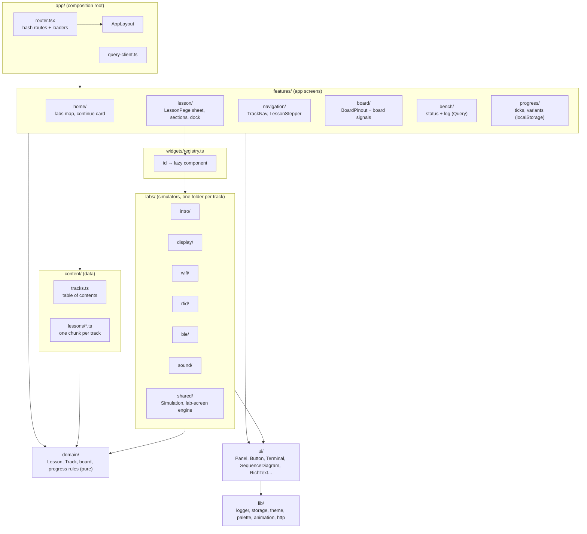
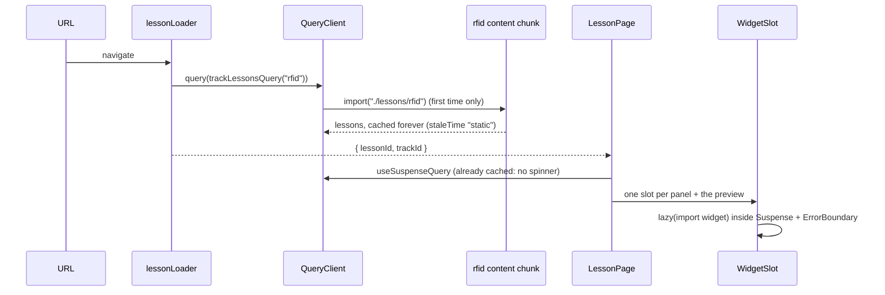
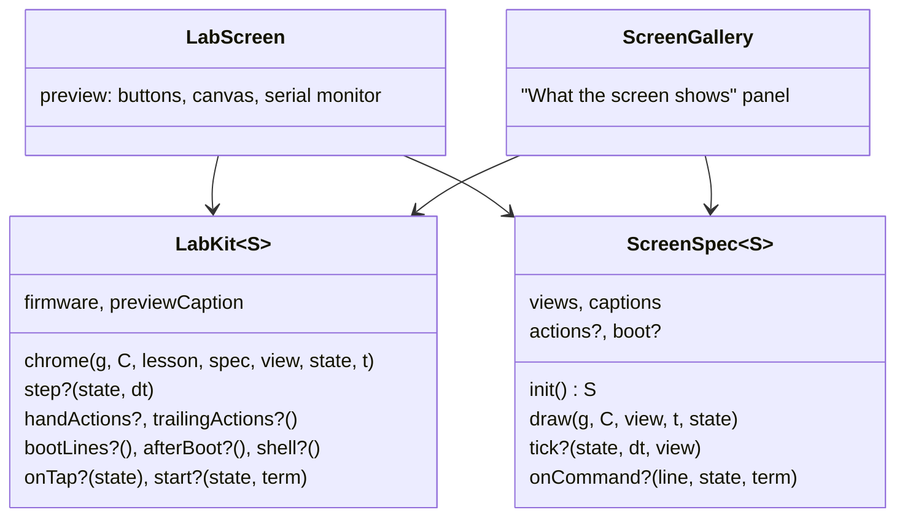
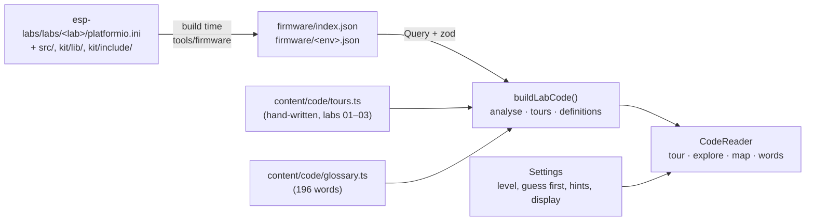
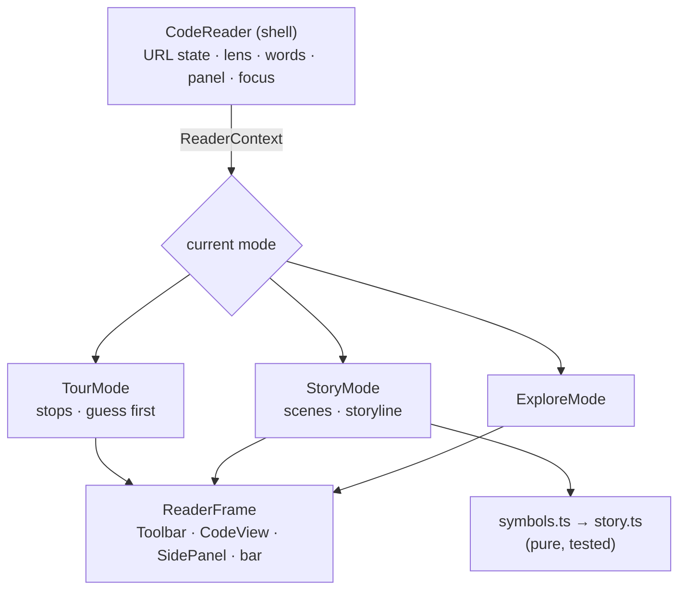
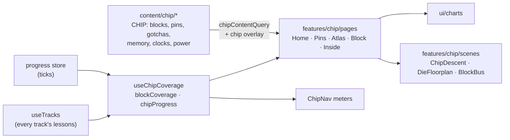

# Bench guide (React): architecture

The ESP32-S3 bench guide, rebuilt from the single 11k-line `hardware-diary/test-esp/guide/bench-guide.html` into a React 19 app. Same content, same look, now modular: lessons are data, simulators are lazily loaded widgets, bench state is fetched JSON.

## Stack

| Concern      | Choice                                                                                  | Why                                                                                          |
| ------------ | --------------------------------------------------------------------------------------- | -------------------------------------------------------------------------------------------- |
| UI           | React 19.3 + React Compiler 1.0                                                         | Automatic memoization; no hand-written `useMemo`/`useCallback`                               |
| Build        | Vite 8 (Rolldown), `base: "./"`                                                         | One static bundle that runs on any static host, in any subfolder, or as a claude.ai artifact |
| Routing      | React Router 8, data mode, `createHashRouter`                                           | Loaders prefetch content before render; hash URLs need no server rewrites                    |
| Server state | TanStack Query 5                                                                        | Bench log/status JSON and lesson content chunks: cache, dedupe, retries, refetch on focus    |
| Languages    | i18next 26 + react-i18next 17; content as JSON overlays                                 | Typed keys, lazy catalogues per language and namespace, CLDR plurals, RTL ([I18N.md](I18N.md)) |
| Validation   | zod 4                                                                                   | Env config and every fetched JSON document are parsed at the boundary                        |
| Styles       | CSS Modules + design tokens (`src/styles/tokens.css`)                                   | Scoped, zero runtime; themes are token sets                                                  |
| Quality      | TypeScript 6 strict, ESLint (react-hooks incl. compiler rules, jsx-a11y, query), Vitest | TS 6 because typescript-eslint does not support TS 7 yet                                     |

## Layers



Dependencies point down only: `domain` and `lib` know nothing about React screens; `labs/<track>` never imports another track.

## A page load, end to end



## Screens and visual language

The guide is about the labs, so every screen puts them first and everything else one tap away.

- **Top bar** (`app/AppLayout.tsx`): brand, a `BenchPill` (what is flashed on the board now, linking to the Bench page), and three sections: **Labs**, **Bench**, **Settings**. Board specs and the full bench status live on the Bench page; the colour theme and motion live in Settings.
- **Labs** (`#/`, `features/home/`), on drafting paper with PCB traces in the margins: the title, a progress readout (one tick per lab), the "continue" card (the lesson you last opened, else the first one), **Meet the board**, then one row per theme with a progress ring and one icon tile per lesson.
- **Meet the board** (`features/home/board3d/`): the DevKitC-1 in 3D (`esp32-scene.ts`: module and can, meander antenna, USB-C ports, BOOT/RST, the RGB LED walking the colour wheel, 44 header pins, silkscreen drawn from `domain/board`'s pin list). Six callouts (`parts.ts`) are tied to the model by leader lines; each lists the labs that use its part, found from the content (`partLessons`: pins, `usb`, `boot`, firmware, theme). Hover or pick a callout to light its part.
- **A lesson** (`#/lessons/:id`): the theme pills (`TrackNav`, each with a one-segment-per-lesson meter), the lesson trace (`LessonStepper`, pads on a copper trace lit up to the open lesson), the sticky **dock** (`LessonTabs`: Do the lab / Read the code, plus the lab page's `SectionNav`, plus a scroll-driven reading line), then the lesson as **one sheet** and a `NextUp` card (next lesson, or the next theme).
- **The dock while you scroll** (`LessonTabs`, `lib/scroll-chrome.ts`, `lib/use-scroll-chrome.ts`): at the top both views show with a line about each; once the dock sticks it shrinks to one button for the *other* view (the lab page keeps its section chips beside it). On the code page (`hideOnScroll`) it also slides away while you scroll down and returns the moment you scroll up, so the reader keeps the screen. A transparent sticky slot keeps the full dock's height, so nothing below jumps. The hide/return rule is a pure function (`nextScrollChrome`, tested); the hook reads the scroll at most once per frame and re-renders only when the form changes. `ui/BackToTop` (bottom right, after a screenful) uses the same hook.
- **Code on GitHub** (`LabSourceLink`, `domain/lab-source.ts`): a lesson's `-d labs/<dir>` command gives its folder in the esp-labs repo; `VITE_LABS_SOURCE_URL` sets where that is. Lessons that build no lab show no link.
- **Scroll never traps**: the reader's code and explanation panes contain only sideways overscroll, so at their top or bottom the wheel carries on to the page.
- **The sheet** (`LessonPage`): `domain/lesson-sections.ts` lists the parts a lesson actually has (goal, each explainer, wiring, commands, steps, preview); the page and the section nav both render from that list. Each `LessonSection` hangs a numbered via on a trace down the sheet's left edge; `useActiveSection` (`lib/active-section.ts`, an IntersectionObserver) lights the via and the dock chip of the part you are reading. Simulators sit on an inset "bench" (`.stage`).
- **Lesson state** (`domain/progress.ts` `lessonState`): `done` (you ticked every step), `works` (confirmed on the board), `built` (compiles, not flashed), `planned`. `StateGlyph` draws each as a different shape (tick, solid pad, ring, dashed ring), so state never depends on colour alone; `StateLegend` is the key.
- **Parts library** (`ui/parts/`, gallery at `#/parts`): every component of the bench drawn once as a small isometric illustration, `<PartIcon name="led" size={64} />` (42 parts: the DevKitC, module, USB-C, LED, RGB LED, button, header, TFT, RC522, cards, fobs, mic, speaker, cassette…). `iso.ts` is a pure isometric engine (3D points to SVG paths: boxes, cylinders, discs, rings on any face, arcs; tested); `shapes.tsx` draws with it in one light (lit top, base left face, shaded right face, ink outline, contact shadow) and colours from tokens only (`--part-*`, mixed for tones; a test checks no raw colour is painted); `drawings/*.tsx` hold the parts by theme and `registry.ts` names them. A new part = one drawing + one registry line. `content/icons.ts` gives every theme and lesson its part (the content test checks none is missing). Interface controls keep the small line icons of `ui/Icon.tsx`.
- **3D** (`ui/stage3d/`): `Stage3d` (eased orbit camera, toolbar turn/zoom/recentre, ctrl+wheel or pinch zoom that never steals page scroll, `fitWidth` to frame a scene on any canvas shape, optional idle sway, labels and leader lines written into nodes it creates itself), `useStage3d` (loads three.js in its own chunk, builds once, adds ink outlines, runs only on screen), `StageBox` and `toon()` materials. The RFID field and memory panels and the home board all use it.
- **Colour**: a theme's token (`Track.color`) is set once as `--track` on a page or card; children tint with `color-mix()` over tokens, never raw colours. Icons are one inline set (`ui/Icon.tsx`, `currentColor`).

## Content model

- `src/content/tracks.ts` is the table of contents: tracks, their colour token and their lesson ids in order.
- `src/content/lessons/<track>.ts` holds the lessons (`LessonEntry` in `src/domain/lesson.ts`). Text fields may carry `<b>`, `<i>`, `<code>` and `<span class="snd-parts|need|opt">`; `RichText` turns them into React elements from an allow-list (no `dangerouslySetInnerHTML`).
- A lesson names its explainers in `panels: [{ title, widget, intro?, view?, flows? }]` and its simulator in `preview: { widget, view? }`. Widget ids are type-checked against the registry.
- Variants (03b, W2) override any body field; the URL `?variant=` wins, then your last choice.

## Widgets

Every simulator, diagram and explainer implements one contract, `WidgetProps` (`src/widgets/types.ts`):

```ts
interface WidgetProps {
  lesson: ResolvedLesson;
  panel?: PanelSpec;
}
```

`panel` is set when the widget is a lesson panel (read `panel.view`, `panel.flows`), undefined when it is the lesson's preview (read `lesson.preview`, `lesson.previewMode`). Each track registers its widgets in `src/labs/<track>/widgets.ts` with `lazyWidget(() => import("./X"), "X")`, so a widget's code (and libraries such as three.js) downloads only when a lesson shows it. `WidgetSlot` wraps each one in `Suspense` and an `ErrorBoundary`: a broken simulator shows an error in its own panel, logs it, and the rest of the lesson keeps working.

## Simulators: React around imperative drawing

Simulators animate at 60 fps, so they follow three rules:

1. **Logic is plain TypeScript.** Firmware behaviour (command parsing, state machines, protocol maths) lives in `.ts` modules with pure functions, unit-tested without a DOM. Example: `labs/intro/led-firmware.ts`.
2. **Per-frame state is not React state.** It lives in a ref or a `Simulation` (`labs/shared/simulation.ts`) and is read by `useFrameLoop`, which pauses while the canvas is off screen. React re-renders only on discrete changes: `sim.update(change)` mutates `sim.state` and notifies, and render code reads `snapshot.state`, a fresh shallow copy per notify (so React Compiler memoization never serves a stale derivation). Never mutate the snapshot.
3. **DOM written per frame is DOM React leaves empty.** A frame loop may set attributes or `textContent` on nodes React renders without children (see `SequenceDiagram`'s live payload and `LedPreview`'s duty text), never on nodes React fills.

The lab-screen engine (`labs/shared/lab-screen/`) is the shared shape of the RFID, BLE and sound previews:



A track writes one `LabKit` (its status bar, its shared hardware model, its common buttons and commands, `subscribe` for outside state its buttons show) and one `ScreenSpec` per lab; `bindLab(kit, spec)` pairs them (a record of labs with different state types, no casts) and `LabScreen` / `ScreenGallery` do the rest. RFID R1–R6, the 03b showcase and the Wi-Fi previews have their own button gestures and status bars, so they compose `ScreenFrame`, `Terminal`, `useFrameLoop` and `useSimulation` directly instead.

3D panels build on `ui/stage3d` (see Screens above): a scene file builds meshes on a `Stage3d` and animates them in `onFrame`, from simulation state like any other simulator. Other shared pieces: `PushButton` / `HoldButton` / `BoardButton` (the board's push button: click, double-click, hold, by pointer or keyboard), `ScrollBox` (wide drawings and tables scroll inside themselves on phones), `Terminal` + `TerminalLog` (a serial monitor any code can print to), `SequenceDiagram` (steppable message flows), `useBoardRgb()` (light the RGB LED on the board drawing), `scopePalette()` / `definePalette()` (canvas colours from CSS tokens, re-read after a theme change), `useInterval`, `useReducedMotion`.

## Reading the code

Every lesson with a firmware has a second tab, **Read the code** (`#/lessons/02/code`), so a learner can understand what runs on the board, not only follow the steps. The design goal is "never intimidating": the reader fills the viewport (only its panes scroll), shows a few lines at a time, asks before it tells, and introduces at most three new C++ words per stop.



- **Where the code comes from.** `tools/firmware/vite-plugin.ts` reads the firmware checkout at `FIRMWARE_DIR` (default `../esp-labs`, a sibling checkout, one PlatformIO project per lab under `labs/`, shared code in `kit/`; `tools/firmware/layout.ts` also still reads the old single-project `test-esp` layout): each env's `build_src_filter` plus every local header reached through `#include`, lab files first in reading order. Dev serves it from memory (edits in the checkout reload the page); build emits static JSON, so the reader always shows what is actually flashed. A lesson finds its env from its command (`-e 02-led`), so variants (03b, W2) show their own code.
- **The analyser** (`src/domain/code/`, pure TypeScript, unit-tested): `tokenize` (C++ tokens per line, raw strings and block comments included), `analyze` (statements, blocks with their calls, chapters drawn as `// ---- x ----`, folds for long data and embedded web pages), `explain` (a plain sentence for every line, rule by rule from specific to general, with "go to definition" across files), `tour` (stops: hand-written ones resolved by text anchors, or automatic ones built from the code's own comments and structure; closing braces are absorbed so no line is left out).
- **Three ways to read**, each a module in `features/code/reader/modes/` registered in `READER_MODES` (`reader/modes.ts`):
  - **Tour**: file by file, a few lines at a time (hand-written or automatic stops).
  - **Story**: the program as it runs. `domain/code/symbols.ts` indexes every function with its class and namespace and every variable with its type, so `lab.begin()` in `main.cpp` resolves to `Lab::begin()` in `lab.h` and `rv::card()` to the views file; `domain/code/story.ts` walks the call graph depth first from `setup()`, then `loop()`, then the lab's functions nobody calls by name (views, commands, handlers). Short leaf helpers are mentioned instead of visited; depth and length grow with the level. Each scene shows the call path that led there (`setup() › Lab::begin() › Display::begin()`), the file it moved into, the comment above the function, and where the story can go next; the Storyline (in the Map tab) is the whole table of contents.
  - **Explore**: tap any line or word.
- **The shell** (`reader/CodeReader.tsx`) owns what the modes share (URL state `mode`, `file`, `stop`, `scene`; the line lens; the word card; the panel; focus) and hands it to the current mode through `ReaderContext`. Every mode renders a `ReaderFrame` (toolbar, code, explanation panel, bottom bar) with its own card and navigation, so modes never depend on each other. Shared pieces: `StepBar`, `LinePlayerControls` + `useLinePlayer`, `useArrowKeys`. Adding a mode = one component + one registry entry.



- **Levels and views** (`features/settings`): Beginner tours only essential stops (file header, `setup`, `loop`, commented code, and what `setup`/`loop` call) and tells a short story; Explorer tours every stop; Deep dive shows the precise story inline and follows calls down into the drivers. The **Simple view** (Settings, or the toolbar) keeps one card and one main button: no file picker, map, phrasebook tab, progress ring or pop-ups; only the lit lines' words are underlined; notes fold away. The Full view keeps every tool. A "Back to the lab" link is always the toolbar's first control.
- **Learning aids**: guess first (a quiz or "what do you think?"), line-by-line player, line lens, new-word cards and the phrasebook (words you met are remembered), the map ("setup once, loop forever" and their calls), and an understanding ring (share of the lab's own code lines you read through stops, scenes or the lens).
- **Checks**: `src/content/code/code-content.test.ts` fails when a lesson's env disappears or a hand-written tour anchor no longer matches the firmware.

## Chip pages

`#/datasheet` is a section of five lazily loaded pages about the ESP32-S3 itself (plan: [CHIP_PAGES_PLAN.md](CHIP_PAGES_PLAN.md)): the chip at a glance, pins, the peripheral atlas, one page per block, and memory, clocks and power modes. They show the curated 10% of the reference a maker needs, most important first (a headline sentence or number, three to five facts, then the chart or table, then a citation of the reference section), and they light up what the labs have used.



- **Data and rules.** `src/content/chip/` holds the typed data, each fact with a `SourceRef` (document and section of the reference, which is not shipped). `domain/chip.ts` is pure: `blockCoverage` gives each block the best state of the lessons that use it, found from the lessons themselves (pins, track, firmware, USB), so a new lesson lights its blocks without touching chip data.
- **Progress, live.** `features/chip/hooks/use-chip-coverage.ts` combines the ticks store with every track's lessons (`useTracks`); every page and the section pills read it, so ticking a step in a lab updates the chip pages at once.
- **Layout.** The layout route renders `ChipSection` (the page pills with a coverage meter each, then the page in its own `Suspense`). Pages are in `features/chip/pages/`, their parts in one folder per page (`home/`, `pins/`, `atlas/`, `block/`, `inside/`), shared cards in `ui/` (`Marker`, `FactCard`, `GotchaCard`, `BlockTile`, `SourceLink`, `RegisterStrip`, `CoverageGlyph`) and pure helpers with tests in `logic/` (atlas and pin URL params, the register bit layout, the count-up curve, gotchas for a pin).
- **Markers** are shapes, never colour alone: a copper pad (key fact), a warning triangle (gotcha), a ring with a dot (used in our labs), each with an accessible name.
- **URL state.** The atlas filters (`?family=&used=&q=`) and the picked pin and function (`?pin=&fn=`) are search params, so a filtered view is shareable and the home page's family chips link into it. An unknown block id throws a `NotFoundResponse`, which the route error boundary shows as its 404.
- **Motion.** Sections rise in once on screen (`useInView` sets `data-shown`; CSS moves only opacity and transform), headline numbers count up, tiles stagger and lift, and links inside the section use React Router's `viewTransition` (a cross-fade where the browser has the View Transitions API). Reduced motion and Calm show the end states.

### The reference reader (optional)

A chip page's citation chip can open the cited section of Espressif's reference in a reader (`features/reference/`): a modal side sheet (bottom sheet on phones) whose open section lives in the URL (`?ref=T26.2`, `?ref=C2.3.5`), so it is shareable and Back closes it. The reference is Espressif's copyrighted text: it is **never committed or bundled by default**.

- **Build time** (`tools/reference/`, pure and tested): splits `REFERENCE_FILE` (default `docs-llm/esp32-s3/ESP32-S3_REFERENCE.md`) by its numbered headings, parses each section into a typed AST (`ast.ts`; no raw HTML), tags numbers with units, register and field names, pins, blocks, warnings and cross-references, and picks a visual for each table from its shape (`classify.ts`: range bars, compare bars, address map, pin grid, timeline). Dev serves `reference/index.json`, `reference/sections/<id>.json` and the figures from memory; a build emits them, with only the figures the sections use.
- **Enable it**: put the reference (and its `images/` folder) at `REFERENCE_FILE` (see `.env.example`). Without it nothing is emitted, `VITE_REFERENCE_URL` is set to `""`, and citations stay plain citations with a link to Espressif's official document (`features/reference/docs-map.ts`). Do not deploy a build made with the reference unless you may redistribute it.

## State

| State                               | Where                                                                               | Why                                                      |
| ----------------------------------- | ----------------------------------------------------------------------------------- | -------------------------------------------------------- |
| Lesson content                      | Query cache, `staleTime: "static"`                                                  | Bundled, never changes while the page is open            |
| Bench status + log                  | Query cache, fresh for 60 s, refetched on focus                                     | Changes when Claude records a command; no rebuild needed |
| Ticks, last lesson, variants, theme | `createPersistentStore` (localStorage + `useSyncExternalStore`, synced across tabs) | Yours, in this browser only                              |
| Section you are reading             | `useActiveSection` (IntersectionObserver), lesson route                              | Lights the sheet's via and the dock's chip               |
| Code settings, motion, code read, words met | Same stores; settings are re-validated (`normalizeSettings`) on every read | Yours; a stale value falls back to defaults |
| Lab code + phrasebook | Query cache, `staleTime: "static"`; analysis cached per document | Bundled at build time |
| Language                            | `esp-locale` store ("auto" follows the browser) → i18next → `<html lang dir>`     | Yours; content queries are keyed by language             |
| Variant, log filter, chip filters   | URL search params                                                                   | Shareable                                                |
| Simulator internals                 | refs / `Simulation`                                                                 | 60 fps, not rendering state                              |

## Configuration, logging, errors

- `src/config/env.ts` parses `import.meta.env` with zod at start-up. `VITE_BENCH_DATA_URL` points at the bench JSON (default `./data/`), `VITE_FIRMWARE_URL` at the bundled lab code (default `./firmware/`), `VITE_LOG_LEVEL` filters logs. `FIRMWARE_DIR` (build time only) is the PlatformIO project to read. See `.env.example`.
- `src/lib/logger.ts` emits structured events (`level, scope, message, data, at`) to pluggable sinks (console by default). Query failures, route errors, render errors (`createRoot` hooks), widget crashes, uncaught errors and unhandled rejections are all logged once, centrally.
- Errors are contained at three levels: route `ErrorBoundary` (404, failed loaders), per-widget `ErrorBoundary`, and a simulator's own draw guard (a failing view draws its error on the simulated screen).

## Updating the bench data

Append an entry to `public/data/bench-log.json` (shape: `LogEntrySchema` in `src/features/bench/schema.ts`) and update `public/data/bench-status.json`. A running guide picks it up on the next focus; no rebuild.

## Adding things

- **Text**: never inline. Interface text goes in `src/locales/en/<namespace>.json` and through `t()`; content text is picked up by `pnpm i18n:extract`. Rules, RTL and adding a language: [I18N.md](I18N.md).

- **A lesson**: add it to `src/content/lessons/<track>.ts` and its id to the track's `lessonIds` in `tracks.ts`.
- **A track**: an entry in `TRACKS`, a lessons file, a loader in `content/queries.ts`, a `labs/<track>/widgets.ts` spread into `widgets/registry.ts`, and a colour token.
- **A widget**: a component taking `WidgetProps` in `labs/<track>/`, one line in that track's `widgets.ts`, then reference its id from a lesson.
- **A theme**: a token block in `tokens.css` and an entry in `THEMES` (`src/lib/theme.ts`).
- **A hand-written code tour**: a `LabTourSpec` in `src/content/code/tours.ts` (stops anchored by text, `essential` for the Beginner tour, optional `quiz`); the content test checks its anchors.
- **A phrasebook word**: an entry in `src/content/code/glossary.ts` (`match` by word, call, operator or directive; first entry wins a key).
